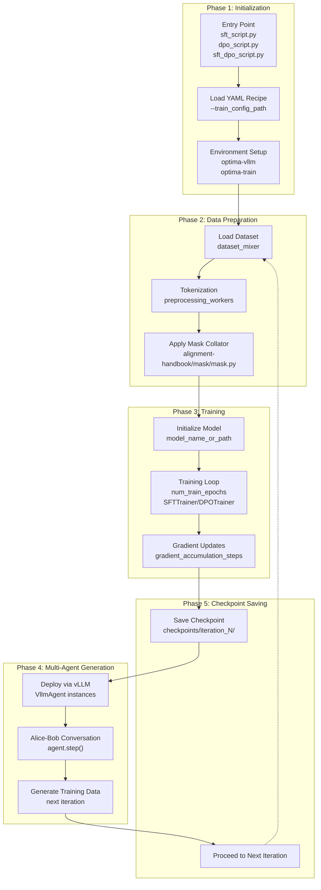
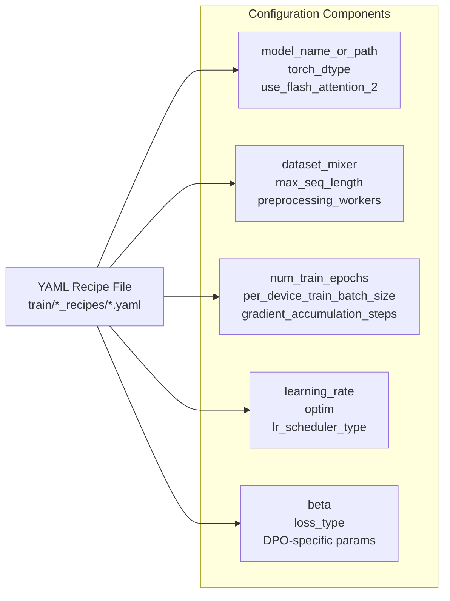
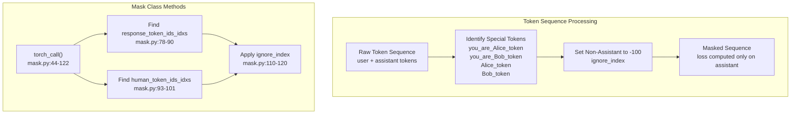
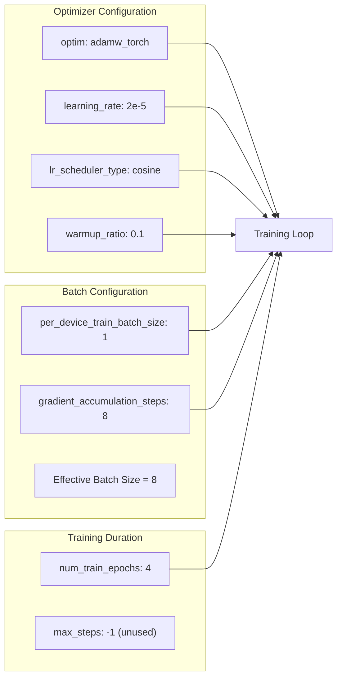
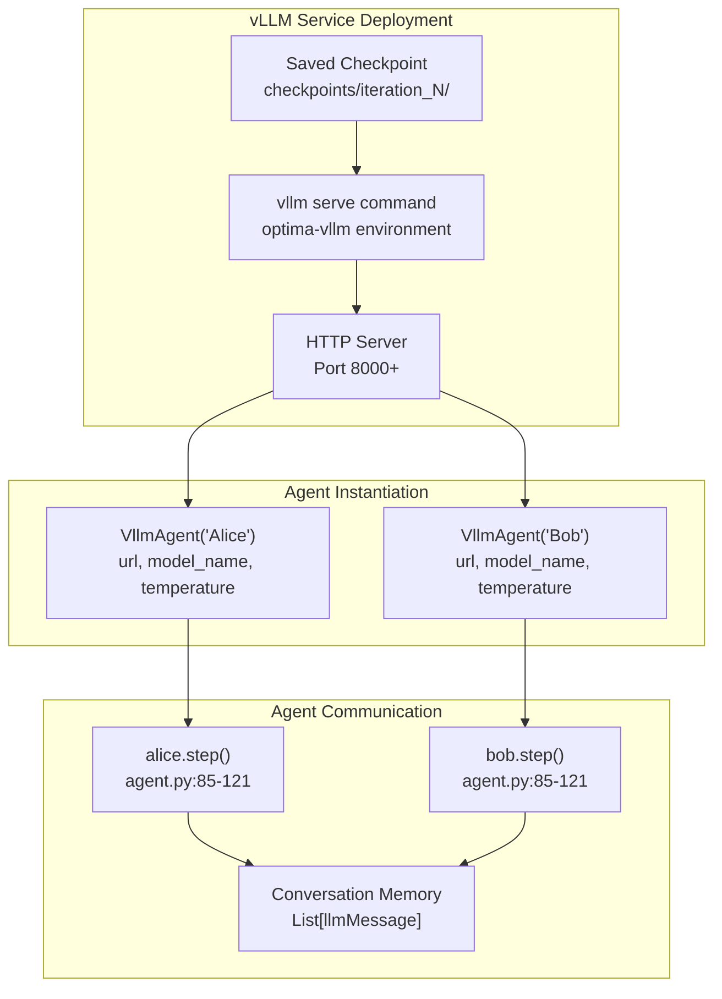
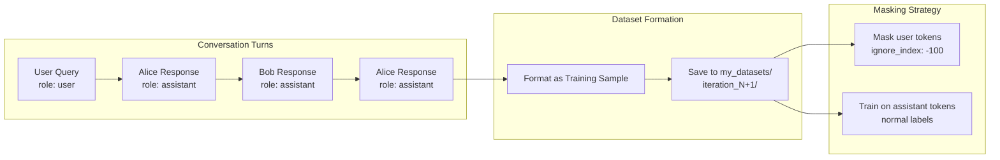
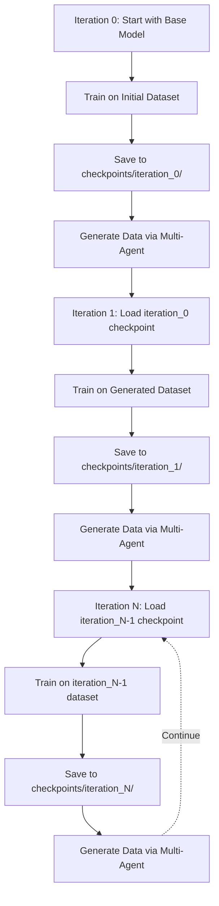

<!-- source: DeepWiki mcp.deepwiki.com · repo thunlp/Optima · page 4.2 Training Pipeline Flow · fetched 2026-11-02 -->

# Training Pipeline Flow

<details>
<summary>Relevant source files</summary>

The following files were used as context for generating this wiki page:

- [README.md](README.md)
- [agent/agent.py](agent/agent.py)
- [alignment-handbook/mask/mask.py](alignment-handbook/mask/mask.py)

</details>


## Purpose and Scope

This page provides a detailed technical walkthrough of Optima's training pipeline, from the moment a training script is invoked through data preparation, model training, multi-agent data generation, and checkpoint saving. It explains the step-by-step execution flow, highlighting key code components and their interactions.

For information about the dual environment architecture that supports this pipeline, see [Dual Environment Design](#4.1). For details on specific training script command-line arguments and parameters, see [Training Scripts Reference](#6.1). For information on configuration files that drive the pipeline, see [Recipe Configuration System](#6.2).

---

## Training Pipeline Overview

The training pipeline executes in five main phases across multiple iterations. Each iteration refines the model by training on data generated from the previous iteration's model, creating a self-improvement feedback loop.



**Sources:** [README.md:58-92](), [alignment-handbook/mask/mask.py:1-123](), [agent/agent.py:57-147]()

---

## Phase 1: Initialization and Configuration

### Entry Point Selection

Training begins by invoking one of three main scripts, each implementing a different training methodology:

| Script | Purpose | Training Method |
|--------|---------|----------------|
| `sft_script.py` | Supervised fine-tuning only | iSFT (iterative SFT) |
| `dpo_script.py` | Preference optimization only | iDPO (iterative DPO) |
| `sft_dpo_script.py` | Combined approach | iSFT-DPO (SFT followed by DPO) |

Each script accepts three critical command-line arguments:
- `--train_config_path`: Path to the YAML recipe file (e.g., `train/sft_recipes/arc.yaml`)
- `--vllm_env`: Conda environment name for vLLM model serving (default: `optima-vllm`)
- `--alignment_env`: Conda environment name for training (default: `optima-train`)

**Sources:** [README.md:58-92]()

### Configuration Loading

The pipeline loads configuration from hierarchical YAML recipe files that specify:



These configurations drive all subsequent pipeline behavior. See [Recipe Configuration System](#6.2) for detailed parameter explanations.

**Sources:** [README.md:58-92]()

### Environment Activation

The pipeline operates across two isolated conda environments:

1. **optima-vllm**: Used for deploying models via vLLM HTTP server during multi-agent data generation
2. **optima-train**: Used for the actual training process with alignment-handbook

This separation prevents dependency conflicts and allows efficient model serving during training. See [Dual Environment Design](#4.1) for architectural rationale.

**Sources:** [README.md:22-55]()

---

## Phase 2: Data Preparation

### Dataset Loading and Mixing

The pipeline loads datasets specified in the `dataset_mixer` configuration parameter. Multiple datasets can be combined with specified proportions:

```yaml
dataset_mixer:
  my_datasets/arc_sft/iteration_0: 1.0
```

Each dataset follows a specific structure in the `my_datasets/` directory. For details on dataset formats and custom dataset preparation, see [Dataset Structure and Preparation](#10.1).

### Tokenization with Parallel Processing

Data preprocessing occurs with configurable parallelism via the `preprocessing_workers` parameter (typically set to 8). The tokenizer processes conversation turns into token sequences, applying the appropriate chat template format.

**Sources:** [README.md:58-92]()

### Mask Data Collator Application

The `Mask` class from [alignment-handbook/mask/mask.py:14-122]() implements completion-only language modeling by masking non-assistant tokens. This ensures the training loss is computed only on assistant responses, not on user prompts or system messages.



The `Mask` class dynamically identifies which agent (Alice or Bob) is the current assistant based on system prompt tokens [alignment-handbook/mask/mask.py:55-76](), then masks all tokens except those following the assistant's response marker [alignment-handbook/mask/mask.py:78-122]().

**Key token identifiers:**
- `you_are_Alice_token = [128006, 9125, 128007, 271, 2675, 527, 30505]` [alignment-handbook/mask/mask.py:8]()
- `you_are_Bob_token = [128006, 9125, 128007, 271, 2675, 527, 14596]` [alignment-handbook/mask/mask.py:9]()
- `Alice_token = [128006, 78191, 128007, 271, 62786, 25]` [alignment-handbook/mask/mask.py:10]()
- `Bob_token = [128006, 78191, 128007, 271, 33488, 25]` [alignment-handbook/mask/mask.py:11]()

**Sources:** [alignment-handbook/mask/mask.py:1-123]()

---

## Phase 3: Model Training

### Model Initialization

The pipeline initializes the model from either:
- A pretrained checkpoint (iteration 0): Base model like `Meta-Llama-3-8B-Instruct`
- A previous iteration checkpoint (iteration N > 0): `checkpoints/{dataset}_sft/iteration_{N-1}`

The model is loaded with optimizations specified in the recipe:
- `torch_dtype: bfloat16` for memory efficiency
- `use_flash_attention_2: true` for faster attention computation
- `attn_implementation: "flash_attention_2"`

**Sources:** [README.md:58-92]()

### Training Loop Execution

The training loop differs based on the script invoked:

#### SFT Training (sft_script.py)

Supervised fine-tuning uses `SFTTrainer` from alignment-handbook. The trainer:
1. Loads the prepared dataset with masked labels
2. Runs training for `num_train_epochs` (typically 4)
3. Updates model parameters based on completion-only loss
4. Accumulates gradients according to `gradient_accumulation_steps`

#### DPO Training (dpo_script.py)

Direct preference optimization uses `DPOTrainer` with preference pairs. Key difference:
- Requires preference data with `chosen` and `rejected` completions
- Uses the `beta` parameter (typically 0.1-0.2) to control strength of preference alignment
- Optimizes based on preference ranking loss rather than standard cross-entropy

#### Combined SFT-DPO Training (sft_dpo_script.py)

Executes both training phases sequentially:
1. SFT phase trains on supervised data
2. Saves intermediate checkpoint
3. DPO phase fine-tunes with preference optimization
4. Saves final checkpoint

**Sources:** [README.md:58-92]()

### Training Configuration



**Sources:** [README.md:58-92]()

---

## Phase 4: Multi-Agent Data Generation

After training completes, the pipeline generates training data for the next iteration by deploying the newly trained model and running multi-agent conversations.

### VllmAgent Deployment



Each `VllmAgent` instance [agent/agent.py:57-147]() maintains:
- `url`: HTTP endpoint for vLLM service
- `my_model_name`: Model identifier for the deployed checkpoint
- `name`: Agent identifier ("Alice" or "Bob")
- `temperature`: Sampling temperature for response generation
- `memory`: List of `llmMessage` objects representing conversation history

**Sources:** [agent/agent.py:57-147]()

### Conversation Flow and Data Generation

The `VllmAgent.step()` method [agent/agent.py:85-121]() orchestrates each turn of the conversation:

1. **Prepare Messages**: Convert `memory` list to message format [agent/agent.py:86-89]()
2. **Apply Chat Template**: Use specialized template with agent-specific tokens [agent/agent.py:102]()
3. **HTTP POST Request**: Send to vLLM server with headers and JSON payload [agent/agent.py:109]()
4. **Response Processing**: Extract content from JSON response [agent/agent.py:112]()
5. **Prefix Handling**: Ensure response starts with agent name [agent/agent.py:113-114]()
6. **Memory Update**: Append response to conversation history [agent/agent.py:119]()

#### Chat Template with Agent Tokens

The chat template dynamically inserts agent prefixes based on context:

```python
"chat_template_kwargs": {
    "is_alice": (self.name == "Alice") and (not is_iteration_0),
    "is_bob": (self.name == "Bob") and (not is_iteration_0),
}
```

This ensures that:
- In iteration 0: Agents follow explicit prompts without automatic prefixes
- In iteration N > 0: Agents automatically prefix responses with "Alice:" or "Bob:"

**Sources:** [agent/agent.py:85-121]()

### Training Data Creation from Conversations

The multi-agent conversations generate structured training data:



The generated conversations become the training dataset for the next iteration, with the `Mask` class ensuring only assistant responses contribute to loss.

**Sources:** [agent/agent.py:57-147](), [alignment-handbook/mask/mask.py:14-122]()

---

## Phase 5: Checkpoint Management and Iteration Progression

### Checkpoint Saving

After training completes, the model checkpoint is saved to a structured directory:

```
checkpoints/
└── {dataset}_{method}/
    └── iteration_{N}/
        ├── config.json
        ├── model.safetensors
        ├── tokenizer_config.json
        ├── special_tokens_map.json
        └── ...
```

Where:
- `{dataset}`: Dataset identifier (e.g., `arc`, `cbt`, `hotpot_qa`)
- `{method}`: Training method (`sft`, `dpo`, or `sft_dpo`)
- `{N}`: Iteration number (0, 1, 2, ...)

**Sources:** [README.md:100-110]()

### Iteration Loop Progression



Each iteration uses the model from the previous iteration to:
1. Generate improved training data via multi-agent conversations
2. Train a new model on this generated data
3. Save the improved checkpoint
4. Repeat the cycle

This iterative refinement process progressively optimizes both communication efficiency and response accuracy.

**Sources:** [README.md:58-92]()

---

## Complete Pipeline Flow: Code-to-Execution Mapping

This diagram maps the complete execution flow with specific code references:

```mermaid
graph TB
    CLI["Command Line Invocation<br/>python sft_script.py<br/>--train_config_path<br/>--vllm_env<br/>--alignment_env"]
    
    LoadYAML["Load Configuration<br/>YAML recipe parsing"]
    
    ActivateEnv["Activate optima-train<br/>conda activate"]
    
    LoadDataset["Load from dataset_mixer<br/>my_datasets/ directory"]
    
    Preprocess["Tokenization & Preprocessing<br/>preprocessing_workers: 8"]
    
    MaskInit["Initialize Mask Collator<br/>mask.py:33-42<br/>ignore_index: -100"]
    
    MaskProcess["Process Batch<br/>mask.torch_call()<br/>mask.py:44-122"]
    
    InitModel["Load Model<br/>model_name_or_path<br/>torch_dtype: bfloat16"]
    
    TrainerInit["Initialize Trainer<br/>SFTTrainer/DPOTrainer"]
    
    TrainEpochs["Training Loop<br/>num_train_epochs: 4<br/>gradient_accumulation: 8"]
    
    SaveModel["Save Checkpoint<br/>checkpoints/iteration_N/"]
    
    DeployVllm["Deploy via vLLM<br/>conda activate optima-vllm<br/>vllm serve"]
    
    CreateAgents["Instantiate Agents<br/>VllmAgent.__init__()<br/>agent.py:64-71"]
    
    InitPrompt["Initialize System Prompts<br/>agent.init_system_prompt()<br/>agent.py:73-75"]
    
    Conversation["Multi-Agent Conversation<br/>alice.step() / bob.step()<br/>agent.py:85-121"]
    
    HTTPPost["HTTP POST to vLLM<br/>requests.post(url, json)<br/>agent.py:109"]
    
    UpdateMemory["Update Conversation Memory<br/>agent.add_memory()<br/>agent.py:77-78"]
    
    GenDataset["Generate Training Dataset<br/>my_datasets/iteration_N+1/"]
    
    NextIteration["Proceed to Iteration N+1"]
    
    CLI --> LoadYAML
    LoadYAML --> ActivateEnv
    ActivateEnv --> LoadDataset
    LoadDataset --> Preprocess
    Preprocess --> MaskInit
    MaskInit --> MaskProcess
    MaskProcess --> InitModel
    InitModel --> TrainerInit
    TrainerInit --> TrainEpochs
    TrainEpochs --> SaveModel
    SaveModel --> DeployVllm
    DeployVllm --> CreateAgents
    CreateAgents --> InitPrompt
    InitPrompt --> Conversation
    Conversation --> HTTPPost
    HTTPPost --> UpdateMemory
    UpdateMemory --> GenDataset
    GenDataset --> NextIteration
    NextIteration -.-> LoadDataset
```



**Sources:** [README.md:58-92](), [agent/agent.py:57-147](), [alignment-handbook/mask/mask.py:1-123]()

---

## Pipeline Execution Summary

The training pipeline executes in a continuous loop where:

1. **Entry**: User invokes training script with YAML configuration
2. **Initialization**: Configuration loaded, environments activated
3. **Data Preparation**: Datasets tokenized, masks applied for completion-only training
4. **Training**: Model trained using SFT, DPO, or combined methodology
5. **Generation**: Trained model deployed via vLLM, agents generate conversational data
6. **Iteration**: Generated data becomes training input for next iteration

This pipeline implements Optima's core innovation: using models to generate their own training data through multi-agent interactions, creating a self-improvement feedback loop that optimizes both communication efficiency and task effectiveness.

For details on running inference to evaluate trained checkpoints, see [Inference Pipeline](#4.3). For information on the agent system architecture, see [Multi-Agent System Architecture](#3.2).

---

