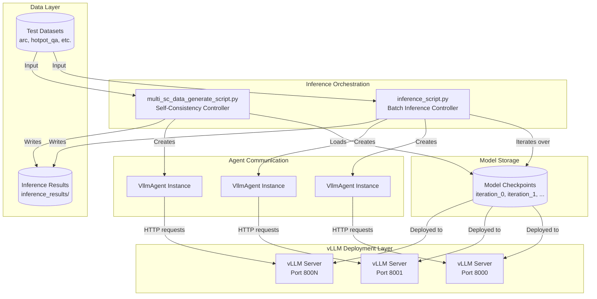
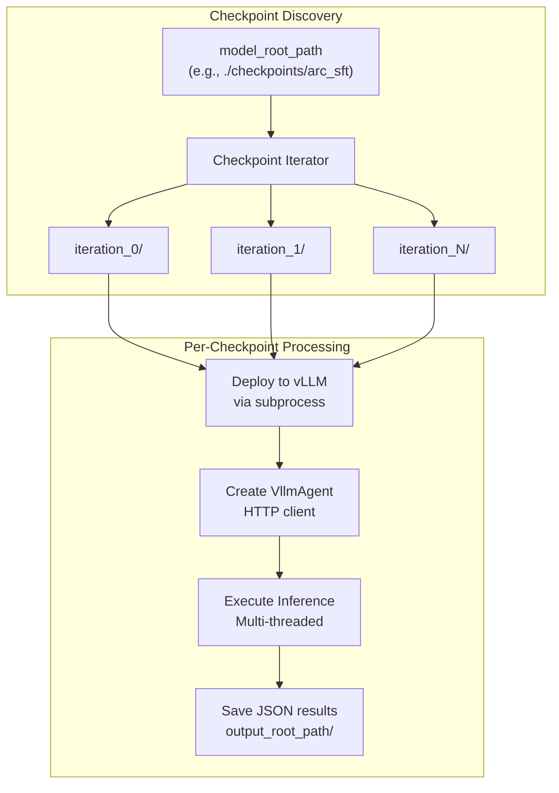
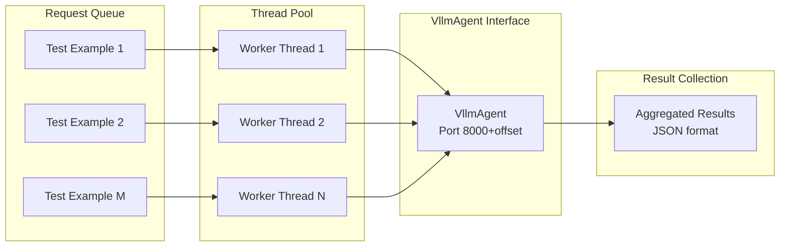
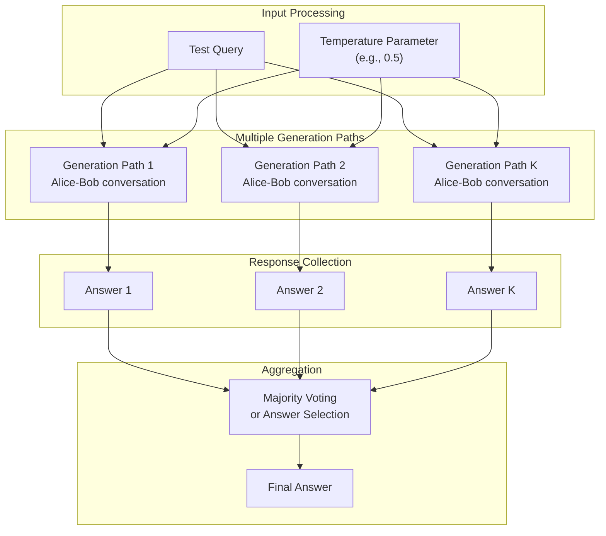
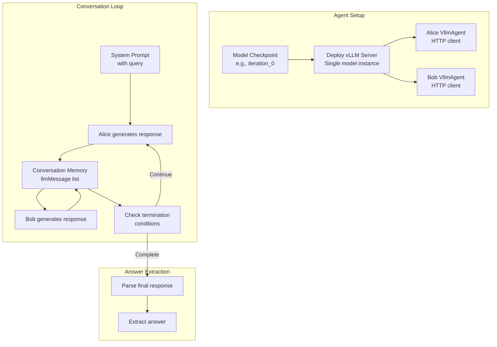
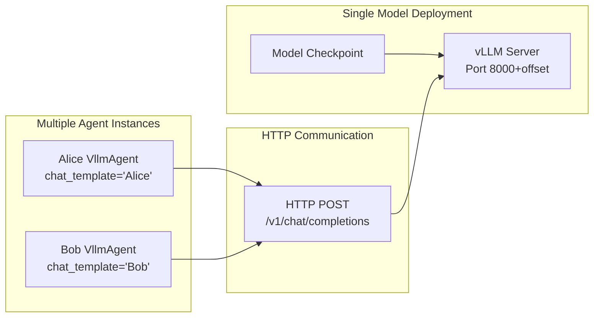
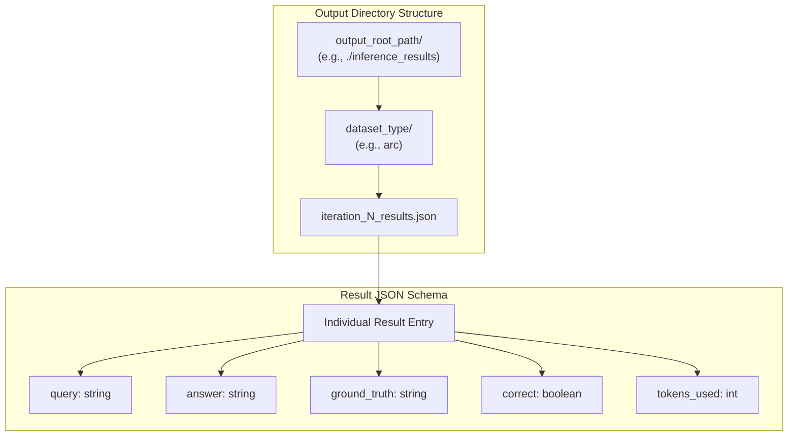
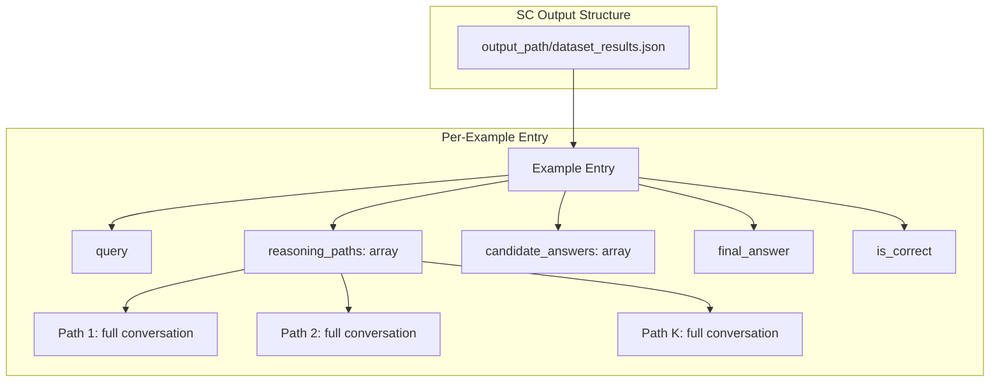
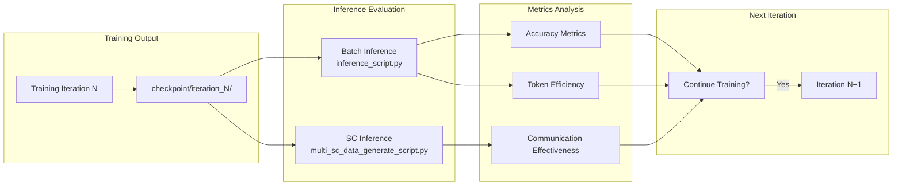

<!-- source: DeepWiki mcp.deepwiki.com · repo thunlp/Optima · page 4.3 Inference Pipeline · fetched 2026-11-02 -->

# Inference Pipeline

<details>
<summary>Relevant source files</summary>

The following files were used as context for generating this wiki page:

- [README.md](README.md)
- [README_revise.md](README_revise.md)

</details>


## Purpose and Scope

This page describes the technical architecture of Optima's inference pipeline, including batch inference across multiple model checkpoints and multi-agent self-consistency mechanisms. For practical usage instructions, see [Running Inference](#8.1). For conceptual explanation of self-consistency, see [Multi-Agent Self-Consistency](#8.2). For agent communication patterns during inference, see [VllmAgent HTTP Communication](#5.2).

## Overview

Optima's inference pipeline is designed to evaluate trained models across all checkpoint iterations systematically. The architecture supports two primary inference modes:

1. **Batch Inference**: Evaluates all model checkpoints from a training run sequentially on test datasets
2. **Multi-Agent Self-Consistency**: Generates multiple reasoning paths with temperature sampling to improve robustness

Both modes leverage the dual-environment architecture, deploying models via vLLM in the `optima-vllm` environment while orchestrating inference from the main execution environment.



**Sources:** [README.md:94-137](), system architecture diagrams

## Batch Inference Architecture

The batch inference system, implemented in `inference_script.py`, evaluates all model checkpoints from a training run on specified test datasets. This enables systematic comparison of model performance across training iterations.

### Model Checkpoint Iteration

The batch inference controller discovers all checkpoint directories within a specified root path and processes them sequentially. Each checkpoint directory follows the naming convention `iteration_N`, where N is the iteration number.



**Sources:** [README.md:94-110]()

### vLLM Deployment Strategy

Each checkpoint is deployed as a separate vLLM server instance on a unique port. The deployment uses subprocess calls to activate the `optima-vllm` conda environment and launch the vLLM OpenAI-compatible server.

| Component | Description |
|-----------|-------------|
| Base Port | Starting port number (e.g., 8000) specified via `--port` |
| Device Allocation | GPU device index specified via `--device` |
| Model Path | Absolute path to checkpoint directory |
| Tokenizer Path | Path to pretrained tokenizer (separate from model) |
| Environment | `optima-vllm` conda environment activated via subprocess |

The deployment command structure follows this pattern:

```
conda run -n {vllm_env} python -m vllm.entrypoints.openai.api_server \
    --model {checkpoint_path} \
    --tokenizer {tokenizer_path} \
    --port {port} \
    --tensor-parallel-size {gpu_count}
```

**Sources:** [README.md:100-109]()

### Thread-Based Parallelization

Inference processing uses Python's threading module to parallelize requests across test dataset examples. The `num_thread` parameter controls the degree of parallelism.



Each worker thread:
1. Retrieves a test example from the queue
2. Formats the input for the agent
3. Makes HTTP request via `VllmAgent`
4. Collects response and extracts answer
5. Stores result in thread-safe collection

**Sources:** [README.md:107]()

### Dataset Type Routing

The inference script supports multiple dataset types, each with specialized processing logic:

| Dataset Type | Description |
|--------------|-------------|
| `arc` | AI2 Reasoning Challenge multiple-choice questions |
| `hotpot_qa` | Multi-hop question answering |
| `mwh_qa` | Multi-hop question answering variant |
| `trivial_qa` | Trivia question answering |
| `cbt` | Children's Book Test |
| `math` | Mathematical reasoning problems |
| `gsm8k` | Grade school math problems |
| `mmlu` | Massive Multitask Language Understanding |

The `--dataset_type` parameter determines which dataset loader and evaluation logic is applied.

**Sources:** [README.md:104](), [README.md:95]()

## Multi-Agent Self-Consistency Architecture

The multi-agent self-consistency system, implemented in `multi_sc_data_generate_script.py`, generates multiple reasoning paths for each query using temperature-based sampling. This improves inference robustness by aggregating diverse responses.

### Temperature-Based Sampling

Unlike batch inference which uses greedy decoding (temperature=0), self-consistency inference uses non-zero temperature to generate diverse reasoning paths:



The temperature parameter controls sampling randomness:
- Higher temperature (e.g., 0.5-0.8) produces more diverse outputs
- Lower temperature (e.g., 0.1-0.3) produces more conservative variations
- Temperature = 0 would revert to greedy decoding (not used for self-consistency)

**Sources:** [README.md:135](), [README.md:114]()

### Multi-Agent Conversation Pattern

Self-consistency inference uses the same multi-agent conversation pattern as training data generation, with Alice and Bob agents exchanging messages:



Both Alice and Bob agents communicate with the same deployed model instance but use different chat templates (with Alice/Bob tokens) to differentiate their roles.

**Sources:** [README.md:127-137](), system architecture diagrams

## VllmAgent Deployment Pattern

During inference, `VllmAgent` instances serve as HTTP clients that communicate with vLLM-deployed models. The deployment pattern differs from training:

### Inference-Time Agent Configuration



Key differences from training-time deployment:
- **Single Model**: Both agents communicate with the same model checkpoint
- **Role Differentiation**: Chat templates distinguish Alice from Bob
- **Stateless**: Each request is independent; conversation memory managed by orchestrator
- **HTTP-Only**: No direct model access; all communication via OpenAI-compatible API

**Sources:** System architecture diagrams, [README.md:127-137]()

### Port Management for Concurrent Deployments

When running batch inference, multiple vLLM servers may be deployed concurrently (though typically models are deployed sequentially to conserve GPU memory). The port allocation system ensures no conflicts:

| Parameter | Purpose |
|-----------|---------|
| `--port` | Base port number (e.g., 8000) |
| `--device` | Base GPU device index |
| Port Offset | Calculated based on checkpoint index or parallel deployment strategy |

The inference script calculates unique ports for each deployment to prevent binding conflicts.

**Sources:** [README.md:106](), [README.md:119]()

## Output Pipeline

Inference results are written to structured JSON files in the output directory specified by `--output_root_path` (for batch inference) or `--output_path` (for self-consistency).

### Batch Inference Output Structure



Each result file contains an array of inference results, one per test example, enabling subsequent analysis of accuracy and token efficiency.

**Sources:** [README.md:108]()

### Self-Consistency Output Format

Self-consistency inference produces richer output that includes all generated paths:



This format preserves all reasoning paths for analysis of consistency and diversity.

**Sources:** [README.md:134]()

## Command-Line Interface

Both inference scripts expose command-line interfaces for configuration:

### inference_script.py Parameters

| Parameter | Type | Description |
|-----------|------|-------------|
| `--model_root_path` | str | Root directory containing checkpoint iterations |
| `--tokenizer_path` | str | Path to pretrained tokenizer |
| `--dataset_type` | str | Dataset identifier (arc, hotpot_qa, etc.) |
| `--device` | int | GPU device index for deployment |
| `--port` | int | Base port number for vLLM servers |
| `--num_thread` | int | Number of worker threads for parallel inference |
| `--output_root_path` | str | Root directory for output files |
| `--vllm_env` | str | Conda environment name for vLLM deployment |

### multi_sc_data_generate_script.py Parameters

| Parameter | Type | Description |
|-----------|------|-------------|
| `--model_path` | str | Path to specific model checkpoint |
| `--tokenizer_path` | str | Path to tokenizer |
| `--device` | int | GPU device index |
| `--port` | int | Port number for vLLM server |
| `--dataset_type` | str | Dataset identifier |
| `--num_thread` | int | Number of worker threads |
| `--output_path` | str | Output directory path |
| `--temperature` | float | Sampling temperature for diversity |
| `--vllm_env` | str | Conda environment for vLLM |

**Sources:** [README.md:101-109](), [README.md:127-136]()

## Integration with Training Pipeline

The inference pipeline completes the iterative training cycle by evaluating models produced by each training iteration:



The evaluation results inform decisions about whether to continue training and what hyperparameters to adjust in subsequent iterations.

**Sources:** System architecture diagrams, [README.md:94-137]()

---

