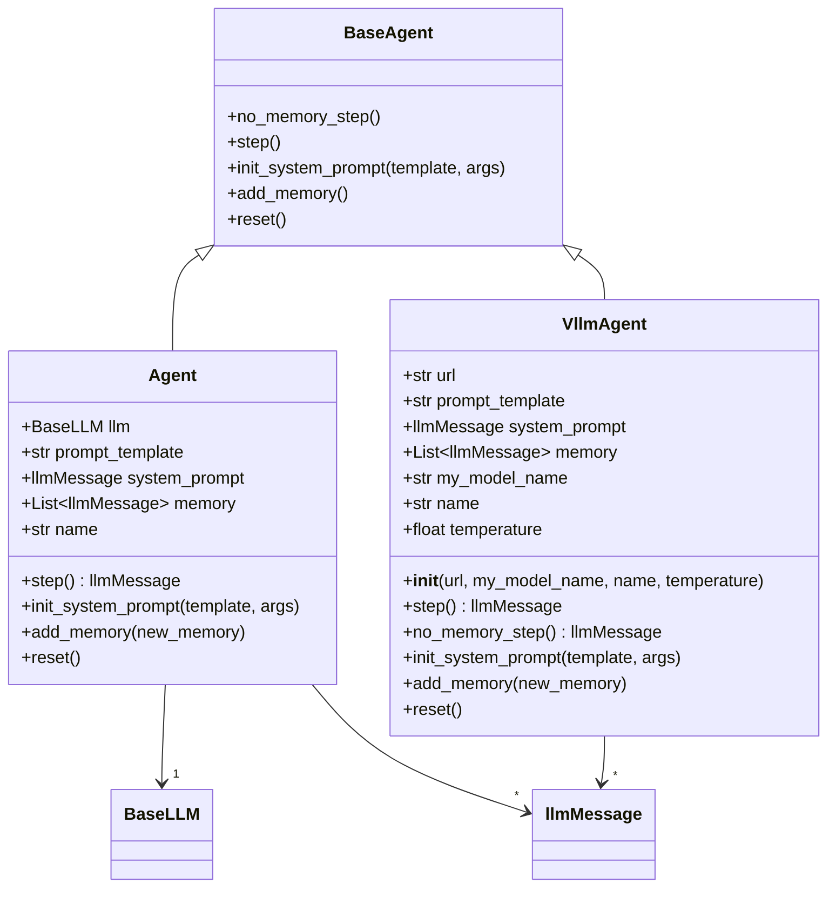
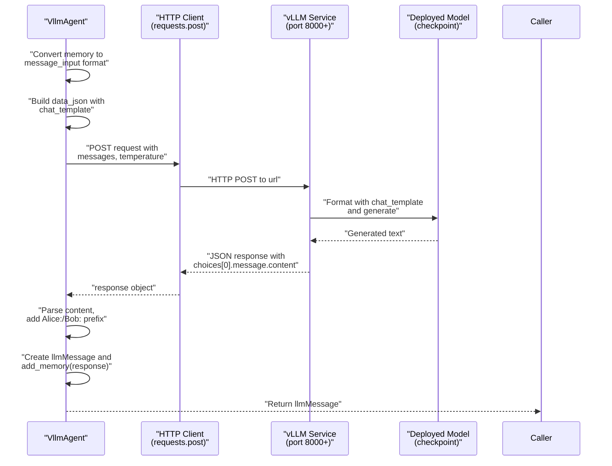
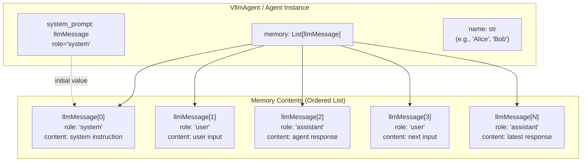
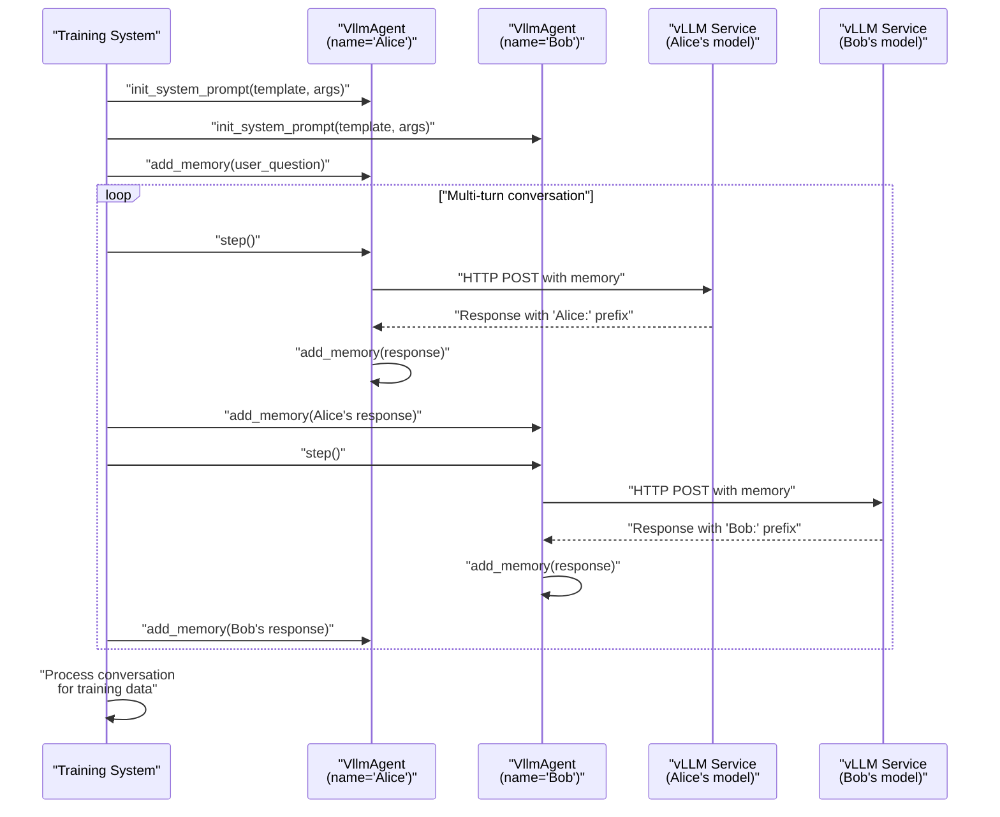
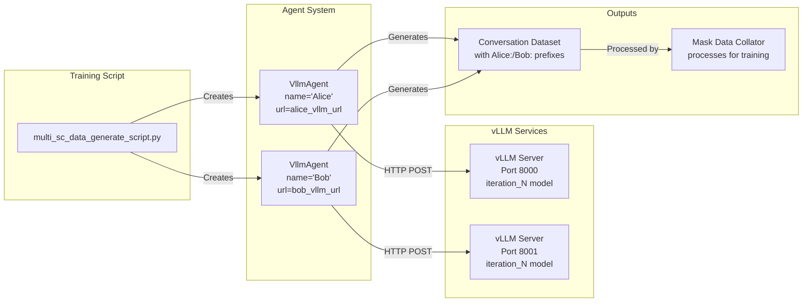

<!-- source: DeepWiki mcp.deepwiki.com · repo thunlp/Optima · page 5 Agent System · fetched 2026-11-02 -->

# Agent System

<details>
<summary>Relevant source files</summary>

The following files were used as context for generating this wiki page:

- [agent/__init__.py](agent/__init__.py)
- [agent/agent.py](agent/agent.py)

</details>


## Purpose and Scope

The Agent System provides the core infrastructure for multi-agent interactions in Optima. It defines a class hierarchy that enables agents to communicate, maintain conversation history, and generate responses either through internal language models or via HTTP communication with vLLM services. This system is essential for the iterative training process, where agent-agent conversations generate training data for subsequent iterations.

This page covers the agent class architecture, HTTP communication protocols, and memory management. For details on how agents are used in training data generation, see [Multi-Agent System Architecture](#3.2). For information on the vLLM deployment that agents communicate with, see [Dual Environment Design](#4.1).

---

## Agent Class Hierarchy

The agent system defines three classes arranged in an inheritance hierarchy, each serving different deployment scenarios.

### Class Structure Diagram



**Sources:** [agent/agent.py:9-147]()

### BaseAgent

`BaseAgent` [agent/agent.py:9-25]() serves as an abstract interface defining the contract that all agent implementations must follow. It declares five core methods without implementation:

| Method | Purpose |
|--------|---------|
| `no_memory_step()` | Generate response without updating conversation memory |
| `step()` | Generate response and update conversation memory |
| `init_system_prompt(template, args)` | Initialize the agent's system prompt from a template |
| `add_memory()` | Add a message to conversation history |
| `reset()` | Clear conversation history and reset agent state |

**Sources:** [agent/agent.py:9-25]()

### Agent

`Agent` [agent/agent.py:27-55]() implements `BaseAgent` using an internal `BaseLLM` instance for generation. This class is designed for scenarios where the language model is loaded directly in memory.

**Key Attributes:**
- `llm`: A `BaseLLM` instance that performs text generation
- `memory`: List of `llmMessage` objects representing conversation history
- `system_prompt`: Initial system-level instruction as an `llmMessage`
- `name`: Agent identifier (e.g., "Alice", "Bob")
- `prompt_template`: Template string for system prompt construction

**Key Methods:**

- **`step()`** [agent/agent.py:34-43](): Converts memory to message format, calls `llm.generate_response()`, adds response to memory, and returns the response as an `llmMessage`.

- **`init_system_prompt(template, args)`** [agent/agent.py:45-47](): Uses Python's `string.Template` to substitute variables in the template and appends the resulting system prompt to memory.

- **`add_memory(new_memory)`** [agent/agent.py:49-50](): Appends an `llmMessage` to the memory list.

- **`reset()`** [agent/agent.py:52-54](): Clears memory and reinitializes system prompt from the template.

**Sources:** [agent/agent.py:27-55]()

### VllmAgent

`VllmAgent` [agent/agent.py:57-147]() is the primary agent implementation used in Optima. It communicates with vLLM-deployed models via HTTP, enabling efficient model serving with batching and GPU optimization.

**Constructor Parameters:**
- `url`: HTTP endpoint for the vLLM service (e.g., `http://localhost:8000/v1/chat/completions`)
- `my_model_name`: Model identifier recognized by the vLLM server
- `name`: Agent name ("Alice" or "Bob" for multi-agent conversations)
- `temperature`: Sampling temperature for response generation

**Key Attributes:**
- `memory`: List of `llmMessage` objects tracking conversation history
- `system_prompt`: System-level instruction
- `prompt_template`: Template for system prompt construction

**Sources:** [agent/agent.py:57-72]()

---

## HTTP Communication Protocol

`VllmAgent` communicates with vLLM services using HTTP POST requests to the chat completions endpoint. The protocol includes custom chat template formatting with agent-specific tokens.

### Request-Response Flow



**Sources:** [agent/agent.py:85-121]()

### Step Method Implementation

The `step()` method [agent/agent.py:85-121]() orchestrates the HTTP communication:

1. **Message Conversion** [agent/agent.py:86-89](): Converts `memory` list to format expected by vLLM API:
   ```python
   message_input = [
       {"role": message.role, "content": message.content}
       for message in self.memory
   ]
   ```

2. **Request Construction** [agent/agent.py:91-108](): Builds JSON payload with:
   - `model`: Model identifier (`my_model_name`)
   - `messages`: Conversation history
   - `temperature`: Sampling parameter
   - `chat_template`: Custom Jinja2 template for formatting
   - `chat_template_kwargs`: Agent-specific parameters (`is_alice`, `is_bob`)
   - `max_tokens`: Maximum response length (2000)

3. **HTTP Communication** [agent/agent.py:109-112](): Posts request and handles errors (returns error message if status code 400)

4. **Response Processing** [agent/agent.py:112-118](): Extracts content, ensures agent name prefix is present (adds `{name}:` if missing and not iteration_0)

5. **Memory Update** [agent/agent.py:119](): Calls `add_memory()` to append response to conversation history

**Sources:** [agent/agent.py:85-121]()

### Chat Template Formatting

The custom chat template [agent/agent.py:102]() uses Llama-3 formatting with special handling for Alice/Bob tokens:

```jinja2


  
  
    
  
  {{ content }}


  {{ '<|start_header_id|>assistant<|end_header_id|>\n\n' }}


    {{- 'Alice:' }}


    {{- 'Bob:' }}

```

**Key Features:**
- Uses Llama-3 special tokens (`<|start_header_id|>`, `<|end_header_id|>`, `<|eot_id|>`)
- Adds `bos_token` at conversation start
- Conditionally appends "Alice:" or "Bob:" prefix based on agent name
- Disabled for iteration_0 (detected by system prompt content) [agent/agent.py:92-97]()

The `is_alice` and `is_bob` flags [agent/agent.py:103-106]() control whether agent prefixes are added:
```python
"chat_template_kwargs": {
    "is_alice": (self.name == "Alice") and (not is_iteration_0),
    "is_bob": (self.name == "Bob") and (not is_iteration_0),
}
```

**Sources:** [agent/agent.py:92-108]()

### No-Memory Step Method

The `no_memory_step()` method [agent/agent.py:124-146]() provides a variant that generates responses without updating memory. It follows the same HTTP protocol but:

- Uses simplified request without `chat_template` or `chat_template_kwargs` [agent/agent.py:131-136]()
- Does not call `add_memory()` after receiving response
- Returns response directly without adding agent name prefix

This method is useful for exploratory sampling or self-consistency checks where memory should not be polluted with trial responses.

**Sources:** [agent/agent.py:124-146]()

---

## Conversation Memory Management

Agents maintain conversation history using a list of `llmMessage` objects. This memory system enables multi-turn dialogues and provides context for subsequent responses.

### Memory Structure



**Sources:** [agent/agent.py:31-32](), [agent/agent.py:67-71]()

### Memory Operations

**Initialization** [agent/agent.py:73-75]():
```python
def init_system_prompt(self, template: str, args: dict):
    self.system_prompt.content = Template(template).safe_substitute(args)
    self.memory.append(self.system_prompt)
```

Uses `string.Template.safe_substitute()` to fill template variables, then appends to memory as the first message.

**Adding Messages** [agent/agent.py:77-78]():
```python
def add_memory(self, new_memory: llmMessage):
    self.memory.append(new_memory)
```

Appends an `llmMessage` to the end of the memory list. Called automatically by `step()` after generating a response.

**Resetting State** [agent/agent.py:80-82]():
```python
def reset(self):
    self.memory = []
    self.system_prompt = llmMessage(role="system", content=self.prompt_template)
```

Clears all conversation history and reinitializes the system prompt from the stored template. Does not automatically re-append system prompt to memory.

**Sources:** [agent/agent.py:73-82]()

### Memory-to-Request Conversion

Before making HTTP requests or generating responses, agents convert their `memory` list to the dictionary format expected by language models [agent/agent.py:86-89](), [agent/agent.py:125-128]():

```python
message_input = [
    {"role": message.role, "content": message.content}
    for message in self.memory
]
```

This creates a list of dictionaries with `role` and `content` keys, which is the standard format for chat-based language models.

**Sources:** [agent/agent.py:86-89](), [agent/agent.py:125-128]()

---

## Usage Patterns

### Multi-Agent Conversation Flow

The typical usage pattern involves two `VllmAgent` instances alternating turns:



**Sources:** [agent/agent.py:64-121]()

### Key Design Patterns

| Pattern | Implementation | Purpose |
|---------|---------------|---------|
| **Turn-taking** | Alternate `step()` calls between agents, adding each agent's response to the other's memory | Enables multi-agent dialogue |
| **Temperature sampling** | `temperature` parameter in constructor controls randomness | Produces diverse training data |
| **Error recovery** | Check `response.status_code == 400` and return error message | Gracefully handle context overflow or generation failures |
| **Agent identification** | Automatic `{name}:` prefix added to responses | Distinguishes speakers in training data |
| **Iteration awareness** | Detect iteration_0 via system prompt keywords, disable prefixing | Support different training stages |

**Sources:** [agent/agent.py:92-121]()

### Agent Lifecycle

1. **Construction**: Create `VllmAgent` with vLLM endpoint URL, model name, agent name, and temperature
2. **Initialization**: Call `init_system_prompt()` with role-specific template and arguments
3. **Conversation**: Alternate `step()` calls, sharing responses via `add_memory()`
4. **Reset**: Call `reset()` to clear history for new conversation
5. **Disposal**: Python garbage collection handles cleanup

**Sources:** [agent/agent.py:64-82]()

---

## Integration with Training System

The agent system integrates with Optima's training pipeline to generate multi-agent conversation data:



**Sources:** [agent/agent.py:57-147]()

The agent system provides the foundation for Optima's iterative training methodology, where agents from iteration N generate training data for iteration N+1. For details on data generation scripts, see [Multi-Agent Self-Consistency](#8.2). For information on how conversation data is processed for training, see [Mask Data Collator](#6.3).

---

