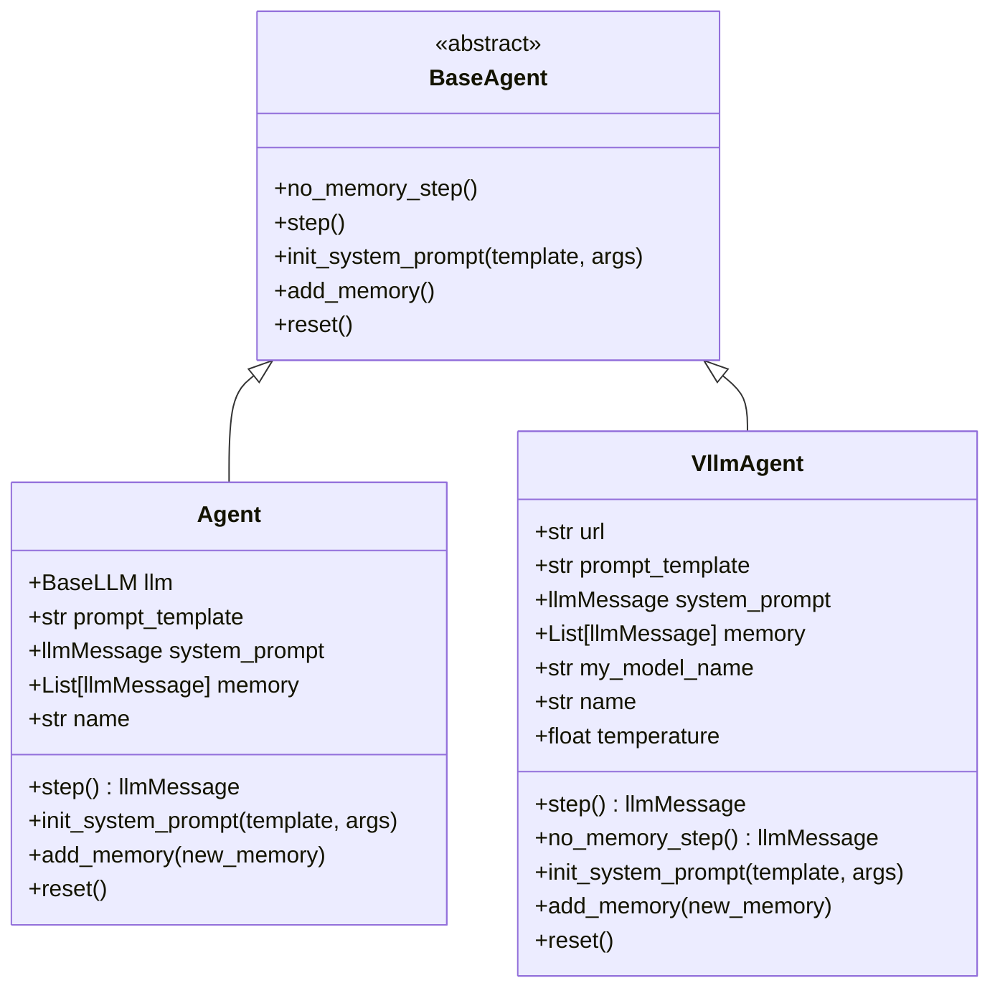
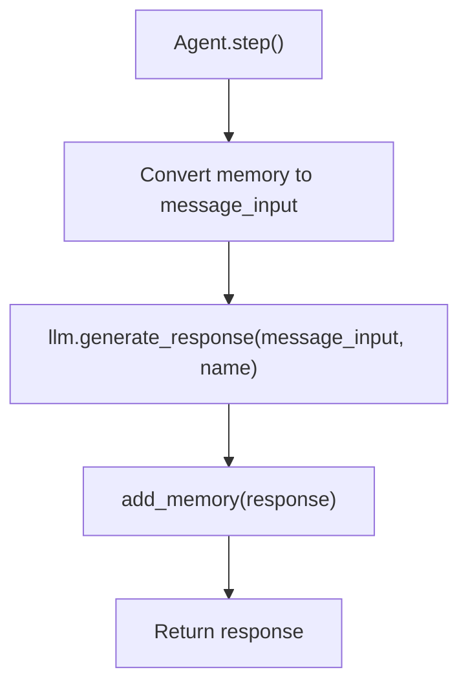
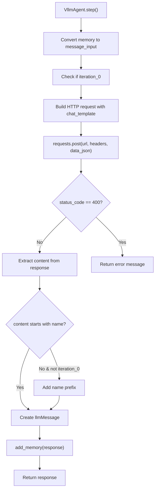
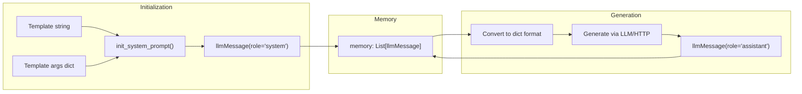

<!-- source: DeepWiki mcp.deepwiki.com · repo thunlp/Optima · page 5.1 Agent Class Reference · fetched 2026-11-02 -->

# Agent Class Reference

<details>
<summary>Relevant source files</summary>

The following files were used as context for generating this wiki page:

- [agent/__init__.py](agent/__init__.py)
- [agent/agent.py](agent/agent.py)

</details>


## Purpose and Scope

This document provides a comprehensive reference for the agent class hierarchy in Optima. It documents the `BaseAgent` abstract interface, the `Agent` class (which uses internal BaseLLM models), and the `VllmAgent` class (which communicates with vLLM services via HTTP). 

For details on how `VllmAgent` communicates with vLLM services, see [VllmAgent HTTP Communication](#5.2). For information on conversation memory management patterns, see [Conversation Memory Management](#5.3). For the broader multi-agent system architecture, see [Multi-Agent System Architecture](#3.2).

**Sources:** [agent/agent.py:1-147]()

---

## Class Hierarchy Overview

The agent system consists of three classes organized in an inheritance hierarchy. `BaseAgent` defines the abstract interface, while `Agent` and `VllmAgent` provide concrete implementations using different LLM backends.

### Class Inheritance Diagram



**Sources:** [agent/agent.py:9-24](), [agent/agent.py:27-54](), [agent/agent.py:57-147]()

---

## BaseAgent (Abstract Interface)

`BaseAgent` is an abstract base class that defines the interface all agent implementations must follow. It does not contain any implementation logic.

**Location:** [agent/agent.py:9-24]()

### Abstract Methods

| Method | Purpose |
|--------|---------|
| `no_memory_step()` | Generate a response without adding it to conversation memory |
| `step()` | Generate a response and add it to conversation memory |
| `init_system_prompt(template, args)` | Initialize the system prompt from a template and arguments |
| `add_memory()` | Add a message to the conversation memory |
| `reset()` | Clear conversation memory and reset the agent state |

**Sources:** [agent/agent.py:9-24]()

---

## Agent Class

The `Agent` class implements the `BaseAgent` interface using an internal `BaseLLM` model for generation. This class is used when the LLM is directly accessible as a Python object rather than through an HTTP service.

**Location:** [agent/agent.py:27-54]()

### Attributes

| Attribute | Type | Description |
|-----------|------|-------------|
| `llm` | `BaseLLM` | The language model used for generation |
| `prompt_template` | `str` | Template string for prompts |
| `system_prompt` | `llmMessage` | The system-level instruction message |
| `memory` | `List[llmMessage]` | Conversation history |
| `name` | `str` | Agent identifier (e.g., "Alice", "Bob") |

### Method Implementations

#### `step() -> llmMessage`

Generates a response using the current conversation memory and adds the response to memory.



**Implementation:** [agent/agent.py:34-43]()

The method converts the internal `memory` list to the format expected by `BaseLLM.generate_response()`, calls the LLM, stores the response in memory, and returns it.

#### `init_system_prompt(template: str, args: dict)`

Initializes the system prompt using Python's `string.Template` for variable substitution, then appends it to memory.

**Implementation:** [agent/agent.py:45-47]()

#### `add_memory(new_memory: llmMessage)`

Appends a new message to the conversation memory list.

**Implementation:** [agent/agent.py:49-50]()

#### `reset()`

Clears the conversation memory and resets the system prompt to the template.

**Implementation:** [agent/agent.py:52-54]()

**Sources:** [agent/agent.py:27-54]()

---

## VllmAgent Class

`VllmAgent` implements the `BaseAgent` interface by communicating with a vLLM service via HTTP POST requests. This is the primary agent class used in Optima's multi-agent training pipeline.

**Location:** [agent/agent.py:57-147]()

### Attributes

| Attribute | Type | Description |
|-----------|------|-------------|
| `url` | `str` | HTTP endpoint of the vLLM service |
| `prompt_template` | `str` | Template string for prompts |
| `system_prompt` | `llmMessage` | The system-level instruction message |
| `memory` | `List[llmMessage]` | Conversation history |
| `my_model_name` | `str` | Model name to send in HTTP requests |
| `name` | `str` | Agent identifier ("Alice" or "Bob") |
| `temperature` | `float` | Sampling temperature for generation |

### Constructor

```python
def __init__(self, url: str, my_model_name: str, name: str, temperature: float)
```

**Implementation:** [agent/agent.py:64-71]()

Initializes the agent with connection parameters and generation settings. The `url` typically points to a local vLLM server (e.g., `http://localhost:8000/v1/chat/completions`).

### Method Implementations

#### `step() -> llmMessage`

Generates a response via HTTP POST to the vLLM service and adds the response to memory. This method includes special handling for agent naming and iteration-specific behavior.



**Implementation:** [agent/agent.py:85-121]()

Key behaviors:
- **Iteration detection:** Checks if the system prompt contains "You should start your utterance with" or "You must begin your response with" to determine if it's iteration 0 ([agent/agent.py:92-97]())
- **Chat template:** Uses a custom Llama-3 style chat template with conditional agent name prefixes ([agent/agent.py:102]())
- **Chat template kwargs:** Sets `is_alice` or `is_bob` based on agent name and iteration ([agent/agent.py:103-106]())
- **Name prefixing:** Adds the agent name prefix if missing (except in iteration 0) ([agent/agent.py:113-114]())
- **Error handling:** Returns an error message if HTTP status code is 400 ([agent/agent.py:110-111]())

#### `no_memory_step() -> llmMessage`

Generates a response without adding it to memory. Used for generating multiple candidate responses without polluting the conversation history.

**Implementation:** [agent/agent.py:124-146]()

This method:
- Converts memory to message format ([agent/agent.py:125-128]())
- Makes HTTP POST request without custom chat template ([agent/agent.py:131-138]())
- Returns response without calling `add_memory()` ([agent/agent.py:141-146]())

#### `init_system_prompt(template: str, args: dict)`

Identical to `Agent.init_system_prompt()`. Uses `string.Template.safe_substitute()` for variable substitution.

**Implementation:** [agent/agent.py:73-75]()

#### `add_memory(new_memory: llmMessage)`

Appends a message to the conversation memory.

**Implementation:** [agent/agent.py:77-78]()

#### `reset()`

Clears memory and resets the system prompt.

**Implementation:** [agent/agent.py:80-82]()

**Sources:** [agent/agent.py:57-147]()

---

## Method Comparison Table

| Method | BaseAgent | Agent | VllmAgent |
|--------|-----------|-------|-----------|
| `step()` | Abstract | Implemented via `BaseLLM.generate_response()` | Implemented via HTTP POST with chat template |
| `no_memory_step()` | Abstract | Not implemented | Implemented via HTTP POST without memory update |
| `init_system_prompt()` | Abstract | Template substitution + append to memory | Template substitution + append to memory |
| `add_memory()` | Abstract | Append to `memory` list | Append to `memory` list |
| `reset()` | Abstract | Clear memory, reset system_prompt | Clear memory, reset system_prompt |

**Sources:** [agent/agent.py:9-147]()

---

## Data Flow: Message Processing

This diagram shows how `llmMessage` objects flow through the agent system during a typical interaction.



**Sources:** [agent/agent.py:34-121]()

---

## Usage Patterns

### Creating a VllmAgent

```python
from agent.agent import VllmAgent

agent = VllmAgent(
    url="http://localhost:8000/v1/chat/completions",
    my_model_name="Meta-Llama-3-8B-Instruct",
    name="Alice",
    temperature=0.7
)
```

**Reference:** [agent/agent.py:64-71]()

### Initializing with System Prompt

```python
template = "You are an agent named $name solving $task"
args = {"name": "Alice", "task": "math problems"}
agent.init_system_prompt(template, args)
```

**Reference:** [agent/agent.py:73-75]()

### Generating Responses

```python
# With memory update
response = agent.step()

# Without memory update (for self-consistency)
candidate = agent.no_memory_step()
```

**Reference:** [agent/agent.py:85-146]()

### Managing Memory

```python
# Add user message
from message.message import llmMessage
user_msg = llmMessage(role="user", content="What is 2+2?")
agent.add_memory(user_msg)

# Generate response
response = agent.step()

# Reset for new conversation
agent.reset()
```

**Reference:** [agent/agent.py:49-50](), [agent/agent.py:80-82]()

---

## Implementation Notes

### VllmAgent Chat Template

The `VllmAgent.step()` method uses a custom chat template that follows the Llama-3 format with special handling for agent names:

- **Template structure:** `<|start_header_id|>role<|end_header_id|>\n\ncontent<|eot_id|>` ([agent/agent.py:102]())
- **Agent name injection:** Adds "Alice:" or "Bob:" prefix based on `chat_template_kwargs` ([agent/agent.py:103-106]())
- **Iteration-specific behavior:** Names are only prefixed after iteration 0 ([agent/agent.py:92-97]())

### Error Handling

Both agent implementations handle errors differently:
- **Agent:** Relies on `BaseLLM.generate_response()` error handling
- **VllmAgent:** Returns `llmMessage(role="assistant", content="error")` on HTTP 400 status ([agent/agent.py:110-111](), [agent/agent.py:139-140]())

### Memory Management

All agent classes maintain conversation history in a `List[llmMessage]` structure. The memory persists across multiple `step()` calls and is only cleared by calling `reset()`.

**Sources:** [agent/agent.py:1-147]()

---

