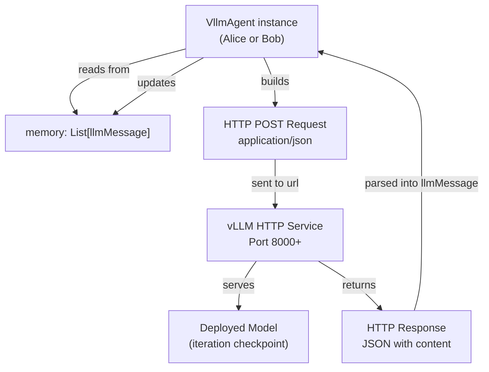
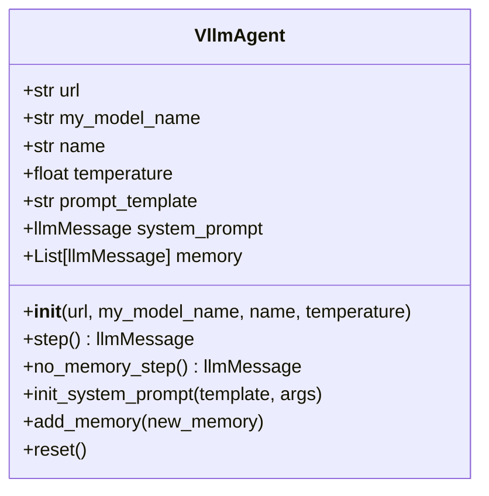
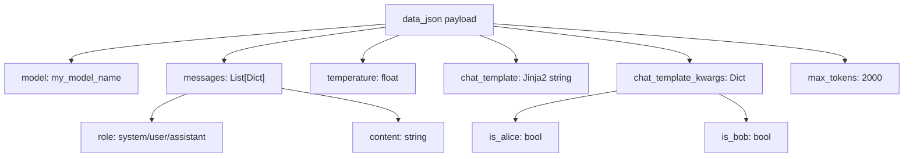
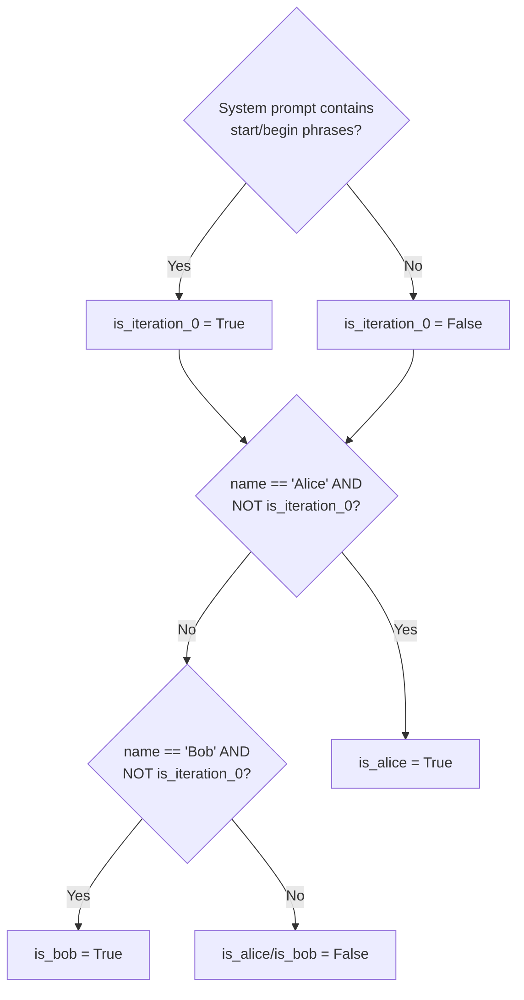
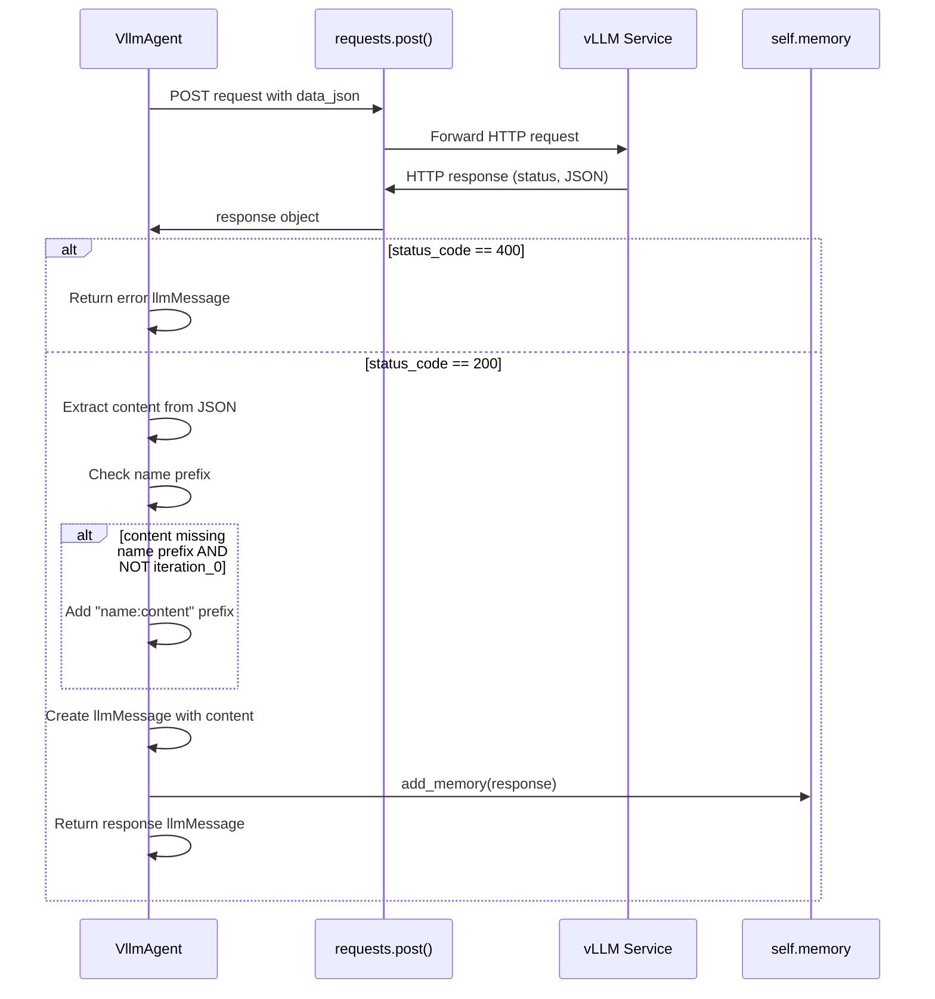
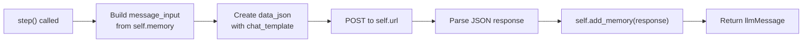
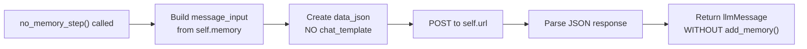
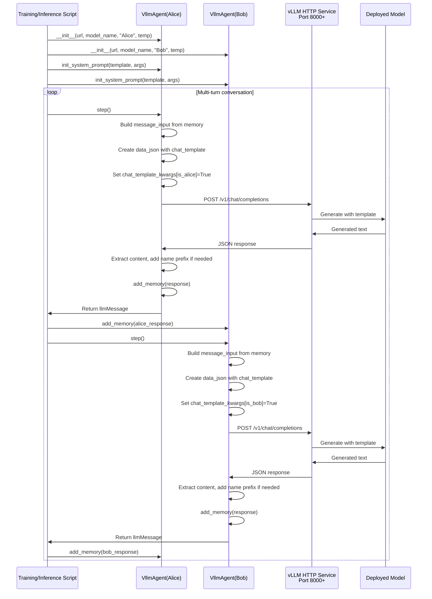

<!-- source: DeepWiki mcp.deepwiki.com · repo thunlp/Optima · page 5.2 VllmAgent HTTP Communication · fetched 2026-11-02 -->

# VllmAgent HTTP Communication

<details>
<summary>Relevant source files</summary>

The following files were used as context for generating this wiki page:

- [agent/agent.py](agent/agent.py)

</details>


## Purpose and Scope

This document explains how the `VllmAgent` class communicates with vLLM model servers via HTTP. It covers the request/response format, chat template system, agent name handling, and error management. For general information about the agent class hierarchy and interface, see [Agent Class Reference](#5.1). For details on conversation memory management, see [Conversation Memory Management](#5.3).

## Overview

The `VllmAgent` class enables multi-agent conversations by sending HTTP POST requests to vLLM services running as HTTP servers. Unlike the `Agent` class which uses internal `BaseLLM` instances, `VllmAgent` communicates with externally deployed models via HTTP, allowing for distributed deployment and GPU resource management.



**Sources:** [agent/agent.py:57-147]()

## VllmAgent Initialization

The `VllmAgent` constructor accepts four key parameters that configure HTTP communication:

| Parameter | Type | Purpose |
|-----------|------|---------|
| `url` | `str` | HTTP endpoint of the vLLM service (e.g., `http://localhost:8000/v1/chat/completions`) |
| `my_model_name` | `str` | Model name identifier for the vLLM service |
| `name` | `str` | Agent name (`"Alice"` or `"Bob"`) used for response prefixing |
| `temperature` | `float` | Sampling temperature for generation |



**Sources:** [agent/agent.py:64-72]()

## HTTP Request Structure

The `step()` method constructs and sends HTTP POST requests to the vLLM service with a JSON payload containing the conversation history and generation parameters.

### Request Headers

The request uses standard JSON headers:

```python
headers = {"Content-Type": "application/json"}
```

**Sources:** [agent/agent.py:91]()

### Request Payload

The JSON payload structure sent to the vLLM service:



The messages list is constructed from the agent's memory:

```python
message_input = [
    {"role": message.role, "content": message.content}
    for message in self.memory
]
```

**Sources:** [agent/agent.py:86-108]()

## Chat Template System

The chat template is a Jinja2 template string that formats the conversation history into the model's expected input format. The template handles Llama-3 specific tokens and agent name prefixing.

### Template Structure

The chat template defined in the request:

| Template Component | Purpose |
|-------------------|---------|
| `` | Initialize message loop |
| `<\|start_header_id\|>` | Begin role header |
| `<\|end_header_id\|>` | End role header |
| `<\|eot_id\|>` | End of turn token |
| `bos_token` | Beginning of sequence (first message only) |
| `` | Add assistant generation prompt |
| `` / `` | Conditionally add agent name |

The template conditionally appends `"Alice:"` or `"Bob:"` based on the `chat_template_kwargs` dictionary, which determines whether to prefix the response with the agent name.

**Sources:** [agent/agent.py:102]()

### Iteration-Specific Template Behavior

The template behavior differs between iteration 0 and later iterations:



The iteration detection logic checks system prompt content:

```python
is_iteration_0 = False
if (
    "You should start your utterance with" in self.system_prompt.content
    or "You must begin your response with" in self.system_prompt.content
):
    is_iteration_0 = True
```

In iteration 0, agents are explicitly instructed to start with their names, so the template doesn't add the prefix. In later iterations, the template handles prefixing automatically.

**Sources:** [agent/agent.py:92-106]()

## HTTP Response Handling

After sending the request, the `step()` method processes the HTTP response and constructs an `llmMessage` object.

### Response Flow



### Response Parsing

The content is extracted from the JSON response:

```python
content: str = response.json()["choices"][0]["message"]["content"]
```

### Agent Name Prefixing

After extraction, the code ensures the response starts with the agent's name:

```python
if not content.startswith(self.name) and not is_iteration_0:
    content = f"{self.name}:{content}"
```

This guarantees that in multi-agent conversations, responses are always attributed to the correct agent, even if the model fails to generate the name prefix.

**Sources:** [agent/agent.py:109-121]()

## Error Handling

The `VllmAgent` handles HTTP errors gracefully:

| Error Condition | HTTP Status | Handling |
|----------------|-------------|----------|
| Request validation failure | 400 | Return `llmMessage(role="assistant", content="error")` |
| Successful generation | 200 | Parse and return normal response |

Error handling occurs in both `step()` and `no_memory_step()` methods:

```python
if response.status_code == 400:
    return llmMessage(role="assistant", content="error")
```

**Sources:** [agent/agent.py:110-111](), [agent/agent.py:139-140]()

## Step Methods Comparison

The `VllmAgent` class provides two methods for generating responses with different memory behaviors:

### step() Method

The primary method that generates a response and updates the conversation memory:



**Sources:** [agent/agent.py:85-121]()

### no_memory_step() Method

A simplified method that generates responses without updating memory or using chat templates:

Key differences from `step()`:
- No chat template included in request
- No `chat_template_kwargs`
- No agent name prefixing logic
- Response is not added to memory
- Simpler error handling



The simplified payload for `no_memory_step()`:

```python
data_json = {
    "model": self.my_model_name,
    "messages": message_input,
    "temperature": self.temperature,
    "max_tokens": 2000,
}
```

**Sources:** [agent/agent.py:124-146]()

## Complete Communication Flow

The following diagram shows the complete end-to-end flow from agent initialization through HTTP communication to memory updates:



**Sources:** [agent/agent.py:57-147]()

## Key Implementation Details

### Request Configuration

| Parameter | Value | Purpose |
|-----------|-------|---------|
| `max_tokens` | 2000 | Maximum response length |
| `temperature` | Instance-specific | Controls generation randomness |
| `model` | `my_model_name` | Identifies which model to use |

### URL Format

The `url` parameter should point to the vLLM chat completions endpoint:
- Format: `http://<host>:<port>/v1/chat/completions`
- Example: `http://localhost:8000/v1/chat/completions`
- Multiple ports can be used for multiple GPU deployments

### Memory Synchronization

In multi-agent conversations, memory must be manually synchronized between agents. When Alice generates a response:
1. Alice calls `step()` which adds the response to Alice's memory
2. The calling script receives the response
3. The script must call `bob.add_memory(alice_response)` to synchronize Bob's memory

This design allows flexible conversation patterns beyond simple turn-taking.

**Sources:** [agent/agent.py:77-78](), [agent/agent.py:85-121]()

---

