<!-- source: DeepWiki mcp.deepwiki.com · repo thunlp/Optima · page 5.3 Conversation Memory Management · fetched 2026-11-02 -->

# Conversation Memory Management

<details>
<summary>Relevant source files</summary>

The following files were used as context for generating this wiki page:

- [agent/agent.py](agent/agent.py)

</details>


## Purpose and Scope

This document describes how agents in the Optima framework maintain conversation history through a memory management system. The memory system enables multi-turn conversations between agents and preserves context across interactions, which is essential for generating coherent training data through multi-agent dialogues.

For information about agent class architecture and inheritance hierarchy, see [Agent Class Reference](#5.1). For details on HTTP communication between VllmAgent and vLLM services, see [VllmAgent HTTP Communication](#5.2).

---

## Memory System Overview

The conversation memory system in Optima is implemented as a sequential list of messages that preserves the complete dialogue history. Each agent maintains its own memory list, allowing it to reference previous exchanges when generating responses.

### Core Memory Structure

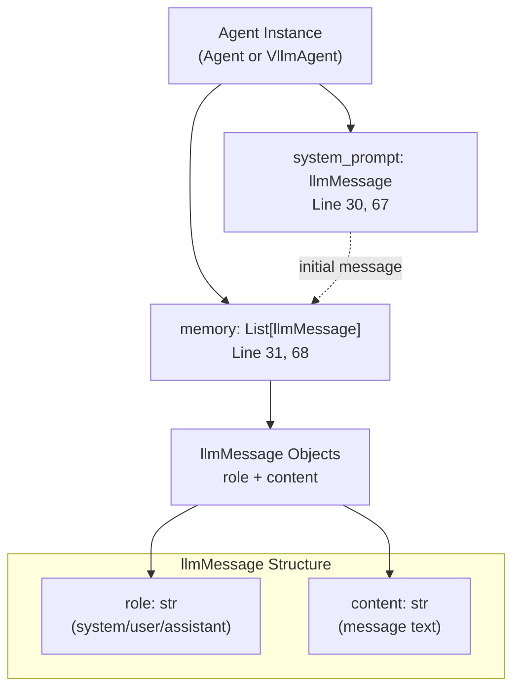

**Sources:** [agent/agent.py:27-82]()

The memory system consists of two primary attributes:

| Attribute | Type | Purpose |
|-----------|------|---------|
| `memory` | `List[llmMessage]` | Sequential list storing all conversation messages |
| `system_prompt` | `llmMessage` | Initial system message defining agent behavior |
| `prompt_template` | `str` | Template string for system prompt generation |

---

## Message Structure

Messages in the memory list are instances of `llmMessage`, a Pydantic `BaseModel` that encapsulates message metadata and content.

### llmMessage Components

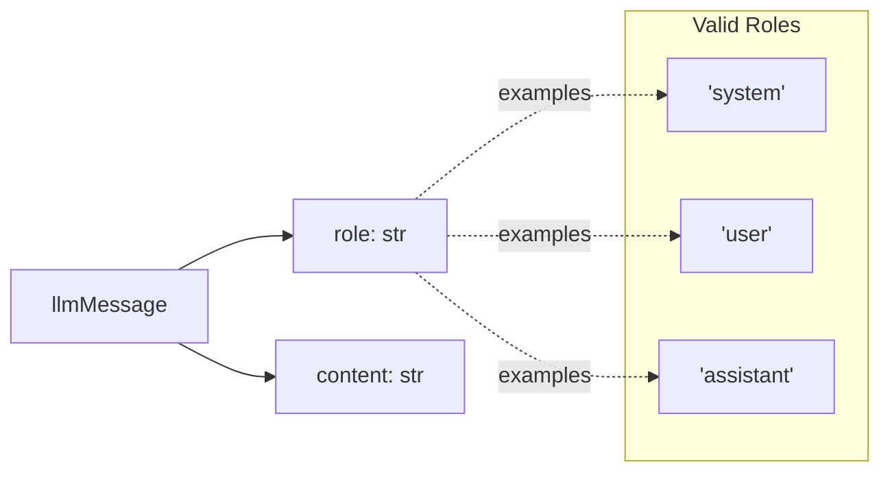

**Sources:** [agent/agent.py:1-3](), [agent/agent.py:30](), [agent/agent.py:67]()

The `llmMessage` class is imported from `message.message` and provides a structured format for all conversation messages. Each message has:

- **role**: Identifies the message source (`"system"`, `"user"`, or `"assistant"`)
- **content**: Contains the actual message text

---

## Memory Lifecycle

### Initialization with System Prompt

The memory lifecycle begins with system prompt initialization, which sets the agent's behavior and is always the first message in memory.

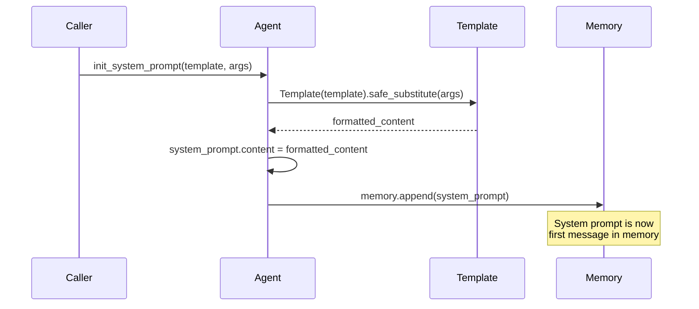

**Sources:** [agent/agent.py:45-47](), [agent/agent.py:73-75]()

The `init_system_prompt()` method ([agent/agent.py:45-47](), [agent/agent.py:73-75]()) performs template substitution and adds the system prompt to memory:

1. **Template Substitution**: Uses Python's `string.Template.safe_substitute()` to replace placeholders with provided arguments
2. **Content Assignment**: Sets the formatted content to `system_prompt.content`
3. **Memory Insertion**: Appends the system prompt as the first message in the memory list

### Adding Messages During Conversation

As the agent participates in conversations, new messages are appended to memory through the `add_memory()` method.

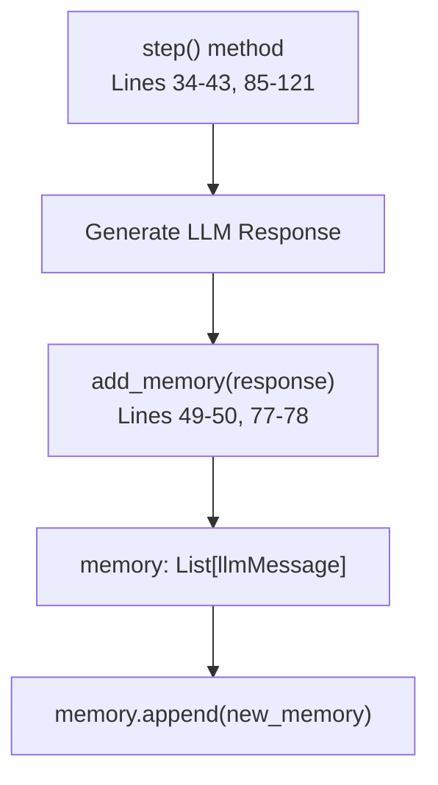

**Sources:** [agent/agent.py:34-50](), [agent/agent.py:77-78](), [agent/agent.py:85-121]()

The `add_memory()` method ([agent/agent.py:49-50](), [agent/agent.py:77-78]()) simply appends the new message to the memory list:

```python
def add_memory(self, new_memory: llmMessage):
    self.memory.append(new_memory)
```

This maintains chronological order, which is critical for maintaining conversation coherence.

### Memory Reset

Agents can reset their memory to clear conversation history and start fresh.

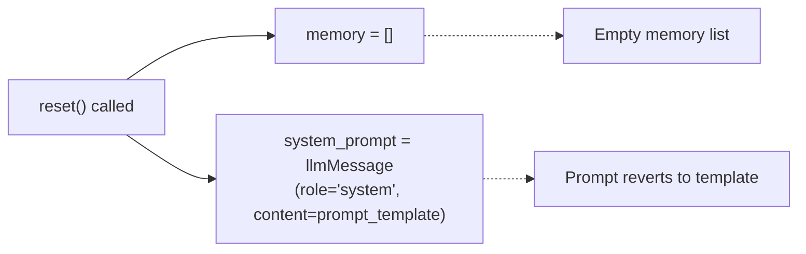

**Sources:** [agent/agent.py:52-54](), [agent/agent.py:80-82]()

The `reset()` method ([agent/agent.py:52-54](), [agent/agent.py:80-82]()) performs two operations:

1. **Clear Memory**: Sets `memory` to an empty list
2. **Reset System Prompt**: Creates a new `llmMessage` with role `"system"` and content from `prompt_template`

Note that after reset, the system prompt is recreated but **not** automatically added to memory. The system prompt must be re-initialized via `init_system_prompt()` if needed.

---

## Memory-Aware Conversation Flow

### Standard Step with Memory Update

The primary conversation method `step()` uses memory to provide context and updates memory with the generated response.

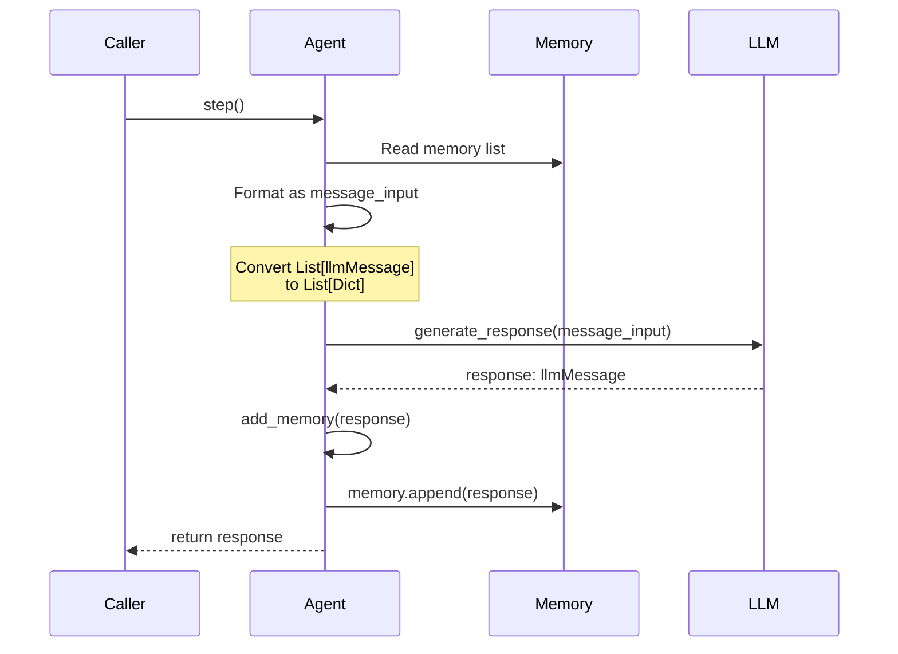

**Sources:** [agent/agent.py:34-43](), [agent/agent.py:85-121]()

#### Agent.step() Implementation

For the `Agent` class ([agent/agent.py:34-43]()):

```python
def step(self) -> llmMessage:
    message_input = [
        {"role": message.role, "content": message.content}
        for message in self.memory
    ]
    response = self.llm.generate_response(message_input, self.name)
    
    self.add_memory(response)
    
    return response
```

**Key steps:**

1. **Memory Formatting**: Converts `List[llmMessage]` to `List[Dict[str, str]]` for LLM input
2. **Response Generation**: Calls the internal `BaseLLM.generate_response()` with full conversation context
3. **Memory Update**: Adds the generated response to memory via `add_memory()`
4. **Return**: Returns the response message

#### VllmAgent.step() Implementation

For the `VllmAgent` class ([agent/agent.py:85-121]()), the process is similar but includes HTTP communication:

1. **Memory Formatting**: Converts memory to dict format ([agent/agent.py:86-89]())
2. **HTTP Request Preparation**: Constructs JSON payload with model name, messages, temperature, and chat template ([agent/agent.py:91-108]())
3. **Response Handling**: Processes HTTP response and formats content ([agent/agent.py:112-118]())
4. **Memory Update**: Adds response to memory ([agent/agent.py:119]())

Special handling for agent names:
- If the response doesn't start with the agent's name and it's not iteration 0, the name is prepended ([agent/agent.py:113-114]())
- Chat template includes special tokens for Alice/Bob identification ([agent/agent.py:103-106]())

### Memory-Free Step

The `no_memory_step()` method generates a response using current memory as context but **does not** add the response to memory.

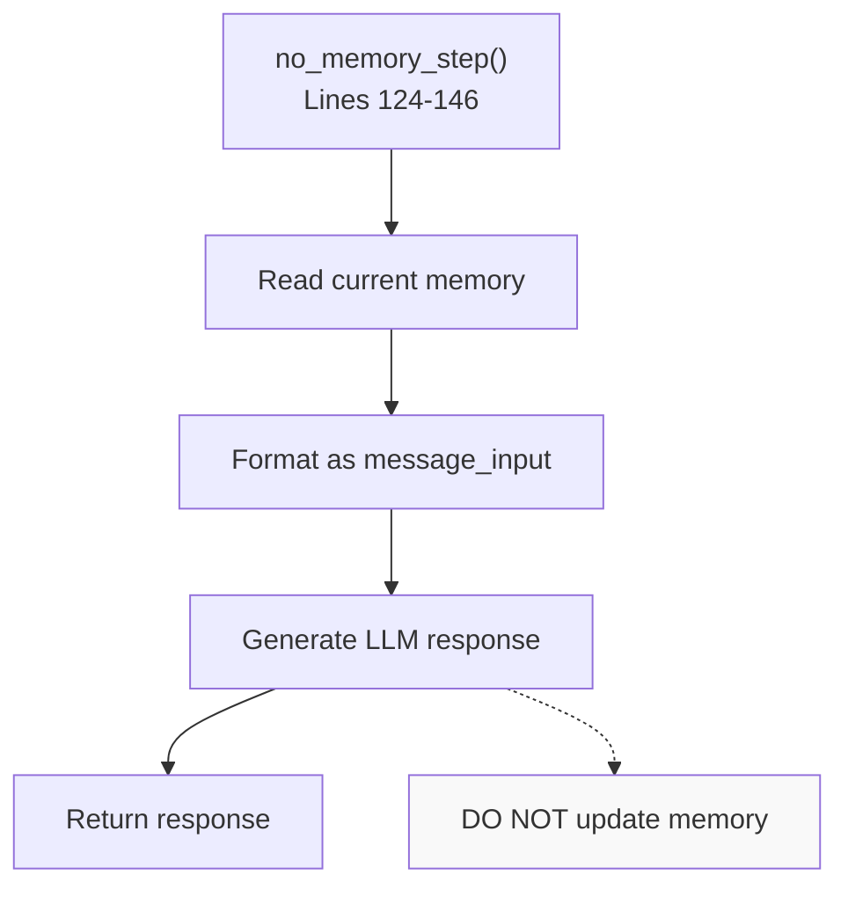

**Sources:** [agent/agent.py:124-146]()

This method is useful for:
- **Exploratory queries**: Testing what the agent would say without committing to that path
- **Candidate generation**: Generating multiple possible responses for ranking
- **Rollback scenarios**: Trying hypothetical continuations without affecting conversation state

The implementation ([agent/agent.py:124-146]()) is nearly identical to `step()`, except it omits the `add_memory()` call:

```python
def no_memory_step(self):
    message_input = [
        {"role": message.role, "content": message.content}
        for message in self.memory
    ]
    
    # Generate response using memory...
    response = requests.post(self.url, headers=headers, json=data_json)
    
    # Return WITHOUT adding to memory
    return llmMessage(
        role="assistant",
        content=response.json()["choices"][0]["message"]["content"],
    )
```

---

## Memory Format Conversion

### From llmMessage to Dict Format

Both `Agent` and `VllmAgent` convert the memory list from `List[llmMessage]` to `List[Dict[str, str]]` before passing to the LLM.

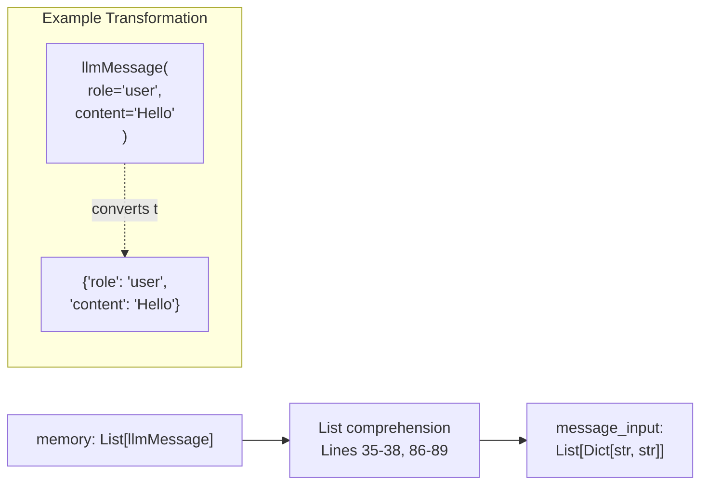

**Sources:** [agent/agent.py:35-38](), [agent/agent.py:86-89]()

The conversion uses a list comprehension:

```python
message_input = [
    {"role": message.role, "content": message.content}
    for message in self.memory
]
```

This produces a plain dictionary structure that LLM APIs expect, containing only the `role` and `content` fields.

---

## Multi-Agent Memory Considerations

### Separate Memory Per Agent

In multi-agent scenarios (e.g., Alice and Bob), each agent maintains its **own independent memory list**.

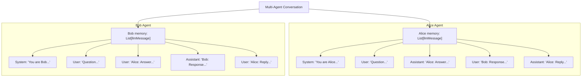

**Sources:** [agent/agent.py:31](), [agent/agent.py:68]()

Key characteristics:

- **Independence**: Each agent's `memory` attribute is a separate list instance
- **Different Perspectives**: Alice's memory contains her own responses as `"assistant"` messages, while Bob's responses appear as `"user"` messages in Alice's memory
- **Synchronized Externally**: The calling code (training/inference scripts) coordinates the conversation and ensures both agents receive the full dialogue context by adding messages to both memories

### Memory Synchronization Pattern

The typical pattern for multi-agent conversation involves manual memory synchronization:

1. **Alice generates response**: `alice_response = alice.step()` (adds to Alice's memory)
2. **Add to Bob's memory**: `bob.add_memory(convert_to_user_message(alice_response))`
3. **Bob generates response**: `bob_response = bob.step()` (adds to Bob's memory)
4. **Add to Alice's memory**: `alice.add_memory(convert_to_user_message(bob_response))`

This pattern ensures both agents have consistent conversation context while maintaining separate memory lists.

---

## Memory Usage Examples

### Example 1: Single-Agent Conversation

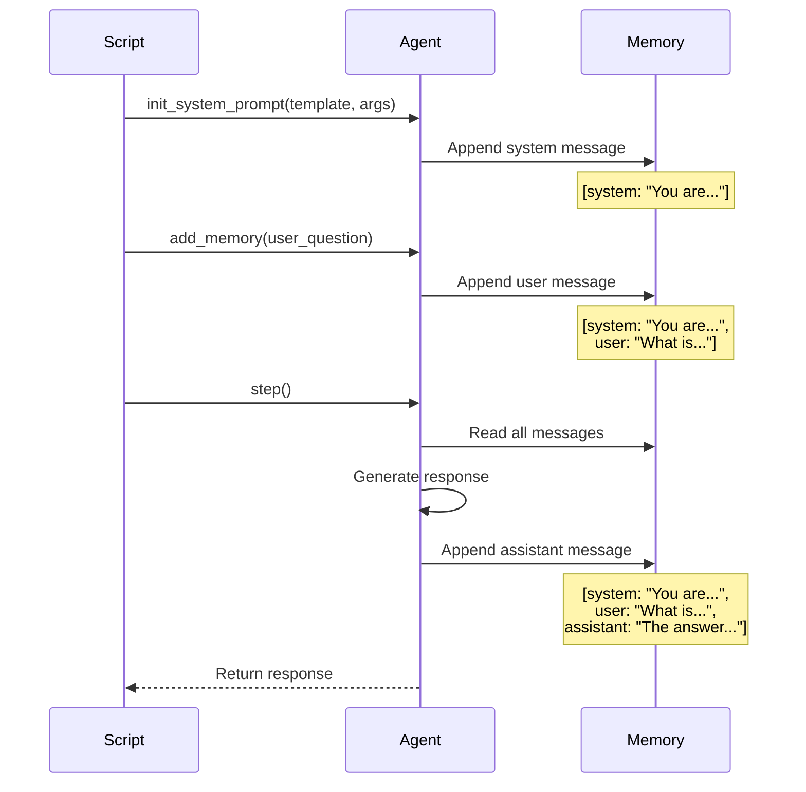

**Sources:** [agent/agent.py:45-50](), [agent/agent.py:34-43]()

### Example 2: Memory Reset and Reuse

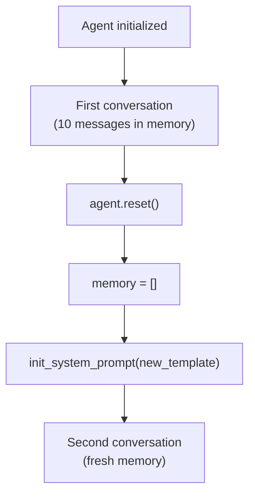

**Sources:** [agent/agent.py:52-54](), [agent/agent.py:80-82]()

---

## Memory Management Best Practices

### Memory Capacity Considerations

| Concern | Impact | Mitigation Strategy |
|---------|--------|---------------------|
| **Long conversations** | Memory list grows unbounded | Implement conversation truncation or sliding window |
| **Token limits** | Very long memory exceeds model context window | Monitor total token count and trim old messages |
| **Memory overhead** | Large memory lists consume RAM | Use `reset()` between independent conversations |

**Note**: The current implementation does not include automatic memory truncation. Calling code must manage memory length if needed.

### When to Use no_memory_step()

Use `no_memory_step()` when:

- **Testing hypothetical responses**: Want to see what the agent would say without committing
- **Self-consistency sampling**: Generating multiple independent responses from the same context
- **Debugging**: Checking agent behavior without polluting memory

Use regular `step()` when:

- **Building training data**: Need full conversation history for downstream processing
- **Interactive agents**: Agent should remember its own responses
- **Multi-turn dialogues**: Context from previous turns is essential

---

## Code Entity Reference

### Key Classes and Methods

| Entity | Location | Purpose |
|--------|----------|---------|
| `BaseAgent` | [agent/agent.py:9-24]() | Abstract base class defining memory interface |
| `Agent` | [agent/agent.py:27-54]() | Agent with internal LLM and memory management |
| `VllmAgent` | [agent/agent.py:57-147]() | Agent using HTTP vLLM service with memory |
| `llmMessage` | [message/message.py]() | Pydantic model for message structure |
| `memory` attribute | [agent/agent.py:31](), [agent/agent.py:68]() | `List[llmMessage]` storing conversation |
| `system_prompt` attribute | [agent/agent.py:30](), [agent/agent.py:67]() | Initial system message |
| `init_system_prompt()` | [agent/agent.py:45-47](), [agent/agent.py:73-75]() | Initialize and add system prompt to memory |
| `add_memory()` | [agent/agent.py:49-50](), [agent/agent.py:77-78]() | Append message to memory list |
| `reset()` | [agent/agent.py:52-54](), [agent/agent.py:80-82]() | Clear memory and reset system prompt |
| `step()` | [agent/agent.py:34-43](), [agent/agent.py:85-121]() | Generate response and update memory |
| `no_memory_step()` | [agent/agent.py:11-12](), [agent/agent.py:124-146]() | Generate response without updating memory |

---

## Related Documentation

- **[Agent Class Reference](#5.1)**: Detailed documentation of agent class hierarchy and methods
- **[VllmAgent HTTP Communication](#5.2)**: How VllmAgent formats requests and handles responses
- **[Multi-Agent System Architecture](#3.2)**: Overview of multi-agent conversation patterns
- **[Training Data Generation](#6)**: How conversation memory is processed into training datasets

---

**Sources:** [agent/agent.py]()

---

