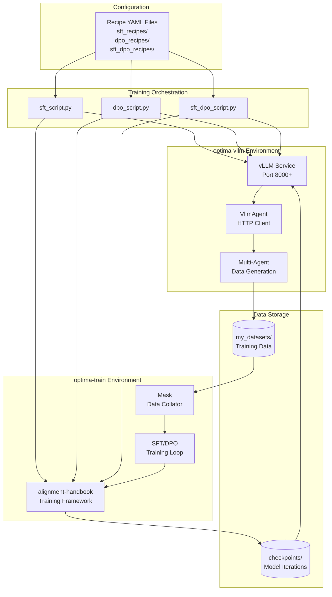
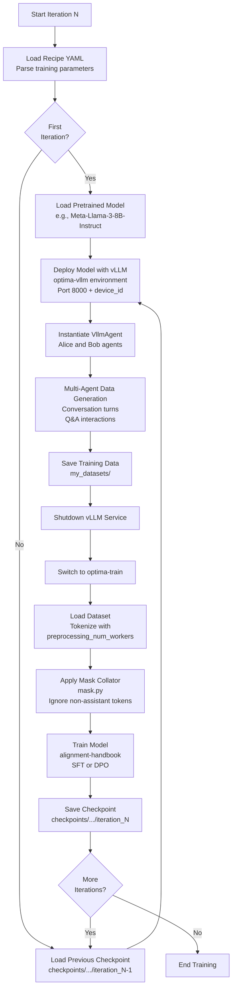
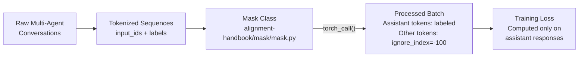
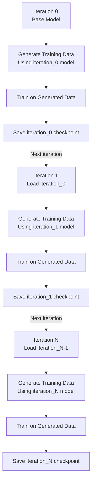

<!-- source: DeepWiki mcp.deepwiki.com · repo thunlp/Optima · page 6 Training System · fetched 2026-11-02 -->

# Training System

<details>
<summary>Relevant source files</summary>

The following files were used as context for generating this wiki page:

- [README.md](README.md)
- [alignment-handbook/mask/mask.py](alignment-handbook/mask/mask.py)

</details>


The Training System is the core component of Optima responsible for executing iterative optimization of LLM-based multi-agent systems. This page provides a high-level overview of the training architecture, methods, and workflows. For detailed information about specific training scripts, see [Training Scripts Reference](#6.1). For configuration details, see [Recipe Configuration System](#6.2). For data processing implementation, see [Mask Data Collator](#6.3).

## Overview

The Optima training system implements three iterative training methods:
- **iSFT**: Iterative Supervised Fine-Tuning
- **iDPO**: Iterative Direct Preference Optimization
- **iSFT-DPO**: Combined iterative training using both methods

Each training iteration involves:
1. Deploying the current model via vLLM for multi-agent interaction
2. Generating training data through agent conversations
3. Processing data with completion-only masking
4. Training the model using the alignment-handbook framework
5. Saving checkpoints for the next iteration

Sources: [README.md:1-148]()

## Training Architecture

The training system operates across two isolated conda environments to prevent resource conflicts during model deployment and training:



**Diagram: Training System Architecture with Code Components**

The training scripts orchestrate the entire pipeline by switching between environments. The `optima-vllm` environment handles model serving and multi-agent data generation, while the `optima-train` environment executes the actual training using alignment-handbook with custom masking.

Sources: [README.md:24-55](), High-level system diagrams

## Training Methods

### iSFT: Iterative Supervised Fine-Tuning

The iSFT method performs iterative supervised fine-tuning on multi-agent conversation data. Each iteration:
1. Deploys the previous iteration's checkpoint
2. Generates new training conversations via agent interactions
3. Trains on assistant responses only (using the Mask collator)
4. Saves the improved checkpoint

**Execution**: [sft_script.py]()

**Configuration**: `train/sft_recipes/*.yaml`

### iDPO: Iterative Direct Preference Optimization

The iDPO method uses preference-based optimization. Each iteration:
1. Generates both chosen (correct) and rejected (incorrect) response pairs
2. Trains using the DPO algorithm with a configurable `beta` parameter
3. Aligns the model to prefer correct multi-agent communication patterns

**Execution**: [dpo_script.py]()

**Configuration**: `train/dpo_recipes/*.yaml`

### iSFT-DPO: Combined Training

The combined method alternates between SFT and DPO within each iteration, leveraging the strengths of both approaches for enhanced optimization.

**Execution**: [sft_dpo_script.py]()

**Configuration**: `train/sft_dpo_recipes/*.yaml`

Sources: [README.md:58-93]()

## Training Pipeline Flow

The following diagram shows the detailed execution flow for a single training iteration:



**Diagram: Single Iteration Training Pipeline with Code References**

Sources: [README.md:58-93](), High-level system diagrams

## Environment Separation

The dual-environment design is critical for preventing resource conflicts and enabling efficient model serving during training:

| Environment | Purpose | Key Dependencies | Usage |
|-------------|---------|------------------|-------|
| `optima-vllm` | Model serving and inference | vLLM 0.5.3, PyTorch 2.3.1, CUDA 12.1 | Multi-agent data generation, model deployment |
| `optima-train` | Model training | alignment-handbook, flash-attn, PyTorch 2.3.1 | Training loop execution, data processing |

**Environment Switching**: Training scripts use subprocess calls to activate the appropriate conda environment for each phase:
- Data generation phase: Activates `optima-vllm`
- Training phase: Activates `optima-train`

This separation allows vLLM to serve the model efficiently on GPUs while the training framework uses the same or different GPUs for optimization.

Sources: [README.md:24-55]()

## Data Processing Pipeline



**Diagram: Data Processing Flow with Mask Collator**

The Mask data collator is essential for completion-only language modeling. It identifies assistant response tokens and masks all other tokens (system prompts, user inputs) by setting their labels to `ignore_index=-100`. This ensures the model only learns from assistant outputs.

**Key Token Patterns** (from [alignment-handbook/mask/mask.py:8-11]()):
- `you_are_Alice_token`: System prompt for Alice agent
- `you_are_Bob_token`: System prompt for Bob agent
- `Alice_token`: Alice's response marker
- `Bob_token`: Bob's response marker

The Mask class extends `DataCollatorForLanguageModeling` and dynamically identifies which agent is the assistant based on the system prompt tokens, then masks appropriately.

Sources: [alignment-handbook/mask/mask.py:1-123]()

## Training Script Execution

Each training script follows a similar execution pattern:

| Script | Purpose | Key Operations |
|--------|---------|----------------|
| `sft_script.py` | iSFT training | For each iteration: deploy model → generate SFT data → train with SFT → save checkpoint |
| `dpo_script.py` | iDPO training | For each iteration: deploy model → generate preference pairs → train with DPO → save checkpoint |
| `sft_dpo_script.py` | Combined training | For each iteration: deploy model → generate both SFT and DPO data → train with both methods → save checkpoint |

**Command-line Arguments** (common to all scripts):
- `--train_config_path`: Path to recipe YAML file
- `--vllm_env`: Name of vLLM conda environment (default: `optima-vllm`)
- `--alignment_env`: Name of training conda environment (default: `optima-train`)

**Example Execution** (from [README.md:66-70]()):
```bash
MKL_THREADING_LAYER=GNU python sft_script.py \
    --train_config_path train/sft_recipes/arc.yaml \
    --vllm_env optima-vllm \
    --alignment_env optima-train
```

The `MKL_THREADING_LAYER=GNU` environment variable is required to prevent threading conflicts.

Sources: [README.md:58-93]()

## Key Components

The training system consists of several integrated components, each documented in detail in the sub-pages:

### Training Scripts
The orchestration layer that manages the entire training workflow, including environment switching, model deployment, data generation, and training execution. See [Training Scripts Reference](#6.1) for detailed documentation of command-line arguments and workflows.

### Recipe Configuration System
YAML-based configuration files that specify all training parameters including model paths, dataset mixers, hyperparameters, and optimization settings. The recipe system supports inheritance and iteration-specific overrides. See [Recipe Configuration System](#6.2) for parameter documentation and customization guides.

### Mask Data Collator
A custom data collator that extends the alignment-handbook framework to implement completion-only language modeling for multi-agent conversations. It dynamically identifies and masks non-assistant tokens to ensure training loss is only computed on agent responses. See [Mask Data Collator](#6.3) for implementation details.

### Alignment Handbook Integration
The training system leverages the alignment-handbook framework for SFT and DPO training, with custom extensions for multi-agent scenarios. See [Alignment Handbook Integration](#9) for more information about this integration.

Sources: [README.md:1-148](), [alignment-handbook/mask/mask.py:1-123]()

## Iterative Training Process

The core innovation of Optima is its iterative training approach, where each iteration builds upon the previous:



**Diagram: Iterative Training Progression**

Each iteration:
1. Starts with the checkpoint from the previous iteration (or pretrained model for iteration 0)
2. Uses that model to generate new training data through multi-agent interactions
3. Trains on the newly generated data
4. Saves an improved checkpoint
5. The improved checkpoint becomes the starting point for the next iteration

This feedback loop allows the model to progressively optimize its communication efficiency and response accuracy over multiple iterations.

Sources: High-level system diagrams, [README.md:11]()

## Training Output

Training produces several artifacts:

| Artifact Type | Location | Description |
|---------------|----------|-------------|
| Model Checkpoints | `checkpoints/{method}_{dataset}/iteration_N/` | Trained model weights, configuration, and tokenizer |
| Training Logs | Generated by alignment-handbook | Loss curves, learning rate schedules, evaluation metrics |
| Training Data | `my_datasets/` | Generated multi-agent conversation datasets |

The checkpoint directory structure follows the pattern:
```
checkpoints/
├── arc_sft/
│   ├── iteration_0/
│   ├── iteration_1/
│   └── ...
├── arc_dpo/
│   ├── iteration_0/
│   └── ...
└── ...
```

See [Model Checkpoints and Iterations](#10.2) for detailed information about checkpoint management.

Sources: [README.md:102](), High-level system diagrams

---

