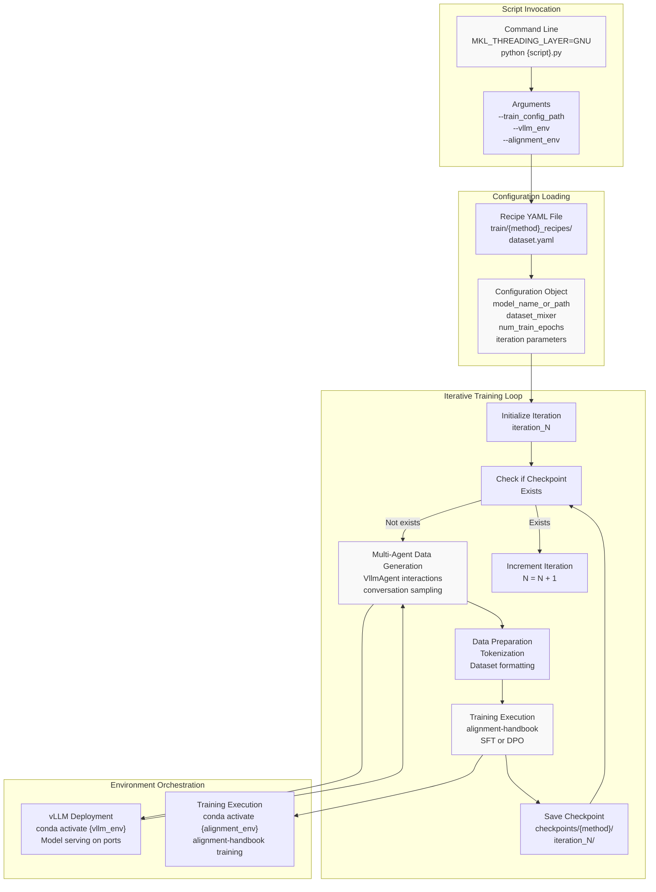
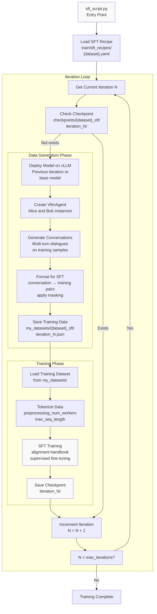
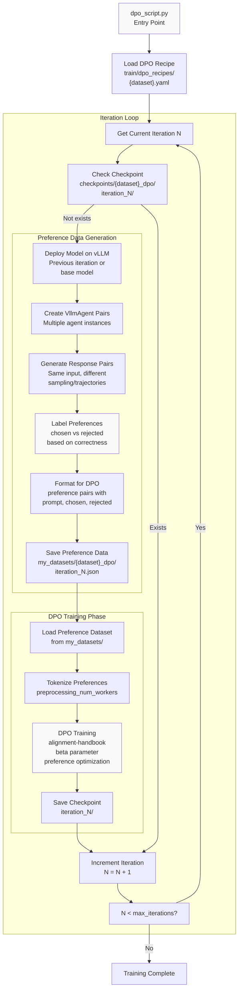
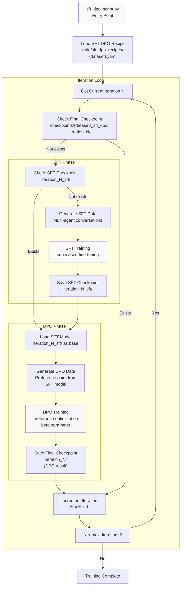
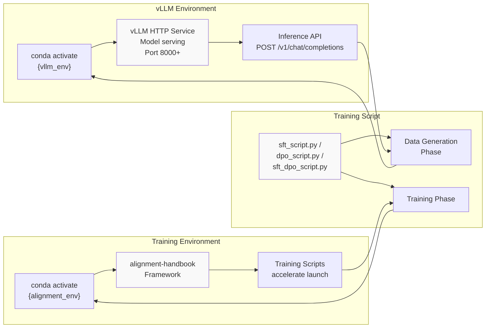

<!-- source: DeepWiki mcp.deepwiki.com · repo thunlp/Optima · page 6.1 Training Scripts Reference · fetched 2026-11-02 -->

# Training Scripts Reference

<details>
<summary>Relevant source files</summary>

The following files were used as context for generating this wiki page:

- [README.md](README.md)
- [README_revise.md](README_revise.md)

</details>


## Purpose and Scope

This page documents the three main training scripts that orchestrate Optima's iterative training process: `sft_script.py`, `dpo_script.py`, and `sft_dpo_script.py`. These scripts handle the complete training lifecycle including data generation, model training, checkpoint management, and iteration progression.

For information about the recipe configuration files these scripts consume, see [Recipe Configuration System](#6.2). For details on the underlying alignment framework and data processing, see [Alignment Handbook Integration](#9).

---

## Overview

Optima provides three training scripts corresponding to the three training methodologies:

| Script | Training Method | Use Case |
|--------|----------------|----------|
| `sft_script.py` | Iterative Supervised Fine-Tuning (iSFT) | Basic iterative training using supervised learning only |
| `dpo_script.py` | Iterative Direct Preference Optimization (iDPO) | Iterative training using preference optimization |
| `sft_dpo_script.py` | Combined iSFT-DPO | Hybrid approach alternating between SFT and DPO within each iteration |

All three scripts share a common execution pattern: they read configuration from YAML recipe files, orchestrate multi-agent data generation using vLLM, perform training using the alignment-handbook framework, and manage iterative checkpoint progression.

**Sources:** [README.md:58-92]()

---

## Command-Line Arguments

All three training scripts accept the same command-line arguments:

| Argument | Type | Required | Description |
|----------|------|----------|-------------|
| `--train_config_path` | string | Yes | Path to the YAML recipe configuration file (e.g., `train/sft_recipes/arc.yaml`) |
| `--vllm_env` | string | Yes | Name of the conda environment for vLLM deployment (typically `optima-vllm`) |
| `--alignment_env` | string | Yes | Name of the conda environment for training (typically `optima-train`) |

### Environment Variable

The scripts require the `MKL_THREADING_LAYER` environment variable to be set to `GNU` to avoid threading conflicts:

```bash
MKL_THREADING_LAYER=GNU python sft_script.py ...
```

**Sources:** [README.md:66-92]()

---

## Script Invocation Patterns

### iSFT Training

```bash
MKL_THREADING_LAYER=GNU python sft_script.py \
    --train_config_path train/sft_recipes/arc.yaml \
    --vllm_env optima-vllm \
    --alignment_env optima-train
```

### iDPO Training

```bash
MKL_THREADING_LAYER=GNU python dpo_script.py \
    --train_config_path train/dpo_recipes/arc.yaml \
    --vllm_env optima-vllm \
    --alignment_env optima-train
```

### iSFT-DPO Training

```bash
MKL_THREADING_LAYER=GNU python sft_dpo_script.py \
    --train_config_path train/sft_dpo_recipes/arc.yaml \
    --vllm_env optima-vllm \
    --alignment_env optima-train
```

**Sources:** [README.md:63-92]()

---

## Training Script Execution Flow



**Diagram: High-level execution flow common to all training scripts**

**Sources:** [README.md:58-92](), high-level architecture diagrams

---

## SFT Script Workflow

The `sft_script.py` script implements iterative supervised fine-tuning. For each iteration, it performs the following steps:



**Diagram: sft_script.py workflow showing data generation and training phases**

### Key Components

1. **Configuration Loading**: Reads SFT recipe specifying model path, dataset mixer, training hyperparameters, and iteration settings
2. **Model Deployment**: Uses vLLM environment to deploy the model for inference during data generation
3. **Multi-Agent Data Generation**: Creates VllmAgent instances that engage in multi-turn conversations
4. **Data Formatting**: Applies completion-only masking via the Mask data collator (see [Mask Data Collator](#6.3))
5. **Training Execution**: Runs SFT using alignment-handbook's training utilities
6. **Checkpoint Management**: Saves trained models to `checkpoints/{dataset}_sft/iteration_N/`

**Sources:** [README.md:62-70](), high-level architecture diagrams

---

## DPO Script Workflow

The `dpo_script.py` script implements iterative direct preference optimization. It generates preference pairs and trains the model to distinguish between preferred and dispreferred responses:



**Diagram: dpo_script.py workflow showing preference pair generation and DPO training**

### Key Differences from SFT

1. **Preference Pair Generation**: Generates multiple responses for the same input and labels them as chosen/rejected
2. **DPO Training**: Uses Direct Preference Optimization with a beta parameter to control regularization strength
3. **Dataset Format**: Requires preference pairs with `prompt`, `chosen`, and `rejected` fields
4. **Beta Parameter**: Configured in the DPO recipe (typically 0.1-0.2), controls how strongly the model deviates from the reference

**Sources:** [README.md:74-81](), high-level architecture diagrams

---

## SFT-DPO Script Workflow

The `sft_dpo_script.py` script combines both SFT and DPO training within each iteration, providing a hybrid approach:



**Diagram: sft_dpo_script.py workflow showing combined SFT and DPO phases**

### Hybrid Training Process

1. **SFT Phase**: First performs supervised fine-tuning within the iteration
2. **Intermediate Checkpoint**: Saves SFT result to `iteration_N_sft/`
3. **DPO Phase**: Uses the SFT checkpoint as the base for preference data generation
4. **Final Checkpoint**: Saves DPO-refined model to `iteration_N/` as the final iteration result
5. **Next Iteration**: Uses the DPO-refined model (`iteration_N/`) as the starting point for iteration N+1

This approach combines the benefits of both methods: SFT provides strong supervised signal, while DPO refines the model based on preference feedback.

**Sources:** [README.md:85-92](), high-level architecture diagrams

---

## Common Workflow Components

All three scripts share several common components and patterns:

### Environment Management



**Diagram: Dual environment orchestration showing script interaction with vLLM and training environments**

### Checkpoint Directory Structure

Each training script produces checkpoints in a predictable directory structure:

```
checkpoints/
├── {dataset}_{method}/          # e.g., arc_sft, arc_dpo, arc_sft_dpo
│   ├── iteration_0/             # Base model or initial fine-tuned model
│   │   ├── config.json
│   │   ├── model.safetensors
│   │   ├── tokenizer.json
│   │   └── ...
│   ├── iteration_1/             # First iteration result
│   ├── iteration_2/             # Second iteration result
│   └── ...
```

For the combined SFT-DPO approach, intermediate SFT checkpoints are also saved:

```
checkpoints/
├── {dataset}_sft_dpo/
│   ├── iteration_0_sft/         # SFT phase of iteration 0
│   ├── iteration_0/             # DPO phase (final) of iteration 0
│   ├── iteration_1_sft/         # SFT phase of iteration 1
│   ├── iteration_1/             # DPO phase (final) of iteration 1
│   └── ...
```

### Data Generation Patterns

All scripts use VllmAgent for multi-agent data generation:

1. **Model Deployment**: Deploy the current iteration model (or base model for iteration 0) on vLLM
2. **Agent Creation**: Instantiate VllmAgent instances (Alice and Bob) that communicate via HTTP
3. **Conversation Sampling**: Generate multi-turn conversations using temperature sampling
4. **Data Formatting**: Apply appropriate formatting (SFT vs DPO) and masking
5. **Dataset Saving**: Store generated data in `my_datasets/{dataset}_{method}/iteration_N.json`

### Training Execution Pattern

All scripts leverage the alignment-handbook framework:

1. **Dataset Loading**: Load prepared datasets from `my_datasets/`
2. **Tokenization**: Apply tokenization with preprocessing workers
3. **Data Collation**: Use Mask data collator for completion-only training
4. **Training Loop**: Execute training with accelerate/distributed training support
5. **Checkpoint Saving**: Save model, tokenizer, and configuration to checkpoint directory

**Sources:** [README.md:58-92](), high-level architecture diagrams

---

## Iteration Control

All scripts support iteration-based training controlled by recipe parameters:

| Parameter | Description | Typical Value |
|-----------|-------------|---------------|
| `max_iterations` | Maximum number of iterations to perform | 3-5 |
| `start_iteration` | Starting iteration number (for resuming) | 0 |
| `model_name_or_path` | Base model for iteration 0 | Path to pretrained model |

The scripts automatically:
- Check if a checkpoint for the current iteration already exists
- Skip data generation and training if checkpoint exists
- Load the previous iteration's checkpoint as the base for the next iteration
- Increment iteration counter and repeat until `max_iterations` is reached

This design enables:
- **Resumability**: Training can be interrupted and resumed from any iteration
- **Incremental Development**: Iterations can be added without retraining from scratch
- **Experimentation**: Different configurations can be tested on later iterations

**Sources:** High-level architecture diagrams, recipe system

---

## Error Handling and Logging

The training scripts implement several error handling mechanisms:

1. **Environment Validation**: Verify that specified conda environments exist before execution
2. **Checkpoint Verification**: Check checkpoint integrity before using for next iteration
3. **Port Management**: Ensure vLLM ports are available for model deployment
4. **Resource Monitoring**: Track GPU memory usage and fail gracefully on OOM errors
5. **Progress Logging**: Log detailed progress information for each phase

Log output is typically written to both console and log files in the checkpoint directory.

---

## Related Scripts

For inference and evaluation of trained checkpoints, see:
- [Running Inference](#8.1) - `inference_script.py` for batch inference
- [Multi-Agent Self-Consistency](#8.2) - `multi_sc_data_generate_script.py` for self-consistency evaluation

For configuration details, see:
- [Recipe Configuration System](#6.2) - YAML recipe structure and parameters
- [SFT Recipe Guide](#7.1), [DPO Recipe Guide](#7.2), [Combined SFT-DPO Recipes](#7.3)

**Sources:** [README.md:94-137]()

---

