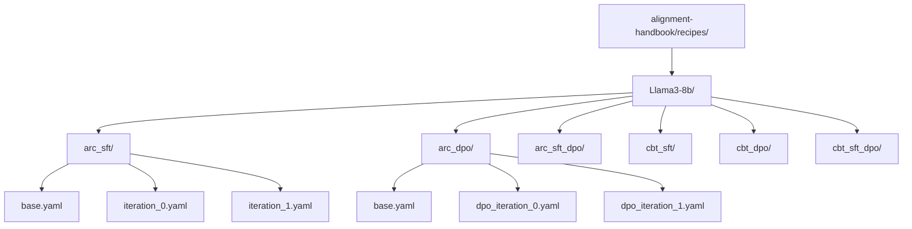
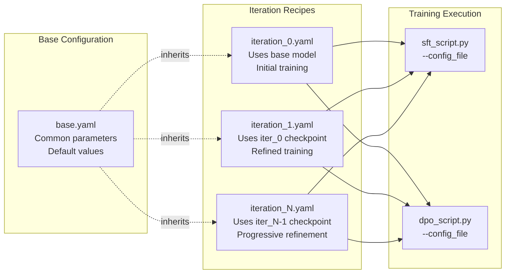
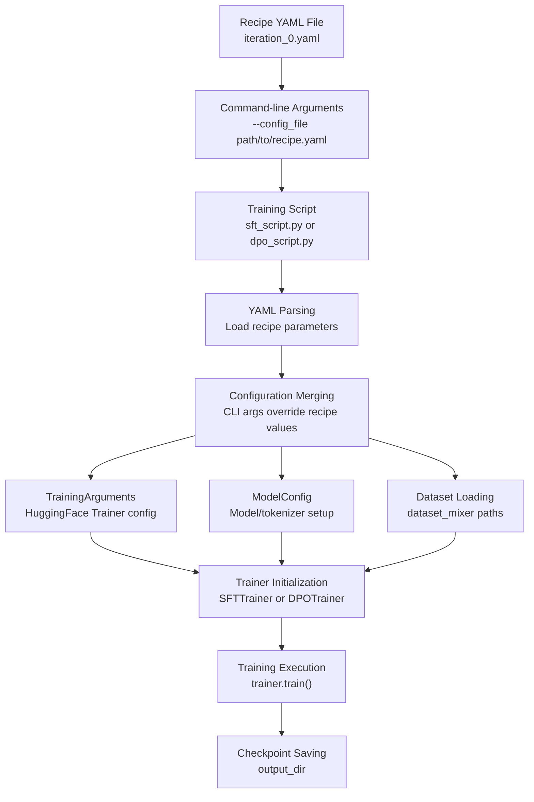
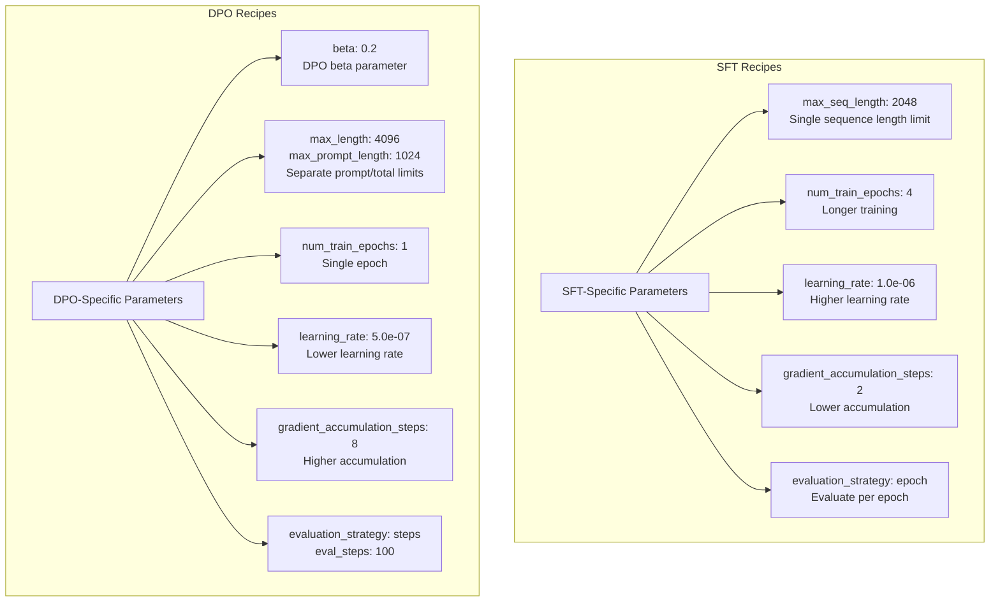

<!-- source: DeepWiki mcp.deepwiki.com · repo thunlp/Optima · page 6.2 Recipe Configuration System · fetched 2026-11-02 -->

# Recipe Configuration System

<details>
<summary>Relevant source files</summary>

The following files were used as context for generating this wiki page:

- [alignment-handbook/recipes/Llama3-8b/arc_dpo/base.yaml](alignment-handbook/recipes/Llama3-8b/arc_dpo/base.yaml)
- [alignment-handbook/recipes/Llama3-8b/arc_dpo/dpo_iteration_0.yaml](alignment-handbook/recipes/Llama3-8b/arc_dpo/dpo_iteration_0.yaml)
- [alignment-handbook/recipes/Llama3-8b/arc_sft/base.yaml](alignment-handbook/recipes/Llama3-8b/arc_sft/base.yaml)

</details>


## Purpose and Scope

The Recipe Configuration System is Optima's YAML-based configuration framework that defines all parameters for training and fine-tuning language models. Recipes specify model paths, dataset mixers, training hyperparameters, optimization settings, and infrastructure configurations in a declarative format. This system enables reproducible experiments and systematic hyperparameter exploration without modifying code.

This document covers the recipe file structure, parameter organization, and how recipes drive training execution. For details on specific recipe types and their parameters, see [SFT Recipe Guide](#7.1), [DPO Recipe Guide](#7.2), and [Recipe Parameters Reference](#7.4). For information on the training scripts that consume these recipes, see [Training Scripts Reference](#6.1).

---

## Recipe Directory Structure

Recipes are organized hierarchically in the `alignment-handbook/recipes/` directory, structured by model family, training method, and iteration:



**Directory Structure Explanation:**

| Level | Purpose | Example |
|-------|---------|---------|
| Root | Contains all recipe configurations | `alignment-handbook/recipes/` |
| Model Family | Groups recipes by base model | `Llama3-8b/` |
| Training Method | Separates SFT, DPO, and hybrid recipes | `arc_sft/`, `arc_dpo/`, `arc_sft_dpo/` |
| Recipe Files | Individual YAML configurations | `base.yaml`, `iteration_0.yaml` |

Sources: [alignment-handbook/recipes/Llama3-8b/arc_sft/base.yaml:1-39](), [alignment-handbook/recipes/Llama3-8b/arc_dpo/base.yaml:1-36](), [alignment-handbook/recipes/Llama3-8b/arc_dpo/dpo_iteration_0.yaml:1-35]()

---

## Recipe Hierarchy and Parameter Inheritance

Optima uses a two-tier recipe system where `base.yaml` defines common parameters that can be overridden by iteration-specific recipes:



**Key Differences Between Base and Iteration Recipes:**

| Aspect | base.yaml | iteration_N.yaml |
|--------|-----------|------------------|
| Purpose | Template with common settings | Specific iteration configuration |
| `model_name_or_path` | Points to pretrained model | Points to previous checkpoint |
| `dataset_mixer` | Example/template path | Actual iteration dataset path |
| `output_dir` | Example output location | Specific checkpoint directory |
| Usage | Reference for creating iterations | Directly consumed by scripts |

### Base Recipe Example

The base recipe establishes default values for the training method:

[alignment-handbook/recipes/Llama3-8b/arc_sft/base.yaml:1-39]()

Key parameters include:
- `model_name_or_path`: `/home/test/testdata/models/Meta-Llama-3-8B-Instruct` [line 23]()
- `dataset_mixer`: Template dataset path [line 5-6]()
- `num_train_epochs`: 4 [line 25]()
- `learning_rate`: 1.0e-06 [line 16]()

### Iteration-Specific Recipe Example

Iteration recipes override base parameters for specific training cycles:

[alignment-handbook/recipes/Llama3-8b/arc_dpo/dpo_iteration_0.yaml:1-35]()

Key overrides:
- `model_name_or_path`: `../checkpoints/arc_sft/iteration_0` [line 21]() - Uses previous checkpoint
- `dataset_mixer`: `../my_datasets/arc_dpo/iteration_0` [line 3-4]() - Iteration-specific dataset
- `output_dir`: `../checkpoints/arc_dpo/dpo_iteration_0` [line 25]() - Iteration-specific output

Sources: [alignment-handbook/recipes/Llama3-8b/arc_sft/base.yaml:1-39](), [alignment-handbook/recipes/Llama3-8b/arc_dpo/dpo_iteration_0.yaml:1-35]()

---

## Parameter Categories

Recipe configurations are organized into five main parameter categories:

```mermaid
graph TB
    Recipe["Recipe YAML File"]
    
    ModelParams["Model Parameters"]
    DataParams["Data Parameters"]
    TrainParams["Training Parameters"]
    OptimParams["Optimization Parameters"]
    InfraParams["Infrastructure Parameters"]
    
    Recipe --> ModelParams
    Recipe --> DataParams
    Recipe --> TrainParams
    Recipe --> OptimParams
    Recipe --> InfraParams
    
    ModelParams --> MP1["model_name_or_path"]
    ModelParams --> MP2["tokenizer_name_or_path"]
    ModelParams --> MP3["torch_dtype"]
    ModelParams --> MP4["use_flash_attention_2"]
    
    DataParams --> DP1["dataset_mixer"]
    DataParams --> DP2["dataset_splits"]
    DataParams --> DP3["max_seq_length / max_length"]
    DataParams --> DP4["preprocessing_num_workers"]
    
    TrainParams --> TP1["num_train_epochs"]
    TrainParams --> TP2["per_device_train_batch_size"]
    TrainParams --> TP3["gradient_accumulation_steps"]
    TrainParams --> TP4["save_strategy"]
    
    OptimParams --> OP1["learning_rate"]
    OptimParams --> OP2["optim"]
    OptimParams --> OP3["lr_scheduler_type"]
    OptimParams --> OP4["warmup_ratio"]
    OptimParams --> OP5["beta (DPO only)"]
    
    InfraParams --> IP1["bf16"]
    InfraParams --> IP2["gradient_checkpointing"]
    InfraParams --> IP3["log_level"]
    InfraParams --> IP4["seed"]
```



### 1. Model Parameters

Parameters that define the model architecture and loading configuration:

| Parameter | Purpose | Example Value | Recipe Location |
|-----------|---------|---------------|-----------------|
| `model_name_or_path` | Model checkpoint path | `/home/test/testdata/models/Meta-Llama-3-8B-Instruct` | [arc_sft/base.yaml:23]() |
| `model_revision` | Model version/branch | `main` | [arc_sft/base.yaml:24]() |
| `tokenizer_name_or_path` | Tokenizer path (often same as model) | `/home/test/testdata/models/Meta-Llama-3-8B-Instruct` | [arc_sft/base.yaml:35]() |
| `torch_dtype` | Model precision | `bfloat16` | [arc_sft/base.yaml:36]() |
| `use_flash_attention_2` | Enable Flash Attention optimization | `true` | [arc_sft/base.yaml:37]() |

### 2. Data Parameters

Parameters controlling dataset loading and preprocessing:

| Parameter | Purpose | Example Value | Recipe Location |
|-----------|---------|---------------|-----------------|
| `dataset_mixer` | Dataset paths and mixing ratios | `../my_datasets/arc_sft/iteration_0: 1.0` | [arc_dpo/dpo_iteration_0.yaml:3-4]() |
| `dataset_splits` | Train/test split names | `[train, test]` | [arc_dpo/base.yaml:8-10]() |
| `max_seq_length` / `max_length` | Maximum sequence length | `2048` (SFT) or `4096` (DPO) | [arc_sft/base.yaml:21]() |
| `max_prompt_length` | Maximum prompt length (DPO) | `1024` | [arc_dpo/base.yaml:26]() |
| `preprocessing_num_workers` | Number of data preprocessing workers | `8` | [arc_sft/base.yaml:30]() |
| `dataset_kwargs` | Additional dataset arguments | `{add_special_tokens: false}` | [arc_sft/base.yaml:2-4]() |

### 3. Training Parameters

Parameters controlling the training loop and checkpointing:

| Parameter | Purpose | Example Value | Recipe Location |
|-----------|---------|---------------|-----------------|
| `num_train_epochs` | Number of training epochs | `4` (SFT) or `1` (DPO) | [arc_sft/base.yaml:25]() |
| `per_device_train_batch_size` | Batch size per GPU | `1` | [arc_sft/base.yaml:29]() |
| `per_device_eval_batch_size` | Evaluation batch size | `1` | [arc_sft/base.yaml:28]() |
| `gradient_accumulation_steps` | Gradient accumulation steps | `2` (SFT) or `8` (DPO) | [arc_sft/base.yaml:12]() |
| `do_eval` | Enable evaluation | `true` | [arc_sft/base.yaml:10]() |
| `evaluation_strategy` | When to evaluate | `epoch` or `steps` | [arc_sft/base.yaml:11]() |
| `eval_steps` | Steps between evaluations | `100` | [arc_dpo/base.yaml:16]() |
| `save_strategy` | Checkpoint saving strategy | `'no'` | [arc_sft/base.yaml:33]() |
| `output_dir` | Checkpoint output directory | `../checkpoints/arc_sft/iteration_0` | [arc_sft/base.yaml:26]() |

### 4. Optimization Parameters

Parameters controlling the optimization algorithm and learning schedule:

| Parameter | Purpose | Example Value | Recipe Location |
|-----------|---------|---------------|-----------------|
| `learning_rate` | Learning rate | `1.0e-06` (SFT) or `5.0e-07` (DPO) | [arc_sft/base.yaml:16]() |
| `optim` | Optimizer type | `adamw_torch` | [arc_sft/base.yaml:24]() |
| `lr_scheduler_type` | Learning rate scheduler | `cosine` | [arc_sft/base.yaml:20]() |
| `warmup_ratio` | Warmup ratio | `0.1` | [arc_sft/base.yaml:38]() |
| `beta` | DPO beta parameter (DPO only) | `0.2` | [arc_dpo/base.yaml:13]() |

### 5. Infrastructure Parameters

Parameters controlling memory optimization, logging, and reproducibility:

| Parameter | Purpose | Example Value | Recipe Location |
|-----------|---------|---------------|-----------------|
| `bf16` | Enable bfloat16 training | `true` | [arc_sft/base.yaml:1]() |
| `gradient_checkpointing` | Enable gradient checkpointing | `true` | [arc_sft/base.yaml:13]() |
| `gradient_checkpointing_kwargs` | Gradient checkpointing config | `{use_reentrant: false}` | [arc_sft/base.yaml:14-15]() |
| `log_level` | Logging verbosity | `info` | [arc_sft/base.yaml:17]() |
| `logging_steps` | Steps between log outputs | `5` | [arc_sft/base.yaml:18]() |
| `seed` | Random seed for reproducibility | `42` | [arc_sft/base.yaml:34]() |

Sources: [alignment-handbook/recipes/Llama3-8b/arc_sft/base.yaml:1-39](), [alignment-handbook/recipes/Llama3-8b/arc_dpo/base.yaml:1-36](), [alignment-handbook/recipes/Llama3-8b/arc_dpo/dpo_iteration_0.yaml:1-35]()

---

## Recipe Loading and Execution Flow

Training scripts load recipe files and merge them with command-line arguments to configure the training run:



**Execution Steps:**

1. **Script Invocation**: Training script called with `--config_file` pointing to recipe YAML
   ```bash
   python sft_script.py --config_file alignment-handbook/recipes/Llama3-8b/arc_sft/iteration_0.yaml
   ```

2. **YAML Loading**: Recipe file parsed and parameters loaded into memory

3. **Configuration Merging**: Command-line arguments override recipe values if specified

4. **Component Initialization**:
   - `TrainingArguments` object created with training parameters
   - Model loaded from `model_name_or_path`
   - Tokenizer loaded from `tokenizer_name_or_path`
   - Datasets loaded from `dataset_mixer` paths

5. **Trainer Setup**: `SFTTrainer` or `DPOTrainer` initialized with configurations

6. **Training Execution**: `trainer.train()` runs the training loop

7. **Checkpoint Saving**: Final model saved to `output_dir` (if `save_strategy` allows)

Sources: [alignment-handbook/recipes/Llama3-8b/arc_sft/base.yaml:1-39](), [alignment-handbook/recipes/Llama3-8b/arc_dpo/dpo_iteration_0.yaml:1-35]()

---

## SFT vs DPO Recipe Differences

While SFT and DPO recipes share common parameters, they have key differences:



### SFT Recipe Characteristics

[alignment-handbook/recipes/Llama3-8b/arc_sft/base.yaml:1-39]()

- **Sequence Length**: `max_seq_length: 2048` [line 21]() - Single parameter for full sequence
- **Training Duration**: `num_train_epochs: 4` [line 25]() - Multiple epochs for supervised fine-tuning
- **Learning Rate**: `1.0e-06` [line 16]() - Higher rate for faster convergence
- **Batch Configuration**: `gradient_accumulation_steps: 2` [line 12]() - Lower accumulation
- **Evaluation**: `evaluation_strategy: epoch` [line 11]() - Evaluate after each epoch
- **Dataset Format**: Single-turn conversations with completion-only masking

### DPO Recipe Characteristics

[alignment-handbook/recipes/Llama3-8b/arc_dpo/base.yaml:1-36]()

- **Beta Parameter**: `beta: 0.2` [line 13]() - Controls strength of preference optimization
- **Sequence Lengths**: 
  - `max_length: 4096` [line 25]() - Total sequence limit
  - `max_prompt_length: 1024` [line 26]() - Separate prompt limit
- **Training Duration**: `num_train_epochs: 1` [line 27]() - Single epoch sufficient for preference alignment
- **Learning Rate**: `5.0e-07` [line 21]() - Lower rate for stable DPO training
- **Batch Configuration**: `gradient_accumulation_steps: 8` [line 17]() - Higher accumulation for stability
- **Evaluation**: `evaluation_strategy: steps` with `eval_steps: 100` [lines 15-16]() - More frequent evaluation
- **Dataset Format**: Chosen/rejected response pairs for preference learning

| Aspect | SFT Recipe | DPO Recipe |
|--------|-----------|------------|
| **Primary Use** | Supervised fine-tuning | Preference optimization |
| **Key Parameter** | `max_seq_length` | `beta` |
| **Typical Epochs** | 4 | 1 |
| **Learning Rate** | 1e-6 | 5e-7 |
| **Gradient Accumulation** | 2 | 8 |
| **Data Format** | Single responses | Chosen/rejected pairs |

Sources: [alignment-handbook/recipes/Llama3-8b/arc_sft/base.yaml:1-39](), [alignment-handbook/recipes/Llama3-8b/arc_dpo/base.yaml:1-36](), [alignment-handbook/recipes/Llama3-8b/arc_dpo/dpo_iteration_0.yaml:1-35]()

---

## Creating Custom Recipes

To create a custom recipe for a new dataset or iteration:

### Step 1: Choose Base Recipe

Start with an existing base recipe for the appropriate training method:
- **SFT**: `alignment-handbook/recipes/Llama3-8b/{dataset}_sft/base.yaml`
- **DPO**: `alignment-handbook/recipes/Llama3-8b/{dataset}_dpo/base.yaml`

### Step 2: Create Iteration Directory

```bash
mkdir -p alignment-handbook/recipes/Llama3-8b/my_dataset_sft
cd alignment-handbook/recipes/Llama3-8b/my_dataset_sft
```

### Step 3: Define Iteration Recipe

Create `iteration_0.yaml` with required overrides:

```yaml
# Model Configuration
model_name_or_path: /path/to/base/model  # or previous checkpoint
tokenizer_name_or_path: /path/to/tokenizer
torch_dtype: bfloat16
use_flash_attention_2: true

# Dataset Configuration
dataset_mixer:
  ../my_datasets/my_dataset_sft/iteration_0: 1.0
dataset_splits:
- train
- test

# Output Configuration
output_dir: ../checkpoints/my_dataset_sft/iteration_0

# Training Hyperparameters
num_train_epochs: 4
learning_rate: 1.0e-06
per_device_train_batch_size: 1
gradient_accumulation_steps: 2

# Infrastructure
bf16: true
gradient_checkpointing: true
preprocessing_num_workers: 8
save_strategy: 'no'
seed: 42
```

### Step 4: Validate Recipe

Ensure all paths exist and are accessible:
- `model_name_or_path` points to valid checkpoint
- `dataset_mixer` paths contain prepared datasets
- `output_dir` is writable

### Step 5: Execute Training

```bash
python sft_script.py --config_file alignment-handbook/recipes/Llama3-8b/my_dataset_sft/iteration_0.yaml
```

### Common Customization Patterns

| Customization | Parameters to Modify | Typical Use Case |
|---------------|---------------------|------------------|
| **Longer Training** | `num_train_epochs`, `max_steps` | Underfitting models |
| **Larger Batch Size** | `per_device_train_batch_size`, `gradient_accumulation_steps` | Better gradient estimates |
| **Faster Convergence** | `learning_rate`, `warmup_ratio` | Experimentation |
| **Memory Optimization** | `gradient_checkpointing`, `max_seq_length` | GPU memory constraints |
| **Dataset Mixing** | `dataset_mixer` (multiple entries with ratios) | Multi-dataset training |
| **DPO Strength** | `beta` | Control preference alignment strength |

### Multi-Dataset Mixing Example

```yaml
dataset_mixer:
  ../my_datasets/arc_sft/iteration_0: 0.5
  ../my_datasets/hotpot_qa_sft/iteration_0: 0.3
  ../my_datasets/trivial_qa_sft/iteration_0: 0.2
```

This configuration trains on a weighted mixture of three datasets with 50%/30%/20% sampling probabilities.

Sources: [alignment-handbook/recipes/Llama3-8b/arc_sft/base.yaml:1-39](), [alignment-handbook/recipes/Llama3-8b/arc_dpo/dpo_iteration_0.yaml:1-35]()

---

## Recipe Parameter Validation

Training scripts validate recipe parameters before execution. Common validation checks include:

| Validation | Description | Error if Failed |
|------------|-------------|-----------------|
| **Path Existence** | `model_name_or_path`, `dataset_mixer` paths exist | File/directory not found |
| **Type Checking** | Boolean parameters are bool, numeric parameters are numeric | Type mismatch |
| **Range Validation** | `learning_rate > 0`, `num_train_epochs > 0` | Invalid value |
| **DPO Requirements** | `beta` present for DPO recipes | Missing required parameter |
| **Consistency** | `per_device_train_batch_size * gradient_accumulation_steps` reasonable | Configuration warning |

For detailed information on all available parameters and their valid ranges, see [Recipe Parameters Reference](#7.4). For guidance on tuning specific parameters, see [Hyperparameter Tuning](#11.3).

Sources: [alignment-handbook/recipes/Llama3-8b/arc_sft/base.yaml:1-39](), [alignment-handbook/recipes/Llama3-8b/arc_dpo/base.yaml:1-36](), [alignment-handbook/recipes/Llama3-8b/arc_dpo/dpo_iteration_0.yaml:1-35]()

---

