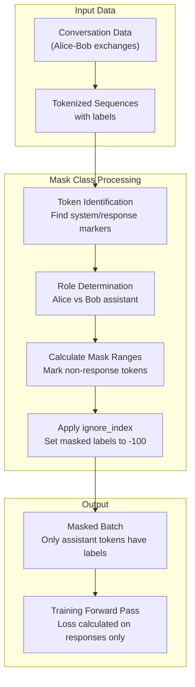
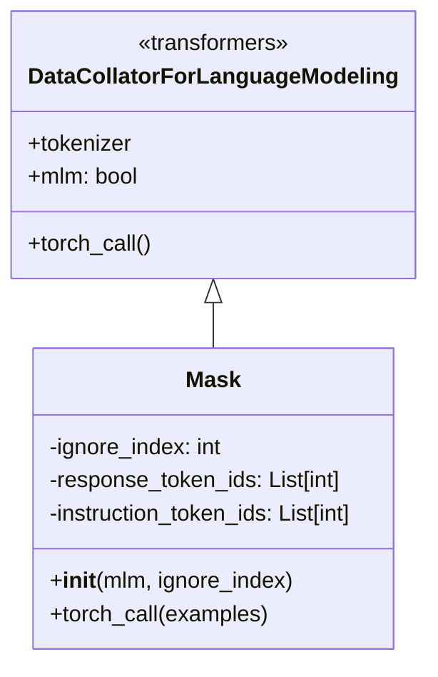
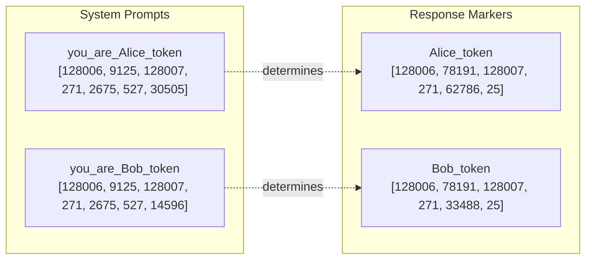
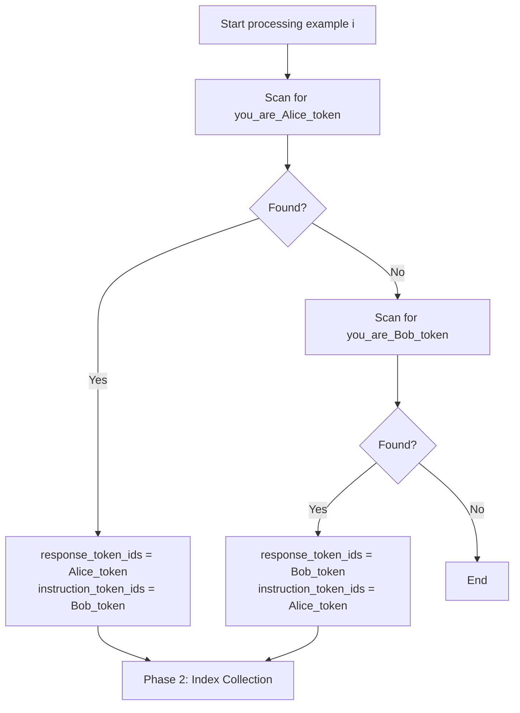
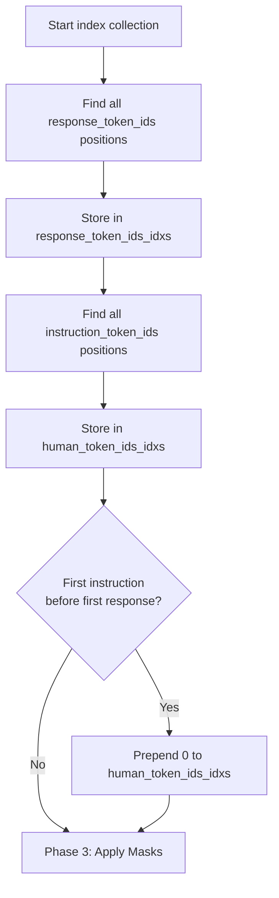
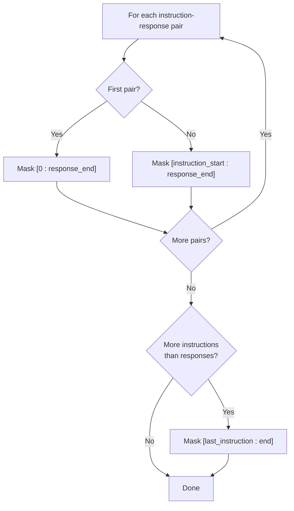
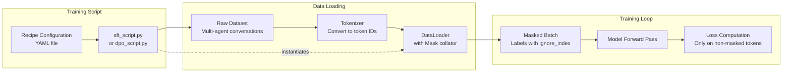

<!-- source: DeepWiki mcp.deepwiki.com · repo thunlp/Optima · page 6.3 Mask Data Collator · fetched 2026-11-02 -->

# Mask Data Collator

<details>
<summary>Relevant source files</summary>

The following files were used as context for generating this wiki page:

- [alignment-handbook/mask/__init__.py](alignment-handbook/mask/__init__.py)
- [alignment-handbook/mask/mask.py](alignment-handbook/mask/mask.py)

</details>


## Purpose and Scope

The Mask Data Collator is a specialized data processing component that implements completion-only language modeling for multi-agent conversational training data. It ensures that during training, the loss is calculated exclusively on assistant response tokens, while masking out system messages, instructions, and the conversational partner's responses. This is critical for the Optima framework's iterative training methodology, where agents must learn to generate effective responses without being penalized for tokens they didn't produce.

For information about how this integrates with the broader training system, see [Training System](#6). For details on the agent conversation format this processes, see [Multi-Agent System Architecture](#3.2).

---

## Overview

The `Mask` class extends the standard `DataCollatorForLanguageModeling` from the Transformers library to implement completion-only masking specifically designed for Alice-Bob style multi-agent conversations. Unlike standard language modeling where all tokens contribute to loss, the Mask collator selectively sets non-response tokens to an `ignore_index` value (default: -100), which PyTorch's loss functions automatically exclude from gradient computation.



**Diagram: Mask Data Collator Processing Flow**

Sources: [alignment-handbook/mask/mask.py:14-122]()

---

## Class Architecture

The `Mask` class inherits from `DataCollatorForLanguageModeling` and overrides the `torch_call` method to implement custom masking logic. The class maintains minimal state, relying primarily on predefined token sequences to identify conversation structure.



**Diagram: Mask Class Hierarchy**

| Component | Type | Purpose |
|-----------|------|---------|
| `Mask` | Class | Main data collator with completion-only masking |
| `ignore_index` | int | Token value for masked labels (default: -100) |
| `response_token_ids` | List[int] | Dynamic marker for current assistant's response |
| `instruction_token_ids` | List[int] | Dynamic marker for conversational partner's turn |
| `torch_call` | Method | Core masking implementation |

Sources: [alignment-handbook/mask/mask.py:14-42]()

---

## Token Identification System

The Mask collator uses predefined token sequences to identify different parts of the conversation structure. These tokens correspond to the Llama-3 chat template format used in multi-agent interactions.

### Predefined Token Sequences



**Diagram: Token Sequence Mapping**

| Token Variable | Token IDs | Decoded Content | Purpose |
|---------------|-----------|-----------------|---------|
| `you_are_Alice_token` | [128006, 9125, 128007, 271, 2675, 527, 30505] | "You are Alice" | System message identifying Alice role |
| `you_are_Bob_token` | [128006, 9125, 128007, 271, 2675, 527, 14596] | "You are Bob" | System message identifying Bob role |
| `Alice_token` | [128006, 78191, 128007, 271, 62786, 25] | "Alice:" | Response marker for Alice's turns |
| `Bob_token` | [128006, 78191, 128007, 271, 33488, 25] | "Bob:" | Response marker for Bob's turns |

These token sequences are hardcoded constants that match the Llama-3 tokenizer's output for the specific chat template format used in Optima's multi-agent conversations.

Sources: [alignment-handbook/mask/mask.py:7-11]()

---

## Masking Algorithm

The `torch_call` method implements a three-phase algorithm to mask conversation tokens appropriately.

### Phase 1: Role Determination

The algorithm first determines which agent is the "assistant" (whose responses should be trained) by scanning for system prompt tokens:



**Diagram: Role Determination Logic**

The algorithm searches for `you_are_Alice_token` and `you_are_Bob_token` in the labels to determine which agent is being trained. Once identified, it sets:
- `response_token_ids`: The token sequence marking the start of responses to preserve
- `instruction_token_ids`: The token sequence marking the conversational partner's turns to mask

Sources: [alignment-handbook/mask/mask.py:55-76]()

### Phase 2: Token Index Collection

After determining roles, the algorithm collects all positions where response and instruction tokens occur:



**Diagram: Index Collection Algorithm**

The algorithm:
1. Finds all occurrences of `response_token_ids` and stores their ending positions
2. Finds all occurrences of `instruction_token_ids` and stores their starting positions
3. Adjusts arrays if the conversation starts with an instruction before any response

Sources: [alignment-handbook/mask/mask.py:78-108]()

### Phase 3: Mask Application

Finally, the algorithm applies the `ignore_index` to appropriate token ranges:

| Range Type | Start | End | Masked? | Reasoning |
|-----------|-------|-----|---------|-----------|
| Initial tokens | 0 | First response end | Yes | System prompts and initial context |
| Between turns | Instruction start | Response end | Yes | Partner's instruction and system tokens |
| Response content | Response end | Next instruction start | No | Assistant's actual response (train on this) |
| Trailing tokens | Last instruction start | Sequence end | Yes | Incomplete conversation or padding |



**Diagram: Mask Application Logic**

The core masking logic at [alignment-handbook/mask/mask.py:110-120]():
- Pairs up instruction starts with response ends
- For the first pair, masks everything from the beginning up to the response end
- For subsequent pairs, masks from the instruction start to the response end
- If there are more instructions than responses (incomplete turn), masks from the last instruction to the end

This ensures that only the tokens between a response marker and the next instruction marker (i.e., the assistant's actual response content) contribute to the training loss.

Sources: [alignment-handbook/mask/mask.py:110-121]()

---

## Example Masking Behavior

Consider a simplified conversation sequence:

```
[SYSTEM: You are Alice] [Alice:] I can help with that. [Bob:] Thank you. [Alice:] You're welcome.
```

If training Alice as the assistant:

| Token Sequence | Masked? | Reason |
|----------------|---------|--------|
| `[SYSTEM: You are Alice]` | ✓ Yes | System prompt (before first response) |
| `[Alice:]` | ✓ Yes | Response marker (before first response) |
| `I can help with that.` | ✗ No | **Alice's response (TRAIN ON THIS)** |
| `[Bob:]` | ✓ Yes | Instruction marker |
| `Thank you.` | ✓ Yes | Bob's turn (not training on Bob) |
| `[Alice:]` | ✓ Yes | Response marker |
| `You're welcome.` | ✗ No | **Alice's response (TRAIN ON THIS)** |

Only the bolded portions contribute to the training loss.

---

## Integration with Training Pipeline

The Mask collator is instantiated by training scripts and used during data loading:



**Diagram: Mask Collator in Training Pipeline**

The Mask collator is typically instantiated in training scripts with:
- The tokenizer from the model configuration
- Default `mlm=False` for causal language modeling
- Default `ignore_index=-100` for PyTorch loss functions

During each training iteration:
1. The DataLoader batches multiple examples
2. The Mask collator's `torch_call` method processes the batch
3. Appropriate labels are set to -100 (ignore_index)
4. The model computes loss only on non-masked tokens
5. Gradients backpropagate only through assistant response tokens

This ensures that the model learns to generate responses as an assistant without being influenced by the partner's responses or system prompts.

Sources: [alignment-handbook/mask/mask.py:44-122]()

---

## Technical Implementation Details

### NumPy Array Operations

The masking algorithm uses NumPy for efficient token matching:

```python
# Find positions where first token of sequence appears
for assistant_idx in np.where(batch["labels"][i] == token_sequence[0])[0]:
    # Verify full sequence matches
    if token_sequence == batch["labels"][i][assistant_idx : assistant_idx + len(token_sequence)].tolist():
        # Process this occurrence
```

This two-step approach (find candidates via first token, then verify full sequence) balances efficiency with accuracy.

### Dynamic Role Assignment

Unlike `DataCollatorForCompletionOnlyLM` from TRL which requires static response templates, the Mask class dynamically determines which agent is the assistant for each example. This allows the same collator to process:
- Training data where Alice is the assistant
- Training data where Bob is the assistant
- Mixed batches containing both scenarios

The `response_token_ids` and `instruction_token_ids` attributes are reassigned for each example based on the detected system prompt.

### Inheritance and Compatibility

By inheriting from `DataCollatorForLanguageModeling` at [alignment-handbook/mask/mask.py:14](), the Mask class maintains compatibility with the Transformers training ecosystem. It properly implements:
- Padding and attention mask handling (via parent class)
- Return format expected by Trainer classes
- Batch dictionary structure with `input_ids`, `attention_mask`, and `labels` keys

Sources: [alignment-handbook/mask/mask.py:1-122]()

---

## Configuration and Usage

### Initialization Parameters

| Parameter | Type | Default | Description |
|-----------|------|---------|-------------|
| `tokenizer` | PreTrainedTokenizer | Required | Tokenizer for padding and special token handling |
| `mlm` | bool | False | Masked language modeling flag (unused, for compatibility) |
| `ignore_index` | int | -100 | Value for masked labels (PyTorch default for ignore) |

### Example Instantiation

```python
from mask import Mask
from transformers import AutoTokenizer

tokenizer = AutoTokenizer.from_pretrained("meta-llama/Meta-Llama-3-8B-Instruct")
mask_collator = Mask(
    tokenizer=tokenizer,
    mlm=False,
    ignore_index=-100
)
```

The collator is then passed to the DataLoader or Trainer as the `data_collator` argument.

---

## Limitations and Considerations

### Token Sequence Hardcoding

The current implementation uses hardcoded token IDs specific to Llama-3's tokenizer at [alignment-handbook/mask/mask.py:8-11](). This means:
- The collator is **not portable** to other model architectures without modification
- Token IDs must match exactly (including special tokens, whitespace handling)
- Different tokenizer versions may produce different token sequences

### Single-Agent Training Assumption

The algorithm assumes each training example should train exactly one agent (Alice or Bob). It does not support:
- Training both agents simultaneously in the same example
- Multi-party conversations with more than two agents
- Role-switching within a single example

### Performance Characteristics

The masking algorithm has time complexity:
- O(n) for scanning system prompts (n = sequence length)
- O(m) for finding response/instruction markers (m = number of markers)
- Overall O(n) per example, acceptable for typical training data sizes

Memory overhead is minimal, as the algorithm operates in-place on the batch dictionary.

Sources: [alignment-handbook/mask/mask.py:55-121]()

---

## Relationship to Alignment Handbook

The Mask class is located in `alignment-handbook/mask/` as part of Optima's integration with the alignment-handbook framework. While alignment-handbook provides general-purpose alignment tools, the Mask class is a custom Optima component designed specifically for multi-agent conversational training.

For more details on the broader alignment-handbook integration, see [Alignment Handbook Integration](#9).

Sources: [alignment-handbook/mask/__init__.py:1](), [alignment-handbook/mask/mask.py:1-122]()

---

