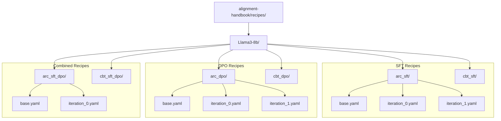
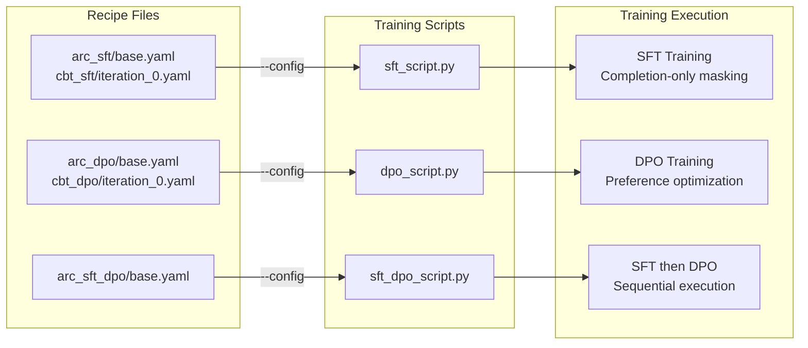
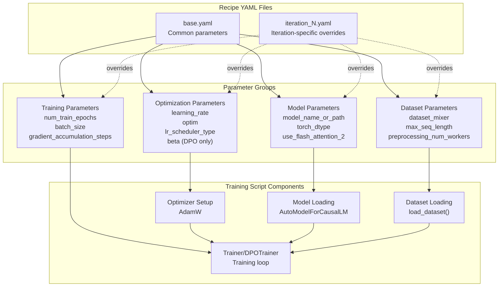
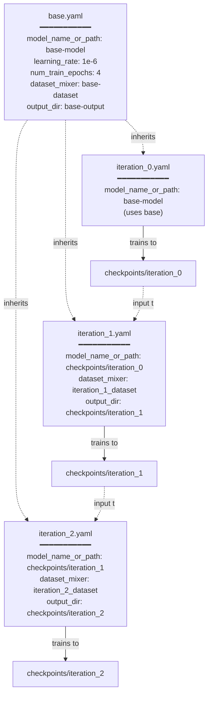

<!-- source: DeepWiki mcp.deepwiki.com · repo thunlp/Optima · page 7 Configuration Recipes · fetched 2026-11-02 -->

# Configuration Recipes

<details>
<summary>Relevant source files</summary>

The following files were used as context for generating this wiki page:

- [alignment-handbook/recipes/Llama3-8b/arc_dpo/base.yaml](alignment-handbook/recipes/Llama3-8b/arc_dpo/base.yaml)
- [alignment-handbook/recipes/Llama3-8b/arc_sft/base.yaml](alignment-handbook/recipes/Llama3-8b/arc_sft/base.yaml)

</details>


## Purpose and Scope

This page provides a comprehensive guide to the recipe configuration system in Optima. Recipes are YAML configuration files that specify all parameters for training experiments, including model settings, dataset configurations, training hyperparameters, and optimization settings. Each recipe defines a complete training setup that can be consumed by training scripts to execute SFT, DPO, or combined training runs.

For information about the recipe configuration system's technical implementation, including parameter inheritance and custom recipe creation, see [Recipe Configuration System](#6.2). For details on how training scripts consume these recipes, see [Training Scripts Reference](#6.1). For conceptual background on the training methods configured by these recipes, see [Iterative Training Methods](#3.1).

---

## Recipe Organization

The recipe system is organized hierarchically within the `alignment-handbook/recipes/` directory. Each training method (SFT, DPO, or combined) has its own subdirectory structure containing base configurations and iteration-specific overrides.

### Directory Structure



**Sources:** [alignment-handbook/recipes/Llama3-8b/arc_dpo/base.yaml:1-36](), [alignment-handbook/recipes/Llama3-8b/arc_sft/base.yaml:1-39]()

---

## Recipe Types

Optima supports three primary recipe types, each corresponding to a different training methodology:

| Recipe Type | Directory Pattern | Training Script | Purpose |
|-------------|------------------|-----------------|---------|
| **SFT** | `arc_sft/`, `cbt_sft/` | `sft_script.py` | Supervised fine-tuning with masked completion-only training |
| **DPO** | `arc_dpo/`, `cbt_dpo/` | `dpo_script.py` | Direct preference optimization for preference alignment |
| **SFT-DPO** | `arc_sft_dpo/`, `cbt_sft_dpo/` | `sft_dpo_script.py` | Combined pipeline executing both SFT and DPO sequentially |

### Recipe to Training Script Mapping



**Sources:** [alignment-handbook/recipes/Llama3-8b/arc_sft/base.yaml:1-39](), [alignment-handbook/recipes/Llama3-8b/arc_dpo/base.yaml:1-36]()

---

## Configuration Parameter Groups

Recipe files organize parameters into logical groups. Each group controls a specific aspect of the training process.

### Model Configuration

Model parameters specify the base model, tokenizer, and computational optimizations:

| Parameter | Type | Example | Description |
|-----------|------|---------|-------------|
| `model_name_or_path` | str | `/path/to/Meta-Llama-3-8B-Instruct` | Path to pretrained model or checkpoint |
| `model_revision` | str | `main` | Model revision/branch identifier |
| `tokenizer_name_or_path` | str | `/path/to/tokenizer` | Path to tokenizer (may include custom tokens) |
| `torch_dtype` | str | `bfloat16` | Model precision format |
| `use_flash_attention_2` | bool | `true` | Enable Flash Attention 2 optimization |

**Example from SFT recipe:**

```yaml
model_name_or_path: /home/test/testdata/models/Meta-Llama-3-8B-Instruct
model_revision: main
tokenizer_name_or_path: /home/test/testdata/models/Meta-Llama-3-8B-Instruct
torch_dtype: bfloat16
use_flash_attention_2: true
```

**Sources:** [alignment-handbook/recipes/Llama3-8b/arc_sft/base.yaml:23-25,36-37]()

### Dataset Configuration

Dataset parameters control data loading, mixing, and preprocessing:

| Parameter | Type | Example | Description |
|-----------|------|---------|-------------|
| `dataset_mixer` | dict | `{"/path/to/dataset": 1.0}` | Datasets and their mixing proportions |
| `dataset_splits` | list | `["train", "test"]` | Dataset splits to use |
| `preprocessing_num_workers` | int | `8` | Number of parallel preprocessing workers |
| `dataset_kwargs` | dict | `{add_special_tokens: false}` | Additional dataset processing arguments |
| `max_seq_length` | int | `2048` | Maximum sequence length (SFT) |
| `max_length` | int | `4096` | Maximum total length (DPO) |
| `max_prompt_length` | int | `1024` | Maximum prompt length (DPO only) |

**Example from DPO recipe:**

```yaml
dataset_mixer:
  /home/test/test04/yuanjiarui/project/src/dpo_3k_v1: 1.0
dataset_splits:
- train
- test
preprocessing_num_workers: 8
max_length: 4096
max_prompt_length: 1024
```

**Sources:** [alignment-handbook/recipes/Llama3-8b/arc_dpo/base.yaml:6-11,25-26]()

### Training Configuration

Training parameters control the training loop, evaluation, and checkpointing:

| Parameter | Type | Example | Description |
|-----------|------|---------|-------------|
| `num_train_epochs` | int | `4` | Number of training epochs |
| `per_device_train_batch_size` | int | `1` | Batch size per GPU for training |
| `per_device_eval_batch_size` | int | `1` | Batch size per GPU for evaluation |
| `gradient_accumulation_steps` | int | `2` | Steps to accumulate gradients before update |
| `do_eval` | bool | `true` | Whether to perform evaluation |
| `evaluation_strategy` | str | `epoch` or `steps` | When to evaluate (per epoch or per N steps) |
| `eval_steps` | int | `100` | Evaluation frequency (if strategy is `steps`) |
| `save_strategy` | str | `no`, `epoch`, `steps` | Checkpoint saving strategy |
| `logging_steps` | int | `5` | Logging frequency |
| `seed` | int | `42` | Random seed for reproducibility |
| `output_dir` | str | `/path/to/output` | Directory to save checkpoints and logs |

**Example from SFT recipe:**

```yaml
num_train_epochs: 4
per_device_train_batch_size: 1
per_device_eval_batch_size: 1
gradient_accumulation_steps: 2
do_eval: true
evaluation_strategy: epoch
save_strategy: 'no'
logging_steps: 5
seed: 42
output_dir: /home/test/test04/yuanjiarui/project/checkpoints/arc_modify/lr_1e-06_epoch_4_batch_2
```

**Sources:** [alignment-handbook/recipes/Llama3-8b/arc_sft/base.yaml:10-11,12,18,25,28-29,33-34]()

### Optimization Configuration

Optimization parameters control the optimizer, learning rate schedule, and gradient behavior:

| Parameter | Type | Example | Description |
|-----------|------|---------|-------------|
| `learning_rate` | float | `1.0e-06` | Initial learning rate |
| `optim` | str | `adamw_torch` | Optimizer type |
| `lr_scheduler_type` | str | `cosine` | Learning rate scheduler |
| `warmup_ratio` | float | `0.1` | Proportion of steps for warmup |
| `bf16` | bool | `true` | Use bfloat16 mixed precision |
| `gradient_checkpointing` | bool | `true` | Enable gradient checkpointing for memory efficiency |
| `gradient_checkpointing_kwargs` | dict | `{use_reentrant: false}` | Gradient checkpointing options |

**Example from SFT recipe:**

```yaml
learning_rate: 1.0e-06
optim: adamw_torch
lr_scheduler_type: cosine
warmup_ratio: 0.1
bf16: true
gradient_checkpointing: true
gradient_checkpointing_kwargs:
  use_reentrant: false
```

**Sources:** [alignment-handbook/recipes/Llama3-8b/arc_sft/base.yaml:1,13-15,16,20,38]()

### DPO-Specific Configuration

DPO recipes include an additional parameter critical for preference optimization:

| Parameter | Type | Example | Description |
|-----------|------|---------|-------------|
| `beta` | float | `0.1`, `0.2` | DPO regularization coefficient controlling KL divergence penalty |

Higher `beta` values result in models staying closer to the reference model, while lower values allow more deviation to satisfy preferences. The `beta` parameter is the key hyperparameter distinguishing DPO training from standard supervised fine-tuning.

**Example from DPO recipe:**

```yaml
beta: 0.2
```

**Sources:** [alignment-handbook/recipes/Llama3-8b/arc_dpo/base.yaml:13]()

---

## Recipe Parameter Flow

This diagram illustrates how recipe parameters flow through the system from configuration files to training execution:



**Sources:** [alignment-handbook/recipes/Llama3-8b/arc_sft/base.yaml:1-39](), [alignment-handbook/recipes/Llama3-8b/arc_dpo/base.yaml:1-36]()

---

## Recipe Hierarchy and Inheritance

Optima uses a two-level hierarchy for recipes: a `base.yaml` file containing common parameters and iteration-specific files that override or extend the base configuration.

### Inheritance Pattern



**Key patterns:**
- `base.yaml` defines parameters common across all iterations
- Iteration files (`iteration_0.yaml`, `iteration_1.yaml`, etc.) inherit from `base.yaml`
- Each iteration typically overrides: `model_name_or_path` (to use previous checkpoint), `dataset_mixer` (to use newly generated data), and `output_dir` (to save to new location)
- Hyperparameters like `learning_rate`, `batch_size`, and training epochs are usually inherited from base unless explicitly tuned per iteration

**Sources:** [alignment-handbook/recipes/Llama3-8b/arc_sft/base.yaml:23,26](), [alignment-handbook/recipes/Llama3-8b/arc_dpo/base.yaml:1,29]()

---

## Complete Recipe Examples

### SFT Recipe Example

Complete SFT recipe showing all major parameter groups:

```yaml
# Model Configuration
model_name_or_path: /home/test/testdata/models/Meta-Llama-3-8B-Instruct
model_revision: main
tokenizer_name_or_path: /home/test/testdata/models/Meta-Llama-3-8B-Instruct
torch_dtype: bfloat16
use_flash_attention_2: true

# Dataset Configuration
dataset_mixer:
  /home/test/test04/yuanjiarui/project/src/my_datasets/arc_sft_v3/modify: 1.0
dataset_splits:
- train
- test
dataset_kwargs:
  add_special_tokens: false
  append_concat_token: false
preprocessing_num_workers: 8
max_seq_length: 2048

# Training Configuration
num_train_epochs: 4
per_device_train_batch_size: 1
per_device_eval_batch_size: 1
do_eval: true
evaluation_strategy: epoch
save_strategy: 'no'
logging_steps: 5
logging_strategy: steps
seed: 42
output_dir: /home/test/test04/yuanjiarui/project/checkpoints/arc_modify/lr_1e-06_epoch_4_batch_2

# Optimization Configuration
learning_rate: 1.0e-06
optim: adamw_torch
lr_scheduler_type: cosine
warmup_ratio: 0.1
bf16: true
gradient_accumulation_steps: 2
gradient_checkpointing: true
gradient_checkpointing_kwargs:
  use_reentrant: false
```

**Key characteristics:**
- Uses `max_seq_length` (single value) for SFT
- `dataset_kwargs` controls special token handling
- Typically uses lower learning rates (1e-6) for fine-tuning
- `save_strategy: 'no'` common when only final checkpoint needed

**Sources:** [alignment-handbook/recipes/Llama3-8b/arc_sft/base.yaml:1-39]()

### DPO Recipe Example

Complete DPO recipe showing preference optimization configuration:

```yaml
# Model Configuration
model_name_or_path: /home/test/testdata/models/Meta-Llama-3-8B-Instruct
model_revision: main
tokenizer_name_or_path: /home/test/testdata/models/Meta-Llama-3-8B-Instruct
torch_dtype: bfloat16
use_flash_attention_2: true

# Dataset Configuration
dataset_mixer:
  /home/test/test04/yuanjiarui/project/src/dpo_3k_v1: 1.0
dataset_splits:
- train
- test
preprocessing_num_workers: 8
max_length: 4096
max_prompt_length: 1024

# DPO-Specific Configuration
beta: 0.2

# Training Configuration
num_train_epochs: 1
per_device_train_batch_size: 1
per_device_eval_batch_size: 1
do_eval: true
evaluation_strategy: steps
eval_steps: 100
save_strategy: "no"
logging_steps: 10
seed: 42
output_dir: /home/test/test04/yuanjiarui/project/checkpoints/dpo_llama_8b_3k_v1

# Optimization Configuration
learning_rate: 5.0e-7
optim: adamw_torch
lr_scheduler_type: cosine
warmup_ratio: 0.1
bf16: true
gradient_accumulation_steps: 8
gradient_checkpointing: true
gradient_checkpointing_kwargs:
  use_reentrant: false
```

**Key differences from SFT:**
- Includes `beta` parameter for DPO regularization
- Uses `max_length` and `max_prompt_length` instead of `max_seq_length`
- Often has even lower learning rates (5e-7)
- Higher gradient accumulation steps (8 vs 2)
- Typically runs for fewer epochs (1 vs 4)
- `evaluation_strategy: steps` with `eval_steps` for more frequent evaluation

**Sources:** [alignment-handbook/recipes/Llama3-8b/arc_dpo/base.yaml:1-36]()

---

## Usage with Training Scripts

Recipes are passed to training scripts via the `--config` argument:

### SFT Training

```bash
python sft_script.py \
    alignment-handbook/recipes/Llama3-8b/arc_sft/base.yaml
```

### DPO Training

```bash
python dpo_script.py \
    alignment-handbook/recipes/Llama3-8b/arc_dpo/iteration_0.yaml
```

### Combined SFT-DPO Training

```bash
python sft_dpo_script.py \
    alignment-handbook/recipes/Llama3-8b/arc_sft_dpo/base.yaml
```

The training script loads the YAML file, merges it with any command-line overrides, and initializes the training pipeline with the specified parameters.

**Sources:** [alignment-handbook/recipes/Llama3-8b/arc_sft/base.yaml:1](), [alignment-handbook/recipes/Llama3-8b/arc_dpo/base.yaml:1]()

---

## Comparative Analysis: SFT vs DPO Recipes

| Aspect | SFT Recipe | DPO Recipe |
|--------|-----------|-----------|
| **Sequence Length** | `max_seq_length: 2048` | `max_length: 4096`, `max_prompt_length: 1024` |
| **Learning Rate** | `1.0e-06` | `5.0e-7` (lower) |
| **Training Epochs** | `4` | `1` (fewer) |
| **Gradient Accumulation** | `2` | `8` (higher) |
| **Evaluation Strategy** | `epoch` | `steps` with `eval_steps: 100` |
| **Special Parameter** | None | `beta: 0.2` |
| **Dataset Format** | Single conversation format | Preference pairs (chosen/rejected) |
| **Typical Dataset Path** | `my_datasets/arc_sft_v3/` | `src/dpo_3k_v1/` |

This comparison highlights the different optimization strategies: SFT uses more epochs with higher learning rates for supervised learning, while DPO uses fewer epochs with lower learning rates and larger effective batch sizes (via gradient accumulation) to optimize preference alignment.

**Sources:** [alignment-handbook/recipes/Llama3-8b/arc_sft/base.yaml:12,16,21,25](), [alignment-handbook/recipes/Llama3-8b/arc_dpo/base.yaml:13,17,21,25,27]()

---

## Dataset Mixer Configuration

The `dataset_mixer` parameter enables flexible dataset composition and weighting. This is particularly useful for:

1. **Multiple datasets**: Combining different data sources with specified proportions
2. **Iteration tracking**: Pointing to iteration-specific generated datasets
3. **Ablation studies**: Testing different dataset compositions

### Example Dataset Mixer Patterns

**Single dataset (most common):**
```yaml
dataset_mixer:
  /path/to/arc_sft_v3/modify: 1.0
```

**Multiple datasets with weighting:**
```yaml
dataset_mixer:
  /path/to/arc_dataset: 0.6
  /path/to/hotpot_qa_dataset: 0.3
  /path/to/math_dataset: 0.1
```

The weights determine the sampling proportion during training. In iterative training, the dataset path typically changes per iteration to use newly generated multi-agent conversation data.

**Sources:** [alignment-handbook/recipes/Llama3-8b/arc_sft/base.yaml:5-6](), [alignment-handbook/recipes/Llama3-8b/arc_dpo/base.yaml:6-7]()

---

## Output Directory Conventions

The `output_dir` parameter follows a structured naming convention that encodes training configuration:

### SFT Output Directory Pattern

```
/path/to/checkpoints/arc_modify/lr_1e-06_epoch_4_batch_2
                      ├─ dataset ─┴─ learning_rate ─┴─ epochs ─┴─ batch_size
```

### DPO Output Directory Pattern

```
/path/to/checkpoints/dpo_llama_8b_3k_v1
                      └─ method ─┴─ model ─┴─ data_version
```

This convention enables:
- Easy identification of training runs
- Organized checkpoint management across iterations
- Quick parameter lookup without inspecting config files
- Systematic hyperparameter search tracking

**Sources:** [alignment-handbook/recipes/Llama3-8b/arc_sft/base.yaml:26](), [alignment-handbook/recipes/Llama3-8b/arc_dpo/base.yaml:29]()

---

## Related Documentation

For detailed guides on specific recipe types and parameter tuning:
- SFT recipe configurations and examples: [SFT Recipe Guide](#7.1)
- DPO recipe configurations and beta tuning: [DPO Recipe Guide](#7.2)
- Combined training pipeline recipes: [Combined SFT-DPO Recipes](#7.3)
- Complete parameter reference: [Recipe Parameters Reference](#7.4)

For technical implementation details:
- Recipe system architecture: [Recipe Configuration System](#6.2)
- Using recipes with training scripts: [Training Scripts Reference](#6.1)
- Training methods and when to use each recipe type: [Iterative Training Methods](#3.1)

---

