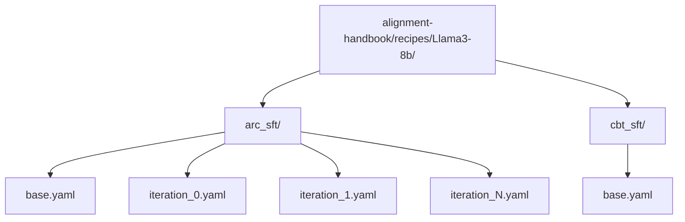
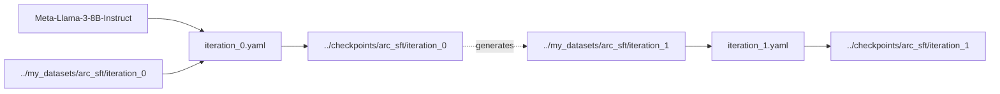
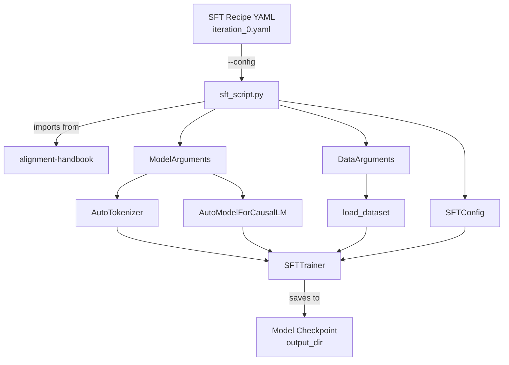

<!-- source: DeepWiki mcp.deepwiki.com · repo thunlp/Optima · page 7.1 SFT Recipe Guide · fetched 2026-11-02 -->

# SFT Recipe Guide

<details>
<summary>Relevant source files</summary>

The following files were used as context for generating this wiki page:

- [alignment-handbook/recipes/Llama3-8b/arc_sft/base.yaml](alignment-handbook/recipes/Llama3-8b/arc_sft/base.yaml)
- [alignment-handbook/recipes/Llama3-8b/arc_sft/iteration_0.yaml](alignment-handbook/recipes/Llama3-8b/arc_sft/iteration_0.yaml)
- [alignment-handbook/recipes/Llama3-8b/arc_sft/iteration_1.yaml](alignment-handbook/recipes/Llama3-8b/arc_sft/iteration_1.yaml)
- [alignment-handbook/recipes/Llama3-8b/cbt_sft/base.yaml](alignment-handbook/recipes/Llama3-8b/cbt_sft/base.yaml)

</details>


## Purpose and Scope

This page documents the Supervised Fine-Tuning (SFT) recipe configurations used in Optima's iterative training pipeline. SFT recipes are YAML configuration files that specify all parameters for supervised fine-tuning, including model paths, dataset locations, training hyperparameters, and optimization settings.

For information about the recipe configuration system architecture and parameter inheritance, see [Recipe Configuration System](#6.2). For details on executing these recipes, see [Training Scripts Reference](#6.1). For DPO-specific recipes, see [DPO Recipe Guide](#7.2). For a complete parameter reference, see [Recipe Parameters Reference](#7.4).

Sources: [alignment-handbook/recipes/Llama3-8b/arc_sft/base.yaml:1-39](), [alignment-handbook/recipes/Llama3-8b/cbt_sft/base.yaml:1-49]()

## Recipe Structure Overview

SFT recipes in Optima are organized hierarchically by dataset and iteration. Each recipe is a self-contained YAML file that defines the complete training configuration for one SFT training run.

### SFT Recipe Directory Structure



**SFT Recipe Organization**

Each dataset (ARC, CBT) has its own recipe directory containing:
- `base.yaml`: Base configuration with common parameters
- `iteration_N.yaml`: Iteration-specific configurations that reference generated datasets

Sources: [alignment-handbook/recipes/Llama3-8b/arc_sft/base.yaml:1-39](), [alignment-handbook/recipes/Llama3-8b/arc_sft/iteration_0.yaml:1-39](), [alignment-handbook/recipes/Llama3-8b/cbt_sft/base.yaml:1-49]()

## ARC SFT Recipes

### Base Configuration

The ARC SFT base recipe provides a template configuration that can be adapted for custom training runs. It demonstrates typical hyperparameter values for SFT on the ARC dataset.

**Key Configuration Elements:**

| Parameter Category | Primary Settings |
|-------------------|------------------|
| Model Source | `Meta-Llama-3-8B-Instruct` base model |
| Dataset Path | Custom path in `dataset_mixer` |
| Training Epochs | 4 epochs |
| Learning Rate | `1.0e-06` with cosine scheduler |
| Batch Configuration | Batch size 1, gradient accumulation 2 |
| Precision | `bfloat16` with Flash Attention 2 |

**Complete Base Recipe Structure:**

[alignment-handbook/recipes/Llama3-8b/arc_sft/base.yaml:1-39]()

```yaml
bf16: true
dataset_mixer:
  /home/test/test04/yuanjiarui/project/src/my_datasets/arc_sft_v3/modify: 1.0
dataset_splits:
- train
- test
gradient_accumulation_steps: 2
gradient_checkpointing: true
learning_rate: 1.0e-06
num_train_epochs: 4
per_device_train_batch_size: 1
use_flash_attention_2: true
warmup_ratio: 0.1
```

Sources: [alignment-handbook/recipes/Llama3-8b/arc_sft/base.yaml:1-39]()

### Iteration-Specific Configurations

Iteration-specific recipes enable Optima's iterative refinement loop. Each iteration uses datasets generated by the previous iteration's model.



**Iteration Data Flow in Recipes**

**Iteration 0 Configuration:**

[alignment-handbook/recipes/Llama3-8b/arc_sft/iteration_0.yaml:1-39]()

The iteration 0 recipe starts from the base pretrained model and uses the initial dataset:

```yaml
dataset_mixer:
  ../my_datasets/arc_sft/iteration_0: 1.0
model_name_or_path: /home/test/testdata/models/Meta-Llama-3-8B-Instruct
output_dir: ../checkpoints/arc_sft/iteration_0
```

**Iteration 1 Configuration:**

[alignment-handbook/recipes/Llama3-8b/arc_sft/iteration_1.yaml:1-39]()

Subsequent iterations point to iteratively generated datasets:

```yaml
dataset_mixer:
  ../my_datasets/arc_sft/iteration_1: 1.0
model_name_or_path: /home/test/testdata/models/Meta-Llama-3-8B-Instruct
output_dir: ../checkpoints/arc_sft/iteration_1
```

**Key Differences Across Iterations:**

| Configuration Aspect | Changes Between Iterations |
|---------------------|---------------------------|
| `dataset_mixer` path | Points to `iteration_N` dataset directory |
| `output_dir` path | Points to `iteration_N` checkpoint directory |
| `model_name_or_path` | Remains base model (iterative data, not model) |
| All other parameters | Identical across iterations |

Sources: [alignment-handbook/recipes/Llama3-8b/arc_sft/iteration_0.yaml:1-39](), [alignment-handbook/recipes/Llama3-8b/arc_sft/iteration_1.yaml:1-39]()

## CBT SFT Recipes

The CBT (Children's Book Test) SFT recipe demonstrates an alternative configuration with different hyperparameters optimized for the CBT dataset.

### CBT Configuration Differences

**Comparison with ARC SFT:**

| Parameter | ARC SFT | CBT SFT | Rationale |
|-----------|---------|---------|-----------|
| `learning_rate` | `1.0e-06` | `2.0e-05` | CBT uses 20x higher learning rate |
| `num_train_epochs` | `4` | `2` | CBT trains for fewer epochs |
| `gradient_accumulation_steps` | `2` | `4` | CBT accumulates over more steps |
| Dataset path | `arc_sft` structure | `dpo_3k_v1` | Different dataset organization |

**CBT Recipe Structure:**

[alignment-handbook/recipes/Llama3-8b/cbt_sft/base.yaml:1-49]()

```yaml
# Model arguments
model_name_or_path: /home/test/testdata/models/Meta-Llama-3-8B-Instruct
torch_dtype: bfloat16
use_flash_attention_2: true

# Data training arguments
dataset_mixer:
  /home/test/test04/yuanjiarui/project/src/dpo_3k_v1: 1.0
preprocessing_num_workers: 8

# SFT trainer config
learning_rate: 2.0e-05
num_train_epochs: 2
gradient_accumulation_steps: 4
```

The CBT recipe includes more detailed inline comments explaining parameter purposes, particularly around special token handling:

```yaml
dataset_kwargs:
  add_special_tokens: false  # We already wrap <bos> and <eos> in the chat template
  append_concat_token: false # No need to add <eos> across samples
```

Sources: [alignment-handbook/recipes/Llama3-8b/cbt_sft/base.yaml:1-49]()

## SFT Recipe Parameters

### Parameter Categories

SFT recipes are organized into five main parameter categories:

```mermaid
graph TD
    SFTRecipe["SFT Recipe YAML"]
    
    ModelParams["Model Parameters"]
    DataParams["Data Parameters"]
    TrainParams["Training Parameters"]
    OptimParams["Optimization Parameters"]
    SystemParams["System Parameters"]
    
    SFTRecipe --> ModelParams
    SFTRecipe --> DataParams
    SFTRecipe --> TrainParams
    SFTRecipe --> OptimParams
    SFTRecipe --> SystemParams
    
    ModelParams --> ModelPath["model_name_or_path"]
    ModelParams --> TokenizerPath["tokenizer_name_or_path"]
    ModelParams --> Dtype["torch_dtype"]
    ModelParams --> FlashAttn["use_flash_attention_2"]
    
    DataParams --> Mixer["dataset_mixer"]
    DataParams --> Splits["dataset_splits"]
    DataParams --> MaxSeq["max_seq_length"]
    DataParams --> Workers["preprocessing_num_workers"]
    
    TrainParams --> Epochs["num_train_epochs"]
    TrainParams --> BatchSize["per_device_train_batch_size"]
    TrainParams --> GradAccum["gradient_accumulation_steps"]
    TrainParams --> GradCheck["gradient_checkpointing"]
    
    OptimParams --> LR["learning_rate"]
    OptimParams --> Scheduler["lr_scheduler_type"]
    OptimParams --> Warmup["warmup_ratio"]
    
    SystemParams --> OutputDir["output_dir"]
    SystemParams --> Seed["seed"]
    SystemParams --> Logging["logging_steps"]
```



**SFT Recipe Parameter Organization**

Sources: [alignment-handbook/recipes/Llama3-8b/arc_sft/base.yaml:1-39](), [alignment-handbook/recipes/Llama3-8b/cbt_sft/base.yaml:1-49]()

### Model Parameters

These parameters define the base model and its loading configuration:

| Parameter | Type | Description | Typical Values |
|-----------|------|-------------|----------------|
| `model_name_or_path` | string | Path to pretrained model checkpoint | `/path/to/Meta-Llama-3-8B-Instruct` |
| `model_revision` | string | Model revision or branch | `main` |
| `tokenizer_name_or_path` | string | Path to tokenizer (usually same as model) | Same as `model_name_or_path` |
| `torch_dtype` | string | Tensor dtype for model weights | `bfloat16` |
| `use_flash_attention_2` | boolean | Enable Flash Attention 2 optimization | `true` |

**Usage in Recipe:**

[alignment-handbook/recipes/Llama3-8b/arc_sft/base.yaml:23-25](), [alignment-handbook/recipes/Llama3-8b/arc_sft/base.yaml:35-37]()

Sources: [alignment-handbook/recipes/Llama3-8b/arc_sft/base.yaml:23-37]()

### Data Parameters

These parameters control dataset loading and preprocessing:

| Parameter | Type | Description | Values in Recipes |
|-----------|------|-------------|-------------------|
| `dataset_mixer` | dict | Mapping of dataset paths to sampling weights | `{path: 1.0}` |
| `dataset_splits` | list | Dataset splits to use | `[train, test]` |
| `dataset_kwargs` | dict | Additional dataset loading arguments | See below |
| `max_seq_length` | int | Maximum sequence length for training | `2048` |
| `preprocessing_num_workers` | int | Number of workers for data preprocessing | `8` |

**Dataset Kwargs:**

[alignment-handbook/recipes/Llama3-8b/arc_sft/base.yaml:2-4]()

```yaml
dataset_kwargs:
  add_special_tokens: false
  append_concat_token: false
```

- `add_special_tokens: false` - Special tokens (BOS, EOS) are already included in chat templates
- `append_concat_token: false` - No need to add EOS token when concatenating samples

**Dataset Mixer Format:**

[alignment-handbook/recipes/Llama3-8b/arc_sft/iteration_0.yaml:5-6]()

```yaml
dataset_mixer:
  ../my_datasets/arc_sft/iteration_0: 1.0
```

The weight value (1.0) determines sampling proportion when mixing multiple datasets. Single-dataset recipes always use 1.0.

Sources: [alignment-handbook/recipes/Llama3-8b/arc_sft/base.yaml:2-8](), [alignment-handbook/recipes/Llama3-8b/arc_sft/base.yaml:21-22](), [alignment-handbook/recipes/Llama3-8b/arc_sft/base.yaml:30]()

### Training Parameters

These parameters control the training loop behavior:

| Parameter | Type | Description | ARC Value | CBT Value |
|-----------|------|-------------|-----------|-----------|
| `num_train_epochs` | int | Number of complete passes over dataset | `4` | `2` |
| `max_steps` | int | Maximum training steps (-1 for epoch-based) | `-1` | `-1` |
| `per_device_train_batch_size` | int | Batch size per GPU during training | `1` | `1` |
| `per_device_eval_batch_size` | int | Batch size per GPU during evaluation | `1` | `1` |
| `gradient_accumulation_steps` | int | Steps to accumulate gradients before update | `2` | `4` |
| `gradient_checkpointing` | boolean | Enable gradient checkpointing for memory | `true` | `true` |
| `gradient_checkpointing_kwargs` | dict | Gradient checkpointing configuration | See below | See below |

**Gradient Checkpointing Configuration:**

[alignment-handbook/recipes/Llama3-8b/arc_sft/base.yaml:14-15]()

```yaml
gradient_checkpointing_kwargs:
  use_reentrant: false
```

Setting `use_reentrant: false` uses the non-reentrant gradient checkpointing implementation, which is more memory-efficient with certain model architectures.

**Effective Batch Size Calculation:**

```
effective_batch_size = per_device_train_batch_size × num_gpus × gradient_accumulation_steps
```

For ARC: `1 × num_gpus × 2 = 2 × num_gpus`  
For CBT: `1 × num_gpus × 4 = 4 × num_gpus`

Sources: [alignment-handbook/recipes/Llama3-8b/arc_sft/base.yaml:12-15](), [alignment-handbook/recipes/Llama3-8b/arc_sft/base.yaml:22-23](), [alignment-handbook/recipes/Llama3-8b/arc_sft/base.yaml:25](), [alignment-handbook/recipes/Llama3-8b/arc_sft/base.yaml:28-29](), [alignment-handbook/recipes/Llama3-8b/cbt_sft/base.yaml:23-26](), [alignment-handbook/recipes/Llama3-8b/cbt_sft/base.yaml:36](), [alignment-handbook/recipes/Llama3-8b/cbt_sft/base.yaml:39-40]()

### Optimization Parameters

These parameters control the optimization algorithm and learning rate schedule:

| Parameter | Type | Description | ARC Value | CBT Value |
|-----------|------|-------------|-----------|-----------|
| `learning_rate` | float | Peak learning rate | `1.0e-06` | `2.0e-05` |
| `lr_scheduler_type` | string | Learning rate schedule strategy | `cosine` | `cosine` |
| `warmup_ratio` | float | Fraction of training for warmup | `0.1` | `0.1` |
| `bf16` | boolean | Enable bfloat16 mixed precision training | `true` | `true` |

**Learning Rate Schedule:**

Both recipes use cosine annealing with warmup:

1. **Warmup Phase**: Linear increase from 0 to `learning_rate` over first 10% of training
2. **Cosine Decay**: Cosine decay from `learning_rate` to 0 over remaining 90% of training

**Learning Rate Differences:**

- **ARC SFT**: `1.0e-06` - Very conservative learning rate for stable fine-tuning
- **CBT SFT**: `2.0e-05` - 20x higher, suitable for faster adaptation to CBT domain

Sources: [alignment-handbook/recipes/Llama3-8b/arc_sft/base.yaml:1](), [alignment-handbook/recipes/Llama3-8b/arc_sft/base.yaml:16](), [alignment-handbook/recipes/Llama3-8b/arc_sft/base.yaml:20](), [alignment-handbook/recipes/Llama3-8b/arc_sft/base.yaml:38](), [alignment-handbook/recipes/Llama3-8b/cbt_sft/base.yaml:17](), [alignment-handbook/recipes/Llama3-8b/cbt_sft/base.yaml:29](), [alignment-handbook/recipes/Llama3-8b/cbt_sft/base.yaml:33](), [alignment-handbook/recipes/Llama3-8b/cbt_sft/base.yaml:48]()

### Evaluation and Logging Parameters

These parameters control evaluation frequency and logging verbosity:

| Parameter | Type | Description | Value |
|-----------|------|-------------|-------|
| `do_eval` | boolean | Whether to run evaluation | `true` |
| `evaluation_strategy` | string | When to evaluate | `epoch` |
| `save_strategy` | string | When to save checkpoints | `no` |
| `logging_strategy` | string | Logging frequency basis | `steps` |
| `logging_steps` | int | Log every N steps | `5` |
| `log_level` | string | Logging verbosity level | `info` |

**Evaluation Strategy:**

[alignment-handbook/recipes/Llama3-8b/arc_sft/base.yaml:10-11]()

```yaml
do_eval: true
evaluation_strategy: epoch
```

Evaluation runs at the end of each epoch, allowing monitoring of validation performance throughout training.

**Save Strategy:**

[alignment-handbook/recipes/Llama3-8b/arc_sft/base.yaml:33]()

```yaml
save_strategy: 'no'
```

Intermediate checkpoints are not saved during training. Only the final model at training completion is saved to `output_dir`. This reduces storage requirements during iterative training.

Sources: [alignment-handbook/recipes/Llama3-8b/arc_sft/base.yaml:10-11](), [alignment-handbook/recipes/Llama3-8b/arc_sft/base.yaml:17-19](), [alignment-handbook/recipes/Llama3-8b/arc_sft/base.yaml:33]()

### System Parameters

These parameters control output paths, reproducibility, and system behavior:

| Parameter | Type | Description | Example Values |
|-----------|------|-------------|----------------|
| `output_dir` | string | Directory for saving trained model | `../checkpoints/arc_sft/iteration_0` |
| `overwrite_output_dir` | boolean | Whether to overwrite existing output | `true` |
| `seed` | int | Random seed for reproducibility | `42` |
| `push_to_hub` | boolean | Upload model to Hugging Face Hub | `false` |
| `remove_unused_columns` | boolean | Remove dataset columns not needed | `true` |

**Output Directory Structure:**

[alignment-handbook/recipes/Llama3-8b/arc_sft/iteration_0.yaml:26]()

```yaml
output_dir: ../checkpoints/arc_sft/iteration_0
```

The output directory follows the pattern: `../checkpoints/{dataset}_{method}/iteration_{N}`

**Reproducibility:**

[alignment-handbook/recipes/Llama3-8b/arc_sft/base.yaml:34]()

```yaml
seed: 42
```

Setting a fixed seed ensures reproducible results across training runs with identical configurations.

Sources: [alignment-handbook/recipes/Llama3-8b/arc_sft/base.yaml:26-27](), [alignment-handbook/recipes/Llama3-8b/arc_sft/base.yaml:31-32](), [alignment-handbook/recipes/Llama3-8b/arc_sft/base.yaml:34]()

## Recipe Consumption and Execution

### How Training Scripts Use SFT Recipes



**SFT Recipe Execution Flow**

**Command-Line Invocation:**

```bash
python sft_script.py --config alignment-handbook/recipes/Llama3-8b/arc_sft/iteration_0.yaml
```

The training script:
1. Loads the YAML recipe file
2. Parses parameters into configuration objects
3. Initializes model, tokenizer, and dataset
4. Creates `SFTTrainer` with all configurations
5. Executes training loop
6. Saves final checkpoint to `output_dir`

For detailed information on the execution process, see [Training Scripts Reference](#6.1). For information about the mask data collator used during training, see [Mask Data Collator](#6.3).

Sources: [alignment-handbook/recipes/Llama3-8b/arc_sft/iteration_0.yaml:1-39]()

## Recipe Customization Guidelines

### Creating Custom SFT Recipes

To create a custom SFT recipe for a new dataset:

1. **Copy an existing recipe** as a template (e.g., `arc_sft/base.yaml`)
2. **Update dataset paths** in `dataset_mixer`
3. **Adjust learning rate** based on dataset size and complexity
4. **Configure epochs** based on convergence requirements
5. **Set output directory** to unique checkpoint location

**Example Custom Recipe Template:**

```yaml
# Model configuration
model_name_or_path: /path/to/base/model
tokenizer_name_or_path: /path/to/base/model
torch_dtype: bfloat16
use_flash_attention_2: true

# Dataset configuration
dataset_mixer:
  /path/to/custom/dataset: 1.0
dataset_splits:
- train
- test
preprocessing_num_workers: 8
max_seq_length: 2048

# Training configuration
num_train_epochs: 4
per_device_train_batch_size: 1
gradient_accumulation_steps: 2
gradient_checkpointing: true

# Optimization configuration
learning_rate: 1.0e-06
lr_scheduler_type: cosine
warmup_ratio: 0.1
bf16: true

# Output configuration
output_dir: /path/to/checkpoints/custom_dataset/iteration_0
save_strategy: 'no'
seed: 42
```

### Parameter Tuning Recommendations

**Learning Rate Selection:**

| Dataset Characteristic | Recommended Learning Rate | Example |
|-----------------------|---------------------------|---------|
| Small dataset (<10K samples) | `1.0e-06` to `5.0e-06` | ARC: `1.0e-06` |
| Medium dataset (10K-100K) | `5.0e-06` to `2.0e-05` | CBT: `2.0e-05` |
| Large dataset (>100K) | `2.0e-05` to `5.0e-05` | - |

**Epoch Configuration:**

- **Conservative**: 4 epochs with low learning rate (ARC approach)
- **Aggressive**: 2 epochs with higher learning rate (CBT approach)
- **Rule of thumb**: More epochs with lower learning rate = more stable; fewer epochs with higher learning rate = faster

**Gradient Accumulation:**

- Increase `gradient_accumulation_steps` if GPU memory is limited
- Maintain effective batch size: aim for 8-32 across all GPUs
- Trade-off: Higher accumulation = slower training but lower memory

For advanced hyperparameter tuning guidance, see [Hyperparameter Tuning](#11.3). For performance optimization techniques, see [Performance Optimization](#11.4).

Sources: [alignment-handbook/recipes/Llama3-8b/arc_sft/base.yaml:1-39](), [alignment-handbook/recipes/Llama3-8b/cbt_sft/base.yaml:1-49]()

---

