<!-- source: DeepWiki mcp.deepwiki.com · repo thunlp/Optima · page 7.2 DPO Recipe Guide · fetched 2026-11-02 -->

# DPO Recipe Guide

<details>
<summary>Relevant source files</summary>

The following files were used as context for generating this wiki page:

- [alignment-handbook/recipes/Llama3-8b/arc_dpo/base.yaml](alignment-handbook/recipes/Llama3-8b/arc_dpo/base.yaml)
- [alignment-handbook/recipes/Llama3-8b/arc_dpo/dpo_iteration_0.yaml](alignment-handbook/recipes/Llama3-8b/arc_dpo/dpo_iteration_0.yaml)
- [alignment-handbook/recipes/Llama3-8b/arc_dpo/dpo_iteration_1.yaml](alignment-handbook/recipes/Llama3-8b/arc_dpo/dpo_iteration_1.yaml)
- [alignment-handbook/recipes/Llama3-8b/cbt_dpo/base.yaml](alignment-handbook/recipes/Llama3-8b/cbt_dpo/base.yaml)

</details>


This document provides comprehensive guidance for configuring Direct Preference Optimization (DPO) training recipes in Optima. DPO recipes define all hyperparameters and settings for preference-based alignment training that follows supervised fine-tuning.

For supervised fine-tuning recipes, see [SFT Recipe Guide](#7.1). For recipes that combine both training methods, see [Combined SFT-DPO Recipes](#7.3). For a complete parameter reference, see [Recipe Parameters Reference](#7.4). For theoretical background on DPO methodology, see [Direct Preference Optimization](#3.3).

## Recipe Structure and Organization

DPO recipes are organized under `alignment-handbook/recipes/Llama3-8b/` with separate directories for each dataset:

```
alignment-handbook/recipes/Llama3-8b/
├── arc_dpo/
│   ├── base.yaml
│   ├── dpo_iteration_0.yaml
│   ├── dpo_iteration_1.yaml
│   └── dpo_iteration_2.yaml
└── cbt_dpo/
    ├── base.yaml
    ├── dpo_iteration_0.yaml
    ├── dpo_iteration_1.yaml
    └── dpo_iteration_2.yaml
```

Each DPO recipe directory contains a `base.yaml` template and iteration-specific configurations. The iteration files inherit from the base template but override dataset paths, model paths, and output directories.

**Sources:** [alignment-handbook/recipes/Llama3-8b/arc_dpo/base.yaml:1-36](), [alignment-handbook/recipes/Llama3-8b/cbt_dpo/base.yaml:1-36]()

## DPO Recipe Architecture

The following diagram illustrates how DPO recipes connect checkpoints, datasets, and training iterations:

```mermaid
graph TB
    subgraph "DPO Recipe Structure"
        BaseArc["arc_dpo/base.yaml"]
        BaseCbt["cbt_dpo/base.yaml"]
        
        Iter0Arc["dpo_iteration_0.yaml<br/>beta: 0.2"]
        Iter1Arc["dpo_iteration_1.yaml<br/>beta: 0.2"]
        
        Iter0Cbt["dpo_iteration_0.yaml<br/>beta: 0.1"]
        Iter1Cbt["dpo_iteration_1.yaml<br/>beta: 0.1"]
    end
    
    subgraph "Input Checkpoints"
        SFT0["../checkpoints/arc_sft/iteration_0"]
        DPO0["../checkpoints/arc_dpo/dpo_iteration_0"]
        SFT0Cbt["../checkpoints/cbt_sft/iteration_0"]
        DPO0Cbt["../checkpoints/cbt_dpo/dpo_iteration_0"]
    end
    
    subgraph "DPO Datasets"
        DS0Arc["../my_datasets/arc_dpo/iteration_0"]
        DS1Arc["../my_datasets/arc_dpo/iteration_1"]
        DS0Cbt["../my_datasets/cbt_dpo/iteration_0"]
        DS1Cbt["../my_datasets/cbt_dpo/iteration_1"]
    end
    
    subgraph "Output Checkpoints"
        Out0Arc["../checkpoints/arc_dpo/dpo_iteration_0"]
        Out1Arc["../checkpoints/arc_dpo/dpo_iteration_1"]
        Out0Cbt["../checkpoints/cbt_dpo/dpo_iteration_0"]
        Out1Cbt["../checkpoints/cbt_dpo/dpo_iteration_1"]
    end
    
    BaseArc -.template.-> Iter0Arc
    BaseArc -.template.-> Iter1Arc
    BaseCbt -.template.-> Iter0Cbt
    BaseCbt -.template.-> Iter1Cbt
    
    SFT0 -->|model_name_or_path| Iter0Arc
    DPO0 -->|model_name_or_path| Iter1Arc
    
    DS0Arc -->|dataset_mixer| Iter0Arc
    DS1Arc -->|dataset_mixer| Iter1Arc
    
    Iter0Arc -->|output_dir| Out0Arc
    Iter1Arc -->|output_dir| Out1Arc
    
    SFT0Cbt -->|model_name_or_path| Iter0Cbt
    DPO0Cbt -->|model_name_or_path| Iter1Cbt
    
    DS0Cbt -->|dataset_mixer| Iter0Cbt
    DS1Cbt -->|dataset_mixer| Iter1Cbt
    
    Iter0Cbt -->|output_dir| Out0Cbt
    Iter1Cbt -->|output_dir| Out1Cbt
```



**Sources:** [alignment-handbook/recipes/Llama3-8b/arc_dpo/dpo_iteration_0.yaml:1-35](), [alignment-handbook/recipes/Llama3-8b/arc_dpo/dpo_iteration_1.yaml:1-35]()

## Available DPO Recipe Collections

Optima provides two primary DPO recipe collections, each optimized for different dataset characteristics:

### arc_dpo Recipes

Used for ARC (AI2 Reasoning Challenge) dataset preference optimization. These recipes use a higher beta value for stronger preference differentiation.

**Key characteristics:**
- Beta parameter: `0.2`
- Optimized for reasoning tasks
- Requires multi-turn conversation preferences

### cbt_dpo Recipes

Used for CBT (Children's Book Test) dataset preference optimization. These recipes use a lower beta value for more conservative updates.

**Key characteristics:**
- Beta parameter: `0.1`
- Optimized for completion tasks
- More conservative preference learning

**Sources:** [alignment-handbook/recipes/Llama3-8b/arc_dpo/base.yaml:13](), [alignment-handbook/recipes/Llama3-8b/cbt_dpo/base.yaml:13]()

## Parameter Comparison

The following table compares key parameters between arc_dpo and cbt_dpo configurations:

| Parameter | arc_dpo | cbt_dpo | Notes |
|-----------|---------|---------|-------|
| `beta` | 0.2 | 0.1 | Controls preference strength; higher = stronger differentiation |
| `learning_rate` | 5.0e-7 | 5.0e-7 | Very low LR for stable preference learning |
| `num_train_epochs` | 1 | 1 | Single epoch prevents overfitting |
| `gradient_accumulation_steps` | 8 | 8 | Effective batch size = 8 |
| `per_device_train_batch_size` | 1 | 1 | Single sample per device |
| `max_length` | 4096 | 4096 | Maximum sequence length |
| `max_prompt_length` | 1024 | 1024 | DPO-specific: prompt portion limit |
| `warmup_ratio` | 0.1 | 0.1 | 10% of steps for warmup |
| `lr_scheduler_type` | cosine | cosine | Cosine annealing schedule |
| `optim` | adamw_torch | adamw_torch | AdamW optimizer |
| `bf16` | true | true | BFloat16 training |
| `use_flash_attention_2` | true | true | Flash Attention 2 enabled |
| `gradient_checkpointing` | true | true | Memory optimization |

**Sources:** [alignment-handbook/recipes/Llama3-8b/arc_dpo/base.yaml:1-36](), [alignment-handbook/recipes/Llama3-8b/cbt_dpo/base.yaml:1-36]()

## Iteration Checkpoint Flow

DPO training follows a specific checkpoint loading pattern that differs between iteration 0 and subsequent iterations:

```mermaid
graph LR
    subgraph "Iteration 0"
        SFTCkpt0["SFT Checkpoint<br/>../checkpoints/arc_sft/iteration_0"]
        DPORecipe0["dpo_iteration_0.yaml<br/>model_name_or_path:<br/>SFT checkpoint"]
        DPOOut0["DPO Output<br/>../checkpoints/arc_dpo/dpo_iteration_0"]
    end
    
    subgraph "Iteration 1"
        DPOCkpt0["DPO Checkpoint<br/>../checkpoints/arc_dpo/dpo_iteration_0"]
        DPORecipe1["dpo_iteration_1.yaml<br/>model_name_or_path:<br/>Previous DPO checkpoint"]
        DPOOut1["DPO Output<br/>../checkpoints/arc_dpo/dpo_iteration_1"]
    end
    
    subgraph "Iteration N"
        DPOCkptN1["DPO Checkpoint<br/>../checkpoints/arc_dpo/dpo_iteration_N-1"]
        DPORecipeN["dpo_iteration_N.yaml<br/>model_name_or_path:<br/>Previous DPO checkpoint"]
        DPOOutN["DPO Output<br/>../checkpoints/arc_dpo/dpo_iteration_N"]
    end
    
    SFTCkpt0 --> DPORecipe0
    DPORecipe0 --> DPOOut0
    
    DPOCkpt0 --> DPORecipe1
    DPORecipe1 --> DPOOut1
    
    DPOCkptN1 --> DPORecipeN
    DPORecipeN --> DPOOutN
    
    DPOOut0 -.next iteration.-> DPOCkpt0
    DPOOut1 -.next iteration.-> DPOCkptN1
```



**Iteration 0 Configuration:**
- `model_name_or_path: ../checkpoints/arc_sft/iteration_0`
- Loads from SFT checkpoint
- First application of DPO

**Iteration 1+ Configuration:**
- `model_name_or_path: ../checkpoints/arc_dpo/dpo_iteration_0`
- Loads from previous DPO checkpoint
- Continues preference refinement

**Sources:** [alignment-handbook/recipes/Llama3-8b/arc_dpo/dpo_iteration_0.yaml:21](), [alignment-handbook/recipes/Llama3-8b/arc_dpo/dpo_iteration_1.yaml:21]()

## DPO-Specific Parameters

DPO recipes include several parameters specific to preference optimization that differ from SFT recipes:

### Beta Parameter

The `beta` parameter controls the strength of preference differentiation in DPO training. It appears in the DPO loss function as a temperature-like scaling factor.

**Recommended values:**
- **0.1** (cbt_dpo): Conservative updates, suitable for tasks where preferences are subtle
- **0.2** (arc_dpo): Stronger differentiation, suitable for tasks with clear preference signals

**Effects of beta:**
- **Higher beta**: Stronger penalty for disfavored responses, faster convergence, risk of overfitting
- **Lower beta**: Gentler updates, more stable training, slower convergence

```yaml
# arc_dpo configuration
beta: 0.2

# cbt_dpo configuration  
beta: 0.1
```

**Sources:** [alignment-handbook/recipes/Llama3-8b/arc_dpo/base.yaml:13](), [alignment-handbook/recipes/Llama3-8b/cbt_dpo/base.yaml:13]()

### Max Prompt Length

Unlike SFT recipes which only specify `max_seq_length`, DPO recipes require both `max_length` and `max_prompt_length`:

- `max_length: 4096` - Total sequence length including prompt and completion
- `max_prompt_length: 1024` - Maximum length allocated to the prompt portion

This separation ensures DPO can properly handle preference pairs where the prompt is shared but completions differ.

```yaml
max_length: 4096
max_prompt_length: 1024
```

**Sources:** [alignment-handbook/recipes/Llama3-8b/arc_dpo/base.yaml:25-26]()

### Learning Rate

DPO uses a significantly lower learning rate than SFT (5e-7 vs 2e-5) to enable stable preference learning:

```yaml
learning_rate: 5.0e-7  # DPO learning rate
```

This conservative learning rate prevents destructive updates to the model's existing capabilities while refining preference alignment.

**Sources:** [alignment-handbook/recipes/Llama3-8b/arc_dpo/base.yaml:21]()

## Dataset Configuration

DPO recipes specify preference datasets generated from multi-agent interactions:

```yaml
dataset_mixer:
  ../my_datasets/arc_dpo/iteration_0: 1.0
dataset_splits:
- train
- test
```

The `dataset_mixer` dictionary maps dataset paths to sampling weights (always 1.0 for single datasets). DPO datasets must contain preference pairs with `chosen` and `rejected` completions.

**Dataset location pattern:**
- `../my_datasets/{dataset}_dpo/iteration_{N}`
- Separate dataset for each iteration
- Generated by multi-agent self-consistency scripts

**Sources:** [alignment-handbook/recipes/Llama3-8b/arc_dpo/dpo_iteration_0.yaml:3-7]()

## Model and Tokenizer Configuration

DPO recipes inherit model configuration from base templates:

```yaml
model_name_or_path: ../checkpoints/arc_sft/iteration_0  # Iteration 0
tokenizer_name_or_path: /home/test/testdata/models/Meta-Llama-3-8B-Instruct
torch_dtype: bfloat16
use_flash_attention_2: true
```

Key points:
- `model_name_or_path` changes per iteration but `tokenizer_name_or_path` remains constant
- Base tokenizer is always the original Llama-3-8B-Instruct tokenizer
- BFloat16 and Flash Attention 2 enabled for efficiency

**Sources:** [alignment-handbook/recipes/Llama3-8b/arc_dpo/dpo_iteration_0.yaml:21-33]()

## Training Configuration

DPO training uses conservative hyperparameters to preserve model capabilities:

```yaml
num_train_epochs: 1
per_device_train_batch_size: 1
gradient_accumulation_steps: 8
warmup_ratio: 0.1
lr_scheduler_type: cosine
optim: adamw_torch
```

**Configuration rationale:**
- **Single epoch**: Prevents overfitting to preference data
- **Batch size 1 + accumulation 8**: Effective batch size of 8 with memory efficiency
- **Cosine schedule**: Smooth learning rate decay
- **AdamW**: Stable optimizer with weight decay

**Sources:** [alignment-handbook/recipes/Llama3-8b/arc_dpo/base.yaml:27-28](), [alignment-handbook/recipes/Llama3-8b/arc_dpo/base.yaml:17](), [alignment-handbook/recipes/Llama3-8b/arc_dpo/base.yaml:36]()

## Evaluation Configuration

DPO recipes include evaluation during training:

```yaml
do_eval: true
evaluation_strategy: steps
eval_steps: 100
per_device_eval_batch_size: 1
```

Evaluation runs every 100 training steps on the test split defined in `dataset_splits`. This enables monitoring of preference learning progress without saving intermediate checkpoints.

**Sources:** [alignment-handbook/recipes/Llama3-8b/arc_dpo/base.yaml:14-16](), [alignment-handbook/recipes/Llama3-8b/arc_dpo/base.yaml:31]()

## Checkpoint Management

DPO recipes use a no-save strategy during training:

```yaml
save_strategy: "no"
output_dir: ../checkpoints/arc_dpo/dpo_iteration_0
```

The model is only saved at the end of training to the `output_dir`. Intermediate checkpoints are not saved to conserve storage, as DPO training is typically fast (single epoch).

**Sources:** [alignment-handbook/recipes/Llama3-8b/arc_dpo/base.yaml:34](), [alignment-handbook/recipes/Llama3-8b/arc_dpo/dpo_iteration_0.yaml:25]()

## Memory Optimization

DPO recipes enable gradient checkpointing for memory efficiency:

```yaml
gradient_checkpointing: true
gradient_checkpointing_kwargs:
  use_reentrant: false
```

The `use_reentrant: false` setting uses the more memory-efficient non-reentrant implementation of gradient checkpointing, which is compatible with Flash Attention 2.

**Sources:** [alignment-handbook/recipes/Llama3-8b/arc_dpo/base.yaml:18-20]()

## Usage with dpo_script.py

DPO recipes are consumed by the `dpo_script.py` training script:

```bash
cd alignment-handbook
python scripts/run_dpo.py recipes/Llama3-8b/arc_dpo/dpo_iteration_0.yaml
```

The script loads the YAML configuration and executes DPO training using the alignment-handbook framework. For detailed usage, see [Training Scripts Reference](#6.1).

## Recipe Customization Guidelines

When creating custom DPO recipes:

1. **Start from existing template**: Copy `base.yaml` from arc_dpo or cbt_dpo
2. **Adjust beta**: Choose 0.1-0.2 based on preference signal strength
3. **Update paths**: Set correct `model_name_or_path`, `dataset_mixer`, and `output_dir`
4. **Maintain conservative LR**: Keep learning rate at 5e-7 or lower
5. **Single epoch**: Avoid multiple epochs to prevent overfitting
6. **Preserve tokenizer**: Always use base model tokenizer path

For advanced customization guidance, see [Hyperparameter Tuning](#11.3).

---

