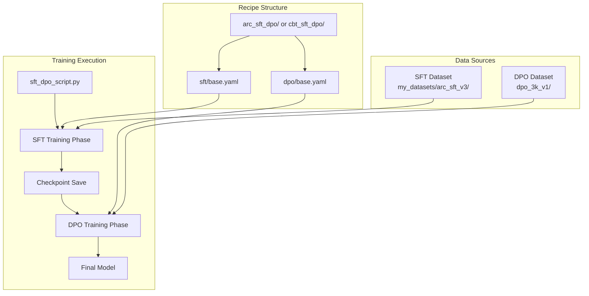
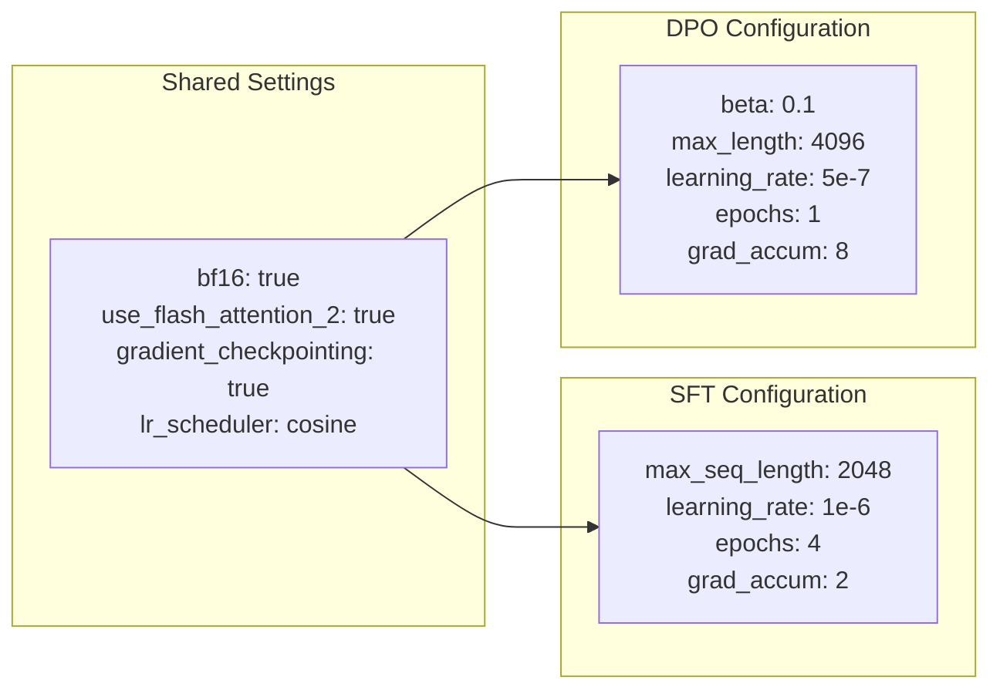
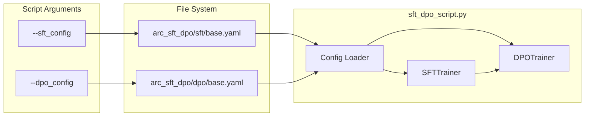

<!-- source: DeepWiki mcp.deepwiki.com · repo thunlp/Optima · page 7.3 Combined SFT-DPO Recipes · fetched 2026-11-02 -->

# Combined SFT-DPO Recipes

<details>
<summary>Relevant source files</summary>

The following files were used as context for generating this wiki page:

- [alignment-handbook/recipes/Llama3-8b/arc_sft_dpo/dpo/base.yaml](alignment-handbook/recipes/Llama3-8b/arc_sft_dpo/dpo/base.yaml)
- [alignment-handbook/recipes/Llama3-8b/arc_sft_dpo/sft/base.yaml](alignment-handbook/recipes/Llama3-8b/arc_sft_dpo/sft/base.yaml)
- [alignment-handbook/recipes/Llama3-8b/cbt_sft_dpo/dpo/base.yaml](alignment-handbook/recipes/Llama3-8b/cbt_sft_dpo/dpo/base.yaml)

</details>


## Purpose and Scope

This document describes the combined SFT-DPO training recipes that apply both Supervised Fine-Tuning (SFT) and Direct Preference Optimization (DPO) sequentially within a single training workflow. These recipes integrate the benefits of both training methods to produce models that are both capable (via SFT) and preference-aligned (via DPO).

For individual training methods, see [SFT Recipe Guide](#7.1) and [DPO Recipe Guide](#7.2). For information about using these recipes with training scripts, see [Training Scripts Reference](#6.1). For general recipe configuration principles, see [Recipe Configuration System](#6.2).

---

## Overview of Combined SFT-DPO Training

Combined SFT-DPO recipes coordinate both training phases in a single workflow by maintaining separate configuration files for each phase within the recipe directory structure. The training process follows a two-stage pipeline:

1. **SFT Phase**: Supervised fine-tuning on task-specific datasets to teach the model task capabilities
2. **DPO Phase**: Preference optimization on generated preference pairs to align model outputs with desired characteristics

The `sft_dpo_script.py` orchestrates this workflow by consuming both configuration files and executing them sequentially.

### Combined Training Flow



**Sources:** 
- [alignment-handbook/recipes/Llama3-8b/arc_sft_dpo/sft/base.yaml:1-39]()
- [alignment-handbook/recipes/Llama3-8b/arc_sft_dpo/dpo/base.yaml:1-36]()

---

## arc_sft_dpo Recipe Configuration

The `arc_sft_dpo` recipe is designed for the ARC (AI2 Reasoning Challenge) dataset, which involves complex reasoning tasks requiring longer context windows and careful learning rate tuning.

### Directory Structure

```
alignment-handbook/recipes/Llama3-8b/arc_sft_dpo/
├── sft/
│   └── base.yaml
└── dpo/
    └── base.yaml
```

### SFT Phase Configuration

The SFT phase configuration focuses on task capability learning with moderate training duration:

| Parameter | Value | Purpose |
|-----------|-------|---------|
| `model_name_or_path` | `/home/test/testdata/models/Meta-Llama-3-8B-Instruct` | Base model checkpoint |
| `dataset_mixer` | `/home/test/test04/yuanjiarui/project/src/my_datasets/arc_sft_v3/modify` | ARC SFT training data |
| `max_seq_length` | 2048 | Maximum sequence length for training |
| `learning_rate` | 1.0e-06 | Conservative learning rate for stable training |
| `num_train_epochs` | 4 | Multiple epochs for thorough learning |
| `gradient_accumulation_steps` | 2 | Effective batch size multiplier |
| `per_device_train_batch_size` | 1 | Per-GPU batch size |
| `warmup_ratio` | 0.1 | Learning rate warmup fraction |

**Sources:** [alignment-handbook/recipes/Llama3-8b/arc_sft_dpo/sft/base.yaml:1-39]()

### DPO Phase Configuration

The DPO phase uses a lower beta value suitable for reasoning tasks:

| Parameter | Value | Purpose |
|-----------|-------|---------|
| `model_name_or_path` | `/home/test/testdata/models/Meta-Llama-3-8B-Instruct` | Starting checkpoint (overridden by SFT output) |
| `dataset_mixer` | `/home/test/test04/yuanjiarui/project/src/dpo_3k_v1` | DPO preference pairs |
| `beta` | 0.1 | Low beta for gentle preference optimization |
| `max_length` | 4096 | Longer sequences for reasoning tasks |
| `max_prompt_length` | 1024 | Maximum prompt length |
| `learning_rate` | 5.0e-7 | Half the SFT learning rate |
| `num_train_epochs` | 1 | Single epoch for preference alignment |
| `gradient_accumulation_steps` | 8 | Higher accumulation for stable gradients |

**Sources:** [alignment-handbook/recipes/Llama3-8b/arc_sft_dpo/dpo/base.yaml:1-36]()

### Key Configuration Patterns



**Sources:** 
- [alignment-handbook/recipes/Llama3-8b/arc_sft_dpo/sft/base.yaml:1-39]()
- [alignment-handbook/recipes/Llama3-8b/arc_sft_dpo/dpo/base.yaml:1-36]()

---

## cbt_sft_dpo Recipe Configuration

The `cbt_sft_dpo` recipe is configured for the CBT (Children's Book Test) dataset, which requires different hyperparameters due to its distinct task characteristics and shorter response patterns.

### Directory Structure

```
alignment-handbook/recipes/Llama3-8b/cbt_sft_dpo/
├── sft/
│   └── base.yaml
└── dpo/
    └── base.yaml
```

### DPO Phase Configuration (Key Differences)

The CBT DPO configuration differs significantly from ARC:

| Parameter | ARC Value | CBT Value | Reason for Difference |
|-----------|-----------|-----------|----------------------|
| `beta` | 0.1 | 0.7 | **7x higher** - CBT requires stronger preference signal |
| `max_length` | 4096 | 512 | **8x shorter** - CBT responses are more concise |
| `max_prompt_length` | 1024 | 1024 | Same - both need reasonable context |

The dramatically higher beta value (0.7 vs 0.1) indicates that CBT tasks benefit from more aggressive preference optimization, likely due to clearer right/wrong distinctions in the task structure.

**Sources:** 
- [alignment-handbook/recipes/Llama3-8b/cbt_sft_dpo/dpo/base.yaml:13]()
- [alignment-handbook/recipes/Llama3-8b/cbt_sft_dpo/dpo/base.yaml:25]()

---

## Comparative Analysis: arc_sft_dpo vs cbt_sft_dpo

### Parameter Comparison Table

| Configuration Aspect | arc_sft_dpo | cbt_sft_dpo | Implication |
|---------------------|-------------|-------------|-------------|
| **DPO Beta** | 0.1 | 0.7 | CBT uses stronger preference signal |
| **DPO Max Length** | 4096 | 512 | ARC needs longer context for reasoning |
| **Task Complexity** | High (reasoning) | Medium (reading comprehension) | Different optimization strategies |
| **Preference Strength** | Gentle | Aggressive | Reflects task characteristics |

### When to Use Each Recipe

**Use `arc_sft_dpo` for:**
- Complex reasoning tasks requiring long context
- Multi-step logical inference problems
- Tasks where gentle preference optimization preserves reasoning capability
- Scenarios needing maximum sequence length (up to 4096 tokens)

**Use `cbt_sft_dpo` for:**
- Reading comprehension tasks with shorter answers
- Tasks with clear-cut correct/incorrect distinctions
- Scenarios where strong preference signals improve alignment
- Memory-constrained environments (shorter sequences)

### Configuration Mapping to Training Flow

```mermaid
graph TB
    subgraph "arc_sft_dpo Execution"
        ArcSFT["SFT Phase<br/>4 epochs @ lr=1e-6<br/>max_len=2048"]
        ArcCkpt["Intermediate Checkpoint"]
        ArcDPO["DPO Phase<br/>1 epoch @ lr=5e-7<br/>beta=0.1, max_len=4096"]
        ArcFinal["Arc Final Model<br/>Gentle preference alignment"]
        
        ArcSFT --> ArcCkpt
        ArcCkpt --> ArcDPO
        ArcDPO --> ArcFinal
    end
    
    subgraph "cbt_sft_dpo Execution"
        CbtSFT["SFT Phase<br/>Similar to Arc"]
        CbtCkpt["Intermediate Checkpoint"]
        CbtDPO["DPO Phase<br/>1 epoch @ lr=5e-7<br/>beta=0.7, max_len=512"]
        CbtFinal["CBT Final Model<br/>Strong preference alignment"]
        
        CbtSFT --> CbtCkpt
        CbtCkpt --> CbtDPO
        CbtDPO --> CbtFinal
    end
```



**Sources:** 
- [alignment-handbook/recipes/Llama3-8b/arc_sft_dpo/dpo/base.yaml:13]()
- [alignment-handbook/recipes/Llama3-8b/arc_sft_dpo/dpo/base.yaml:25]()
- [alignment-handbook/recipes/Llama3-8b/cbt_sft_dpo/dpo/base.yaml:13]()
- [alignment-handbook/recipes/Llama3-8b/cbt_sft_dpo/dpo/base.yaml:25]()

---

## Usage with sft_dpo_script.py

The combined recipes are designed to be consumed by the `sft_dpo_script.py`, which handles the orchestration of both training phases.

### Typical Invocation Pattern

```bash
python sft_dpo_script.py \
    --sft_config alignment-handbook/recipes/Llama3-8b/arc_sft_dpo/sft/base.yaml \
    --dpo_config alignment-handbook/recipes/Llama3-8b/arc_sft_dpo/dpo/base.yaml \
    --output_dir checkpoints/arc_combined_iteration_0
```

### Recipe File Resolution



**Sources:** 
- [alignment-handbook/recipes/Llama3-8b/arc_sft_dpo/sft/base.yaml:1-39]()
- [alignment-handbook/recipes/Llama3-8b/arc_sft_dpo/dpo/base.yaml:1-36]()

### Checkpoint Management

The script automatically manages checkpoint flow between phases:

1. **SFT Phase Output**: Saves checkpoint to intermediate location or specified `output_dir`
2. **DPO Phase Input**: Loads from SFT output checkpoint (overrides `model_name_or_path` in DPO config)
3. **Final Output**: Saves final model to specified location after DPO completion

This ensures that DPO training continues from the SFT-trained model rather than the original base model specified in the DPO config file.

---

## Common Configuration Parameters

Both recipes share several common configuration parameters that are essential for stable training:

### Precision and Optimization

| Parameter | Value | Purpose |
|-----------|-------|---------|
| `bf16` | `true` | Enable bfloat16 mixed precision training |
| `torch_dtype` | `bfloat16` | Model weight data type |
| `use_flash_attention_2` | `true` | Enable Flash Attention 2 for efficiency |
| `gradient_checkpointing` | `true` | Reduce memory usage at cost of compute |
| `optim` | `adamw_torch` | Optimizer selection |
| `lr_scheduler_type` | `cosine` | Cosine annealing learning rate schedule |

### Evaluation Settings

| Parameter | Value | Purpose |
|-----------|-------|---------|
| `do_eval` | `true` | Enable evaluation during training |
| `evaluation_strategy` | `steps` (DPO) / `epoch` (SFT) | When to evaluate |
| `eval_steps` | `100` (DPO) | Evaluation frequency |
| `per_device_eval_batch_size` | `1` | Batch size for evaluation |

### Data Processing

| Parameter | Value | Purpose |
|-----------|-------|---------|
| `preprocessing_num_workers` | `8` | Number of parallel data preprocessing workers |
| `dataset_splits` | `['train', 'test']` | Dataset splits to use |

**Sources:** 
- [alignment-handbook/recipes/Llama3-8b/arc_sft_dpo/sft/base.yaml:1-2]()
- [alignment-handbook/recipes/Llama3-8b/arc_sft_dpo/dpo/base.yaml:4-5]()
- [alignment-handbook/recipes/Llama3-8b/arc_sft_dpo/sft/base.yaml:13-15]()

---

## Best Practices for Combined Training

### Beta Parameter Selection

The beta parameter in DPO controls the strength of preference optimization:

- **Low beta (0.1)**: Suitable for complex reasoning tasks (like ARC) where preserving model capability is critical
- **High beta (0.7)**: Appropriate for tasks with clear preferences (like CBT) where strong alignment is desired
- **General guideline**: Start with 0.1 and increase if preference signal is too weak

### Sequence Length Tuning

Match sequence lengths to task requirements:

- **Reasoning tasks**: Use longer sequences (2048-4096) to accommodate multi-step inference
- **Comprehension tasks**: Shorter sequences (512-1024) are sufficient and more memory-efficient
- **DPO phase**: Can use longer sequences than SFT if preference pairs include longer responses

### Learning Rate Coordination

The typical pattern is:

```
DPO learning_rate = 0.5 × SFT learning_rate
```

This gentler learning rate during DPO prevents catastrophic forgetting of capabilities learned during SFT.

**Sources:** 
- [alignment-handbook/recipes/Llama3-8b/arc_sft_dpo/sft/base.yaml:16]()
- [alignment-handbook/recipes/Llama3-8b/arc_sft_dpo/dpo/base.yaml:21]()

---

## Recipe Parameter Reference

### File Locations

| Recipe | SFT Config | DPO Config |
|--------|-----------|-----------|
| `arc_sft_dpo` | [alignment-handbook/recipes/Llama3-8b/arc_sft_dpo/sft/base.yaml:1-39]() | [alignment-handbook/recipes/Llama3-8b/arc_sft_dpo/dpo/base.yaml:1-36]() |
| `cbt_sft_dpo` | Similar structure | [alignment-handbook/recipes/Llama3-8b/cbt_sft_dpo/dpo/base.yaml:1-36]() |

### Modifiable Parameters by Phase

**SFT Phase (commonly adjusted):**
- `learning_rate` [alignment-handbook/recipes/Llama3-8b/arc_sft_dpo/sft/base.yaml:16]()
- `num_train_epochs` [alignment-handbook/recipes/Llama3-8b/arc_sft_dpo/sft/base.yaml:25]()
- `max_seq_length` [alignment-handbook/recipes/Llama3-8b/arc_sft_dpo/sft/base.yaml:21]()
- `gradient_accumulation_steps` [alignment-handbook/recipes/Llama3-8b/arc_sft_dpo/sft/base.yaml:12]()

**DPO Phase (commonly adjusted):**
- `beta` [alignment-handbook/recipes/Llama3-8b/arc_sft_dpo/dpo/base.yaml:13]()
- `max_length` [alignment-handbook/recipes/Llama3-8b/arc_sft_dpo/dpo/base.yaml:25]()
- `learning_rate` [alignment-handbook/recipes/Llama3-8b/arc_sft_dpo/dpo/base.yaml:21]()

For complete parameter descriptions, see [Recipe Parameters Reference](#7.4).

---

