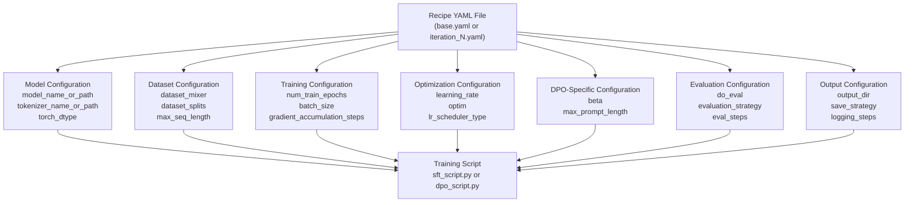
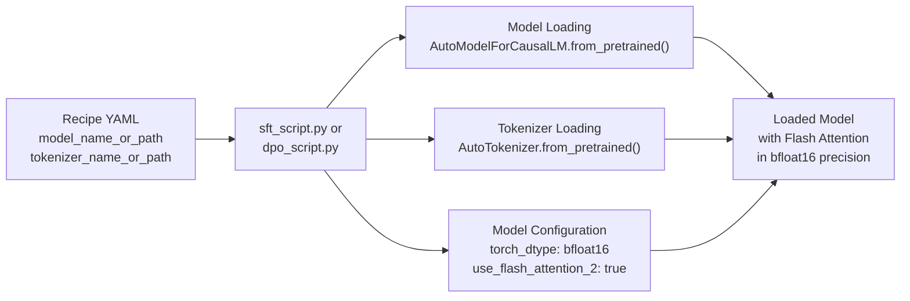
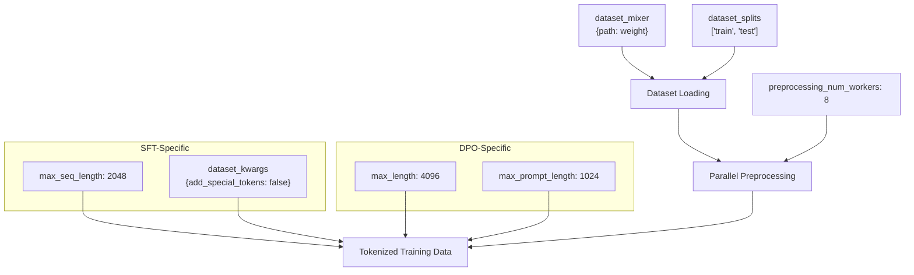
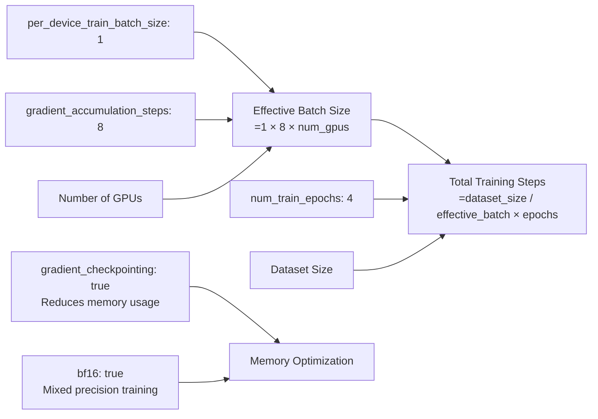
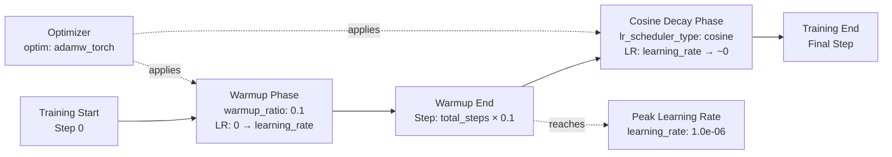
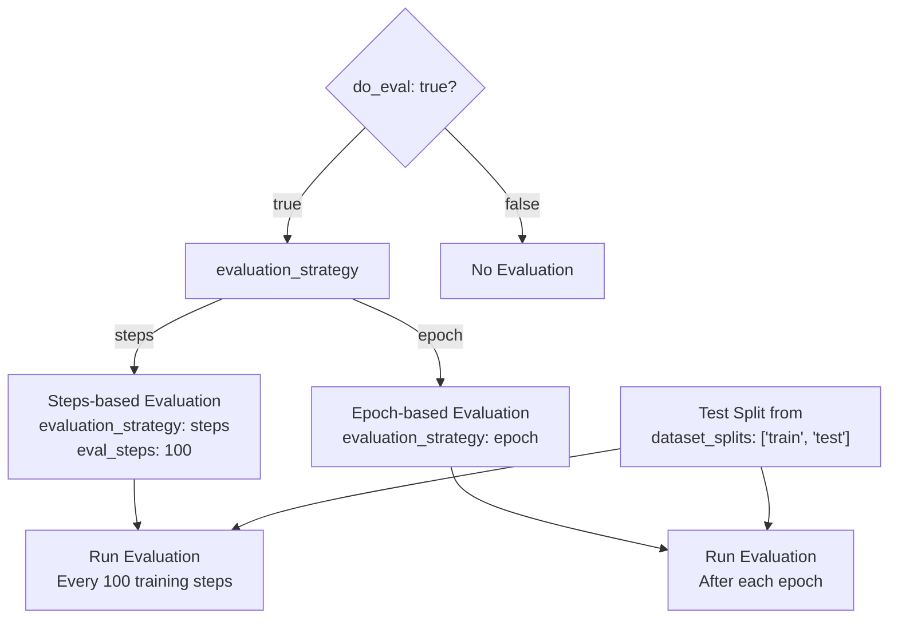
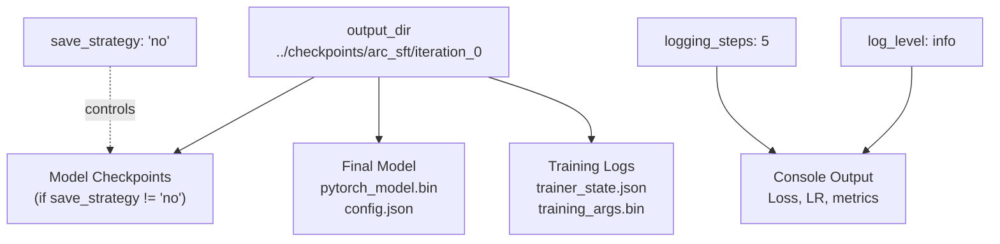
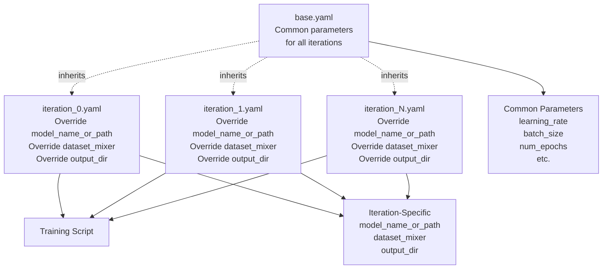

<!-- source: DeepWiki mcp.deepwiki.com · repo thunlp/Optima · page 7.4 Recipe Parameters Reference · fetched 2026-11-02 -->

# Recipe Parameters Reference

<details>
<summary>Relevant source files</summary>

The following files were used as context for generating this wiki page:

- [alignment-handbook/recipes/Llama3-8b/arc_dpo/base.yaml](alignment-handbook/recipes/Llama3-8b/arc_dpo/base.yaml)
- [alignment-handbook/recipes/Llama3-8b/arc_dpo/dpo_iteration_0.yaml](alignment-handbook/recipes/Llama3-8b/arc_dpo/dpo_iteration_0.yaml)
- [alignment-handbook/recipes/Llama3-8b/arc_sft/base.yaml](alignment-handbook/recipes/Llama3-8b/arc_sft/base.yaml)

</details>


This page provides a complete reference of all available parameters that can be configured in recipe YAML files. Recipe files control training behavior for SFT, DPO, and combined SFT-DPO training methods. Each parameter is documented with its purpose, type, expected values, and usage context.

For guidance on creating custom recipes, see [Recipe Configuration System](#6.2). For specific training method recipes, see [SFT Recipe Guide](#7.1), [DPO Recipe Guide](#7.2), and [Combined SFT-DPO Recipes](#7.3).

## Parameter Categories Overview

Recipe parameters are organized into seven functional categories that control different aspects of the training process:



**Sources:** [alignment-handbook/recipes/Llama3-8b/arc_dpo/base.yaml:1-36](), [alignment-handbook/recipes/Llama3-8b/arc_sft/base.yaml:1-39]()

## Model Configuration Parameters

These parameters specify the model architecture, weights, and low-level execution settings.

| Parameter | Type | Required | Description | Example Value |
|-----------|------|----------|-------------|---------------|
| `model_name_or_path` | string | Yes | Path to pretrained model or model identifier from Hugging Face Hub. For iterative training, points to previous iteration checkpoint. | `/home/test/testdata/models/Meta-Llama-3-8B-Instruct` or `../checkpoints/arc_sft/iteration_0` |
| `model_revision` | string | No | Specific model version/revision to use from Hugging Face Hub. | `main` |
| `tokenizer_name_or_path` | string | Yes | Path to tokenizer files or tokenizer identifier. Must match model's tokenizer. Custom tokenizers may include special tokens like `<\|im_start\|>` and `<\|im_end\|>`. | `/home/test/testdata/models/Meta-Llama-3-8B-Instruct` |
| `torch_dtype` | string | Yes | PyTorch data type for model weights. Controls precision and memory usage. | `bfloat16` |
| `use_flash_attention_2` | boolean | No | Enable Flash Attention 2 for improved memory efficiency and speed. Requires compatible GPU hardware. | `true` |

**Sources:** [alignment-handbook/recipes/Llama3-8b/arc_dpo/base.yaml:1-5](), [alignment-handbook/recipes/Llama3-8b/arc_dpo/dpo_iteration_0.yaml:21-33](), [alignment-handbook/recipes/Llama3-8b/arc_sft/base.yaml:23-37]()

### Model Parameter Usage Flow



**Sources:** [alignment-handbook/recipes/Llama3-8b/arc_dpo/base.yaml:1-5](), [alignment-handbook/recipes/Llama3-8b/arc_sft/base.yaml:23-37]()

## Dataset Configuration Parameters

These parameters control data loading, preprocessing, and sequence length constraints.

| Parameter | Type | Required | Description | Example Value |
|-----------|------|----------|-------------|---------------|
| `dataset_mixer` | dict | Yes | Dictionary mapping dataset paths to mixing ratios. Values should sum to 1.0 for proper weighting. Supports local paths or Hugging Face dataset identifiers. | `../my_datasets/arc_sft/iteration_0: 1.0` |
| `dataset_splits` | list | Yes | List of dataset splits to load. Typically includes `train` and optionally `test` for evaluation. | `["train", "test"]` |
| `dataset_kwargs` | dict | No | Additional keyword arguments for dataset processing. **SFT only**. Controls token handling behavior. | `{add_special_tokens: false, append_concat_token: false}` |
| `preprocessing_num_workers` | integer | No | Number of parallel processes for dataset preprocessing and tokenization. Higher values speed up data preparation. | `8` |
| `max_seq_length` | integer | SFT only | Maximum sequence length for training examples in SFT. Sequences longer than this are truncated. | `2048` |
| `max_length` | integer | DPO only | Maximum total length for chosen/rejected sequences in DPO training. | `4096` |
| `max_prompt_length` | integer | DPO only | Maximum length for the prompt portion in DPO training. Ensures sufficient space for completion. | `1024` |

**Sources:** [alignment-handbook/recipes/Llama3-8b/arc_dpo/base.yaml:6-11](), [alignment-handbook/recipes/Llama3-8b/arc_dpo/dpo_iteration_0.yaml:3-7, 19-20](), [alignment-handbook/recipes/Llama3-8b/arc_sft/base.yaml:2-9, 21, 30]()

### Dataset Parameter Relationships



**Sources:** [alignment-handbook/recipes/Llama3-8b/arc_dpo/base.yaml:6-11, 25-26](), [alignment-handbook/recipes/Llama3-8b/arc_sft/base.yaml:2-9, 21]()

## Training Configuration Parameters

These parameters control the training loop mechanics, batch sizes, and gradient computation.

| Parameter | Type | Required | Description | Example Value |
|-----------|------|----------|-------------|---------------|
| `num_train_epochs` | integer | Yes | Number of complete passes through the training dataset. | `4` (SFT), `1` (DPO) |
| `max_steps` | integer | No | Maximum number of training steps. Overrides `num_train_epochs` if set to positive value. Set to `-1` to use epochs instead. | `-1` |
| `per_device_train_batch_size` | integer | Yes | Training batch size per GPU device. Actual batch size equals this multiplied by number of GPUs and `gradient_accumulation_steps`. | `1` |
| `per_device_eval_batch_size` | integer | No | Evaluation batch size per GPU device. Can be larger than training batch size since gradients aren't computed. | `1` |
| `gradient_accumulation_steps` | integer | Yes | Number of forward passes before performing backward pass. Effective batch size = `per_device_train_batch_size` × `gradient_accumulation_steps` × `num_gpus`. | `2` (SFT), `8` (DPO) |
| `gradient_checkpointing` | boolean | Yes | Enable gradient checkpointing to trade computation for memory. Reduces memory usage by recomputing activations during backward pass. | `true` |
| `gradient_checkpointing_kwargs` | dict | No | Additional arguments for gradient checkpointing. `use_reentrant: false` uses more efficient non-reentrant implementation. | `{use_reentrant: false}` |
| `bf16` | boolean | Yes | Use bfloat16 mixed precision training. Reduces memory usage and improves speed on compatible hardware. | `true` |

**Sources:** [alignment-handbook/recipes/Llama3-8b/arc_dpo/base.yaml:12, 17-18, 19-20, 27, 30-31](), [alignment-handbook/recipes/Llama3-8b/arc_dpo/dpo_iteration_0.yaml:2, 11-14, 23, 26-27](), [alignment-handbook/recipes/Llama3-8b/arc_sft/base.yaml:1, 11-15, 22, 25, 28-29]()

### Training Parameter Computation



**Sources:** [alignment-handbook/recipes/Llama3-8b/arc_dpo/base.yaml:17-18, 12, 27, 30](), [alignment-handbook/recipes/Llama3-8b/arc_sft/base.yaml:11-15, 1, 25]()

## Optimization Configuration Parameters

These parameters control the optimizer, learning rate scheduling, and training dynamics.

| Parameter | Type | Required | Description | Example Value |
|-----------|------|----------|-------------|---------------|
| `learning_rate` | float | Yes | Peak learning rate for the optimizer. DPO typically uses lower learning rates than SFT. | `1.0e-06` (SFT), `5.0e-07` (DPO) |
| `optim` | string | Yes | Optimizer algorithm. `adamw_torch` is standard Adam with weight decay implementation. | `adamw_torch` |
| `lr_scheduler_type` | string | Yes | Learning rate schedule type. `cosine` provides smooth decay from peak to near-zero. | `cosine` |
| `warmup_ratio` | float | Yes | Fraction of training steps used for linear learning rate warmup. Helps stabilize early training. | `0.1` |
| `seed` | integer | Yes | Random seed for reproducibility. Controls initialization and data shuffling. | `42` |

**Sources:** [alignment-handbook/recipes/Llama3-8b/arc_dpo/base.yaml:21, 28, 24, 36](), [alignment-handbook/recipes/Llama3-8b/arc_dpo/dpo_iteration_0.yaml:15, 24, 18, 34, 30](), [alignment-handbook/recipes/Llama3-8b/arc_sft/base.yaml:16, 20, 38, 34]()

### Learning Rate Schedule Visualization



**Sources:** [alignment-handbook/recipes/Llama3-8b/arc_sft/base.yaml:16, 20, 38](), [alignment-handbook/recipes/Llama3-8b/arc_dpo/base.yaml:21, 24, 28, 36]()

## DPO-Specific Configuration Parameters

These parameters are specific to Direct Preference Optimization (DPO) training and control preference alignment behavior.

| Parameter | Type | Required | Description | Example Value |
|-----------|------|----------|-------------|---------------|
| `beta` | float | DPO only | DPO temperature parameter controlling the strength of preference optimization. Higher values make the model deviate less from the reference policy. Common range: 0.1-0.2. | `0.2` |

The `beta` parameter is crucial for DPO training as it balances between:
- **Lower beta** (e.g., 0.1): Stronger optimization toward preferred responses, potentially more deviation from base model
- **Higher beta** (e.g., 0.2): More conservative optimization, staying closer to reference policy

**Sources:** [alignment-handbook/recipes/Llama3-8b/arc_dpo/base.yaml:13](), [alignment-handbook/recipes/Llama3-8b/arc_dpo/dpo_iteration_0.yaml:1]()

## Evaluation Configuration Parameters

These parameters control evaluation frequency, strategy, and behavior during training.

| Parameter | Type | Required | Description | Example Value |
|-----------|------|----------|-------------|---------------|
| `do_eval` | boolean | No | Enable evaluation during training. Required if `evaluation_strategy` is set. | `true` |
| `evaluation_strategy` | string | No | When to run evaluation. Options: `no`, `steps`, `epoch`. `steps` evaluates every `eval_steps`, `epoch` evaluates after each epoch. | `steps` (DPO), `epoch` (SFT) |
| `eval_steps` | integer | Conditional | Number of training steps between evaluations. Required if `evaluation_strategy: steps`. | `100` |

**Sources:** [alignment-handbook/recipes/Llama3-8b/arc_dpo/base.yaml:14-16](), [alignment-handbook/recipes/Llama3-8b/arc_dpo/dpo_iteration_0.yaml:8-10](), [alignment-handbook/recipes/Llama3-8b/arc_sft/base.yaml:10-11]()

### Evaluation Strategy Flow



**Sources:** [alignment-handbook/recipes/Llama3-8b/arc_dpo/base.yaml:14-16](), [alignment-handbook/recipes/Llama3-8b/arc_sft/base.yaml:10-11]()

## Output and Logging Configuration Parameters

These parameters control where outputs are saved, logging verbosity, and checkpoint management.

| Parameter | Type | Required | Description | Example Value |
|-----------|------|----------|-------------|---------------|
| `output_dir` | string | Yes | Directory where checkpoints, logs, and training artifacts are saved. Can be absolute or relative path. | `../checkpoints/arc_sft/iteration_0` |
| `save_strategy` | string | Yes | When to save checkpoints. Options: `no`, `steps`, `epoch`. `no` disables checkpoint saving (model only saved at end). | `"no"` |
| `log_level` | string | No | Logging verbosity level. Options: `debug`, `info`, `warning`, `error`, `critical`. | `info` |
| `logging_steps` | integer | No | Number of training steps between log outputs. Lower values provide more frequent updates. | `5` (SFT), `10` (DPO) |
| `logging_strategy` | string | No | When to log metrics. Options: `no`, `steps`, `epoch`. Usually `steps` for frequent updates. | `steps` |
| `overwrite_output_dir` | boolean | No | Whether to overwrite existing files in `output_dir`. Use with caution. | `true` |
| `push_to_hub` | boolean | No | Whether to push model checkpoints to Hugging Face Hub during/after training. | `false` |
| `remove_unused_columns` | boolean | No | Remove dataset columns not used by the model. Reduces memory usage. | `true` |

**Sources:** [alignment-handbook/recipes/Llama3-8b/arc_dpo/base.yaml:22-23, 29, 34](), [alignment-handbook/recipes/Llama3-8b/arc_dpo/dpo_iteration_0.yaml:16-17, 25, 29](), [alignment-handbook/recipes/Llama3-8b/arc_sft/base.yaml:17-19, 26-27, 31-33]()

### Output Directory Structure



**Sources:** [alignment-handbook/recipes/Llama3-8b/arc_sft/base.yaml:26-27, 17-19, 33](), [alignment-handbook/recipes/Llama3-8b/arc_dpo/base.yaml:29, 34, 22-23]()

## Complete Parameter Reference Table

The following table provides a quick reference of all parameters with their applicability across training methods:

| Parameter | SFT | DPO | Type | Default |
|-----------|-----|-----|------|---------|
| `model_name_or_path` | ✓ | ✓ | string | Required |
| `model_revision` | ✓ | ✓ | string | `main` |
| `tokenizer_name_or_path` | ✓ | ✓ | string | Required |
| `torch_dtype` | ✓ | ✓ | string | `bfloat16` |
| `use_flash_attention_2` | ✓ | ✓ | boolean | `true` |
| `dataset_mixer` | ✓ | ✓ | dict | Required |
| `dataset_splits` | ✓ | ✓ | list | `["train", "test"]` |
| `dataset_kwargs` | ✓ | ✗ | dict | Optional |
| `preprocessing_num_workers` | ✓ | ✓ | integer | `8` |
| `max_seq_length` | ✓ | ✗ | integer | `2048` |
| `max_length` | ✗ | ✓ | integer | `4096` |
| `max_prompt_length` | ✗ | ✓ | integer | `1024` |
| `num_train_epochs` | ✓ | ✓ | integer | `4` (SFT), `1` (DPO) |
| `max_steps` | ✓ | ✓ | integer | `-1` |
| `per_device_train_batch_size` | ✓ | ✓ | integer | `1` |
| `per_device_eval_batch_size` | ✓ | ✓ | integer | `1` |
| `gradient_accumulation_steps` | ✓ | ✓ | integer | `2` (SFT), `8` (DPO) |
| `gradient_checkpointing` | ✓ | ✓ | boolean | `true` |
| `gradient_checkpointing_kwargs` | ✓ | ✓ | dict | `{use_reentrant: false}` |
| `bf16` | ✓ | ✓ | boolean | `true` |
| `learning_rate` | ✓ | ✓ | float | `1.0e-06` (SFT), `5.0e-07` (DPO) |
| `optim` | ✓ | ✓ | string | `adamw_torch` |
| `lr_scheduler_type` | ✓ | ✓ | string | `cosine` |
| `warmup_ratio` | ✓ | ✓ | float | `0.1` |
| `seed` | ✓ | ✓ | integer | `42` |
| `beta` | ✗ | ✓ | float | `0.2` |
| `do_eval` | ✓ | ✓ | boolean | `true` |
| `evaluation_strategy` | ✓ | ✓ | string | `epoch` (SFT), `steps` (DPO) |
| `eval_steps` | ✓ | ✓ | integer | `100` |
| `output_dir` | ✓ | ✓ | string | Required |
| `save_strategy` | ✓ | ✓ | string | `"no"` |
| `log_level` | ✓ | ✓ | string | `info` |
| `logging_steps` | ✓ | ✓ | integer | `5` (SFT), `10` (DPO) |
| `logging_strategy` | ✓ | ✓ | string | `steps` |
| `overwrite_output_dir` | ✓ | ✓ | boolean | `false` |
| `push_to_hub` | ✓ | ✓ | boolean | `false` |
| `remove_unused_columns` | ✓ | ✓ | boolean | `true` |

**Sources:** All recipe files: [alignment-handbook/recipes/Llama3-8b/arc_dpo/base.yaml:1-36](), [alignment-handbook/recipes/Llama3-8b/arc_dpo/dpo_iteration_0.yaml:1-35](), [alignment-handbook/recipes/Llama3-8b/arc_sft/base.yaml:1-39]()

## Parameter Inheritance and Overrides

Recipe files follow an inheritance pattern where iteration-specific configurations override base configurations:



Key parameters that typically change between iterations:
- `model_name_or_path`: Points to checkpoint from previous iteration
- `dataset_mixer`: Points to dataset generated by previous iteration
- `output_dir`: Unique directory for current iteration's outputs

**Sources:** [alignment-handbook/recipes/Llama3-8b/arc_dpo/dpo_iteration_0.yaml:3-4, 21, 25](), [alignment-handbook/recipes/Llama3-8b/arc_dpo/base.yaml:1-36]()

## Usage Examples

### Typical SFT Configuration

For supervised fine-tuning with moderate sequence lengths and learning rate:

```yaml
model_name_or_path: /path/to/base/model
tokenizer_name_or_path: /path/to/base/model
torch_dtype: bfloat16
use_flash_attention_2: true
bf16: true

dataset_mixer:
  ../my_datasets/arc_sft/iteration_0: 1.0
dataset_splits: ["train", "test"]
max_seq_length: 2048
preprocessing_num_workers: 8

num_train_epochs: 4
per_device_train_batch_size: 1
gradient_accumulation_steps: 2

learning_rate: 1.0e-06
optim: adamw_torch
lr_scheduler_type: cosine
warmup_ratio: 0.1

gradient_checkpointing: true
gradient_checkpointing_kwargs:
  use_reentrant: false

do_eval: true
evaluation_strategy: epoch

output_dir: ../checkpoints/arc_sft/iteration_0
save_strategy: "no"
log_level: info
logging_steps: 5
seed: 42
```

**Sources:** [alignment-handbook/recipes/Llama3-8b/arc_sft/base.yaml:1-39]()

### Typical DPO Configuration

For preference optimization with lower learning rate and specific beta:

```yaml
model_name_or_path: ../checkpoints/arc_sft/iteration_0
tokenizer_name_or_path: /path/to/base/tokenizer
torch_dtype: bfloat16
use_flash_attention_2: true
bf16: true

dataset_mixer:
  ../my_datasets/arc_dpo/iteration_0: 1.0
dataset_splits: ["train", "test"]
max_length: 4096
max_prompt_length: 1024
preprocessing_num_workers: 8

beta: 0.2

num_train_epochs: 1
per_device_train_batch_size: 1
gradient_accumulation_steps: 8

learning_rate: 5.0e-07
optim: adamw_torch
lr_scheduler_type: cosine
warmup_ratio: 0.1

gradient_checkpointing: true
gradient_checkpointing_kwargs:
  use_reentrant: false

do_eval: true
evaluation_strategy: steps
eval_steps: 100

output_dir: ../checkpoints/arc_dpo/dpo_iteration_0
save_strategy: "no"
log_level: info
logging_steps: 10
seed: 42
```

**Sources:** [alignment-handbook/recipes/Llama3-8b/arc_dpo/dpo_iteration_0.yaml:1-35]()

---

