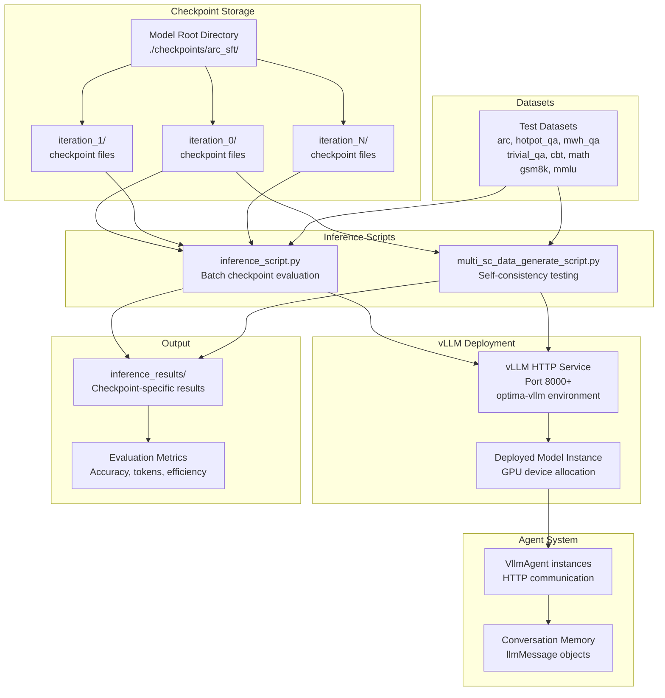
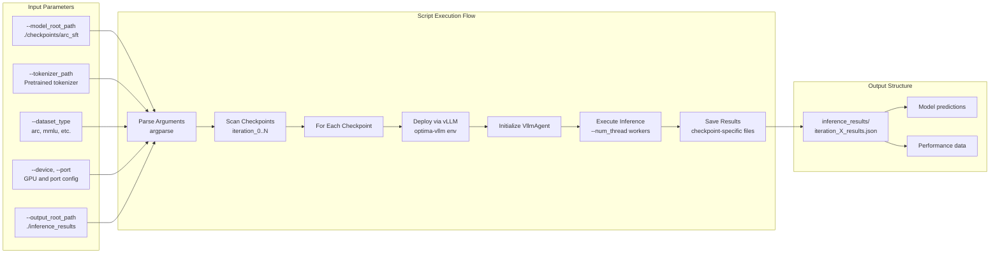
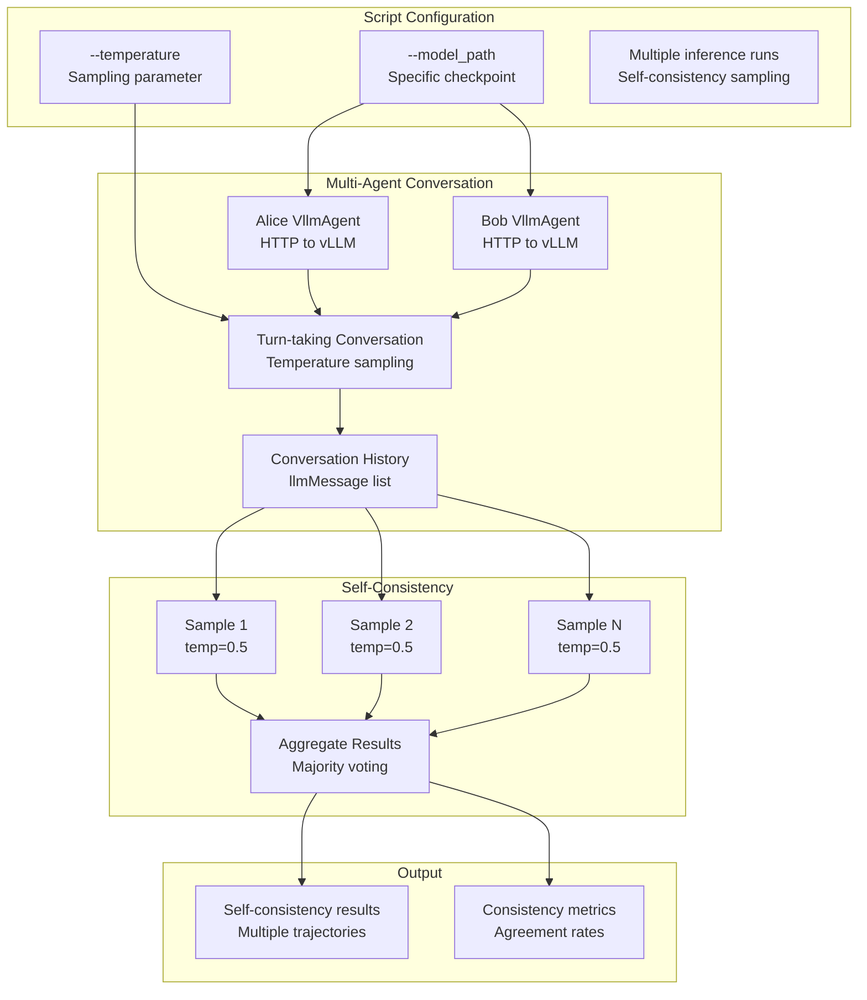
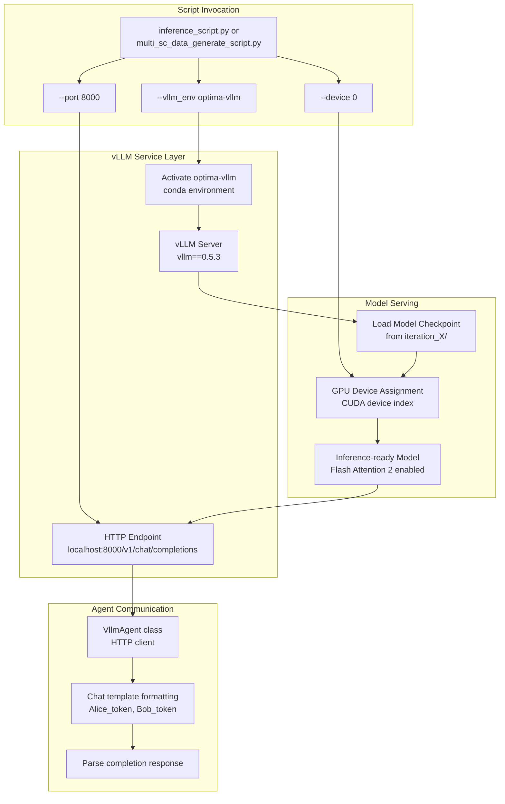

<!-- source: DeepWiki mcp.deepwiki.com · repo thunlp/Optima · page 8 Inference and Evaluation · fetched 2026-11-02 -->

# Inference and Evaluation

<details>
<summary>Relevant source files</summary>

The following files were used as context for generating this wiki page:

- [README.md](README.md)
- [README_revise.md](README_revise.md)

</details>


This document provides a comprehensive guide to Optima's inference and evaluation system, covering how to run inference on trained models, evaluate their performance, and interpret results. The inference system supports both standard batch inference and multi-agent self-consistency approaches to assess model improvements across iterations.

For detailed information on specific aspects of the inference system:
- For script usage and command-line arguments, see [Running Inference](#8.1)
- For multi-agent self-consistency methodology, see [Multi-Agent Self-Consistency](#8.2)
- For metrics and result interpretation, see [Evaluation Metrics](#8.3)

For information on the training pipeline that produces the checkpoints evaluated here, see [Training Pipeline Flow](#4.2).

## Purpose and Scope

The inference and evaluation system serves three primary purposes:

1. **Checkpoint Evaluation**: Run batch inference across all model checkpoints (iteration_0, iteration_1, etc.) to assess progressive improvements
2. **Multi-Agent Testing**: Evaluate models in multi-agent conversation scenarios with self-consistency sampling
3. **Performance Measurement**: Generate metrics for accuracy, token efficiency, and communication effectiveness

## Inference System Architecture

The inference system consists of two main components implemented in separate scripts: `inference_script.py` for batch checkpoint evaluation and `multi_sc_data_generate_script.py` for self-consistency testing.



**Sources**: [README.md:94-137]()

## Batch Inference Pipeline

The `inference_script.py` provides batch inference capabilities to evaluate all checkpoints from a training run systematically. This script automates the process of deploying each checkpoint, running inference, and collecting results.



**Sources**: [README.md:96-110]()

### Key Command-Line Parameters

The `inference_script.py` accepts the following parameters:

| Parameter | Description | Example Value |
|-----------|-------------|---------------|
| `--model_root_path` | Root directory containing checkpoint iterations | `./checkpoints/arc_sft` |
| `--tokenizer_path` | Path to pretrained tokenizer | `${pretrained_tokenizer_path}` |
| `--dataset_type` | Dataset for evaluation | `arc`, `mmlu`, `gsm8k`, etc. |
| `--device` | GPU index for first deployment | `0` |
| `--port` | First port number for vLLM service | `8000` |
| `--num_thread` | Number of parallel inference threads | `128` |
| `--output_root_path` | Directory for inference results | `./inference_results` |
| `--vllm_env` | Conda environment name for vLLM | `optima-vllm` |

**Sources**: [README.md:96-110]()

## Multi-Agent Self-Consistency

The `multi_sc_data_generate_script.py` implements multi-agent self-consistency evaluation, where multiple conversation samples are generated with temperature-based sampling to assess model robustness and consistency.



**Sources**: [README.md:112-137]()

### Self-Consistency Parameters

The `multi_sc_data_generate_script.py` uses these parameters:

| Parameter | Description | Example Value |
|-----------|-------------|---------------|
| `--model_path` | Path to specific model checkpoint | `./checkpoints/arc_sft/iteration_0` |
| `--tokenizer_path` | Path to tokenizer | `${pretrained_tokenizer_path}` |
| `--device` | GPU index for deployment | `0` |
| `--port` | First port number for vLLM | `8000` |
| `--dataset_type` | Dataset for testing | `arc`, `mmlu`, etc. |
| `--num_thread` | Number of parallel threads | `128` |
| `--output_path` | Directory for output files | `./inference_results` |
| `--temperature` | Sampling temperature | `0.5` |
| `--vllm_env` | Conda environment for vLLM | `optima-vllm` |

**Sources**: [README.md:115-137]()

## vLLM Deployment Architecture

Both inference scripts leverage the `optima-vllm` environment to deploy models via the vLLM HTTP service. The deployment uses port-based model serving with GPU device allocation.



**Sources**: [README.md:96-137]()

## Supported Dataset Types

The inference system supports evaluation on multiple datasets, specified via the `--dataset_type` parameter:

| Dataset Type | Description | Domain |
|--------------|-------------|--------|
| `arc` | AI2 Reasoning Challenge | Commonsense reasoning |
| `hotpot_qa` | HotpotQA | Multi-hop question answering |
| `mwh_qa` | Multi-hop Wikipedia QA | Multi-hop reasoning |
| `trivial_qa` | TriviaQA | Factual question answering |
| `cbt` | Children's Book Test | Reading comprehension |
| `math` | MATH dataset | Mathematical reasoning |
| `gsm8k` | Grade School Math 8K | Math word problems |
| `mmlu` | Massive Multitask Language Understanding | General knowledge |

**Sources**: [README.md:104, 121, 132]()

## Output Directory Structure

Inference results are organized in the `inference_results/` directory with checkpoint-specific subdirectories:

```
inference_results/
├── arc_sft/
│   ├── iteration_0_results.json
│   ├── iteration_1_results.json
│   ├── iteration_N_results.json
│   └── metrics_summary.json
├── arc_dpo/
│   └── ...
└── self_consistency/
    ├── iteration_0_sc_results.json
    └── ...
```

Each result file contains:
- Model predictions for test samples
- Token usage statistics per sample
- Conversation length metrics (for multi-agent settings)
- Accuracy and performance data

**Sources**: [README.md:108, 134]()

## Integration with Training Pipeline

The inference system integrates tightly with the training pipeline to enable iterative evaluation:

```mermaid
graph LR
    subgraph "Training Phase"
        TrainScript["sft_script.py or<br/>dpo_script.py"]
        SaveCheckpoint["Save Checkpoint<br/>checkpoints/dataset_method/"]
        IterationN["iteration_N/"]
    end
    
    subgraph "Inference Phase"
        InferScript["inference_script.py"]
        ModelRootScan["Scan model_root_path<br/>Find all iterations"]
        EvalIteration["Evaluate Each<br/>iteration_0..N"]
    end
    
    subgraph "Analysis Phase"
        CompareResults["Compare Results<br/>Across iterations"]
        Metrics["Compute Metrics<br/>Accuracy, tokens, efficiency"]
        PlotTrends["Plot Improvement Trends"]
    end
    
    TrainScript --> SaveCheckpoint
    SaveCheckpoint --> IterationN
    
    IterationN --> InferScript
    InferScript --> ModelRootScan
    ModelRootScan --> EvalIteration
    
    EvalIteration --> CompareResults
    CompareResults --> Metrics
    Metrics --> PlotTrends
```



**Sources**: [README.md:94-110]()

## Thread-Based Parallel Inference

Both inference scripts support parallel execution via the `--num_thread` parameter, enabling efficient batch processing:

- Thread pool manages concurrent inference requests
- Each thread handles independent test samples
- VllmAgent instances communicate with the same vLLM service
- Thread synchronization ensures proper resource utilization

The recommended thread count is `128` for optimal GPU utilization, though this can be adjusted based on available resources and batch size requirements.

**Sources**: [README.md:107, 121, 133]()

## Usage Example: Complete Inference Workflow

A typical inference workflow involves:

1. **Standard Batch Inference**: Evaluate all checkpoints from a training run
   ```bash
   python inference_script.py \
       --model_root_path ./checkpoints/arc_sft \
       --tokenizer_path ${pretrained_tokenizer_path} \
       --dataset_type arc \
       --device 0 \
       --port 8000 \
       --num_thread 128 \
       --output_root_path ./inference_results \
       --vllm_env optima-vllm
   ```

2. **Self-Consistency Testing**: Test a specific checkpoint with multiple samples
   ```bash
   python multi_sc_data_generate_script.py \
       --model_path ./checkpoints/arc_sft/iteration_0 \
       --tokenizer_path ${pretrained_tokenizer_path} \
       --device 0 \
       --port 8000 \
       --dataset_type arc \
       --num_thread 128 \
       --output_path ./inference_results \
       --temperature 0.5 \
       --vllm_env optima-vllm
   ```

3. **Analyze Results**: Compare metrics across iterations to assess training improvements

**Sources**: [README.md:92-137]()

---

