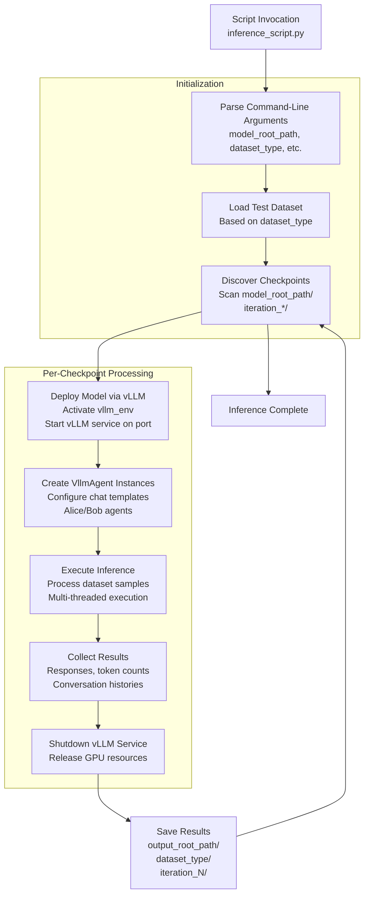
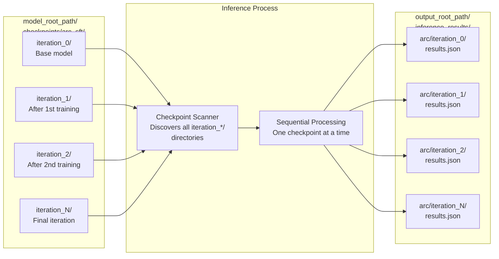
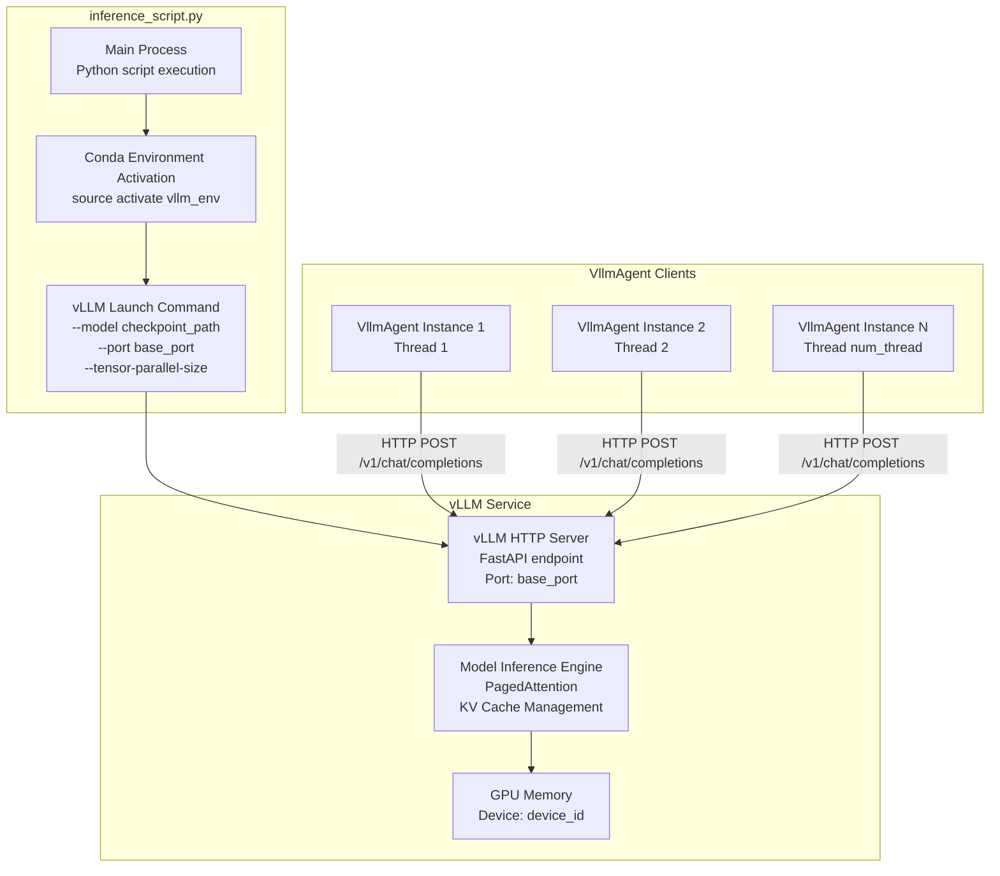
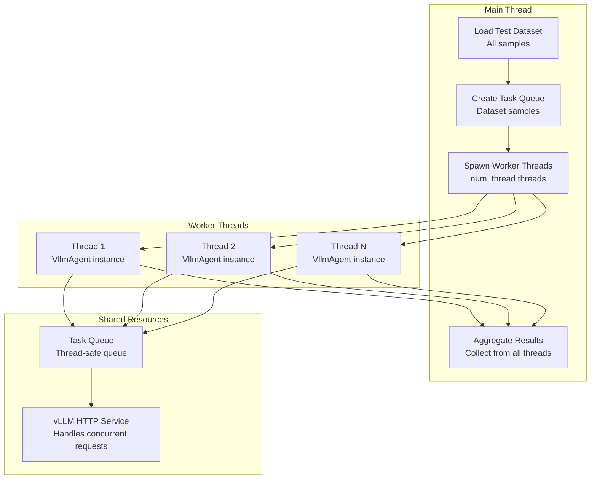
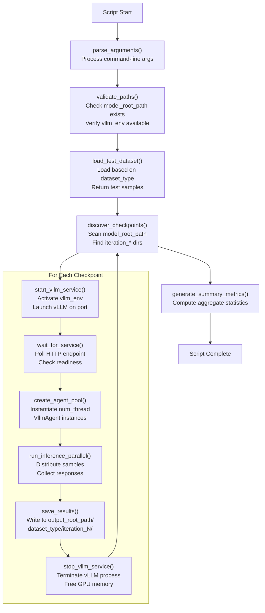
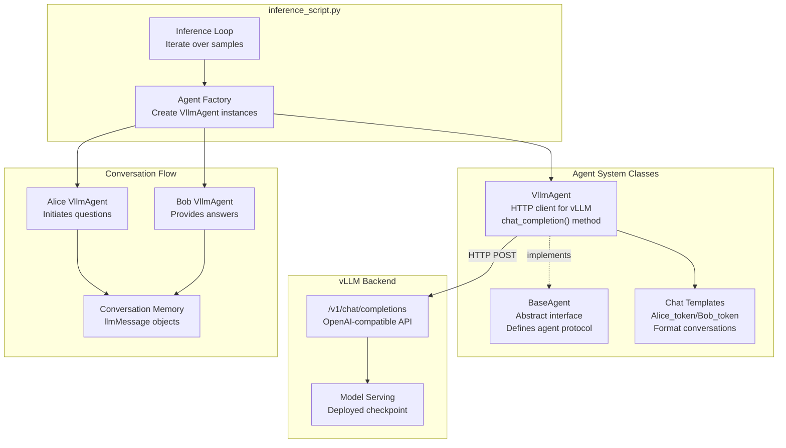

<!-- source: DeepWiki mcp.deepwiki.com · repo thunlp/Optima · page 8.1 Running Inference · fetched 2026-11-02 -->

# Running Inference

<details>
<summary>Relevant source files</summary>

The following files were used as context for generating this wiki page:

- [README.md](README.md)
- [README_revise.md](README_revise.md)

</details>


## Purpose and Scope

This page documents the inference process in Optima, specifically covering the `inference_script.py` usage, batch inference across multiple model checkpoints, and output formats. For multi-agent self-consistency inference, see [Multi-Agent Self-Consistency](#8.2). For architectural details of the inference pipeline, see [Inference Pipeline](#4.3). For metric computation and interpretation, see [Evaluation Metrics](#8.3).

## Overview

The Optima inference system performs batch evaluation of trained models across all checkpoints in a training run. The `inference_script.py` script automates the process of deploying models via vLLM, running inference on test datasets, and collecting results. This enables systematic evaluation of model improvements across training iterations.

**Sources:** [README.md:94-110]()

## Inference Workflow

The inference process consists of the following stages:



**Sources:** [README.md:96-110]()

## Command-Line Parameters

The `inference_script.py` accepts the following parameters:

| Parameter | Type | Required | Description |
|-----------|------|----------|-------------|
| `--model_root_path` | string | Yes | Root directory containing checkpoint iterations (e.g., `./checkpoints/arc_sft`) |
| `--tokenizer_path` | string | Yes | Path to the pretrained tokenizer |
| `--dataset_type` | string | Yes | Dataset identifier: `hotpot_qa`, `mwh_qa`, `trivial_qa`, `cbt`, `math`, `gsm8k`, `arc`, `mmlu` |
| `--device` | integer | Yes | GPU device index for the first vLLM deployment port |
| `--port` | integer | Yes | Base port number for vLLM HTTP service (e.g., 8000) |
| `--num_thread` | integer | Yes | Number of parallel inference threads |
| `--output_root_path` | string | Yes | Root directory for saving inference results |
| `--vllm_env` | string | Yes | Conda environment name for vLLM deployment (e.g., `optima-vllm`) |

**Sources:** [README.md:102-109]()

## Basic Usage Example

```bash
python inference_script.py \
    --model_root_path ./checkpoints/arc_sft \
    --tokenizer_path /path/to/Meta-Llama-3-8B-Instruct \
    --dataset_type arc \
    --device 0 \
    --port 8000 \
    --num_thread 128 \
    --output_root_path ./inference_results \
    --vllm_env optima-vllm
```

This command will:
1. Scan `./checkpoints/arc_sft/` for all checkpoint directories (`iteration_0/`, `iteration_1/`, etc.)
2. Deploy each checkpoint sequentially via vLLM on GPU device 0
3. Run inference on the ARC-C test dataset using 128 parallel threads
4. Save results to `./inference_results/arc/iteration_N/`

**Sources:** [README.md:101-110]()

## Batch Inference Across Checkpoints

The inference script automatically processes all checkpoint iterations found in the `model_root_path`. This enables systematic comparison of model performance across training iterations.



The checkpoint directory structure follows the pattern:
```
checkpoints/
└── arc_sft/
    ├── iteration_0/
    │   ├── model.safetensors
    │   ├── config.json
    │   └── tokenizer_config.json
    ├── iteration_1/
    │   └── ...
    └── iteration_N/
        └── ...
```

**Sources:** [README.md:102]()

## vLLM Deployment Architecture

The inference script uses vLLM for efficient model serving. Each checkpoint is deployed as a temporary HTTP service during its inference phase.



**Sources:** [README.md:109]()

### Port Management

When deploying multiple models or running multiple inference jobs, port numbers must be managed to avoid conflicts:

- Base port: Specified via `--port` parameter (e.g., 8000)
- vLLM service binds to `base_port` for HTTP requests
- If running parallel inference jobs, increment port numbers (e.g., 8001, 8002)
- Device allocation: Use `--device` parameter to assign specific GPU devices

**Sources:** [README.md:106-107]()

## Multi-Threading and Parallelization

The inference script uses multi-threading to parallelize inference requests:



Each worker thread:
1. Creates its own `VllmAgent` instance
2. Fetches samples from the shared task queue
3. Sends HTTP requests to the vLLM service
4. Collects responses and metadata

The `--num_thread` parameter controls the degree of parallelism. Higher values increase throughput but require sufficient GPU memory and CPU resources.

**Sources:** [README.md:107]()

## Output Format and Structure

The inference script saves results in a structured directory hierarchy:

```
output_root_path/
└── inference_results/
    └── ${dataset_type}/
        ├── iteration_0/
        │   ├── results.json
        │   ├── conversations.jsonl
        │   └── metrics.json
        ├── iteration_1/
        │   ├── results.json
        │   ├── conversations.jsonl
        │   └── metrics.json
        └── iteration_N/
            └── ...
```

### Results File Structure

The primary output file (`results.json`) contains inference results for each test sample:

```json
{
  "sample_id": "arc_challenge_0001",
  "question": "Which of the following is an example...",
  "prediction": "C",
  "ground_truth": "C",
  "correct": true,
  "conversation_history": [...],
  "token_counts": {
    "prompt_tokens": 245,
    "completion_tokens": 183,
    "total_tokens": 428
  },
  "response_time": 2.34
}
```

### Key Output Fields

| Field | Type | Description |
|-------|------|-------------|
| `sample_id` | string | Unique identifier for the test sample |
| `question` | string | Input question or task |
| `prediction` | string | Model's predicted answer |
| `ground_truth` | string | Correct answer |
| `correct` | boolean | Whether prediction matches ground truth |
| `conversation_history` | array | Complete multi-agent conversation (if applicable) |
| `token_counts` | object | Token usage statistics |
| `response_time` | float | Time taken for inference (seconds) |

**Sources:** [README.md:108]()

## Dataset-Specific Inference

Different datasets have specific inference patterns and evaluation metrics:

### Question Answering Datasets

**ARC, MMLU:**
- Single-turn or multi-turn reasoning
- Multiple choice format
- Evaluation: Exact match accuracy

**HotpotQA, Multi-hop Question Answering:**
- Multi-agent collaboration required
- Alice and Bob agents exchange information
- Evaluation: F1 score and exact match

### Reasoning Datasets

**GSM8K, MATH:**
- Chain-of-thought reasoning
- Answer extraction from reasoning steps
- Evaluation: Numerical answer accuracy

**Sources:** [README.md:104]()

## Dataset Type Mapping

The `--dataset_type` parameter maps to specific dataset configurations:

| dataset_type | Full Name | Task Type |
|--------------|-----------|-----------|
| `arc` | AI2 Reasoning Challenge | Multiple choice QA |
| `hotpot_qa` | HotpotQA | Multi-hop QA |
| `mwh_qa` | Multi-hop Wiki QA | Multi-hop QA |
| `trivial_qa` | TriviaQA | Open-domain QA |
| `cbt` | Children's Book Test | Cloze test |
| `math` | MATH Dataset | Mathematical reasoning |
| `gsm8k` | Grade School Math 8K | Math word problems |
| `mmlu` | Massive Multitask Language Understanding | Multiple choice QA |

**Sources:** [README.md:104]()

## Advanced Usage Examples

### Running Inference on Multiple Datasets

To evaluate a checkpoint on multiple datasets, run separate inference commands:

```bash
for dataset in arc hotpot_qa gsm8k mmlu; do
    python inference_script.py \
        --model_root_path ./checkpoints/arc_sft \
        --tokenizer_path /path/to/tokenizer \
        --dataset_type $dataset \
        --device 0 \
        --port 8000 \
        --num_thread 128 \
        --output_root_path ./inference_results \
        --vllm_env optima-vllm
done
```

### Using Multiple GPUs

To leverage multiple GPUs for faster inference, specify different devices:

```bash
# GPU 0 for iterations 0-2
python inference_script.py \
    --model_root_path ./checkpoints/arc_sft \
    --device 0 \
    --port 8000 \
    ... &

# GPU 1 for iterations 3-5
python inference_script.py \
    --model_root_path ./checkpoints/arc_dpo \
    --device 1 \
    --port 8001 \
    ... &

wait
```

**Note:** Ensure port numbers do not conflict when running parallel inference jobs.

**Sources:** [README.md:96-110]()

## Inference Script Execution Flow

The following diagram shows the detailed execution flow within `inference_script.py`:



**Sources:** [README.md:96-110]()

## Error Handling and Troubleshooting

### Common Issues

**vLLM Service Fails to Start:**
- Verify `--vllm_env` conda environment exists
- Check GPU availability with `nvidia-smi`
- Ensure port is not already in use: `lsof -i :8000`
- Verify model checkpoint files are present and valid

**Out of Memory Errors:**
- Reduce `--num_thread` to decrease concurrent requests
- Use smaller batch sizes in vLLM configuration
- Enable tensor parallelism for large models

**Port Conflicts:**
- Change `--port` to an available port number
- Kill existing vLLM processes: `pkill -f vllm`
- Verify no other services using the specified port

**Slow Inference:**
- Increase `--num_thread` for better parallelization
- Enable Flash Attention 2 in vLLM deployment
- Use bfloat16 precision instead of float32

**Sources:** [README.md:96-110]()

## Integration with Agent System

The inference script leverages the Optima agent system for multi-agent inference:



For detailed information on agent classes and their methods, see [Agent Class Reference](#5.1). For VllmAgent HTTP communication details, see [VllmAgent HTTP Communication](#5.2).

**Sources:** [README.md:96-110]()

## Performance Considerations

### Optimizing Inference Throughput

**Thread Count:**
- Higher `--num_thread` increases parallelism but requires more CPU and memory
- Recommended: 64-128 threads for single-GPU inference
- Monitor GPU utilization to find optimal thread count

**vLLM Configuration:**
- Enable continuous batching for better throughput
- Adjust `max_num_batched_tokens` based on GPU memory
- Use tensor parallelism for models larger than GPU capacity

**Network Overhead:**
- VllmAgent uses HTTP communication, adding latency
- Consider direct VLLM library integration for maximum performance
- For high-throughput scenarios, batch multiple samples per request

**Sources:** [README.md:107]()

## Comparison with Multi-Agent Self-Consistency

The standard inference script (`inference_script.py`) differs from multi-agent self-consistency inference (`multi_sc_data_generate_script.py`):

| Feature | inference_script.py | multi_sc_data_generate_script.py |
|---------|-------------------|----------------------------------|
| Purpose | Standard evaluation | Self-consistency sampling |
| Temperature | 0.0 (greedy) | Configurable (e.g., 0.5) |
| Sampling | Single prediction | Multiple samples per question |
| Voting | None | Majority voting across samples |
| Output | Single answer | Consensus answer |
| Use Case | Benchmark evaluation | Improved robustness |

For multi-agent self-consistency inference, see [Multi-Agent Self-Consistency](#8.2).

**Sources:** [README.md:96-137]()

---

