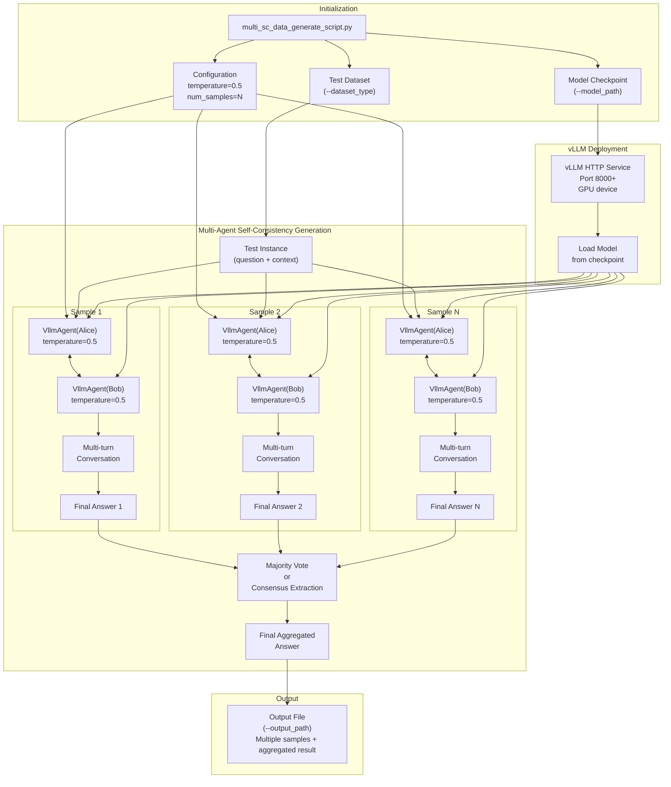
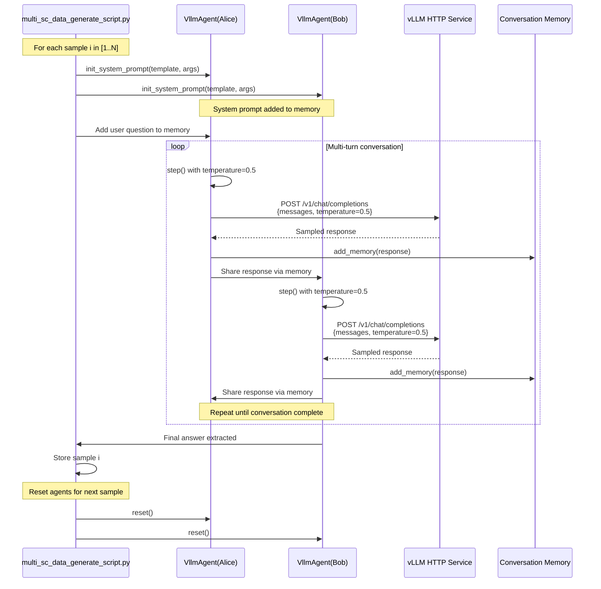
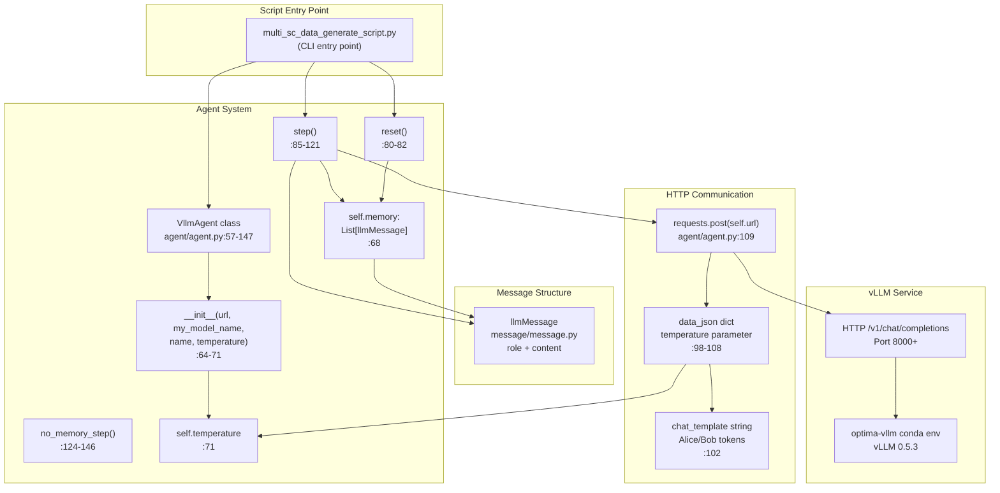
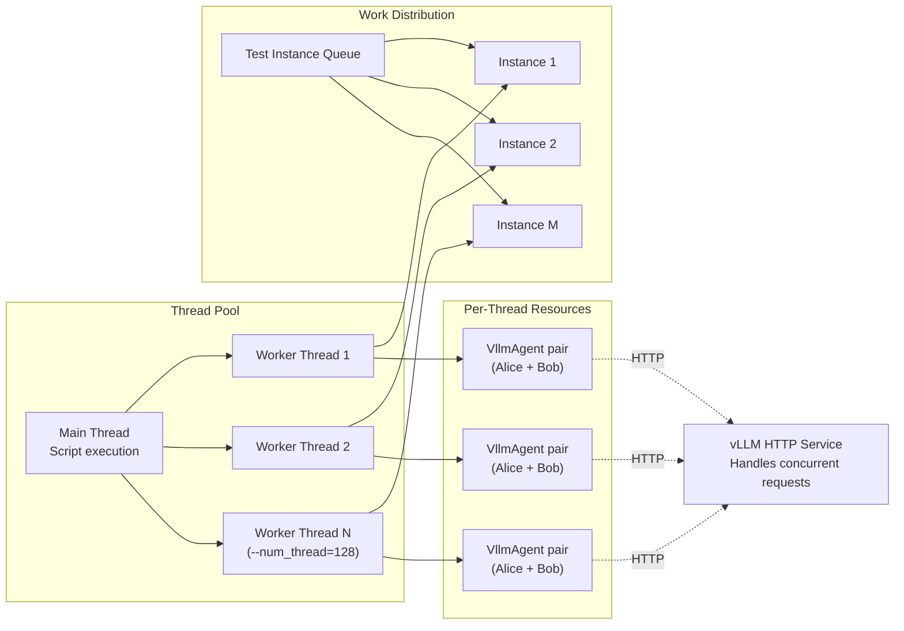

<!-- source: DeepWiki mcp.deepwiki.com · repo thunlp/Optima · page 8.2 Multi-Agent Self-Consistency · fetched 2026-11-02 -->

# Multi-Agent Self-Consistency

<details>
<summary>Relevant source files</summary>

The following files were used as context for generating this wiki page:

- [README.md](README.md)
- [README_revise.md](README_revise.md)
- [agent/agent.py](agent/agent.py)

</details>


## Purpose and Scope

This document explains the multi-agent self-consistency technique implemented in Optima and how to use the `multi_sc_data_generate_script.py` script. Self-consistency is an inference-time technique that improves response robustness by generating multiple conversation samples and aggregating results. This page focuses specifically on the self-consistency implementation for multi-agent interactions.

For standard batch inference without self-consistency, see [Running Inference](#8.1). For evaluation metrics that can be computed from self-consistency outputs, see [Evaluation Metrics](#8.3).

---

## Overview of Self-Consistency

Self-consistency is a decoding strategy that generates multiple independent responses to the same input by using temperature-based sampling, then aggregates these responses to produce a more robust final answer. In the context of multi-agent systems, this means:

1. Running the same multi-agent conversation multiple times with non-zero temperature
2. Allowing agents (Alice and Bob) to explore different reasoning paths
3. Aggregating the final answers across multiple samples to identify the most consistent response

This technique is particularly valuable for:
- **Robustness improvement**: Reducing the impact of single-sample variance
- **Uncertainty quantification**: Measuring confidence based on answer agreement across samples
- **Performance gains**: Often improving accuracy compared to single greedy decoding

**Key difference from training data generation**: During training iterations, multi-agent conversations are deterministic (temperature=0 or greedy). Self-consistency uses temperature>0 to generate diverse samples at inference time.

Sources: [README.md:112-137]()

---

## Script Architecture

The `multi_sc_data_generate_script.py` script implements multi-agent self-consistency by orchestrating multiple sampled conversations between VllmAgent instances.

### Command-Line Interface

The script accepts the following parameters:

| Parameter | Description | Example Value |
|-----------|-------------|---------------|
| `--model_path` | Path to the specific model checkpoint | `./checkpoints/arc_sft/iteration_0` |
| `--tokenizer_path` | Path to the tokenizer | `${pretrained_tokenizer_path}` |
| `--device` | GPU device index for first vLLM deployment | `0` |
| `--port` | First port number for vLLM HTTP service | `8000` |
| `--dataset_type` | Dataset to evaluate on | `arc`, `hotpot_qa`, `mwh_qa`, `trivial_qa`, `cbt`, `math`, `gsm8k`, `mmlu` |
| `--num_thread` | Number of parallel threads for generation | `128` |
| `--output_path` | Directory to save results | `./inference_results` |
| `--temperature` | Sampling temperature for response generation | `0.5` |
| `--vllm_env` | Conda environment name for vLLM | `optima-vllm` |

### Execution Example

```bash
python multi_sc_data_generate_script.py \
    --model_path ./checkpoints/arc_sft/iteration_0 \
    --tokenizer_path ${pretrained_tokenizer_path} \
    --device 0 \
    --port 8000 \
    --dataset_type arc \
    --num_thread 128 \
    --output_path ./inference_results \
    --temperature 0.5 \
    --vllm_env optima-vllm
```

Sources: [README.md:112-137](), [README_revise.md:103-128]()

---

## Self-Consistency Workflow

The following diagram illustrates the complete self-consistency workflow from model deployment through multi-sample generation:



Sources: [README.md:112-137](), [agent/agent.py:57-147]()

---

## VllmAgent Temperature Sampling

The `VllmAgent` class enables temperature-based sampling crucial for self-consistency by passing the temperature parameter to the vLLM HTTP service.

### Temperature-Controlled Generation

```mermaid
graph LR
    subgraph "VllmAgent Configuration"
        AgentInit["VllmAgent.__init__()<br/>url, name, temperature"]
        TempParam["self.temperature<br/>(e.g., 0.5)"]
    end
    
    subgraph "Step Execution"
        StepMethod["VllmAgent.step()"]
        MessageInput["Convert memory<br/>to message list"]
        DataJSON["HTTP Request JSON<br/>model, messages,<br/>temperature, max_tokens"]
    end
    
    subgraph "vLLM HTTP Service"
        HTTPEndpoint["/v1/chat/completions"]
        TempSampling["Temperature Sampling<br/>Non-deterministic"]
        Response["Sampled Response"]
    end
    
    subgraph "Memory Management"
        AddMemory["add_memory()"]
        MemoryList["self.memory:<br/>List[llmMessage]"]
    end
    
    AgentInit --> TempParam
    TempParam --> StepMethod
    
    StepMethod --> MessageInput
    MessageInput --> DataJSON
    DataJSON --> HTTPEndpoint
    
    HTTPEndpoint --> TempSampling
    TempSampling --> Response
    
    Response --> AddMemory
    AddMemory --> MemoryList
    MemoryList -.feeds back to.-> StepMethod
```



### Implementation Details

The `VllmAgent.step()` method [agent/agent.py:85-121]() constructs an HTTP POST request with temperature:

**Key components**:
- **Temperature parameter**: Set in `data_json["temperature"]` at [agent/agent.py:101]()
- **Chat template**: Ensures proper Alice/Bob formatting at [agent/agent.py:102-106]()
- **Max tokens**: Limits response length to 2000 tokens at [agent/agent.py:107]()
- **Memory update**: Adds response to conversation history at [agent/agent.py:119]()

**Temperature values**:
- `0.0`: Deterministic greedy decoding (used in training data generation)
- `0.5`: Moderate diversity (typical for self-consistency)
- `1.0`: High diversity (more exploration, but potentially less coherent)

Sources: [agent/agent.py:57-147]()

---

## Multi-Sample Generation Process

### Agent Interaction Flow

For each test instance, the self-consistency script generates multiple independent samples through repeated multi-agent conversations:



### Memory Reset Between Samples

Between samples, agents are reset to ensure independence:
- **Memory clearing**: [agent/agent.py:80-82]() shows `reset()` clears the `self.memory` list
- **System prompt reinitialization**: System prompt is reset but conversation history is cleared
- **Independence guarantee**: Each sample starts fresh, ensuring true sampling diversity

Sources: [agent/agent.py:57-147]()

---

## Differences from Standard Inference

The following table compares `multi_sc_data_generate_script.py` with the standard `inference_script.py`:

| Aspect | Standard Inference (`inference_script.py`) | Self-Consistency (`multi_sc_data_generate_script.py`) |
|--------|-------------------------------------------|--------------------------------------------------|
| **Temperature** | 0.0 (greedy decoding) | > 0.0 (typically 0.5) |
| **Samples per instance** | 1 | N (multiple) |
| **Determinism** | Deterministic | Stochastic |
| **Output** | Single answer per instance | Multiple samples + aggregated answer |
| **Purpose** | Batch evaluation of accuracy | Robustness and confidence estimation |
| **Memory resets** | Once per instance | N times per instance (once per sample) |
| **Computational cost** | 1x | Nx |
| **Model scope** | Batch processes all checkpoints in `--model_root_path` | Evaluates single checkpoint at `--model_path` |

### When to Use Each

**Use `inference_script.py`** when:
- Evaluating multiple model checkpoints across iterations
- Measuring baseline accuracy with deterministic responses
- Comparing different training configurations

**Use `multi_sc_data_generate_script.py`** when:
- Measuring robustness and consistency of a specific checkpoint
- Estimating model uncertainty
- Seeking performance improvements through aggregation
- Analyzing reasoning path diversity

Sources: [README.md:94-137]()

---

## Code Entity Mapping

The following diagram maps the self-consistency concept to concrete code entities in the repository:



Sources: [agent/agent.py:1-147](), [README.md:112-137]()

---

## Parallel Execution with Threading

The `--num_thread` parameter enables parallel processing of multiple test instances or samples:

### Thread Configuration



**Threading benefits**:
- **Throughput**: Process multiple instances concurrently
- **GPU utilization**: Keep vLLM service busy with parallel requests
- **Scalability**: `num_thread=128` can handle large test sets efficiently

**Considerations**:
- Each thread creates independent VllmAgent instances
- vLLM service handles request queuing internally
- Memory usage scales with thread count

Sources: [README.md:112-137]()

---

## Output Format and Results

The self-consistency script saves results to the specified `--output_path`, typically containing:

### Expected Output Structure

```
inference_results/
├── {dataset_type}_{model_name}_selfconsistency.json
│   └── Contains:
│       ├── test_instance_id
│       ├── question
│       ├── context
│       ├── samples: [
│       │   ├── sample_1: {conversation_history, final_answer}
│       │   ├── sample_2: {conversation_history, final_answer}
│       │   └── sample_N: {conversation_history, final_answer}
│       │   ]
│       ├── aggregated_answer
│       └── ground_truth
```

### Result Analysis

The output enables various analyses:
- **Accuracy**: Compare aggregated answer to ground truth
- **Consistency rate**: Measure agreement across samples
- **Confidence estimation**: Higher agreement → higher confidence
- **Reasoning diversity**: Analyze different conversation paths

Sources: [README.md:112-137]()

---

## Usage Recommendations

### Temperature Selection

| Temperature | Behavior | Use Case |
|------------|----------|----------|
| 0.3-0.5 | Moderate diversity with coherence | Standard self-consistency |
| 0.5-0.7 | Higher diversity, more exploration | Uncertainty quantification |
| 0.7-1.0 | Maximum diversity | Reasoning path analysis |

### Sample Count

- **N=3-5**: Quick consistency check with limited computational budget
- **N=10-20**: Balanced trade-off for most applications
- **N=30+**: High-confidence estimation, research analysis

### Best Practices

1. **Checkpoint selection**: Use fully trained checkpoints (later iterations) for best results
2. **Dataset choice**: Self-consistency is most valuable for reasoning tasks (arc, math, gsm8k)
3. **Resource allocation**: Ensure vLLM has sufficient GPU memory for concurrent requests
4. **Output storage**: Plan for N× storage compared to standard inference

Sources: [README.md:112-137](), [agent/agent.py:57-147]()

---

