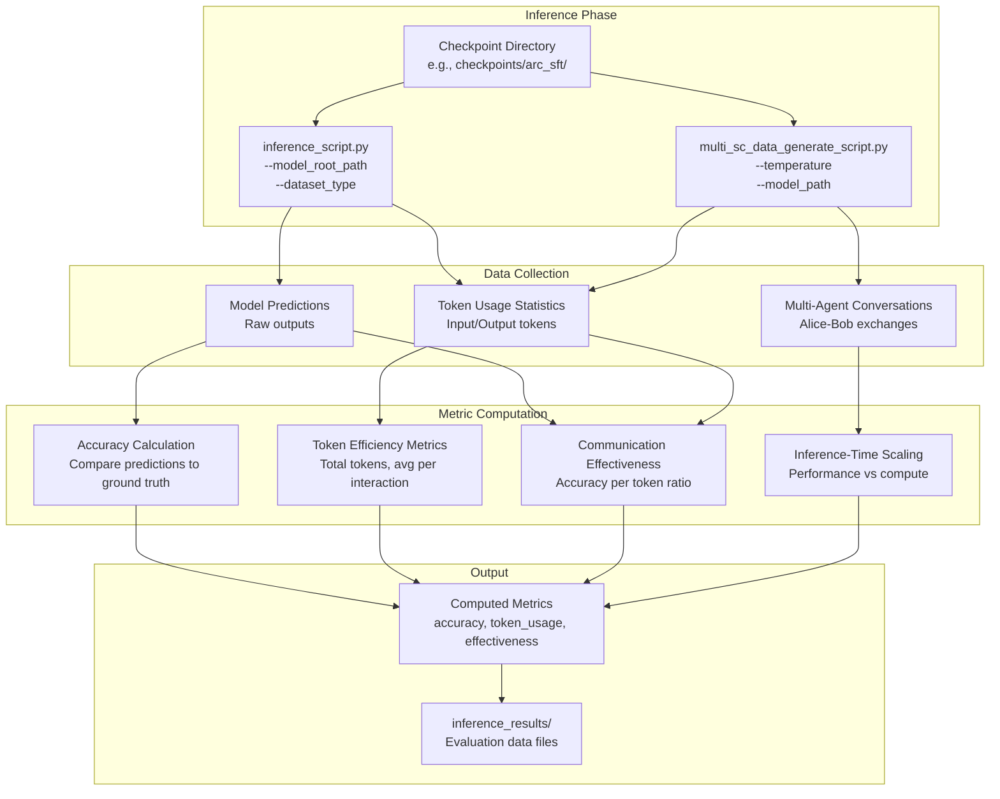
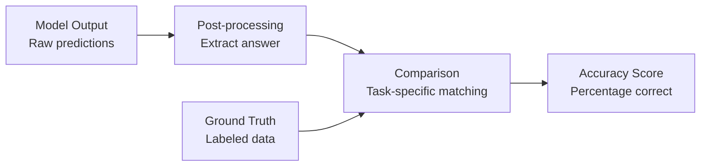
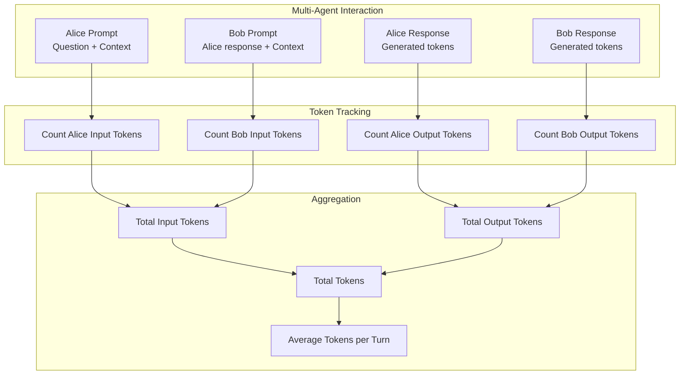
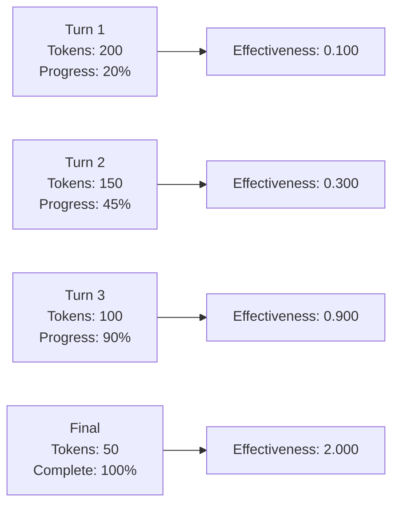
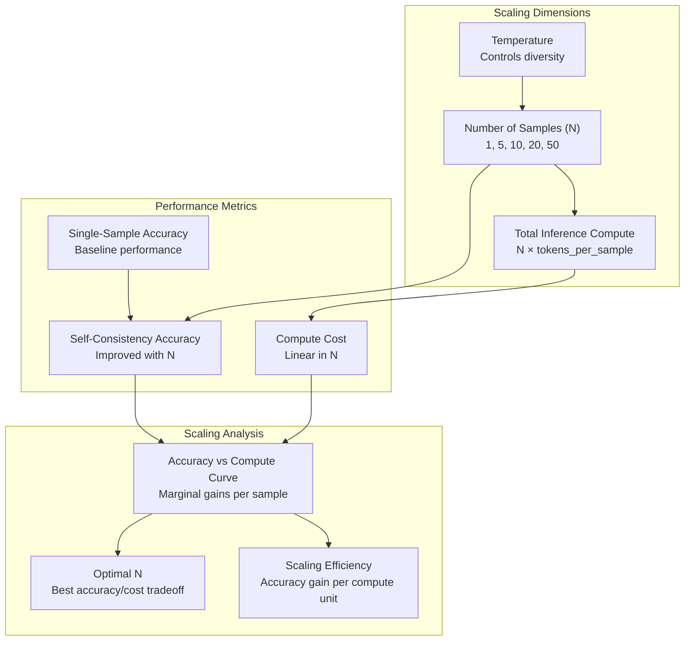
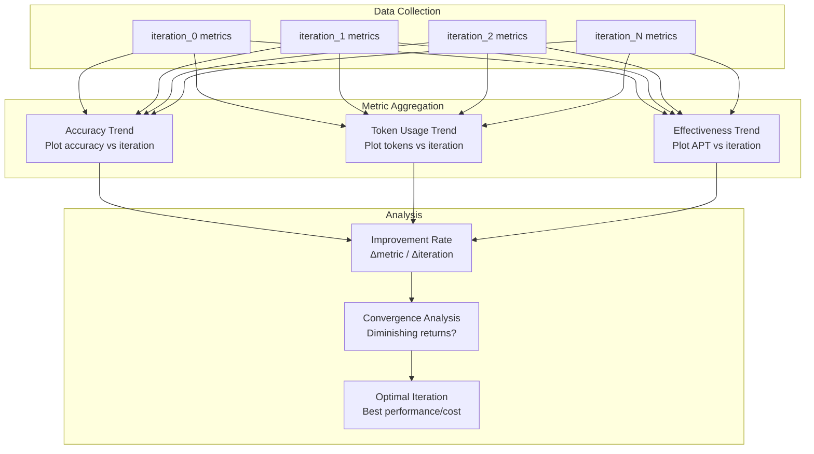

<!-- source: DeepWiki mcp.deepwiki.com · repo thunlp/Optima · page 8.3 Evaluation Metrics · fetched 2026-11-02 -->

# Evaluation Metrics

<details>
<summary>Relevant source files</summary>

The following files were used as context for generating this wiki page:

- [README.md](README.md)
- [README_revise.md](README_revise.md)

</details>


This page documents the key evaluation metrics used in the Optima framework to measure model performance, efficiency, and communication effectiveness. These metrics are computed after running inference using [inference_script.py]() and [multi_sc_data_generate_script.py](), and are essential for assessing the improvements achieved through iterative training.

For information on running inference to generate these metrics, see [Running Inference](#8.1). For details on multi-agent self-consistency evaluation, see [Multi-Agent Self-Consistency](#8.2).

## Overview

Optima evaluates models across three primary dimensions that correspond to its core optimization objectives:

| Metric Category | Purpose | Key Insight |
|-----------------|---------|-------------|
| **Accuracy** | Measure task performance correctness | Ensures optimization doesn't degrade response quality |
| **Token Efficiency** | Quantify communication cost | Tracks reduction in token usage during multi-agent interactions |
| **Communication Effectiveness** | Assess information density | Measures how much useful information is conveyed per token |

These metrics work together to validate Optima's claim of simultaneously improving both effectiveness (accuracy) and efficiency (token usage) in multi-agent systems.

**Sources:** [README.md:11-21]()

## Metric Computation Flow

The following diagram illustrates how evaluation metrics are computed in the Optima pipeline:



**Sources:** [README.md:94-137](), [inference_script.py]()

## Accuracy Metrics

Accuracy measures the correctness of model predictions on evaluation tasks. Different datasets use different accuracy computation methods appropriate to their task type.

### Task-Specific Accuracy

The `--dataset_type` parameter in [inference_script.py]() determines which accuracy metric is applied:

| Dataset Type | Accuracy Method | Description |
|--------------|----------------|-------------|
| `arc` | Multiple Choice | Exact match against correct option label |
| `mmlu` | Multiple Choice | Exact match against correct option label |
| `hotpot_qa` | Extractive QA | Token-level F1 and exact match scores |
| `mwh_qa` | Extractive QA | Token-level F1 and exact match scores |
| `trivial_qa` | Extractive QA | Token-level F1 and exact match scores |
| `math` | Numerical | Equivalence check for mathematical expressions |
| `gsm8k` | Numerical | Exact numerical match with tolerance |
| `cbt` | Completion | Exact string match |

### Accuracy Computation

Accuracy is computed by comparing model predictions against ground truth labels after inference completes:



The accuracy metric is typically reported as:
- **Percentage**: Number of correct predictions / Total predictions × 100
- **Per-iteration tracking**: Accuracy is tracked across training iterations (iteration_0, iteration_1, etc.) to measure improvement

**Sources:** [README.md:98-110](), [inference_script.py:104]()

## Token Efficiency Metrics

Token efficiency quantifies the computational and communication cost of multi-agent interactions. Optima aims to reduce token usage while maintaining or improving accuracy.

### Token Usage Categories

Token counts are tracked across different components of multi-agent conversations:

| Token Category | Description | Optimization Goal |
|----------------|-------------|-------------------|
| **Input Tokens** | Tokens in prompts and context | Minimize while preserving necessary information |
| **Output Tokens** | Tokens generated by agents | Reduce verbose responses, maintain clarity |
| **Total Tokens** | Sum of input and output tokens | Primary efficiency metric |
| **Tokens per Turn** | Average tokens in each conversation turn | Track communication granularity |

### Token Counting Methodology

Token counts are collected during inference through the vLLM deployment:



### Token Reduction Measurement

Token efficiency improvement is measured by comparing token usage across iterations:

- **Baseline**: Token usage of iteration_0 (base model)
- **Optimized**: Token usage of iteration_N (after N training iterations)
- **Reduction Percentage**: (Baseline - Optimized) / Baseline × 100

Example calculation:
- If iteration_0 uses 500 tokens on average per problem
- And iteration_3 uses 300 tokens on average per problem
- Token reduction = (500 - 300) / 500 × 100 = 40% reduction

**Sources:** [README.md:11-21](), [multi_sc_data_generate_script.py:127-137]()

## Communication Effectiveness Metrics

Communication effectiveness measures how efficiently agents convey information relative to token cost. This metric bridges accuracy and efficiency.

### Effectiveness Calculation

Communication effectiveness is computed as the ratio of useful information conveyed to tokens used:

**Effectiveness = Accuracy / Token Usage**

More precisely:
- **Accuracy per Token (APT)**: Task accuracy divided by average total tokens per sample
- **Information Density**: Successful task completions per 1000 tokens

### Effectiveness Comparison

The effectiveness metric reveals whether token reduction comes at the cost of accuracy:

| Scenario | Accuracy | Token Usage | Effectiveness | Interpretation |
|----------|----------|-------------|---------------|----------------|
| Baseline | 60% | 500 tokens | 0.120 | Reference point |
| Optimized A | 65% | 300 tokens | 0.217 | Better: +5% accuracy, -40% tokens |
| Optimized B | 55% | 300 tokens | 0.183 | Worse: -5% accuracy despite token reduction |
| Optimized C | 60% | 400 tokens | 0.150 | Mixed: same accuracy, 20% fewer tokens |

Optima aims for scenarios like "Optimized A" where both numerator (accuracy) increases and denominator (token usage) decreases, resulting in significant effectiveness gains.

### Multi-Turn Effectiveness

For multi-turn conversations, effectiveness can be computed per conversation turn:



This per-turn analysis reveals whether later iterations learn to make more efficient use of tokens in each exchange.

**Sources:** [README.md:11-21]()

## Inference-Time Scaling Laws

Inference-time scaling analysis examines how model performance changes with additional inference-time computation, particularly through multi-agent self-consistency approaches.

### Self-Consistency Scaling

The [multi_sc_data_generate_script.py]() script enables self-consistency evaluation with temperature sampling:

**Scaling Mechanism:**
1. Generate N diverse responses per question (controlled by `--temperature`)
2. Aggregate responses through voting or consistency checking
3. Measure accuracy improvement as N increases

### Scaling Curve Analysis

Inference-time scaling is characterized by plotting accuracy against inference compute:



### Scaling Law Formula

Empirical scaling laws often follow power law relationships:

**Accuracy(N) = A_base + k × N^α**

Where:
- `A_base`: Single-sample baseline accuracy
- `k`: Scaling coefficient (improvement potential)
- `N`: Number of self-consistency samples
- `α`: Scaling exponent (typically 0 < α < 1, showing diminishing returns)

Optima-trained models aim to have:
- **Higher k**: Greater improvement potential from self-consistency
- **Higher α**: Better scaling efficiency (slower diminishing returns)

### Comparative Scaling Analysis

Comparing scaling curves across iterations reveals whether iterative training improves inference-time scalability:

| Iteration | Single Accuracy | N=10 Accuracy | Scaling Gain | Efficiency |
|-----------|----------------|---------------|--------------|------------|
| iteration_0 | 60% | 65% | +5% | 0.5%/sample |
| iteration_1 | 62% | 69% | +7% | 0.7%/sample |
| iteration_2 | 65% | 74% | +9% | 0.9%/sample |

The "Scaling Gain" and "Efficiency" metrics indicate whether the model becomes more amenable to inference-time scaling through training.

**Sources:** [README.md:112-137](), [multi_sc_data_generate_script.py]()

## Metrics Output Format

Evaluation metrics are stored in the output directory specified by `--output_root_path` (for batch inference) or `--output_path` (for multi-agent self-consistency):

### Output Directory Structure

```
inference_results/
├── arc_sft/
│   ├── iteration_0/
│   │   ├── predictions.json       # Raw model predictions
│   │   ├── metrics.json           # Computed metrics
│   │   └── token_stats.json       # Token usage statistics
│   ├── iteration_1/
│   │   └── ...
│   └── iteration_N/
│       └── ...
└── arc_sft_dpo/
    └── ...
```

### Metrics File Format

The `metrics.json` file typically contains:

```json
{
  "accuracy": 0.73,
  "total_samples": 1000,
  "correct_predictions": 730,
  "token_statistics": {
    "avg_input_tokens": 45.2,
    "avg_output_tokens": 78.5,
    "avg_total_tokens": 123.7,
    "total_tokens": 123700
  },
  "communication_effectiveness": 0.0059,
  "per_category_accuracy": {
    "science": 0.75,
    "history": 0.70,
    "math": 0.72
  }
}
```

**Sources:** [README.md:94-110](), [inference_script.py:100-109]()

## Cross-Iteration Comparison

A key aspect of evaluation is tracking metric evolution across training iterations to validate the iterative training approach.

### Comparison Methodology



### Expected Metric Trajectories

Based on Optima's design goals:

| Metric | Expected Trajectory | Success Indicator |
|--------|-------------------|-------------------|
| Accuracy | Monotonic increase or plateau | No degradation, ideally +5-15% |
| Token Usage | Monotonic decrease | 20-50% reduction typical |
| Effectiveness | Steep increase | Combines both improvements |
| Scaling Efficiency | Gradual increase | Better use of inference compute |

**Sources:** [README.md:11-21]()

## Dataset-Specific Considerations

Different datasets require different evaluation approaches and have different metric characteristics.

### Reasoning Tasks (ARC, MMLU)

- **Accuracy**: Multiple choice, clear correct answer
- **Token Efficiency**: Measures reasoning efficiency
- **Communication Focus**: How agents collaborate to reason

### Question Answering (HotpotQA, MultiWikihop, TriviaQA)

- **Accuracy**: F1 score and exact match
- **Token Efficiency**: Measures retrieval and synthesis efficiency
- **Communication Focus**: Information gathering and integration

### Mathematical Reasoning (MATH, GSM8K)

- **Accuracy**: Numerical equivalence
- **Token Efficiency**: Measures problem-solving efficiency
- **Communication Focus**: Step-by-step reasoning coordination

### Language Understanding (CBT)

- **Accuracy**: Exact string match
- **Token Efficiency**: Measures comprehension efficiency
- **Communication Focus**: Context understanding and inference

The supported dataset types are specified via the `--dataset_type` argument to inference scripts and include: `arc`, `mmlu`, `hotpot_qa`, `mwh_qa`, `trivial_qa`, `cbt`, `math`, `gsm8k`.

**Sources:** [README.md:104-105](), [README.md:132]()

## Summary

Optima's evaluation metrics provide a comprehensive view of model improvements across three critical dimensions:

1. **Accuracy metrics** ensure task performance is maintained or improved
2. **Token efficiency metrics** quantify reduction in computational and communication costs
3. **Communication effectiveness metrics** capture the combined benefit of accuracy and efficiency

These metrics are computed using [inference_script.py]() for standard evaluation and [multi_sc_data_generate_script.py]() for self-consistency scaling analysis. Results are stored in the `inference_results/` directory with detailed breakdowns per iteration and dataset.

The interplay of these metrics validates Optima's core contribution: simultaneously optimizing both effectiveness (accuracy) and efficiency (token usage) in LLM-based multi-agent systems, while also improving inference-time scaling properties.

**Sources:** [README.md:11-21](), [README.md:94-137]()

---

