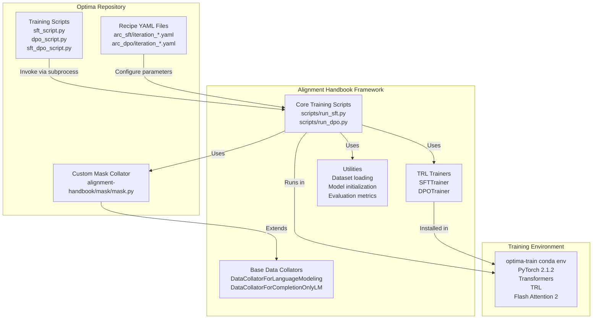
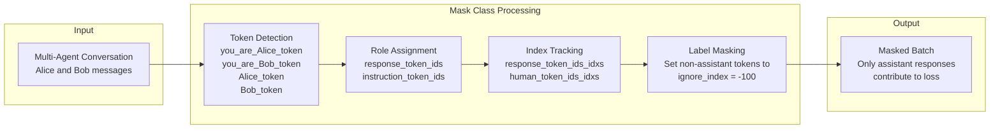
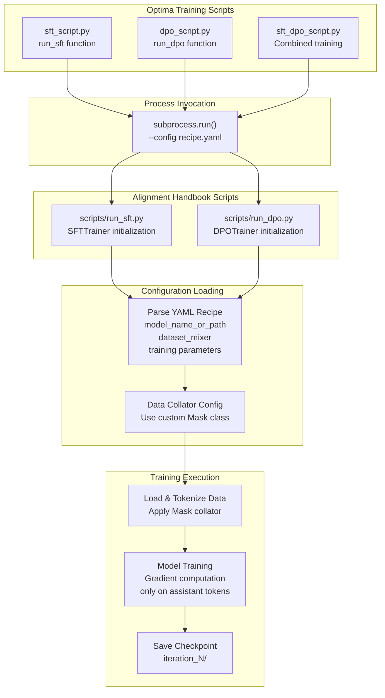
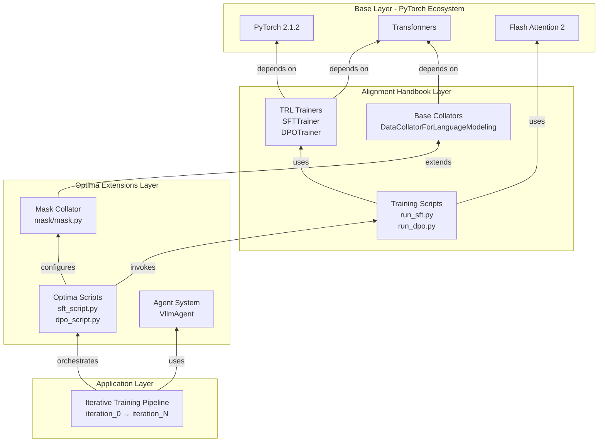

<!-- source: DeepWiki mcp.deepwiki.com · repo thunlp/Optima · page 9 Alignment Handbook Integration · fetched 2026-11-02 -->

# Alignment Handbook Integration

<details>
<summary>Relevant source files</summary>

The following files were used as context for generating this wiki page:

- [alignment-handbook/.gitignore](alignment-handbook/.gitignore)
- [alignment-handbook/README.md](alignment-handbook/README.md)
- [alignment-handbook/mask/mask.py](alignment-handbook/mask/mask.py)

</details>


## Purpose and Scope

This document explains how Optima integrates with and extends the [alignment-handbook](https://github.com/huggingface/alignment-handbook) framework for training language models with human and AI preferences. The alignment-handbook provides the foundational training infrastructure that Optima builds upon, including SFT and DPO training scripts, data processing utilities, and model evaluation tools.

For specific implementation details of the custom Mask data collator, see [Mask Data Collator Implementation](#9.2). For build system and development tools, see [Build System and Development Tools](#9.3). For configuration of training recipes that use these tools, see [Recipe Configuration System](#6.2).

---

## What is Alignment Handbook

The alignment-handbook is an open-source framework developed by Hugging Face for aligning language models with human preferences. It provides:

- **Training scripts**: Supervised fine-tuning (SFT), Direct Preference Optimization (DPO), and Odds Ratio Preference Optimization (ORPO)
- **Recipe system**: YAML-based configuration for reproducible training runs
- **Distributed training**: Support for DeepSpeed ZeRO-3, LoRA, and QLoRA
- **Educational resources**: Documentation and guides on preference alignment techniques

Optima uses alignment-handbook as the underlying training engine while extending it with custom data collators and multi-agent capabilities.

**Sources:** [alignment-handbook/README.md:1-130]()

---

## Integration Architecture

The following diagram shows how alignment-handbook components integrate into the Optima system:

### Diagram: Alignment Handbook Integration Points



**Sources:** [alignment-handbook/README.md:35-58](), [alignment-handbook/mask/mask.py:1-123]()

---

## Key Components

### alignment-handbook Directory Structure

```
alignment-handbook/
├── scripts/                    # Core training scripts
│   ├── run_sft.py             # Supervised fine-tuning
│   ├── run_dpo.py             # Direct preference optimization
│   └── run_orpo.py            # Odds ratio preference optimization
├── recipes/                    # Example recipe configurations
│   └── zephyr-7b-beta/        # Zephyr model recipes
├── src/                        # Source code and utilities
│   └── alignment/             # Main package
├── mask/                       # Optima's custom extensions
│   └── mask.py                # Custom Mask data collator
├── Makefile                    # Development commands
├── setup.py                    # Package installation
└── README.md                   # Framework documentation
```

**Sources:** [alignment-handbook/README.md:101-114]()

---

## Optima's Extensions

### Custom Mask Data Collator

Optima extends alignment-handbook with a custom `Mask` class that implements completion-only language modeling for multi-agent conversations. This collator masks non-assistant tokens so that only the assistant's responses contribute to the training loss.

### Diagram: Mask Data Collator Flow



**Sources:** [alignment-handbook/mask/mask.py:14-122]()

### Token Identifiers

The Mask collator uses specific token sequences to identify agent roles in conversations:

| Token Variable | Token IDs | Purpose |
|----------------|-----------|---------|
| `you_are_Alice_token` | `[128006, 9125, 128007, 271, 2675, 527, 30505]` | Identifies Alice system message |
| `you_are_Bob_token` | `[128006, 9125, 128007, 271, 2675, 527, 14596]` | Identifies Bob system message |
| `Alice_token` | `[128006, 78191, 128007, 271, 62786, 25]` | Marks Alice's assistant responses |
| `Bob_token` | `[128006, 78191, 128007, 271, 33488, 25]` | Marks Bob's assistant responses |

These token sequences correspond to Llama-3's chat template format with custom agent names.

**Sources:** [alignment-handbook/mask/mask.py:8-11]()

---

## Integration with Training Scripts

### Diagram: Training Script to Alignment Handbook Flow



**Sources:** [alignment-handbook/README.md:35-45](), [alignment-handbook/mask/mask.py:14-40]()

---

## Recipe Configuration Integration

Optima's recipe YAML files configure alignment-handbook training runs. Key parameters include:

### Model Configuration
```yaml
model_name_or_path: checkpoints/iteration_0
tokenizer_name_or_path: meta-llama/Meta-Llama-3-8B-Instruct
torch_dtype: bfloat16
use_flash_attention_2: true
```

### Data Configuration
```yaml
dataset_mixer:
  my_datasets/arc_sft/iteration_1: 1.0
dataset_splits:
  - train
preprocessing_num_workers: 8
```

### Training Configuration
```yaml
learning_rate: 5.0e-7
num_train_epochs: 4
per_device_train_batch_size: 1
gradient_accumulation_steps: 8
```

These configurations are passed directly to alignment-handbook's training scripts, which parse them and initialize the appropriate trainers and data collators.

**Sources:** [alignment-handbook/README.md:38-39]()

---

## Installation and Dependencies

### alignment-handbook Installation

The alignment-handbook is installed as part of the `optima-train` conda environment:

```bash
# Inside optima-train environment
cd alignment-handbook/
python -m pip install .
python -m pip install flash-attn --no-build-isolation
```

### Key Dependencies

| Package | Version | Purpose |
|---------|---------|---------|
| PyTorch | 2.1.2 | Deep learning framework |
| Transformers | Latest | Model architectures and tokenizers |
| TRL | Latest | Trainer classes (SFTTrainer, DPOTrainer) |
| Flash Attention 2 | Latest | Optimized attention computation |
| DeepSpeed | Latest | Distributed training (optional) |

**Sources:** [alignment-handbook/README.md:59-97]()

---

## Development Tools

The alignment-handbook includes a Makefile with common development commands:

### Available Make Targets

| Target | Description |
|--------|-------------|
| `make quality` | Run code quality checks (black, isort, flake8) |
| `make style` | Auto-format code with black and isort |
| `make test` | Run unit tests |

These tools help maintain code quality across both alignment-handbook and Optima's extensions.

For more details on the build system, see [Build System and Development Tools](#9.3).

**Sources:** [alignment-handbook/README.md:105]()

---

## Integration Points Summary

### Where Optima Uses Alignment Handbook

1. **Training Infrastructure**: Core SFT and DPO training logic
2. **Data Processing**: Base data collator classes extended by `Mask`
3. **Model Management**: Model loading, saving, and checkpoint management
4. **Distributed Training**: DeepSpeed and multi-GPU support
5. **Recipe System**: YAML-based configuration parsing

### What Optima Extends

1. **Mask Data Collator**: Custom completion-only masking for multi-agent conversations
2. **Training Scripts**: Wrapper scripts that orchestrate multi-iteration training
3. **Agent Integration**: VllmAgent system for inference during data generation
4. **Dataset Structure**: Custom dataset format in `my_datasets/` directory

### Diagram: Component Dependencies



**Sources:** [alignment-handbook/README.md:1-130](), [alignment-handbook/mask/mask.py:1-123]()

---

## File Locations

### Alignment Handbook Files in Optima Repository

- **Core framework**: `alignment-handbook/` directory (git submodule or copy)
- **Custom extensions**: `alignment-handbook/mask/mask.py`
- **Configuration**: Referenced by recipe YAML files in `recipes/`
- **Installation**: Part of `optima-train` conda environment

### Related Optima Files

- **Training scripts**: `sft_script.py`, `dpo_script.py`, `sft_dpo_script.py`
- **Recipe configurations**: `recipes/arc_sft/`, `recipes/arc_dpo/`, etc.
- **Agent system**: `agent.py` (VllmAgent class)
- **Data generation**: `multi_sc_data_generate_script.py`

**Sources:** [alignment-handbook/README.md:101-114](), [alignment-handbook/.gitignore:1-164]()

---

