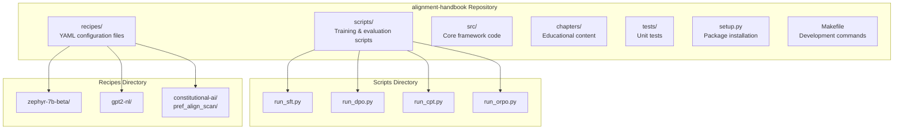
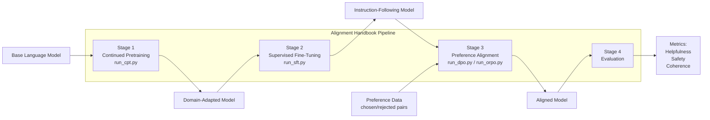
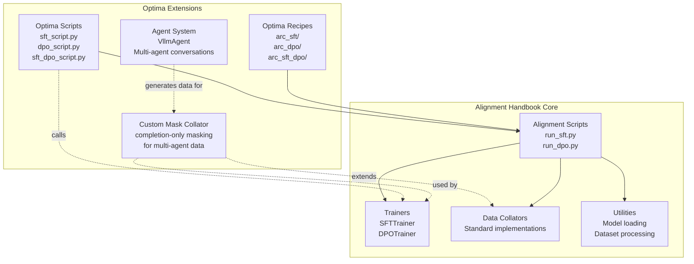
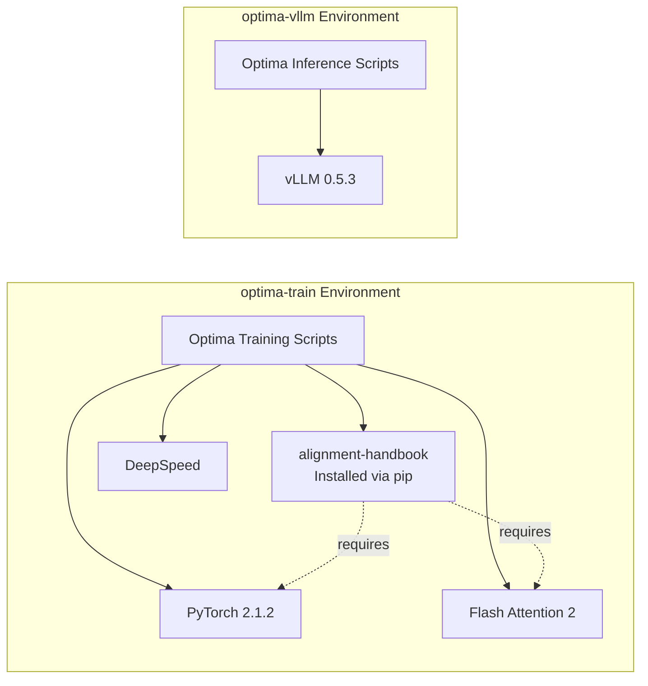
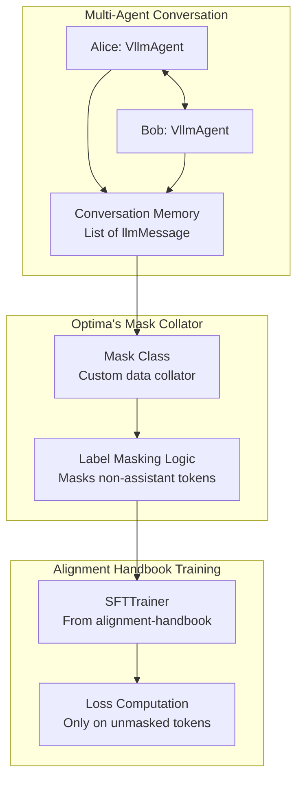
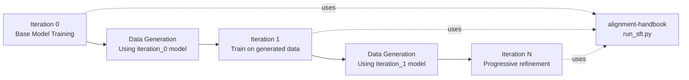
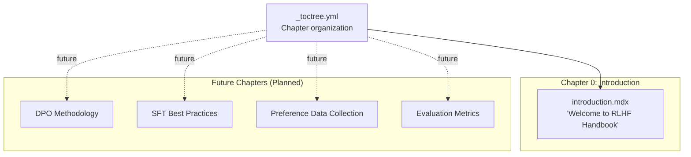

<!-- source: DeepWiki mcp.deepwiki.com · repo thunlp/Optima · page 9.1 Alignment Handbook Overview · fetched 2026-11-02 -->

# Alignment Handbook Overview

<details>
<summary>Relevant source files</summary>

The following files were used as context for generating this wiki page:

- [alignment-handbook/README.md](alignment-handbook/README.md)
- [alignment-handbook/chapters/en/_toctree.yml](alignment-handbook/chapters/en/_toctree.yml)
- [alignment-handbook/chapters/en/chapter0/introduction.mdx](alignment-handbook/chapters/en/chapter0/introduction.mdx)

</details>


This page introduces the alignment-handbook framework, an open-source project by Hugging Face that provides robust training recipes for aligning language models with human and AI preferences. This document explains what alignment-handbook is, its core components, and how Optima integrates with and extends it for multi-agent system optimization.

For technical details on Optima's custom Mask data collator implementation that extends alignment-handbook, see [Mask Data Collator Implementation](#9.2). For information about the build system and development tools, see [Build System and Development Tools](#9.3).

## What is Alignment Handbook?

The alignment-handbook is a comprehensive framework for training language models with human preferences. It provides production-ready implementations of modern alignment techniques including Supervised Fine-Tuning (SFT), Direct Preference Optimization (DPO), Reward Modeling, Rejection Sampling, and Odds Ratio Preference Optimization (ORPO).

### Primary Purpose

The framework addresses the gap between research papers and production-ready alignment techniques by providing:

- **Robust Training Scripts**: Battle-tested implementations of SFT, DPO, and other alignment methods
- **Recipe System**: YAML-based configurations for reproducible training runs
- **Distributed Training Support**: DeepSpeed ZeRO-3 integration for full-parameter training
- **Parameter-Efficient Methods**: LoRA/QLoRA support for resource-constrained scenarios

### Key Features

| Feature | Description |
|---------|-------------|
| **Multi-stage Pipeline** | Continued pretraining → SFT → Preference alignment |
| **Multiple Alignment Methods** | DPO, ORPO, KTO, IPO implementations |
| **Distributed Training** | DeepSpeed ZeRO-3, multi-GPU support |
| **Recipe-Based Configuration** | YAML files for complete training reproducibility |
| **Flash Attention 2** | Optimized attention implementation for efficiency |

Sources: [alignment-handbook/README.md:1-58]()

## Project Structure

The alignment-handbook repository follows a clean, modular structure:



**Directory Structure Overview**

```
alignment-handbook/
├── scripts/           # Training and evaluation scripts
│   ├── run_sft.py    # Supervised fine-tuning
│   ├── run_dpo.py    # Direct preference optimization
│   ├── run_cpt.py    # Continued pretraining
│   └── run_orpo.py   # Odds ratio preference optimization
├── recipes/           # YAML configuration files
│   ├── zephyr-7b-beta/
│   ├── gpt2-nl/
│   └── ...
├── src/               # Framework source code
├── chapters/          # Educational content
├── tests/             # Unit tests
├── setup.py           # Package installation
└── Makefile          # Development tools
```

Sources: [alignment-handbook/README.md:101-114]()

## Core Training Pipeline

The alignment-handbook provides a multi-stage training pipeline for model alignment:



**Training Stages**

| Stage | Script | Purpose | Key Parameters |
|-------|--------|---------|----------------|
| **Continued Pretraining** | `run_cpt.py` | Adapt to new domain/language | Dataset, learning rate, sequence length |
| **Supervised Fine-Tuning** | `run_sft.py` | Teach instruction following | Chat templates, masking strategy |
| **DPO Alignment** | `run_dpo.py` | Align with preferences | Beta parameter, reference model |
| **ORPO Alignment** | `run_orpo.py` | Combined SFT+DPO | Lambda parameter, odds ratio loss |

Sources: [alignment-handbook/README.md:48-58]()

## How Optima Integrates with Alignment Handbook

Optima leverages alignment-handbook as its core training framework while adding critical extensions for multi-agent optimization:



### Integration Points

**1. Training Scripts Invocation**

Optima's training scripts (`sft_script.py`, `dpo_script.py`) invoke alignment-handbook's scripts as subprocesses:

| Optima Script | Calls Alignment-Handbook Script | Purpose |
|---------------|--------------------------------|---------|
| `sft_script.py` | `run_sft.py` | Execute supervised fine-tuning |
| `dpo_script.py` | `run_dpo.py` | Execute preference optimization |
| `sft_dpo_script.py` | Both scripts | Execute combined training |

**2. Recipe Configuration System**

Optima extends alignment-handbook's YAML recipe system with additional parameters for multi-agent training:

- **Standard Parameters**: Learning rate, batch size, gradient accumulation (from alignment-handbook)
- **Optima Extensions**: Agent configurations, multi-agent data paths, custom masking strategies

**3. Custom Data Collator**

Optima implements a custom `Mask` data collator that extends alignment-handbook's standard collators to support completion-only language modeling for multi-agent conversations. This ensures only assistant responses contribute to the training loss, not the user prompts or intermediate conversation tokens.

**4. Environment Separation**

Optima maintains the alignment-handbook installation in the `optima-train` environment:



Sources: [alignment-handbook/README.md:59-98]()

## Key Components Used by Optima

### Training Scripts

Alignment-handbook provides four primary training scripts that Optima utilizes:

| Script | Function | Optima Usage |
|--------|----------|--------------|
| `run_sft.py` | Supervised fine-tuning with chat templates | Called by `sft_script.py` for iterative SFT |
| `run_dpo.py` | Direct preference optimization | Called by `dpo_script.py` for preference alignment |
| `run_cpt.py` | Continued pretraining | Not directly used by Optima |
| `run_orpo.py` | Combined SFT+DPO in single stage | Not directly used by Optima |

### Recipe System

The recipe system allows complete training configuration through YAML files:

```yaml
# Example alignment-handbook recipe structure
model_name_or_path: meta-llama/Meta-Llama-3-8B-Instruct
chat_template: "..."
dataset_mixer:
  HuggingFaceH4/ultrachat_200k: 1.0
num_train_epochs: 3
learning_rate: 5.0e-7
per_device_train_batch_size: 2
gradient_accumulation_steps: 8
bf16: true
use_flash_attention_2: true
```

Optima extends this with additional parameters for multi-agent scenarios.

### Distributed Training Support

Alignment-handbook integrates with DeepSpeed and Accelerate for distributed training:

- **DeepSpeed ZeRO-3**: Shards model parameters, gradients, and optimizer states across GPUs
- **Accelerate**: Simplifies multi-GPU and mixed-precision training
- **FSDP**: Alternative to DeepSpeed for distributed training

### Data Processing

Alignment-handbook provides utilities for:

- **Dataset Loading**: Hugging Face Datasets integration
- **Chat Template Formatting**: Converts conversations to model-specific formats
- **Tokenization**: Efficient batch tokenization with padding and truncation
- **Data Collation**: Batches samples for training

Sources: [alignment-handbook/README.md:35-45]()

## Optima's Extensions to Alignment Handbook

Optima adds several critical components on top of alignment-handbook:

### 1. Multi-Agent Data Processing



The custom `Mask` data collator ensures:
- User prompts are masked (ignored in loss)
- Assistant responses are unmasked (contribute to loss)
- Proper handling of multi-turn conversations

### 2. Iterative Training Pipeline

Optima orchestrates multiple iterations of alignment-handbook training:



Each iteration:
1. Calls alignment-handbook training scripts
2. Generates new training data with the trained model
3. Uses that data for the next iteration

### 3. Recipe Hierarchy

Optima extends the recipe system with iteration-specific configurations:

```
recipes/
├── arc_sft/
│   ├── base.yaml              # Common parameters
│   ├── iteration_0.yaml       # Iteration-specific overrides
│   ├── iteration_1.yaml
│   └── ...
├── arc_dpo/
│   ├── base.yaml
│   ├── iteration_0.yaml
│   └── ...
```

This allows:
- Shared configuration in `base.yaml`
- Progressive hyperparameter tuning per iteration
- Easy experiment tracking and reproducibility

Sources: [alignment-handbook/README.md:1-129]()

## Installation and Dependencies

The alignment-handbook is installed as part of the `optima-train` environment:

### Installation Steps

```bash
# 1. Clone alignment-handbook
git clone https://github.com/huggingface/alignment-handbook.git
cd alignment-handbook/

# 2. Install package
python -m pip install .

# 3. Install Flash Attention 2
python -m pip install flash-attn --no-build-isolation
```

### Key Dependencies

| Package | Version | Purpose |
|---------|---------|---------|
| PyTorch | 2.1.2 | Deep learning framework |
| Transformers | Latest | Model architectures and tokenizers |
| Datasets | Latest | Data loading and processing |
| Accelerate | Latest | Distributed training orchestration |
| DeepSpeed | Latest | ZeRO optimization |
| Flash Attention 2 | Latest | Efficient attention computation |
| TRL | Latest | Reinforcement learning utilities |

Sources: [alignment-handbook/README.md:59-98]()

## Development and Customization

The alignment-handbook provides development tools through its `Makefile`:

```bash
# Code quality checks
make style        # Format code with black and isort
make quality      # Run ruff linter

# Testing
make test         # Run unit tests

# Package release
make release      # Build and upload to PyPI
```

### Makefile Targets

| Target | Command | Purpose |
|--------|---------|---------|
| `style` | `black` + `isort` | Format code |
| `quality` | `ruff check` | Lint code |
| `test` | `pytest` | Run tests |
| `release` | Build + upload | Release package |

Sources: [alignment-handbook/README.md:105]()

## Educational Content

The alignment-handbook includes educational chapters (currently under development):



The `chapters/` directory is designed to host comprehensive guides on alignment techniques, though content is still being developed.

Sources: [alignment-handbook/chapters/en/_toctree.yml:1-4](), [alignment-handbook/chapters/en/chapter0/introduction.mdx:1-3]()

## Notable Models and Datasets

The alignment-handbook has been used to train several notable models:

### Released Models

| Model | Parameters | Techniques | Notes |
|-------|------------|------------|-------|
| Zephyr 7B β | 7B | SFT + DPO | Flagship model demonstrating full pipeline |
| Zephyr 141B (A35B) | 141B | ORPO | Mixtral 8x22B fine-tuned |
| Zephyr 7B Gemma | 7B | RLAIF | Gemma 7B aligned with AI feedback |
| StarChat2 15B | 15B | SFT + DPO | Code assistant specialization |

### Dataset Contributions

- **No Robots**: 10,000 instructions written by human annotators
- Various preference datasets for DPO training
- Constitutional AI datasets for value alignment

Sources: [alignment-handbook/README.md:21-31]()

## Summary

The alignment-handbook provides Optima with:

1. **Production-Ready Training Infrastructure**: Battle-tested SFT and DPO implementations
2. **Distributed Training Support**: DeepSpeed and Accelerate integration
3. **Recipe System**: YAML-based reproducible configurations
4. **Data Processing Utilities**: Chat templates, tokenization, collation

Optima extends this foundation with:

1. **Custom Mask Collator**: Completion-only masking for multi-agent conversations
2. **Iterative Training Pipeline**: Multi-iteration refinement loop
3. **Agent System Integration**: VllmAgent-based data generation
4. **Recipe Hierarchy**: Iteration-specific configuration management

This symbiotic relationship allows Optima to leverage a mature alignment framework while adding specialized capabilities for multi-agent system optimization.

Sources: [alignment-handbook/README.md:1-129]()

---

