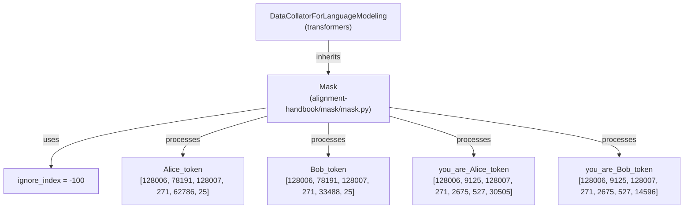
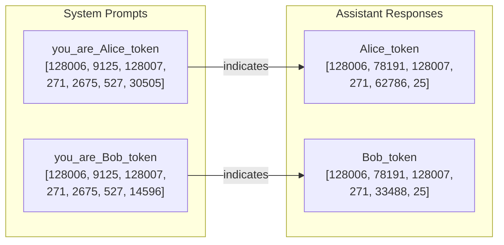
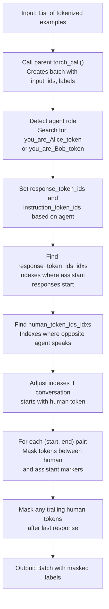
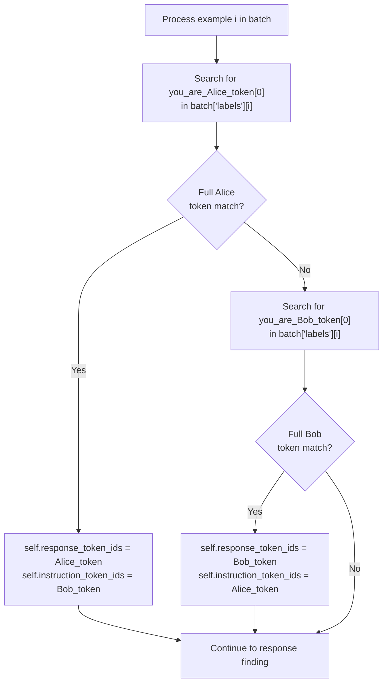
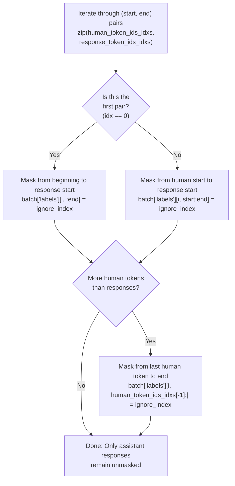
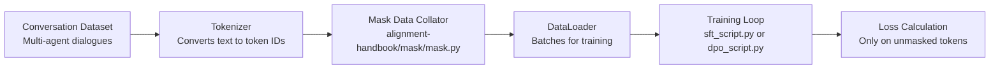

<!-- source: DeepWiki mcp.deepwiki.com · repo thunlp/Optima · page 9.2 Mask Data Collator Implementation · fetched 2026-11-02 -->

# Mask Data Collator Implementation

<details>
<summary>Relevant source files</summary>

The following files were used as context for generating this wiki page:

- [alignment-handbook/mask/__init__.py](alignment-handbook/mask/__init__.py)
- [alignment-handbook/mask/mask.py](alignment-handbook/mask/mask.py)

</details>


## Purpose and Scope

This document provides technical details of the `Mask` class implementation located in `alignment-handbook/mask/mask.py`. The `Mask` class is a specialized data collator that implements completion-only language modeling for multi-agent conversation training. It ensures that only tokens generated by the assistant contribute to the loss calculation during training, while masking out system prompts and user instructions.

For broader context on how this integrates with Optima's training system, see [Training System](#6). For information about the multi-agent conversation architecture that generates the data processed by this collator, see [Multi-Agent System Architecture](#3.2).

## Class Overview

The `Mask` class extends `DataCollatorForLanguageModeling` from the Transformers library to provide conversation-aware token masking for multi-agent training scenarios.

### Class Hierarchy



**Sources:** [alignment-handbook/mask/mask.py:1-42]()

### Constructor Parameters

| Parameter | Type | Default | Description |
|-----------|------|---------|-------------|
| `mlm` | `bool` | `False` | Whether to use masked language modeling (currently has no effect) |
| `ignore_index` | `int` | `-100` | The index used to mask tokens that should not contribute to loss |
| `*args` | | | Passed to parent `DataCollatorForLanguageModeling` |
| `**kwargs` | | | Passed to parent `DataCollatorForLanguageModeling` |

**Sources:** [alignment-handbook/mask/mask.py:33-42]()

## Token Templates

The `Mask` class uses predefined token ID sequences to identify different parts of multi-agent conversations. These token IDs correspond to the Llama-3 tokenizer encoding of specific chat templates.

### Defined Token Sequences



| Token Variable | Token IDs | Decoded Text | Purpose |
|----------------|-----------|--------------|---------|
| `you_are_Alice_token` | `[128006, 9125, 128007, 271, 2675, 527, 30505]` | System message: "You are Alice" | Identifies Alice as the active agent |
| `you_are_Bob_token` | `[128006, 9125, 128007, 271, 2675, 527, 14596]` | System message: "You are Bob" | Identifies Bob as the active agent |
| `Alice_token` | `[128006, 78191, 128007, 271, 62786, 25]` | Assistant response marker: "Alice:" | Marks start of Alice's response |
| `Bob_token` | `[128006, 78191, 128007, 271, 33488, 25]` | Assistant response marker: "Bob:" | Marks start of Bob's response |

**Sources:** [alignment-handbook/mask/mask.py:7-11]()

## Processing Flow

The core masking logic is implemented in the `torch_call` method, which processes batches of tokenized conversation examples.

### High-Level Processing Steps



**Sources:** [alignment-handbook/mask/mask.py:44-122]()

### Detailed Processing Logic

#### Step 1: Agent Role Detection

The method first determines which agent (Alice or Bob) is the assistant by searching for system prompt tokens.



**Implementation:** The code uses `np.where()` to find potential matches by searching for the first token ID, then verifies the full sequence matches [alignment-handbook/mask/mask.py:55-76]().

**Sources:** [alignment-handbook/mask/mask.py:55-76]()

#### Step 2: Response and Instruction Index Collection

After identifying the agent roles, the method collects indexes where responses and instructions occur.

| Index List | Purpose | Population Method |
|------------|---------|-------------------|
| `response_token_ids_idxs` | Start positions of assistant responses (what to train on) | Search for `self.response_token_ids`, store index after the token sequence |
| `human_token_ids_idxs` | Start positions of opposite agent's turns (what to mask) | Search for `self.instruction_token_ids`, store exact index |

**Sources:** [alignment-handbook/mask/mask.py:78-101]()

#### Step 3: Index Adjustment

If the conversation starts with a human message (opposite agent speaks first), the code adds index 0 to `human_token_ids_idxs` to ensure proper masking from the beginning.

```python
if (
    len(human_token_ids_idxs) > 0
    and len(response_token_ids_idxs) > 0
    and human_token_ids_idxs[0] > response_token_ids_idxs[0]
):
    human_token_ids_idxs = [0] + human_token_ids_idxs
```

**Sources:** [alignment-handbook/mask/mask.py:103-108]()

#### Step 4: Token Masking

The core masking operation sets labels to `ignore_index` for all tokens that should not contribute to the loss.



**Sources:** [alignment-handbook/mask/mask.py:110-120]()

## Masking Pattern Example

To illustrate the masking behavior, consider a typical multi-agent conversation:

| Sequence Position | Content | Token Status | Reason |
|-------------------|---------|--------------|--------|
| 0-10 | System: "You are Alice" | **MASKED** | System prompt |
| 11-50 | Bob: "What is 2+2?" | **MASKED** | Instruction from opposite agent |
| 51-70 | Alice: "The answer is 4" | **TRAINED** | Assistant response (Alice is active agent) |
| 71-90 | Bob: "Can you explain?" | **MASKED** | Instruction from opposite agent |
| 91-120 | Alice: "2+2 equals 4 because..." | **TRAINED** | Assistant response |

Only the tokens marked **TRAINED** contribute to the loss calculation during training. The `ignore_index` value of `-100` is the standard PyTorch convention for ignored labels in cross-entropy loss computation.

**Sources:** [alignment-handbook/mask/mask.py:110-120]()

## Integration with Training Pipeline

The `Mask` class is instantiated and used by the training scripts to process conversation data during batch collation.



**Sources:** [alignment-handbook/mask/mask.py:14-122]()

### Typical Usage Pattern

The `Mask` collator is typically instantiated with the tokenizer and used as the data collator in the training configuration:

```python
# Pseudo-code showing typical usage
from mask import Mask

data_collator = Mask(
    tokenizer=tokenizer,
    mlm=False
)

# Used in Trainer
trainer = SFTTrainer(
    model=model,
    train_dataset=train_dataset,
    data_collator=data_collator,
    ...
)
```

The collator is automatically called by the PyTorch DataLoader during batch preparation, ensuring that labels are properly masked before each training step.

**Sources:** [alignment-handbook/mask/mask.py:14-42]()

## Key Implementation Details

### Use of NumPy for Pattern Matching

The implementation uses `np.where()` to efficiently find token patterns in the label sequences. This approach:
- Quickly identifies all positions where a token ID appears
- Avoids iterating through every position in the sequence
- Handles variable-length conversations efficiently

**Sources:** [alignment-handbook/mask/mask.py:55-101]()

### Dynamic Agent Role Assignment

Unlike simpler data collators that have fixed response templates, the `Mask` class dynamically determines which agent is the assistant based on the system prompt tokens present in each example. This allows:
- Training datasets with mixed agent perspectives (some examples where Alice is assistant, others where Bob is assistant)
- Flexible conversation structures without requiring dataset preprocessing
- Support for iterative training where agent roles may vary

**Sources:** [alignment-handbook/mask/mask.py:55-76]()

### Robust Edge Case Handling

The implementation handles several edge cases:

1. **Conversations starting with responses**: If `human_token_ids_idxs[0] > response_token_ids_idxs[0]`, index 0 is prepended to ensure proper masking [alignment-handbook/mask/mask.py:103-108]()

2. **Trailing instructions**: If there are more human tokens than responses (conversation ends with a question), the tail is masked [alignment-handbook/mask/mask.py:119-120]()

3. **First token masking**: The first iteration of the masking loop uses a different slice (`:end` instead of `start:end`) to mask everything before the first response [alignment-handbook/mask/mask.py:110-117]()

**Sources:** [alignment-handbook/mask/mask.py:103-120]()

## Module Structure

The mask module is organized as a Python package:

```
alignment-handbook/mask/
├── __init__.py          # Empty module initializer
└── mask.py              # Mask class implementation
```

The `__init__.py` file is empty [alignment-handbook/mask/__init__.py:1](), allowing the module to be imported as `from mask import Mask`.

**Sources:** [alignment-handbook/mask/__init__.py:1](), [alignment-handbook/mask/mask.py:1-123]()

## Summary

The `Mask` class provides specialized data collation for multi-agent conversation training by:

1. **Inheriting** from `DataCollatorForLanguageModeling` for standard language modeling functionality
2. **Detecting** agent roles dynamically using predefined token templates for Alice and Bob
3. **Identifying** response and instruction boundaries in tokenized conversations
4. **Masking** all non-assistant tokens by setting labels to `ignore_index` (-100)
5. **Ensuring** only assistant responses contribute to the training loss

This completion-only training approach is essential for Optima's iterative training methodology, where models learn to generate effective responses without being influenced by system prompts or instructions from the opposite agent.

**Sources:** [alignment-handbook/mask/mask.py:1-123]()

---

