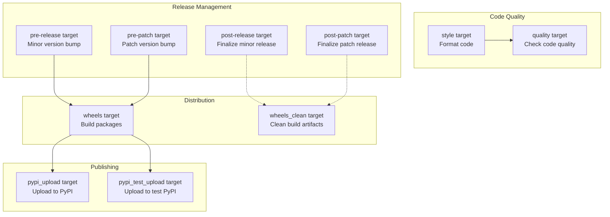
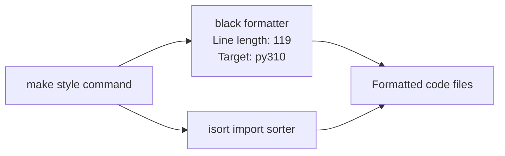
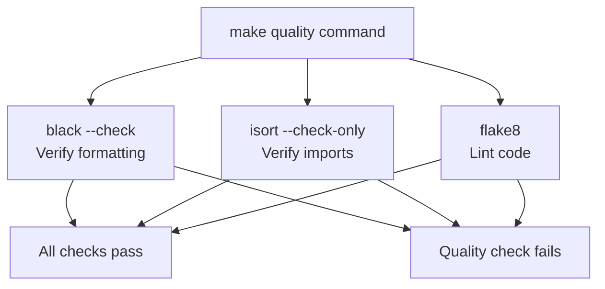
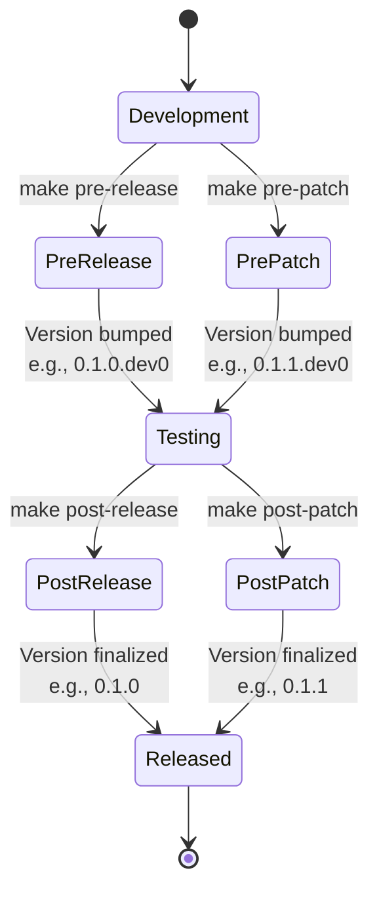
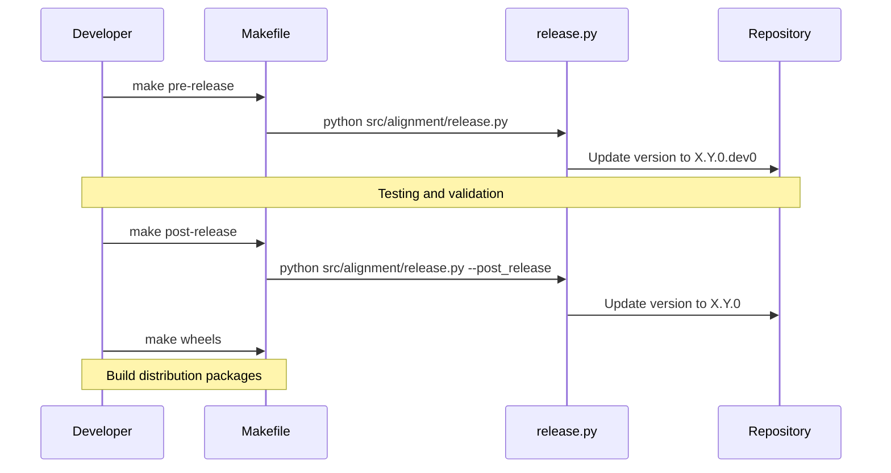
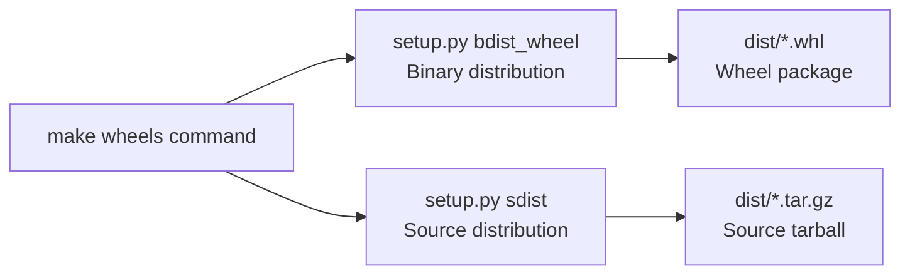
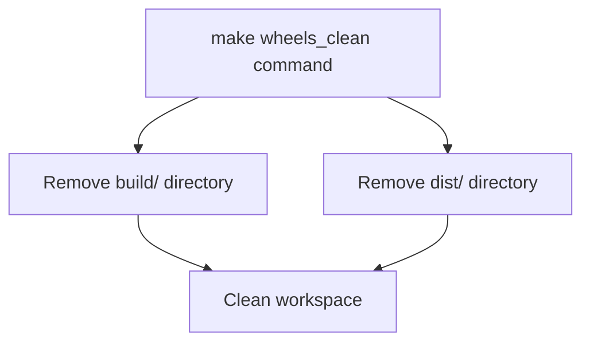
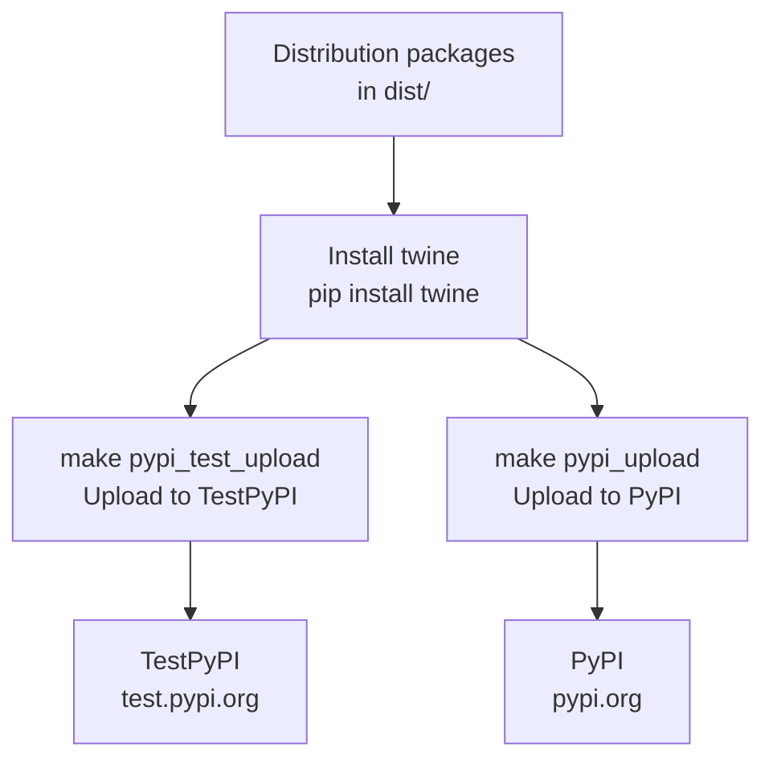
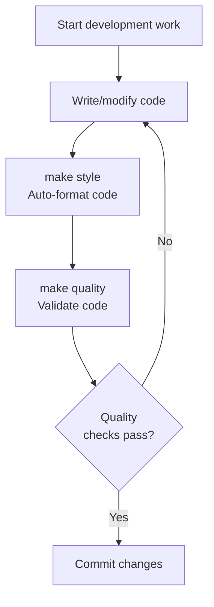
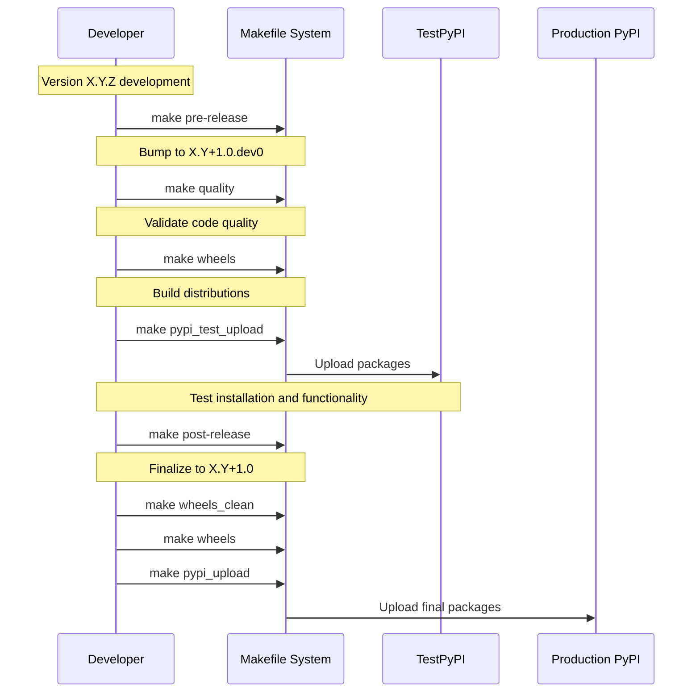

<!-- source: DeepWiki mcp.deepwiki.com · repo thunlp/Optima · page 9.3 Build System and Development Tools · fetched 2026-11-02 -->

# Build System and Development Tools

<details>
<summary>Relevant source files</summary>

The following files were used as context for generating this wiki page:

- [alignment-handbook/.gitignore](alignment-handbook/.gitignore)
- [alignment-handbook/Makefile](alignment-handbook/Makefile)

</details>


## Purpose and Scope

This document describes the Makefile-based build system used in the alignment-handbook component of Optima. The build system provides automated targets for code formatting, quality checks, versioning, package building, and PyPI publishing. These tools ensure code consistency and streamline the development and release workflow.

For information about the broader alignment-handbook integration and its role in Optima, see [Alignment Handbook Overview](#9.1). For code quality guidelines and testing procedures, see [Code Quality and Testing](#12.2).

---

## Build System Overview

The alignment-handbook uses a GNU Make-based build system defined in [alignment-handbook/Makefile:1-45](). The Makefile provides a standardized interface for common development tasks including code formatting, quality validation, release management, and package distribution.

### Makefile Structure

The build system is organized into four major functional groups:



**Makefile Target Groups and Workflow**

Sources: [alignment-handbook/Makefile:1-45]()

### Environment Configuration

The Makefile sets up the development environment with specific configurations:

| Variable | Value | Purpose |
|----------|-------|---------|
| `PYTHONPATH` | `src` | Ensures local source code is used instead of installed packages |
| `check_dirs` | `src tests scripts` | Defines directories to be checked by quality tools |

The `PYTHONPATH` configuration at [alignment-handbook/Makefile:4]() is critical for development: it ensures that code quality tools and tests use the local checkout rather than any pre-installed version of the package. This prevents confusion when making changes to the codebase.

Sources: [alignment-handbook/Makefile:1-6]()

---

## Code Quality Targets

The build system provides two complementary targets for maintaining code quality: `style` for automatic formatting and `quality` for validation.

### Style Target

The `style` target automatically formats code to ensure consistent style across the codebase:



**Code Formatting Workflow**

The style target is defined at [alignment-handbook/Makefile:8-10]() and performs two operations:

1. **Black formatting**: Formats Python code with 119-character line length, targeting Python 3.10 syntax
2. **Import sorting**: Organizes import statements using isort

**Usage:**
```bash
make style
```

This modifies files in-place in the `src`, `tests`, and `scripts` directories, as well as `setup.py`.

Sources: [alignment-handbook/Makefile:8-10]()

### Quality Target

The `quality` target validates code without modifying it, useful for CI/CD pipelines:



**Code Quality Validation Workflow**

The quality target is defined at [alignment-handbook/Makefile:12-15]() and runs three checks:

| Tool | Purpose | Configuration |
|------|---------|---------------|
| `black --check` | Verifies code formatting | Line length: 119, target Python 3.10 |
| `isort --check-only` | Verifies import ordering | Default configuration |
| `flake8` | Lints code for style violations | Max line length: 119 |

**Usage:**
```bash
make quality
```

This command exits with a non-zero status if any checks fail, making it suitable for continuous integration.

Sources: [alignment-handbook/Makefile:12-15]()

---

## Release Management Workflow

The build system provides a structured workflow for managing package versions and releases. The release process distinguishes between minor releases (new features) and patch releases (bug fixes).

### Release Targets Overview



**Release State Machine**

Sources: [alignment-handbook/Makefile:18-30]()

### Release Targets Reference

The following table describes each release target and its purpose:

| Target | Purpose | Release Script Arguments | Typical Usage |
|--------|---------|-------------------------|---------------|
| `pre-release` | Prepare a minor version release | Default (no flags) | Before releasing new features |
| `pre-patch` | Prepare a patch version release | `--patch` | Before releasing bug fixes |
| `post-release` | Finalize minor version release | `--post_release` | After testing new features |
| `post-patch` | Finalize patch version release | `--post_release --patch` | After testing bug fixes |

All release targets invoke the `src/alignment/release.py` script with different argument combinations.

**Pre-release targets** [alignment-handbook/Makefile:20-24]():
- Bump version numbers to development versions (e.g., `0.1.0.dev0`)
- Update version strings in relevant files
- Prepare the codebase for testing

**Post-release targets** [alignment-handbook/Makefile:26-30]():
- Remove development suffixes from version numbers
- Finalize version strings (e.g., `0.1.0`)
- Tag the release in version control

### Release Workflow Example



**Typical Release Process Flow**

Sources: [alignment-handbook/Makefile:20-30]()

---

## Distribution Building

The build system provides targets for creating Python distribution packages that can be uploaded to PyPI or installed locally.

### Wheel Building

The `wheels` target creates both wheel and source distributions:



**Package Building Process**

The wheels target is defined at [alignment-handbook/Makefile:32-33]() and creates two types of distribution packages:

1. **Binary wheel** (`bdist_wheel`): Platform-specific binary distribution for faster installation
2. **Source distribution** (`sdist`): Source code archive for platforms requiring compilation

Both packages are created in the `dist/` directory.

**Usage:**
```bash
make wheels
```

Sources: [alignment-handbook/Makefile:32-33]()

### Build Artifact Cleanup

The `wheels_clean` target removes build artifacts:



**Build Cleanup Process**

The cleanup target at [alignment-handbook/Makefile:35-36]() removes:
- `build/` - Temporary build files created during package building
- `dist/` - Distribution packages (wheels and source distributions)

This ensures a clean slate for subsequent builds and prevents stale artifacts.

**Usage:**
```bash
make wheels_clean
```

Sources: [alignment-handbook/Makefile:35-36]()

---

## PyPI Publishing

The build system includes targets for publishing packages to the Python Package Index (PyPI), with support for both production and test environments.

### Publishing Workflow



**Package Publishing Workflow**

Sources: [alignment-handbook/Makefile:38-44]()

### Publishing Targets

| Target | Destination | Purpose | Command |
|--------|-------------|---------|---------|
| `pypi_test_upload` | TestPyPI | Test package before production release | `twine upload dist/* -r pypitest` |
| `pypi_upload` | PyPI | Production package release | `twine upload dist/* -r pypi` |

Both targets first ensure `twine` is installed via [alignment-handbook/Makefile:39,43](), then upload all packages in the `dist/` directory.

### PyPI Test Upload

The test upload target at [alignment-handbook/Makefile:42-44]() publishes to TestPyPI (`test.pypi.org`), allowing developers to:
- Verify package metadata and descriptions
- Test installation from a PyPI-like environment
- Catch issues before production release

**Usage:**
```bash
make wheels           # Build packages first
make pypi_test_upload # Upload to test environment
```

### PyPI Production Upload

The production upload target at [alignment-handbook/Makefile:38-40]() publishes to the official PyPI repository:

**Usage:**
```bash
make wheels       # Build packages first
make pypi_upload  # Upload to production PyPI
```

⚠️ **Warning**: This operation cannot be undone. Package versions published to PyPI are permanent and cannot be reused.

Sources: [alignment-handbook/Makefile:38-44]()

---

## Development Workflow Patterns

This section describes common patterns for using the build system during development.

### Daily Development Cycle



**Daily Development Flow**

**Typical workflow:**
1. Make code changes
2. Run `make style` to auto-format
3. Run `make quality` to verify
4. Commit if quality checks pass

### Pre-Commit Integration

Developers can integrate quality checks into their git workflow:

```bash
# Run quality checks before every commit
git commit -m "message" && make quality
```

This ensures code quality standards are met before pushing changes.

### Complete Release Workflow



**Complete Release Process**

This workflow ensures packages are tested before production release and maintains clean version semantics.

Sources: [alignment-handbook/Makefile:1-45]()

---

## Integration with Optima Development

While the Makefile is part of the alignment-handbook component, it supports the broader Optima development workflow:

### Code Quality Enforcement

The `quality` target can be integrated into Optima's continuous integration pipeline to ensure:
- Consistent code formatting across all alignment-handbook modifications
- Early detection of style violations
- Maintenance of code quality standards

### Custom Extensions

Developers extending Optima's alignment-handbook integration should:
1. Add new code to the `src/alignment/` directory structure
2. Ensure custom code passes `make quality` checks
3. Follow the same formatting standards (119-character lines, Python 3.10 target)

### Ignored Files and Directories

The [alignment-handbook/.gitignore:1-164]() file specifies which files are excluded from version control. Key exclusions include:

| Pattern | Purpose |
|---------|---------|
| `__pycache__/`, `*.pyc` | Python bytecode |
| `dist/`, `build/` | Build artifacts |
| `*.egg-info/` | Package metadata |
| `data/`, `wandb/` | Temporary data and experiment tracking |
| `.env`, `venv/` | Virtual environments |

These patterns prevent development artifacts from polluting the repository and ensure clean version control.

Sources: [alignment-handbook/.gitignore:1-164]()

---

## Target Reference Summary

### Quick Reference Table

| Target | Category | Effect | Modifies Files |
|--------|----------|--------|----------------|
| `make style` | Code Quality | Formats code with black and isort | Yes |
| `make quality` | Code Quality | Validates code quality | No |
| `make pre-release` | Release | Bump minor version to dev | Yes |
| `make pre-patch` | Release | Bump patch version to dev | Yes |
| `make post-release` | Release | Finalize minor version | Yes |
| `make post-patch` | Release | Finalize patch version | Yes |
| `make wheels` | Distribution | Build packages | Creates dist/ |
| `make wheels_clean` | Distribution | Remove build artifacts | Deletes build/, dist/ |
| `make pypi_test_upload` | Publishing | Upload to TestPyPI | No |
| `make pypi_upload` | Publishing | Upload to PyPI | No |

### Phony Targets

The Makefile declares `.PHONY: style quality` at [alignment-handbook/Makefile:1](), indicating these targets don't correspond to actual files. This ensures make always executes these commands even if files named "style" or "quality" exist in the directory.

Sources: [alignment-handbook/Makefile:1-45]()

---

## Best Practices

### For Contributors

1. **Always run `make style` before committing** to ensure consistent formatting
2. **Verify `make quality` passes** before submitting pull requests
3. **Use `make pypi_test_upload`** to test package distribution before production release
4. **Clean build artifacts** with `make wheels_clean` between builds to prevent issues

### For Release Managers

1. **Follow the version workflow**: pre-release → testing → post-release
2. **Test on TestPyPI first** before uploading to production PyPI
3. **Rebuild wheels after post-release** to ensure correct version numbers in distributions
4. **Document release notes** externally (Makefile doesn't handle changelog generation)

### For CI/CD Integration

The `quality` target is designed for continuous integration:
```bash
# In CI pipeline
make quality || exit 1  # Fail build if quality checks fail
```

This ensures code quality standards are enforced automatically across all contributions.

Sources: [alignment-handbook/Makefile:1-45]()

---

