# Page: Overview

# Overview

<details>
<summary>Relevant source files</summary>

The following files were used as context for generating this wiki page:

- [README.md](README.md)
- [README_revise.md](README_revise.md)

</details>


This document provides an introduction to the Optima framework, its architecture, and core capabilities. For detailed installation instructions, see [Getting Started](#2). For technical details on specific subsystems, refer to [System Architecture](#4), [Agent System](#5), and [Training System](#6).

## Purpose and Scope

Optima is a training framework designed to optimize Large Language Model (LLM)-based multi-agent systems for improved communication efficiency and task effectiveness. This page introduces the framework's purpose, key features, architectural design, and iterative training methodology.

**Sources:** [README.md:1-20]()

## What is Optima

Optima (**Opti**mizing Effectiveness and Efficiency for LLM-Based **M**ulti-**A**gent Systems) is a specialized training framework that leverages iterative supervised fine-tuning (iSFT) and direct preference optimization (iDPO) to enhance multi-agent system performance. The framework reduces token usage in agent-to-agent communication while simultaneously improving response accuracy and task completion rates.

The core innovation lies in using model outputs from iteration N to generate training data for iteration N+1, creating a self-improvement feedback loop. This iterative approach enables agents to develop more efficient communication patterns and more accurate reasoning strategies over successive training cycles.

**Sources:** [README.md:5-11]()

## Key Features and Capabilities

Optima provides the following capabilities:

| Feature | Description |
|---------|-------------|
| **Token Efficiency** | Significant reduction in token usage during multi-agent communication |
| **Communication Effectiveness** | Substantial improvement in agent-to-agent communication quality and task completion |
| **Inference-Time Scaling** | Improved scaling laws for inference-time computation |
| **Multiple Training Methods** | Support for iSFT, iDPO, and combined iSFT-DPO training approaches |
| **Iterative Refinement** | Progressive model improvement across multiple training iterations |
| **Multi-Agent Data Generation** | Automated generation of training data through agent conversations |

**Sources:** [README.md:15-20]()

## High-Level System Architecture

The Optima framework consists of several interconnected systems that enable iterative training and inference:

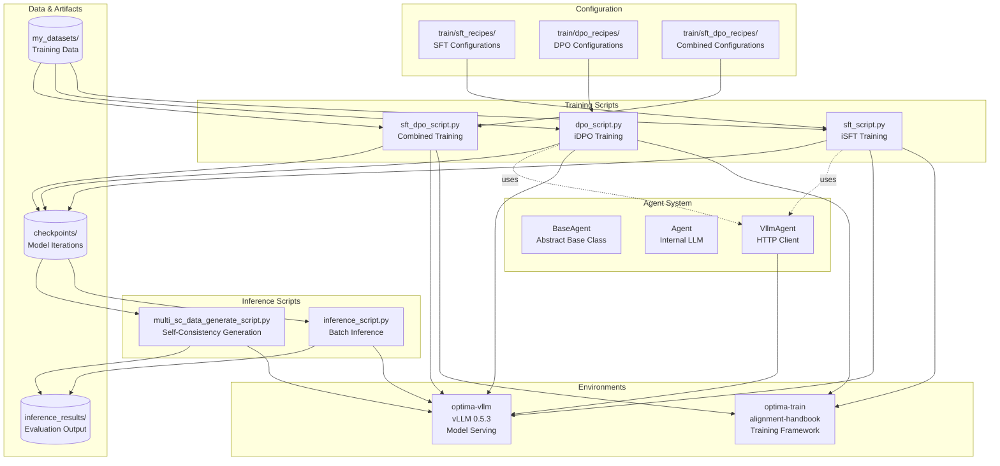

**Sources:** [README.md:22-92](), System Architecture Diagrams

### Core Components

The framework comprises five primary component categories:

1. **Training Scripts**: Entry points for executing different training methods (`sft_script.py`, `dpo_script.py`, `sft_dpo_script.py`)
2. **Inference Scripts**: Tools for model evaluation and data generation (`inference_script.py`, `multi_sc_data_generate_script.py`)
3. **Agent System**: Classes for multi-agent interaction (`BaseAgent`, `Agent`, `VllmAgent`)
4. **Dual Environments**: Separated `optima-vllm` (serving) and `optima-train` (training) conda environments
5. **Configuration System**: YAML-based recipe files defining training parameters

**Sources:** [README.md:22-92]()

## Iterative Training Methodology

Optima employs an iterative training cycle where each iteration builds upon the previous one:

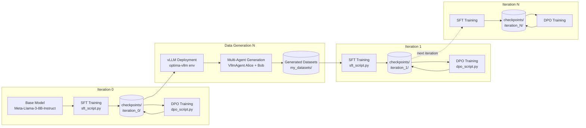

### Training Cycle Phases

Each iteration consists of three phases:

| Phase | Component | Description |
|-------|-----------|-------------|
| **1. Supervised Fine-Tuning** | `sft_script.py` | Trains model on multi-agent conversation data using supervised learning |
| **2. Data Generation** | `VllmAgent` | Deploys trained model to generate new training data through agent interactions |
| **3. Preference Optimization** | `dpo_script.py` | Refines model using Direct Preference Optimization on generated data |

After completing all phases in iteration N, the resulting checkpoint serves as the starting point for generating data for iteration N+1, creating a continuous improvement loop.

**Sources:** [README.md:58-92](), System Architecture Diagrams

## Training Methods

Optima supports three distinct training methodologies, each configurable through YAML recipe files:

### iSFT (Iterative Supervised Fine-Tuning)

Uses only supervised fine-tuning across iterations. Configured via files in `train/sft_recipes/` and executed with `sft_script.py`.

**Command-line invocation:**
```bash
MKL_THREADING_LAYER=GNU python sft_script.py \
    --train_config_path train/sft_recipes/arc.yaml \
    --vllm_env optima-vllm \
    --alignment_env optima-train
```

**Sources:** [README.md:58-70]()

### iDPO (Iterative Direct Preference Optimization)

Uses only DPO training across iterations. Configured via files in `train/dpo_recipes/` and executed with `dpo_script.py`.

**Command-line invocation:**
```bash
MKL_THREADING_LAYER=GNU python dpo_script.py \
    --train_config_path train/dpo_recipes/arc.yaml \
    --vllm_env optima-vllm \
    --alignment_env optima-train
```

**Sources:** [README.md:72-81]()

### iSFT-DPO (Combined Approach)

Combines both SFT and DPO within each iteration. Configured via files in `train/sft_dpo_recipes/` and executed with `sft_dpo_script.py`.

**Command-line invocation:**
```bash
MKL_THREADING_LAYER=GNU python sft_dpo_script.py \
    --train_config_path train/sft_dpo_recipes/arc.yaml \
    --vllm_env optima-vllm \
    --alignment_env optima-train
```

**Sources:** [README.md:83-92]()

## Dual Environment Architecture

Optima requires two separate conda environments to avoid dependency conflicts and enable concurrent model serving during training:

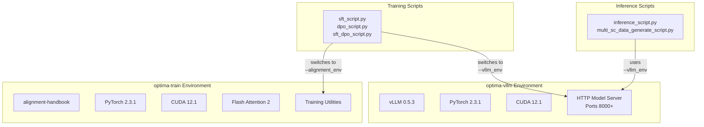

### Environment Purposes

| Environment | Primary Use | Key Dependencies |
|-------------|-------------|------------------|
| **optima-vllm** | Model serving during inference and data generation | vLLM 0.5.3, PyTorch 2.3.1 |
| **optima-train** | Model training and optimization | alignment-handbook, Flash Attention 2 |

Training scripts automatically switch between environments using subprocess calls, enabling seamless integration of serving and training operations.

**Sources:** [README.md:22-55]()

## Agent System Overview

The agent system enables multi-agent conversations for data generation:

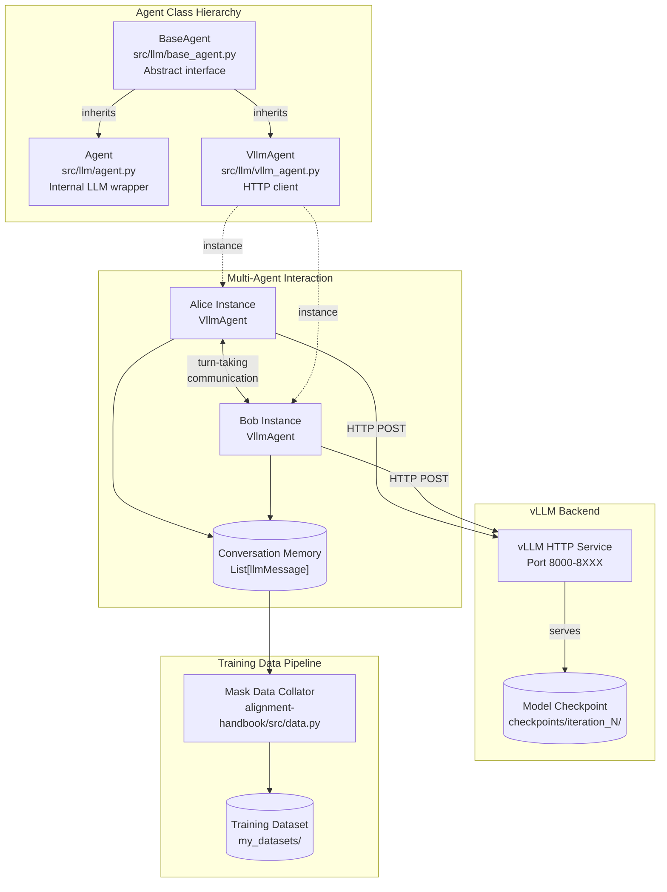

### Agent Roles

- **BaseAgent**: Abstract base class defining the agent interface
- **Agent**: Implementation using internal language model instances
- **VllmAgent**: Implementation using HTTP calls to vLLM-deployed models
- **Alice & Bob**: Named agent instances that conduct multi-turn conversations to generate training data

The `VllmAgent` class is the primary agent type used during data generation, communicating with models deployed via vLLM's HTTP interface.

**Sources:** System Architecture Diagrams, [README.md:94-137]()

## Supported Datasets

Optima includes support for multiple benchmark datasets:

| Dataset | Type | Purpose |
|---------|------|---------|
| **arc** | Multiple Choice | AI2 Reasoning Challenge |
| **hotpot_qa** | Question Answering | Multi-hop reasoning |
| **mwh_qa** | Question Answering | Multi-hop with Wikipedia |
| **trivial_qa** | Question Answering | Trivia questions |
| **cbt** | Language Understanding | Children's Book Test |
| **math** | Mathematical Reasoning | MATH dataset |
| **gsm8k** | Mathematical Reasoning | Grade School Math |
| **mmlu** | Multiple Choice | Massive Multitask Language Understanding |

These datasets are stored in the `my_datasets/` directory and referenced by the `--dataset_type` parameter in training and inference scripts.

**Sources:** [README.md:104-120](), [README.md:132]()

## Inference and Evaluation

Optima provides two inference modes:

### Batch Inference

The `inference_script.py` evaluates all model checkpoints on specified test datasets:

```bash
python inference_script.py \
    --model_root_path ./checkpoints/arc_sft \
    --tokenizer_path ${pretrained_tokenizer_path} \
    --dataset_type arc \
    --device 0 \
    --port 8000 \
    --num_thread 128 \
    --output_root_path ./inference_results \
    --vllm_env optima-vllm
```

**Sources:** [README.md:94-110]()

### Multi-Agent Self-Consistency

The `multi_sc_data_generate_script.py` performs inference with multiple agent settings and self-consistency voting:

```bash
python multi_sc_data_generate_script.py \
    --model_path ./checkpoints/arc_sft/iteration_0 \
    --tokenizer_path ${pretrained_tokenizer_path} \
    --device 0 \
    --port 8000 \
    --dataset_type arc \
    --num_thread 128 \
    --output_path ./inference_results \
    --temperature 0.5 \
    --vllm_env optima-vllm
```

**Sources:** [README.md:112-137]()

## Directory Structure

The framework organizes files into the following structure:

```
optima/
├── sft_script.py                      # iSFT training entry point
├── dpo_script.py                      # iDPO training entry point
├── sft_dpo_script.py                  # Combined training entry point
├── inference_script.py                # Batch inference script
├── multi_sc_data_generate_script.py   # Self-consistency inference
├── train/                             # Training configuration recipes
│   ├── sft_recipes/                   # iSFT configurations
│   ├── dpo_recipes/                   # iDPO configurations
│   └── sft_dpo_recipes/               # Combined configurations
├── src/                               # Source code modules
│   └── llm/                           # Agent system implementation
├── my_datasets/                       # Training and test datasets
├── checkpoints/                       # Saved model checkpoints
├── inference_results/                 # Evaluation outputs
└── alignment-handbook/                # Modified alignment framework
```

**Sources:** System Architecture Diagrams

## Next Steps

- For installation and setup instructions, see [Getting Started](#2)
- For detailed architecture documentation, see [System Architecture](#4)
- For training method details, see [Core Concepts](#3)
- For agent system documentation, see [Agent System](#5)
- For configuration reference, see [Configuration Recipes](#7)
- For inference documentation, see [Inference and Evaluation](#8)

---

# Page: Getting Started

# Getting Started

<details>
<summary>Relevant source files</summary>

The following files were used as context for generating this wiki page:

- [README.md](README.md)
- [README_revise.md](README_revise.md)

</details>


This page provides a practical guide to installing Optima and running your first training and inference jobs. It covers the essential prerequisites, environment setup, and basic usage patterns to get you started quickly with the framework.

For detailed installation instructions and troubleshooting, see [Installation and Environment Setup](#2.1). For a comprehensive walkthrough with examples, see [Quick Start Tutorial](#2.2).

## Prerequisites

Before installing Optima, ensure your system meets the following requirements:

| Requirement | Specification |
|------------|---------------|
| Python | 3.11 |
| CUDA | 12.1.0 |
| PyTorch | 2.3.1 |
| GPU | NVIDIA GPU with CUDA support |
| Operating System | Linux (recommended) |

## System Overview

Optima uses a dual-environment architecture that separates model serving from model training. This design prevents resource conflicts and enables efficient workflows.

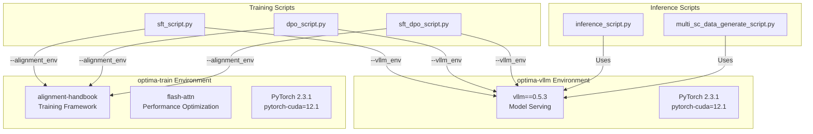

**Dual Environment Architecture**: The `optima-vllm` environment hosts vLLM for high-performance model serving during data generation and inference. The `optima-train` environment contains the alignment-handbook framework and training dependencies. Training scripts orchestrate both environments through command-line arguments.

Sources: [README.md:22-55]()

## Installation Overview

Optima requires setting up two separate conda environments. Below is a condensed installation guide. For detailed instructions, dependency troubleshooting, and environment validation, see [Installation and Environment Setup](#2.1).

### Quick Installation Steps

**Step 1: Create vLLM Environment**

```bash
conda create -n optima-vllm python=3.11
conda activate optima-vllm
conda install nvidia/label/cuda-12.1.0::cuda-nvcc
conda install pytorch=2.3.1 torchvision torchaudio pytorch-cuda=12.1 -c pytorch -c nvidia
pip install vllm==0.5.3
```

**Step 2: Create Training Environment**

```bash
conda create -n optima-train python=3.11
conda activate optima-train
conda install nvidia/label/cuda-12.1.0::cuda-nvcc
conda install pytorch=2.3.1 torchvision torchaudio pytorch-cuda=12.1 -c pytorch -c nvidia
cd alignment-handbook
pip install -e .
pip install flash-attn --no-build-isolation
cd ../
pip install -r requirements.txt
```

**Step 3: Verify Installation**

After installation, verify both environments are correctly configured:

```bash
# Test vLLM environment
conda activate optima-vllm
python -c "import vllm; print(vllm.__version__)"

# Test training environment
conda activate optima-train
python -c "import torch; print(torch.__version__, torch.cuda.is_available())"
```

Sources: [README.md:22-55](), [README_revise.md:16-46]()

## Running Your First Training Job

Optima provides three iterative training methods: iSFT, iDPO, and iSFT-DPO. This section demonstrates running iSFT on the ARC dataset. For detailed explanations of each method, see [Iterative Training Methods](#3.1).

### Training Script Command Structure

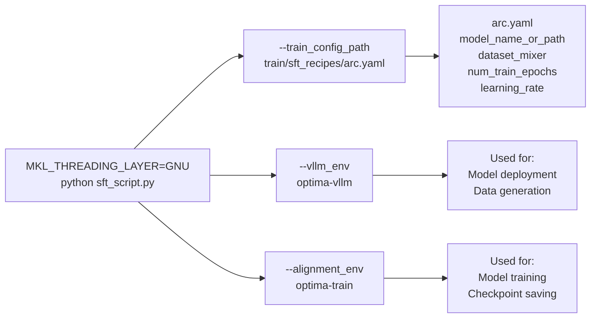

**Command-Line Arguments**: Each training script accepts three key arguments: `--train_config_path` specifies the YAML recipe file containing training parameters, `--vllm_env` names the conda environment for model serving, and `--alignment_env` names the conda environment for training.

Sources: [README.md:58-92]()

### Example: Running iSFT Training

To train a model using iterative supervised fine-tuning on the ARC dataset:

```bash
MKL_THREADING_LAYER=GNU python sft_script.py \
    --train_config_path train/sft_recipes/arc.yaml \
    --vllm_env optima-vllm \
    --alignment_env optima-train
```

This command initiates the iSFT training pipeline, which:

1. Loads the base model specified in `train/sft_recipes/arc.yaml`
2. Deploys the model using vLLM in the `optima-vllm` environment
3. Generates multi-agent conversation data through Alice-Bob interactions
4. Fine-tunes the model in the `optima-train` environment
5. Saves checkpoints to `checkpoints/arc_sft/iteration_0/`, `iteration_1/`, etc.

### Available Training Methods

| Script | Method | Recipe Directory | Description |
|--------|--------|------------------|-------------|
| `sft_script.py` | iSFT | `train/sft_recipes/` | Iterative supervised fine-tuning only |
| `dpo_script.py` | iDPO | `train/dpo_recipes/` | Iterative direct preference optimization only |
| `sft_dpo_script.py` | iSFT-DPO | `train/sft_dpo_recipes/` | Combined iterative SFT followed by DPO |

To use different methods or datasets, simply change the script name and config path:

```bash
# iDPO on ARC
MKL_THREADING_LAYER=GNU python dpo_script.py \
    --train_config_path train/dpo_recipes/arc.yaml \
    --vllm_env optima-vllm \
    --alignment_env optima-train

# iSFT-DPO on ARC
MKL_THREADING_LAYER=GNU python sft_dpo_script.py \
    --train_config_path train/sft_dpo_recipes/arc.yaml \
    --vllm_env optima-vllm \
    --alignment_env optima-train
```

Sources: [README.md:58-92](), [README_revise.md:49-83]()

## Running Inference

After training, you can evaluate your models using the inference scripts. Optima provides two inference modes: batch inference across all checkpoints and multi-agent self-consistency inference.

### Batch Inference Across Checkpoints

The `inference_script.py` evaluates all model iterations from a training run:

```bash
python inference_script.py \
    --model_root_path ./checkpoints/arc_sft \
    --tokenizer_path ${pretrained_tokenizer_path} \
    --dataset_type arc \
    --device 0 \
    --port 8000 \
    --num_thread 128 \
    --output_root_path ./inference_results \
    --vllm_env optima-vllm
```

This script:
- Iterates through all checkpoint iterations in `./checkpoints/arc_sft/`
- Deploys each model using vLLM on the specified GPU device
- Evaluates on the ARC test dataset
- Saves results to `./inference_results/`

### Inference Script Arguments

| Argument | Description | Example |
|----------|-------------|---------|
| `--model_root_path` | Root directory containing checkpoint iterations | `./checkpoints/arc_sft` |
| `--tokenizer_path` | Path to pretrained tokenizer | `/path/to/Meta-Llama-3-8B-Instruct` |
| `--dataset_type` | Dataset to evaluate on | `arc`, `hotpot_qa`, `math`, `gsm8k` |
| `--device` | GPU index for first deployment | `0` |
| `--port` | Starting port number for vLLM server | `8000` |
| `--num_thread` | Number of parallel threads | `128` |
| `--output_root_path` | Directory for inference results | `./inference_results` |
| `--vllm_env` | Conda environment for vLLM | `optima-vllm` |

### Multi-Agent Self-Consistency Inference

For improved robustness through self-consistency sampling:

```bash
python multi_sc_data_generate_script.py \
    --model_path ./checkpoints/arc_sft/iteration_0 \
    --tokenizer_path ${pretrained_tokenizer_path} \
    --device 0 \
    --port 8000 \
    --dataset_type arc \
    --num_thread 128 \
    --output_path ./inference_results \
    --temperature 0.5 \
    --vllm_env optima-vllm
```

The key difference is `--model_path` targets a specific checkpoint iteration and `--temperature` enables sampling-based generation for self-consistency.

Sources: [README.md:94-137](), [README_revise.md:85-128]()

## Complete Training and Inference Workflow

The following diagram illustrates the end-to-end workflow from training to evaluation:

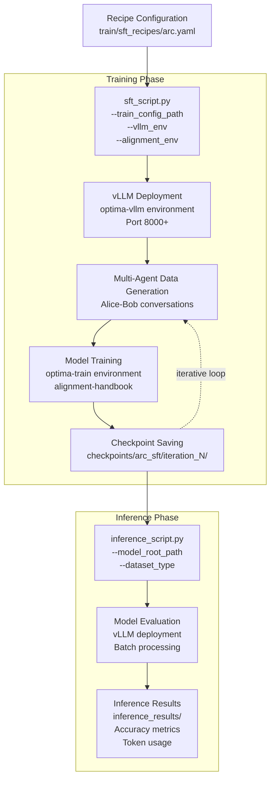

**Workflow Pipeline**: Training begins with a recipe configuration that specifies all training parameters. The training script orchestrates model deployment in the vLLM environment for data generation, then switches to the training environment for optimization. Checkpoints from each iteration are saved and can be used for both inference evaluation and generating data for the next iteration.

Sources: [README.md:58-137](), [README_revise.md:49-128]()

## Supported Datasets

Optima supports multiple datasets for training and evaluation. Specify the dataset using the `--dataset_type` argument:

| Dataset Type | Domain | Use Case |
|--------------|--------|----------|
| `arc` | Multiple choice reasoning | ARC-Challenge dataset |
| `hotpot_qa` | Multi-hop question answering | HotpotQA dataset |
| `mwh_qa` | Multi-hop QA | Multi-hop Wikipedia QA |
| `trivial_qa` | Question answering | TriviaQA dataset |
| `cbt` | Reading comprehension | Children's Book Test |
| `math` | Mathematical reasoning | MATH dataset |
| `gsm8k` | Grade school math | GSM8K dataset |
| `mmlu` | Multi-task language understanding | MMLU benchmark |

For information on dataset structure and creating custom datasets, see [Dataset Structure and Preparation](#10.1).

Sources: [README.md:104,132](), [README_revise.md:95,123]()

## Next Steps

After completing your first training and inference run, explore these resources:

- **[Installation and Environment Setup](#2.1)**: Detailed installation instructions, dependency management, and troubleshooting
- **[Quick Start Tutorial](#2.2)**: Step-by-step walkthrough of a complete training and evaluation workflow
- **[Iterative Training Methods](#3.1)**: Deep dive into iSFT, iDPO, and iSFT-DPO methodologies
- **[Recipe Configuration System](#6.2)**: Learn how to customize training parameters and create your own recipes
- **[Agent System](#5)**: Understand the multi-agent architecture and Alice-Bob interactions
- **[Training Scripts Reference](#6.1)**: Complete documentation of all training script arguments and workflows

For configuration details, all recipe files are located in:
- `train/sft_recipes/` - iSFT configurations
- `train/dpo_recipes/` - iDPO configurations  
- `train/sft_dpo_recipes/` - iSFT-DPO configurations

For parameter explanations, see [Recipe Parameters Reference](#7.4).

Sources: [README.md:59]()

---

# Page: Installation and Environment Setup

# Installation and Environment Setup

<details>
<summary>Relevant source files</summary>

The following files were used as context for generating this wiki page:

- [README.md](README.md)
- [README_revise.md](README_revise.md)

</details>


This document provides detailed instructions for installing and configuring Optima's dual-environment system. Optima requires two separate conda environments: `optima-vllm` for model serving and `optima-train` for model training. This separation ensures efficient resource management and prevents dependency conflicts during the iterative training process.

For information about why this dual-environment design is used, see [Dual Environment Design](#4.1). For running your first training job after installation, see [Quick Start Tutorial](#2.2).

## Prerequisites

Before installing Optima, ensure your system meets the following requirements:

| Requirement | Specification |
|------------|---------------|
| **Operating System** | Linux (tested on Ubuntu 20.04+) |
| **Python Version** | 3.11 |
| **CUDA Version** | 12.1.0 |
| **GPU** | NVIDIA GPU with CUDA support (recommended: A100, H100, or equivalent) |
| **Conda/Miniconda** | Latest version installed |
| **Disk Space** | Minimum 50GB for environments and model checkpoints |
| **Git** | For cloning the repository and submodules |

**Sources:** [README.md:22-55]()

## Environment Architecture Overview

The following diagram illustrates how Optima's dual-environment system is organized and which components rely on each environment:

```mermaid
graph TB
    subgraph "optima-vllm Environment"
        VLLM["vLLM 0.5.3<br/>Model Serving"]
        PyTorchVLLM["PyTorch 2.3.1"]
        NVCCVLLM["CUDA NVCC 12.1.0"]
    end
    
    subgraph "optima-train Environment"
        AlignmentHB["alignment-handbook"]
        PyTorchTrain["PyTorch 2.3.1"]
        NVCCTrain["CUDA NVCC 12.1.0"]
        FlashAttn["flash-attn"]
        Requirements["requirements.txt<br/>dependencies"]
    end
    
    subgraph "Training Scripts"
        SFTScript["sft_script.py"]
        DPOScript["dpo_script.py"]
        SFTDPOScript["sft_dpo_script.py"]
    end
    
    subgraph "Inference Scripts"
        InferenceScript["inference_script.py"]
        MultiSCScript["multi_sc_data_generate_script.py"]
    end
    
    subgraph "Agent System"
        VllmAgent["VllmAgent"]
    end
    
    SFTScript -->|"Uses for deployment"| VLLM
    DPOScript -->|"Uses for deployment"| VLLM
    SFTDPOScript -->|"Uses for deployment"| VLLM
    
    SFTScript -->|"Uses for training"| AlignmentHB
    DPOScript -->|"Uses for training"| AlignmentHB
    SFTDPOScript -->|"Uses for training"| AlignmentHB
    
    InferenceScript -->|"Deploys models"| VLLM
    MultiSCScript -->|"Deploys models"| VLLM
    
    VllmAgent -->|"HTTP requests"| VLLM
    
    PyTorchVLLM -.->|"Required by"| VLLM
    NVCCVLLM -.->|"Required by"| PyTorchVLLM
    
    PyTorchTrain -.->|"Required by"| AlignmentHB
    NVCCTrain -.->|"Required by"| PyTorchTrain
    FlashAttn -.->|"Required by"| AlignmentHB
    Requirements -.->|"Additional deps"| AlignmentHB
```

**Diagram: Optima Dual Environment Architecture and Dependencies**

The training scripts ([sft_script.py](), [dpo_script.py](), [sft_dpo_script.py]()) invoke both environments: `optima-vllm` for deploying models during data generation, and `optima-train` for executing the training process itself. Inference scripts only require the `optima-vllm` environment.

**Sources:** [README.md:22-55](), High-level system architecture diagrams

## Installation Steps

### Step 1: Clone the Repository

```bash
git clone https://github.com/thunlp/Optima.git
cd Optima
```

The repository includes the `alignment-handbook` as a dependency that needs to be installed in the training environment.

**Sources:** [README.md:1-10]()

### Step 2: Setup vLLM Environment (optima-vllm)

The `optima-vllm` environment is used for model serving via vLLM, which provides efficient inference for deployed models.

```bash
# Create conda environment with Python 3.11
conda create -n optima-vllm python=3.11

# Activate the environment
conda activate optima-vllm

# Install CUDA NVCC 12.1.0
conda install nvidia/label/cuda-12.1.0::cuda-nvcc

# Install PyTorch 2.3.1 with CUDA 12.1 support
conda install pytorch=2.3.1 torchvision torchaudio pytorch-cuda=12.1 -c pytorch -c nvidia

# Install vLLM 0.5.3
pip install vllm==0.5.3
```

**Version Requirements:**
- **Python**: 3.11 (required for compatibility)
- **PyTorch**: 2.3.1 (required by vLLM 0.5.3)
- **CUDA**: 12.1.0
- **vLLM**: 0.5.3 (specific version required)

**Sources:** [README.md:26-37]()

### Step 3: Setup Training Environment (optima-train)

The `optima-train` environment contains the training framework, including the alignment-handbook and additional dependencies.

```bash
# Create conda environment with Python 3.11
conda create -n optima-train python=3.11

# Activate the environment
conda activate optima-train

# Install CUDA NVCC 12.1.0
conda install nvidia/label/cuda-12.1.0::cuda-nvcc

# Install PyTorch 2.3.1 with CUDA 12.1 support
conda install pytorch=2.3.1 torchvision torchaudio pytorch-cuda=12.1 -c pytorch -c nvidia

# Navigate to alignment-handbook directory and install
cd alignment-handbook
pip install -e .

# Install Flash Attention 2 (without build isolation for compatibility)
pip install flash-attn --no-build-isolation

# Return to root directory and install additional dependencies
cd ..
pip install -r requirements.txt
```

**Version Requirements:**
- **Python**: 3.11
- **PyTorch**: 2.3.1
- **CUDA**: 12.1.0
- **alignment-handbook**: Installed from local directory in editable mode
- **flash-attn**: Latest compatible version
- **Additional packages**: Specified in `requirements.txt`

**Sources:** [README.md:39-55]()

### Step 4: Directory Structure After Installation

After successful installation, your Optima directory should have the following structure:

```
Optima/
├── alignment-handbook/          # Alignment framework (installed in optima-train)
├── train/                       # Training configuration recipes
│   ├── sft_recipes/            # iSFT configuration files
│   ├── dpo_recipes/            # iDPO configuration files
│   └── sft_dpo_recipes/        # Combined iSFT-DPO configurations
├── my_datasets/                 # Dataset storage directory
├── checkpoints/                 # Model checkpoint storage
├── inference_results/           # Inference output storage
├── sft_script.py               # iSFT training script
├── dpo_script.py               # iDPO training script
├── sft_dpo_script.py           # Combined iSFT-DPO training script
├── inference_script.py         # Batch inference script
├── multi_sc_data_generate_script.py  # Multi-agent self-consistency script
├── requirements.txt            # Python dependencies
└── README.md                   # Documentation
```

**Sources:** [README.md:1-148](), repository structure

## Dependency Installation Flow

The following diagram shows the dependency installation sequence and relationships:

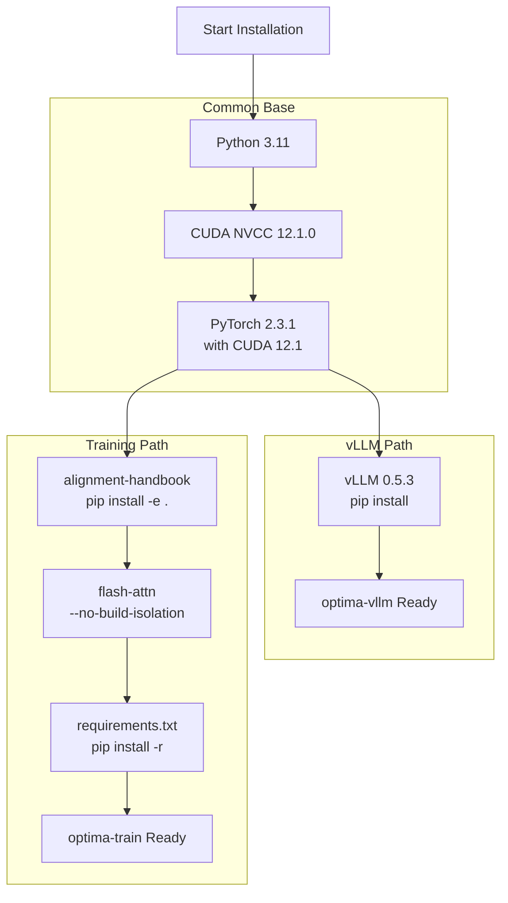

**Diagram: Dependency Installation Sequence**

**Important Notes:**
- PyTorch must be installed **before** vLLM to ensure CUDA compatibility
- Flash Attention must be installed with `--no-build-isolation` flag
- The alignment-handbook is installed in editable mode (`-e`) from the local directory

**Sources:** [README.md:22-55]()

## Verification Steps

After installation, verify that both environments are correctly configured:

### Verify optima-vllm Environment

```bash
conda activate optima-vllm

# Check Python version
python --version  # Should output: Python 3.11.x

# Check PyTorch and CUDA
python -c "import torch; print(f'PyTorch: {torch.__version__}'); print(f'CUDA Available: {torch.cuda.is_available()}'); print(f'CUDA Version: {torch.version.cuda}')"
# Expected output:
# PyTorch: 2.3.1+cu121
# CUDA Available: True
# CUDA Version: 12.1

# Check vLLM installation
python -c "import vllm; print(f'vLLM Version: {vllm.__version__}')"
# Expected output: vLLM Version: 0.5.3
```

### Verify optima-train Environment

```bash
conda activate optima-train

# Check Python version
python --version  # Should output: Python 3.11.x

# Check PyTorch and CUDA
python -c "import torch; print(f'PyTorch: {torch.__version__}'); print(f'CUDA Available: {torch.cuda.is_available()}'); print(f'CUDA Version: {torch.version.cuda}')"

# Check alignment-handbook installation
python -c "from alignment import __version__; print(f'Alignment Handbook installed')"

# Check Flash Attention
python -c "import flash_attn; print(f'Flash Attention installed')"
```

**Sources:** [README.md:22-55]()

## Environment Variable Configuration

The training scripts require the `MKL_THREADING_LAYER` environment variable to be set:

```bash
export MKL_THREADING_LAYER=GNU
```

Alternatively, prefix your training commands with this variable:

```bash
MKL_THREADING_LAYER=GNU python sft_script.py [arguments...]
```

This setting prevents threading conflicts during training. It is used in all training script invocations ([sft_script.py](), [dpo_script.py](), [sft_dpo_script.py]()).

**Sources:** [README.md:66-92]()

## Script-Environment Mapping

The following table shows which environment each script requires:

| Script | Primary Environment | Secondary Environment | Purpose |
|--------|---------------------|----------------------|---------|
| `sft_script.py` | `optima-train` | `optima-vllm` (for deployment) | iSFT iterative training |
| `dpo_script.py` | `optima-train` | `optima-vllm` (for deployment) | iDPO iterative training |
| `sft_dpo_script.py` | `optima-train` | `optima-vllm` (for deployment) | Combined iSFT-DPO training |
| `inference_script.py` | `optima-vllm` | None | Batch inference on checkpoints |
| `multi_sc_data_generate_script.py` | `optima-vllm` | None | Multi-agent self-consistency generation |

Training scripts are executed from the `optima-train` environment but accept `--vllm_env` and `--alignment_env` arguments to specify which conda environments to use for deployment and training respectively.

**Sources:** [README.md:58-92]()

## Common Issues and Troubleshooting

### Issue 1: PyTorch CUDA Version Mismatch

**Symptom:** `RuntimeError: CUDA error: no kernel image is available for execution on the device`

**Solution:** Ensure PyTorch is installed with the correct CUDA version (12.1):
```bash
conda install pytorch=2.3.1 torchvision torchaudio pytorch-cuda=12.1 -c pytorch -c nvidia
```

### Issue 2: Flash Attention Build Failure

**Symptom:** Compilation errors during flash-attn installation

**Solution:** Install with the `--no-build-isolation` flag:
```bash
pip install flash-attn --no-build-isolation
```

Ensure NVCC is properly installed before attempting flash-attn installation.

### Issue 3: vLLM Version Compatibility

**Symptom:** Import errors or unexpected behavior with vLLM

**Solution:** Use the exact version specified:
```bash
pip install vllm==0.5.3
```

Optima is tested specifically with vLLM 0.5.3, which requires PyTorch 2.3.1.

### Issue 4: alignment-handbook Not Found

**Symptom:** `ModuleNotFoundError: No module named 'alignment'`

**Solution:** Ensure you installed the alignment-handbook in editable mode:
```bash
cd alignment-handbook
pip install -e .
cd ..
```

### Issue 5: MKL Threading Layer Error

**Symptom:** `Error: MKL FATAL ERROR: Cannot load libmkl_intel_thread.so`

**Solution:** Set the MKL threading layer environment variable:
```bash
export MKL_THREADING_LAYER=GNU
```

**Sources:** [README.md:22-55]()

## GPU and Multi-GPU Configuration

Optima supports multi-GPU training and inference. The system uses GPU indices for port allocation when deploying models via vLLM.

**Port Allocation Formula:**
```
port_number = base_port + gpu_index
```

For example, with `--device 0` and `--port 8000`, the vLLM service will be deployed on port 8000. For multi-GPU setups, subsequent GPUs will use sequential ports (8001, 8002, etc.).

This configuration is specified via command-line arguments:
- `--device`: GPU index for the first deployment
- `--port`: Base port number for vLLM HTTP service

For more details on multi-GPU training optimization, see [Multi-GPU Training](#11.2).

**Sources:** [README.md:100-137]()

## Next Steps

After completing the installation:

1. **Verify Installation**: Run all verification commands to ensure both environments are correctly configured
2. **Prepare Datasets**: See [Dataset Structure and Preparation](#10.1) for information on dataset organization
3. **Quick Start**: Follow the [Quick Start Tutorial](#2.2) to run your first training job
4. **Configure Training**: Explore [Recipe Configuration System](#6.2) to understand training parameters

**Configuration files** for training are located in:
- [train/sft_recipes/]() for iSFT configurations
- [train/dpo_recipes/]() for iDPO configurations  
- [train/sft_dpo_recipes/]() for combined iSFT-DPO configurations

**Sources:** [README.md:58-92]()

---

# Page: Quick Start Tutorial

# Quick Start Tutorial

<details>
<summary>Relevant source files</summary>

The following files were used as context for generating this wiki page:

- [README.md](README.md)
- [README_revise.md](README_revise.md)
- [alignment-handbook/recipes/Llama3-8b/arc_sft/base.yaml](alignment-handbook/recipes/Llama3-8b/arc_sft/base.yaml)

</details>


This tutorial walks you through running your first training job using iterative Supervised Fine-Tuning (iSFT) on the ARC-Challenge dataset, then performing inference on the trained model. This provides a practical introduction to Optima's core workflow.

**Prerequisites:** This tutorial assumes you have completed the installation and environment setup described in [Installation and Environment Setup](#2.1). You should have both `optima-vllm` and `optima-train` conda environments configured.

For understanding the theoretical concepts behind iSFT and other training methods, see [Iterative Training Methods](#3.1). For detailed configuration options, see [Recipe Configuration System](#6.2).

## Overview of the iSFT Workflow

Before running the tutorial, it's helpful to understand how iSFT training operates. The following diagram illustrates the end-to-end workflow:

**iSFT Training Pipeline: From Configuration to Checkpoint**

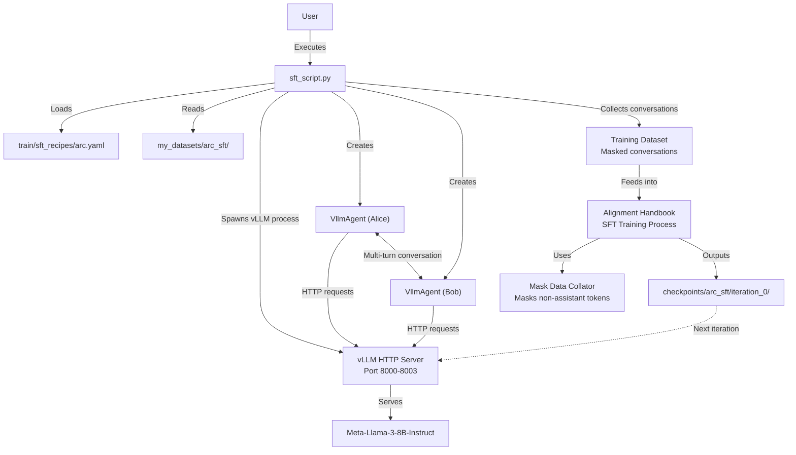

**Sources:** [README.md:58-71](), [sft_script.py](), [alignment-handbook/recipes/Llama3-8b/arc_sft/base.yaml:1-39]()

## Step 1: Prepare Your Training Configuration

Optima uses YAML configuration files (called "recipes") to specify all training parameters. For this quick start, we'll use the pre-configured ARC-Challenge iSFT recipe.

Examine the base configuration structure at [alignment-handbook/recipes/Llama3-8b/arc_sft/base.yaml:1-39](). Key parameters include:

| Parameter | Value | Purpose |
|-----------|-------|---------|
| `model_name_or_path` | Path to pretrained model | Specifies the base LLM (e.g., Llama-3-8B-Instruct) |
| `dataset_mixer` | Path to training dataset | Points to the ARC SFT dataset |
| `num_train_epochs` | 4 | Number of training epochs |
| `learning_rate` | 1.0e-06 | Learning rate for optimization |
| `max_seq_length` | 2048 | Maximum sequence length for training |
| `output_dir` | Checkpoint save path | Where trained models are saved |
| `use_flash_attention_2` | true | Enables Flash Attention for efficiency |

**Note:** Before running, ensure you update the following paths in your configuration:
- `model_name_or_path`: Path to your pretrained Llama-3-8B-Instruct model
- `tokenizer_name_or_path`: Path to the corresponding tokenizer
- `dataset_mixer`: Path to your ARC SFT dataset directory
- `output_dir`: Desired checkpoint output location

**Sources:** [alignment-handbook/recipes/Llama3-8b/arc_sft/base.yaml:1-39]()

## Step 2: Run iSFT Training

Execute the training script with the following command:

```bash
MKL_THREADING_LAYER=GNU python sft_script.py \
    --train_config_path train/sft_recipes/arc.yaml \
    --vllm_env optima-vllm \
    --alignment_env optima-train
```

**Command-line Arguments:**

| Argument | Description |
|----------|-------------|
| `--train_config_path` | Path to the YAML recipe file containing training configuration |
| `--vllm_env` | Name of conda environment for vLLM deployment (created in [Installation](#2.1)) |
| `--alignment_env` | Name of conda environment for training (created in [Installation](#2.1)) |

**Sources:** [README.md:58-71](), [sft_script.py]()

### What Happens During Training

The `sft_script.py` orchestrates the following sequence:

1. **vLLM Server Deployment**: Spawns a vLLM server process in the `optima-vllm` environment, deploying the base model on available GPUs (ports 8000-8003 by default)

2. **Multi-Agent Data Generation**: Creates two `VllmAgent` instances (Alice and Bob) that engage in multi-turn conversations to solve ARC-Challenge problems

3. **Conversation Collection**: Gathers and formats the agent conversations into training data, applying the `Mask` data collator to ensure only assistant responses contribute to the loss

4. **SFT Training**: Executes supervised fine-tuning in the `optima-train` environment using the Alignment Handbook framework

5. **Checkpoint Saving**: Saves the trained model to the specified `output_dir` (e.g., `checkpoints/arc_sft/iteration_0/`)

6. **Cleanup**: Terminates the vLLM server process

**Expected Output:** Training logs will display loss values, learning rate, and evaluation metrics. Upon completion, a checkpoint directory containing model weights, tokenizer, and training configuration will be created.

**Sources:** [sft_script.py](), [README.md:58-71]()

## Step 3: Run Inference on Trained Model

After training completes, evaluate your model using the inference script. The following diagram shows the inference pipeline:

**Inference Pipeline: Model Evaluation Workflow**

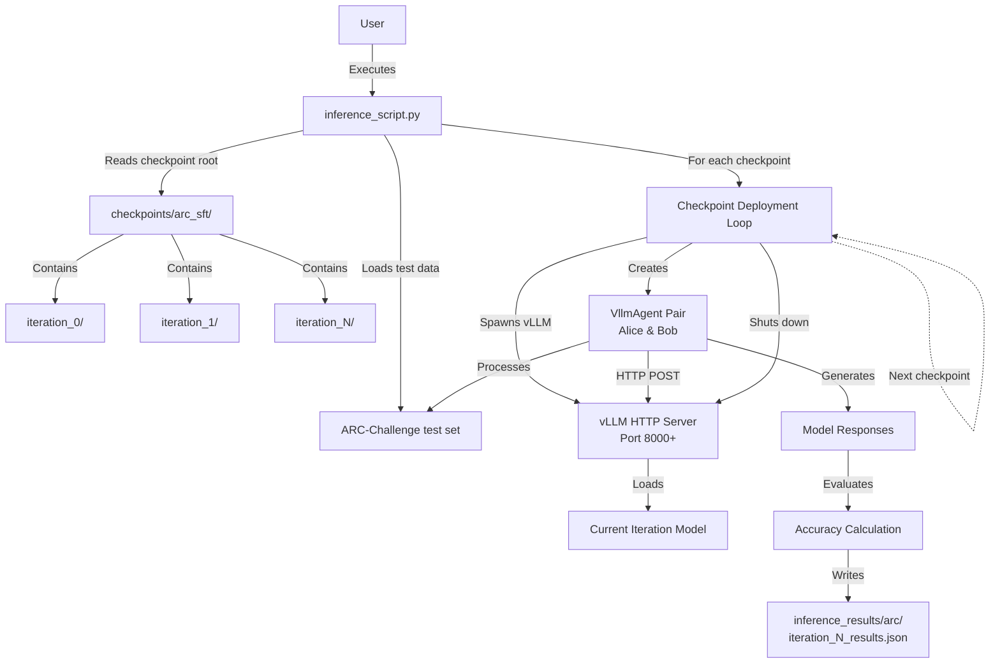

**Sources:** [README.md:94-110](), [inference_script.py]()

Execute the inference script:

```bash
python inference_script.py \
    --model_root_path ./checkpoints/arc_sft \
    --tokenizer_path ${pretrained_tokenizer_path} \
    --dataset_type arc \
    --device 0 \
    --port 8000 \
    --num_thread 128 \
    --output_root_path ./inference_results \
    --vllm_env optima-vllm
```

**Inference Arguments:**

| Argument | Description | Example Value |
|----------|-------------|---------------|
| `--model_root_path` | Root directory containing iteration checkpoints | `./checkpoints/arc_sft` |
| `--tokenizer_path` | Path to pretrained tokenizer (same as training) | Path to Llama-3-8B tokenizer |
| `--dataset_type` | Test dataset identifier | `arc` (ARC-Challenge) |
| `--device` | GPU device index for first vLLM deployment | `0` |
| `--port` | Starting port number for vLLM services | `8000` |
| `--num_thread` | Number of parallel threads for inference | `128` |
| `--output_root_path` | Directory for inference results | `./inference_results` |
| `--vllm_env` | Conda environment for vLLM | `optima-vllm` |

**Sources:** [README.md:94-110](), [inference_script.py]()

### Understanding Inference Results

The inference script generates JSON files in the following structure:

```
inference_results/
└── arc/
    ├── iteration_0_results.json
    ├── iteration_1_results.json
    └── iteration_N_results.json
```

Each results file contains:
- **Individual predictions**: Model responses for each test instance
- **Accuracy metrics**: Overall accuracy on the test set
- **Token statistics**: Number of tokens used in multi-agent conversations
- **Conversation logs**: Full conversation history between Alice and Bob agents

**Key Metrics to Monitor:**

| Metric | Description | Improvement Indicator |
|--------|-------------|----------------------|
| Accuracy | Percentage of correct answers | Higher is better |
| Average Tokens | Mean tokens per conversation | Lower indicates better efficiency |
| Communication Rounds | Number of turns between agents | Fewer rounds suggests more concise communication |

**Sources:** [inference_script.py](), [README.md:94-110]()

## Step 4: Iterative Training (Optional)

Optima's core innovation is iterative refinement. To continue training for additional iterations:

1. **Update Configuration**: The checkpoint from iteration 0 becomes the `model_name_or_path` for iteration 1
2. **Generate New Data**: Use the trained model from iteration 0 to generate more sophisticated training data
3. **Repeat Training**: Run `sft_script.py` again with the updated configuration

For iteration 1, modify your recipe to point `model_name_or_path` to `checkpoints/arc_sft/iteration_0/` and update the `output_dir` to `checkpoints/arc_sft/iteration_1/`.

**Sources:** [README.md:58-71]()

## Training Progress Monitoring

During training, monitor these key indicators:

**Log Output Structure:**

```
INFO:     Training started
INFO:     Epoch 1/4, Step 10/500, Loss: 1.234, LR: 1.0e-06
INFO:     Epoch 1/4, Step 20/500, Loss: 1.156, LR: 9.8e-07
...
INFO:     Evaluation - Accuracy: 0.72, Loss: 0.845
INFO:     Training complete, checkpoint saved to checkpoints/arc_sft/iteration_0/
```

**Expected Training Time:** For ARC-Challenge with 4 epochs on a single GPU:
- Data generation: ~30-60 minutes (depends on model size and dataset)
- Training: ~1-2 hours (depends on GPU type and batch size)
- Total: ~2-3 hours per iteration

**Sources:** [sft_script.py](), [alignment-handbook/recipes/Llama3-8b/arc_sft/base.yaml:17-19]()

## Common Issues and Solutions

| Issue | Possible Cause | Solution |
|-------|----------------|----------|
| CUDA out of memory | Batch size too large | Reduce `per_device_train_batch_size` in recipe |
| vLLM port conflict | Port already in use | Change `--port` argument to unused port range |
| Conda environment not found | Incorrect environment name | Verify `--vllm_env` and `--alignment_env` match created environments |
| Dataset not found | Incorrect path in recipe | Update `dataset_mixer` path in YAML configuration |

**Sources:** [README.md:22-55](), [alignment-handbook/recipes/Llama3-8b/arc_sft/base.yaml:1-39]()

## Next Steps

After completing this quick start tutorial:

1. **Explore Other Training Methods**: Try [iDPO](#3.1) or [combined iSFT-DPO](#3.1) for enhanced performance
2. **Experiment with Different Datasets**: Optima supports multiple datasets including HotpotQA, MATH, GSM8K, and MMLU. See [Supported Datasets](#13.3)
3. **Customize Training Recipes**: Learn to tune hyperparameters in [Hyperparameter Tuning](#11.3)
4. **Run Multi-Agent Self-Consistency**: Improve robustness with self-consistency evaluation using [multi_sc_data_generate_script.py](#8.2)
5. **Understand the Agent System**: Deep dive into [Agent System Architecture](#5) to customize agent behavior

**Sources:** [README.md:58-137]()

---

# Page: Core Concepts

# Core Concepts

<details>
<summary>Relevant source files</summary>

The following files were used as context for generating this wiki page:

- [README.md](README.md)
- [README_revise.md](README_revise.md)

</details>


This page explains the fundamental concepts behind Optima's approach to optimizing LLM-based multi-agent systems. It covers the core problem Optima addresses, the iterative training methodology, and how multi-agent conversations generate training data for continuous improvement.

For specific training method details (iSFT, iDPO, iSFT-DPO), see [Iterative Training Methods](#3.1). For agent implementation details, see [Multi-Agent System Architecture](#3.2). For preference optimization specifics, see [Direct Preference Optimization](#3.3).

## The Multi-Agent Optimization Problem

Multi-agent LLM systems face a fundamental challenge: balancing **communication effectiveness** with **token efficiency**. Traditional multi-agent systems produce verbose exchanges that consume excessive tokens while often failing to improve accuracy proportionally. Optima addresses this by training agents to communicate more efficiently without sacrificing—and often improving—response quality.

The framework targets two primary objectives:

| Optimization Goal | Description | Measurement |
|-------------------|-------------|-------------|
| **Token Efficiency** | Reduce the number of tokens used in agent-to-agent communication | Total tokens per conversation |
| **Communication Effectiveness** | Improve the quality and accuracy of multi-agent reasoning | Task accuracy metrics |

Sources: [README.md:1-21]()

## Iterative Self-Improvement Architecture

Optima's core innovation is an **iterative training loop** where models from iteration N generate training data for iteration N+1. This creates a self-improvement cycle that progressively optimizes both objectives.

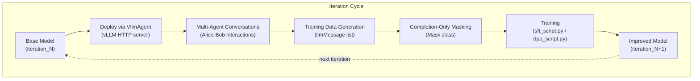

**Diagram: Iterative Self-Improvement Loop**

The cycle operates as follows:

1. **Deployment**: The current model checkpoint is deployed using `VllmAgent` instances that communicate via HTTP with vLLM servers
2. **Multi-Agent Generation**: Agents engage in structured conversations to solve reasoning tasks
3. **Data Processing**: Conversations are converted to training examples with completion-only masking
4. **Training**: The next iteration model is trained using supervised fine-tuning (SFT) or direct preference optimization (DPO)
5. **Iteration**: The improved model becomes the base for the next cycle

Sources: [README.md:11-21](), [README_revise.md:7-14]()

## Multi-Agent Conversation Framework

Optima employs a two-agent conversation paradigm where agents named **Alice** and **Bob** collaborate to solve tasks. This framework is implemented through the agent class hierarchy:

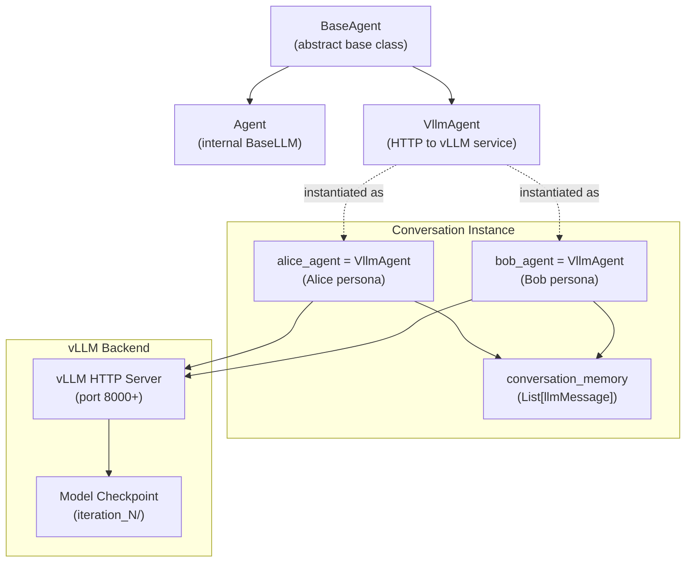

**Diagram: Agent System Architecture and Code Entities**

### Agent Roles

- **Alice**: Typically initiates conversations and drives the reasoning process
- **Bob**: Responds to Alice's queries, providing complementary reasoning perspectives
- **Conversation Memory**: Maintains the dialogue history as a list of `llmMessage` objects

Each agent instance uses chat templates with role-specific tokens (`Alice_token`, `Bob_token`) to distinguish speakers in the training data.

Sources: [README.md:114-137]()

## Training Data Generation Process

The conversion from agent conversations to training data involves several key transformations:

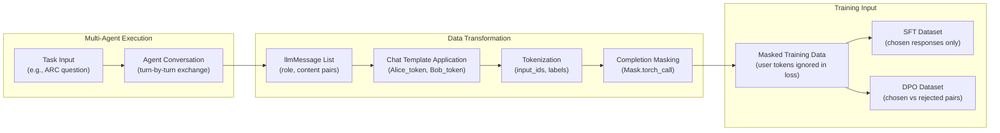

**Diagram: Training Data Generation Pipeline**

### Completion-Only Masking

A critical component is the **Mask** data collator from the alignment-handbook integration, which implements completion-only language modeling. This ensures that:

- **User/System tokens**: Masked in the loss calculation (labels set to `-100`)
- **Assistant tokens**: Contribute to the training loss
- **Rationale**: Agents should learn to generate high-quality responses, not to predict user inputs

The masking is applied in [alignment-handbook/src/alignment/data.py]() via the `Mask` class's `torch_call` method.

Sources: [README.md:48-55]()

## Training Methodologies

Optima supports three training approaches, each targeting different aspects of optimization:

| Method | Full Name | Implementation | Primary Optimization |
|--------|-----------|----------------|---------------------|
| **iSFT** | Iterative Supervised Fine-Tuning | `sft_script.py` | Behavior cloning from successful multi-agent trajectories |
| **iDPO** | Iterative Direct Preference Optimization | `dpo_script.py` | Preference learning between response pairs |
| **iSFT-DPO** | Combined Iterative Training | `sft_dpo_script.py` | Sequential application of both methods |

### Method Selection Guidelines

- **iSFT**: Best for establishing baseline communication patterns from demonstration data
- **iDPO**: Optimal when preference pairs (chosen vs. rejected) are available, provides stronger optimization signal
- **iSFT-DPO**: Combines the stability of SFT with the refinement of DPO for maximum performance

Each method shares the same iterative loop structure but differs in the training objective and data format requirements.

Sources: [README.md:58-92]()

## Configuration-Driven Execution

All training executions are driven by **YAML recipe files** located in:
- `train/sft_recipes/` - SFT configurations
- `train/dpo_recipes/` - DPO configurations  
- `train/sft_dpo_recipes/` - Combined method configurations

Each recipe specifies:

```yaml
# Key configuration elements
model_name_or_path: path/to/checkpoint
dataset_mixer: {dataset_name: weight}
num_train_epochs: 4
learning_rate: 5.0e-7
per_device_train_batch_size: 1
gradient_accumulation_steps: 8
```

Recipe files enable reproducible experiments and systematic hyperparameter exploration. See [Recipe Configuration System](#6.2) for complete documentation.

Sources: [README.md:59-60]()

## Dual Environment Design

Optima's architecture requires two separate conda environments:

| Environment | Name | Purpose | Key Dependencies |
|-------------|------|---------|------------------|
| **Serving** | `optima-vllm` | Deploy models for inference during data generation | vLLM 0.5.3, PyTorch 2.3.1 |
| **Training** | `optima-train` | Execute training scripts and optimization | alignment-handbook, Flash Attention 2 |

This separation prevents resource conflicts—vLLM deploys models on specific GPUs for inference while training occurs on separate devices. The `VllmAgent` class bridges these environments via HTTP communication.

Scripts accept `--vllm_env` and `--alignment_env` arguments to specify which conda environments to activate for each phase.

Sources: [README.md:22-55](), [README_revise.md:16-46]()

## Checkpoint Iteration Management

Model checkpoints are organized by iteration number:

```
checkpoints/
├── arc_sft/
│   ├── iteration_0/    # First training iteration
│   ├── iteration_1/    # Second iteration
│   └── iteration_N/    # Nth iteration
├── arc_dpo/
│   └── ...
```

Each iteration directory contains a complete model checkpoint that can be:
- Deployed via vLLM for inference
- Used as the base model for the next training iteration
- Evaluated independently via `inference_script.py`

The iteration number is automatically incremented by training scripts based on existing checkpoint directories.

Sources: [README.md:66-92](), [README.md:102-109]()

## Inference-Time Scaling Laws

Beyond training optimizations, Optima explores **inference-time scaling** through multi-agent self-consistency. The `multi_sc_data_generate_script.py` implements this by:

1. Sampling multiple conversation trajectories at temperature > 0
2. Aggregating responses across trajectories
3. Selecting final answers via majority voting or confidence scoring

This approach enables trading inference compute (multiple samples) for improved accuracy, creating a new dimension for scaling model performance.

Sources: [README.md:103-137]()

## Key Concepts Summary

The core concepts work together to create a comprehensive optimization framework:

1. **Problem**: Multi-agent systems are token-inefficient with suboptimal accuracy
2. **Solution**: Iterative training using self-generated multi-agent conversations
3. **Mechanism**: VllmAgent instances generate data → Mask class processes it → Training scripts optimize models
4. **Methods**: iSFT, iDPO, or iSFT-DPO depending on data and objectives
5. **Architecture**: Dual environments (serving + training) enable efficient pipeline execution
6. **Output**: Progressive model improvements across iterations, measurable via token usage and accuracy metrics

The following subsections provide detailed technical documentation for each component.

Sources: [README.md:1-147](), [README_revise.md:1-131]()

---

# Page: Iterative Training Methods

# Iterative Training Methods

<details>
<summary>Relevant source files</summary>

The following files were used as context for generating this wiki page:

- [README.md](README.md)
- [README_revise.md](README_revise.md)

</details>


## Purpose and Scope

This page explains Optima's three iterative training methodologies: iSFT (iterative Supervised Fine-Tuning), iDPO (iterative Direct Preference Optimization), and iSFT-DPO (combined approach). These methods form the core of Optima's approach to optimizing multi-agent systems through self-improving feedback loops.

For detailed information about the Direct Preference Optimization algorithm itself, see [Direct Preference Optimization (DPO)](#3.3). For configuration details, see [Recipe Configuration System](#6.2). For script usage, see [Training Scripts Reference](#6.1).

**Sources:** [README.md:1-147]()

## Overview of Iterative Training

Optima's iterative training approach uses models from iteration N to generate training data for iteration N+1, creating a self-improvement loop. Unlike traditional single-pass training, this method progressively refines both the quality of agent responses and the efficiency of multi-agent communication.

The iterative process consists of:

1. **Training Phase**: Fine-tune the model using supervised learning (SFT) and/or preference optimization (DPO)
2. **Data Generation Phase**: Deploy the trained model to generate multi-agent conversation data
3. **Iteration Phase**: Use generated data to train the next iteration

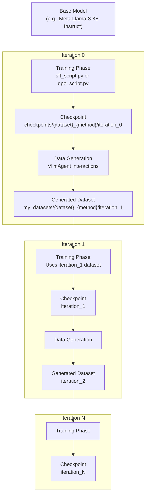

**Diagram: Iterative Training Pipeline Flow**

The key innovation is that each iteration improves upon the previous one by learning from the model's own generated multi-agent conversations, progressively optimizing for token efficiency and communication effectiveness.

**Sources:** [README.md:11-11](), [README.md:58-92]()

## iSFT: Iterative Supervised Fine-Tuning

iSFT (iterative Supervised Fine-Tuning) uses standard supervised learning in an iterative framework. At each iteration, the model is trained on multi-agent conversation data where only the assistant responses contribute to the loss function.

### Training Process

The iSFT method is implemented through [sft_script.py:1-end](), which orchestrates the following workflow:

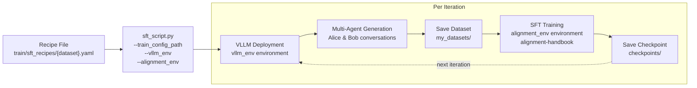

**Diagram: iSFT Script Workflow Connecting Code Entities**

### Key Characteristics

| Aspect | Description |
|--------|-------------|
| **Training Objective** | Maximize likelihood of assistant responses in multi-agent conversations |
| **Loss Calculation** | Cross-entropy loss on assistant tokens only (non-assistant tokens masked) |
| **Data Source** | Self-generated multi-agent conversations from previous iteration |
| **Masking** | Uses `Mask` data collator from [alignment-handbook/src/alignment/data.py]() |
| **Script** | [sft_script.py:1-end]() |
| **Configuration** | Recipe files in [train/sft_recipes/]() directory |

### Usage Example

```bash
MKL_THREADING_LAYER=GNU python sft_script.py \
    --train_config_path train/sft_recipes/arc.yaml \
    --vllm_env optima-vllm \
    --alignment_env optima-train
```

The script accepts three command-line arguments:
- `--train_config_path`: Path to YAML recipe configuration
- `--vllm_env`: Conda environment for vLLM deployment
- `--alignment_env`: Conda environment for training

### When to Use iSFT

iSFT is appropriate when:
- You want a straightforward iterative training approach
- You have access to positive examples of good multi-agent conversations
- You don't need explicit preference modeling between response pairs
- Training stability is a priority (SFT is generally more stable than DPO)

**Sources:** [README.md:63-70](), [sft_script.py:1-end]()

## iDPO: Iterative Direct Preference Optimization

iDPO (iterative Direct Preference Optimization) combines DPO with iterative training. DPO trains models to prefer certain responses over others without requiring explicit reward models, making it more efficient than traditional RLHF approaches.

### Training Process

The iDPO method is implemented through [dpo_script.py:1-end](), which follows a similar structure to iSFT but generates preference pairs:

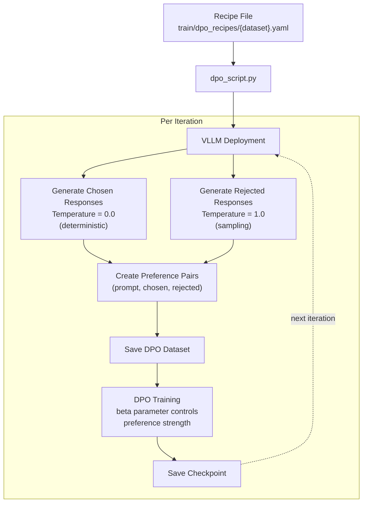

**Diagram: iDPO Script Workflow with Preference Pair Generation**

### Key Characteristics

| Aspect | Description |
|--------|-------------|
| **Training Objective** | Optimize policy to prefer chosen responses over rejected responses |
| **Loss Calculation** | DPO loss with beta parameter (typically 0.1-0.2) |
| **Data Source** | Preference pairs: chosen (temp=0.0) vs rejected (temp=1.0) responses |
| **Beta Parameter** | Controls strength of preference optimization (see [DPO](#3.3)) |
| **Script** | [dpo_script.py:1-end]() |
| **Configuration** | Recipe files in [train/dpo_recipes/]() directory |

### Preference Pair Construction

In iDPO, preference pairs are constructed by:
1. **Chosen response**: Generated with temperature 0.0 (greedy/deterministic) from the current model
2. **Rejected response**: Generated with temperature 1.0 (stochastic sampling) from the current model

This creates an implicit preference signal where the model's most confident responses (temperature 0.0) are treated as preferred over its sampled responses (temperature 1.0).

### Usage Example

```bash
MKL_THREADING_LAYER=GNU python dpo_script.py \
    --train_config_path train/dpo_recipes/arc.yaml \
    --vllm_env optima-vllm \
    --alignment_env optima-train
```

### When to Use iDPO

iDPO is appropriate when:
- You want to explicitly optimize for response quality through preferences
- You can distinguish between better and worse responses
- You want to reduce verbosity (DPO tends to produce more concise responses)
- You're willing to tune the beta hyperparameter for your use case

**Sources:** [README.md:74-81](), [dpo_script.py:1-end]()

## iSFT-DPO: Combined Approach

iSFT-DPO combines both supervised fine-tuning and preference optimization within each iteration, providing the benefits of both approaches.

### Training Process

The combined method is implemented through [sft_dpo_script.py:1-end]():

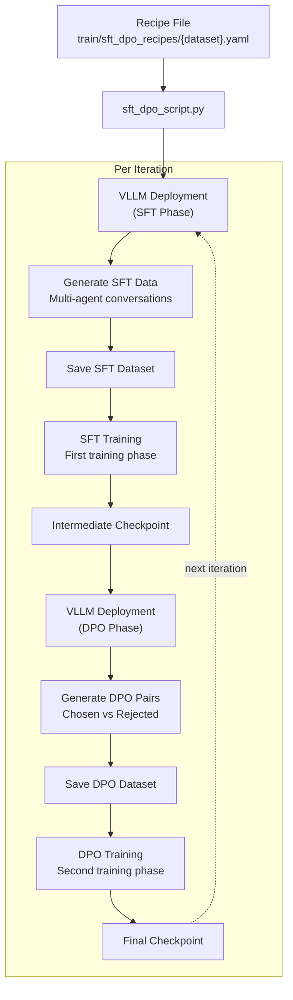

**Diagram: iSFT-DPO Combined Training Workflow**

### Key Characteristics

| Aspect | Description |
|--------|-------------|
| **Training Phases** | Two-phase: SFT first, then DPO |
| **SFT Phase** | Standard supervised learning on conversation data |
| **DPO Phase** | Preference optimization on the SFT-trained model |
| **Checkpoints** | Intermediate checkpoint after SFT, final checkpoint after DPO |
| **Script** | [sft_dpo_script.py:1-end]() |
| **Configuration** | Recipe files in [train/sft_dpo_recipes/]() directory |

### Training Sequence

Within each iteration:

1. **Phase 1 - SFT**: Train on multi-agent conversation data generated from previous iteration
2. **Intermediate Checkpoint**: Save SFT-trained model
3. **Phase 2 - DPO**: Generate preference pairs using SFT model, then train with DPO
4. **Final Checkpoint**: Save DPO-refined model for next iteration

### Usage Example

```bash
MKL_THREADING_LAYER=GNU python sft_dpo_script.py \
    --train_config_path train/sft_dpo_recipes/arc.yaml \
    --vllm_env optima-vllm \
    --alignment_env optima-train
```

### When to Use iSFT-DPO

iSFT-DPO is appropriate when:
- You want the stability of SFT combined with the preference modeling of DPO
- You have computational resources for two training phases per iteration
- You want to maximize response quality and communication efficiency
- You're optimizing for both accuracy and token efficiency simultaneously

**Sources:** [README.md:85-92](), [sft_dpo_script.py:1-end]()

## Method Comparison and Selection Guide

### Performance Characteristics

| Method | Token Efficiency | Training Stability | Response Quality | Computational Cost |
|--------|-----------------|-------------------|-----------------|-------------------|
| **iSFT** | Moderate | High | Good | Low |
| **iDPO** | High | Moderate | Very Good | Moderate |
| **iSFT-DPO** | Very High | High | Excellent | High |

### Training Configuration Comparison

| Configuration Aspect | iSFT | iDPO | iSFT-DPO |
|---------------------|------|------|----------|
| **Recipe Directory** | `train/sft_recipes/` | `train/dpo_recipes/` | `train/sft_dpo_recipes/` |
| **Script File** | `sft_script.py` | `dpo_script.py` | `sft_dpo_script.py` |
| **Data Generation** | Single pass (conversation) | Two passes (chosen + rejected) | Both (SFT data + DPO pairs) |
| **Training Phases** | 1 (SFT only) | 1 (DPO only) | 2 (SFT then DPO) |
| **Beta Parameter** | N/A | Required (0.1-0.2) | Required for DPO phase |
| **Epochs per Iteration** | Typically 4 | Varies by dataset | 4 (SFT) + variable (DPO) |

### Selection Guidelines

**Choose iSFT when:**
- Starting a new project and want a simple baseline
- Training stability is critical
- Computational budget is limited
- You have high-quality conversation examples

**Choose iDPO when:**
- You need maximum token efficiency
- You can identify clear preference signals
- You want to reduce response verbosity
- You're comfortable tuning the beta hyperparameter

**Choose iSFT-DPO when:**
- You want state-of-the-art performance
- You have sufficient computational resources
- Both accuracy and efficiency are critical
- You're willing to invest in longer training times

**Sources:** [README.md:20-20](), [README.md:58-92]()

## Training Scripts Architecture

All three training scripts follow a common architectural pattern with specific implementations for each method:

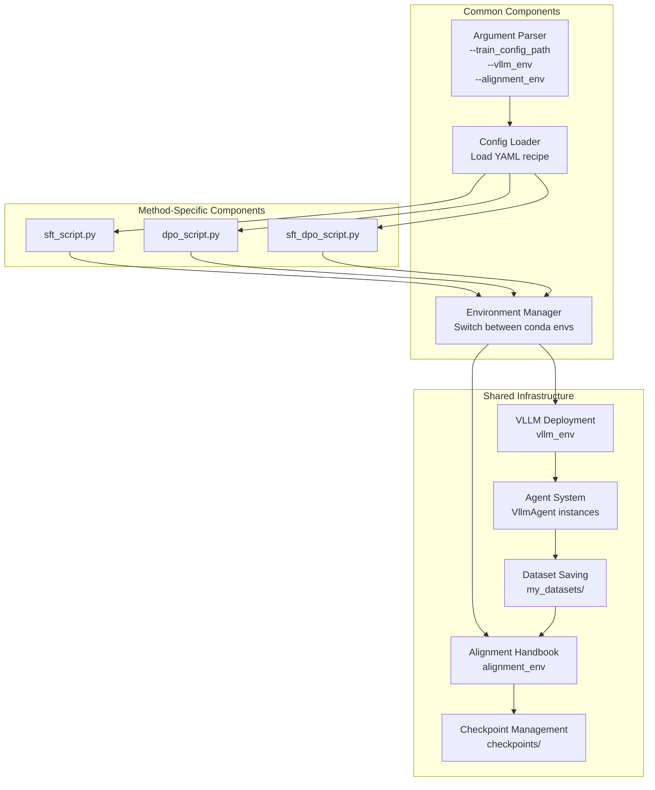

**Diagram: Training Scripts Architecture with Shared Components**

### Command-Line Interface

All training scripts accept the same three arguments:

| Argument | Type | Description |
|----------|------|-------------|
| `--train_config_path` | string | Path to YAML recipe file (e.g., `train/sft_recipes/arc.yaml`) |
| `--vllm_env` | string | Conda environment name for vLLM deployment (e.g., `optima-vllm`) |
| `--alignment_env` | string | Conda environment name for training (e.g., `optima-train`) |

### Environment Variables

The `MKL_THREADING_LAYER=GNU` environment variable is required before running any training script to avoid threading conflicts with PyTorch.

**Sources:** [README.md:63-92](), [sft_script.py:1-end](), [dpo_script.py:1-end](), [sft_dpo_script.py:1-end]()

## Iteration Progression

### Checkpoint Directory Structure

Each training method creates checkpoints in a structured directory hierarchy:

```
checkpoints/
├── {dataset}_{method}/
│   ├── iteration_0/
│   │   ├── config.json
│   │   ├── model.safetensors
│   │   ├── tokenizer.json
│   │   └── ...
│   ├── iteration_1/
│   ├── iteration_2/
│   └── ...
```

For example:
- `checkpoints/arc_sft/iteration_0/` - First iteration of iSFT on ARC dataset
- `checkpoints/arc_dpo/iteration_1/` - Second iteration of iDPO on ARC dataset
- `checkpoints/arc_sft_dpo/iteration_2/` - Third iteration of iSFT-DPO on ARC dataset

### Dataset Directory Structure

Generated datasets for each iteration are stored in:

```
my_datasets/
├── {dataset}_{method}/
│   ├── iteration_1/
│   │   └── train.jsonl
│   ├── iteration_2/
│   │   └── train.jsonl
│   └── ...
```

Note: Iteration 0 typically uses the base pretrained model, so dataset generation starts at iteration 1.

### Stopping Criteria

Training iterations continue until:
1. Performance metrics plateau or degrade
2. Maximum specified iterations are reached
3. Manual intervention based on evaluation results

For evaluation and performance monitoring, see [Evaluation Metrics](#8.3).

**Sources:** [README.md:102-103](), [README.md:128-129]()

---

# Page: Multi-Agent System Architecture

# Multi-Agent System Architecture

<details>
<summary>Relevant source files</summary>

The following files were used as context for generating this wiki page:

- [README.md](README.md)
- [agent/agent.py](agent/agent.py)
- [alignment-handbook/mask/mask.py](alignment-handbook/mask/mask.py)

</details>


## Purpose and Scope

This document describes the multi-agent system architecture that enables Optima's core training methodology. The agent system facilitates interactions between multiple agents (typically Alice and Bob) that generate training data through structured conversations. This page covers the agent class hierarchy, conversation memory management, and how agents communicate via HTTP with vLLM-deployed models.

For details on specific agent class methods and APIs, see [Agent Class Reference](#5.1). For information on how agents use HTTP to communicate with vLLM services, see [VllmAgent HTTP Communication](#5.2). For conversation memory implementation details, see [Conversation Memory Management](#5.3).

## Agent Class Hierarchy

Optima implements a three-tier agent class hierarchy that provides flexibility between local model invocation and distributed model serving:

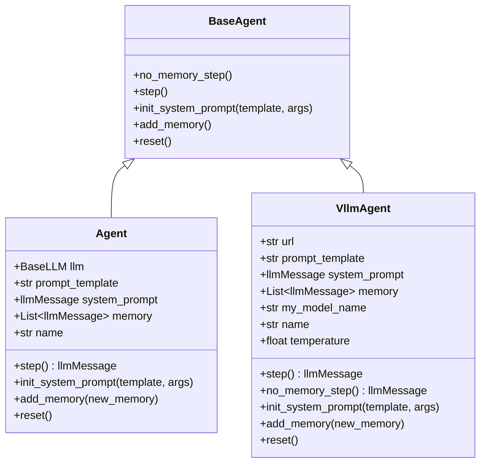

**Sources:** [agent/agent.py:9-25](), [agent/agent.py:27-55](), [agent/agent.py:57-147]()

### BaseAgent

The `BaseAgent` class defines the abstract interface that all agent implementations must follow. It declares five core methods without implementation:

| Method | Purpose |
|--------|---------|
| `no_memory_step()` | Generate response without updating conversation memory |
| `step()` | Generate response and update conversation memory |
| `init_system_prompt(template, args)` | Initialize agent's system prompt from template |
| `add_memory()` | Add message to conversation history |
| `reset()` | Clear conversation memory and reset to initial state |

**Sources:** [agent/agent.py:9-25]()

### Agent

The `Agent` class implements the interface for local model invocation using an internal `BaseLLM` instance. This class is primarily used for simpler scenarios or testing. It maintains:

- `llm`: A `BaseLLM` instance for generating responses
- `memory`: A list of `llmMessage` objects representing conversation history
- `system_prompt`: The initial system message defining the agent's role
- `name`: The agent's identifier (e.g., "Alice", "Bob")

The `step()` method converts the memory list to dictionary format, invokes the LLM, and automatically adds the response to memory.

**Sources:** [agent/agent.py:27-55]()

### VllmAgent

The `VllmAgent` class is the primary agent implementation used in Optima's training pipeline. Unlike `Agent`, it communicates with vLLM-deployed models via HTTP, enabling efficient distributed model serving. Key attributes:

| Attribute | Type | Purpose |
|-----------|------|---------|
| `url` | `str` | HTTP endpoint for vLLM service (e.g., `http://localhost:8000/v1/chat/completions`) |
| `my_model_name` | `str` | Model identifier for vLLM deployment |
| `name` | `str` | Agent identifier ("Alice" or "Bob") |
| `temperature` | `float` | Sampling temperature for generation |
| `memory` | `List[llmMessage]` | Conversation history |

**Sources:** [agent/agent.py:57-147]()

## VllmAgent Architecture

The following diagram illustrates how `VllmAgent` instances interact with vLLM services during multi-agent conversations:

```mermaid
graph TB
    subgraph "Training Script Environment"
        Alice["VllmAgent<br/>name='Alice'<br/>url='http://localhost:8000/v1/chat/completions'"]
        Bob["VllmAgent<br/>name='Bob'<br/>url='http://localhost:8001/v1/chat/completions'"]
        Memory["memory: List[llmMessage]<br/>[system, user, assistant, ...]"]
        
        Alice --> Memory
        Bob --> Memory
    end
    
    subgraph "vLLM Service Port 8000"
        VllmService1["vLLM HTTP Server<br/>my_model_name=checkpoint_path"]
        Model1["Model Instance<br/>iteration_N checkpoint"]
    end
    
    subgraph "vLLM Service Port 8001"
        VllmService2["vLLM HTTP Server<br/>my_model_name=checkpoint_path"]
        Model2["Model Instance<br/>iteration_N checkpoint"]
    end
    
    Alice -->|"POST /v1/chat/completions<br/>messages, temperature, chat_template"| VllmService1
    VllmService1 --> Model1
    Model1 -->|"response JSON"| Alice
    
    Bob -->|"POST /v1/chat/completions<br/>messages, temperature, chat_template"| VllmService2
    VllmService2 --> Model2
    Model2 -->|"response JSON"| Bob
```

**Sources:** [agent/agent.py:85-121](), [README.md:26-37]()

### HTTP Request Structure

When `VllmAgent.step()` is invoked, it constructs an HTTP POST request with the following structure:

```python
{
    "model": self.my_model_name,              # Model identifier
    "messages": message_input,                 # List of conversation messages
    "temperature": self.temperature,           # Sampling temperature
    "chat_template": "...",                    # Jinja2 template for formatting
    "chat_template_kwargs": {                  # Template variables
        "is_alice": bool,
        "is_bob": bool
    },
    "max_tokens": 2000                         # Maximum response length
}
```

The `messages` field contains the entire conversation history formatted as dictionaries with `role` and `content` keys.

**Sources:** [agent/agent.py:91-108]()

## Multi-Agent Conversation Flow

The multi-agent conversation system enables turn-based dialogue between agents that generates training data. The following diagram shows a typical conversation cycle:

```mermaid
sequenceDiagram
    participant Script as Training Script
    participant Alice as VllmAgent (Alice)
    participant Bob as VllmAgent (Bob)
    participant Memory as Shared memory
    participant vLLM1 as vLLM Service :8000
    participant vLLM2 as vLLM Service :8001
    
    Script->>Alice: init_system_prompt(template, args)
    Alice->>Memory: append(system_prompt)
    
    Script->>Bob: init_system_prompt(template, args)
    Bob->>Memory: append(system_prompt)
    
    Script->>Memory: append(user_message)
    
    loop Conversation Turns
        Script->>Alice: step()
        Alice->>vLLM1: POST messages + chat_template
        vLLM1->>Alice: response content
        Alice->>Memory: add_memory(response)
        
        Script->>Bob: step()
        Bob->>vLLM2: POST messages + chat_template
        vLLM2->>Bob: response content
        Bob->>Memory: add_memory(response)
    end
    
    Script->>Memory: Extract conversation for training
```

**Sources:** [agent/agent.py:85-121](), [agent/agent.py:73-78]()

### Turn-Taking Mechanism

The training script orchestrates turn-taking between agents. Typically:

1. Both agents are initialized with system prompts defining their roles
2. A user query is added to the shared memory
3. Alice generates a response (calls `step()`)
4. Bob generates a response based on updated memory
5. The cycle repeats for multiple turns
6. The final conversation is processed for training data

**Sources:** [agent/agent.py:34-43](), [agent/agent.py:85-121]()

## Chat Template System

The chat template system is critical for formatting agent responses correctly. `VllmAgent` uses a custom Jinja2 template that includes special tokens for the Llama-3 format and agent name prefixes:

### Template Structure

The chat template includes:
- Standard Llama-3 conversation markers: `<|start_header_id|>`, `<|end_header_id|>`, `<|eot_id|>`
- Conditional name prefixes (`Alice:` or `Bob:`) based on agent identity
- Special handling for iteration 0 vs. later iterations

```python
chat_template = """



{{ content }}

{{ '<|start_header_id|>assistant<|end_header_id|>\n\n' }}
\n    {{- 'Alice:' }}\n
\n    {{- 'Bob:' }}\n"""
```

**Sources:** [agent/agent.py:102-103]()

### Iteration-Specific Behavior

The agent detects whether it's in iteration 0 by checking the system prompt content:

```python
is_iteration_0 = False
if ("You should start your utterance with" in self.system_prompt.content
    or "You must begin your response with" in self.system_prompt.content):
    is_iteration_0 = True
```

- **Iteration 0**: Name prefixes are not forced by the template (agents learn to use them)
- **Later iterations**: Name prefixes (`Alice:`, `Bob:`) are automatically prepended

This enables the model to learn proper turn-taking conventions during the initial training phase.

**Sources:** [agent/agent.py:92-107]()

### Response Post-Processing

After receiving a response from vLLM, `VllmAgent` ensures proper formatting:

```python
content: str = response.json()["choices"][0]["message"]["content"]
if not content.startswith(self.name) and not is_iteration_0:
    content = f"{self.name}:{content}"
```

This guarantees that all responses are prefixed with the agent name for later iterations, even if the model occasionally fails to include it.

**Sources:** [agent/agent.py:112-114]()

## Memory Management

Each `VllmAgent` maintains a `memory` list containing `llmMessage` objects that represent the conversation history:

```mermaid
graph TB
    subgraph "Memory Structure"
        Memory["memory: List[llmMessage]"]
        
        Msg1["llmMessage<br/>role='system'<br/>content='You are Alice...'"]
        Msg2["llmMessage<br/>role='user'<br/>content='Question: ...'"]
        Msg3["llmMessage<br/>role='assistant'<br/>content='Alice: ...'"]
        Msg4["llmMessage<br/>role='assistant'<br/>content='Bob: ...'"]
        
        Memory --> Msg1
        Memory --> Msg2
        Memory --> Msg3
        Memory --> Msg4
    end
    
    subgraph "Memory Operations"
        Init["init_system_prompt()<br/>Append system message"]
        Add["add_memory(new_memory)<br/>Append new message"]
        Reset["reset()<br/>Clear all messages"]
    end
    
    Init --> Memory
    Add --> Memory
    Reset --> Memory
```

**Sources:** [agent/agent.py:68-82](), [message/message.py]()

### Memory Operations

| Operation | Method | Description |
|-----------|--------|-------------|
| Initialize | `init_system_prompt(template, args)` | Creates system prompt from template and adds to memory |
| Add message | `add_memory(new_memory)` | Appends a new `llmMessage` to memory list |
| Generate with memory | `step()` | Generates response using current memory, then adds response to memory |
| Generate without memory | `no_memory_step()` | Generates response without modifying memory (useful for sampling) |
| Clear memory | `reset()` | Empties memory list and resets system prompt |

**Sources:** [agent/agent.py:73-82](), [agent/agent.py:85-121](), [agent/agent.py:124-146]()

## Integration with Training Pipeline

The multi-agent system integrates with Optima's training pipeline through the `Mask` data collator, which processes agent conversations into training data:

```mermaid
graph LR
    subgraph "Agent Conversation"
        Alice["VllmAgent (Alice)"]
        Bob["VllmAgent (Bob)"]
        Conv["Conversation Memory<br/>system + user + assistant turns"]
    end
    
    subgraph "Data Processing"
        TokenDetect["Token Detection<br/>you_are_Alice_token<br/>you_are_Bob_token"]
        PrefixDetect["Prefix Detection<br/>Alice_token: [128006, 78191, 128007, 271, 62786, 25]<br/>Bob_token: [128006, 78191, 128007, 271, 33488, 25]"]
        Masking["Label Masking<br/>Set non-assistant tokens to -100"]
    end
    
    subgraph "Training Data"
        SFTData["SFT Dataset<br/>Only assistant responses contribute to loss"]
        DPOData["DPO Dataset<br/>Preference pairs from conversations"]
    end
    
    Alice --> Conv
    Bob --> Conv
    Conv --> TokenDetect
    TokenDetect --> PrefixDetect
    PrefixDetect --> Masking
    Masking --> SFTData
    Masking --> DPOData
```

**Sources:** [alignment-handbook/mask/mask.py:8-11](), [alignment-handbook/mask/mask.py:55-102]()

### Token-Based Agent Identification

The `Mask` data collator identifies which agent is speaking by detecting specific token sequences in the conversation:

| Token Sequence | Token IDs | Purpose |
|----------------|-----------|---------|
| `you_are_Alice_token` | `[128006, 9125, 128007, 271, 2675, 527, 30505]` | System prompt indicating Alice's role |
| `you_are_Bob_token` | `[128006, 9125, 128007, 271, 2675, 527, 14596]` | System prompt indicating Bob's role |
| `Alice_token` | `[128006, 78191, 128007, 271, 62786, 25]` | Response prefix for Alice |
| `Bob_token` | `[128006, 78191, 128007, 271, 33488, 25]` | Response prefix for Bob |

These token sequences correspond to:
- `<|start_header_id|>system<|end_header_id|>\n\nYou are Alice` (or Bob)
- `<|start_header_id|>assistant<|end_header_id|>\n\nAlice:` (or Bob:)

**Sources:** [alignment-handbook/mask/mask.py:8-11]()

### Label Masking for Training

The `Mask.torch_call()` method processes conversations to ensure only assistant responses contribute to the training loss:

1. **Detect agent roles**: Scans for `you_are_Alice_token` or `you_are_Bob_token` in system prompts
2. **Identify response boundaries**: Locates `Alice_token` and `Bob_token` prefixes that mark assistant responses
3. **Mask non-response tokens**: Sets all tokens before assistant responses to `ignore_index` (-100)
4. **Preserve response tokens**: Keeps assistant response tokens for loss calculation

This ensures the model learns to generate appropriate responses without being penalized for system prompts or user queries.

**Sources:** [alignment-handbook/mask/mask.py:44-122]()

### Example Processing Flow

For a conversation like:
```
System: You are Alice
User: What is 2+2?
Assistant: Alice: Let me calculate. The answer is 4.
Assistant: Bob: That's correct, it's 4.
```

The masking process:
1. Detects "You are Alice" → Sets `response_token_ids = Alice_token`, `instruction_token_ids = Bob_token`
2. Finds "Alice:" prefix → Unmasks tokens from this point until "Bob:" prefix
3. Finds "Bob:" prefix → Masks these tokens (since Bob is the "instruction" for Alice's perspective)

This creates training data where Alice's model only learns from Alice's responses, enabling specialized agent behavior.

**Sources:** [alignment-handbook/mask/mask.py:55-122]()

---

# Page: Direct Preference Optimization (DPO)

# Direct Preference Optimization (DPO)

<details>
<summary>Relevant source files</summary>

The following files were used as context for generating this wiki page:

- [README.md](README.md)
- [alignment-handbook/recipes/Llama3-8b/arc_dpo/base.yaml](alignment-handbook/recipes/Llama3-8b/arc_dpo/base.yaml)
- [alignment-handbook/recipes/Llama3-8b/arc_dpo/dpo_iteration_0.yaml](alignment-handbook/recipes/Llama3-8b/arc_dpo/dpo_iteration_0.yaml)

</details>


## Purpose and Scope

This document explains the Direct Preference Optimization (DPO) methodology as implemented in Optima, including the mathematical foundations, the role of the beta parameter, and how DPO aligns language models with human preferences through iterative training. For information about the broader iterative training framework, see [Iterative Training Methods](#3.1). For details on the multi-agent system that generates preference data, see [Multi-Agent System Architecture](#3.2).

---

## DPO Methodology Overview

Direct Preference Optimization (DPO) is a preference learning algorithm that trains language models to align with human preferences without requiring explicit reward modeling or reinforcement learning. Unlike traditional RLHF (Reinforcement Learning from Human Feedback), DPO directly optimizes the policy using preference pairs.

### Key Principles

DPO operates on preference pairs consisting of:
- **Chosen response**: The preferred completion for a given prompt
- **Rejected response**: The less preferred completion for the same prompt

The algorithm adjusts model probabilities to increase the likelihood of chosen responses while decreasing the likelihood of rejected responses, controlled by a regularization parameter beta (β).

**Mathematical Foundation**

DPO minimizes the following loss:

```
L_DPO = -log(σ(β * log(π_θ(y_w|x) / π_ref(y_w|x)) - β * log(π_θ(y_l|x) / π_ref(y_l|x))))
```

Where:
- `π_θ` is the policy being trained
- `π_ref` is the reference policy (usually the model before DPO)
- `y_w` is the chosen (winning) response
- `y_l` is the rejected (losing) response
- `x` is the prompt
- `β` is the temperature parameter controlling optimization strength
- `σ` is the sigmoid function

Sources: [README.md:1-148]()

---

## DPO in Optima's Iterative Training

Optima implements DPO as part of its iterative training pipeline, where models from previous iterations generate preference data for subsequent training cycles. This creates a self-improvement loop that enhances both communication efficiency and response quality.

### Iterative DPO (iDPO) Pipeline

```mermaid
graph TB
    subgraph "Iteration N-1"
        PrevModel["Model_N-1<br/>(Trained Model)"]
    end
    
    subgraph "Multi-Agent Preference Generation"
        Deploy["vLLM Deployment<br/>VllmAgent instances"]
        Alice["Alice Agent"]
        Bob["Bob Agent"]
        Conversations["Multi-turn Conversations"]
        PrefData["Preference Pair Generation<br/>chosen vs rejected"]
    end
    
    subgraph "DPO Training Process"
        DPORecipe["DPO Recipe YAML<br/>arc_dpo/dpo_iteration_N.yaml"]
        DPOScript["dpo_script.py<br/>Training orchestration"]
        AlignmentHandbook["alignment-handbook<br/>DPO trainer"]
        DPOLoss["DPO Loss Computation<br/>beta parameter"]
    end
    
    subgraph "Output"
        NewModel["Model_N<br/>(DPO-aligned)"]
        Checkpoint["Checkpoint Save<br/>arc_dpo/dpo_iteration_N"]
    end
    
    PrevModel --> Deploy
    Deploy --> Alice
    Deploy --> Bob
    Alice --> Conversations
    Bob --> Conversations
    Conversations --> PrefData
    
    PrefData --> DPORecipe
    DPORecipe --> DPOScript
    DPOScript --> AlignmentHandbook
    AlignmentHandbook --> DPOLoss
    DPOLoss --> NewModel
    NewModel --> Checkpoint
```

Sources: [README.md:72-81](), High-level architecture diagrams

### Training Settings

Optima supports three training configurations involving DPO:

| Setting | Description | Script | Use Case |
|---------|-------------|--------|----------|
| **iDPO** | Pure DPO training across iterations | `dpo_script.py` | When preference data is available from iteration 0 |
| **iSFT-DPO** | Combined SFT followed by DPO in each iteration | `sft_dpo_script.py` | Most common setting for balanced training |
| **SFT + DPO** | SFT in early iterations, DPO in later ones | Custom configuration | Progressive refinement strategy |

Sources: [README.md:58-92]()

---

## The Beta Parameter

The beta (β) parameter is the most critical hyperparameter in DPO training, controlling the strength of preference optimization relative to the reference model.

### Beta's Role

**Trade-off Control**:
- **Higher beta** (e.g., 0.5): Stronger preference enforcement, larger deviations from reference model
- **Lower beta** (e.g., 0.1): Gentler optimization, stays closer to reference model

```mermaid
graph LR
    subgraph "Beta Parameter Effect"
        Beta["beta value<br/>(β)"]
        
        LowBeta["Low β: 0.1<br/>Conservative updates<br/>Stays close to reference"]
        MedBeta["Medium β: 0.2<br/>Balanced optimization<br/>Default choice"]
        HighBeta["High β: 0.5<br/>Aggressive updates<br/>Strong alignment"]
        
        TradeOff["Trade-off:<br/>Alignment vs Stability"]
    end
    
    Beta --> LowBeta
    Beta --> MedBeta
    Beta --> HighBeta
    
    LowBeta --> TradeOff
    MedBeta --> TradeOff
    HighBeta --> TradeOff
```

Sources: [alignment-handbook/recipes/Llama3-8b/arc_dpo/base.yaml:13](), [alignment-handbook/recipes/Llama3-8b/arc_dpo/dpo_iteration_0.yaml:1]()

### Beta Configuration in Optima

The beta parameter appears in DPO recipe configurations:

```yaml
# From arc_dpo/base.yaml and dpo_iteration_0.yaml
beta: 0.2  # Default value used in Optima experiments
```

**Typical Beta Values**:
- `0.1`: Very conservative, minimal deviation from reference
- `0.2`: **Default in Optima** - balanced approach
- `0.5`: Aggressive optimization for strong alignment

**Tuning Guidelines**:
1. Start with `beta=0.2` for most tasks
2. Reduce to `0.1` if training becomes unstable
3. Increase to `0.3-0.5` if stronger preference enforcement is needed
4. Monitor evaluation metrics to assess alignment quality

Sources: [alignment-handbook/recipes/Llama3-8b/arc_dpo/base.yaml:13](), [alignment-handbook/recipes/Llama3-8b/arc_dpo/dpo_iteration_0.yaml:1]()

---

## DPO Recipe Configuration

DPO training in Optima is configured through YAML recipe files located in the `alignment-handbook/recipes/` directory structure.

### Configuration Hierarchy

```mermaid
graph TD
    BaseConfig["base.yaml<br/>Common parameters"]
    
    IterConfig0["dpo_iteration_0.yaml<br/>First iteration config"]
    IterConfig1["dpo_iteration_1.yaml<br/>Second iteration config"]
    IterConfigN["dpo_iteration_N.yaml<br/>N-th iteration config"]
    
    subgraph "Key Parameters"
        ModelParams["Model Settings:<br/>model_name_or_path<br/>tokenizer_name_or_path<br/>torch_dtype: bfloat16"]
        
        DPOParams["DPO Specific:<br/>beta: 0.2<br/>max_length: 4096<br/>max_prompt_length: 1024"]
        
        TrainingParams["Training Config:<br/>learning_rate: 5.0e-7<br/>num_train_epochs: 1<br/>gradient_accumulation_steps: 8"]
        
        DataParams["Data Settings:<br/>dataset_mixer<br/>preprocessing_num_workers: 8"]
    end
    
    BaseConfig --> IterConfig0
    BaseConfig --> IterConfig1
    BaseConfig --> IterConfigN
    
    IterConfig0 --> ModelParams
    IterConfig0 --> DPOParams
    IterConfig0 --> TrainingParams
    IterConfig0 --> DataParams
```

Sources: [alignment-handbook/recipes/Llama3-8b/arc_dpo/base.yaml:1-36](), [alignment-handbook/recipes/Llama3-8b/arc_dpo/dpo_iteration_0.yaml:1-35]()

### Core DPO Parameters

| Parameter | Value | Description |
|-----------|-------|-------------|
| `beta` | `0.2` | DPO temperature parameter controlling optimization strength |
| `max_length` | `4096` | Maximum sequence length for chosen/rejected pairs |
| `max_prompt_length` | `1024` | Maximum length of the prompt portion |
| `learning_rate` | `5.0e-7` | Very low learning rate for stable preference learning |
| `num_train_epochs` | `1` | Single epoch to prevent overfitting |
| `gradient_accumulation_steps` | `8` | Effective batch size multiplier |
| `optim` | `adamw_torch` | Optimizer for DPO training |
| `lr_scheduler_type` | `cosine` | Learning rate schedule |
| `warmup_ratio` | `0.1` | Warmup portion of training |

Sources: [alignment-handbook/recipes/Llama3-8b/arc_dpo/base.yaml:1-36](), [alignment-handbook/recipes/Llama3-8b/arc_dpo/dpo_iteration_0.yaml:1-35]()

### Model and Data Configuration

**Model Settings** [alignment-handbook/recipes/Llama3-8b/arc_dpo/dpo_iteration_0.yaml:21-23]():
```yaml
model_name_or_path: ../checkpoints/arc_sft/iteration_0  # Reference model from SFT
tokenizer_name_or_path: /path/to/Meta-Llama-3-8B-Instruct  # Base tokenizer
torch_dtype: bfloat16  # Memory-efficient mixed precision
use_flash_attention_2: true  # Optimized attention implementation
```

**Dataset Configuration** [alignment-handbook/recipes/Llama3-8b/arc_dpo/dpo_iteration_0.yaml:3-7]():
```yaml
dataset_mixer:
  ../my_datasets/arc_dpo/iteration_0: 1.0  # DPO preference pairs
dataset_splits:
  - train
  - test
preprocessing_num_workers: 8  # Parallel data loading
```

Sources: [alignment-handbook/recipes/Llama3-8b/arc_dpo/dpo_iteration_0.yaml:1-35]()

---

## DPO Training Process

### Execution Flow

```mermaid
graph TB
    subgraph "Script Execution"
        CLI["Command Line<br/>dpo_script.py<br/>--train_config_path"]
        ConfigLoad["Load Recipe YAML<br/>Parse parameters"]
        EnvSetup["Environment Setup<br/>optima-train activation"]
    end
    
    subgraph "Data Preparation"
        DataLoad["Load Preference Pairs<br/>dataset_mixer paths"]
        Tokenize["Tokenization<br/>preprocessing_num_workers=8"]
        Format["Format as DPO Input<br/>prompt, chosen, rejected"]
    end
    
    subgraph "Training Loop"
        RefModel["Reference Model π_ref<br/>Frozen copy"]
        PolicyModel["Policy Model π_θ<br/>Being optimized"]
        
        Forward["Forward Pass<br/>Compute log probabilities"]
        Loss["DPO Loss Computation<br/>L_DPO = -log(σ(β * delta))"]
        Backward["Backward Pass<br/>Gradient computation"]
        Update["Parameter Update<br/>AdamW optimizer"]
    end
    
    subgraph "Checkpointing"
        Eval["Evaluation on test split<br/>eval_steps=100"]
        Save["Save Final Checkpoint<br/>output_dir"]
    end
    
    CLI --> ConfigLoad
    ConfigLoad --> EnvSetup
    EnvSetup --> DataLoad
    
    DataLoad --> Tokenize
    Tokenize --> Format
    
    Format --> RefModel
    Format --> PolicyModel
    
    RefModel --> Forward
    PolicyModel --> Forward
    Forward --> Loss
    Loss --> Backward
    Backward --> Update
    
    Update --> Eval
    Eval --> Save
    
    Update -.Iteration.-> Forward
```

Sources: [README.md:72-81](), [alignment-handbook/recipes/Llama3-8b/arc_dpo/dpo_iteration_0.yaml:1-35]()

### Running DPO Training

**Command Structure**:
```bash
MKL_THREADING_LAYER=GNU python dpo_script.py \
    --train_config_path train/dpo_recipes/arc.yaml \
    --vllm_env optima-vllm \
    --alignment_env optima-train
```

**Parameters**:
- `train_config_path`: Path to DPO recipe YAML configuration
- `vllm_env`: Conda environment name for vLLM deployment (data generation)
- `alignment_env`: Conda environment name for training execution

Sources: [README.md:72-81]()

---

## Preference Data Requirements

DPO training requires datasets structured as preference pairs. In Optima, this data is generated through multi-agent interactions.

### Expected Data Format

Each training example must contain:

| Field | Description | Example |
|-------|-------------|---------|
| `prompt` | Input question or context | "Question: What is the capital of France?" |
| `chosen` | Preferred response | "The capital of France is Paris." |
| `rejected` | Less preferred response | "I think it might be Lyon or maybe Paris." |

### Data Location

DPO datasets are stored in iteration-specific directories:
```
my_datasets/
├── arc_dpo/
│   ├── iteration_0/
│   │   ├── train/
│   │   └── test/
│   ├── iteration_1/
│   └── ...
```

Sources: [alignment-handbook/recipes/Llama3-8b/arc_dpo/dpo_iteration_0.yaml:3-7]()

---

## Training Configuration Details

### Optimization Settings

The DPO training uses carefully tuned hyperparameters for stable preference learning:

**Learning Rate Schedule** [alignment-handbook/recipes/Llama3-8b/arc_dpo/dpo_iteration_0.yaml:15-18]():
- Initial learning rate: `5.0e-7` (very low for stability)
- Scheduler: `cosine` decay
- Warmup: `0.1` ratio (10% of training)

**Batch Configuration** [alignment-handbook/recipes/Llama3-8b/arc_dpo/dpo_iteration_0.yaml:11-12,27]():
- Per-device batch size: `1`
- Gradient accumulation: `8` steps
- Effective batch size: `8 × num_gpus`

**Memory Optimization** [alignment-handbook/recipes/Llama3-8b/arc_dpo/dpo_iteration_0.yaml:12-14,32-33]():
```yaml
gradient_checkpointing: true
gradient_checkpointing_kwargs:
  use_reentrant: false
bf16: true  # BFloat16 mixed precision
use_flash_attention_2: true  # Efficient attention
```

Sources: [alignment-handbook/recipes/Llama3-8b/arc_dpo/dpo_iteration_0.yaml:1-35]()

### Evaluation Strategy

DPO training includes periodic evaluation:

```yaml
do_eval: true
evaluation_strategy: steps
eval_steps: 100  # Evaluate every 100 training steps
```

This allows monitoring of:
- Training loss convergence
- Preference accuracy (how often chosen > rejected)
- Alignment quality on held-out test set

Sources: [alignment-handbook/recipes/Llama3-8b/arc_dpo/dpo_iteration_0.yaml:8-10]()

---

## DPO vs SFT Trade-offs

Understanding when to use DPO versus supervised fine-tuning (SFT) is crucial for optimal results.

| Aspect | SFT | DPO |
|--------|-----|-----|
| **Data Type** | Single correct responses | Preference pairs (chosen vs rejected) |
| **Training Signal** | Maximum likelihood | Preference ranking |
| **Best For** | Learning task format | Aligning to preferences |
| **Stability** | More stable | Requires careful tuning |
| **Beta Parameter** | N/A | Critical hyperparameter |
| **Use in Optima** | Initial iterations | After SFT, for refinement |

**Recommended Strategy**:
1. Start with iSFT to teach basic task competence
2. Apply iDPO to refine responses based on preferences
3. Use iSFT-DPO for combined benefits in each iteration

Sources: [README.md:58-92]()

---

## Integration with Alignment Handbook

Optima leverages the `alignment-handbook` framework for DPO implementation. The DPO trainer handles:

- Reference model management (frozen copy of initial model)
- DPO loss computation with beta parameter
- Preference pair processing
- Gradient computation and optimization

The integration allows Optima to focus on:
- Multi-agent preference data generation
- Iterative training orchestration
- Recipe configuration management
- Checkpoint and evaluation workflows

Sources: [README.md:48-50](), High-level architecture diagrams

---

## Key Takeaways

1. **DPO Purpose**: Direct preference optimization aligns models with human preferences without explicit reward modeling
2. **Beta Parameter**: Controls optimization strength; `0.2` is the default balanced value in Optima
3. **Iterative DPO**: Each iteration uses the previous model to generate preference data for the next
4. **Recipe Configuration**: YAML files specify all DPO parameters including beta, learning rate, and data paths
5. **Training Stability**: Low learning rate (`5.0e-7`), single epoch, and gradient checkpointing ensure stable training
6. **Complementary to SFT**: DPO refines models after SFT establishes basic competence

For implementation details on running DPO training, see [Training Scripts Reference](#6.1). For DPO recipe configurations, see [DPO Recipe Guide](#7.2).

---

# Page: System Architecture

# System Architecture

<details>
<summary>Relevant source files</summary>

The following files were used as context for generating this wiki page:

- [README.md](README.md)
- [README_revise.md](README_revise.md)

</details>


This document provides a technical overview of Optima's system architecture, including its component organization, dual-environment design, and pipeline flows. It serves as an entry point for understanding how the various parts of the system work together to enable iterative training of multi-agent systems.

For detailed information about specific architectural components, see:
- Dual environment setup and isolation: [Dual Environment Design](#4.1)
- Step-by-step training workflow: [Training Pipeline Flow](#4.2)
- Inference and evaluation workflow: [Inference Pipeline](#4.3)

## Architecture Overview

Optima implements a multi-component architecture organized around three primary subsystems: training orchestration, agent serving, and configuration management. The system employs a dual-environment design that separates model serving (`optima-vllm`) from training execution (`optima-train`) to enable concurrent operations and resource isolation.

```mermaid
graph TB
    subgraph "Entry Points"
        sft_script["sft_script.py"]
        dpo_script["dpo_script.py"]
        sft_dpo_script["sft_dpo_script.py"]
        inference_script["inference_script.py"]
        multi_sc_script["multi_sc_data_generate_script.py"]
    end
    
    subgraph "Configuration Layer"
        sft_recipes["train/sft_recipes/*.yaml"]
        dpo_recipes["train/dpo_recipes/*.yaml"]
        sft_dpo_recipes["train/sft_dpo_recipes/*.yaml"]
    end
    
    subgraph "Agent System"
        BaseAgent["BaseAgent<br/>(base_agent.py)"]
        Agent["Agent<br/>(agent.py)"]
        VllmAgent["VllmAgent<br/>(vllm_agent.py)"]
    end
    
    subgraph "Training Framework"
        alignment_handbook["alignment-handbook<br/>SFT/DPO utilities"]
        Mask["Mask<br/>(data_collator_mask.py)"]
    end
    
    subgraph "Environments"
        vllm_env["optima-vllm<br/>vLLM 0.5.3<br/>PyTorch 2.3.1"]
        train_env["optima-train<br/>alignment-handbook<br/>Flash Attention 2"]
    end
    
    subgraph "Storage"
        my_datasets["my_datasets/<br/>Training data"]
        checkpoints["checkpoints/<br/>Model iterations"]
        inference_results["inference_results/<br/>Evaluation outputs"]
    end
    
    sft_script --> sft_recipes
    dpo_script --> dpo_recipes
    sft_dpo_script --> sft_dpo_recipes
    
    sft_script --> VllmAgent
    dpo_script --> VllmAgent
    sft_dpo_script --> VllmAgent
    inference_script --> VllmAgent
    multi_sc_script --> VllmAgent
    
    VllmAgent --> vllm_env
    
    sft_script --> train_env
    dpo_script --> train_env
    sft_dpo_script --> train_env
    
    train_env --> alignment_handbook
    train_env --> Mask
    
    sft_script --> my_datasets
    dpo_script --> my_datasets
    sft_dpo_script --> my_datasets
    
    sft_script --> checkpoints
    dpo_script --> checkpoints
    sft_dpo_script --> checkpoints
    
    inference_script --> checkpoints
    multi_sc_script --> checkpoints
    
    inference_script --> inference_results
    multi_sc_script --> inference_results
```

**Sources:** [README.md:22-56](), [README.md:58-92](), [README.md:94-137]()

## Core Components

The system is organized into distinct components, each responsible for specific functionality:

| Component | Code Location | Purpose |
|-----------|--------------|---------|
| Training Scripts | `sft_script.py`, `dpo_script.py`, `sft_dpo_script.py` | Orchestrate iterative training workflows |
| Inference Scripts | `inference_script.py`, `multi_sc_data_generate_script.py` | Execute model evaluation and multi-agent data generation |
| Agent Classes | `base_agent.py`, `agent.py`, `vllm_agent.py` | Implement multi-agent communication interfaces |
| Recipe Configs | `train/sft_recipes/`, `train/dpo_recipes/`, `train/sft_dpo_recipes/` | Define training hyperparameters and dataset configurations |
| Data Collator | `alignment-handbook/src/alignment/data_collator_mask.py` | Implement completion-only masking for training |
| Datasets | `my_datasets/` | Store training and evaluation data |
| Checkpoints | `checkpoints/` | Store model weights at each iteration |
| Results | `inference_results/` | Store evaluation outputs and metrics |

**Sources:** [README.md:58-92](), [README.md:94-137]()

## Environment Architecture

Optima employs a dual-environment architecture that isolates model serving from training operations. This design enables concurrent execution of inference (for data generation) and training without resource conflicts.

```mermaid
graph TB
    subgraph "optima-vllm Environment"
        vllm_python["Python 3.11"]
        cuda_nvcc_vllm["CUDA 12.1 NVCC"]
        pytorch_vllm["PyTorch 2.3.1<br/>pytorch-cuda=12.1"]
        vllm_package["vLLM 0.5.3"]
        
        vllm_python --> cuda_nvcc_vllm
        cuda_nvcc_vllm --> pytorch_vllm
        pytorch_vllm --> vllm_package
    end
    
    subgraph "optima-train Environment"
        train_python["Python 3.11"]
        cuda_nvcc_train["CUDA 12.1 NVCC"]
        pytorch_train["PyTorch 2.3.1<br/>pytorch-cuda=12.1"]
        alignment_pkg["alignment-handbook"]
        flash_attn["Flash Attention 2"]
        requirements["requirements.txt<br/>dependencies"]
        
        train_python --> cuda_nvcc_train
        cuda_nvcc_train --> pytorch_train
        pytorch_train --> alignment_pkg
        pytorch_train --> flash_attn
        pytorch_train --> requirements
    end
    
    subgraph "Training Scripts"
        scripts["sft_script.py<br/>dpo_script.py<br/>sft_dpo_script.py"]
    end
    
    subgraph "Inference Scripts"
        inf_scripts["inference_script.py<br/>multi_sc_data_generate_script.py"]
    end
    
    scripts -->|"--vllm_env optima-vllm"| vllm_package
    scripts -->|"--alignment_env optima-train"| alignment_pkg
    
    inf_scripts -->|"--vllm_env optima-vllm"| vllm_package
```

**Key Design Decisions:**

- **Separate PyTorch Installations**: Each environment has its own PyTorch 2.3.1 installation with CUDA 12.1 support to prevent version conflicts
- **vLLM Isolation**: The `optima-vllm` environment is dedicated to model serving via vLLM 0.5.3, enabling efficient inference
- **Training Isolation**: The `optima-train` environment includes alignment-handbook and Flash Attention 2 for memory-efficient training
- **Command-Line Selection**: Training scripts accept `--vllm_env` and `--alignment_env` parameters to specify which environments to activate

See [Dual Environment Design](#4.1) for detailed setup instructions and rationale.

**Sources:** [README.md:22-56]()

## Training Pipeline Architecture

The training pipeline orchestrates iterative model refinement through supervised fine-tuning (SFT) and direct preference optimization (DPO). Each iteration involves checkpoint management, multi-agent data generation, and model training.

```mermaid
graph TB
    subgraph "Training Script Entry"
        sft_script_entry["sft_script.py"]
        dpo_script_entry["dpo_script.py"]
        sft_dpo_script_entry["sft_dpo_script.py"]
    end
    
    subgraph "Configuration Loading"
        load_config["Load YAML config<br/>train/*_recipes/*.yaml"]
        parse_args["Parse command-line args<br/>--vllm_env, --alignment_env"]
    end
    
    subgraph "Iteration Loop"
        iteration_start["Start iteration N"]
        load_checkpoint["Load checkpoint<br/>iteration_{N-1}"]
        deploy_vllm["Deploy model via vLLM<br/>VllmAgent + HTTP"]
        generate_data["Generate training data<br/>Multi-agent conversations"]
        save_dataset["Save to my_datasets/"]
        train_model["Train with alignment-handbook<br/>SFT or DPO"]
        save_checkpoint["Save checkpoint<br/>iteration_N"]
        iteration_end["End iteration N"]
    end
    
    sft_script_entry --> load_config
    dpo_script_entry --> load_config
    sft_dpo_script_entry --> load_config
    
    load_config --> parse_args
    parse_args --> iteration_start
    
    iteration_start --> load_checkpoint
    load_checkpoint --> deploy_vllm
    deploy_vllm --> generate_data
    generate_data --> save_dataset
    save_dataset --> train_model
    train_model --> save_checkpoint
    save_checkpoint --> iteration_end
    
    iteration_end -.next iteration.-> iteration_start
```

**Pipeline Components:**

1. **Configuration Loading**: Parses YAML recipe files from `train/sft_recipes/`, `train/dpo_recipes/`, or `train/sft_dpo_recipes/`
2. **Checkpoint Management**: Loads previous iteration models from `checkpoints/` directory
3. **vLLM Deployment**: Activates `optima-vllm` environment and deploys model via HTTP server
4. **Data Generation**: Uses `VllmAgent` instances to create multi-agent conversation data
5. **Dataset Storage**: Saves generated data to `my_datasets/` for training
6. **Model Training**: Activates `optima-train` environment and trains using alignment-handbook
7. **Checkpoint Saving**: Stores trained model in `checkpoints/iteration_N/`

See [Training Pipeline Flow](#4.2) for step-by-step execution details.

**Sources:** [README.md:58-92]()

## Inference Pipeline Architecture

The inference pipeline evaluates trained models on test datasets and implements multi-agent self-consistency for robust predictions.

```mermaid
graph TB
    subgraph "Inference Entry Points"
        inference_script_entry["inference_script.py"]
        multi_sc_entry["multi_sc_data_generate_script.py"]
    end
    
    subgraph "Checkpoint Discovery"
        discover["Discover checkpoints<br/>--model_root_path"]
        iterate_models["Iterate over iterations<br/>iteration_0, iteration_1, ..."]
    end
    
    subgraph "Model Deployment"
        load_model["Load checkpoint"]
        deploy_vllm_inf["Deploy via vLLM<br/>--port, --device"]
        create_agent["Create VllmAgent<br/>HTTP client"]
    end
    
    subgraph "Dataset Loading"
        load_test_data["Load test dataset<br/>--dataset_type"]
        prepare_prompts["Prepare evaluation prompts"]
    end
    
    subgraph "Inference Execution"
        multi_agent_inference["Multi-agent inference<br/>Alice-Bob conversations"]
        self_consistency["Self-consistency<br/>--temperature sampling"]
        aggregate_results["Aggregate predictions"]
    end
    
    subgraph "Result Storage"
        compute_metrics["Compute metrics<br/>Accuracy, token usage"]
        save_results["Save to inference_results/"]
    end
    
    inference_script_entry --> discover
    multi_sc_entry --> load_model
    
    discover --> iterate_models
    iterate_models --> load_model
    
    load_model --> deploy_vllm_inf
    deploy_vllm_inf --> create_agent
    
    create_agent --> load_test_data
    load_test_data --> prepare_prompts
    
    prepare_prompts --> multi_agent_inference
    multi_agent_inference --> self_consistency
    self_consistency --> aggregate_results
    
    aggregate_results --> compute_metrics
    compute_metrics --> save_results
```

**Inference Modes:**

| Script | Purpose | Key Parameters |
|--------|---------|----------------|
| `inference_script.py` | Batch evaluation of all checkpoints | `--model_root_path`, `--dataset_type`, `--device`, `--port` |
| `multi_sc_data_generate_script.py` | Multi-agent self-consistency | `--model_path`, `--temperature`, `--num_thread` |

**Workflow:**

1. **Checkpoint Discovery**: `inference_script.py` discovers all iteration checkpoints in `--model_root_path`
2. **Model Deployment**: Each checkpoint is deployed via vLLM in the `optima-vllm` environment
3. **Agent Creation**: `VllmAgent` instances are created to communicate with the deployed model
4. **Dataset Loading**: Test data is loaded based on `--dataset_type` (arc, hotpot_qa, etc.)
5. **Multi-Agent Inference**: Agents conduct conversations to solve tasks
6. **Result Aggregation**: Predictions are aggregated and metrics computed
7. **Storage**: Results saved to `inference_results/` directory

See [Inference Pipeline](#4.3) for detailed execution flow.

**Sources:** [README.md:94-137]()

## Data Flow

The following diagram illustrates how data flows through the system across iterations:

```mermaid
graph LR
    subgraph "Iteration 0"
        pretrained["Pretrained Model<br/>Meta-Llama-3-8B"]
        raw_data["Raw Datasets<br/>my_datasets/"]
        train_0["Training<br/>sft_script.py"]
        ckpt_0["checkpoints/<br/>iteration_0/"]
    end
    
    subgraph "Iteration 1"
        gen_data_1["Generated Data<br/>VllmAgent conversations"]
        train_1["Training<br/>sft_script.py"]
        ckpt_1["checkpoints/<br/>iteration_1/"]
    end
    
    subgraph "Iteration N"
        gen_data_n["Generated Data<br/>VllmAgent conversations"]
        train_n["Training<br/>sft_script.py"]
        ckpt_n["checkpoints/<br/>iteration_N/"]
    end
    
    subgraph "Evaluation"
        inference["Inference<br/>inference_script.py"]
        results["inference_results/<br/>Metrics & predictions"]
    end
    
    pretrained --> train_0
    raw_data --> train_0
    train_0 --> ckpt_0
    
    ckpt_0 --> gen_data_1
    gen_data_1 --> train_1
    train_1 --> ckpt_1
    
    ckpt_1 --> gen_data_n
    gen_data_n --> train_n
    train_n --> ckpt_n
    
    ckpt_0 --> inference
    ckpt_1 --> inference
    ckpt_n --> inference
    inference --> results
```

**Data Lifecycle:**

1. **Iteration 0**: Starts with pretrained model (e.g., Meta-Llama-3-8B-Instruct) and raw datasets from `my_datasets/`
2. **Generated Data**: Each iteration uses previous checkpoint to generate new training data via multi-agent conversations
3. **Checkpoints**: Models are saved to `checkpoints/iteration_N/` after each training phase
4. **Evaluation**: All checkpoints are evaluated via `inference_script.py`, results stored in `inference_results/`
5. **Feedback Loop**: Generated data from iteration N trains iteration N+1, creating continuous improvement

**Sources:** [README.md:58-92](), [README.md:94-137]()

## Component Interaction

The following table summarizes how components interact:

| Source Component | Target Component | Interaction Type | Purpose |
|------------------|------------------|------------------|---------|
| Training Scripts | Recipe Configs | File Read | Load hyperparameters and dataset configurations |
| Training Scripts | VllmAgent | Object Creation | Instantiate agents for multi-agent data generation |
| VllmAgent | vLLM HTTP Server | HTTP POST | Send inference requests to deployed models |
| Training Scripts | alignment-handbook | Subprocess Call | Execute training via command-line interface |
| alignment-handbook | Mask Data Collator | Import | Use completion-only masking during training |
| Training Scripts | Checkpoints | File Write | Save trained model weights |
| Inference Scripts | Checkpoints | File Read | Load models for evaluation |
| Inference Scripts | Results | File Write | Save evaluation metrics and predictions |

**Sources:** [README.md:22-137]()

## Key Architectural Patterns

### Environment Isolation Pattern
Training scripts activate different conda environments for different operations using subprocess calls. The `--vllm_env` parameter specifies the environment for model serving, while `--alignment_env` specifies the training environment. This enables concurrent operations without dependency conflicts.

### Iterative Refinement Pattern
Each training iteration generates data using the previous iteration's model. This creates a feedback loop where models progressively improve their multi-agent communication efficiency. The checkpoint directory structure (`iteration_0/`, `iteration_1/`, etc.) reflects this pattern.

### Agent Abstraction Pattern
The agent system uses inheritance (`BaseAgent` → `Agent`, `VllmAgent`) to provide different model serving backends. Training and inference scripts interact with agents through the common `BaseAgent` interface, enabling flexible deployment strategies.

### Recipe-Driven Configuration Pattern
All training parameters are externalized into YAML recipe files in `train/*/`. This enables reproducible experiments and systematic hyperparameter exploration without code modification.

**Sources:** [README.md:22-92]()

---

# Page: Dual Environment Design

# Dual Environment Design

<details>
<summary>Relevant source files</summary>

The following files were used as context for generating this wiki page:

- [README.md](README.md)
- [README_revise.md](README_revise.md)

</details>


## Purpose and Scope

This document explains Optima's dual-environment architecture, which separates model serving from model training using two distinct conda environments: `optima-vllm` and `optima-train`. This design is fundamental to Optima's iterative training approach and enables efficient resource management during multi-agent data generation and model optimization.

For details on how these environments are used during training, see [Training Pipeline Flow](#4.2). For information on agent deployment within these environments, see [VllmAgent HTTP Communication](#5.2).

## Architecture Overview

Optima employs a dual-environment design to separate concerns and prevent resource conflicts during the iterative training process. The two environments serve distinct but complementary roles:

```mermaid
graph TB
    subgraph "optima-vllm Environment"
        VLLM["vLLM 0.5.3"]
        PyTorchVLLM["PyTorch 2.3.1"]
        CUDAToolkitVLLM["CUDA 12.1 NVCC"]
        ModelServing["Model Serving<br/>HTTP API on port 8000+"]
        
        VLLM --> ModelServing
        PyTorchVLLM --> VLLM
        CUDAToolkitVLLM --> VLLM
    end
    
    subgraph "optima-train Environment"
        AlignmentHandbook["alignment-handbook"]
        PyTorchTrain["PyTorch 2.3.1"]
        CUDAToolkitTrain["CUDA 12.1 NVCC"]
        FlashAttn["Flash Attention 2"]
        TrainingFramework["Training Framework<br/>SFT/DPO/SFT-DPO"]
        
        AlignmentHandbook --> TrainingFramework
        PyTorchTrain --> TrainingFramework
        FlashAttn --> TrainingFramework
        CUDAToolkitTrain --> TrainingFramework
    end
    
    subgraph "Training Scripts"
        SFTScript["sft_script.py"]
        DPOScript["dpo_script.py"]
        SFTDPOScript["sft_dpo_script.py"]
    end
    
    subgraph "Inference Scripts"
        InferenceScript["inference_script.py"]
        MultiSCScript["multi_sc_data_generate_script.py"]
    end
    
    SFTScript -->|"--vllm_env"| ModelServing
    SFTScript -->|"--alignment_env"| TrainingFramework
    
    DPOScript -->|"--vllm_env"| ModelServing
    DPOScript -->|"--alignment_env"| TrainingFramework
    
    SFTDPOScript -->|"--vllm_env"| ModelServing
    SFTDPOScript -->|"--alignment_env"| TrainingFramework
    
    InferenceScript -->|"--vllm_env"| ModelServing
    MultiSCScript -->|"--vllm_env"| ModelServing
```

**Dual Environment Architecture**: Training and inference scripts orchestrate both environments, using vLLM for model serving and the training environment for optimization.

Sources: [README.md:22-55](), [README_revise.md:16-46]()

## Environment Specifications

### optima-vllm Environment

The `optima-vllm` environment is dedicated to model serving using the vLLM inference engine. It provides high-throughput model deployment capabilities essential for multi-agent data generation.

| Component | Version | Purpose |
|-----------|---------|---------|
| Python | 3.11 | Base interpreter |
| CUDA NVCC | 12.1.0 | CUDA compilation toolkit |
| PyTorch | 2.3.1 | Deep learning framework with CUDA 12.1 support |
| vLLM | 0.5.3 | High-performance LLM inference engine |

Installation commands:
```bash
conda create -n optima-vllm python=3.11
conda activate optima-vllm
conda install nvidia/label/cuda-12.1.0::cuda-nvcc
conda install pytorch=2.3.1 torchvision torchaudio pytorch-cuda=12.1 -c pytorch -c nvidia
pip install vllm==0.5.3
```

This environment handles:
- Model deployment on HTTP endpoints (ports 8000+)
- Multi-agent conversation serving during data generation
- Batch inference for model evaluation
- Self-consistency sampling with temperature control

Sources: [README.md:26-37](), [README_revise.md:20-30]()

### optima-train Environment

The `optima-train` environment contains the training infrastructure, including the alignment-handbook framework and optimization tools.

| Component | Version | Purpose |
|-----------|---------|---------|
| Python | 3.11 | Base interpreter |
| CUDA NVCC | 12.1.0 | CUDA compilation toolkit |
| PyTorch | 2.3.1 | Deep learning framework with CUDA 12.1 support |
| alignment-handbook | Latest | Training framework for LLM alignment |
| Flash Attention 2 | Latest | Memory-efficient attention implementation |
| Additional dependencies | - | From requirements.txt |

Installation commands:
```bash
conda create -n optima-train python=3.11
conda activate optima-train
conda install nvidia/label/cuda-12.1.0::cuda-nvcc
conda install pytorch=2.3.1 torchvision torchaudio pytorch-cuda=12.1 -c pytorch -c nvidia
cd alignment-handbook
pip install -e .
pip install flash-attn --no-build-isolation
cd ../
pip install -r requirements.txt
```

This environment handles:
- Supervised fine-tuning (SFT)
- Direct preference optimization (DPO)
- Data preparation and tokenization
- Checkpoint management and saving

Sources: [README.md:39-55](), [README_revise.md:32-46]()

## Environment Interaction During Training

The two environments interact through a well-defined workflow orchestrated by the training scripts. The separation allows model serving to occur on dedicated GPU resources while training utilizes separate computational resources.

```mermaid
sequenceDiagram
    participant Script as "Training Script<br/>(sft_script.py)"
    participant VLLMEnv as "optima-vllm<br/>Environment"
    participant TrainEnv as "optima-train<br/>Environment"
    participant VLLMServer as "vLLM HTTP Server"
    participant Checkpoint as "Model Checkpoint"
    
    Script->>VLLMEnv: Activate environment
    Script->>VLLMServer: Deploy model on port 8000+
    Note over VLLMServer: Model loaded into GPU memory<br/>for inference
    
    Script->>VLLMServer: Generate multi-agent data
    VLLMServer-->>Script: Training conversations
    
    Script->>VLLMServer: Shutdown server
    Script->>VLLMEnv: Deactivate
    
    Script->>TrainEnv: Activate environment
    Script->>TrainEnv: Run SFT/DPO training
    Note over TrainEnv: Model training on GPU<br/>with gradient updates
    
    TrainEnv->>Checkpoint: Save trained model
    Script->>TrainEnv: Deactivate
    
    Script->>VLLMEnv: Activate for next iteration
```

**Environment Orchestration During Training**: Training scripts coordinate between environments, ensuring clean transitions and resource management.

The key interaction points are:

1. **Model Deployment Phase**: The training script activates `optima-vllm` and deploys the current model checkpoint using vLLM on specified GPU devices and ports.

2. **Data Generation Phase**: Multi-agent conversations are generated using the deployed model, with VllmAgent instances making HTTP requests to the vLLM server.

3. **Environment Transition**: The vLLM server is shut down, GPU resources are released, and the script transitions to the training environment.

4. **Training Phase**: The training script activates `optima-train` and executes SFT or DPO training using the generated data, updating model weights and saving checkpoints.

5. **Iteration Loop**: The cycle repeats for the next iteration, using the newly trained checkpoint.

Sources: [README.md:58-92](), [README_revise.md:49-83]()

## Command-Line Interface

All training scripts accept command-line arguments to specify both environments, enabling flexible deployment across different system configurations.

### Training Script Parameters

```bash
MKL_THREADING_LAYER=GNU python sft_script.py \
    --train_config_path train/sft_recipes/arc.yaml \
    --vllm_env optima-vllm \
    --alignment_env optima-train
```

| Parameter | Type | Description |
|-----------|------|-------------|
| `--vllm_env` | string | Conda environment name for vLLM deployment and model serving |
| `--alignment_env` | string | Conda environment name for training with alignment-handbook |
| `--train_config_path` | string | Path to YAML configuration file specifying training parameters |

The same parameters apply to all training scripts:
- [sft_script.py](): For iterative supervised fine-tuning (iSFT)
- [dpo_script.py](): For iterative direct preference optimization (iDPO)
- [sft_dpo_script.py](): For combined iSFT-DPO training

Sources: [README.md:64-92](), [README_revise.md:54-83]()

### Inference Script Parameters

Inference scripts only require the `optima-vllm` environment since they perform no training:

```bash
python inference_script.py \
    --model_root_path ./checkpoints/arc_sft \
    --tokenizer_path ${pretrained_tokenizer_path} \
    --dataset_type arc \
    --device 0 \
    --port 8000 \
    --num_thread 128 \
    --output_root_path ./inference_results \
    --vllm_env optima-vllm
```

| Parameter | Type | Description |
|-----------|------|-------------|
| `--vllm_env` | string | Conda environment name for vLLM deployment |

The multi-agent self-consistency script follows the same pattern:

```bash
python multi_sc_data_generate_script.py \
    --model_path ./checkpoints/arc_sft/iteration_0 \
    --tokenizer_path ${pretrained_tokenizer_path} \
    --device 0 \
    --port 8000 \
    --dataset_type arc \
    --num_thread 128 \
    --output_path ./inference_results \
    --temperature 0.5 \
    --vllm_env optima-vllm
```

Sources: [README.md:94-137](), [README_revise.md:85-128]()

## Resource Management and Isolation

The dual-environment design provides critical resource management benefits that enable Optima's iterative training workflow:

### GPU Memory Isolation

```mermaid
graph LR
    subgraph "GPU Resources"
        subgraph "During Data Generation"
            GPU1["GPU 0<br/>vLLM Server<br/>Model Inference"]
            GPU2["GPU 1<br/>vLLM Server<br/>Model Inference"]
        end
        
        subgraph "During Training"
            GPU3["GPU 0<br/>Training Process<br/>Gradient Updates"]
            GPU4["GPU 1<br/>Training Process<br/>Gradient Updates"]
        end
    end
    
    VLLMPhase["Data Generation Phase<br/>(optima-vllm)"]
    TrainPhase["Training Phase<br/>(optima-train)"]
    
    VLLMPhase --> GPU1
    VLLMPhase --> GPU2
    TrainPhase --> GPU3
    TrainPhase --> GPU4
```

**GPU Resource Allocation**: The dual-environment design ensures clean GPU memory transitions between serving and training phases.

Key isolation benefits:

1. **Memory Conflict Prevention**: Model serving and training never compete for GPU memory, as they execute in separate phases with explicit environment activation/deactivation.

2. **Library Version Compatibility**: Both environments use PyTorch 2.3.1 and CUDA 12.1, but maintain separate dependency installations, preventing version conflicts.

3. **Clean State Transitions**: Shutting down vLLM servers before training ensures no residual GPU memory allocation, maximizing available memory for gradient computation.

4. **Port Management**: vLLM servers bind to specific ports (8000+) during data generation, which are released before training, avoiding port conflicts.

Sources: [README.md:22-55]()

### Dependency Isolation

The two environments maintain separate dependency trees:

**optima-vllm dependencies:**
- Minimal set focused on inference: vLLM, PyTorch, CUDA toolkit
- Optimized for model serving throughput
- No training-specific libraries

**optima-train dependencies:**
- Complete training stack: alignment-handbook, Flash Attention, transformers, datasets, accelerate
- Data processing utilities
- Training optimization tools (DeepSpeed, PEFT)

This separation prevents:
- Dependency conflicts between serving and training libraries
- Unnecessary package installations in the serving environment
- Version mismatches that could affect reproducibility

Sources: [README.md:26-55](), [README_revise.md:20-46]()

## Practical Implications

### For Users

When running Optima training workflows, users must:

1. **Create Both Environments**: Follow the installation instructions to set up both `optima-vllm` and `optima-train` environments before executing any training scripts.

2. **Specify Environment Names**: Pass the correct environment names via `--vllm_env` and `--alignment_env` command-line arguments. These can be customized if different environment names are used.

3. **GPU Allocation**: Ensure sufficient GPU resources are available. During data generation, GPUs will be used for vLLM serving; during training, the same GPUs will be used for model optimization.

4. **Sequential Execution**: The training scripts handle environment switching automatically. Users should not manually activate/deactivate environments during script execution.

### For Developers

When extending Optima, developers should:

1. **Respect Environment Boundaries**: Code that deploys models should use the vLLM environment; code that trains models should use the training environment.

2. **Environment Orchestration**: Use subprocess calls with explicit conda environment activation when switching between environments, following the pattern in existing training scripts.

3. **Shared Dependencies**: Both environments share PyTorch 2.3.1 and CUDA 12.1, which must remain synchronized for consistent model handling.

4. **Port Management**: When deploying multiple vLLM servers, ensure proper port allocation to avoid conflicts (typically incrementing from base port 8000).

Sources: [README.md:58-137]()

## Environment Lifecycle Example

The following table illustrates a complete training iteration showing environment transitions:

| Phase | Active Environment | GPU Usage | Key Operations |
|-------|-------------------|-----------|----------------|
| Initial Setup | None | None | Load training configuration, prepare data paths |
| Model Deployment | optima-vllm | Inference | Deploy checkpoint on vLLM server (port 8000+) |
| Data Generation | optima-vllm | Inference | Generate multi-agent conversations via VllmAgent |
| Server Shutdown | optima-vllm | None | Release GPU memory, close HTTP ports |
| Training Setup | optima-train | None | Tokenize data, prepare training dataset |
| Model Training | optima-train | Training | Execute SFT/DPO with gradient updates |
| Checkpoint Save | optima-train | None | Save trained model to disk |
| Next Iteration | None | None | Loop to Model Deployment with new checkpoint |

This lifecycle repeats for each iteration (typically 4-5 iterations in Optima experiments), with each iteration building upon the previous checkpoint.

Sources: [README.md:58-92]()

---

# Page: Training Pipeline Flow

# Training Pipeline Flow

<details>
<summary>Relevant source files</summary>

The following files were used as context for generating this wiki page:

- [README.md](README.md)
- [agent/agent.py](agent/agent.py)
- [alignment-handbook/mask/mask.py](alignment-handbook/mask/mask.py)

</details>


## Purpose and Scope

This page provides a detailed technical walkthrough of Optima's training pipeline, from the moment a training script is invoked through data preparation, model training, multi-agent data generation, and checkpoint saving. It explains the step-by-step execution flow, highlighting key code components and their interactions.

For information about the dual environment architecture that supports this pipeline, see [Dual Environment Design](#4.1). For details on specific training script command-line arguments and parameters, see [Training Scripts Reference](#6.1). For information on configuration files that drive the pipeline, see [Recipe Configuration System](#6.2).

---

## Training Pipeline Overview

The training pipeline executes in five main phases across multiple iterations. Each iteration refines the model by training on data generated from the previous iteration's model, creating a self-improvement feedback loop.

```mermaid
graph TB
    subgraph "Phase 1: Initialization"
        EntryPoint["Entry Point<br/>sft_script.py<br/>dpo_script.py<br/>sft_dpo_script.py"]
        ConfigLoad["Load YAML Recipe<br/>--train_config_path"]
        EnvSetup["Environment Setup<br/>optima-vllm<br/>optima-train"]
    end
    
    subgraph "Phase 2: Data Preparation"
        DataLoad["Load Dataset<br/>dataset_mixer"]
        Tokenize["Tokenization<br/>preprocessing_workers"]
        MaskApply["Apply Mask Collator<br/>alignment-handbook/mask/mask.py"]
    end
    
    subgraph "Phase 3: Training"
        ModelInit["Initialize Model<br/>model_name_or_path"]
        TrainLoop["Training Loop<br/>num_train_epochs<br/>SFTTrainer/DPOTrainer"]
        GradUpdate["Gradient Updates<br/>gradient_accumulation_steps"]
    end
    
    subgraph "Phase 4: Multi-Agent Generation"
        VllmDeploy["Deploy via vLLM<br/>VllmAgent instances"]
        AgentConverse["Alice-Bob Conversation<br/>agent.step()"]
        GenData["Generate Training Data<br/>next iteration"]
    end
    
    subgraph "Phase 5: Checkpoint Saving"
        SaveCkpt["Save Checkpoint<br/>checkpoints/iteration_N/"]
        NextIter["Proceed to Next Iteration"]
    end
    
    EntryPoint --> ConfigLoad
    ConfigLoad --> EnvSetup
    EnvSetup --> DataLoad
    DataLoad --> Tokenize
    Tokenize --> MaskApply
    MaskApply --> ModelInit
    ModelInit --> TrainLoop
    TrainLoop --> GradUpdate
    GradUpdate --> SaveCkpt
    SaveCkpt --> VllmDeploy
    VllmDeploy --> AgentConverse
    AgentConverse --> GenData
    GenData --> NextIter
    NextIter -.-> DataLoad
```

**Sources:** [README.md:58-92](), [alignment-handbook/mask/mask.py:1-123](), [agent/agent.py:57-147]()

---

## Phase 1: Initialization and Configuration

### Entry Point Selection

Training begins by invoking one of three main scripts, each implementing a different training methodology:

| Script | Purpose | Training Method |
|--------|---------|----------------|
| `sft_script.py` | Supervised fine-tuning only | iSFT (iterative SFT) |
| `dpo_script.py` | Preference optimization only | iDPO (iterative DPO) |
| `sft_dpo_script.py` | Combined approach | iSFT-DPO (SFT followed by DPO) |

Each script accepts three critical command-line arguments:
- `--train_config_path`: Path to the YAML recipe file (e.g., `train/sft_recipes/arc.yaml`)
- `--vllm_env`: Conda environment name for vLLM model serving (default: `optima-vllm`)
- `--alignment_env`: Conda environment name for training (default: `optima-train`)

**Sources:** [README.md:58-92]()

### Configuration Loading

The pipeline loads configuration from hierarchical YAML recipe files that specify:

```mermaid
graph LR
    Recipe["YAML Recipe File<br/>train/*_recipes/*.yaml"]
    
    subgraph "Configuration Components"
        ModelCfg["model_name_or_path<br/>torch_dtype<br/>use_flash_attention_2"]
        DataCfg["dataset_mixer<br/>max_seq_length<br/>preprocessing_workers"]
        TrainCfg["num_train_epochs<br/>per_device_train_batch_size<br/>gradient_accumulation_steps"]
        OptimCfg["learning_rate<br/>optim<br/>lr_scheduler_type"]
        DPOCfg["beta<br/>loss_type<br/>DPO-specific params"]
    end
    
    Recipe --> ModelCfg
    Recipe --> DataCfg
    Recipe --> TrainCfg
    Recipe --> OptimCfg
    Recipe --> DPOCfg
```

These configurations drive all subsequent pipeline behavior. See [Recipe Configuration System](#6.2) for detailed parameter explanations.

**Sources:** [README.md:58-92]()

### Environment Activation

The pipeline operates across two isolated conda environments:

1. **optima-vllm**: Used for deploying models via vLLM HTTP server during multi-agent data generation
2. **optima-train**: Used for the actual training process with alignment-handbook

This separation prevents dependency conflicts and allows efficient model serving during training. See [Dual Environment Design](#4.1) for architectural rationale.

**Sources:** [README.md:22-55]()

---

## Phase 2: Data Preparation

### Dataset Loading and Mixing

The pipeline loads datasets specified in the `dataset_mixer` configuration parameter. Multiple datasets can be combined with specified proportions:

```yaml
dataset_mixer:
  my_datasets/arc_sft/iteration_0: 1.0
```

Each dataset follows a specific structure in the `my_datasets/` directory. For details on dataset formats and custom dataset preparation, see [Dataset Structure and Preparation](#10.1).

### Tokenization with Parallel Processing

Data preprocessing occurs with configurable parallelism via the `preprocessing_workers` parameter (typically set to 8). The tokenizer processes conversation turns into token sequences, applying the appropriate chat template format.

**Sources:** [README.md:58-92]()

### Mask Data Collator Application

The `Mask` class from [alignment-handbook/mask/mask.py:14-122]() implements completion-only language modeling by masking non-assistant tokens. This ensures the training loss is computed only on assistant responses, not on user prompts or system messages.

```mermaid
graph TB
    subgraph "Token Sequence Processing"
        RawSeq["Raw Token Sequence<br/>user + assistant tokens"]
        
        IdentifyTokens["Identify Special Tokens<br/>you_are_Alice_token<br/>you_are_Bob_token<br/>Alice_token<br/>Bob_token"]
        
        MaskRegions["Set Non-Assistant to -100<br/>ignore_index"]
        
        FinalSeq["Masked Sequence<br/>loss computed only on assistant"]
    end
    
    RawSeq --> IdentifyTokens
    IdentifyTokens --> MaskRegions
    MaskRegions --> FinalSeq
    
    subgraph "Mask Class Methods"
        TorchCall["torch_call()<br/>mask.py:44-122"]
        FindResponse["Find response_token_ids_idxs<br/>mask.py:78-90"]
        FindHuman["Find human_token_ids_idxs<br/>mask.py:93-101"]
        ApplyMask["Apply ignore_index<br/>mask.py:110-120"]
    end
    
    TorchCall --> FindResponse
    TorchCall --> FindHuman
    FindResponse --> ApplyMask
    FindHuman --> ApplyMask
```

The `Mask` class dynamically identifies which agent (Alice or Bob) is the current assistant based on system prompt tokens [alignment-handbook/mask/mask.py:55-76](), then masks all tokens except those following the assistant's response marker [alignment-handbook/mask/mask.py:78-122]().

**Key token identifiers:**
- `you_are_Alice_token = [128006, 9125, 128007, 271, 2675, 527, 30505]` [alignment-handbook/mask/mask.py:8]()
- `you_are_Bob_token = [128006, 9125, 128007, 271, 2675, 527, 14596]` [alignment-handbook/mask/mask.py:9]()
- `Alice_token = [128006, 78191, 128007, 271, 62786, 25]` [alignment-handbook/mask/mask.py:10]()
- `Bob_token = [128006, 78191, 128007, 271, 33488, 25]` [alignment-handbook/mask/mask.py:11]()

**Sources:** [alignment-handbook/mask/mask.py:1-123]()

---

## Phase 3: Model Training

### Model Initialization

The pipeline initializes the model from either:
- A pretrained checkpoint (iteration 0): Base model like `Meta-Llama-3-8B-Instruct`
- A previous iteration checkpoint (iteration N > 0): `checkpoints/{dataset}_sft/iteration_{N-1}`

The model is loaded with optimizations specified in the recipe:
- `torch_dtype: bfloat16` for memory efficiency
- `use_flash_attention_2: true` for faster attention computation
- `attn_implementation: "flash_attention_2"`

**Sources:** [README.md:58-92]()

### Training Loop Execution

The training loop differs based on the script invoked:

#### SFT Training (sft_script.py)

Supervised fine-tuning uses `SFTTrainer` from alignment-handbook. The trainer:
1. Loads the prepared dataset with masked labels
2. Runs training for `num_train_epochs` (typically 4)
3. Updates model parameters based on completion-only loss
4. Accumulates gradients according to `gradient_accumulation_steps`

#### DPO Training (dpo_script.py)

Direct preference optimization uses `DPOTrainer` with preference pairs. Key difference:
- Requires preference data with `chosen` and `rejected` completions
- Uses the `beta` parameter (typically 0.1-0.2) to control strength of preference alignment
- Optimizes based on preference ranking loss rather than standard cross-entropy

#### Combined SFT-DPO Training (sft_dpo_script.py)

Executes both training phases sequentially:
1. SFT phase trains on supervised data
2. Saves intermediate checkpoint
3. DPO phase fine-tunes with preference optimization
4. Saves final checkpoint

**Sources:** [README.md:58-92]()

### Training Configuration

```mermaid
graph LR
    subgraph "Optimizer Configuration"
        Optim["optim: adamw_torch"]
        LR["learning_rate: 2e-5"]
        Scheduler["lr_scheduler_type: cosine"]
        Warmup["warmup_ratio: 0.1"]
    end
    
    subgraph "Batch Configuration"
        BatchSize["per_device_train_batch_size: 1"]
        GradAccum["gradient_accumulation_steps: 8"]
        EffectiveBatch["Effective Batch Size = 8"]
    end
    
    subgraph "Training Duration"
        Epochs["num_train_epochs: 4"]
        MaxSteps["max_steps: -1 (unused)"]
    end
    
    Optim --> TrainLoop["Training Loop"]
    LR --> TrainLoop
    Scheduler --> TrainLoop
    Warmup --> TrainLoop
    BatchSize --> TrainLoop
    GradAccum --> TrainLoop
    Epochs --> TrainLoop
```

**Sources:** [README.md:58-92]()

---

## Phase 4: Multi-Agent Data Generation

After training completes, the pipeline generates training data for the next iteration by deploying the newly trained model and running multi-agent conversations.

### VllmAgent Deployment

```mermaid
graph TB
    subgraph "vLLM Service Deployment"
        Checkpoint["Saved Checkpoint<br/>checkpoints/iteration_N/"]
        VllmCmd["vllm serve command<br/>optima-vllm environment"]
        HTTPServer["HTTP Server<br/>Port 8000+"]
    end
    
    subgraph "Agent Instantiation"
        AliceAgent["VllmAgent('Alice')<br/>url, model_name, temperature"]
        BobAgent["VllmAgent('Bob')<br/>url, model_name, temperature"]
    end
    
    subgraph "Agent Communication"
        AliceStep["alice.step()<br/>agent.py:85-121"]
        BobStep["bob.step()<br/>agent.py:85-121"]
        Memory["Conversation Memory<br/>List[llmMessage]"]
    end
    
    Checkpoint --> VllmCmd
    VllmCmd --> HTTPServer
    HTTPServer --> AliceAgent
    HTTPServer --> BobAgent
    AliceAgent --> AliceStep
    BobAgent --> BobStep
    AliceStep --> Memory
    BobStep --> Memory
```

Each `VllmAgent` instance [agent/agent.py:57-147]() maintains:
- `url`: HTTP endpoint for vLLM service
- `my_model_name`: Model identifier for the deployed checkpoint
- `name`: Agent identifier ("Alice" or "Bob")
- `temperature`: Sampling temperature for response generation
- `memory`: List of `llmMessage` objects representing conversation history

**Sources:** [agent/agent.py:57-147]()

### Conversation Flow and Data Generation

The `VllmAgent.step()` method [agent/agent.py:85-121]() orchestrates each turn of the conversation:

1. **Prepare Messages**: Convert `memory` list to message format [agent/agent.py:86-89]()
2. **Apply Chat Template**: Use specialized template with agent-specific tokens [agent/agent.py:102]()
3. **HTTP POST Request**: Send to vLLM server with headers and JSON payload [agent/agent.py:109]()
4. **Response Processing**: Extract content from JSON response [agent/agent.py:112]()
5. **Prefix Handling**: Ensure response starts with agent name [agent/agent.py:113-114]()
6. **Memory Update**: Append response to conversation history [agent/agent.py:119]()

#### Chat Template with Agent Tokens

The chat template dynamically inserts agent prefixes based on context:

```python
"chat_template_kwargs": {
    "is_alice": (self.name == "Alice") and (not is_iteration_0),
    "is_bob": (self.name == "Bob") and (not is_iteration_0),
}
```

This ensures that:
- In iteration 0: Agents follow explicit prompts without automatic prefixes
- In iteration N > 0: Agents automatically prefix responses with "Alice:" or "Bob:"

**Sources:** [agent/agent.py:85-121]()

### Training Data Creation from Conversations

The multi-agent conversations generate structured training data:

```mermaid
graph LR
    subgraph "Conversation Turns"
        UserMsg["User Query<br/>role: user"]
        Alice1["Alice Response<br/>role: assistant"]
        Bob1["Bob Response<br/>role: assistant"]
        Alice2["Alice Response<br/>role: assistant"]
    end
    
    subgraph "Dataset Formation"
        Format["Format as Training Sample"]
        Save["Save to my_datasets/<br/>iteration_N+1/"]
    end
    
    subgraph "Masking Strategy"
        MaskUser["Mask user tokens<br/>ignore_index: -100"]
        TrainAsst["Train on assistant tokens<br/>normal labels"]
    end
    
    UserMsg --> Alice1
    Alice1 --> Bob1
    Bob1 --> Alice2
    Alice2 --> Format
    Format --> Save
    Save --> MaskUser
    Save --> TrainAsst
```

The generated conversations become the training dataset for the next iteration, with the `Mask` class ensuring only assistant responses contribute to loss.

**Sources:** [agent/agent.py:57-147](), [alignment-handbook/mask/mask.py:14-122]()

---

## Phase 5: Checkpoint Management and Iteration Progression

### Checkpoint Saving

After training completes, the model checkpoint is saved to a structured directory:

```
checkpoints/
└── {dataset}_{method}/
    └── iteration_{N}/
        ├── config.json
        ├── model.safetensors
        ├── tokenizer_config.json
        ├── special_tokens_map.json
        └── ...
```

Where:
- `{dataset}`: Dataset identifier (e.g., `arc`, `cbt`, `hotpot_qa`)
- `{method}`: Training method (`sft`, `dpo`, or `sft_dpo`)
- `{N}`: Iteration number (0, 1, 2, ...)

**Sources:** [README.md:100-110]()

### Iteration Loop Progression

```mermaid
graph TB
    Iter0Start["Iteration 0: Start with Base Model"]
    Iter0Train["Train on Initial Dataset"]
    Iter0Save["Save to checkpoints/iteration_0/"]
    Iter0Gen["Generate Data via Multi-Agent"]
    
    Iter1Start["Iteration 1: Load iteration_0 checkpoint"]
    Iter1Train["Train on Generated Dataset"]
    Iter1Save["Save to checkpoints/iteration_1/"]
    Iter1Gen["Generate Data via Multi-Agent"]
    
    IterNStart["Iteration N: Load iteration_N-1 checkpoint"]
    IterNTrain["Train on iteration_N-1 dataset"]
    IterNSave["Save to checkpoints/iteration_N/"]
    IterNGen["Generate Data via Multi-Agent"]
    
    Iter0Start --> Iter0Train
    Iter0Train --> Iter0Save
    Iter0Save --> Iter0Gen
    Iter0Gen --> Iter1Start
    
    Iter1Start --> Iter1Train
    Iter1Train --> Iter1Save
    Iter1Save --> Iter1Gen
    Iter1Gen --> IterNStart
    
    IterNStart --> IterNTrain
    IterNTrain --> IterNSave
    IterNSave --> IterNGen
    IterNGen -.Continue.-> IterNStart
```

Each iteration uses the model from the previous iteration to:
1. Generate improved training data via multi-agent conversations
2. Train a new model on this generated data
3. Save the improved checkpoint
4. Repeat the cycle

This iterative refinement process progressively optimizes both communication efficiency and response accuracy.

**Sources:** [README.md:58-92]()

---

## Complete Pipeline Flow: Code-to-Execution Mapping

This diagram maps the complete execution flow with specific code references:

```mermaid
graph TB
    CLI["Command Line Invocation<br/>python sft_script.py<br/>--train_config_path<br/>--vllm_env<br/>--alignment_env"]
    
    LoadYAML["Load Configuration<br/>YAML recipe parsing"]
    
    ActivateEnv["Activate optima-train<br/>conda activate"]
    
    LoadDataset["Load from dataset_mixer<br/>my_datasets/ directory"]
    
    Preprocess["Tokenization & Preprocessing<br/>preprocessing_workers: 8"]
    
    MaskInit["Initialize Mask Collator<br/>mask.py:33-42<br/>ignore_index: -100"]
    
    MaskProcess["Process Batch<br/>mask.torch_call()<br/>mask.py:44-122"]
    
    InitModel["Load Model<br/>model_name_or_path<br/>torch_dtype: bfloat16"]
    
    TrainerInit["Initialize Trainer<br/>SFTTrainer/DPOTrainer"]
    
    TrainEpochs["Training Loop<br/>num_train_epochs: 4<br/>gradient_accumulation: 8"]
    
    SaveModel["Save Checkpoint<br/>checkpoints/iteration_N/"]
    
    DeployVllm["Deploy via vLLM<br/>conda activate optima-vllm<br/>vllm serve"]
    
    CreateAgents["Instantiate Agents<br/>VllmAgent.__init__()<br/>agent.py:64-71"]
    
    InitPrompt["Initialize System Prompts<br/>agent.init_system_prompt()<br/>agent.py:73-75"]
    
    Conversation["Multi-Agent Conversation<br/>alice.step() / bob.step()<br/>agent.py:85-121"]
    
    HTTPPost["HTTP POST to vLLM<br/>requests.post(url, json)<br/>agent.py:109"]
    
    UpdateMemory["Update Conversation Memory<br/>agent.add_memory()<br/>agent.py:77-78"]
    
    GenDataset["Generate Training Dataset<br/>my_datasets/iteration_N+1/"]
    
    NextIteration["Proceed to Iteration N+1"]
    
    CLI --> LoadYAML
    LoadYAML --> ActivateEnv
    ActivateEnv --> LoadDataset
    LoadDataset --> Preprocess
    Preprocess --> MaskInit
    MaskInit --> MaskProcess
    MaskProcess --> InitModel
    InitModel --> TrainerInit
    TrainerInit --> TrainEpochs
    TrainEpochs --> SaveModel
    SaveModel --> DeployVllm
    DeployVllm --> CreateAgents
    CreateAgents --> InitPrompt
    InitPrompt --> Conversation
    Conversation --> HTTPPost
    HTTPPost --> UpdateMemory
    UpdateMemory --> GenDataset
    GenDataset --> NextIteration
    NextIteration -.-> LoadDataset
```

**Sources:** [README.md:58-92](), [agent/agent.py:57-147](), [alignment-handbook/mask/mask.py:1-123]()

---

## Pipeline Execution Summary

The training pipeline executes in a continuous loop where:

1. **Entry**: User invokes training script with YAML configuration
2. **Initialization**: Configuration loaded, environments activated
3. **Data Preparation**: Datasets tokenized, masks applied for completion-only training
4. **Training**: Model trained using SFT, DPO, or combined methodology
5. **Generation**: Trained model deployed via vLLM, agents generate conversational data
6. **Iteration**: Generated data becomes training input for next iteration

This pipeline implements Optima's core innovation: using models to generate their own training data through multi-agent interactions, creating a self-improvement feedback loop that optimizes both communication efficiency and task effectiveness.

For details on running inference to evaluate trained checkpoints, see [Inference Pipeline](#4.3). For information on the agent system architecture, see [Multi-Agent System Architecture](#3.2).

---

# Page: Inference Pipeline

# Inference Pipeline

<details>
<summary>Relevant source files</summary>

The following files were used as context for generating this wiki page:

- [README.md](README.md)
- [README_revise.md](README_revise.md)

</details>


## Purpose and Scope

This page describes the technical architecture of Optima's inference pipeline, including batch inference across multiple model checkpoints and multi-agent self-consistency mechanisms. For practical usage instructions, see [Running Inference](#8.1). For conceptual explanation of self-consistency, see [Multi-Agent Self-Consistency](#8.2). For agent communication patterns during inference, see [VllmAgent HTTP Communication](#5.2).

## Overview

Optima's inference pipeline is designed to evaluate trained models across all checkpoint iterations systematically. The architecture supports two primary inference modes:

1. **Batch Inference**: Evaluates all model checkpoints from a training run sequentially on test datasets
2. **Multi-Agent Self-Consistency**: Generates multiple reasoning paths with temperature sampling to improve robustness

Both modes leverage the dual-environment architecture, deploying models via vLLM in the `optima-vllm` environment while orchestrating inference from the main execution environment.

```mermaid
graph TB
    subgraph "Inference Orchestration"
        InferenceScript["inference_script.py<br/>Batch Inference Controller"]
        MultiSCScript["multi_sc_data_generate_script.py<br/>Self-Consistency Controller"]
    end
    
    subgraph "vLLM Deployment Layer"
        VLLMService1["vLLM Server<br/>Port 8000"]
        VLLMService2["vLLM Server<br/>Port 8001"]
        VLLMServiceN["vLLM Server<br/>Port 800N"]
    end
    
    subgraph "Agent Communication"
        VllmAgent1["VllmAgent Instance"]
        VllmAgent2["VllmAgent Instance"]
        VllmAgentN["VllmAgent Instance"]
    end
    
    subgraph "Model Storage"
        Checkpoints[("Model Checkpoints<br/>iteration_0, iteration_1, ...")]
    end
    
    subgraph "Data Layer"
        TestDatasets[("Test Datasets<br/>arc, hotpot_qa, etc.")]
        InferenceResults[("Inference Results<br/>inference_results/")]
    end
    
    InferenceScript -->|"Iterates over"| Checkpoints
    MultiSCScript -->|"Loads"| Checkpoints
    
    Checkpoints -->|"Deployed to"| VLLMService1
    Checkpoints -->|"Deployed to"| VLLMService2
    Checkpoints -->|"Deployed to"| VLLMServiceN
    
    InferenceScript -->|"Creates"| VllmAgent1
    InferenceScript -->|"Creates"| VllmAgent2
    MultiSCScript -->|"Creates"| VllmAgentN
    
    VllmAgent1 -->|"HTTP requests"| VLLMService1
    VllmAgent2 -->|"HTTP requests"| VLLMService2
    VllmAgentN -->|"HTTP requests"| VLLMServiceN
    
    TestDatasets -->|"Input"| InferenceScript
    TestDatasets -->|"Input"| MultiSCScript
    
    InferenceScript -->|"Writes"| InferenceResults
    MultiSCScript -->|"Writes"| InferenceResults
```

**Sources:** [README.md:94-137](), system architecture diagrams

## Batch Inference Architecture

The batch inference system, implemented in `inference_script.py`, evaluates all model checkpoints from a training run on specified test datasets. This enables systematic comparison of model performance across training iterations.

### Model Checkpoint Iteration

The batch inference controller discovers all checkpoint directories within a specified root path and processes them sequentially. Each checkpoint directory follows the naming convention `iteration_N`, where N is the iteration number.

```mermaid
graph TB
    subgraph "Checkpoint Discovery"
        RootPath["model_root_path<br/>(e.g., ./checkpoints/arc_sft)"]
        Iterator["Checkpoint Iterator"]
        Iter0["iteration_0/"]
        Iter1["iteration_1/"]
        IterN["iteration_N/"]
    end
    
    subgraph "Per-Checkpoint Processing"
        Deploy["Deploy to vLLM<br/>via subprocess"]
        CreateAgent["Create VllmAgent<br/>HTTP client"]
        RunInference["Execute Inference<br/>Multi-threaded"]
        SaveResults["Save JSON results<br/>output_root_path/"]
    end
    
    RootPath --> Iterator
    Iterator --> Iter0
    Iterator --> Iter1
    Iterator --> IterN
    
    Iter0 --> Deploy
    Iter1 --> Deploy
    IterN --> Deploy
    
    Deploy --> CreateAgent
    CreateAgent --> RunInference
    RunInference --> SaveResults
```

**Sources:** [README.md:94-110]()

### vLLM Deployment Strategy

Each checkpoint is deployed as a separate vLLM server instance on a unique port. The deployment uses subprocess calls to activate the `optima-vllm` conda environment and launch the vLLM OpenAI-compatible server.

| Component | Description |
|-----------|-------------|
| Base Port | Starting port number (e.g., 8000) specified via `--port` |
| Device Allocation | GPU device index specified via `--device` |
| Model Path | Absolute path to checkpoint directory |
| Tokenizer Path | Path to pretrained tokenizer (separate from model) |
| Environment | `optima-vllm` conda environment activated via subprocess |

The deployment command structure follows this pattern:

```
conda run -n {vllm_env} python -m vllm.entrypoints.openai.api_server \
    --model {checkpoint_path} \
    --tokenizer {tokenizer_path} \
    --port {port} \
    --tensor-parallel-size {gpu_count}
```

**Sources:** [README.md:100-109]()

### Thread-Based Parallelization

Inference processing uses Python's threading module to parallelize requests across test dataset examples. The `num_thread` parameter controls the degree of parallelism.

```mermaid
graph LR
    subgraph "Thread Pool"
        Thread1["Worker Thread 1"]
        Thread2["Worker Thread 2"]
        ThreadN["Worker Thread N"]
    end
    
    subgraph "Request Queue"
        Example1["Test Example 1"]
        Example2["Test Example 2"]
        ExampleM["Test Example M"]
    end
    
    subgraph "VllmAgent Interface"
        HTTPClient["VllmAgent<br/>Port 8000+offset"]
    end
    
    subgraph "Result Collection"
        Results["Aggregated Results<br/>JSON format"]
    end
    
    Example1 --> Thread1
    Example2 --> Thread2
    ExampleM --> ThreadN
    
    Thread1 --> HTTPClient
    Thread2 --> HTTPClient
    ThreadN --> HTTPClient
    
    HTTPClient --> Results
```

Each worker thread:
1. Retrieves a test example from the queue
2. Formats the input for the agent
3. Makes HTTP request via `VllmAgent`
4. Collects response and extracts answer
5. Stores result in thread-safe collection

**Sources:** [README.md:107]()

### Dataset Type Routing

The inference script supports multiple dataset types, each with specialized processing logic:

| Dataset Type | Description |
|--------------|-------------|
| `arc` | AI2 Reasoning Challenge multiple-choice questions |
| `hotpot_qa` | Multi-hop question answering |
| `mwh_qa` | Multi-hop question answering variant |
| `trivial_qa` | Trivia question answering |
| `cbt` | Children's Book Test |
| `math` | Mathematical reasoning problems |
| `gsm8k` | Grade school math problems |
| `mmlu` | Massive Multitask Language Understanding |

The `--dataset_type` parameter determines which dataset loader and evaluation logic is applied.

**Sources:** [README.md:104](), [README.md:95]()

## Multi-Agent Self-Consistency Architecture

The multi-agent self-consistency system, implemented in `multi_sc_data_generate_script.py`, generates multiple reasoning paths for each query using temperature-based sampling. This improves inference robustness by aggregating diverse responses.

### Temperature-Based Sampling

Unlike batch inference which uses greedy decoding (temperature=0), self-consistency inference uses non-zero temperature to generate diverse reasoning paths:

```mermaid
graph TB
    subgraph "Input Processing"
        Query["Test Query"]
        Temperature["Temperature Parameter<br/>(e.g., 0.5)"]
    end
    
    subgraph "Multiple Generation Paths"
        Path1["Generation Path 1<br/>Alice-Bob conversation"]
        Path2["Generation Path 2<br/>Alice-Bob conversation"]
        PathK["Generation Path K<br/>Alice-Bob conversation"]
    end
    
    subgraph "Response Collection"
        Answer1["Answer 1"]
        Answer2["Answer 2"]
        AnswerK["Answer K"]
    end
    
    subgraph "Aggregation"
        MajorityVote["Majority Voting<br/>or Answer Selection"]
        FinalAnswer["Final Answer"]
    end
    
    Query --> Path1
    Query --> Path2
    Query --> PathK
    
    Temperature --> Path1
    Temperature --> Path2
    Temperature --> PathK
    
    Path1 --> Answer1
    Path2 --> Answer2
    PathK --> AnswerK
    
    Answer1 --> MajorityVote
    Answer2 --> MajorityVote
    AnswerK --> MajorityVote
    
    MajorityVote --> FinalAnswer
```

The temperature parameter controls sampling randomness:
- Higher temperature (e.g., 0.5-0.8) produces more diverse outputs
- Lower temperature (e.g., 0.1-0.3) produces more conservative variations
- Temperature = 0 would revert to greedy decoding (not used for self-consistency)

**Sources:** [README.md:135](), [README.md:114]()

### Multi-Agent Conversation Pattern

Self-consistency inference uses the same multi-agent conversation pattern as training data generation, with Alice and Bob agents exchanging messages:

```mermaid
graph TB
    subgraph "Agent Setup"
        ModelPath["Model Checkpoint<br/>e.g., iteration_0"]
        Deploy["Deploy vLLM Server<br/>Single model instance"]
        AliceAgent["Alice VllmAgent<br/>HTTP client"]
        BobAgent["Bob VllmAgent<br/>HTTP client"]
    end
    
    subgraph "Conversation Loop"
        SystemPrompt["System Prompt<br/>with query"]
        AliceTurn["Alice generates response"]
        Memory["Conversation Memory<br/>llmMessage list"]
        BobTurn["Bob generates response"]
        Termination["Check termination<br/>conditions"]
    end
    
    subgraph "Answer Extraction"
        ParseResponse["Parse final response"]
        ExtractAnswer["Extract answer"]
    end
    
    ModelPath --> Deploy
    Deploy --> AliceAgent
    Deploy --> BobAgent
    
    SystemPrompt --> AliceTurn
    AliceTurn --> Memory
    Memory --> BobTurn
    BobTurn --> Memory
    Memory --> Termination
    
    Termination -->|"Continue"| AliceTurn
    Termination -->|"Complete"| ParseResponse
    
    ParseResponse --> ExtractAnswer
```

Both Alice and Bob agents communicate with the same deployed model instance but use different chat templates (with Alice/Bob tokens) to differentiate their roles.

**Sources:** [README.md:127-137](), system architecture diagrams

## VllmAgent Deployment Pattern

During inference, `VllmAgent` instances serve as HTTP clients that communicate with vLLM-deployed models. The deployment pattern differs from training:

### Inference-Time Agent Configuration

```mermaid
graph LR
    subgraph "Single Model Deployment"
        Checkpoint["Model Checkpoint"]
        VLLMServer["vLLM Server<br/>Port 8000+offset"]
    end
    
    subgraph "Multiple Agent Instances"
        Alice["Alice VllmAgent<br/>chat_template='Alice'"]
        Bob["Bob VllmAgent<br/>chat_template='Bob'"]
    end
    
    subgraph "HTTP Communication"
        Requests["HTTP POST<br/>/v1/chat/completions"]
    end
    
    Checkpoint --> VLLMServer
    
    Alice --> Requests
    Bob --> Requests
    
    Requests --> VLLMServer
```

Key differences from training-time deployment:
- **Single Model**: Both agents communicate with the same model checkpoint
- **Role Differentiation**: Chat templates distinguish Alice from Bob
- **Stateless**: Each request is independent; conversation memory managed by orchestrator
- **HTTP-Only**: No direct model access; all communication via OpenAI-compatible API

**Sources:** System architecture diagrams, [README.md:127-137]()

### Port Management for Concurrent Deployments

When running batch inference, multiple vLLM servers may be deployed concurrently (though typically models are deployed sequentially to conserve GPU memory). The port allocation system ensures no conflicts:

| Parameter | Purpose |
|-----------|---------|
| `--port` | Base port number (e.g., 8000) |
| `--device` | Base GPU device index |
| Port Offset | Calculated based on checkpoint index or parallel deployment strategy |

The inference script calculates unique ports for each deployment to prevent binding conflicts.

**Sources:** [README.md:106](), [README.md:119]()

## Output Pipeline

Inference results are written to structured JSON files in the output directory specified by `--output_root_path` (for batch inference) or `--output_path` (for self-consistency).

### Batch Inference Output Structure

```mermaid
graph TB
    subgraph "Output Directory Structure"
        OutputRoot["output_root_path/<br/>(e.g., ./inference_results)"]
        DatasetDir["dataset_type/<br/>(e.g., arc)"]
        IterationFile["iteration_N_results.json"]
    end
    
    subgraph "Result JSON Schema"
        ResultEntry["Individual Result Entry"]
        QueryField["query: string"]
        AnswerField["answer: string"]
        GroundTruthField["ground_truth: string"]
        CorrectField["correct: boolean"]
        TokensField["tokens_used: int"]
    end
    
    OutputRoot --> DatasetDir
    DatasetDir --> IterationFile
    
    IterationFile --> ResultEntry
    ResultEntry --> QueryField
    ResultEntry --> AnswerField
    ResultEntry --> GroundTruthField
    ResultEntry --> CorrectField
    ResultEntry --> TokensField
```

Each result file contains an array of inference results, one per test example, enabling subsequent analysis of accuracy and token efficiency.

**Sources:** [README.md:108]()

### Self-Consistency Output Format

Self-consistency inference produces richer output that includes all generated paths:

```mermaid
graph TB
    subgraph "SC Output Structure"
        SCFile["output_path/dataset_results.json"]
    end
    
    subgraph "Per-Example Entry"
        Example["Example Entry"]
        Query["query"]
        Paths["reasoning_paths: array"]
        Path1["Path 1: full conversation"]
        Path2["Path 2: full conversation"]
        PathK["Path K: full conversation"]
        Answers["candidate_answers: array"]
        FinalAnswer["final_answer"]
        IsCorrect["is_correct"]
    end
    
    SCFile --> Example
    Example --> Query
    Example --> Paths
    Example --> Answers
    Example --> FinalAnswer
    Example --> IsCorrect
    
    Paths --> Path1
    Paths --> Path2
    Paths --> PathK
```

This format preserves all reasoning paths for analysis of consistency and diversity.

**Sources:** [README.md:134]()

## Command-Line Interface

Both inference scripts expose command-line interfaces for configuration:

### inference_script.py Parameters

| Parameter | Type | Description |
|-----------|------|-------------|
| `--model_root_path` | str | Root directory containing checkpoint iterations |
| `--tokenizer_path` | str | Path to pretrained tokenizer |
| `--dataset_type` | str | Dataset identifier (arc, hotpot_qa, etc.) |
| `--device` | int | GPU device index for deployment |
| `--port` | int | Base port number for vLLM servers |
| `--num_thread` | int | Number of worker threads for parallel inference |
| `--output_root_path` | str | Root directory for output files |
| `--vllm_env` | str | Conda environment name for vLLM deployment |

### multi_sc_data_generate_script.py Parameters

| Parameter | Type | Description |
|-----------|------|-------------|
| `--model_path` | str | Path to specific model checkpoint |
| `--tokenizer_path` | str | Path to tokenizer |
| `--device` | int | GPU device index |
| `--port` | int | Port number for vLLM server |
| `--dataset_type` | str | Dataset identifier |
| `--num_thread` | int | Number of worker threads |
| `--output_path` | str | Output directory path |
| `--temperature` | float | Sampling temperature for diversity |
| `--vllm_env` | str | Conda environment for vLLM |

**Sources:** [README.md:101-109](), [README.md:127-136]()

## Integration with Training Pipeline

The inference pipeline completes the iterative training cycle by evaluating models produced by each training iteration:

```mermaid
graph LR
    subgraph "Training Output"
        TrainIteration["Training Iteration N"]
        Checkpoint["checkpoint/iteration_N/"]
    end
    
    subgraph "Inference Evaluation"
        BatchInference["Batch Inference<br/>inference_script.py"]
        SCInference["SC Inference<br/>multi_sc_data_generate_script.py"]
    end
    
    subgraph "Metrics Analysis"
        Accuracy["Accuracy Metrics"]
        TokenEfficiency["Token Efficiency"]
        CommEffectiveness["Communication Effectiveness"]
    end
    
    subgraph "Next Iteration"
        DecisionPoint["Continue Training?"]
        NextIteration["Iteration N+1"]
    end
    
    TrainIteration --> Checkpoint
    Checkpoint --> BatchInference
    Checkpoint --> SCInference
    
    BatchInference --> Accuracy
    BatchInference --> TokenEfficiency
    SCInference --> CommEffectiveness
    
    Accuracy --> DecisionPoint
    TokenEfficiency --> DecisionPoint
    CommEffectiveness --> DecisionPoint
    
    DecisionPoint -->|"Yes"| NextIteration
```

The evaluation results inform decisions about whether to continue training and what hyperparameters to adjust in subsequent iterations.

**Sources:** System architecture diagrams, [README.md:94-137]()

---

# Page: Agent System

# Agent System

<details>
<summary>Relevant source files</summary>

The following files were used as context for generating this wiki page:

- [agent/__init__.py](agent/__init__.py)
- [agent/agent.py](agent/agent.py)

</details>


## Purpose and Scope

The Agent System provides the core infrastructure for multi-agent interactions in Optima. It defines a class hierarchy that enables agents to communicate, maintain conversation history, and generate responses either through internal language models or via HTTP communication with vLLM services. This system is essential for the iterative training process, where agent-agent conversations generate training data for subsequent iterations.

This page covers the agent class architecture, HTTP communication protocols, and memory management. For details on how agents are used in training data generation, see [Multi-Agent System Architecture](#3.2). For information on the vLLM deployment that agents communicate with, see [Dual Environment Design](#4.1).

---

## Agent Class Hierarchy

The agent system defines three classes arranged in an inheritance hierarchy, each serving different deployment scenarios.

### Class Structure Diagram

```mermaid
classDiagram
    class BaseAgent {
        +no_memory_step()
        +step()
        +init_system_prompt(template, args)
        +add_memory()
        +reset()
    }
    
    class Agent {
        +BaseLLM llm
        +str prompt_template
        +llmMessage system_prompt
        +List~llmMessage~ memory
        +str name
        +step() llmMessage
        +init_system_prompt(template, args)
        +add_memory(new_memory)
        +reset()
    }
    
    class VllmAgent {
        +str url
        +str prompt_template
        +llmMessage system_prompt
        +List~llmMessage~ memory
        +str my_model_name
        +str name
        +float temperature
        +__init__(url, my_model_name, name, temperature)
        +step() llmMessage
        +no_memory_step() llmMessage
        +init_system_prompt(template, args)
        +add_memory(new_memory)
        +reset()
    }
    
    BaseAgent <|-- Agent
    BaseAgent <|-- VllmAgent
    
    Agent --> "1" BaseLLM
    Agent --> "*" llmMessage
    VllmAgent --> "*" llmMessage
```

**Sources:** [agent/agent.py:9-147]()

### BaseAgent

`BaseAgent` [agent/agent.py:9-25]() serves as an abstract interface defining the contract that all agent implementations must follow. It declares five core methods without implementation:

| Method | Purpose |
|--------|---------|
| `no_memory_step()` | Generate response without updating conversation memory |
| `step()` | Generate response and update conversation memory |
| `init_system_prompt(template, args)` | Initialize the agent's system prompt from a template |
| `add_memory()` | Add a message to conversation history |
| `reset()` | Clear conversation history and reset agent state |

**Sources:** [agent/agent.py:9-25]()

### Agent

`Agent` [agent/agent.py:27-55]() implements `BaseAgent` using an internal `BaseLLM` instance for generation. This class is designed for scenarios where the language model is loaded directly in memory.

**Key Attributes:**
- `llm`: A `BaseLLM` instance that performs text generation
- `memory`: List of `llmMessage` objects representing conversation history
- `system_prompt`: Initial system-level instruction as an `llmMessage`
- `name`: Agent identifier (e.g., "Alice", "Bob")
- `prompt_template`: Template string for system prompt construction

**Key Methods:**

- **`step()`** [agent/agent.py:34-43](): Converts memory to message format, calls `llm.generate_response()`, adds response to memory, and returns the response as an `llmMessage`.

- **`init_system_prompt(template, args)`** [agent/agent.py:45-47](): Uses Python's `string.Template` to substitute variables in the template and appends the resulting system prompt to memory.

- **`add_memory(new_memory)`** [agent/agent.py:49-50](): Appends an `llmMessage` to the memory list.

- **`reset()`** [agent/agent.py:52-54](): Clears memory and reinitializes system prompt from the template.

**Sources:** [agent/agent.py:27-55]()

### VllmAgent

`VllmAgent` [agent/agent.py:57-147]() is the primary agent implementation used in Optima. It communicates with vLLM-deployed models via HTTP, enabling efficient model serving with batching and GPU optimization.

**Constructor Parameters:**
- `url`: HTTP endpoint for the vLLM service (e.g., `http://localhost:8000/v1/chat/completions`)
- `my_model_name`: Model identifier recognized by the vLLM server
- `name`: Agent name ("Alice" or "Bob" for multi-agent conversations)
- `temperature`: Sampling temperature for response generation

**Key Attributes:**
- `memory`: List of `llmMessage` objects tracking conversation history
- `system_prompt`: System-level instruction
- `prompt_template`: Template for system prompt construction

**Sources:** [agent/agent.py:57-72]()

---

## HTTP Communication Protocol

`VllmAgent` communicates with vLLM services using HTTP POST requests to the chat completions endpoint. The protocol includes custom chat template formatting with agent-specific tokens.

### Request-Response Flow

```mermaid
sequenceDiagram
    participant VA as "VllmAgent"
    participant HTTP as "HTTP Client<br/>(requests.post)"
    participant VLLM as "vLLM Service<br/>(port 8000+)"
    participant Model as "Deployed Model<br/>(checkpoint)"
    
    VA->>VA: "Convert memory to<br/>message_input format"
    VA->>VA: "Build data_json with<br/>chat_template"
    VA->>HTTP: "POST request with<br/>messages, temperature"
    HTTP->>VLLM: "HTTP POST to url"
    VLLM->>Model: "Format with chat_template<br/>and generate"
    Model-->>VLLM: "Generated text"
    VLLM-->>HTTP: "JSON response with<br/>choices[0].message.content"
    HTTP-->>VA: "response object"
    VA->>VA: "Parse content,<br/>add Alice:/Bob: prefix"
    VA->>VA: "Create llmMessage and<br/>add_memory(response)"
    VA-->>Caller: "Return llmMessage"
```

**Sources:** [agent/agent.py:85-121]()

### Step Method Implementation

The `step()` method [agent/agent.py:85-121]() orchestrates the HTTP communication:

1. **Message Conversion** [agent/agent.py:86-89](): Converts `memory` list to format expected by vLLM API:
   ```python
   message_input = [
       {"role": message.role, "content": message.content}
       for message in self.memory
   ]
   ```

2. **Request Construction** [agent/agent.py:91-108](): Builds JSON payload with:
   - `model`: Model identifier (`my_model_name`)
   - `messages`: Conversation history
   - `temperature`: Sampling parameter
   - `chat_template`: Custom Jinja2 template for formatting
   - `chat_template_kwargs`: Agent-specific parameters (`is_alice`, `is_bob`)
   - `max_tokens`: Maximum response length (2000)

3. **HTTP Communication** [agent/agent.py:109-112](): Posts request and handles errors (returns error message if status code 400)

4. **Response Processing** [agent/agent.py:112-118](): Extracts content, ensures agent name prefix is present (adds `{name}:` if missing and not iteration_0)

5. **Memory Update** [agent/agent.py:119](): Calls `add_memory()` to append response to conversation history

**Sources:** [agent/agent.py:85-121]()

### Chat Template Formatting

The custom chat template [agent/agent.py:102]() uses Llama-3 formatting with special handling for Alice/Bob tokens:

```jinja2


  
  
    
  
  {{ content }}


  {{ '<|start_header_id|>assistant<|end_header_id|>\n\n' }}


    {{- 'Alice:' }}


    {{- 'Bob:' }}

```

**Key Features:**
- Uses Llama-3 special tokens (`<|start_header_id|>`, `<|end_header_id|>`, `<|eot_id|>`)
- Adds `bos_token` at conversation start
- Conditionally appends "Alice:" or "Bob:" prefix based on agent name
- Disabled for iteration_0 (detected by system prompt content) [agent/agent.py:92-97]()

The `is_alice` and `is_bob` flags [agent/agent.py:103-106]() control whether agent prefixes are added:
```python
"chat_template_kwargs": {
    "is_alice": (self.name == "Alice") and (not is_iteration_0),
    "is_bob": (self.name == "Bob") and (not is_iteration_0),
}
```

**Sources:** [agent/agent.py:92-108]()

### No-Memory Step Method

The `no_memory_step()` method [agent/agent.py:124-146]() provides a variant that generates responses without updating memory. It follows the same HTTP protocol but:

- Uses simplified request without `chat_template` or `chat_template_kwargs` [agent/agent.py:131-136]()
- Does not call `add_memory()` after receiving response
- Returns response directly without adding agent name prefix

This method is useful for exploratory sampling or self-consistency checks where memory should not be polluted with trial responses.

**Sources:** [agent/agent.py:124-146]()

---

## Conversation Memory Management

Agents maintain conversation history using a list of `llmMessage` objects. This memory system enables multi-turn dialogues and provides context for subsequent responses.

### Memory Structure

```mermaid
graph TB
    subgraph "VllmAgent / Agent Instance"
        Memory["memory: List[llmMessage]"]
        SystemPrompt["system_prompt: llmMessage<br/>role='system'"]
        Name["name: str<br/>(e.g., 'Alice', 'Bob')"]
    end
    
    subgraph "Memory Contents (Ordered List)"
        Msg0["llmMessage[0]<br/>role: 'system'<br/>content: system instruction"]
        Msg1["llmMessage[1]<br/>role: 'user'<br/>content: user input"]
        Msg2["llmMessage[2]<br/>role: 'assistant'<br/>content: agent response"]
        Msg3["llmMessage[3]<br/>role: 'user'<br/>content: next input"]
        MsgN["llmMessage[N]<br/>role: 'assistant'<br/>content: latest response"]
    end
    
    Memory --> Msg0
    Memory --> Msg1
    Memory --> Msg2
    Memory --> Msg3
    Memory --> MsgN
    
    SystemPrompt -.initial value.-> Msg0
```

**Sources:** [agent/agent.py:31-32](), [agent/agent.py:67-71]()

### Memory Operations

**Initialization** [agent/agent.py:73-75]():
```python
def init_system_prompt(self, template: str, args: dict):
    self.system_prompt.content = Template(template).safe_substitute(args)
    self.memory.append(self.system_prompt)
```

Uses `string.Template.safe_substitute()` to fill template variables, then appends to memory as the first message.

**Adding Messages** [agent/agent.py:77-78]():
```python
def add_memory(self, new_memory: llmMessage):
    self.memory.append(new_memory)
```

Appends an `llmMessage` to the end of the memory list. Called automatically by `step()` after generating a response.

**Resetting State** [agent/agent.py:80-82]():
```python
def reset(self):
    self.memory = []
    self.system_prompt = llmMessage(role="system", content=self.prompt_template)
```

Clears all conversation history and reinitializes the system prompt from the stored template. Does not automatically re-append system prompt to memory.

**Sources:** [agent/agent.py:73-82]()

### Memory-to-Request Conversion

Before making HTTP requests or generating responses, agents convert their `memory` list to the dictionary format expected by language models [agent/agent.py:86-89](), [agent/agent.py:125-128]():

```python
message_input = [
    {"role": message.role, "content": message.content}
    for message in self.memory
]
```

This creates a list of dictionaries with `role` and `content` keys, which is the standard format for chat-based language models.

**Sources:** [agent/agent.py:86-89](), [agent/agent.py:125-128]()

---

## Usage Patterns

### Multi-Agent Conversation Flow

The typical usage pattern involves two `VllmAgent` instances alternating turns:

```mermaid
sequenceDiagram
    participant System as "Training System"
    participant Alice as "VllmAgent<br/>(name='Alice')"
    participant Bob as "VllmAgent<br/>(name='Bob')"
    participant AliceVLLM as "vLLM Service<br/>(Alice's model)"
    participant BobVLLM as "vLLM Service<br/>(Bob's model)"
    
    System->>Alice: "init_system_prompt(template, args)"
    System->>Bob: "init_system_prompt(template, args)"
    
    System->>Alice: "add_memory(user_question)"
    
    loop "Multi-turn conversation"
        System->>Alice: "step()"
        Alice->>AliceVLLM: "HTTP POST with memory"
        AliceVLLM-->>Alice: "Response with 'Alice:' prefix"
        Alice->>Alice: "add_memory(response)"
        
        System->>Bob: "add_memory(Alice's response)"
        System->>Bob: "step()"
        Bob->>BobVLLM: "HTTP POST with memory"
        BobVLLM-->>Bob: "Response with 'Bob:' prefix"
        Bob->>Bob: "add_memory(response)"
        
        System->>Alice: "add_memory(Bob's response)"
    end
    
    System->>System: "Process conversation<br/>for training data"
```

**Sources:** [agent/agent.py:64-121]()

### Key Design Patterns

| Pattern | Implementation | Purpose |
|---------|---------------|---------|
| **Turn-taking** | Alternate `step()` calls between agents, adding each agent's response to the other's memory | Enables multi-agent dialogue |
| **Temperature sampling** | `temperature` parameter in constructor controls randomness | Produces diverse training data |
| **Error recovery** | Check `response.status_code == 400` and return error message | Gracefully handle context overflow or generation failures |
| **Agent identification** | Automatic `{name}:` prefix added to responses | Distinguishes speakers in training data |
| **Iteration awareness** | Detect iteration_0 via system prompt keywords, disable prefixing | Support different training stages |

**Sources:** [agent/agent.py:92-121]()

### Agent Lifecycle

1. **Construction**: Create `VllmAgent` with vLLM endpoint URL, model name, agent name, and temperature
2. **Initialization**: Call `init_system_prompt()` with role-specific template and arguments
3. **Conversation**: Alternate `step()` calls, sharing responses via `add_memory()`
4. **Reset**: Call `reset()` to clear history for new conversation
5. **Disposal**: Python garbage collection handles cleanup

**Sources:** [agent/agent.py:64-82]()

---

## Integration with Training System

The agent system integrates with Optima's training pipeline to generate multi-agent conversation data:

```mermaid
graph LR
    subgraph "Training Script"
        DataGen["multi_sc_data_generate_script.py"]
    end
    
    subgraph "Agent System"
        AliceAgent["VllmAgent<br/>name='Alice'<br/>url=alice_vllm_url"]
        BobAgent["VllmAgent<br/>name='Bob'<br/>url=bob_vllm_url"]
    end
    
    subgraph "vLLM Services"
        AliceVLLM["vLLM Server<br/>Port 8000<br/>iteration_N model"]
        BobVLLM["vLLM Server<br/>Port 8001<br/>iteration_N model"]
    end
    
    subgraph "Outputs"
        ConvData["Conversation Dataset<br/>with Alice:/Bob: prefixes"]
        MaskCollator["Mask Data Collator<br/>processes for training"]
    end
    
    DataGen -->|"Creates"| AliceAgent
    DataGen -->|"Creates"| BobAgent
    
    AliceAgent -->|"HTTP POST"| AliceVLLM
    BobAgent -->|"HTTP POST"| BobVLLM
    
    AliceAgent -->|"Generates"| ConvData
    BobAgent -->|"Generates"| ConvData
    
    ConvData -->|"Processed by"| MaskCollator
```

**Sources:** [agent/agent.py:57-147]()

The agent system provides the foundation for Optima's iterative training methodology, where agents from iteration N generate training data for iteration N+1. For details on data generation scripts, see [Multi-Agent Self-Consistency](#8.2). For information on how conversation data is processed for training, see [Mask Data Collator](#6.3).

---

# Page: Agent Class Reference

# Agent Class Reference

<details>
<summary>Relevant source files</summary>

The following files were used as context for generating this wiki page:

- [agent/__init__.py](agent/__init__.py)
- [agent/agent.py](agent/agent.py)

</details>


## Purpose and Scope

This document provides a comprehensive reference for the agent class hierarchy in Optima. It documents the `BaseAgent` abstract interface, the `Agent` class (which uses internal BaseLLM models), and the `VllmAgent` class (which communicates with vLLM services via HTTP). 

For details on how `VllmAgent` communicates with vLLM services, see [VllmAgent HTTP Communication](#5.2). For information on conversation memory management patterns, see [Conversation Memory Management](#5.3). For the broader multi-agent system architecture, see [Multi-Agent System Architecture](#3.2).

**Sources:** [agent/agent.py:1-147]()

---

## Class Hierarchy Overview

The agent system consists of three classes organized in an inheritance hierarchy. `BaseAgent` defines the abstract interface, while `Agent` and `VllmAgent` provide concrete implementations using different LLM backends.

### Class Inheritance Diagram

```mermaid
classDiagram
    class BaseAgent {
        <<abstract>>
        +no_memory_step()
        +step()
        +init_system_prompt(template, args)
        +add_memory()
        +reset()
    }
    
    class Agent {
        +BaseLLM llm
        +str prompt_template
        +llmMessage system_prompt
        +List[llmMessage] memory
        +str name
        +step() llmMessage
        +init_system_prompt(template, args)
        +add_memory(new_memory)
        +reset()
    }
    
    class VllmAgent {
        +str url
        +str prompt_template
        +llmMessage system_prompt
        +List[llmMessage] memory
        +str my_model_name
        +str name
        +float temperature
        +step() llmMessage
        +no_memory_step() llmMessage
        +init_system_prompt(template, args)
        +add_memory(new_memory)
        +reset()
    }
    
    BaseAgent <|-- Agent
    BaseAgent <|-- VllmAgent
```

**Sources:** [agent/agent.py:9-24](), [agent/agent.py:27-54](), [agent/agent.py:57-147]()

---

## BaseAgent (Abstract Interface)

`BaseAgent` is an abstract base class that defines the interface all agent implementations must follow. It does not contain any implementation logic.

**Location:** [agent/agent.py:9-24]()

### Abstract Methods

| Method | Purpose |
|--------|---------|
| `no_memory_step()` | Generate a response without adding it to conversation memory |
| `step()` | Generate a response and add it to conversation memory |
| `init_system_prompt(template, args)` | Initialize the system prompt from a template and arguments |
| `add_memory()` | Add a message to the conversation memory |
| `reset()` | Clear conversation memory and reset the agent state |

**Sources:** [agent/agent.py:9-24]()

---

## Agent Class

The `Agent` class implements the `BaseAgent` interface using an internal `BaseLLM` model for generation. This class is used when the LLM is directly accessible as a Python object rather than through an HTTP service.

**Location:** [agent/agent.py:27-54]()

### Attributes

| Attribute | Type | Description |
|-----------|------|-------------|
| `llm` | `BaseLLM` | The language model used for generation |
| `prompt_template` | `str` | Template string for prompts |
| `system_prompt` | `llmMessage` | The system-level instruction message |
| `memory` | `List[llmMessage]` | Conversation history |
| `name` | `str` | Agent identifier (e.g., "Alice", "Bob") |

### Method Implementations

#### `step() -> llmMessage`

Generates a response using the current conversation memory and adds the response to memory.

```mermaid
flowchart TD
    start["Agent.step()"]
    convert["Convert memory to message_input"]
    generate["llm.generate_response(message_input, name)"]
    add["add_memory(response)"]
    return["Return response"]
    
    start --> convert
    convert --> generate
    generate --> add
    add --> return
```

**Implementation:** [agent/agent.py:34-43]()

The method converts the internal `memory` list to the format expected by `BaseLLM.generate_response()`, calls the LLM, stores the response in memory, and returns it.

#### `init_system_prompt(template: str, args: dict)`

Initializes the system prompt using Python's `string.Template` for variable substitution, then appends it to memory.

**Implementation:** [agent/agent.py:45-47]()

#### `add_memory(new_memory: llmMessage)`

Appends a new message to the conversation memory list.

**Implementation:** [agent/agent.py:49-50]()

#### `reset()`

Clears the conversation memory and resets the system prompt to the template.

**Implementation:** [agent/agent.py:52-54]()

**Sources:** [agent/agent.py:27-54]()

---

## VllmAgent Class

`VllmAgent` implements the `BaseAgent` interface by communicating with a vLLM service via HTTP POST requests. This is the primary agent class used in Optima's multi-agent training pipeline.

**Location:** [agent/agent.py:57-147]()

### Attributes

| Attribute | Type | Description |
|-----------|------|-------------|
| `url` | `str` | HTTP endpoint of the vLLM service |
| `prompt_template` | `str` | Template string for prompts |
| `system_prompt` | `llmMessage` | The system-level instruction message |
| `memory` | `List[llmMessage]` | Conversation history |
| `my_model_name` | `str` | Model name to send in HTTP requests |
| `name` | `str` | Agent identifier ("Alice" or "Bob") |
| `temperature` | `float` | Sampling temperature for generation |

### Constructor

```python
def __init__(self, url: str, my_model_name: str, name: str, temperature: float)
```

**Implementation:** [agent/agent.py:64-71]()

Initializes the agent with connection parameters and generation settings. The `url` typically points to a local vLLM server (e.g., `http://localhost:8000/v1/chat/completions`).

### Method Implementations

#### `step() -> llmMessage`

Generates a response via HTTP POST to the vLLM service and adds the response to memory. This method includes special handling for agent naming and iteration-specific behavior.

```mermaid
flowchart TD
    start["VllmAgent.step()"]
    convert["Convert memory to message_input"]
    check["Check if iteration_0"]
    build["Build HTTP request with chat_template"]
    post["requests.post(url, headers, data_json)"]
    error{"status_code == 400?"}
    extract["Extract content from response"]
    name_check{"content starts with name?"}
    prefix["Add name prefix"]
    create["Create llmMessage"]
    add["add_memory(response)"]
    return_response["Return response"]
    return_error["Return error message"]
    
    start --> convert
    convert --> check
    check --> build
    build --> post
    post --> error
    error -->|Yes| return_error
    error -->|No| extract
    extract --> name_check
    name_check -->|No & not iteration_0| prefix
    name_check -->|Yes| create
    prefix --> create
    create --> add
    add --> return_response
```

**Implementation:** [agent/agent.py:85-121]()

Key behaviors:
- **Iteration detection:** Checks if the system prompt contains "You should start your utterance with" or "You must begin your response with" to determine if it's iteration 0 ([agent/agent.py:92-97]())
- **Chat template:** Uses a custom Llama-3 style chat template with conditional agent name prefixes ([agent/agent.py:102]())
- **Chat template kwargs:** Sets `is_alice` or `is_bob` based on agent name and iteration ([agent/agent.py:103-106]())
- **Name prefixing:** Adds the agent name prefix if missing (except in iteration 0) ([agent/agent.py:113-114]())
- **Error handling:** Returns an error message if HTTP status code is 400 ([agent/agent.py:110-111]())

#### `no_memory_step() -> llmMessage`

Generates a response without adding it to memory. Used for generating multiple candidate responses without polluting the conversation history.

**Implementation:** [agent/agent.py:124-146]()

This method:
- Converts memory to message format ([agent/agent.py:125-128]())
- Makes HTTP POST request without custom chat template ([agent/agent.py:131-138]())
- Returns response without calling `add_memory()` ([agent/agent.py:141-146]())

#### `init_system_prompt(template: str, args: dict)`

Identical to `Agent.init_system_prompt()`. Uses `string.Template.safe_substitute()` for variable substitution.

**Implementation:** [agent/agent.py:73-75]()

#### `add_memory(new_memory: llmMessage)`

Appends a message to the conversation memory.

**Implementation:** [agent/agent.py:77-78]()

#### `reset()`

Clears memory and resets the system prompt.

**Implementation:** [agent/agent.py:80-82]()

**Sources:** [agent/agent.py:57-147]()

---

## Method Comparison Table

| Method | BaseAgent | Agent | VllmAgent |
|--------|-----------|-------|-----------|
| `step()` | Abstract | Implemented via `BaseLLM.generate_response()` | Implemented via HTTP POST with chat template |
| `no_memory_step()` | Abstract | Not implemented | Implemented via HTTP POST without memory update |
| `init_system_prompt()` | Abstract | Template substitution + append to memory | Template substitution + append to memory |
| `add_memory()` | Abstract | Append to `memory` list | Append to `memory` list |
| `reset()` | Abstract | Clear memory, reset system_prompt | Clear memory, reset system_prompt |

**Sources:** [agent/agent.py:9-147]()

---

## Data Flow: Message Processing

This diagram shows how `llmMessage` objects flow through the agent system during a typical interaction.

```mermaid
flowchart LR
    subgraph "Initialization"
        template["Template string"]
        args["Template args dict"]
        init["init_system_prompt()"]
        sys_msg["llmMessage(role='system')"]
    end
    
    subgraph "Memory"
        mem["memory: List[llmMessage]"]
    end
    
    subgraph "Generation"
        convert["Convert to dict format"]
        generate["Generate via LLM/HTTP"]
        response["llmMessage(role='assistant')"]
    end
    
    template --> init
    args --> init
    init --> sys_msg
    sys_msg --> mem
    mem --> convert
    convert --> generate
    generate --> response
    response --> mem
```

**Sources:** [agent/agent.py:34-121]()

---

## Usage Patterns

### Creating a VllmAgent

```python
from agent.agent import VllmAgent

agent = VllmAgent(
    url="http://localhost:8000/v1/chat/completions",
    my_model_name="Meta-Llama-3-8B-Instruct",
    name="Alice",
    temperature=0.7
)
```

**Reference:** [agent/agent.py:64-71]()

### Initializing with System Prompt

```python
template = "You are an agent named $name solving $task"
args = {"name": "Alice", "task": "math problems"}
agent.init_system_prompt(template, args)
```

**Reference:** [agent/agent.py:73-75]()

### Generating Responses

```python
# With memory update
response = agent.step()

# Without memory update (for self-consistency)
candidate = agent.no_memory_step()
```

**Reference:** [agent/agent.py:85-146]()

### Managing Memory

```python
# Add user message
from message.message import llmMessage
user_msg = llmMessage(role="user", content="What is 2+2?")
agent.add_memory(user_msg)

# Generate response
response = agent.step()

# Reset for new conversation
agent.reset()
```

**Reference:** [agent/agent.py:49-50](), [agent/agent.py:80-82]()

---

## Implementation Notes

### VllmAgent Chat Template

The `VllmAgent.step()` method uses a custom chat template that follows the Llama-3 format with special handling for agent names:

- **Template structure:** `<|start_header_id|>role<|end_header_id|>\n\ncontent<|eot_id|>` ([agent/agent.py:102]())
- **Agent name injection:** Adds "Alice:" or "Bob:" prefix based on `chat_template_kwargs` ([agent/agent.py:103-106]())
- **Iteration-specific behavior:** Names are only prefixed after iteration 0 ([agent/agent.py:92-97]())

### Error Handling

Both agent implementations handle errors differently:
- **Agent:** Relies on `BaseLLM.generate_response()` error handling
- **VllmAgent:** Returns `llmMessage(role="assistant", content="error")` on HTTP 400 status ([agent/agent.py:110-111](), [agent/agent.py:139-140]())

### Memory Management

All agent classes maintain conversation history in a `List[llmMessage]` structure. The memory persists across multiple `step()` calls and is only cleared by calling `reset()`.

**Sources:** [agent/agent.py:1-147]()

---

# Page: VllmAgent HTTP Communication

# VllmAgent HTTP Communication

<details>
<summary>Relevant source files</summary>

The following files were used as context for generating this wiki page:

- [agent/agent.py](agent/agent.py)

</details>


## Purpose and Scope

This document explains how the `VllmAgent` class communicates with vLLM model servers via HTTP. It covers the request/response format, chat template system, agent name handling, and error management. For general information about the agent class hierarchy and interface, see [Agent Class Reference](#5.1). For details on conversation memory management, see [Conversation Memory Management](#5.3).

## Overview

The `VllmAgent` class enables multi-agent conversations by sending HTTP POST requests to vLLM services running as HTTP servers. Unlike the `Agent` class which uses internal `BaseLLM` instances, `VllmAgent` communicates with externally deployed models via HTTP, allowing for distributed deployment and GPU resource management.

```mermaid
graph TB
    VllmAgent["VllmAgent instance<br/>(Alice or Bob)"]
    Memory["memory: List[llmMessage]"]
    HTTPRequest["HTTP POST Request<br/>application/json"]
    VLLMService["vLLM HTTP Service<br/>Port 8000+"]
    ModelInstance["Deployed Model<br/>(iteration checkpoint)"]
    Response["HTTP Response<br/>JSON with content"]
    
    VllmAgent -->|"reads from"| Memory
    VllmAgent -->|"builds"| HTTPRequest
    HTTPRequest -->|"sent to url"| VLLMService
    VLLMService -->|"serves"| ModelInstance
    VLLMService -->|"returns"| Response
    Response -->|"parsed into llmMessage"| VllmAgent
    VllmAgent -->|"updates"| Memory
```

**Sources:** [agent/agent.py:57-147]()

## VllmAgent Initialization

The `VllmAgent` constructor accepts four key parameters that configure HTTP communication:

| Parameter | Type | Purpose |
|-----------|------|---------|
| `url` | `str` | HTTP endpoint of the vLLM service (e.g., `http://localhost:8000/v1/chat/completions`) |
| `my_model_name` | `str` | Model name identifier for the vLLM service |
| `name` | `str` | Agent name (`"Alice"` or `"Bob"`) used for response prefixing |
| `temperature` | `float` | Sampling temperature for generation |

```mermaid
classDiagram
    class VllmAgent {
        +str url
        +str my_model_name
        +str name
        +float temperature
        +str prompt_template
        +llmMessage system_prompt
        +List[llmMessage] memory
        +__init__(url, my_model_name, name, temperature)
        +step() llmMessage
        +no_memory_step() llmMessage
        +init_system_prompt(template, args)
        +add_memory(new_memory)
        +reset()
    }
```

**Sources:** [agent/agent.py:64-72]()

## HTTP Request Structure

The `step()` method constructs and sends HTTP POST requests to the vLLM service with a JSON payload containing the conversation history and generation parameters.

### Request Headers

The request uses standard JSON headers:

```python
headers = {"Content-Type": "application/json"}
```

**Sources:** [agent/agent.py:91]()

### Request Payload

The JSON payload structure sent to the vLLM service:

```mermaid
graph TD
    Payload["data_json payload"]
    Model["model: my_model_name"]
    Messages["messages: List[Dict]"]
    Temp["temperature: float"]
    Template["chat_template: Jinja2 string"]
    TemplateKwargs["chat_template_kwargs: Dict"]
    MaxTokens["max_tokens: 2000"]
    
    Payload --> Model
    Payload --> Messages
    Payload --> Temp
    Payload --> Template
    Payload --> TemplateKwargs
    Payload --> MaxTokens
    
    Messages --> MessageRole["role: system/user/assistant"]
    Messages --> MessageContent["content: string"]
    
    TemplateKwargs --> IsAlice["is_alice: bool"]
    TemplateKwargs --> IsBob["is_bob: bool"]
```

The messages list is constructed from the agent's memory:

```python
message_input = [
    {"role": message.role, "content": message.content}
    for message in self.memory
]
```

**Sources:** [agent/agent.py:86-108]()

## Chat Template System

The chat template is a Jinja2 template string that formats the conversation history into the model's expected input format. The template handles Llama-3 specific tokens and agent name prefixing.

### Template Structure

The chat template defined in the request:

| Template Component | Purpose |
|-------------------|---------|
| `` | Initialize message loop |
| `<\|start_header_id\|>` | Begin role header |
| `<\|end_header_id\|>` | End role header |
| `<\|eot_id\|>` | End of turn token |
| `bos_token` | Beginning of sequence (first message only) |
| `` | Add assistant generation prompt |
| `` / `` | Conditionally add agent name |

The template conditionally appends `"Alice:"` or `"Bob:"` based on the `chat_template_kwargs` dictionary, which determines whether to prefix the response with the agent name.

**Sources:** [agent/agent.py:102]()

### Iteration-Specific Template Behavior

The template behavior differs between iteration 0 and later iterations:

```mermaid
graph TD
    SystemPromptCheck{"System prompt contains<br/>start/begin phrases?"}
    SetIteration0["is_iteration_0 = True"]
    SetIterationN["is_iteration_0 = False"]
    DetermineAlice{"name == 'Alice' AND<br/>NOT is_iteration_0?"}
    DetermineBob{"name == 'Bob' AND<br/>NOT is_iteration_0?"}
    SetIsAliceTrue["is_alice = True"]
    SetIsBobTrue["is_bob = True"]
    SetFalse["is_alice/is_bob = False"]
    
    SystemPromptCheck -->|"Yes"| SetIteration0
    SystemPromptCheck -->|"No"| SetIterationN
    SetIteration0 --> DetermineAlice
    SetIterationN --> DetermineAlice
    DetermineAlice -->|"Yes"| SetIsAliceTrue
    DetermineAlice -->|"No"| DetermineBob
    DetermineBob -->|"Yes"| SetIsBobTrue
    DetermineBob -->|"No"| SetFalse
```

The iteration detection logic checks system prompt content:

```python
is_iteration_0 = False
if (
    "You should start your utterance with" in self.system_prompt.content
    or "You must begin your response with" in self.system_prompt.content
):
    is_iteration_0 = True
```

In iteration 0, agents are explicitly instructed to start with their names, so the template doesn't add the prefix. In later iterations, the template handles prefixing automatically.

**Sources:** [agent/agent.py:92-106]()

## HTTP Response Handling

After sending the request, the `step()` method processes the HTTP response and constructs an `llmMessage` object.

### Response Flow

```mermaid
sequenceDiagram
    participant VA as VllmAgent
    participant HTTP as requests.post()
    participant VLLM as vLLM Service
    participant Memory as self.memory
    
    VA->>HTTP: POST request with data_json
    HTTP->>VLLM: Forward HTTP request
    VLLM->>HTTP: HTTP response (status, JSON)
    HTTP->>VA: response object
    
    alt status_code == 400
        VA->>VA: Return error llmMessage
    else status_code == 200
        VA->>VA: Extract content from JSON
        VA->>VA: Check name prefix
        alt content missing name prefix AND NOT iteration_0
            VA->>VA: Add "name:content" prefix
        end
        VA->>VA: Create llmMessage with content
        VA->>Memory: add_memory(response)
        VA->>VA: Return response llmMessage
    end
```

### Response Parsing

The content is extracted from the JSON response:

```python
content: str = response.json()["choices"][0]["message"]["content"]
```

### Agent Name Prefixing

After extraction, the code ensures the response starts with the agent's name:

```python
if not content.startswith(self.name) and not is_iteration_0:
    content = f"{self.name}:{content}"
```

This guarantees that in multi-agent conversations, responses are always attributed to the correct agent, even if the model fails to generate the name prefix.

**Sources:** [agent/agent.py:109-121]()

## Error Handling

The `VllmAgent` handles HTTP errors gracefully:

| Error Condition | HTTP Status | Handling |
|----------------|-------------|----------|
| Request validation failure | 400 | Return `llmMessage(role="assistant", content="error")` |
| Successful generation | 200 | Parse and return normal response |

Error handling occurs in both `step()` and `no_memory_step()` methods:

```python
if response.status_code == 400:
    return llmMessage(role="assistant", content="error")
```

**Sources:** [agent/agent.py:110-111](), [agent/agent.py:139-140]()

## Step Methods Comparison

The `VllmAgent` class provides two methods for generating responses with different memory behaviors:

### step() Method

The primary method that generates a response and updates the conversation memory:

```mermaid
graph LR
    Start["step() called"]
    BuildInput["Build message_input<br/>from self.memory"]
    CreatePayload["Create data_json<br/>with chat_template"]
    SendRequest["POST to self.url"]
    ParseResponse["Parse JSON response"]
    AddMemory["self.add_memory(response)"]
    Return["Return llmMessage"]
    
    Start --> BuildInput
    BuildInput --> CreatePayload
    CreatePayload --> SendRequest
    SendRequest --> ParseResponse
    ParseResponse --> AddMemory
    AddMemory --> Return
```

**Sources:** [agent/agent.py:85-121]()

### no_memory_step() Method

A simplified method that generates responses without updating memory or using chat templates:

Key differences from `step()`:
- No chat template included in request
- No `chat_template_kwargs`
- No agent name prefixing logic
- Response is not added to memory
- Simpler error handling

```mermaid
graph LR
    Start["no_memory_step() called"]
    BuildInput["Build message_input<br/>from self.memory"]
    CreatePayload["Create data_json<br/>NO chat_template"]
    SendRequest["POST to self.url"]
    ParseResponse["Parse JSON response"]
    Return["Return llmMessage<br/>WITHOUT add_memory()"]
    
    Start --> BuildInput
    BuildInput --> CreatePayload
    CreatePayload --> SendRequest
    SendRequest --> ParseResponse
    ParseResponse --> Return
```

The simplified payload for `no_memory_step()`:

```python
data_json = {
    "model": self.my_model_name,
    "messages": message_input,
    "temperature": self.temperature,
    "max_tokens": 2000,
}
```

**Sources:** [agent/agent.py:124-146]()

## Complete Communication Flow

The following diagram shows the complete end-to-end flow from agent initialization through HTTP communication to memory updates:

```mermaid
sequenceDiagram
    participant Script as Training/Inference Script
    participant Alice as VllmAgent(Alice)
    participant Bob as VllmAgent(Bob)
    participant VLLM as vLLM HTTP Service<br/>Port 8000+
    participant Model as Deployed Model
    
    Script->>Alice: __init__(url, model_name, "Alice", temp)
    Script->>Bob: __init__(url, model_name, "Bob", temp)
    
    Script->>Alice: init_system_prompt(template, args)
    Script->>Bob: init_system_prompt(template, args)
    
    loop Multi-turn conversation
        Script->>Alice: step()
        Alice->>Alice: Build message_input from memory
        Alice->>Alice: Create data_json with chat_template
        Alice->>Alice: Set chat_template_kwargs[is_alice]=True
        Alice->>VLLM: POST /v1/chat/completions
        VLLM->>Model: Generate with template
        Model->>VLLM: Generated text
        VLLM->>Alice: JSON response
        Alice->>Alice: Extract content, add name prefix if needed
        Alice->>Alice: add_memory(response)
        Alice->>Script: Return llmMessage
        Script->>Bob: add_memory(alice_response)
        
        Script->>Bob: step()
        Bob->>Bob: Build message_input from memory
        Bob->>Bob: Create data_json with chat_template
        Bob->>Bob: Set chat_template_kwargs[is_bob]=True
        Bob->>VLLM: POST /v1/chat/completions
        VLLM->>Model: Generate with template
        Model->>VLLM: Generated text
        VLLM->>Bob: JSON response
        Bob->>Bob: Extract content, add name prefix if needed
        Bob->>Bob: add_memory(response)
        Bob->>Script: Return llmMessage
        Script->>Alice: add_memory(bob_response)
    end
```

**Sources:** [agent/agent.py:57-147]()

## Key Implementation Details

### Request Configuration

| Parameter | Value | Purpose |
|-----------|-------|---------|
| `max_tokens` | 2000 | Maximum response length |
| `temperature` | Instance-specific | Controls generation randomness |
| `model` | `my_model_name` | Identifies which model to use |

### URL Format

The `url` parameter should point to the vLLM chat completions endpoint:
- Format: `http://<host>:<port>/v1/chat/completions`
- Example: `http://localhost:8000/v1/chat/completions`
- Multiple ports can be used for multiple GPU deployments

### Memory Synchronization

In multi-agent conversations, memory must be manually synchronized between agents. When Alice generates a response:
1. Alice calls `step()` which adds the response to Alice's memory
2. The calling script receives the response
3. The script must call `bob.add_memory(alice_response)` to synchronize Bob's memory

This design allows flexible conversation patterns beyond simple turn-taking.

**Sources:** [agent/agent.py:77-78](), [agent/agent.py:85-121]()

---

# Page: Conversation Memory Management

# Conversation Memory Management

<details>
<summary>Relevant source files</summary>

The following files were used as context for generating this wiki page:

- [agent/agent.py](agent/agent.py)

</details>


## Purpose and Scope

This document describes how agents in the Optima framework maintain conversation history through a memory management system. The memory system enables multi-turn conversations between agents and preserves context across interactions, which is essential for generating coherent training data through multi-agent dialogues.

For information about agent class architecture and inheritance hierarchy, see [Agent Class Reference](#5.1). For details on HTTP communication between VllmAgent and vLLM services, see [VllmAgent HTTP Communication](#5.2).

---

## Memory System Overview

The conversation memory system in Optima is implemented as a sequential list of messages that preserves the complete dialogue history. Each agent maintains its own memory list, allowing it to reference previous exchanges when generating responses.

### Core Memory Structure

```mermaid
graph TD
    Agent["Agent Instance<br/>(Agent or VllmAgent)"]
    Memory["memory: List[llmMessage]<br/>Line 31, 68"]
    SystemPrompt["system_prompt: llmMessage<br/>Line 30, 67"]
    Messages["llmMessage Objects<br/>role + content"]
    
    Agent --> Memory
    Agent --> SystemPrompt
    Memory --> Messages
    SystemPrompt -.initial message.-> Memory
    
    subgraph "llmMessage Structure"
        Role["role: str<br/>(system/user/assistant)"]
        Content["content: str<br/>(message text)"]
    end
    
    Messages --> Role
    Messages --> Content
```

**Sources:** [agent/agent.py:27-82]()

The memory system consists of two primary attributes:

| Attribute | Type | Purpose |
|-----------|------|---------|
| `memory` | `List[llmMessage]` | Sequential list storing all conversation messages |
| `system_prompt` | `llmMessage` | Initial system message defining agent behavior |
| `prompt_template` | `str` | Template string for system prompt generation |

---

## Message Structure

Messages in the memory list are instances of `llmMessage`, a Pydantic `BaseModel` that encapsulates message metadata and content.

### llmMessage Components

```mermaid
graph LR
    Message["llmMessage"]
    RoleField["role: str"]
    ContentField["content: str"]
    
    Message --> RoleField
    Message --> ContentField
    
    subgraph "Valid Roles"
        System["'system'"]
        User["'user'"]
        Assistant["'assistant'"]
    end
    
    RoleField -.examples.-> System
    RoleField -.examples.-> User
    RoleField -.examples.-> Assistant
```

**Sources:** [agent/agent.py:1-3](), [agent/agent.py:30](), [agent/agent.py:67]()

The `llmMessage` class is imported from `message.message` and provides a structured format for all conversation messages. Each message has:

- **role**: Identifies the message source (`"system"`, `"user"`, or `"assistant"`)
- **content**: Contains the actual message text

---

## Memory Lifecycle

### Initialization with System Prompt

The memory lifecycle begins with system prompt initialization, which sets the agent's behavior and is always the first message in memory.

```mermaid
sequenceDiagram
    participant Caller
    participant Agent
    participant Template
    participant Memory
    
    Caller->>Agent: init_system_prompt(template, args)
    Agent->>Template: Template(template).safe_substitute(args)
    Template-->>Agent: formatted_content
    Agent->>Agent: system_prompt.content = formatted_content
    Agent->>Memory: memory.append(system_prompt)
    Note over Memory: System prompt is now<br/>first message in memory
```

**Sources:** [agent/agent.py:45-47](), [agent/agent.py:73-75]()

The `init_system_prompt()` method ([agent/agent.py:45-47](), [agent/agent.py:73-75]()) performs template substitution and adds the system prompt to memory:

1. **Template Substitution**: Uses Python's `string.Template.safe_substitute()` to replace placeholders with provided arguments
2. **Content Assignment**: Sets the formatted content to `system_prompt.content`
3. **Memory Insertion**: Appends the system prompt as the first message in the memory list

### Adding Messages During Conversation

As the agent participates in conversations, new messages are appended to memory through the `add_memory()` method.

```mermaid
graph TD
    StepMethod["step() method<br/>Lines 34-43, 85-121"]
    GenerateResponse["Generate LLM Response"]
    AddMemory["add_memory(response)<br/>Lines 49-50, 77-78"]
    MemoryList["memory: List[llmMessage]"]
    
    StepMethod --> GenerateResponse
    GenerateResponse --> AddMemory
    AddMemory --> MemoryList
    
    MemoryList --> Append["memory.append(new_memory)"]
```

**Sources:** [agent/agent.py:34-50](), [agent/agent.py:77-78](), [agent/agent.py:85-121]()

The `add_memory()` method ([agent/agent.py:49-50](), [agent/agent.py:77-78]()) simply appends the new message to the memory list:

```python
def add_memory(self, new_memory: llmMessage):
    self.memory.append(new_memory)
```

This maintains chronological order, which is critical for maintaining conversation coherence.

### Memory Reset

Agents can reset their memory to clear conversation history and start fresh.

```mermaid
graph LR
    ResetCall["reset() called"]
    ClearMemory["memory = []"]
    ResetPrompt["system_prompt = llmMessage<br/>(role='system', content=prompt_template)"]
    
    ResetCall --> ClearMemory
    ResetCall --> ResetPrompt
    
    Note1["Empty memory list"]
    Note2["Prompt reverts to template"]
    
    ClearMemory -.-> Note1
    ResetPrompt -.-> Note2
```

**Sources:** [agent/agent.py:52-54](), [agent/agent.py:80-82]()

The `reset()` method ([agent/agent.py:52-54](), [agent/agent.py:80-82]()) performs two operations:

1. **Clear Memory**: Sets `memory` to an empty list
2. **Reset System Prompt**: Creates a new `llmMessage` with role `"system"` and content from `prompt_template`

Note that after reset, the system prompt is recreated but **not** automatically added to memory. The system prompt must be re-initialized via `init_system_prompt()` if needed.

---

## Memory-Aware Conversation Flow

### Standard Step with Memory Update

The primary conversation method `step()` uses memory to provide context and updates memory with the generated response.

```mermaid
sequenceDiagram
    participant Caller
    participant Agent
    participant Memory
    participant LLM
    
    Caller->>Agent: step()
    Agent->>Memory: Read memory list
    Agent->>Agent: Format as message_input
    Note over Agent: Convert List[llmMessage]<br/>to List[Dict]
    Agent->>LLM: generate_response(message_input)
    LLM-->>Agent: response: llmMessage
    Agent->>Agent: add_memory(response)
    Agent->>Memory: memory.append(response)
    Agent-->>Caller: return response
```

**Sources:** [agent/agent.py:34-43](), [agent/agent.py:85-121]()

#### Agent.step() Implementation

For the `Agent` class ([agent/agent.py:34-43]()):

```python
def step(self) -> llmMessage:
    message_input = [
        {"role": message.role, "content": message.content}
        for message in self.memory
    ]
    response = self.llm.generate_response(message_input, self.name)
    
    self.add_memory(response)
    
    return response
```

**Key steps:**

1. **Memory Formatting**: Converts `List[llmMessage]` to `List[Dict[str, str]]` for LLM input
2. **Response Generation**: Calls the internal `BaseLLM.generate_response()` with full conversation context
3. **Memory Update**: Adds the generated response to memory via `add_memory()`
4. **Return**: Returns the response message

#### VllmAgent.step() Implementation

For the `VllmAgent` class ([agent/agent.py:85-121]()), the process is similar but includes HTTP communication:

1. **Memory Formatting**: Converts memory to dict format ([agent/agent.py:86-89]())
2. **HTTP Request Preparation**: Constructs JSON payload with model name, messages, temperature, and chat template ([agent/agent.py:91-108]())
3. **Response Handling**: Processes HTTP response and formats content ([agent/agent.py:112-118]())
4. **Memory Update**: Adds response to memory ([agent/agent.py:119]())

Special handling for agent names:
- If the response doesn't start with the agent's name and it's not iteration 0, the name is prepended ([agent/agent.py:113-114]())
- Chat template includes special tokens for Alice/Bob identification ([agent/agent.py:103-106]())

### Memory-Free Step

The `no_memory_step()` method generates a response using current memory as context but **does not** add the response to memory.

```mermaid
graph TD
    NoMemoryStep["no_memory_step()<br/>Lines 124-146"]
    ReadMemory["Read current memory"]
    FormatInput["Format as message_input"]
    GenerateResponse["Generate LLM response"]
    Return["Return response"]
    
    NoMemoryStep --> ReadMemory
    ReadMemory --> FormatInput
    FormatInput --> GenerateResponse
    GenerateResponse --> Return
    
    NoUpdate["DO NOT update memory"]
    GenerateResponse -.-> NoUpdate
    
    style NoUpdate fill:#f9f9f9
```

**Sources:** [agent/agent.py:124-146]()

This method is useful for:
- **Exploratory queries**: Testing what the agent would say without committing to that path
- **Candidate generation**: Generating multiple possible responses for ranking
- **Rollback scenarios**: Trying hypothetical continuations without affecting conversation state

The implementation ([agent/agent.py:124-146]()) is nearly identical to `step()`, except it omits the `add_memory()` call:

```python
def no_memory_step(self):
    message_input = [
        {"role": message.role, "content": message.content}
        for message in self.memory
    ]
    
    # Generate response using memory...
    response = requests.post(self.url, headers=headers, json=data_json)
    
    # Return WITHOUT adding to memory
    return llmMessage(
        role="assistant",
        content=response.json()["choices"][0]["message"]["content"],
    )
```

---

## Memory Format Conversion

### From llmMessage to Dict Format

Both `Agent` and `VllmAgent` convert the memory list from `List[llmMessage]` to `List[Dict[str, str]]` before passing to the LLM.

```mermaid
graph LR
    MemoryList["memory: List[llmMessage]"]
    Conversion["List comprehension<br/>Lines 35-38, 86-89"]
    DictList["message_input:<br/>List[Dict[str, str]]"]
    
    MemoryList --> Conversion
    Conversion --> DictList
    
    subgraph "Example Transformation"
        Before["llmMessage(<br/>role='user',<br/>content='Hello'<br/>)"]
        After["{'role': 'user',<br/>'content': 'Hello'}"]
        Before -.converts to.-> After
    end
```

**Sources:** [agent/agent.py:35-38](), [agent/agent.py:86-89]()

The conversion uses a list comprehension:

```python
message_input = [
    {"role": message.role, "content": message.content}
    for message in self.memory
]
```

This produces a plain dictionary structure that LLM APIs expect, containing only the `role` and `content` fields.

---

## Multi-Agent Memory Considerations

### Separate Memory Per Agent

In multi-agent scenarios (e.g., Alice and Bob), each agent maintains its **own independent memory list**.

```mermaid
graph TB
    Conversation["Multi-Agent Conversation"]
    
    subgraph "Alice Agent"
        AliceMemory["Alice memory: List[llmMessage]"]
        AliceSystem["System: 'You are Alice...'"]
        AliceUser1["User: 'Question...'"]
        AliceAssist1["Assistant: 'Alice: Answer...'"]
        AliceBob1["User: 'Bob: Response...'"]
        AliceAssist2["Assistant: 'Alice: Reply...'"]
    end
    
    subgraph "Bob Agent"
        BobMemory["Bob memory: List[llmMessage]"]
        BobSystem["System: 'You are Bob...'"]
        BobUser1["User: 'Question...'"]
        BobAlice1["User: 'Alice: Answer...'"]
        BobAssist1["Assistant: 'Bob: Response...'"]
        BobAlice2["User: 'Alice: Reply...'"]
    end
    
    Conversation --> AliceMemory
    Conversation --> BobMemory
    
    AliceMemory --> AliceSystem
    AliceMemory --> AliceUser1
    AliceMemory --> AliceAssist1
    AliceMemory --> AliceBob1
    AliceMemory --> AliceAssist2
    
    BobMemory --> BobSystem
    BobMemory --> BobUser1
    BobMemory --> BobAlice1
    BobMemory --> BobAssist1
    BobMemory --> BobAlice2
```

**Sources:** [agent/agent.py:31](), [agent/agent.py:68]()

Key characteristics:

- **Independence**: Each agent's `memory` attribute is a separate list instance
- **Different Perspectives**: Alice's memory contains her own responses as `"assistant"` messages, while Bob's responses appear as `"user"` messages in Alice's memory
- **Synchronized Externally**: The calling code (training/inference scripts) coordinates the conversation and ensures both agents receive the full dialogue context by adding messages to both memories

### Memory Synchronization Pattern

The typical pattern for multi-agent conversation involves manual memory synchronization:

1. **Alice generates response**: `alice_response = alice.step()` (adds to Alice's memory)
2. **Add to Bob's memory**: `bob.add_memory(convert_to_user_message(alice_response))`
3. **Bob generates response**: `bob_response = bob.step()` (adds to Bob's memory)
4. **Add to Alice's memory**: `alice.add_memory(convert_to_user_message(bob_response))`

This pattern ensures both agents have consistent conversation context while maintaining separate memory lists.

---

## Memory Usage Examples

### Example 1: Single-Agent Conversation

```mermaid
sequenceDiagram
    participant Script
    participant Agent
    participant Memory
    
    Script->>Agent: init_system_prompt(template, args)
    Agent->>Memory: Append system message
    Note over Memory: [system: "You are..."]
    
    Script->>Agent: add_memory(user_question)
    Agent->>Memory: Append user message
    Note over Memory: [system: "You are...",<br/>user: "What is..."]
    
    Script->>Agent: step()
    Agent->>Memory: Read all messages
    Agent->>Agent: Generate response
    Agent->>Memory: Append assistant message
    Note over Memory: [system: "You are...",<br/>user: "What is...",<br/>assistant: "The answer..."]
    Agent-->>Script: Return response
```

**Sources:** [agent/agent.py:45-50](), [agent/agent.py:34-43]()

### Example 2: Memory Reset and Reuse

```mermaid
graph TD
    Start["Agent initialized"]
    Conversation1["First conversation<br/>(10 messages in memory)"]
    Reset["agent.reset()"]
    EmptyMemory["memory = []"]
    Reinit["init_system_prompt(new_template)"]
    Conversation2["Second conversation<br/>(fresh memory)"]
    
    Start --> Conversation1
    Conversation1 --> Reset
    Reset --> EmptyMemory
    EmptyMemory --> Reinit
    Reinit --> Conversation2
```

**Sources:** [agent/agent.py:52-54](), [agent/agent.py:80-82]()

---

## Memory Management Best Practices

### Memory Capacity Considerations

| Concern | Impact | Mitigation Strategy |
|---------|--------|---------------------|
| **Long conversations** | Memory list grows unbounded | Implement conversation truncation or sliding window |
| **Token limits** | Very long memory exceeds model context window | Monitor total token count and trim old messages |
| **Memory overhead** | Large memory lists consume RAM | Use `reset()` between independent conversations |

**Note**: The current implementation does not include automatic memory truncation. Calling code must manage memory length if needed.

### When to Use no_memory_step()

Use `no_memory_step()` when:

- **Testing hypothetical responses**: Want to see what the agent would say without committing
- **Self-consistency sampling**: Generating multiple independent responses from the same context
- **Debugging**: Checking agent behavior without polluting memory

Use regular `step()` when:

- **Building training data**: Need full conversation history for downstream processing
- **Interactive agents**: Agent should remember its own responses
- **Multi-turn dialogues**: Context from previous turns is essential

---

## Code Entity Reference

### Key Classes and Methods

| Entity | Location | Purpose |
|--------|----------|---------|
| `BaseAgent` | [agent/agent.py:9-24]() | Abstract base class defining memory interface |
| `Agent` | [agent/agent.py:27-54]() | Agent with internal LLM and memory management |
| `VllmAgent` | [agent/agent.py:57-147]() | Agent using HTTP vLLM service with memory |
| `llmMessage` | [message/message.py]() | Pydantic model for message structure |
| `memory` attribute | [agent/agent.py:31](), [agent/agent.py:68]() | `List[llmMessage]` storing conversation |
| `system_prompt` attribute | [agent/agent.py:30](), [agent/agent.py:67]() | Initial system message |
| `init_system_prompt()` | [agent/agent.py:45-47](), [agent/agent.py:73-75]() | Initialize and add system prompt to memory |
| `add_memory()` | [agent/agent.py:49-50](), [agent/agent.py:77-78]() | Append message to memory list |
| `reset()` | [agent/agent.py:52-54](), [agent/agent.py:80-82]() | Clear memory and reset system prompt |
| `step()` | [agent/agent.py:34-43](), [agent/agent.py:85-121]() | Generate response and update memory |
| `no_memory_step()` | [agent/agent.py:11-12](), [agent/agent.py:124-146]() | Generate response without updating memory |

---

## Related Documentation

- **[Agent Class Reference](#5.1)**: Detailed documentation of agent class hierarchy and methods
- **[VllmAgent HTTP Communication](#5.2)**: How VllmAgent formats requests and handles responses
- **[Multi-Agent System Architecture](#3.2)**: Overview of multi-agent conversation patterns
- **[Training Data Generation](#6)**: How conversation memory is processed into training datasets

---

**Sources:** [agent/agent.py]()

---

# Page: Training System

# Training System

<details>
<summary>Relevant source files</summary>

The following files were used as context for generating this wiki page:

- [README.md](README.md)
- [alignment-handbook/mask/mask.py](alignment-handbook/mask/mask.py)

</details>


The Training System is the core component of Optima responsible for executing iterative optimization of LLM-based multi-agent systems. This page provides a high-level overview of the training architecture, methods, and workflows. For detailed information about specific training scripts, see [Training Scripts Reference](#6.1). For configuration details, see [Recipe Configuration System](#6.2). For data processing implementation, see [Mask Data Collator](#6.3).

## Overview

The Optima training system implements three iterative training methods:
- **iSFT**: Iterative Supervised Fine-Tuning
- **iDPO**: Iterative Direct Preference Optimization
- **iSFT-DPO**: Combined iterative training using both methods

Each training iteration involves:
1. Deploying the current model via vLLM for multi-agent interaction
2. Generating training data through agent conversations
3. Processing data with completion-only masking
4. Training the model using the alignment-handbook framework
5. Saving checkpoints for the next iteration

Sources: [README.md:1-148]()

## Training Architecture

The training system operates across two isolated conda environments to prevent resource conflicts during model deployment and training:

```mermaid
graph TB
    subgraph "Training Orchestration"
        sft_script["sft_script.py"]
        dpo_script["dpo_script.py"]
        sft_dpo_script["sft_dpo_script.py"]
    end
    
    subgraph "optima-vllm Environment"
        VLLMDeploy["vLLM Service<br/>Port 8000+"]
        VllmAgent["VllmAgent<br/>HTTP Client"]
        MultiAgentGen["Multi-Agent<br/>Data Generation"]
    end
    
    subgraph "optima-train Environment"
        AlignmentHandbook["alignment-handbook<br/>Training Framework"]
        MaskCollator["Mask<br/>Data Collator"]
        TrainingLoop["SFT/DPO<br/>Training Loop"]
    end
    
    subgraph "Configuration"
        RecipeYAML["Recipe YAML Files<br/>sft_recipes/<br/>dpo_recipes/<br/>sft_dpo_recipes/"]
    end
    
    subgraph "Data Storage"
        Datasets[("my_datasets/<br/>Training Data")]
        Checkpoints[("checkpoints/<br/>Model Iterations")]
    end
    
    RecipeYAML --> sft_script
    RecipeYAML --> dpo_script
    RecipeYAML --> sft_dpo_script
    
    sft_script --> VLLMDeploy
    dpo_script --> VLLMDeploy
    sft_dpo_script --> VLLMDeploy
    
    VLLMDeploy --> VllmAgent
    VllmAgent --> MultiAgentGen
    MultiAgentGen --> Datasets
    
    sft_script --> AlignmentHandbook
    dpo_script --> AlignmentHandbook
    sft_dpo_script --> AlignmentHandbook
    
    Datasets --> MaskCollator
    MaskCollator --> TrainingLoop
    TrainingLoop --> AlignmentHandbook
    
    AlignmentHandbook --> Checkpoints
    Checkpoints --> VLLMDeploy
```

**Diagram: Training System Architecture with Code Components**

The training scripts orchestrate the entire pipeline by switching between environments. The `optima-vllm` environment handles model serving and multi-agent data generation, while the `optima-train` environment executes the actual training using alignment-handbook with custom masking.

Sources: [README.md:24-55](), High-level system diagrams

## Training Methods

### iSFT: Iterative Supervised Fine-Tuning

The iSFT method performs iterative supervised fine-tuning on multi-agent conversation data. Each iteration:
1. Deploys the previous iteration's checkpoint
2. Generates new training conversations via agent interactions
3. Trains on assistant responses only (using the Mask collator)
4. Saves the improved checkpoint

**Execution**: [sft_script.py]()

**Configuration**: `train/sft_recipes/*.yaml`

### iDPO: Iterative Direct Preference Optimization

The iDPO method uses preference-based optimization. Each iteration:
1. Generates both chosen (correct) and rejected (incorrect) response pairs
2. Trains using the DPO algorithm with a configurable `beta` parameter
3. Aligns the model to prefer correct multi-agent communication patterns

**Execution**: [dpo_script.py]()

**Configuration**: `train/dpo_recipes/*.yaml`

### iSFT-DPO: Combined Training

The combined method alternates between SFT and DPO within each iteration, leveraging the strengths of both approaches for enhanced optimization.

**Execution**: [sft_dpo_script.py]()

**Configuration**: `train/sft_dpo_recipes/*.yaml`

Sources: [README.md:58-93]()

## Training Pipeline Flow

The following diagram shows the detailed execution flow for a single training iteration:

```mermaid
graph TB
    Start["Start Iteration N"]
    LoadConfig["Load Recipe YAML<br/>Parse training parameters"]
    CheckIteration{"First<br/>Iteration?"}
    
    LoadPretrained["Load Pretrained Model<br/>e.g., Meta-Llama-3-8B-Instruct"]
    LoadPrevCheckpoint["Load Previous Checkpoint<br/>checkpoints/.../iteration_N-1"]
    
    DeployVLLM["Deploy Model with vLLM<br/>optima-vllm environment<br/>Port 8000 + device_id"]
    
    CreateAgents["Instantiate VllmAgent<br/>Alice and Bob agents"]
    
    GenerateData["Multi-Agent Data Generation<br/>Conversation turns<br/>Q&A interactions"]
    
    SaveData["Save Training Data<br/>my_datasets/"]
    
    ShutdownVLLM["Shutdown vLLM Service"]
    
    SwitchEnv["Switch to optima-train"]
    
    LoadDataset["Load Dataset<br/>Tokenize with<br/>preprocessing_num_workers"]
    
    ApplyMask["Apply Mask Collator<br/>mask.py<br/>Ignore non-assistant tokens"]
    
    TrainModel["Train Model<br/>alignment-handbook<br/>SFT or DPO"]
    
    SaveCheckpoint["Save Checkpoint<br/>checkpoints/.../iteration_N"]
    
    CheckComplete{"More<br/>Iterations?"}
    
    End["End Training"]
    
    Start --> LoadConfig
    LoadConfig --> CheckIteration
    CheckIteration -->|Yes| LoadPretrained
    CheckIteration -->|No| LoadPrevCheckpoint
    
    LoadPretrained --> DeployVLLM
    LoadPrevCheckpoint --> DeployVLLM
    
    DeployVLLM --> CreateAgents
    CreateAgents --> GenerateData
    GenerateData --> SaveData
    SaveData --> ShutdownVLLM
    
    ShutdownVLLM --> SwitchEnv
    SwitchEnv --> LoadDataset
    LoadDataset --> ApplyMask
    ApplyMask --> TrainModel
    TrainModel --> SaveCheckpoint
    
    SaveCheckpoint --> CheckComplete
    CheckComplete -->|Yes| LoadPrevCheckpoint
    CheckComplete -->|No| End
```

**Diagram: Single Iteration Training Pipeline with Code References**

Sources: [README.md:58-93](), High-level system diagrams

## Environment Separation

The dual-environment design is critical for preventing resource conflicts and enabling efficient model serving during training:

| Environment | Purpose | Key Dependencies | Usage |
|-------------|---------|------------------|-------|
| `optima-vllm` | Model serving and inference | vLLM 0.5.3, PyTorch 2.3.1, CUDA 12.1 | Multi-agent data generation, model deployment |
| `optima-train` | Model training | alignment-handbook, flash-attn, PyTorch 2.3.1 | Training loop execution, data processing |

**Environment Switching**: Training scripts use subprocess calls to activate the appropriate conda environment for each phase:
- Data generation phase: Activates `optima-vllm`
- Training phase: Activates `optima-train`

This separation allows vLLM to serve the model efficiently on GPUs while the training framework uses the same or different GPUs for optimization.

Sources: [README.md:24-55]()

## Data Processing Pipeline

```mermaid
graph LR
    RawConversations["Raw Multi-Agent<br/>Conversations"]
    
    TokenizedData["Tokenized Sequences<br/>input_ids + labels"]
    
    MaskClass["Mask Class<br/>alignment-handbook/mask/mask.py"]
    
    ProcessedBatch["Processed Batch<br/>Assistant tokens: labeled<br/>Other tokens: ignore_index=-100"]
    
    TrainingLoss["Training Loss<br/>Computed only on<br/>assistant responses"]
    
    RawConversations --> TokenizedData
    TokenizedData --> MaskClass
    
    MaskClass -->|"torch_call()"| ProcessedBatch
    ProcessedBatch --> TrainingLoss
```

**Diagram: Data Processing Flow with Mask Collator**

The Mask data collator is essential for completion-only language modeling. It identifies assistant response tokens and masks all other tokens (system prompts, user inputs) by setting their labels to `ignore_index=-100`. This ensures the model only learns from assistant outputs.

**Key Token Patterns** (from [alignment-handbook/mask/mask.py:8-11]()):
- `you_are_Alice_token`: System prompt for Alice agent
- `you_are_Bob_token`: System prompt for Bob agent
- `Alice_token`: Alice's response marker
- `Bob_token`: Bob's response marker

The Mask class extends `DataCollatorForLanguageModeling` and dynamically identifies which agent is the assistant based on the system prompt tokens, then masks appropriately.

Sources: [alignment-handbook/mask/mask.py:1-123]()

## Training Script Execution

Each training script follows a similar execution pattern:

| Script | Purpose | Key Operations |
|--------|---------|----------------|
| `sft_script.py` | iSFT training | For each iteration: deploy model → generate SFT data → train with SFT → save checkpoint |
| `dpo_script.py` | iDPO training | For each iteration: deploy model → generate preference pairs → train with DPO → save checkpoint |
| `sft_dpo_script.py` | Combined training | For each iteration: deploy model → generate both SFT and DPO data → train with both methods → save checkpoint |

**Command-line Arguments** (common to all scripts):
- `--train_config_path`: Path to recipe YAML file
- `--vllm_env`: Name of vLLM conda environment (default: `optima-vllm`)
- `--alignment_env`: Name of training conda environment (default: `optima-train`)

**Example Execution** (from [README.md:66-70]()):
```bash
MKL_THREADING_LAYER=GNU python sft_script.py \
    --train_config_path train/sft_recipes/arc.yaml \
    --vllm_env optima-vllm \
    --alignment_env optima-train
```

The `MKL_THREADING_LAYER=GNU` environment variable is required to prevent threading conflicts.

Sources: [README.md:58-93]()

## Key Components

The training system consists of several integrated components, each documented in detail in the sub-pages:

### Training Scripts
The orchestration layer that manages the entire training workflow, including environment switching, model deployment, data generation, and training execution. See [Training Scripts Reference](#6.1) for detailed documentation of command-line arguments and workflows.

### Recipe Configuration System
YAML-based configuration files that specify all training parameters including model paths, dataset mixers, hyperparameters, and optimization settings. The recipe system supports inheritance and iteration-specific overrides. See [Recipe Configuration System](#6.2) for parameter documentation and customization guides.

### Mask Data Collator
A custom data collator that extends the alignment-handbook framework to implement completion-only language modeling for multi-agent conversations. It dynamically identifies and masks non-assistant tokens to ensure training loss is only computed on agent responses. See [Mask Data Collator](#6.3) for implementation details.

### Alignment Handbook Integration
The training system leverages the alignment-handbook framework for SFT and DPO training, with custom extensions for multi-agent scenarios. See [Alignment Handbook Integration](#9) for more information about this integration.

Sources: [README.md:1-148](), [alignment-handbook/mask/mask.py:1-123]()

## Iterative Training Process

The core innovation of Optima is its iterative training approach, where each iteration builds upon the previous:

```mermaid
graph TB
    Iter0Start["Iteration 0<br/>Base Model"]
    Iter0Data["Generate Training Data<br/>Using iteration_0 model"]
    Iter0Train["Train on Generated Data"]
    Iter0Save["Save iteration_0 checkpoint"]
    
    Iter1Start["Iteration 1<br/>Load iteration_0"]
    Iter1Data["Generate Training Data<br/>Using iteration_1 model"]
    Iter1Train["Train on Generated Data"]
    Iter1Save["Save iteration_1 checkpoint"]
    
    IterNStart["Iteration N<br/>Load iteration_N-1"]
    IterNData["Generate Training Data<br/>Using iteration_N model"]
    IterNTrain["Train on Generated Data"]
    IterNSave["Save iteration_N checkpoint"]
    
    Iter0Start --> Iter0Data
    Iter0Data --> Iter0Train
    Iter0Train --> Iter0Save
    
    Iter0Save -.->|"Next iteration"| Iter1Start
    Iter1Start --> Iter1Data
    Iter1Data --> Iter1Train
    Iter1Train --> Iter1Save
    
    Iter1Save -.->|"Next iteration"| IterNStart
    IterNStart --> IterNData
    IterNData --> IterNTrain
    IterNTrain --> IterNSave
```

**Diagram: Iterative Training Progression**

Each iteration:
1. Starts with the checkpoint from the previous iteration (or pretrained model for iteration 0)
2. Uses that model to generate new training data through multi-agent interactions
3. Trains on the newly generated data
4. Saves an improved checkpoint
5. The improved checkpoint becomes the starting point for the next iteration

This feedback loop allows the model to progressively optimize its communication efficiency and response accuracy over multiple iterations.

Sources: High-level system diagrams, [README.md:11]()

## Training Output

Training produces several artifacts:

| Artifact Type | Location | Description |
|---------------|----------|-------------|
| Model Checkpoints | `checkpoints/{method}_{dataset}/iteration_N/` | Trained model weights, configuration, and tokenizer |
| Training Logs | Generated by alignment-handbook | Loss curves, learning rate schedules, evaluation metrics |
| Training Data | `my_datasets/` | Generated multi-agent conversation datasets |

The checkpoint directory structure follows the pattern:
```
checkpoints/
├── arc_sft/
│   ├── iteration_0/
│   ├── iteration_1/
│   └── ...
├── arc_dpo/
│   ├── iteration_0/
│   └── ...
└── ...
```

See [Model Checkpoints and Iterations](#10.2) for detailed information about checkpoint management.

Sources: [README.md:102](), High-level system diagrams

---

# Page: Training Scripts Reference

# Training Scripts Reference

<details>
<summary>Relevant source files</summary>

The following files were used as context for generating this wiki page:

- [README.md](README.md)
- [README_revise.md](README_revise.md)

</details>


## Purpose and Scope

This page documents the three main training scripts that orchestrate Optima's iterative training process: `sft_script.py`, `dpo_script.py`, and `sft_dpo_script.py`. These scripts handle the complete training lifecycle including data generation, model training, checkpoint management, and iteration progression.

For information about the recipe configuration files these scripts consume, see [Recipe Configuration System](#6.2). For details on the underlying alignment framework and data processing, see [Alignment Handbook Integration](#9).

---

## Overview

Optima provides three training scripts corresponding to the three training methodologies:

| Script | Training Method | Use Case |
|--------|----------------|----------|
| `sft_script.py` | Iterative Supervised Fine-Tuning (iSFT) | Basic iterative training using supervised learning only |
| `dpo_script.py` | Iterative Direct Preference Optimization (iDPO) | Iterative training using preference optimization |
| `sft_dpo_script.py` | Combined iSFT-DPO | Hybrid approach alternating between SFT and DPO within each iteration |

All three scripts share a common execution pattern: they read configuration from YAML recipe files, orchestrate multi-agent data generation using vLLM, perform training using the alignment-handbook framework, and manage iterative checkpoint progression.

**Sources:** [README.md:58-92]()

---

## Command-Line Arguments

All three training scripts accept the same command-line arguments:

| Argument | Type | Required | Description |
|----------|------|----------|-------------|
| `--train_config_path` | string | Yes | Path to the YAML recipe configuration file (e.g., `train/sft_recipes/arc.yaml`) |
| `--vllm_env` | string | Yes | Name of the conda environment for vLLM deployment (typically `optima-vllm`) |
| `--alignment_env` | string | Yes | Name of the conda environment for training (typically `optima-train`) |

### Environment Variable

The scripts require the `MKL_THREADING_LAYER` environment variable to be set to `GNU` to avoid threading conflicts:

```bash
MKL_THREADING_LAYER=GNU python sft_script.py ...
```

**Sources:** [README.md:66-92]()

---

## Script Invocation Patterns

### iSFT Training

```bash
MKL_THREADING_LAYER=GNU python sft_script.py \
    --train_config_path train/sft_recipes/arc.yaml \
    --vllm_env optima-vllm \
    --alignment_env optima-train
```

### iDPO Training

```bash
MKL_THREADING_LAYER=GNU python dpo_script.py \
    --train_config_path train/dpo_recipes/arc.yaml \
    --vllm_env optima-vllm \
    --alignment_env optima-train
```

### iSFT-DPO Training

```bash
MKL_THREADING_LAYER=GNU python sft_dpo_script.py \
    --train_config_path train/sft_dpo_recipes/arc.yaml \
    --vllm_env optima-vllm \
    --alignment_env optima-train
```

**Sources:** [README.md:63-92]()

---

## Training Script Execution Flow

```mermaid
graph TB
    subgraph "Script Invocation"
        CLI["Command Line<br/>MKL_THREADING_LAYER=GNU<br/>python {script}.py"]
        Args["Arguments<br/>--train_config_path<br/>--vllm_env<br/>--alignment_env"]
    end
    
    subgraph "Configuration Loading"
        RecipeFile["Recipe YAML File<br/>train/{method}_recipes/<br/>dataset.yaml"]
        Config["Configuration Object<br/>model_name_or_path<br/>dataset_mixer<br/>num_train_epochs<br/>iteration parameters"]
    end
    
    subgraph "Iterative Training Loop"
        IterStart["Initialize Iteration<br/>iteration_N"]
        CheckCP["Check if Checkpoint<br/>Exists"]
        DataGen["Multi-Agent Data Generation<br/>VllmAgent interactions<br/>conversation sampling"]
        PrepData["Data Preparation<br/>Tokenization<br/>Dataset formatting"]
        Train["Training Execution<br/>alignment-handbook<br/>SFT or DPO"]
        SaveCP["Save Checkpoint<br/>checkpoints/{method}/<br/>iteration_N/"]
        IterNext["Increment Iteration<br/>N = N + 1"]
    end
    
    subgraph "Environment Orchestration"
        VLLMDeploy["vLLM Deployment<br/>conda activate {vllm_env}<br/>Model serving on ports"]
        TrainExec["Training Execution<br/>conda activate {alignment_env}<br/>alignment-handbook training"]
    end
    
    CLI --> Args
    Args --> RecipeFile
    RecipeFile --> Config
    Config --> IterStart
    
    IterStart --> CheckCP
    CheckCP -->|"Not exists"| DataGen
    CheckCP -->|"Exists"| IterNext
    
    DataGen --> VLLMDeploy
    VLLMDeploy --> DataGen
    DataGen --> PrepData
    PrepData --> Train
    Train --> TrainExec
    Train --> SaveCP
    SaveCP --> CheckCP
    
    style CLI fill:#f9f9f9
    style Config fill:#f9f9f9
    style DataGen fill:#f9f9f9
    style Train fill:#f9f9f9
```

**Diagram: High-level execution flow common to all training scripts**

**Sources:** [README.md:58-92](), high-level architecture diagrams

---

## SFT Script Workflow

The `sft_script.py` script implements iterative supervised fine-tuning. For each iteration, it performs the following steps:

```mermaid
graph TB
    Start["sft_script.py<br/>Entry Point"]
    LoadConfig["Load SFT Recipe<br/>train/sft_recipes/<br/>{dataset}.yaml"]
    
    subgraph "Iteration Loop"
        GetIter["Get Current Iteration N"]
        CheckExists["Check Checkpoint<br/>checkpoints/{dataset}_sft/<br/>iteration_N/"]
        
        subgraph "Data Generation Phase"
            DeployVLLM["Deploy Model on vLLM<br/>Previous iteration or<br/>base model"]
            CreateAgents["Create VllmAgent<br/>Alice and Bob instances"]
            GenConv["Generate Conversations<br/>Multi-turn dialogues<br/>on training samples"]
            FormatSFT["Format for SFT<br/>conversation → training pairs<br/>apply masking"]
            SaveData["Save Training Data<br/>my_datasets/{dataset}_sft/<br/>iteration_N.json"]
        end
        
        subgraph "Training Phase"
            LoadData["Load Training Dataset<br/>from my_datasets/"]
            Tokenize["Tokenize Data<br/>preprocessing_num_workers<br/>max_seq_length"]
            SFTTrain["SFT Training<br/>alignment-handbook<br/>supervised fine-tuning"]
            SaveModel["Save Checkpoint<br/>iteration_N/"]
        end
        
        IncrIter["Increment Iteration<br/>N = N + 1"]
        CheckMax["N < max_iterations?"]
    end
    
    End["Training Complete"]
    
    Start --> LoadConfig
    LoadConfig --> GetIter
    GetIter --> CheckExists
    
    CheckExists -->|"Not exists"| DeployVLLM
    DeployVLLM --> CreateAgents
    CreateAgents --> GenConv
    GenConv --> FormatSFT
    FormatSFT --> SaveData
    SaveData --> LoadData
    LoadData --> Tokenize
    Tokenize --> SFTTrain
    SFTTrain --> SaveModel
    SaveModel --> IncrIter
    
    CheckExists -->|"Exists"| IncrIter
    IncrIter --> CheckMax
    CheckMax -->|"Yes"| GetIter
    CheckMax -->|"No"| End
    
    style Start fill:#f9f9f9
    style SFTTrain fill:#f9f9f9
    style SaveModel fill:#f9f9f9
```

**Diagram: sft_script.py workflow showing data generation and training phases**

### Key Components

1. **Configuration Loading**: Reads SFT recipe specifying model path, dataset mixer, training hyperparameters, and iteration settings
2. **Model Deployment**: Uses vLLM environment to deploy the model for inference during data generation
3. **Multi-Agent Data Generation**: Creates VllmAgent instances that engage in multi-turn conversations
4. **Data Formatting**: Applies completion-only masking via the Mask data collator (see [Mask Data Collator](#6.3))
5. **Training Execution**: Runs SFT using alignment-handbook's training utilities
6. **Checkpoint Management**: Saves trained models to `checkpoints/{dataset}_sft/iteration_N/`

**Sources:** [README.md:62-70](), high-level architecture diagrams

---

## DPO Script Workflow

The `dpo_script.py` script implements iterative direct preference optimization. It generates preference pairs and trains the model to distinguish between preferred and dispreferred responses:

```mermaid
graph TB
    Start["dpo_script.py<br/>Entry Point"]
    LoadConfig["Load DPO Recipe<br/>train/dpo_recipes/<br/>{dataset}.yaml"]
    
    subgraph "Iteration Loop"
        GetIter["Get Current Iteration N"]
        CheckExists["Check Checkpoint<br/>checkpoints/{dataset}_dpo/<br/>iteration_N/"]
        
        subgraph "Preference Data Generation"
            DeployVLLM["Deploy Model on vLLM<br/>Previous iteration or<br/>base model"]
            CreateAgents["Create VllmAgent Pairs<br/>Multiple agent instances"]
            GenPairs["Generate Response Pairs<br/>Same input, different<br/>sampling/trajectories"]
            LabelPref["Label Preferences<br/>chosen vs rejected<br/>based on correctness"]
            FormatDPO["Format for DPO<br/>preference pairs with<br/>prompt, chosen, rejected"]
            SavePrefData["Save Preference Data<br/>my_datasets/{dataset}_dpo/<br/>iteration_N.json"]
        end
        
        subgraph "DPO Training Phase"
            LoadPrefData["Load Preference Dataset<br/>from my_datasets/"]
            TokenizePref["Tokenize Preferences<br/>preprocessing_num_workers"]
            DPOTrain["DPO Training<br/>alignment-handbook<br/>beta parameter<br/>preference optimization"]
            SaveModel["Save Checkpoint<br/>iteration_N/"]
        end
        
        IncrIter["Increment Iteration<br/>N = N + 1"]
        CheckMax["N < max_iterations?"]
    end
    
    End["Training Complete"]
    
    Start --> LoadConfig
    LoadConfig --> GetIter
    GetIter --> CheckExists
    
    CheckExists -->|"Not exists"| DeployVLLM
    DeployVLLM --> CreateAgents
    CreateAgents --> GenPairs
    GenPairs --> LabelPref
    LabelPref --> FormatDPO
    FormatDPO --> SavePrefData
    SavePrefData --> LoadPrefData
    LoadPrefData --> TokenizePref
    TokenizePref --> DPOTrain
    DPOTrain --> SaveModel
    SaveModel --> IncrIter
    
    CheckExists -->|"Exists"| IncrIter
    IncrIter --> CheckMax
    CheckMax -->|"Yes"| GetIter
    CheckMax -->|"No"| End
    
    style Start fill:#f9f9f9
    style DPOTrain fill:#f9f9f9
    style LabelPref fill:#f9f9f9
```

**Diagram: dpo_script.py workflow showing preference pair generation and DPO training**

### Key Differences from SFT

1. **Preference Pair Generation**: Generates multiple responses for the same input and labels them as chosen/rejected
2. **DPO Training**: Uses Direct Preference Optimization with a beta parameter to control regularization strength
3. **Dataset Format**: Requires preference pairs with `prompt`, `chosen`, and `rejected` fields
4. **Beta Parameter**: Configured in the DPO recipe (typically 0.1-0.2), controls how strongly the model deviates from the reference

**Sources:** [README.md:74-81](), high-level architecture diagrams

---

## SFT-DPO Script Workflow

The `sft_dpo_script.py` script combines both SFT and DPO training within each iteration, providing a hybrid approach:

```mermaid
graph TB
    Start["sft_dpo_script.py<br/>Entry Point"]
    LoadConfig["Load SFT-DPO Recipe<br/>train/sft_dpo_recipes/<br/>{dataset}.yaml"]
    
    subgraph "Iteration Loop"
        GetIter["Get Current Iteration N"]
        CheckExists["Check Final Checkpoint<br/>checkpoints/{dataset}_sft_dpo/<br/>iteration_N/"]
        
        subgraph "SFT Phase"
            CheckSFTExists["Check SFT Checkpoint<br/>iteration_N_sft/"]
            GenSFTData["Generate SFT Data<br/>Multi-agent conversations"]
            SFTTrain["SFT Training<br/>supervised fine-tuning"]
            SaveSFT["Save SFT Checkpoint<br/>iteration_N_sft/"]
        end
        
        subgraph "DPO Phase"
            LoadSFTModel["Load SFT Model<br/>iteration_N_sft/ as base"]
            GenDPOData["Generate DPO Data<br/>Preference pairs from<br/>SFT model"]
            DPOTrain["DPO Training<br/>preference optimization<br/>beta parameter"]
            SaveDPO["Save Final Checkpoint<br/>iteration_N/<br/>(DPO result)"]
        end
        
        IncrIter["Increment Iteration<br/>N = N + 1"]
        CheckMax["N < max_iterations?"]
    end
    
    End["Training Complete"]
    
    Start --> LoadConfig
    LoadConfig --> GetIter
    GetIter --> CheckExists
    
    CheckExists -->|"Not exists"| CheckSFTExists
    CheckSFTExists -->|"Not exists"| GenSFTData
    GenSFTData --> SFTTrain
    SFTTrain --> SaveSFT
    
    CheckSFTExists -->|"Exists"| LoadSFTModel
    SaveSFT --> LoadSFTModel
    LoadSFTModel --> GenDPOData
    GenDPOData --> DPOTrain
    DPOTrain --> SaveDPO
    SaveDPO --> IncrIter
    
    CheckExists -->|"Exists"| IncrIter
    IncrIter --> CheckMax
    CheckMax -->|"Yes"| GetIter
    CheckMax -->|"No"| End
    
    style Start fill:#f9f9f9
    style SFTTrain fill:#f9f9f9
    style DPOTrain fill:#f9f9f9
```

**Diagram: sft_dpo_script.py workflow showing combined SFT and DPO phases**

### Hybrid Training Process

1. **SFT Phase**: First performs supervised fine-tuning within the iteration
2. **Intermediate Checkpoint**: Saves SFT result to `iteration_N_sft/`
3. **DPO Phase**: Uses the SFT checkpoint as the base for preference data generation
4. **Final Checkpoint**: Saves DPO-refined model to `iteration_N/` as the final iteration result
5. **Next Iteration**: Uses the DPO-refined model (`iteration_N/`) as the starting point for iteration N+1

This approach combines the benefits of both methods: SFT provides strong supervised signal, while DPO refines the model based on preference feedback.

**Sources:** [README.md:85-92](), high-level architecture diagrams

---

## Common Workflow Components

All three scripts share several common components and patterns:

### Environment Management

```mermaid
graph LR
    subgraph "vLLM Environment"
        VLLMConda["conda activate<br/>{vllm_env}"]
        VLLMServe["vLLM HTTP Service<br/>Model serving<br/>Port 8000+"]
        VLLMInfer["Inference API<br/>POST /v1/chat/completions"]
    end
    
    subgraph "Training Environment"
        TrainConda["conda activate<br/>{alignment_env}"]
        AlignHB["alignment-handbook<br/>Framework"]
        TrainExec["Training Scripts<br/>accelerate launch"]
    end
    
    subgraph "Training Script"
        Script["sft_script.py /<br/>dpo_script.py /<br/>sft_dpo_script.py"]
        DataGen["Data Generation<br/>Phase"]
        TrainPhase["Training Phase"]
    end
    
    Script --> DataGen
    Script --> TrainPhase
    
    DataGen --> VLLMConda
    VLLMConda --> VLLMServe
    VLLMServe --> VLLMInfer
    VLLMInfer --> DataGen
    
    TrainPhase --> TrainConda
    TrainConda --> AlignHB
    AlignHB --> TrainExec
    TrainExec --> TrainPhase
    
    style Script fill:#f9f9f9
    style VLLMServe fill:#f9f9f9
    style AlignHB fill:#f9f9f9
```

**Diagram: Dual environment orchestration showing script interaction with vLLM and training environments**

### Checkpoint Directory Structure

Each training script produces checkpoints in a predictable directory structure:

```
checkpoints/
├── {dataset}_{method}/          # e.g., arc_sft, arc_dpo, arc_sft_dpo
│   ├── iteration_0/             # Base model or initial fine-tuned model
│   │   ├── config.json
│   │   ├── model.safetensors
│   │   ├── tokenizer.json
│   │   └── ...
│   ├── iteration_1/             # First iteration result
│   ├── iteration_2/             # Second iteration result
│   └── ...
```

For the combined SFT-DPO approach, intermediate SFT checkpoints are also saved:

```
checkpoints/
├── {dataset}_sft_dpo/
│   ├── iteration_0_sft/         # SFT phase of iteration 0
│   ├── iteration_0/             # DPO phase (final) of iteration 0
│   ├── iteration_1_sft/         # SFT phase of iteration 1
│   ├── iteration_1/             # DPO phase (final) of iteration 1
│   └── ...
```

### Data Generation Patterns

All scripts use VllmAgent for multi-agent data generation:

1. **Model Deployment**: Deploy the current iteration model (or base model for iteration 0) on vLLM
2. **Agent Creation**: Instantiate VllmAgent instances (Alice and Bob) that communicate via HTTP
3. **Conversation Sampling**: Generate multi-turn conversations using temperature sampling
4. **Data Formatting**: Apply appropriate formatting (SFT vs DPO) and masking
5. **Dataset Saving**: Store generated data in `my_datasets/{dataset}_{method}/iteration_N.json`

### Training Execution Pattern

All scripts leverage the alignment-handbook framework:

1. **Dataset Loading**: Load prepared datasets from `my_datasets/`
2. **Tokenization**: Apply tokenization with preprocessing workers
3. **Data Collation**: Use Mask data collator for completion-only training
4. **Training Loop**: Execute training with accelerate/distributed training support
5. **Checkpoint Saving**: Save model, tokenizer, and configuration to checkpoint directory

**Sources:** [README.md:58-92](), high-level architecture diagrams

---

## Iteration Control

All scripts support iteration-based training controlled by recipe parameters:

| Parameter | Description | Typical Value |
|-----------|-------------|---------------|
| `max_iterations` | Maximum number of iterations to perform | 3-5 |
| `start_iteration` | Starting iteration number (for resuming) | 0 |
| `model_name_or_path` | Base model for iteration 0 | Path to pretrained model |

The scripts automatically:
- Check if a checkpoint for the current iteration already exists
- Skip data generation and training if checkpoint exists
- Load the previous iteration's checkpoint as the base for the next iteration
- Increment iteration counter and repeat until `max_iterations` is reached

This design enables:
- **Resumability**: Training can be interrupted and resumed from any iteration
- **Incremental Development**: Iterations can be added without retraining from scratch
- **Experimentation**: Different configurations can be tested on later iterations

**Sources:** High-level architecture diagrams, recipe system

---

## Error Handling and Logging

The training scripts implement several error handling mechanisms:

1. **Environment Validation**: Verify that specified conda environments exist before execution
2. **Checkpoint Verification**: Check checkpoint integrity before using for next iteration
3. **Port Management**: Ensure vLLM ports are available for model deployment
4. **Resource Monitoring**: Track GPU memory usage and fail gracefully on OOM errors
5. **Progress Logging**: Log detailed progress information for each phase

Log output is typically written to both console and log files in the checkpoint directory.

---

## Related Scripts

For inference and evaluation of trained checkpoints, see:
- [Running Inference](#8.1) - `inference_script.py` for batch inference
- [Multi-Agent Self-Consistency](#8.2) - `multi_sc_data_generate_script.py` for self-consistency evaluation

For configuration details, see:
- [Recipe Configuration System](#6.2) - YAML recipe structure and parameters
- [SFT Recipe Guide](#7.1), [DPO Recipe Guide](#7.2), [Combined SFT-DPO Recipes](#7.3)

**Sources:** [README.md:94-137]()

---

# Page: Recipe Configuration System

# Recipe Configuration System

<details>
<summary>Relevant source files</summary>

The following files were used as context for generating this wiki page:

- [alignment-handbook/recipes/Llama3-8b/arc_dpo/base.yaml](alignment-handbook/recipes/Llama3-8b/arc_dpo/base.yaml)
- [alignment-handbook/recipes/Llama3-8b/arc_dpo/dpo_iteration_0.yaml](alignment-handbook/recipes/Llama3-8b/arc_dpo/dpo_iteration_0.yaml)
- [alignment-handbook/recipes/Llama3-8b/arc_sft/base.yaml](alignment-handbook/recipes/Llama3-8b/arc_sft/base.yaml)

</details>


## Purpose and Scope

The Recipe Configuration System is Optima's YAML-based configuration framework that defines all parameters for training and fine-tuning language models. Recipes specify model paths, dataset mixers, training hyperparameters, optimization settings, and infrastructure configurations in a declarative format. This system enables reproducible experiments and systematic hyperparameter exploration without modifying code.

This document covers the recipe file structure, parameter organization, and how recipes drive training execution. For details on specific recipe types and their parameters, see [SFT Recipe Guide](#7.1), [DPO Recipe Guide](#7.2), and [Recipe Parameters Reference](#7.4). For information on the training scripts that consume these recipes, see [Training Scripts Reference](#6.1).

---

## Recipe Directory Structure

Recipes are organized hierarchically in the `alignment-handbook/recipes/` directory, structured by model family, training method, and iteration:

```mermaid
graph TB
    RecipesRoot["alignment-handbook/recipes/"]
    
    ModelDir["Llama3-8b/"]
    
    ArcSft["arc_sft/"]
    ArcDpo["arc_dpo/"]
    ArcSftDpo["arc_sft_dpo/"]
    CbtSft["cbt_sft/"]
    CbtDpo["cbt_dpo/"]
    CbtSftDpo["cbt_sft_dpo/"]
    
    SftBase["base.yaml"]
    SftIter0["iteration_0.yaml"]
    SftIter1["iteration_1.yaml"]
    
    DpoBase["base.yaml"]
    DpoIter0["dpo_iteration_0.yaml"]
    DpoIter1["dpo_iteration_1.yaml"]
    
    RecipesRoot --> ModelDir
    ModelDir --> ArcSft
    ModelDir --> ArcDpo
    ModelDir --> ArcSftDpo
    ModelDir --> CbtSft
    ModelDir --> CbtDpo
    ModelDir --> CbtSftDpo
    
    ArcSft --> SftBase
    ArcSft --> SftIter0
    ArcSft --> SftIter1
    
    ArcDpo --> DpoBase
    ArcDpo --> DpoIter0
    ArcDpo --> DpoIter1
```

**Directory Structure Explanation:**

| Level | Purpose | Example |
|-------|---------|---------|
| Root | Contains all recipe configurations | `alignment-handbook/recipes/` |
| Model Family | Groups recipes by base model | `Llama3-8b/` |
| Training Method | Separates SFT, DPO, and hybrid recipes | `arc_sft/`, `arc_dpo/`, `arc_sft_dpo/` |
| Recipe Files | Individual YAML configurations | `base.yaml`, `iteration_0.yaml` |

Sources: [alignment-handbook/recipes/Llama3-8b/arc_sft/base.yaml:1-39](), [alignment-handbook/recipes/Llama3-8b/arc_dpo/base.yaml:1-36](), [alignment-handbook/recipes/Llama3-8b/arc_dpo/dpo_iteration_0.yaml:1-35]()

---

## Recipe Hierarchy and Parameter Inheritance

Optima uses a two-tier recipe system where `base.yaml` defines common parameters that can be overridden by iteration-specific recipes:

```mermaid
graph LR
    subgraph "Base Configuration"
        BaseYaml["base.yaml<br/>Common parameters<br/>Default values"]
    end
    
    subgraph "Iteration Recipes"
        Iter0["iteration_0.yaml<br/>Uses base model<br/>Initial training"]
        Iter1["iteration_1.yaml<br/>Uses iter_0 checkpoint<br/>Refined training"]
        IterN["iteration_N.yaml<br/>Uses iter_N-1 checkpoint<br/>Progressive refinement"]
    end
    
    subgraph "Training Execution"
        SftScript["sft_script.py<br/>--config_file"]
        DpoScript["dpo_script.py<br/>--config_file"]
    end
    
    BaseYaml -.inherits.-> Iter0
    BaseYaml -.inherits.-> Iter1
    BaseYaml -.inherits.-> IterN
    
    Iter0 --> SftScript
    Iter0 --> DpoScript
    Iter1 --> SftScript
    Iter1 --> DpoScript
    IterN --> SftScript
    IterN --> DpoScript
```

**Key Differences Between Base and Iteration Recipes:**

| Aspect | base.yaml | iteration_N.yaml |
|--------|-----------|------------------|
| Purpose | Template with common settings | Specific iteration configuration |
| `model_name_or_path` | Points to pretrained model | Points to previous checkpoint |
| `dataset_mixer` | Example/template path | Actual iteration dataset path |
| `output_dir` | Example output location | Specific checkpoint directory |
| Usage | Reference for creating iterations | Directly consumed by scripts |

### Base Recipe Example

The base recipe establishes default values for the training method:

[alignment-handbook/recipes/Llama3-8b/arc_sft/base.yaml:1-39]()

Key parameters include:
- `model_name_or_path`: `/home/test/testdata/models/Meta-Llama-3-8B-Instruct` [line 23]()
- `dataset_mixer`: Template dataset path [line 5-6]()
- `num_train_epochs`: 4 [line 25]()
- `learning_rate`: 1.0e-06 [line 16]()

### Iteration-Specific Recipe Example

Iteration recipes override base parameters for specific training cycles:

[alignment-handbook/recipes/Llama3-8b/arc_dpo/dpo_iteration_0.yaml:1-35]()

Key overrides:
- `model_name_or_path`: `../checkpoints/arc_sft/iteration_0` [line 21]() - Uses previous checkpoint
- `dataset_mixer`: `../my_datasets/arc_dpo/iteration_0` [line 3-4]() - Iteration-specific dataset
- `output_dir`: `../checkpoints/arc_dpo/dpo_iteration_0` [line 25]() - Iteration-specific output

Sources: [alignment-handbook/recipes/Llama3-8b/arc_sft/base.yaml:1-39](), [alignment-handbook/recipes/Llama3-8b/arc_dpo/dpo_iteration_0.yaml:1-35]()

---

## Parameter Categories

Recipe configurations are organized into five main parameter categories:

```mermaid
graph TB
    Recipe["Recipe YAML File"]
    
    ModelParams["Model Parameters"]
    DataParams["Data Parameters"]
    TrainParams["Training Parameters"]
    OptimParams["Optimization Parameters"]
    InfraParams["Infrastructure Parameters"]
    
    Recipe --> ModelParams
    Recipe --> DataParams
    Recipe --> TrainParams
    Recipe --> OptimParams
    Recipe --> InfraParams
    
    ModelParams --> MP1["model_name_or_path"]
    ModelParams --> MP2["tokenizer_name_or_path"]
    ModelParams --> MP3["torch_dtype"]
    ModelParams --> MP4["use_flash_attention_2"]
    
    DataParams --> DP1["dataset_mixer"]
    DataParams --> DP2["dataset_splits"]
    DataParams --> DP3["max_seq_length / max_length"]
    DataParams --> DP4["preprocessing_num_workers"]
    
    TrainParams --> TP1["num_train_epochs"]
    TrainParams --> TP2["per_device_train_batch_size"]
    TrainParams --> TP3["gradient_accumulation_steps"]
    TrainParams --> TP4["save_strategy"]
    
    OptimParams --> OP1["learning_rate"]
    OptimParams --> OP2["optim"]
    OptimParams --> OP3["lr_scheduler_type"]
    OptimParams --> OP4["warmup_ratio"]
    OptimParams --> OP5["beta (DPO only)"]
    
    InfraParams --> IP1["bf16"]
    InfraParams --> IP2["gradient_checkpointing"]
    InfraParams --> IP3["log_level"]
    InfraParams --> IP4["seed"]
```

### 1. Model Parameters

Parameters that define the model architecture and loading configuration:

| Parameter | Purpose | Example Value | Recipe Location |
|-----------|---------|---------------|-----------------|
| `model_name_or_path` | Model checkpoint path | `/home/test/testdata/models/Meta-Llama-3-8B-Instruct` | [arc_sft/base.yaml:23]() |
| `model_revision` | Model version/branch | `main` | [arc_sft/base.yaml:24]() |
| `tokenizer_name_or_path` | Tokenizer path (often same as model) | `/home/test/testdata/models/Meta-Llama-3-8B-Instruct` | [arc_sft/base.yaml:35]() |
| `torch_dtype` | Model precision | `bfloat16` | [arc_sft/base.yaml:36]() |
| `use_flash_attention_2` | Enable Flash Attention optimization | `true` | [arc_sft/base.yaml:37]() |

### 2. Data Parameters

Parameters controlling dataset loading and preprocessing:

| Parameter | Purpose | Example Value | Recipe Location |
|-----------|---------|---------------|-----------------|
| `dataset_mixer` | Dataset paths and mixing ratios | `../my_datasets/arc_sft/iteration_0: 1.0` | [arc_dpo/dpo_iteration_0.yaml:3-4]() |
| `dataset_splits` | Train/test split names | `[train, test]` | [arc_dpo/base.yaml:8-10]() |
| `max_seq_length` / `max_length` | Maximum sequence length | `2048` (SFT) or `4096` (DPO) | [arc_sft/base.yaml:21]() |
| `max_prompt_length` | Maximum prompt length (DPO) | `1024` | [arc_dpo/base.yaml:26]() |
| `preprocessing_num_workers` | Number of data preprocessing workers | `8` | [arc_sft/base.yaml:30]() |
| `dataset_kwargs` | Additional dataset arguments | `{add_special_tokens: false}` | [arc_sft/base.yaml:2-4]() |

### 3. Training Parameters

Parameters controlling the training loop and checkpointing:

| Parameter | Purpose | Example Value | Recipe Location |
|-----------|---------|---------------|-----------------|
| `num_train_epochs` | Number of training epochs | `4` (SFT) or `1` (DPO) | [arc_sft/base.yaml:25]() |
| `per_device_train_batch_size` | Batch size per GPU | `1` | [arc_sft/base.yaml:29]() |
| `per_device_eval_batch_size` | Evaluation batch size | `1` | [arc_sft/base.yaml:28]() |
| `gradient_accumulation_steps` | Gradient accumulation steps | `2` (SFT) or `8` (DPO) | [arc_sft/base.yaml:12]() |
| `do_eval` | Enable evaluation | `true` | [arc_sft/base.yaml:10]() |
| `evaluation_strategy` | When to evaluate | `epoch` or `steps` | [arc_sft/base.yaml:11]() |
| `eval_steps` | Steps between evaluations | `100` | [arc_dpo/base.yaml:16]() |
| `save_strategy` | Checkpoint saving strategy | `'no'` | [arc_sft/base.yaml:33]() |
| `output_dir` | Checkpoint output directory | `../checkpoints/arc_sft/iteration_0` | [arc_sft/base.yaml:26]() |

### 4. Optimization Parameters

Parameters controlling the optimization algorithm and learning schedule:

| Parameter | Purpose | Example Value | Recipe Location |
|-----------|---------|---------------|-----------------|
| `learning_rate` | Learning rate | `1.0e-06` (SFT) or `5.0e-07` (DPO) | [arc_sft/base.yaml:16]() |
| `optim` | Optimizer type | `adamw_torch` | [arc_sft/base.yaml:24]() |
| `lr_scheduler_type` | Learning rate scheduler | `cosine` | [arc_sft/base.yaml:20]() |
| `warmup_ratio` | Warmup ratio | `0.1` | [arc_sft/base.yaml:38]() |
| `beta` | DPO beta parameter (DPO only) | `0.2` | [arc_dpo/base.yaml:13]() |

### 5. Infrastructure Parameters

Parameters controlling memory optimization, logging, and reproducibility:

| Parameter | Purpose | Example Value | Recipe Location |
|-----------|---------|---------------|-----------------|
| `bf16` | Enable bfloat16 training | `true` | [arc_sft/base.yaml:1]() |
| `gradient_checkpointing` | Enable gradient checkpointing | `true` | [arc_sft/base.yaml:13]() |
| `gradient_checkpointing_kwargs` | Gradient checkpointing config | `{use_reentrant: false}` | [arc_sft/base.yaml:14-15]() |
| `log_level` | Logging verbosity | `info` | [arc_sft/base.yaml:17]() |
| `logging_steps` | Steps between log outputs | `5` | [arc_sft/base.yaml:18]() |
| `seed` | Random seed for reproducibility | `42` | [arc_sft/base.yaml:34]() |

Sources: [alignment-handbook/recipes/Llama3-8b/arc_sft/base.yaml:1-39](), [alignment-handbook/recipes/Llama3-8b/arc_dpo/base.yaml:1-36](), [alignment-handbook/recipes/Llama3-8b/arc_dpo/dpo_iteration_0.yaml:1-35]()

---

## Recipe Loading and Execution Flow

Training scripts load recipe files and merge them with command-line arguments to configure the training run:

```mermaid
graph TB
    RecipeFile["Recipe YAML File<br/>iteration_0.yaml"]
    TrainScript["Training Script<br/>sft_script.py or dpo_script.py"]
    
    ArgParse["Command-line Arguments<br/>--config_file path/to/recipe.yaml"]
    
    YamlLoad["YAML Parsing<br/>Load recipe parameters"]
    
    ConfigMerge["Configuration Merging<br/>CLI args override recipe values"]
    
    TrainingArgs["TrainingArguments<br/>HuggingFace Trainer config"]
    
    ModelConfig["ModelConfig<br/>Model/tokenizer setup"]
    
    DatasetLoad["Dataset Loading<br/>dataset_mixer paths"]
    
    Trainer["Trainer Initialization<br/>SFTTrainer or DPOTrainer"]
    
    Training["Training Execution<br/>trainer.train()"]
    
    Checkpoint["Checkpoint Saving<br/>output_dir"]
    
    RecipeFile --> ArgParse
    ArgParse --> TrainScript
    TrainScript --> YamlLoad
    YamlLoad --> ConfigMerge
    
    ConfigMerge --> TrainingArgs
    ConfigMerge --> ModelConfig
    ConfigMerge --> DatasetLoad
    
    TrainingArgs --> Trainer
    ModelConfig --> Trainer
    DatasetLoad --> Trainer
    
    Trainer --> Training
    Training --> Checkpoint
```

**Execution Steps:**

1. **Script Invocation**: Training script called with `--config_file` pointing to recipe YAML
   ```bash
   python sft_script.py --config_file alignment-handbook/recipes/Llama3-8b/arc_sft/iteration_0.yaml
   ```

2. **YAML Loading**: Recipe file parsed and parameters loaded into memory

3. **Configuration Merging**: Command-line arguments override recipe values if specified

4. **Component Initialization**:
   - `TrainingArguments` object created with training parameters
   - Model loaded from `model_name_or_path`
   - Tokenizer loaded from `tokenizer_name_or_path`
   - Datasets loaded from `dataset_mixer` paths

5. **Trainer Setup**: `SFTTrainer` or `DPOTrainer` initialized with configurations

6. **Training Execution**: `trainer.train()` runs the training loop

7. **Checkpoint Saving**: Final model saved to `output_dir` (if `save_strategy` allows)

Sources: [alignment-handbook/recipes/Llama3-8b/arc_sft/base.yaml:1-39](), [alignment-handbook/recipes/Llama3-8b/arc_dpo/dpo_iteration_0.yaml:1-35]()

---

## SFT vs DPO Recipe Differences

While SFT and DPO recipes share common parameters, they have key differences:

```mermaid
graph TB
    subgraph "SFT Recipes"
        SftParams["SFT-Specific Parameters"]
        
        SftParams --> SftSeq["max_seq_length: 2048<br/>Single sequence length limit"]
        SftParams --> SftEpochs["num_train_epochs: 4<br/>Longer training"]
        SftParams --> SftLR["learning_rate: 1.0e-06<br/>Higher learning rate"]
        SftParams --> SftBatch["gradient_accumulation_steps: 2<br/>Lower accumulation"]
        SftParams --> SftEval["evaluation_strategy: epoch<br/>Evaluate per epoch"]
    end
    
    subgraph "DPO Recipes"
        DpoParams["DPO-Specific Parameters"]
        
        DpoParams --> DpoBeta["beta: 0.2<br/>DPO beta parameter"]
        DpoParams --> DpoMax["max_length: 4096<br/>max_prompt_length: 1024<br/>Separate prompt/total limits"]
        DpoParams --> DpoEpochs["num_train_epochs: 1<br/>Single epoch"]
        DpoParams --> DpoLR["learning_rate: 5.0e-07<br/>Lower learning rate"]
        DpoParams --> DpoBatch["gradient_accumulation_steps: 8<br/>Higher accumulation"]
        DpoParams --> DpoEval["evaluation_strategy: steps<br/>eval_steps: 100"]
    end
```

### SFT Recipe Characteristics

[alignment-handbook/recipes/Llama3-8b/arc_sft/base.yaml:1-39]()

- **Sequence Length**: `max_seq_length: 2048` [line 21]() - Single parameter for full sequence
- **Training Duration**: `num_train_epochs: 4` [line 25]() - Multiple epochs for supervised fine-tuning
- **Learning Rate**: `1.0e-06` [line 16]() - Higher rate for faster convergence
- **Batch Configuration**: `gradient_accumulation_steps: 2` [line 12]() - Lower accumulation
- **Evaluation**: `evaluation_strategy: epoch` [line 11]() - Evaluate after each epoch
- **Dataset Format**: Single-turn conversations with completion-only masking

### DPO Recipe Characteristics

[alignment-handbook/recipes/Llama3-8b/arc_dpo/base.yaml:1-36]()

- **Beta Parameter**: `beta: 0.2` [line 13]() - Controls strength of preference optimization
- **Sequence Lengths**: 
  - `max_length: 4096` [line 25]() - Total sequence limit
  - `max_prompt_length: 1024` [line 26]() - Separate prompt limit
- **Training Duration**: `num_train_epochs: 1` [line 27]() - Single epoch sufficient for preference alignment
- **Learning Rate**: `5.0e-07` [line 21]() - Lower rate for stable DPO training
- **Batch Configuration**: `gradient_accumulation_steps: 8` [line 17]() - Higher accumulation for stability
- **Evaluation**: `evaluation_strategy: steps` with `eval_steps: 100` [lines 15-16]() - More frequent evaluation
- **Dataset Format**: Chosen/rejected response pairs for preference learning

| Aspect | SFT Recipe | DPO Recipe |
|--------|-----------|------------|
| **Primary Use** | Supervised fine-tuning | Preference optimization |
| **Key Parameter** | `max_seq_length` | `beta` |
| **Typical Epochs** | 4 | 1 |
| **Learning Rate** | 1e-6 | 5e-7 |
| **Gradient Accumulation** | 2 | 8 |
| **Data Format** | Single responses | Chosen/rejected pairs |

Sources: [alignment-handbook/recipes/Llama3-8b/arc_sft/base.yaml:1-39](), [alignment-handbook/recipes/Llama3-8b/arc_dpo/base.yaml:1-36](), [alignment-handbook/recipes/Llama3-8b/arc_dpo/dpo_iteration_0.yaml:1-35]()

---

## Creating Custom Recipes

To create a custom recipe for a new dataset or iteration:

### Step 1: Choose Base Recipe

Start with an existing base recipe for the appropriate training method:
- **SFT**: `alignment-handbook/recipes/Llama3-8b/{dataset}_sft/base.yaml`
- **DPO**: `alignment-handbook/recipes/Llama3-8b/{dataset}_dpo/base.yaml`

### Step 2: Create Iteration Directory

```bash
mkdir -p alignment-handbook/recipes/Llama3-8b/my_dataset_sft
cd alignment-handbook/recipes/Llama3-8b/my_dataset_sft
```

### Step 3: Define Iteration Recipe

Create `iteration_0.yaml` with required overrides:

```yaml
# Model Configuration
model_name_or_path: /path/to/base/model  # or previous checkpoint
tokenizer_name_or_path: /path/to/tokenizer
torch_dtype: bfloat16
use_flash_attention_2: true

# Dataset Configuration
dataset_mixer:
  ../my_datasets/my_dataset_sft/iteration_0: 1.0
dataset_splits:
- train
- test

# Output Configuration
output_dir: ../checkpoints/my_dataset_sft/iteration_0

# Training Hyperparameters
num_train_epochs: 4
learning_rate: 1.0e-06
per_device_train_batch_size: 1
gradient_accumulation_steps: 2

# Infrastructure
bf16: true
gradient_checkpointing: true
preprocessing_num_workers: 8
save_strategy: 'no'
seed: 42
```

### Step 4: Validate Recipe

Ensure all paths exist and are accessible:
- `model_name_or_path` points to valid checkpoint
- `dataset_mixer` paths contain prepared datasets
- `output_dir` is writable

### Step 5: Execute Training

```bash
python sft_script.py --config_file alignment-handbook/recipes/Llama3-8b/my_dataset_sft/iteration_0.yaml
```

### Common Customization Patterns

| Customization | Parameters to Modify | Typical Use Case |
|---------------|---------------------|------------------|
| **Longer Training** | `num_train_epochs`, `max_steps` | Underfitting models |
| **Larger Batch Size** | `per_device_train_batch_size`, `gradient_accumulation_steps` | Better gradient estimates |
| **Faster Convergence** | `learning_rate`, `warmup_ratio` | Experimentation |
| **Memory Optimization** | `gradient_checkpointing`, `max_seq_length` | GPU memory constraints |
| **Dataset Mixing** | `dataset_mixer` (multiple entries with ratios) | Multi-dataset training |
| **DPO Strength** | `beta` | Control preference alignment strength |

### Multi-Dataset Mixing Example

```yaml
dataset_mixer:
  ../my_datasets/arc_sft/iteration_0: 0.5
  ../my_datasets/hotpot_qa_sft/iteration_0: 0.3
  ../my_datasets/trivial_qa_sft/iteration_0: 0.2
```

This configuration trains on a weighted mixture of three datasets with 50%/30%/20% sampling probabilities.

Sources: [alignment-handbook/recipes/Llama3-8b/arc_sft/base.yaml:1-39](), [alignment-handbook/recipes/Llama3-8b/arc_dpo/dpo_iteration_0.yaml:1-35]()

---

## Recipe Parameter Validation

Training scripts validate recipe parameters before execution. Common validation checks include:

| Validation | Description | Error if Failed |
|------------|-------------|-----------------|
| **Path Existence** | `model_name_or_path`, `dataset_mixer` paths exist | File/directory not found |
| **Type Checking** | Boolean parameters are bool, numeric parameters are numeric | Type mismatch |
| **Range Validation** | `learning_rate > 0`, `num_train_epochs > 0` | Invalid value |
| **DPO Requirements** | `beta` present for DPO recipes | Missing required parameter |
| **Consistency** | `per_device_train_batch_size * gradient_accumulation_steps` reasonable | Configuration warning |

For detailed information on all available parameters and their valid ranges, see [Recipe Parameters Reference](#7.4). For guidance on tuning specific parameters, see [Hyperparameter Tuning](#11.3).

Sources: [alignment-handbook/recipes/Llama3-8b/arc_sft/base.yaml:1-39](), [alignment-handbook/recipes/Llama3-8b/arc_dpo/base.yaml:1-36](), [alignment-handbook/recipes/Llama3-8b/arc_dpo/dpo_iteration_0.yaml:1-35]()

---

# Page: Mask Data Collator

# Mask Data Collator

<details>
<summary>Relevant source files</summary>

The following files were used as context for generating this wiki page:

- [alignment-handbook/mask/__init__.py](alignment-handbook/mask/__init__.py)
- [alignment-handbook/mask/mask.py](alignment-handbook/mask/mask.py)

</details>


## Purpose and Scope

The Mask Data Collator is a specialized data processing component that implements completion-only language modeling for multi-agent conversational training data. It ensures that during training, the loss is calculated exclusively on assistant response tokens, while masking out system messages, instructions, and the conversational partner's responses. This is critical for the Optima framework's iterative training methodology, where agents must learn to generate effective responses without being penalized for tokens they didn't produce.

For information about how this integrates with the broader training system, see [Training System](#6). For details on the agent conversation format this processes, see [Multi-Agent System Architecture](#3.2).

---

## Overview

The `Mask` class extends the standard `DataCollatorForLanguageModeling` from the Transformers library to implement completion-only masking specifically designed for Alice-Bob style multi-agent conversations. Unlike standard language modeling where all tokens contribute to loss, the Mask collator selectively sets non-response tokens to an `ignore_index` value (default: -100), which PyTorch's loss functions automatically exclude from gradient computation.

```mermaid
graph TB
    subgraph "Input Data"
        ConvData["Conversation Data<br/>(Alice-Bob exchanges)"]
        Tokenized["Tokenized Sequences<br/>with labels"]
    end
    
    subgraph "Mask Class Processing"
        Identify["Token Identification<br/>Find system/response markers"]
        Determine["Role Determination<br/>Alice vs Bob assistant"]
        Calculate["Calculate Mask Ranges<br/>Mark non-response tokens"]
        Apply["Apply ignore_index<br/>Set masked labels to -100"]
    end
    
    subgraph "Output"
        Batch["Masked Batch<br/>Only assistant tokens have labels"]
        Training["Training Forward Pass<br/>Loss calculated on responses only"]
    end
    
    ConvData --> Tokenized
    Tokenized --> Identify
    Identify --> Determine
    Determine --> Calculate
    Calculate --> Apply
    Apply --> Batch
    Batch --> Training
```

**Diagram: Mask Data Collator Processing Flow**

Sources: [alignment-handbook/mask/mask.py:14-122]()

---

## Class Architecture

The `Mask` class inherits from `DataCollatorForLanguageModeling` and overrides the `torch_call` method to implement custom masking logic. The class maintains minimal state, relying primarily on predefined token sequences to identify conversation structure.

```mermaid
classDiagram
    class DataCollatorForLanguageModeling {
        <<transformers>>
        +tokenizer
        +mlm: bool
        +torch_call()
    }
    
    class Mask {
        -ignore_index: int
        -response_token_ids: List[int]
        -instruction_token_ids: List[int]
        +__init__(mlm, ignore_index)
        +torch_call(examples)
    }
    
    DataCollatorForLanguageModeling <|-- Mask
```

**Diagram: Mask Class Hierarchy**

| Component | Type | Purpose |
|-----------|------|---------|
| `Mask` | Class | Main data collator with completion-only masking |
| `ignore_index` | int | Token value for masked labels (default: -100) |
| `response_token_ids` | List[int] | Dynamic marker for current assistant's response |
| `instruction_token_ids` | List[int] | Dynamic marker for conversational partner's turn |
| `torch_call` | Method | Core masking implementation |

Sources: [alignment-handbook/mask/mask.py:14-42]()

---

## Token Identification System

The Mask collator uses predefined token sequences to identify different parts of the conversation structure. These tokens correspond to the Llama-3 chat template format used in multi-agent interactions.

### Predefined Token Sequences

```mermaid
graph LR
    subgraph "System Prompts"
        AliceSys["you_are_Alice_token<br/>[128006, 9125, 128007, 271, 2675, 527, 30505]"]
        BobSys["you_are_Bob_token<br/>[128006, 9125, 128007, 271, 2675, 527, 14596]"]
    end
    
    subgraph "Response Markers"
        AliceResp["Alice_token<br/>[128006, 78191, 128007, 271, 62786, 25]"]
        BobResp["Bob_token<br/>[128006, 78191, 128007, 271, 33488, 25]"]
    end
    
    AliceSys -.determines.-> AliceResp
    BobSys -.determines.-> BobResp
```

**Diagram: Token Sequence Mapping**

| Token Variable | Token IDs | Decoded Content | Purpose |
|---------------|-----------|-----------------|---------|
| `you_are_Alice_token` | [128006, 9125, 128007, 271, 2675, 527, 30505] | "You are Alice" | System message identifying Alice role |
| `you_are_Bob_token` | [128006, 9125, 128007, 271, 2675, 527, 14596] | "You are Bob" | System message identifying Bob role |
| `Alice_token` | [128006, 78191, 128007, 271, 62786, 25] | "Alice:" | Response marker for Alice's turns |
| `Bob_token` | [128006, 78191, 128007, 271, 33488, 25] | "Bob:" | Response marker for Bob's turns |

These token sequences are hardcoded constants that match the Llama-3 tokenizer's output for the specific chat template format used in Optima's multi-agent conversations.

Sources: [alignment-handbook/mask/mask.py:7-11]()

---

## Masking Algorithm

The `torch_call` method implements a three-phase algorithm to mask conversation tokens appropriately.

### Phase 1: Role Determination

The algorithm first determines which agent is the "assistant" (whose responses should be trained) by scanning for system prompt tokens:

```mermaid
graph TD
    Start["Start processing example i"] --> ScanAlice["Scan for you_are_Alice_token"]
    ScanAlice --> FoundAlice{"Found?"}
    FoundAlice -->|Yes| SetAliceRole["response_token_ids = Alice_token<br/>instruction_token_ids = Bob_token"]
    FoundAlice -->|No| ScanBob["Scan for you_are_Bob_token"]
    ScanBob --> FoundBob{"Found?"}
    FoundBob -->|Yes| SetBobRole["response_token_ids = Bob_token<br/>instruction_token_ids = Alice_token"]
    FoundBob -->|No| End
    SetAliceRole --> Phase2["Phase 2: Index Collection"]
    SetBobRole --> Phase2
```

**Diagram: Role Determination Logic**

The algorithm searches for `you_are_Alice_token` and `you_are_Bob_token` in the labels to determine which agent is being trained. Once identified, it sets:
- `response_token_ids`: The token sequence marking the start of responses to preserve
- `instruction_token_ids`: The token sequence marking the conversational partner's turns to mask

Sources: [alignment-handbook/mask/mask.py:55-76]()

### Phase 2: Token Index Collection

After determining roles, the algorithm collects all positions where response and instruction tokens occur:

```mermaid
graph TB
    Start["Start index collection"] --> FindResp["Find all response_token_ids positions"]
    FindResp --> StoreResp["Store in response_token_ids_idxs"]
    StoreResp --> FindInstr["Find all instruction_token_ids positions"]
    FindInstr --> StoreInstr["Store in human_token_ids_idxs"]
    StoreInstr --> CheckOrder{"First instruction<br/>before first response?"}
    CheckOrder -->|Yes| PrependZero["Prepend 0 to human_token_ids_idxs"]
    CheckOrder -->|No| Phase3
    PrependZero --> Phase3["Phase 3: Apply Masks"]
```

**Diagram: Index Collection Algorithm**

The algorithm:
1. Finds all occurrences of `response_token_ids` and stores their ending positions
2. Finds all occurrences of `instruction_token_ids` and stores their starting positions
3. Adjusts arrays if the conversation starts with an instruction before any response

Sources: [alignment-handbook/mask/mask.py:78-108]()

### Phase 3: Mask Application

Finally, the algorithm applies the `ignore_index` to appropriate token ranges:

| Range Type | Start | End | Masked? | Reasoning |
|-----------|-------|-----|---------|-----------|
| Initial tokens | 0 | First response end | Yes | System prompts and initial context |
| Between turns | Instruction start | Response end | Yes | Partner's instruction and system tokens |
| Response content | Response end | Next instruction start | No | Assistant's actual response (train on this) |
| Trailing tokens | Last instruction start | Sequence end | Yes | Incomplete conversation or padding |

```mermaid
graph TD
    Start["For each instruction-response pair"] --> CheckFirst{"First pair?"}
    CheckFirst -->|Yes| MaskInitial["Mask [0 : response_end]"]
    CheckFirst -->|No| MaskBetween["Mask [instruction_start : response_end]"]
    MaskInitial --> Next{"More pairs?"}
    MaskBetween --> Next
    Next -->|Yes| Start
    Next -->|No| CheckTrailing{"More instructions<br/>than responses?"}
    CheckTrailing -->|Yes| MaskTrail["Mask [last_instruction : end]"]
    CheckTrailing -->|No| Done["Done"]
    MaskTrail --> Done
```

**Diagram: Mask Application Logic**

The core masking logic at [alignment-handbook/mask/mask.py:110-120]():
- Pairs up instruction starts with response ends
- For the first pair, masks everything from the beginning up to the response end
- For subsequent pairs, masks from the instruction start to the response end
- If there are more instructions than responses (incomplete turn), masks from the last instruction to the end

This ensures that only the tokens between a response marker and the next instruction marker (i.e., the assistant's actual response content) contribute to the training loss.

Sources: [alignment-handbook/mask/mask.py:110-121]()

---

## Example Masking Behavior

Consider a simplified conversation sequence:

```
[SYSTEM: You are Alice] [Alice:] I can help with that. [Bob:] Thank you. [Alice:] You're welcome.
```

If training Alice as the assistant:

| Token Sequence | Masked? | Reason |
|----------------|---------|--------|
| `[SYSTEM: You are Alice]` | ✓ Yes | System prompt (before first response) |
| `[Alice:]` | ✓ Yes | Response marker (before first response) |
| `I can help with that.` | ✗ No | **Alice's response (TRAIN ON THIS)** |
| `[Bob:]` | ✓ Yes | Instruction marker |
| `Thank you.` | ✓ Yes | Bob's turn (not training on Bob) |
| `[Alice:]` | ✓ Yes | Response marker |
| `You're welcome.` | ✗ No | **Alice's response (TRAIN ON THIS)** |

Only the bolded portions contribute to the training loss.

---

## Integration with Training Pipeline

The Mask collator is instantiated by training scripts and used during data loading:

```mermaid
graph LR
    subgraph "Training Script"
        Config["Recipe Configuration<br/>YAML file"]
        Script["sft_script.py<br/>or dpo_script.py"]
    end
    
    subgraph "Data Loading"
        Dataset["Raw Dataset<br/>Multi-agent conversations"]
        Tokenizer["Tokenizer<br/>Convert to token IDs"]
        DataLoader["DataLoader<br/>with Mask collator"]
    end
    
    subgraph "Training Loop"
        Batch["Masked Batch<br/>Labels with ignore_index"]
        Model["Model Forward Pass"]
        Loss["Loss Computation<br/>Only on non-masked tokens"]
    end
    
    Config --> Script
    Script --> Dataset
    Dataset --> Tokenizer
    Tokenizer --> DataLoader
    DataLoader --> Batch
    Batch --> Model
    Model --> Loss
    
    Script -.instantiates.-> DataLoader
```

**Diagram: Mask Collator in Training Pipeline**

The Mask collator is typically instantiated in training scripts with:
- The tokenizer from the model configuration
- Default `mlm=False` for causal language modeling
- Default `ignore_index=-100` for PyTorch loss functions

During each training iteration:
1. The DataLoader batches multiple examples
2. The Mask collator's `torch_call` method processes the batch
3. Appropriate labels are set to -100 (ignore_index)
4. The model computes loss only on non-masked tokens
5. Gradients backpropagate only through assistant response tokens

This ensures that the model learns to generate responses as an assistant without being influenced by the partner's responses or system prompts.

Sources: [alignment-handbook/mask/mask.py:44-122]()

---

## Technical Implementation Details

### NumPy Array Operations

The masking algorithm uses NumPy for efficient token matching:

```python
# Find positions where first token of sequence appears
for assistant_idx in np.where(batch["labels"][i] == token_sequence[0])[0]:
    # Verify full sequence matches
    if token_sequence == batch["labels"][i][assistant_idx : assistant_idx + len(token_sequence)].tolist():
        # Process this occurrence
```

This two-step approach (find candidates via first token, then verify full sequence) balances efficiency with accuracy.

### Dynamic Role Assignment

Unlike `DataCollatorForCompletionOnlyLM` from TRL which requires static response templates, the Mask class dynamically determines which agent is the assistant for each example. This allows the same collator to process:
- Training data where Alice is the assistant
- Training data where Bob is the assistant
- Mixed batches containing both scenarios

The `response_token_ids` and `instruction_token_ids` attributes are reassigned for each example based on the detected system prompt.

### Inheritance and Compatibility

By inheriting from `DataCollatorForLanguageModeling` at [alignment-handbook/mask/mask.py:14](), the Mask class maintains compatibility with the Transformers training ecosystem. It properly implements:
- Padding and attention mask handling (via parent class)
- Return format expected by Trainer classes
- Batch dictionary structure with `input_ids`, `attention_mask`, and `labels` keys

Sources: [alignment-handbook/mask/mask.py:1-122]()

---

## Configuration and Usage

### Initialization Parameters

| Parameter | Type | Default | Description |
|-----------|------|---------|-------------|
| `tokenizer` | PreTrainedTokenizer | Required | Tokenizer for padding and special token handling |
| `mlm` | bool | False | Masked language modeling flag (unused, for compatibility) |
| `ignore_index` | int | -100 | Value for masked labels (PyTorch default for ignore) |

### Example Instantiation

```python
from mask import Mask
from transformers import AutoTokenizer

tokenizer = AutoTokenizer.from_pretrained("meta-llama/Meta-Llama-3-8B-Instruct")
mask_collator = Mask(
    tokenizer=tokenizer,
    mlm=False,
    ignore_index=-100
)
```

The collator is then passed to the DataLoader or Trainer as the `data_collator` argument.

---

## Limitations and Considerations

### Token Sequence Hardcoding

The current implementation uses hardcoded token IDs specific to Llama-3's tokenizer at [alignment-handbook/mask/mask.py:8-11](). This means:
- The collator is **not portable** to other model architectures without modification
- Token IDs must match exactly (including special tokens, whitespace handling)
- Different tokenizer versions may produce different token sequences

### Single-Agent Training Assumption

The algorithm assumes each training example should train exactly one agent (Alice or Bob). It does not support:
- Training both agents simultaneously in the same example
- Multi-party conversations with more than two agents
- Role-switching within a single example

### Performance Characteristics

The masking algorithm has time complexity:
- O(n) for scanning system prompts (n = sequence length)
- O(m) for finding response/instruction markers (m = number of markers)
- Overall O(n) per example, acceptable for typical training data sizes

Memory overhead is minimal, as the algorithm operates in-place on the batch dictionary.

Sources: [alignment-handbook/mask/mask.py:55-121]()

---

## Relationship to Alignment Handbook

The Mask class is located in `alignment-handbook/mask/` as part of Optima's integration with the alignment-handbook framework. While alignment-handbook provides general-purpose alignment tools, the Mask class is a custom Optima component designed specifically for multi-agent conversational training.

For more details on the broader alignment-handbook integration, see [Alignment Handbook Integration](#9).

Sources: [alignment-handbook/mask/__init__.py:1](), [alignment-handbook/mask/mask.py:1-122]()

---

# Page: Configuration Recipes

# Configuration Recipes

<details>
<summary>Relevant source files</summary>

The following files were used as context for generating this wiki page:

- [alignment-handbook/recipes/Llama3-8b/arc_dpo/base.yaml](alignment-handbook/recipes/Llama3-8b/arc_dpo/base.yaml)
- [alignment-handbook/recipes/Llama3-8b/arc_sft/base.yaml](alignment-handbook/recipes/Llama3-8b/arc_sft/base.yaml)

</details>


## Purpose and Scope

This page provides a comprehensive guide to the recipe configuration system in Optima. Recipes are YAML configuration files that specify all parameters for training experiments, including model settings, dataset configurations, training hyperparameters, and optimization settings. Each recipe defines a complete training setup that can be consumed by training scripts to execute SFT, DPO, or combined training runs.

For information about the recipe configuration system's technical implementation, including parameter inheritance and custom recipe creation, see [Recipe Configuration System](#6.2). For details on how training scripts consume these recipes, see [Training Scripts Reference](#6.1). For conceptual background on the training methods configured by these recipes, see [Iterative Training Methods](#3.1).

---

## Recipe Organization

The recipe system is organized hierarchically within the `alignment-handbook/recipes/` directory. Each training method (SFT, DPO, or combined) has its own subdirectory structure containing base configurations and iteration-specific overrides.

### Directory Structure

```mermaid
graph TD
    RecipesRoot["alignment-handbook/recipes/"]
    ModelDir["Llama3-8b/"]
    
    subgraph "SFT Recipes"
        ArcSFT["arc_sft/"]
        CbtSFT["cbt_sft/"]
        SFTBase1["base.yaml"]
        SFTIter1["iteration_0.yaml"]
        SFTIter2["iteration_1.yaml"]
    end
    
    subgraph "DPO Recipes"
        ArcDPO["arc_dpo/"]
        CbtDPO["cbt_dpo/"]
        DPOBase1["base.yaml"]
        DPOIter1["iteration_0.yaml"]
        DPOIter2["iteration_1.yaml"]
    end
    
    subgraph "Combined Recipes"
        ArcSFTDPO["arc_sft_dpo/"]
        CbtSFTDPO["cbt_sft_dpo/"]
        CombBase["base.yaml"]
        CombIter1["iteration_0.yaml"]
    end
    
    RecipesRoot --> ModelDir
    ModelDir --> ArcSFT
    ModelDir --> CbtSFT
    ModelDir --> ArcDPO
    ModelDir --> CbtDPO
    ModelDir --> ArcSFTDPO
    ModelDir --> CbtSFTDPO
    
    ArcSFT --> SFTBase1
    ArcSFT --> SFTIter1
    ArcSFT --> SFTIter2
    
    ArcDPO --> DPOBase1
    ArcDPO --> DPOIter1
    ArcDPO --> DPOIter2
    
    ArcSFTDPO --> CombBase
    ArcSFTDPO --> CombIter1
```

**Sources:** [alignment-handbook/recipes/Llama3-8b/arc_dpo/base.yaml:1-36](), [alignment-handbook/recipes/Llama3-8b/arc_sft/base.yaml:1-39]()

---

## Recipe Types

Optima supports three primary recipe types, each corresponding to a different training methodology:

| Recipe Type | Directory Pattern | Training Script | Purpose |
|-------------|------------------|-----------------|---------|
| **SFT** | `arc_sft/`, `cbt_sft/` | `sft_script.py` | Supervised fine-tuning with masked completion-only training |
| **DPO** | `arc_dpo/`, `cbt_dpo/` | `dpo_script.py` | Direct preference optimization for preference alignment |
| **SFT-DPO** | `arc_sft_dpo/`, `cbt_sft_dpo/` | `sft_dpo_script.py` | Combined pipeline executing both SFT and DPO sequentially |

### Recipe to Training Script Mapping

```mermaid
graph LR
    subgraph "Recipe Files"
        SFTRecipe["arc_sft/base.yaml<br/>cbt_sft/iteration_0.yaml"]
        DPORecipe["arc_dpo/base.yaml<br/>cbt_dpo/iteration_0.yaml"]
        CombRecipe["arc_sft_dpo/base.yaml"]
    end
    
    subgraph "Training Scripts"
        SFTScript["sft_script.py"]
        DPOScript["dpo_script.py"]
        CombScript["sft_dpo_script.py"]
    end
    
    subgraph "Training Execution"
        SFTExec["SFT Training<br/>Completion-only masking"]
        DPOExec["DPO Training<br/>Preference optimization"]
        CombExec["SFT then DPO<br/>Sequential execution"]
    end
    
    SFTRecipe -->|"--config"| SFTScript
    DPORecipe -->|"--config"| DPOScript
    CombRecipe -->|"--config"| CombScript
    
    SFTScript --> SFTExec
    DPOScript --> DPOExec
    CombScript --> CombExec
```

**Sources:** [alignment-handbook/recipes/Llama3-8b/arc_sft/base.yaml:1-39](), [alignment-handbook/recipes/Llama3-8b/arc_dpo/base.yaml:1-36]()

---

## Configuration Parameter Groups

Recipe files organize parameters into logical groups. Each group controls a specific aspect of the training process.

### Model Configuration

Model parameters specify the base model, tokenizer, and computational optimizations:

| Parameter | Type | Example | Description |
|-----------|------|---------|-------------|
| `model_name_or_path` | str | `/path/to/Meta-Llama-3-8B-Instruct` | Path to pretrained model or checkpoint |
| `model_revision` | str | `main` | Model revision/branch identifier |
| `tokenizer_name_or_path` | str | `/path/to/tokenizer` | Path to tokenizer (may include custom tokens) |
| `torch_dtype` | str | `bfloat16` | Model precision format |
| `use_flash_attention_2` | bool | `true` | Enable Flash Attention 2 optimization |

**Example from SFT recipe:**

```yaml
model_name_or_path: /home/test/testdata/models/Meta-Llama-3-8B-Instruct
model_revision: main
tokenizer_name_or_path: /home/test/testdata/models/Meta-Llama-3-8B-Instruct
torch_dtype: bfloat16
use_flash_attention_2: true
```

**Sources:** [alignment-handbook/recipes/Llama3-8b/arc_sft/base.yaml:23-25,36-37]()

### Dataset Configuration

Dataset parameters control data loading, mixing, and preprocessing:

| Parameter | Type | Example | Description |
|-----------|------|---------|-------------|
| `dataset_mixer` | dict | `{"/path/to/dataset": 1.0}` | Datasets and their mixing proportions |
| `dataset_splits` | list | `["train", "test"]` | Dataset splits to use |
| `preprocessing_num_workers` | int | `8` | Number of parallel preprocessing workers |
| `dataset_kwargs` | dict | `{add_special_tokens: false}` | Additional dataset processing arguments |
| `max_seq_length` | int | `2048` | Maximum sequence length (SFT) |
| `max_length` | int | `4096` | Maximum total length (DPO) |
| `max_prompt_length` | int | `1024` | Maximum prompt length (DPO only) |

**Example from DPO recipe:**

```yaml
dataset_mixer:
  /home/test/test04/yuanjiarui/project/src/dpo_3k_v1: 1.0
dataset_splits:
- train
- test
preprocessing_num_workers: 8
max_length: 4096
max_prompt_length: 1024
```

**Sources:** [alignment-handbook/recipes/Llama3-8b/arc_dpo/base.yaml:6-11,25-26]()

### Training Configuration

Training parameters control the training loop, evaluation, and checkpointing:

| Parameter | Type | Example | Description |
|-----------|------|---------|-------------|
| `num_train_epochs` | int | `4` | Number of training epochs |
| `per_device_train_batch_size` | int | `1` | Batch size per GPU for training |
| `per_device_eval_batch_size` | int | `1` | Batch size per GPU for evaluation |
| `gradient_accumulation_steps` | int | `2` | Steps to accumulate gradients before update |
| `do_eval` | bool | `true` | Whether to perform evaluation |
| `evaluation_strategy` | str | `epoch` or `steps` | When to evaluate (per epoch or per N steps) |
| `eval_steps` | int | `100` | Evaluation frequency (if strategy is `steps`) |
| `save_strategy` | str | `no`, `epoch`, `steps` | Checkpoint saving strategy |
| `logging_steps` | int | `5` | Logging frequency |
| `seed` | int | `42` | Random seed for reproducibility |
| `output_dir` | str | `/path/to/output` | Directory to save checkpoints and logs |

**Example from SFT recipe:**

```yaml
num_train_epochs: 4
per_device_train_batch_size: 1
per_device_eval_batch_size: 1
gradient_accumulation_steps: 2
do_eval: true
evaluation_strategy: epoch
save_strategy: 'no'
logging_steps: 5
seed: 42
output_dir: /home/test/test04/yuanjiarui/project/checkpoints/arc_modify/lr_1e-06_epoch_4_batch_2
```

**Sources:** [alignment-handbook/recipes/Llama3-8b/arc_sft/base.yaml:10-11,12,18,25,28-29,33-34]()

### Optimization Configuration

Optimization parameters control the optimizer, learning rate schedule, and gradient behavior:

| Parameter | Type | Example | Description |
|-----------|------|---------|-------------|
| `learning_rate` | float | `1.0e-06` | Initial learning rate |
| `optim` | str | `adamw_torch` | Optimizer type |
| `lr_scheduler_type` | str | `cosine` | Learning rate scheduler |
| `warmup_ratio` | float | `0.1` | Proportion of steps for warmup |
| `bf16` | bool | `true` | Use bfloat16 mixed precision |
| `gradient_checkpointing` | bool | `true` | Enable gradient checkpointing for memory efficiency |
| `gradient_checkpointing_kwargs` | dict | `{use_reentrant: false}` | Gradient checkpointing options |

**Example from SFT recipe:**

```yaml
learning_rate: 1.0e-06
optim: adamw_torch
lr_scheduler_type: cosine
warmup_ratio: 0.1
bf16: true
gradient_checkpointing: true
gradient_checkpointing_kwargs:
  use_reentrant: false
```

**Sources:** [alignment-handbook/recipes/Llama3-8b/arc_sft/base.yaml:1,13-15,16,20,38]()

### DPO-Specific Configuration

DPO recipes include an additional parameter critical for preference optimization:

| Parameter | Type | Example | Description |
|-----------|------|---------|-------------|
| `beta` | float | `0.1`, `0.2` | DPO regularization coefficient controlling KL divergence penalty |

Higher `beta` values result in models staying closer to the reference model, while lower values allow more deviation to satisfy preferences. The `beta` parameter is the key hyperparameter distinguishing DPO training from standard supervised fine-tuning.

**Example from DPO recipe:**

```yaml
beta: 0.2
```

**Sources:** [alignment-handbook/recipes/Llama3-8b/arc_dpo/base.yaml:13]()

---

## Recipe Parameter Flow

This diagram illustrates how recipe parameters flow through the system from configuration files to training execution:

```mermaid
graph TB
    subgraph "Recipe YAML Files"
        BaseYAML["base.yaml<br/>Common parameters"]
        IterYAML["iteration_N.yaml<br/>Iteration-specific overrides"]
    end
    
    subgraph "Parameter Groups"
        ModelParams["Model Parameters<br/>model_name_or_path<br/>torch_dtype<br/>use_flash_attention_2"]
        DataParams["Dataset Parameters<br/>dataset_mixer<br/>max_seq_length<br/>preprocessing_num_workers"]
        TrainParams["Training Parameters<br/>num_train_epochs<br/>batch_size<br/>gradient_accumulation_steps"]
        OptimParams["Optimization Parameters<br/>learning_rate<br/>optim<br/>lr_scheduler_type<br/>beta (DPO only)"]
    end
    
    subgraph "Training Script Components"
        ModelLoad["Model Loading<br/>AutoModelForCausalLM"]
        DataLoad["Dataset Loading<br/>load_dataset()"]
        Trainer["Trainer/DPOTrainer<br/>Training loop"]
        Optimizer["Optimizer Setup<br/>AdamW"]
    end
    
    BaseYAML --> ModelParams
    BaseYAML --> DataParams
    BaseYAML --> TrainParams
    BaseYAML --> OptimParams
    
    IterYAML -.overrides.-> ModelParams
    IterYAML -.overrides.-> DataParams
    IterYAML -.overrides.-> TrainParams
    IterYAML -.overrides.-> OptimParams
    
    ModelParams --> ModelLoad
    DataParams --> DataLoad
    TrainParams --> Trainer
    OptimParams --> Optimizer
    
    Optimizer --> Trainer
    ModelLoad --> Trainer
    DataLoad --> Trainer
```

**Sources:** [alignment-handbook/recipes/Llama3-8b/arc_sft/base.yaml:1-39](), [alignment-handbook/recipes/Llama3-8b/arc_dpo/base.yaml:1-36]()

---

## Recipe Hierarchy and Inheritance

Optima uses a two-level hierarchy for recipes: a `base.yaml` file containing common parameters and iteration-specific files that override or extend the base configuration.

### Inheritance Pattern

```mermaid
graph TD
    Base["base.yaml<br/>━━━━━━━━━━━<br/>model_name_or_path: base-model<br/>learning_rate: 1e-6<br/>num_train_epochs: 4<br/>dataset_mixer: base-dataset<br/>output_dir: base-output"]
    
    Iter0["iteration_0.yaml<br/>━━━━━━━━━━━<br/>model_name_or_path: base-model<br/>(uses base)"]
    
    Iter1["iteration_1.yaml<br/>━━━━━━━━━━━<br/>model_name_or_path: checkpoints/iteration_0<br/>dataset_mixer: iteration_1_dataset<br/>output_dir: checkpoints/iteration_1"]
    
    Iter2["iteration_2.yaml<br/>━━━━━━━━━━━<br/>model_name_or_path: checkpoints/iteration_1<br/>dataset_mixer: iteration_2_dataset<br/>output_dir: checkpoints/iteration_2"]
    
    Base -.inherits.-> Iter0
    Base -.inherits.-> Iter1
    Base -.inherits.-> Iter2
    
    Iter0 -->|"trains to"| Ckpt0["checkpoints/iteration_0"]
    Iter1 -->|"trains to"| Ckpt1["checkpoints/iteration_1"]
    Iter2 -->|"trains to"| Ckpt2["checkpoints/iteration_2"]
    
    Ckpt0 -.input to.-> Iter1
    Ckpt1 -.input to.-> Iter2
```

**Key patterns:**
- `base.yaml` defines parameters common across all iterations
- Iteration files (`iteration_0.yaml`, `iteration_1.yaml`, etc.) inherit from `base.yaml`
- Each iteration typically overrides: `model_name_or_path` (to use previous checkpoint), `dataset_mixer` (to use newly generated data), and `output_dir` (to save to new location)
- Hyperparameters like `learning_rate`, `batch_size`, and training epochs are usually inherited from base unless explicitly tuned per iteration

**Sources:** [alignment-handbook/recipes/Llama3-8b/arc_sft/base.yaml:23,26](), [alignment-handbook/recipes/Llama3-8b/arc_dpo/base.yaml:1,29]()

---

## Complete Recipe Examples

### SFT Recipe Example

Complete SFT recipe showing all major parameter groups:

```yaml
# Model Configuration
model_name_or_path: /home/test/testdata/models/Meta-Llama-3-8B-Instruct
model_revision: main
tokenizer_name_or_path: /home/test/testdata/models/Meta-Llama-3-8B-Instruct
torch_dtype: bfloat16
use_flash_attention_2: true

# Dataset Configuration
dataset_mixer:
  /home/test/test04/yuanjiarui/project/src/my_datasets/arc_sft_v3/modify: 1.0
dataset_splits:
- train
- test
dataset_kwargs:
  add_special_tokens: false
  append_concat_token: false
preprocessing_num_workers: 8
max_seq_length: 2048

# Training Configuration
num_train_epochs: 4
per_device_train_batch_size: 1
per_device_eval_batch_size: 1
do_eval: true
evaluation_strategy: epoch
save_strategy: 'no'
logging_steps: 5
logging_strategy: steps
seed: 42
output_dir: /home/test/test04/yuanjiarui/project/checkpoints/arc_modify/lr_1e-06_epoch_4_batch_2

# Optimization Configuration
learning_rate: 1.0e-06
optim: adamw_torch
lr_scheduler_type: cosine
warmup_ratio: 0.1
bf16: true
gradient_accumulation_steps: 2
gradient_checkpointing: true
gradient_checkpointing_kwargs:
  use_reentrant: false
```

**Key characteristics:**
- Uses `max_seq_length` (single value) for SFT
- `dataset_kwargs` controls special token handling
- Typically uses lower learning rates (1e-6) for fine-tuning
- `save_strategy: 'no'` common when only final checkpoint needed

**Sources:** [alignment-handbook/recipes/Llama3-8b/arc_sft/base.yaml:1-39]()

### DPO Recipe Example

Complete DPO recipe showing preference optimization configuration:

```yaml
# Model Configuration
model_name_or_path: /home/test/testdata/models/Meta-Llama-3-8B-Instruct
model_revision: main
tokenizer_name_or_path: /home/test/testdata/models/Meta-Llama-3-8B-Instruct
torch_dtype: bfloat16
use_flash_attention_2: true

# Dataset Configuration
dataset_mixer:
  /home/test/test04/yuanjiarui/project/src/dpo_3k_v1: 1.0
dataset_splits:
- train
- test
preprocessing_num_workers: 8
max_length: 4096
max_prompt_length: 1024

# DPO-Specific Configuration
beta: 0.2

# Training Configuration
num_train_epochs: 1
per_device_train_batch_size: 1
per_device_eval_batch_size: 1
do_eval: true
evaluation_strategy: steps
eval_steps: 100
save_strategy: "no"
logging_steps: 10
seed: 42
output_dir: /home/test/test04/yuanjiarui/project/checkpoints/dpo_llama_8b_3k_v1

# Optimization Configuration
learning_rate: 5.0e-7
optim: adamw_torch
lr_scheduler_type: cosine
warmup_ratio: 0.1
bf16: true
gradient_accumulation_steps: 8
gradient_checkpointing: true
gradient_checkpointing_kwargs:
  use_reentrant: false
```

**Key differences from SFT:**
- Includes `beta` parameter for DPO regularization
- Uses `max_length` and `max_prompt_length` instead of `max_seq_length`
- Often has even lower learning rates (5e-7)
- Higher gradient accumulation steps (8 vs 2)
- Typically runs for fewer epochs (1 vs 4)
- `evaluation_strategy: steps` with `eval_steps` for more frequent evaluation

**Sources:** [alignment-handbook/recipes/Llama3-8b/arc_dpo/base.yaml:1-36]()

---

## Usage with Training Scripts

Recipes are passed to training scripts via the `--config` argument:

### SFT Training

```bash
python sft_script.py \
    alignment-handbook/recipes/Llama3-8b/arc_sft/base.yaml
```

### DPO Training

```bash
python dpo_script.py \
    alignment-handbook/recipes/Llama3-8b/arc_dpo/iteration_0.yaml
```

### Combined SFT-DPO Training

```bash
python sft_dpo_script.py \
    alignment-handbook/recipes/Llama3-8b/arc_sft_dpo/base.yaml
```

The training script loads the YAML file, merges it with any command-line overrides, and initializes the training pipeline with the specified parameters.

**Sources:** [alignment-handbook/recipes/Llama3-8b/arc_sft/base.yaml:1](), [alignment-handbook/recipes/Llama3-8b/arc_dpo/base.yaml:1]()

---

## Comparative Analysis: SFT vs DPO Recipes

| Aspect | SFT Recipe | DPO Recipe |
|--------|-----------|-----------|
| **Sequence Length** | `max_seq_length: 2048` | `max_length: 4096`, `max_prompt_length: 1024` |
| **Learning Rate** | `1.0e-06` | `5.0e-7` (lower) |
| **Training Epochs** | `4` | `1` (fewer) |
| **Gradient Accumulation** | `2` | `8` (higher) |
| **Evaluation Strategy** | `epoch` | `steps` with `eval_steps: 100` |
| **Special Parameter** | None | `beta: 0.2` |
| **Dataset Format** | Single conversation format | Preference pairs (chosen/rejected) |
| **Typical Dataset Path** | `my_datasets/arc_sft_v3/` | `src/dpo_3k_v1/` |

This comparison highlights the different optimization strategies: SFT uses more epochs with higher learning rates for supervised learning, while DPO uses fewer epochs with lower learning rates and larger effective batch sizes (via gradient accumulation) to optimize preference alignment.

**Sources:** [alignment-handbook/recipes/Llama3-8b/arc_sft/base.yaml:12,16,21,25](), [alignment-handbook/recipes/Llama3-8b/arc_dpo/base.yaml:13,17,21,25,27]()

---

## Dataset Mixer Configuration

The `dataset_mixer` parameter enables flexible dataset composition and weighting. This is particularly useful for:

1. **Multiple datasets**: Combining different data sources with specified proportions
2. **Iteration tracking**: Pointing to iteration-specific generated datasets
3. **Ablation studies**: Testing different dataset compositions

### Example Dataset Mixer Patterns

**Single dataset (most common):**
```yaml
dataset_mixer:
  /path/to/arc_sft_v3/modify: 1.0
```

**Multiple datasets with weighting:**
```yaml
dataset_mixer:
  /path/to/arc_dataset: 0.6
  /path/to/hotpot_qa_dataset: 0.3
  /path/to/math_dataset: 0.1
```

The weights determine the sampling proportion during training. In iterative training, the dataset path typically changes per iteration to use newly generated multi-agent conversation data.

**Sources:** [alignment-handbook/recipes/Llama3-8b/arc_sft/base.yaml:5-6](), [alignment-handbook/recipes/Llama3-8b/arc_dpo/base.yaml:6-7]()

---

## Output Directory Conventions

The `output_dir` parameter follows a structured naming convention that encodes training configuration:

### SFT Output Directory Pattern

```
/path/to/checkpoints/arc_modify/lr_1e-06_epoch_4_batch_2
                      ├─ dataset ─┴─ learning_rate ─┴─ epochs ─┴─ batch_size
```

### DPO Output Directory Pattern

```
/path/to/checkpoints/dpo_llama_8b_3k_v1
                      └─ method ─┴─ model ─┴─ data_version
```

This convention enables:
- Easy identification of training runs
- Organized checkpoint management across iterations
- Quick parameter lookup without inspecting config files
- Systematic hyperparameter search tracking

**Sources:** [alignment-handbook/recipes/Llama3-8b/arc_sft/base.yaml:26](), [alignment-handbook/recipes/Llama3-8b/arc_dpo/base.yaml:29]()

---

## Related Documentation

For detailed guides on specific recipe types and parameter tuning:
- SFT recipe configurations and examples: [SFT Recipe Guide](#7.1)
- DPO recipe configurations and beta tuning: [DPO Recipe Guide](#7.2)
- Combined training pipeline recipes: [Combined SFT-DPO Recipes](#7.3)
- Complete parameter reference: [Recipe Parameters Reference](#7.4)

For technical implementation details:
- Recipe system architecture: [Recipe Configuration System](#6.2)
- Using recipes with training scripts: [Training Scripts Reference](#6.1)
- Training methods and when to use each recipe type: [Iterative Training Methods](#3.1)

---

# Page: SFT Recipe Guide

# SFT Recipe Guide

<details>
<summary>Relevant source files</summary>

The following files were used as context for generating this wiki page:

- [alignment-handbook/recipes/Llama3-8b/arc_sft/base.yaml](alignment-handbook/recipes/Llama3-8b/arc_sft/base.yaml)
- [alignment-handbook/recipes/Llama3-8b/arc_sft/iteration_0.yaml](alignment-handbook/recipes/Llama3-8b/arc_sft/iteration_0.yaml)
- [alignment-handbook/recipes/Llama3-8b/arc_sft/iteration_1.yaml](alignment-handbook/recipes/Llama3-8b/arc_sft/iteration_1.yaml)
- [alignment-handbook/recipes/Llama3-8b/cbt_sft/base.yaml](alignment-handbook/recipes/Llama3-8b/cbt_sft/base.yaml)

</details>


## Purpose and Scope

This page documents the Supervised Fine-Tuning (SFT) recipe configurations used in Optima's iterative training pipeline. SFT recipes are YAML configuration files that specify all parameters for supervised fine-tuning, including model paths, dataset locations, training hyperparameters, and optimization settings.

For information about the recipe configuration system architecture and parameter inheritance, see [Recipe Configuration System](#6.2). For details on executing these recipes, see [Training Scripts Reference](#6.1). For DPO-specific recipes, see [DPO Recipe Guide](#7.2). For a complete parameter reference, see [Recipe Parameters Reference](#7.4).

Sources: [alignment-handbook/recipes/Llama3-8b/arc_sft/base.yaml:1-39](), [alignment-handbook/recipes/Llama3-8b/cbt_sft/base.yaml:1-49]()

## Recipe Structure Overview

SFT recipes in Optima are organized hierarchically by dataset and iteration. Each recipe is a self-contained YAML file that defines the complete training configuration for one SFT training run.

### SFT Recipe Directory Structure

```mermaid
graph TD
    RecipesRoot["alignment-handbook/recipes/Llama3-8b/"]
    
    ArcSFT["arc_sft/"]
    CbtSFT["cbt_sft/"]
    
    ArcBase["base.yaml"]
    ArcIter0["iteration_0.yaml"]
    ArcIter1["iteration_1.yaml"]
    ArcIterN["iteration_N.yaml"]
    
    CbtBase["base.yaml"]
    
    RecipesRoot --> ArcSFT
    RecipesRoot --> CbtSFT
    
    ArcSFT --> ArcBase
    ArcSFT --> ArcIter0
    ArcSFT --> ArcIter1
    ArcSFT --> ArcIterN
    
    CbtSFT --> CbtBase
```

**SFT Recipe Organization**

Each dataset (ARC, CBT) has its own recipe directory containing:
- `base.yaml`: Base configuration with common parameters
- `iteration_N.yaml`: Iteration-specific configurations that reference generated datasets

Sources: [alignment-handbook/recipes/Llama3-8b/arc_sft/base.yaml:1-39](), [alignment-handbook/recipes/Llama3-8b/arc_sft/iteration_0.yaml:1-39](), [alignment-handbook/recipes/Llama3-8b/cbt_sft/base.yaml:1-49]()

## ARC SFT Recipes

### Base Configuration

The ARC SFT base recipe provides a template configuration that can be adapted for custom training runs. It demonstrates typical hyperparameter values for SFT on the ARC dataset.

**Key Configuration Elements:**

| Parameter Category | Primary Settings |
|-------------------|------------------|
| Model Source | `Meta-Llama-3-8B-Instruct` base model |
| Dataset Path | Custom path in `dataset_mixer` |
| Training Epochs | 4 epochs |
| Learning Rate | `1.0e-06` with cosine scheduler |
| Batch Configuration | Batch size 1, gradient accumulation 2 |
| Precision | `bfloat16` with Flash Attention 2 |

**Complete Base Recipe Structure:**

[alignment-handbook/recipes/Llama3-8b/arc_sft/base.yaml:1-39]()

```yaml
bf16: true
dataset_mixer:
  /home/test/test04/yuanjiarui/project/src/my_datasets/arc_sft_v3/modify: 1.0
dataset_splits:
- train
- test
gradient_accumulation_steps: 2
gradient_checkpointing: true
learning_rate: 1.0e-06
num_train_epochs: 4
per_device_train_batch_size: 1
use_flash_attention_2: true
warmup_ratio: 0.1
```

Sources: [alignment-handbook/recipes/Llama3-8b/arc_sft/base.yaml:1-39]()

### Iteration-Specific Configurations

Iteration-specific recipes enable Optima's iterative refinement loop. Each iteration uses datasets generated by the previous iteration's model.

```mermaid
graph LR
    Iter0Config["iteration_0.yaml"]
    Iter1Config["iteration_1.yaml"]
    
    Iter0Dataset["../my_datasets/arc_sft/iteration_0"]
    Iter1Dataset["../my_datasets/arc_sft/iteration_1"]
    
    Iter0Checkpoint["../checkpoints/arc_sft/iteration_0"]
    Iter1Checkpoint["../checkpoints/arc_sft/iteration_1"]
    
    BaseModel["Meta-Llama-3-8B-Instruct"]
    
    BaseModel --> Iter0Config
    Iter0Dataset --> Iter0Config
    Iter0Config --> Iter0Checkpoint
    
    Iter0Checkpoint -.generates.-> Iter1Dataset
    Iter1Dataset --> Iter1Config
    Iter1Config --> Iter1Checkpoint
```

**Iteration Data Flow in Recipes**

**Iteration 0 Configuration:**

[alignment-handbook/recipes/Llama3-8b/arc_sft/iteration_0.yaml:1-39]()

The iteration 0 recipe starts from the base pretrained model and uses the initial dataset:

```yaml
dataset_mixer:
  ../my_datasets/arc_sft/iteration_0: 1.0
model_name_or_path: /home/test/testdata/models/Meta-Llama-3-8B-Instruct
output_dir: ../checkpoints/arc_sft/iteration_0
```

**Iteration 1 Configuration:**

[alignment-handbook/recipes/Llama3-8b/arc_sft/iteration_1.yaml:1-39]()

Subsequent iterations point to iteratively generated datasets:

```yaml
dataset_mixer:
  ../my_datasets/arc_sft/iteration_1: 1.0
model_name_or_path: /home/test/testdata/models/Meta-Llama-3-8B-Instruct
output_dir: ../checkpoints/arc_sft/iteration_1
```

**Key Differences Across Iterations:**

| Configuration Aspect | Changes Between Iterations |
|---------------------|---------------------------|
| `dataset_mixer` path | Points to `iteration_N` dataset directory |
| `output_dir` path | Points to `iteration_N` checkpoint directory |
| `model_name_or_path` | Remains base model (iterative data, not model) |
| All other parameters | Identical across iterations |

Sources: [alignment-handbook/recipes/Llama3-8b/arc_sft/iteration_0.yaml:1-39](), [alignment-handbook/recipes/Llama3-8b/arc_sft/iteration_1.yaml:1-39]()

## CBT SFT Recipes

The CBT (Children's Book Test) SFT recipe demonstrates an alternative configuration with different hyperparameters optimized for the CBT dataset.

### CBT Configuration Differences

**Comparison with ARC SFT:**

| Parameter | ARC SFT | CBT SFT | Rationale |
|-----------|---------|---------|-----------|
| `learning_rate` | `1.0e-06` | `2.0e-05` | CBT uses 20x higher learning rate |
| `num_train_epochs` | `4` | `2` | CBT trains for fewer epochs |
| `gradient_accumulation_steps` | `2` | `4` | CBT accumulates over more steps |
| Dataset path | `arc_sft` structure | `dpo_3k_v1` | Different dataset organization |

**CBT Recipe Structure:**

[alignment-handbook/recipes/Llama3-8b/cbt_sft/base.yaml:1-49]()

```yaml
# Model arguments
model_name_or_path: /home/test/testdata/models/Meta-Llama-3-8B-Instruct
torch_dtype: bfloat16
use_flash_attention_2: true

# Data training arguments
dataset_mixer:
  /home/test/test04/yuanjiarui/project/src/dpo_3k_v1: 1.0
preprocessing_num_workers: 8

# SFT trainer config
learning_rate: 2.0e-05
num_train_epochs: 2
gradient_accumulation_steps: 4
```

The CBT recipe includes more detailed inline comments explaining parameter purposes, particularly around special token handling:

```yaml
dataset_kwargs:
  add_special_tokens: false  # We already wrap <bos> and <eos> in the chat template
  append_concat_token: false # No need to add <eos> across samples
```

Sources: [alignment-handbook/recipes/Llama3-8b/cbt_sft/base.yaml:1-49]()

## SFT Recipe Parameters

### Parameter Categories

SFT recipes are organized into five main parameter categories:

```mermaid
graph TD
    SFTRecipe["SFT Recipe YAML"]
    
    ModelParams["Model Parameters"]
    DataParams["Data Parameters"]
    TrainParams["Training Parameters"]
    OptimParams["Optimization Parameters"]
    SystemParams["System Parameters"]
    
    SFTRecipe --> ModelParams
    SFTRecipe --> DataParams
    SFTRecipe --> TrainParams
    SFTRecipe --> OptimParams
    SFTRecipe --> SystemParams
    
    ModelParams --> ModelPath["model_name_or_path"]
    ModelParams --> TokenizerPath["tokenizer_name_or_path"]
    ModelParams --> Dtype["torch_dtype"]
    ModelParams --> FlashAttn["use_flash_attention_2"]
    
    DataParams --> Mixer["dataset_mixer"]
    DataParams --> Splits["dataset_splits"]
    DataParams --> MaxSeq["max_seq_length"]
    DataParams --> Workers["preprocessing_num_workers"]
    
    TrainParams --> Epochs["num_train_epochs"]
    TrainParams --> BatchSize["per_device_train_batch_size"]
    TrainParams --> GradAccum["gradient_accumulation_steps"]
    TrainParams --> GradCheck["gradient_checkpointing"]
    
    OptimParams --> LR["learning_rate"]
    OptimParams --> Scheduler["lr_scheduler_type"]
    OptimParams --> Warmup["warmup_ratio"]
    
    SystemParams --> OutputDir["output_dir"]
    SystemParams --> Seed["seed"]
    SystemParams --> Logging["logging_steps"]
```

**SFT Recipe Parameter Organization**

Sources: [alignment-handbook/recipes/Llama3-8b/arc_sft/base.yaml:1-39](), [alignment-handbook/recipes/Llama3-8b/cbt_sft/base.yaml:1-49]()

### Model Parameters

These parameters define the base model and its loading configuration:

| Parameter | Type | Description | Typical Values |
|-----------|------|-------------|----------------|
| `model_name_or_path` | string | Path to pretrained model checkpoint | `/path/to/Meta-Llama-3-8B-Instruct` |
| `model_revision` | string | Model revision or branch | `main` |
| `tokenizer_name_or_path` | string | Path to tokenizer (usually same as model) | Same as `model_name_or_path` |
| `torch_dtype` | string | Tensor dtype for model weights | `bfloat16` |
| `use_flash_attention_2` | boolean | Enable Flash Attention 2 optimization | `true` |

**Usage in Recipe:**

[alignment-handbook/recipes/Llama3-8b/arc_sft/base.yaml:23-25](), [alignment-handbook/recipes/Llama3-8b/arc_sft/base.yaml:35-37]()

Sources: [alignment-handbook/recipes/Llama3-8b/arc_sft/base.yaml:23-37]()

### Data Parameters

These parameters control dataset loading and preprocessing:

| Parameter | Type | Description | Values in Recipes |
|-----------|------|-------------|-------------------|
| `dataset_mixer` | dict | Mapping of dataset paths to sampling weights | `{path: 1.0}` |
| `dataset_splits` | list | Dataset splits to use | `[train, test]` |
| `dataset_kwargs` | dict | Additional dataset loading arguments | See below |
| `max_seq_length` | int | Maximum sequence length for training | `2048` |
| `preprocessing_num_workers` | int | Number of workers for data preprocessing | `8` |

**Dataset Kwargs:**

[alignment-handbook/recipes/Llama3-8b/arc_sft/base.yaml:2-4]()

```yaml
dataset_kwargs:
  add_special_tokens: false
  append_concat_token: false
```

- `add_special_tokens: false` - Special tokens (BOS, EOS) are already included in chat templates
- `append_concat_token: false` - No need to add EOS token when concatenating samples

**Dataset Mixer Format:**

[alignment-handbook/recipes/Llama3-8b/arc_sft/iteration_0.yaml:5-6]()

```yaml
dataset_mixer:
  ../my_datasets/arc_sft/iteration_0: 1.0
```

The weight value (1.0) determines sampling proportion when mixing multiple datasets. Single-dataset recipes always use 1.0.

Sources: [alignment-handbook/recipes/Llama3-8b/arc_sft/base.yaml:2-8](), [alignment-handbook/recipes/Llama3-8b/arc_sft/base.yaml:21-22](), [alignment-handbook/recipes/Llama3-8b/arc_sft/base.yaml:30]()

### Training Parameters

These parameters control the training loop behavior:

| Parameter | Type | Description | ARC Value | CBT Value |
|-----------|------|-------------|-----------|-----------|
| `num_train_epochs` | int | Number of complete passes over dataset | `4` | `2` |
| `max_steps` | int | Maximum training steps (-1 for epoch-based) | `-1` | `-1` |
| `per_device_train_batch_size` | int | Batch size per GPU during training | `1` | `1` |
| `per_device_eval_batch_size` | int | Batch size per GPU during evaluation | `1` | `1` |
| `gradient_accumulation_steps` | int | Steps to accumulate gradients before update | `2` | `4` |
| `gradient_checkpointing` | boolean | Enable gradient checkpointing for memory | `true` | `true` |
| `gradient_checkpointing_kwargs` | dict | Gradient checkpointing configuration | See below | See below |

**Gradient Checkpointing Configuration:**

[alignment-handbook/recipes/Llama3-8b/arc_sft/base.yaml:14-15]()

```yaml
gradient_checkpointing_kwargs:
  use_reentrant: false
```

Setting `use_reentrant: false` uses the non-reentrant gradient checkpointing implementation, which is more memory-efficient with certain model architectures.

**Effective Batch Size Calculation:**

```
effective_batch_size = per_device_train_batch_size × num_gpus × gradient_accumulation_steps
```

For ARC: `1 × num_gpus × 2 = 2 × num_gpus`  
For CBT: `1 × num_gpus × 4 = 4 × num_gpus`

Sources: [alignment-handbook/recipes/Llama3-8b/arc_sft/base.yaml:12-15](), [alignment-handbook/recipes/Llama3-8b/arc_sft/base.yaml:22-23](), [alignment-handbook/recipes/Llama3-8b/arc_sft/base.yaml:25](), [alignment-handbook/recipes/Llama3-8b/arc_sft/base.yaml:28-29](), [alignment-handbook/recipes/Llama3-8b/cbt_sft/base.yaml:23-26](), [alignment-handbook/recipes/Llama3-8b/cbt_sft/base.yaml:36](), [alignment-handbook/recipes/Llama3-8b/cbt_sft/base.yaml:39-40]()

### Optimization Parameters

These parameters control the optimization algorithm and learning rate schedule:

| Parameter | Type | Description | ARC Value | CBT Value |
|-----------|------|-------------|-----------|-----------|
| `learning_rate` | float | Peak learning rate | `1.0e-06` | `2.0e-05` |
| `lr_scheduler_type` | string | Learning rate schedule strategy | `cosine` | `cosine` |
| `warmup_ratio` | float | Fraction of training for warmup | `0.1` | `0.1` |
| `bf16` | boolean | Enable bfloat16 mixed precision training | `true` | `true` |

**Learning Rate Schedule:**

Both recipes use cosine annealing with warmup:

1. **Warmup Phase**: Linear increase from 0 to `learning_rate` over first 10% of training
2. **Cosine Decay**: Cosine decay from `learning_rate` to 0 over remaining 90% of training

**Learning Rate Differences:**

- **ARC SFT**: `1.0e-06` - Very conservative learning rate for stable fine-tuning
- **CBT SFT**: `2.0e-05` - 20x higher, suitable for faster adaptation to CBT domain

Sources: [alignment-handbook/recipes/Llama3-8b/arc_sft/base.yaml:1](), [alignment-handbook/recipes/Llama3-8b/arc_sft/base.yaml:16](), [alignment-handbook/recipes/Llama3-8b/arc_sft/base.yaml:20](), [alignment-handbook/recipes/Llama3-8b/arc_sft/base.yaml:38](), [alignment-handbook/recipes/Llama3-8b/cbt_sft/base.yaml:17](), [alignment-handbook/recipes/Llama3-8b/cbt_sft/base.yaml:29](), [alignment-handbook/recipes/Llama3-8b/cbt_sft/base.yaml:33](), [alignment-handbook/recipes/Llama3-8b/cbt_sft/base.yaml:48]()

### Evaluation and Logging Parameters

These parameters control evaluation frequency and logging verbosity:

| Parameter | Type | Description | Value |
|-----------|------|-------------|-------|
| `do_eval` | boolean | Whether to run evaluation | `true` |
| `evaluation_strategy` | string | When to evaluate | `epoch` |
| `save_strategy` | string | When to save checkpoints | `no` |
| `logging_strategy` | string | Logging frequency basis | `steps` |
| `logging_steps` | int | Log every N steps | `5` |
| `log_level` | string | Logging verbosity level | `info` |

**Evaluation Strategy:**

[alignment-handbook/recipes/Llama3-8b/arc_sft/base.yaml:10-11]()

```yaml
do_eval: true
evaluation_strategy: epoch
```

Evaluation runs at the end of each epoch, allowing monitoring of validation performance throughout training.

**Save Strategy:**

[alignment-handbook/recipes/Llama3-8b/arc_sft/base.yaml:33]()

```yaml
save_strategy: 'no'
```

Intermediate checkpoints are not saved during training. Only the final model at training completion is saved to `output_dir`. This reduces storage requirements during iterative training.

Sources: [alignment-handbook/recipes/Llama3-8b/arc_sft/base.yaml:10-11](), [alignment-handbook/recipes/Llama3-8b/arc_sft/base.yaml:17-19](), [alignment-handbook/recipes/Llama3-8b/arc_sft/base.yaml:33]()

### System Parameters

These parameters control output paths, reproducibility, and system behavior:

| Parameter | Type | Description | Example Values |
|-----------|------|-------------|----------------|
| `output_dir` | string | Directory for saving trained model | `../checkpoints/arc_sft/iteration_0` |
| `overwrite_output_dir` | boolean | Whether to overwrite existing output | `true` |
| `seed` | int | Random seed for reproducibility | `42` |
| `push_to_hub` | boolean | Upload model to Hugging Face Hub | `false` |
| `remove_unused_columns` | boolean | Remove dataset columns not needed | `true` |

**Output Directory Structure:**

[alignment-handbook/recipes/Llama3-8b/arc_sft/iteration_0.yaml:26]()

```yaml
output_dir: ../checkpoints/arc_sft/iteration_0
```

The output directory follows the pattern: `../checkpoints/{dataset}_{method}/iteration_{N}`

**Reproducibility:**

[alignment-handbook/recipes/Llama3-8b/arc_sft/base.yaml:34]()

```yaml
seed: 42
```

Setting a fixed seed ensures reproducible results across training runs with identical configurations.

Sources: [alignment-handbook/recipes/Llama3-8b/arc_sft/base.yaml:26-27](), [alignment-handbook/recipes/Llama3-8b/arc_sft/base.yaml:31-32](), [alignment-handbook/recipes/Llama3-8b/arc_sft/base.yaml:34]()

## Recipe Consumption and Execution

### How Training Scripts Use SFT Recipes

```mermaid
graph TD
    Recipe["SFT Recipe YAML<br/>iteration_0.yaml"]
    
    SFTScript["sft_script.py"]
    
    AlignmentHandbook["alignment-handbook"]
    
    ModelConfig["ModelArguments"]
    DataConfig["DataArguments"]
    TrainConfig["SFTConfig"]
    
    Tokenizer["AutoTokenizer"]
    Model["AutoModelForCausalLM"]
    Dataset["load_dataset"]
    
    Trainer["SFTTrainer"]
    
    Checkpoint["Model Checkpoint<br/>output_dir"]
    
    Recipe -->|"--config"| SFTScript
    
    SFTScript --> ModelConfig
    SFTScript --> DataConfig
    SFTScript --> TrainConfig
    
    ModelConfig --> Tokenizer
    ModelConfig --> Model
    DataConfig --> Dataset
    
    Tokenizer --> Trainer
    Model --> Trainer
    Dataset --> Trainer
    TrainConfig --> Trainer
    
    SFTScript -->|imports from| AlignmentHandbook
    
    Trainer -->|saves to| Checkpoint
```

**SFT Recipe Execution Flow**

**Command-Line Invocation:**

```bash
python sft_script.py --config alignment-handbook/recipes/Llama3-8b/arc_sft/iteration_0.yaml
```

The training script:
1. Loads the YAML recipe file
2. Parses parameters into configuration objects
3. Initializes model, tokenizer, and dataset
4. Creates `SFTTrainer` with all configurations
5. Executes training loop
6. Saves final checkpoint to `output_dir`

For detailed information on the execution process, see [Training Scripts Reference](#6.1). For information about the mask data collator used during training, see [Mask Data Collator](#6.3).

Sources: [alignment-handbook/recipes/Llama3-8b/arc_sft/iteration_0.yaml:1-39]()

## Recipe Customization Guidelines

### Creating Custom SFT Recipes

To create a custom SFT recipe for a new dataset:

1. **Copy an existing recipe** as a template (e.g., `arc_sft/base.yaml`)
2. **Update dataset paths** in `dataset_mixer`
3. **Adjust learning rate** based on dataset size and complexity
4. **Configure epochs** based on convergence requirements
5. **Set output directory** to unique checkpoint location

**Example Custom Recipe Template:**

```yaml
# Model configuration
model_name_or_path: /path/to/base/model
tokenizer_name_or_path: /path/to/base/model
torch_dtype: bfloat16
use_flash_attention_2: true

# Dataset configuration
dataset_mixer:
  /path/to/custom/dataset: 1.0
dataset_splits:
- train
- test
preprocessing_num_workers: 8
max_seq_length: 2048

# Training configuration
num_train_epochs: 4
per_device_train_batch_size: 1
gradient_accumulation_steps: 2
gradient_checkpointing: true

# Optimization configuration
learning_rate: 1.0e-06
lr_scheduler_type: cosine
warmup_ratio: 0.1
bf16: true

# Output configuration
output_dir: /path/to/checkpoints/custom_dataset/iteration_0
save_strategy: 'no'
seed: 42
```

### Parameter Tuning Recommendations

**Learning Rate Selection:**

| Dataset Characteristic | Recommended Learning Rate | Example |
|-----------------------|---------------------------|---------|
| Small dataset (<10K samples) | `1.0e-06` to `5.0e-06` | ARC: `1.0e-06` |
| Medium dataset (10K-100K) | `5.0e-06` to `2.0e-05` | CBT: `2.0e-05` |
| Large dataset (>100K) | `2.0e-05` to `5.0e-05` | - |

**Epoch Configuration:**

- **Conservative**: 4 epochs with low learning rate (ARC approach)
- **Aggressive**: 2 epochs with higher learning rate (CBT approach)
- **Rule of thumb**: More epochs with lower learning rate = more stable; fewer epochs with higher learning rate = faster

**Gradient Accumulation:**

- Increase `gradient_accumulation_steps` if GPU memory is limited
- Maintain effective batch size: aim for 8-32 across all GPUs
- Trade-off: Higher accumulation = slower training but lower memory

For advanced hyperparameter tuning guidance, see [Hyperparameter Tuning](#11.3). For performance optimization techniques, see [Performance Optimization](#11.4).

Sources: [alignment-handbook/recipes/Llama3-8b/arc_sft/base.yaml:1-39](), [alignment-handbook/recipes/Llama3-8b/cbt_sft/base.yaml:1-49]()

---

# Page: DPO Recipe Guide

# DPO Recipe Guide

<details>
<summary>Relevant source files</summary>

The following files were used as context for generating this wiki page:

- [alignment-handbook/recipes/Llama3-8b/arc_dpo/base.yaml](alignment-handbook/recipes/Llama3-8b/arc_dpo/base.yaml)
- [alignment-handbook/recipes/Llama3-8b/arc_dpo/dpo_iteration_0.yaml](alignment-handbook/recipes/Llama3-8b/arc_dpo/dpo_iteration_0.yaml)
- [alignment-handbook/recipes/Llama3-8b/arc_dpo/dpo_iteration_1.yaml](alignment-handbook/recipes/Llama3-8b/arc_dpo/dpo_iteration_1.yaml)
- [alignment-handbook/recipes/Llama3-8b/cbt_dpo/base.yaml](alignment-handbook/recipes/Llama3-8b/cbt_dpo/base.yaml)

</details>


This document provides comprehensive guidance for configuring Direct Preference Optimization (DPO) training recipes in Optima. DPO recipes define all hyperparameters and settings for preference-based alignment training that follows supervised fine-tuning.

For supervised fine-tuning recipes, see [SFT Recipe Guide](#7.1). For recipes that combine both training methods, see [Combined SFT-DPO Recipes](#7.3). For a complete parameter reference, see [Recipe Parameters Reference](#7.4). For theoretical background on DPO methodology, see [Direct Preference Optimization](#3.3).

## Recipe Structure and Organization

DPO recipes are organized under `alignment-handbook/recipes/Llama3-8b/` with separate directories for each dataset:

```
alignment-handbook/recipes/Llama3-8b/
├── arc_dpo/
│   ├── base.yaml
│   ├── dpo_iteration_0.yaml
│   ├── dpo_iteration_1.yaml
│   └── dpo_iteration_2.yaml
└── cbt_dpo/
    ├── base.yaml
    ├── dpo_iteration_0.yaml
    ├── dpo_iteration_1.yaml
    └── dpo_iteration_2.yaml
```

Each DPO recipe directory contains a `base.yaml` template and iteration-specific configurations. The iteration files inherit from the base template but override dataset paths, model paths, and output directories.

**Sources:** [alignment-handbook/recipes/Llama3-8b/arc_dpo/base.yaml:1-36](), [alignment-handbook/recipes/Llama3-8b/cbt_dpo/base.yaml:1-36]()

## DPO Recipe Architecture

The following diagram illustrates how DPO recipes connect checkpoints, datasets, and training iterations:

```mermaid
graph TB
    subgraph "DPO Recipe Structure"
        BaseArc["arc_dpo/base.yaml"]
        BaseCbt["cbt_dpo/base.yaml"]
        
        Iter0Arc["dpo_iteration_0.yaml<br/>beta: 0.2"]
        Iter1Arc["dpo_iteration_1.yaml<br/>beta: 0.2"]
        
        Iter0Cbt["dpo_iteration_0.yaml<br/>beta: 0.1"]
        Iter1Cbt["dpo_iteration_1.yaml<br/>beta: 0.1"]
    end
    
    subgraph "Input Checkpoints"
        SFT0["../checkpoints/arc_sft/iteration_0"]
        DPO0["../checkpoints/arc_dpo/dpo_iteration_0"]
        SFT0Cbt["../checkpoints/cbt_sft/iteration_0"]
        DPO0Cbt["../checkpoints/cbt_dpo/dpo_iteration_0"]
    end
    
    subgraph "DPO Datasets"
        DS0Arc["../my_datasets/arc_dpo/iteration_0"]
        DS1Arc["../my_datasets/arc_dpo/iteration_1"]
        DS0Cbt["../my_datasets/cbt_dpo/iteration_0"]
        DS1Cbt["../my_datasets/cbt_dpo/iteration_1"]
    end
    
    subgraph "Output Checkpoints"
        Out0Arc["../checkpoints/arc_dpo/dpo_iteration_0"]
        Out1Arc["../checkpoints/arc_dpo/dpo_iteration_1"]
        Out0Cbt["../checkpoints/cbt_dpo/dpo_iteration_0"]
        Out1Cbt["../checkpoints/cbt_dpo/dpo_iteration_1"]
    end
    
    BaseArc -.template.-> Iter0Arc
    BaseArc -.template.-> Iter1Arc
    BaseCbt -.template.-> Iter0Cbt
    BaseCbt -.template.-> Iter1Cbt
    
    SFT0 -->|model_name_or_path| Iter0Arc
    DPO0 -->|model_name_or_path| Iter1Arc
    
    DS0Arc -->|dataset_mixer| Iter0Arc
    DS1Arc -->|dataset_mixer| Iter1Arc
    
    Iter0Arc -->|output_dir| Out0Arc
    Iter1Arc -->|output_dir| Out1Arc
    
    SFT0Cbt -->|model_name_or_path| Iter0Cbt
    DPO0Cbt -->|model_name_or_path| Iter1Cbt
    
    DS0Cbt -->|dataset_mixer| Iter0Cbt
    DS1Cbt -->|dataset_mixer| Iter1Cbt
    
    Iter0Cbt -->|output_dir| Out0Cbt
    Iter1Cbt -->|output_dir| Out1Cbt
```

**Sources:** [alignment-handbook/recipes/Llama3-8b/arc_dpo/dpo_iteration_0.yaml:1-35](), [alignment-handbook/recipes/Llama3-8b/arc_dpo/dpo_iteration_1.yaml:1-35]()

## Available DPO Recipe Collections

Optima provides two primary DPO recipe collections, each optimized for different dataset characteristics:

### arc_dpo Recipes

Used for ARC (AI2 Reasoning Challenge) dataset preference optimization. These recipes use a higher beta value for stronger preference differentiation.

**Key characteristics:**
- Beta parameter: `0.2`
- Optimized for reasoning tasks
- Requires multi-turn conversation preferences

### cbt_dpo Recipes

Used for CBT (Children's Book Test) dataset preference optimization. These recipes use a lower beta value for more conservative updates.

**Key characteristics:**
- Beta parameter: `0.1`
- Optimized for completion tasks
- More conservative preference learning

**Sources:** [alignment-handbook/recipes/Llama3-8b/arc_dpo/base.yaml:13](), [alignment-handbook/recipes/Llama3-8b/cbt_dpo/base.yaml:13]()

## Parameter Comparison

The following table compares key parameters between arc_dpo and cbt_dpo configurations:

| Parameter | arc_dpo | cbt_dpo | Notes |
|-----------|---------|---------|-------|
| `beta` | 0.2 | 0.1 | Controls preference strength; higher = stronger differentiation |
| `learning_rate` | 5.0e-7 | 5.0e-7 | Very low LR for stable preference learning |
| `num_train_epochs` | 1 | 1 | Single epoch prevents overfitting |
| `gradient_accumulation_steps` | 8 | 8 | Effective batch size = 8 |
| `per_device_train_batch_size` | 1 | 1 | Single sample per device |
| `max_length` | 4096 | 4096 | Maximum sequence length |
| `max_prompt_length` | 1024 | 1024 | DPO-specific: prompt portion limit |
| `warmup_ratio` | 0.1 | 0.1 | 10% of steps for warmup |
| `lr_scheduler_type` | cosine | cosine | Cosine annealing schedule |
| `optim` | adamw_torch | adamw_torch | AdamW optimizer |
| `bf16` | true | true | BFloat16 training |
| `use_flash_attention_2` | true | true | Flash Attention 2 enabled |
| `gradient_checkpointing` | true | true | Memory optimization |

**Sources:** [alignment-handbook/recipes/Llama3-8b/arc_dpo/base.yaml:1-36](), [alignment-handbook/recipes/Llama3-8b/cbt_dpo/base.yaml:1-36]()

## Iteration Checkpoint Flow

DPO training follows a specific checkpoint loading pattern that differs between iteration 0 and subsequent iterations:

```mermaid
graph LR
    subgraph "Iteration 0"
        SFTCkpt0["SFT Checkpoint<br/>../checkpoints/arc_sft/iteration_0"]
        DPORecipe0["dpo_iteration_0.yaml<br/>model_name_or_path:<br/>SFT checkpoint"]
        DPOOut0["DPO Output<br/>../checkpoints/arc_dpo/dpo_iteration_0"]
    end
    
    subgraph "Iteration 1"
        DPOCkpt0["DPO Checkpoint<br/>../checkpoints/arc_dpo/dpo_iteration_0"]
        DPORecipe1["dpo_iteration_1.yaml<br/>model_name_or_path:<br/>Previous DPO checkpoint"]
        DPOOut1["DPO Output<br/>../checkpoints/arc_dpo/dpo_iteration_1"]
    end
    
    subgraph "Iteration N"
        DPOCkptN1["DPO Checkpoint<br/>../checkpoints/arc_dpo/dpo_iteration_N-1"]
        DPORecipeN["dpo_iteration_N.yaml<br/>model_name_or_path:<br/>Previous DPO checkpoint"]
        DPOOutN["DPO Output<br/>../checkpoints/arc_dpo/dpo_iteration_N"]
    end
    
    SFTCkpt0 --> DPORecipe0
    DPORecipe0 --> DPOOut0
    
    DPOCkpt0 --> DPORecipe1
    DPORecipe1 --> DPOOut1
    
    DPOCkptN1 --> DPORecipeN
    DPORecipeN --> DPOOutN
    
    DPOOut0 -.next iteration.-> DPOCkpt0
    DPOOut1 -.next iteration.-> DPOCkptN1
```

**Iteration 0 Configuration:**
- `model_name_or_path: ../checkpoints/arc_sft/iteration_0`
- Loads from SFT checkpoint
- First application of DPO

**Iteration 1+ Configuration:**
- `model_name_or_path: ../checkpoints/arc_dpo/dpo_iteration_0`
- Loads from previous DPO checkpoint
- Continues preference refinement

**Sources:** [alignment-handbook/recipes/Llama3-8b/arc_dpo/dpo_iteration_0.yaml:21](), [alignment-handbook/recipes/Llama3-8b/arc_dpo/dpo_iteration_1.yaml:21]()

## DPO-Specific Parameters

DPO recipes include several parameters specific to preference optimization that differ from SFT recipes:

### Beta Parameter

The `beta` parameter controls the strength of preference differentiation in DPO training. It appears in the DPO loss function as a temperature-like scaling factor.

**Recommended values:**
- **0.1** (cbt_dpo): Conservative updates, suitable for tasks where preferences are subtle
- **0.2** (arc_dpo): Stronger differentiation, suitable for tasks with clear preference signals

**Effects of beta:**
- **Higher beta**: Stronger penalty for disfavored responses, faster convergence, risk of overfitting
- **Lower beta**: Gentler updates, more stable training, slower convergence

```yaml
# arc_dpo configuration
beta: 0.2

# cbt_dpo configuration  
beta: 0.1
```

**Sources:** [alignment-handbook/recipes/Llama3-8b/arc_dpo/base.yaml:13](), [alignment-handbook/recipes/Llama3-8b/cbt_dpo/base.yaml:13]()

### Max Prompt Length

Unlike SFT recipes which only specify `max_seq_length`, DPO recipes require both `max_length` and `max_prompt_length`:

- `max_length: 4096` - Total sequence length including prompt and completion
- `max_prompt_length: 1024` - Maximum length allocated to the prompt portion

This separation ensures DPO can properly handle preference pairs where the prompt is shared but completions differ.

```yaml
max_length: 4096
max_prompt_length: 1024
```

**Sources:** [alignment-handbook/recipes/Llama3-8b/arc_dpo/base.yaml:25-26]()

### Learning Rate

DPO uses a significantly lower learning rate than SFT (5e-7 vs 2e-5) to enable stable preference learning:

```yaml
learning_rate: 5.0e-7  # DPO learning rate
```

This conservative learning rate prevents destructive updates to the model's existing capabilities while refining preference alignment.

**Sources:** [alignment-handbook/recipes/Llama3-8b/arc_dpo/base.yaml:21]()

## Dataset Configuration

DPO recipes specify preference datasets generated from multi-agent interactions:

```yaml
dataset_mixer:
  ../my_datasets/arc_dpo/iteration_0: 1.0
dataset_splits:
- train
- test
```

The `dataset_mixer` dictionary maps dataset paths to sampling weights (always 1.0 for single datasets). DPO datasets must contain preference pairs with `chosen` and `rejected` completions.

**Dataset location pattern:**
- `../my_datasets/{dataset}_dpo/iteration_{N}`
- Separate dataset for each iteration
- Generated by multi-agent self-consistency scripts

**Sources:** [alignment-handbook/recipes/Llama3-8b/arc_dpo/dpo_iteration_0.yaml:3-7]()

## Model and Tokenizer Configuration

DPO recipes inherit model configuration from base templates:

```yaml
model_name_or_path: ../checkpoints/arc_sft/iteration_0  # Iteration 0
tokenizer_name_or_path: /home/test/testdata/models/Meta-Llama-3-8B-Instruct
torch_dtype: bfloat16
use_flash_attention_2: true
```

Key points:
- `model_name_or_path` changes per iteration but `tokenizer_name_or_path` remains constant
- Base tokenizer is always the original Llama-3-8B-Instruct tokenizer
- BFloat16 and Flash Attention 2 enabled for efficiency

**Sources:** [alignment-handbook/recipes/Llama3-8b/arc_dpo/dpo_iteration_0.yaml:21-33]()

## Training Configuration

DPO training uses conservative hyperparameters to preserve model capabilities:

```yaml
num_train_epochs: 1
per_device_train_batch_size: 1
gradient_accumulation_steps: 8
warmup_ratio: 0.1
lr_scheduler_type: cosine
optim: adamw_torch
```

**Configuration rationale:**
- **Single epoch**: Prevents overfitting to preference data
- **Batch size 1 + accumulation 8**: Effective batch size of 8 with memory efficiency
- **Cosine schedule**: Smooth learning rate decay
- **AdamW**: Stable optimizer with weight decay

**Sources:** [alignment-handbook/recipes/Llama3-8b/arc_dpo/base.yaml:27-28](), [alignment-handbook/recipes/Llama3-8b/arc_dpo/base.yaml:17](), [alignment-handbook/recipes/Llama3-8b/arc_dpo/base.yaml:36]()

## Evaluation Configuration

DPO recipes include evaluation during training:

```yaml
do_eval: true
evaluation_strategy: steps
eval_steps: 100
per_device_eval_batch_size: 1
```

Evaluation runs every 100 training steps on the test split defined in `dataset_splits`. This enables monitoring of preference learning progress without saving intermediate checkpoints.

**Sources:** [alignment-handbook/recipes/Llama3-8b/arc_dpo/base.yaml:14-16](), [alignment-handbook/recipes/Llama3-8b/arc_dpo/base.yaml:31]()

## Checkpoint Management

DPO recipes use a no-save strategy during training:

```yaml
save_strategy: "no"
output_dir: ../checkpoints/arc_dpo/dpo_iteration_0
```

The model is only saved at the end of training to the `output_dir`. Intermediate checkpoints are not saved to conserve storage, as DPO training is typically fast (single epoch).

**Sources:** [alignment-handbook/recipes/Llama3-8b/arc_dpo/base.yaml:34](), [alignment-handbook/recipes/Llama3-8b/arc_dpo/dpo_iteration_0.yaml:25]()

## Memory Optimization

DPO recipes enable gradient checkpointing for memory efficiency:

```yaml
gradient_checkpointing: true
gradient_checkpointing_kwargs:
  use_reentrant: false
```

The `use_reentrant: false` setting uses the more memory-efficient non-reentrant implementation of gradient checkpointing, which is compatible with Flash Attention 2.

**Sources:** [alignment-handbook/recipes/Llama3-8b/arc_dpo/base.yaml:18-20]()

## Usage with dpo_script.py

DPO recipes are consumed by the `dpo_script.py` training script:

```bash
cd alignment-handbook
python scripts/run_dpo.py recipes/Llama3-8b/arc_dpo/dpo_iteration_0.yaml
```

The script loads the YAML configuration and executes DPO training using the alignment-handbook framework. For detailed usage, see [Training Scripts Reference](#6.1).

## Recipe Customization Guidelines

When creating custom DPO recipes:

1. **Start from existing template**: Copy `base.yaml` from arc_dpo or cbt_dpo
2. **Adjust beta**: Choose 0.1-0.2 based on preference signal strength
3. **Update paths**: Set correct `model_name_or_path`, `dataset_mixer`, and `output_dir`
4. **Maintain conservative LR**: Keep learning rate at 5e-7 or lower
5. **Single epoch**: Avoid multiple epochs to prevent overfitting
6. **Preserve tokenizer**: Always use base model tokenizer path

For advanced customization guidance, see [Hyperparameter Tuning](#11.3).

---

# Page: Combined SFT-DPO Recipes

# Combined SFT-DPO Recipes

<details>
<summary>Relevant source files</summary>

The following files were used as context for generating this wiki page:

- [alignment-handbook/recipes/Llama3-8b/arc_sft_dpo/dpo/base.yaml](alignment-handbook/recipes/Llama3-8b/arc_sft_dpo/dpo/base.yaml)
- [alignment-handbook/recipes/Llama3-8b/arc_sft_dpo/sft/base.yaml](alignment-handbook/recipes/Llama3-8b/arc_sft_dpo/sft/base.yaml)
- [alignment-handbook/recipes/Llama3-8b/cbt_sft_dpo/dpo/base.yaml](alignment-handbook/recipes/Llama3-8b/cbt_sft_dpo/dpo/base.yaml)

</details>


## Purpose and Scope

This document describes the combined SFT-DPO training recipes that apply both Supervised Fine-Tuning (SFT) and Direct Preference Optimization (DPO) sequentially within a single training workflow. These recipes integrate the benefits of both training methods to produce models that are both capable (via SFT) and preference-aligned (via DPO).

For individual training methods, see [SFT Recipe Guide](#7.1) and [DPO Recipe Guide](#7.2). For information about using these recipes with training scripts, see [Training Scripts Reference](#6.1). For general recipe configuration principles, see [Recipe Configuration System](#6.2).

---

## Overview of Combined SFT-DPO Training

Combined SFT-DPO recipes coordinate both training phases in a single workflow by maintaining separate configuration files for each phase within the recipe directory structure. The training process follows a two-stage pipeline:

1. **SFT Phase**: Supervised fine-tuning on task-specific datasets to teach the model task capabilities
2. **DPO Phase**: Preference optimization on generated preference pairs to align model outputs with desired characteristics

The `sft_dpo_script.py` orchestrates this workflow by consuming both configuration files and executing them sequentially.

### Combined Training Flow

```mermaid
graph TB
    subgraph "Recipe Structure"
        RecipeDir["arc_sft_dpo/ or cbt_sft_dpo/"]
        SFTConfig["sft/base.yaml"]
        DPOConfig["dpo/base.yaml"]
        
        RecipeDir --> SFTConfig
        RecipeDir --> DPOConfig
    end
    
    subgraph "Training Execution"
        Script["sft_dpo_script.py"]
        SFTPhase["SFT Training Phase"]
        Checkpoint["Checkpoint Save"]
        DPOPhase["DPO Training Phase"]
        FinalModel["Final Model"]
        
        Script --> SFTPhase
        SFTPhase --> Checkpoint
        Checkpoint --> DPOPhase
        DPOPhase --> FinalModel
    end
    
    subgraph "Data Sources"
        SFTData["SFT Dataset<br/>my_datasets/arc_sft_v3/"]
        DPOData["DPO Dataset<br/>dpo_3k_v1/"]
    end
    
    SFTConfig --> SFTPhase
    DPOConfig --> DPOPhase
    SFTData --> SFTPhase
    DPOData --> DPOPhase
```

**Sources:** 
- [alignment-handbook/recipes/Llama3-8b/arc_sft_dpo/sft/base.yaml:1-39]()
- [alignment-handbook/recipes/Llama3-8b/arc_sft_dpo/dpo/base.yaml:1-36]()

---

## arc_sft_dpo Recipe Configuration

The `arc_sft_dpo` recipe is designed for the ARC (AI2 Reasoning Challenge) dataset, which involves complex reasoning tasks requiring longer context windows and careful learning rate tuning.

### Directory Structure

```
alignment-handbook/recipes/Llama3-8b/arc_sft_dpo/
├── sft/
│   └── base.yaml
└── dpo/
    └── base.yaml
```

### SFT Phase Configuration

The SFT phase configuration focuses on task capability learning with moderate training duration:

| Parameter | Value | Purpose |
|-----------|-------|---------|
| `model_name_or_path` | `/home/test/testdata/models/Meta-Llama-3-8B-Instruct` | Base model checkpoint |
| `dataset_mixer` | `/home/test/test04/yuanjiarui/project/src/my_datasets/arc_sft_v3/modify` | ARC SFT training data |
| `max_seq_length` | 2048 | Maximum sequence length for training |
| `learning_rate` | 1.0e-06 | Conservative learning rate for stable training |
| `num_train_epochs` | 4 | Multiple epochs for thorough learning |
| `gradient_accumulation_steps` | 2 | Effective batch size multiplier |
| `per_device_train_batch_size` | 1 | Per-GPU batch size |
| `warmup_ratio` | 0.1 | Learning rate warmup fraction |

**Sources:** [alignment-handbook/recipes/Llama3-8b/arc_sft_dpo/sft/base.yaml:1-39]()

### DPO Phase Configuration

The DPO phase uses a lower beta value suitable for reasoning tasks:

| Parameter | Value | Purpose |
|-----------|-------|---------|
| `model_name_or_path` | `/home/test/testdata/models/Meta-Llama-3-8B-Instruct` | Starting checkpoint (overridden by SFT output) |
| `dataset_mixer` | `/home/test/test04/yuanjiarui/project/src/dpo_3k_v1` | DPO preference pairs |
| `beta` | 0.1 | Low beta for gentle preference optimization |
| `max_length` | 4096 | Longer sequences for reasoning tasks |
| `max_prompt_length` | 1024 | Maximum prompt length |
| `learning_rate` | 5.0e-7 | Half the SFT learning rate |
| `num_train_epochs` | 1 | Single epoch for preference alignment |
| `gradient_accumulation_steps` | 8 | Higher accumulation for stable gradients |

**Sources:** [alignment-handbook/recipes/Llama3-8b/arc_sft_dpo/dpo/base.yaml:1-36]()

### Key Configuration Patterns

```mermaid
graph LR
    subgraph "SFT Configuration"
        SFTParams["max_seq_length: 2048<br/>learning_rate: 1e-6<br/>epochs: 4<br/>grad_accum: 2"]
    end
    
    subgraph "DPO Configuration"
        DPOParams["beta: 0.1<br/>max_length: 4096<br/>learning_rate: 5e-7<br/>epochs: 1<br/>grad_accum: 8"]
    end
    
    subgraph "Shared Settings"
        SharedParams["bf16: true<br/>use_flash_attention_2: true<br/>gradient_checkpointing: true<br/>lr_scheduler: cosine"]
    end
    
    SharedParams --> SFTParams
    SharedParams --> DPOParams
```

**Sources:** 
- [alignment-handbook/recipes/Llama3-8b/arc_sft_dpo/sft/base.yaml:1-39]()
- [alignment-handbook/recipes/Llama3-8b/arc_sft_dpo/dpo/base.yaml:1-36]()

---

## cbt_sft_dpo Recipe Configuration

The `cbt_sft_dpo` recipe is configured for the CBT (Children's Book Test) dataset, which requires different hyperparameters due to its distinct task characteristics and shorter response patterns.

### Directory Structure

```
alignment-handbook/recipes/Llama3-8b/cbt_sft_dpo/
├── sft/
│   └── base.yaml
└── dpo/
    └── base.yaml
```

### DPO Phase Configuration (Key Differences)

The CBT DPO configuration differs significantly from ARC:

| Parameter | ARC Value | CBT Value | Reason for Difference |
|-----------|-----------|-----------|----------------------|
| `beta` | 0.1 | 0.7 | **7x higher** - CBT requires stronger preference signal |
| `max_length` | 4096 | 512 | **8x shorter** - CBT responses are more concise |
| `max_prompt_length` | 1024 | 1024 | Same - both need reasonable context |

The dramatically higher beta value (0.7 vs 0.1) indicates that CBT tasks benefit from more aggressive preference optimization, likely due to clearer right/wrong distinctions in the task structure.

**Sources:** 
- [alignment-handbook/recipes/Llama3-8b/cbt_sft_dpo/dpo/base.yaml:13]()
- [alignment-handbook/recipes/Llama3-8b/cbt_sft_dpo/dpo/base.yaml:25]()

---

## Comparative Analysis: arc_sft_dpo vs cbt_sft_dpo

### Parameter Comparison Table

| Configuration Aspect | arc_sft_dpo | cbt_sft_dpo | Implication |
|---------------------|-------------|-------------|-------------|
| **DPO Beta** | 0.1 | 0.7 | CBT uses stronger preference signal |
| **DPO Max Length** | 4096 | 512 | ARC needs longer context for reasoning |
| **Task Complexity** | High (reasoning) | Medium (reading comprehension) | Different optimization strategies |
| **Preference Strength** | Gentle | Aggressive | Reflects task characteristics |

### When to Use Each Recipe

**Use `arc_sft_dpo` for:**
- Complex reasoning tasks requiring long context
- Multi-step logical inference problems
- Tasks where gentle preference optimization preserves reasoning capability
- Scenarios needing maximum sequence length (up to 4096 tokens)

**Use `cbt_sft_dpo` for:**
- Reading comprehension tasks with shorter answers
- Tasks with clear-cut correct/incorrect distinctions
- Scenarios where strong preference signals improve alignment
- Memory-constrained environments (shorter sequences)

### Configuration Mapping to Training Flow

```mermaid
graph TB
    subgraph "arc_sft_dpo Execution"
        ArcSFT["SFT Phase<br/>4 epochs @ lr=1e-6<br/>max_len=2048"]
        ArcCkpt["Intermediate Checkpoint"]
        ArcDPO["DPO Phase<br/>1 epoch @ lr=5e-7<br/>beta=0.1, max_len=4096"]
        ArcFinal["Arc Final Model<br/>Gentle preference alignment"]
        
        ArcSFT --> ArcCkpt
        ArcCkpt --> ArcDPO
        ArcDPO --> ArcFinal
    end
    
    subgraph "cbt_sft_dpo Execution"
        CbtSFT["SFT Phase<br/>Similar to Arc"]
        CbtCkpt["Intermediate Checkpoint"]
        CbtDPO["DPO Phase<br/>1 epoch @ lr=5e-7<br/>beta=0.7, max_len=512"]
        CbtFinal["CBT Final Model<br/>Strong preference alignment"]
        
        CbtSFT --> CbtCkpt
        CbtCkpt --> CbtDPO
        CbtDPO --> CbtFinal
    end
```

**Sources:** 
- [alignment-handbook/recipes/Llama3-8b/arc_sft_dpo/dpo/base.yaml:13]()
- [alignment-handbook/recipes/Llama3-8b/arc_sft_dpo/dpo/base.yaml:25]()
- [alignment-handbook/recipes/Llama3-8b/cbt_sft_dpo/dpo/base.yaml:13]()
- [alignment-handbook/recipes/Llama3-8b/cbt_sft_dpo/dpo/base.yaml:25]()

---

## Usage with sft_dpo_script.py

The combined recipes are designed to be consumed by the `sft_dpo_script.py`, which handles the orchestration of both training phases.

### Typical Invocation Pattern

```bash
python sft_dpo_script.py \
    --sft_config alignment-handbook/recipes/Llama3-8b/arc_sft_dpo/sft/base.yaml \
    --dpo_config alignment-handbook/recipes/Llama3-8b/arc_sft_dpo/dpo/base.yaml \
    --output_dir checkpoints/arc_combined_iteration_0
```

### Recipe File Resolution

```mermaid
graph LR
    subgraph "Script Arguments"
        SFTArg["--sft_config"]
        DPOArg["--dpo_config"]
    end
    
    subgraph "File System"
        SFTYaml["arc_sft_dpo/sft/base.yaml"]
        DPOYaml["arc_sft_dpo/dpo/base.yaml"]
    end
    
    subgraph "sft_dpo_script.py"
        ConfigLoader["Config Loader"]
        SFTTrainer["SFTTrainer"]
        DPOTrainer["DPOTrainer"]
    end
    
    SFTArg --> SFTYaml
    DPOArg --> DPOYaml
    
    SFTYaml --> ConfigLoader
    DPOYaml --> ConfigLoader
    
    ConfigLoader --> SFTTrainer
    ConfigLoader --> DPOTrainer
    
    SFTTrainer --> DPOTrainer
```

**Sources:** 
- [alignment-handbook/recipes/Llama3-8b/arc_sft_dpo/sft/base.yaml:1-39]()
- [alignment-handbook/recipes/Llama3-8b/arc_sft_dpo/dpo/base.yaml:1-36]()

### Checkpoint Management

The script automatically manages checkpoint flow between phases:

1. **SFT Phase Output**: Saves checkpoint to intermediate location or specified `output_dir`
2. **DPO Phase Input**: Loads from SFT output checkpoint (overrides `model_name_or_path` in DPO config)
3. **Final Output**: Saves final model to specified location after DPO completion

This ensures that DPO training continues from the SFT-trained model rather than the original base model specified in the DPO config file.

---

## Common Configuration Parameters

Both recipes share several common configuration parameters that are essential for stable training:

### Precision and Optimization

| Parameter | Value | Purpose |
|-----------|-------|---------|
| `bf16` | `true` | Enable bfloat16 mixed precision training |
| `torch_dtype` | `bfloat16` | Model weight data type |
| `use_flash_attention_2` | `true` | Enable Flash Attention 2 for efficiency |
| `gradient_checkpointing` | `true` | Reduce memory usage at cost of compute |
| `optim` | `adamw_torch` | Optimizer selection |
| `lr_scheduler_type` | `cosine` | Cosine annealing learning rate schedule |

### Evaluation Settings

| Parameter | Value | Purpose |
|-----------|-------|---------|
| `do_eval` | `true` | Enable evaluation during training |
| `evaluation_strategy` | `steps` (DPO) / `epoch` (SFT) | When to evaluate |
| `eval_steps` | `100` (DPO) | Evaluation frequency |
| `per_device_eval_batch_size` | `1` | Batch size for evaluation |

### Data Processing

| Parameter | Value | Purpose |
|-----------|-------|---------|
| `preprocessing_num_workers` | `8` | Number of parallel data preprocessing workers |
| `dataset_splits` | `['train', 'test']` | Dataset splits to use |

**Sources:** 
- [alignment-handbook/recipes/Llama3-8b/arc_sft_dpo/sft/base.yaml:1-2]()
- [alignment-handbook/recipes/Llama3-8b/arc_sft_dpo/dpo/base.yaml:4-5]()
- [alignment-handbook/recipes/Llama3-8b/arc_sft_dpo/sft/base.yaml:13-15]()

---

## Best Practices for Combined Training

### Beta Parameter Selection

The beta parameter in DPO controls the strength of preference optimization:

- **Low beta (0.1)**: Suitable for complex reasoning tasks (like ARC) where preserving model capability is critical
- **High beta (0.7)**: Appropriate for tasks with clear preferences (like CBT) where strong alignment is desired
- **General guideline**: Start with 0.1 and increase if preference signal is too weak

### Sequence Length Tuning

Match sequence lengths to task requirements:

- **Reasoning tasks**: Use longer sequences (2048-4096) to accommodate multi-step inference
- **Comprehension tasks**: Shorter sequences (512-1024) are sufficient and more memory-efficient
- **DPO phase**: Can use longer sequences than SFT if preference pairs include longer responses

### Learning Rate Coordination

The typical pattern is:

```
DPO learning_rate = 0.5 × SFT learning_rate
```

This gentler learning rate during DPO prevents catastrophic forgetting of capabilities learned during SFT.

**Sources:** 
- [alignment-handbook/recipes/Llama3-8b/arc_sft_dpo/sft/base.yaml:16]()
- [alignment-handbook/recipes/Llama3-8b/arc_sft_dpo/dpo/base.yaml:21]()

---

## Recipe Parameter Reference

### File Locations

| Recipe | SFT Config | DPO Config |
|--------|-----------|-----------|
| `arc_sft_dpo` | [alignment-handbook/recipes/Llama3-8b/arc_sft_dpo/sft/base.yaml:1-39]() | [alignment-handbook/recipes/Llama3-8b/arc_sft_dpo/dpo/base.yaml:1-36]() |
| `cbt_sft_dpo` | Similar structure | [alignment-handbook/recipes/Llama3-8b/cbt_sft_dpo/dpo/base.yaml:1-36]() |

### Modifiable Parameters by Phase

**SFT Phase (commonly adjusted):**
- `learning_rate` [alignment-handbook/recipes/Llama3-8b/arc_sft_dpo/sft/base.yaml:16]()
- `num_train_epochs` [alignment-handbook/recipes/Llama3-8b/arc_sft_dpo/sft/base.yaml:25]()
- `max_seq_length` [alignment-handbook/recipes/Llama3-8b/arc_sft_dpo/sft/base.yaml:21]()
- `gradient_accumulation_steps` [alignment-handbook/recipes/Llama3-8b/arc_sft_dpo/sft/base.yaml:12]()

**DPO Phase (commonly adjusted):**
- `beta` [alignment-handbook/recipes/Llama3-8b/arc_sft_dpo/dpo/base.yaml:13]()
- `max_length` [alignment-handbook/recipes/Llama3-8b/arc_sft_dpo/dpo/base.yaml:25]()
- `learning_rate` [alignment-handbook/recipes/Llama3-8b/arc_sft_dpo/dpo/base.yaml:21]()

For complete parameter descriptions, see [Recipe Parameters Reference](#7.4).

---

# Page: Recipe Parameters Reference

# Recipe Parameters Reference

<details>
<summary>Relevant source files</summary>

The following files were used as context for generating this wiki page:

- [alignment-handbook/recipes/Llama3-8b/arc_dpo/base.yaml](alignment-handbook/recipes/Llama3-8b/arc_dpo/base.yaml)
- [alignment-handbook/recipes/Llama3-8b/arc_dpo/dpo_iteration_0.yaml](alignment-handbook/recipes/Llama3-8b/arc_dpo/dpo_iteration_0.yaml)
- [alignment-handbook/recipes/Llama3-8b/arc_sft/base.yaml](alignment-handbook/recipes/Llama3-8b/arc_sft/base.yaml)

</details>


This page provides a complete reference of all available parameters that can be configured in recipe YAML files. Recipe files control training behavior for SFT, DPO, and combined SFT-DPO training methods. Each parameter is documented with its purpose, type, expected values, and usage context.

For guidance on creating custom recipes, see [Recipe Configuration System](#6.2). For specific training method recipes, see [SFT Recipe Guide](#7.1), [DPO Recipe Guide](#7.2), and [Combined SFT-DPO Recipes](#7.3).

## Parameter Categories Overview

Recipe parameters are organized into seven functional categories that control different aspects of the training process:

```mermaid
graph TB
    Recipe["Recipe YAML File<br/>(base.yaml or iteration_N.yaml)"]
    
    ModelParams["Model Configuration<br/>model_name_or_path<br/>tokenizer_name_or_path<br/>torch_dtype"]
    DataParams["Dataset Configuration<br/>dataset_mixer<br/>dataset_splits<br/>max_seq_length"]
    TrainParams["Training Configuration<br/>num_train_epochs<br/>batch_size<br/>gradient_accumulation_steps"]
    OptimParams["Optimization Configuration<br/>learning_rate<br/>optim<br/>lr_scheduler_type"]
    DPOParams["DPO-Specific Configuration<br/>beta<br/>max_prompt_length"]
    EvalParams["Evaluation Configuration<br/>do_eval<br/>evaluation_strategy<br/>eval_steps"]
    OutputParams["Output Configuration<br/>output_dir<br/>save_strategy<br/>logging_steps"]
    
    Recipe --> ModelParams
    Recipe --> DataParams
    Recipe --> TrainParams
    Recipe --> OptimParams
    Recipe --> DPOParams
    Recipe --> EvalParams
    Recipe --> OutputParams
    
    TrainingScript["Training Script<br/>sft_script.py or dpo_script.py"]
    
    ModelParams --> TrainingScript
    DataParams --> TrainingScript
    TrainParams --> TrainingScript
    OptimParams --> TrainingScript
    DPOParams --> TrainingScript
    EvalParams --> TrainingScript
    OutputParams --> TrainingScript
```

**Sources:** [alignment-handbook/recipes/Llama3-8b/arc_dpo/base.yaml:1-36](), [alignment-handbook/recipes/Llama3-8b/arc_sft/base.yaml:1-39]()

## Model Configuration Parameters

These parameters specify the model architecture, weights, and low-level execution settings.

| Parameter | Type | Required | Description | Example Value |
|-----------|------|----------|-------------|---------------|
| `model_name_or_path` | string | Yes | Path to pretrained model or model identifier from Hugging Face Hub. For iterative training, points to previous iteration checkpoint. | `/home/test/testdata/models/Meta-Llama-3-8B-Instruct` or `../checkpoints/arc_sft/iteration_0` |
| `model_revision` | string | No | Specific model version/revision to use from Hugging Face Hub. | `main` |
| `tokenizer_name_or_path` | string | Yes | Path to tokenizer files or tokenizer identifier. Must match model's tokenizer. Custom tokenizers may include special tokens like `<\|im_start\|>` and `<\|im_end\|>`. | `/home/test/testdata/models/Meta-Llama-3-8B-Instruct` |
| `torch_dtype` | string | Yes | PyTorch data type for model weights. Controls precision and memory usage. | `bfloat16` |
| `use_flash_attention_2` | boolean | No | Enable Flash Attention 2 for improved memory efficiency and speed. Requires compatible GPU hardware. | `true` |

**Sources:** [alignment-handbook/recipes/Llama3-8b/arc_dpo/base.yaml:1-5](), [alignment-handbook/recipes/Llama3-8b/arc_dpo/dpo_iteration_0.yaml:21-33](), [alignment-handbook/recipes/Llama3-8b/arc_sft/base.yaml:23-37]()

### Model Parameter Usage Flow

```mermaid
graph LR
    RecipeFile["Recipe YAML<br/>model_name_or_path<br/>tokenizer_name_or_path"]
    
    TrainingScript["sft_script.py or<br/>dpo_script.py"]
    
    ModelLoader["Model Loading<br/>AutoModelForCausalLM.from_pretrained()"]
    TokenizerLoader["Tokenizer Loading<br/>AutoTokenizer.from_pretrained()"]
    
    ModelConfig["Model Configuration<br/>torch_dtype: bfloat16<br/>use_flash_attention_2: true"]
    
    LoadedModel["Loaded Model<br/>with Flash Attention<br/>in bfloat16 precision"]
    
    RecipeFile --> TrainingScript
    TrainingScript --> ModelLoader
    TrainingScript --> TokenizerLoader
    TrainingScript --> ModelConfig
    
    ModelLoader --> LoadedModel
    TokenizerLoader --> LoadedModel
    ModelConfig --> LoadedModel
```

**Sources:** [alignment-handbook/recipes/Llama3-8b/arc_dpo/base.yaml:1-5](), [alignment-handbook/recipes/Llama3-8b/arc_sft/base.yaml:23-37]()

## Dataset Configuration Parameters

These parameters control data loading, preprocessing, and sequence length constraints.

| Parameter | Type | Required | Description | Example Value |
|-----------|------|----------|-------------|---------------|
| `dataset_mixer` | dict | Yes | Dictionary mapping dataset paths to mixing ratios. Values should sum to 1.0 for proper weighting. Supports local paths or Hugging Face dataset identifiers. | `../my_datasets/arc_sft/iteration_0: 1.0` |
| `dataset_splits` | list | Yes | List of dataset splits to load. Typically includes `train` and optionally `test` for evaluation. | `["train", "test"]` |
| `dataset_kwargs` | dict | No | Additional keyword arguments for dataset processing. **SFT only**. Controls token handling behavior. | `{add_special_tokens: false, append_concat_token: false}` |
| `preprocessing_num_workers` | integer | No | Number of parallel processes for dataset preprocessing and tokenization. Higher values speed up data preparation. | `8` |
| `max_seq_length` | integer | SFT only | Maximum sequence length for training examples in SFT. Sequences longer than this are truncated. | `2048` |
| `max_length` | integer | DPO only | Maximum total length for chosen/rejected sequences in DPO training. | `4096` |
| `max_prompt_length` | integer | DPO only | Maximum length for the prompt portion in DPO training. Ensures sufficient space for completion. | `1024` |

**Sources:** [alignment-handbook/recipes/Llama3-8b/arc_dpo/base.yaml:6-11](), [alignment-handbook/recipes/Llama3-8b/arc_dpo/dpo_iteration_0.yaml:3-7, 19-20](), [alignment-handbook/recipes/Llama3-8b/arc_sft/base.yaml:2-9, 21, 30]()

### Dataset Parameter Relationships

```mermaid
graph TB
    DatasetMixer["dataset_mixer<br/>{path: weight}"]
    DatasetSplits["dataset_splits<br/>['train', 'test']"]
    PreprocessWorkers["preprocessing_num_workers: 8"]
    
    subgraph "SFT-Specific"
        SFTMaxSeq["max_seq_length: 2048"]
        SFTKwargs["dataset_kwargs<br/>{add_special_tokens: false}"]
    end
    
    subgraph "DPO-Specific"
        DPOMaxLength["max_length: 4096"]
        DPOMaxPrompt["max_prompt_length: 1024"]
    end
    
    DatasetLoader["Dataset Loading"]
    Preprocessing["Parallel Preprocessing"]
    TokenizedData["Tokenized Training Data"]
    
    DatasetMixer --> DatasetLoader
    DatasetSplits --> DatasetLoader
    DatasetLoader --> Preprocessing
    PreprocessWorkers --> Preprocessing
    
    SFTMaxSeq --> TokenizedData
    SFTKwargs --> TokenizedData
    
    DPOMaxLength --> TokenizedData
    DPOMaxPrompt --> TokenizedData
    
    Preprocessing --> TokenizedData
```

**Sources:** [alignment-handbook/recipes/Llama3-8b/arc_dpo/base.yaml:6-11, 25-26](), [alignment-handbook/recipes/Llama3-8b/arc_sft/base.yaml:2-9, 21]()

## Training Configuration Parameters

These parameters control the training loop mechanics, batch sizes, and gradient computation.

| Parameter | Type | Required | Description | Example Value |
|-----------|------|----------|-------------|---------------|
| `num_train_epochs` | integer | Yes | Number of complete passes through the training dataset. | `4` (SFT), `1` (DPO) |
| `max_steps` | integer | No | Maximum number of training steps. Overrides `num_train_epochs` if set to positive value. Set to `-1` to use epochs instead. | `-1` |
| `per_device_train_batch_size` | integer | Yes | Training batch size per GPU device. Actual batch size equals this multiplied by number of GPUs and `gradient_accumulation_steps`. | `1` |
| `per_device_eval_batch_size` | integer | No | Evaluation batch size per GPU device. Can be larger than training batch size since gradients aren't computed. | `1` |
| `gradient_accumulation_steps` | integer | Yes | Number of forward passes before performing backward pass. Effective batch size = `per_device_train_batch_size` × `gradient_accumulation_steps` × `num_gpus`. | `2` (SFT), `8` (DPO) |
| `gradient_checkpointing` | boolean | Yes | Enable gradient checkpointing to trade computation for memory. Reduces memory usage by recomputing activations during backward pass. | `true` |
| `gradient_checkpointing_kwargs` | dict | No | Additional arguments for gradient checkpointing. `use_reentrant: false` uses more efficient non-reentrant implementation. | `{use_reentrant: false}` |
| `bf16` | boolean | Yes | Use bfloat16 mixed precision training. Reduces memory usage and improves speed on compatible hardware. | `true` |

**Sources:** [alignment-handbook/recipes/Llama3-8b/arc_dpo/base.yaml:12, 17-18, 19-20, 27, 30-31](), [alignment-handbook/recipes/Llama3-8b/arc_dpo/dpo_iteration_0.yaml:2, 11-14, 23, 26-27](), [alignment-handbook/recipes/Llama3-8b/arc_sft/base.yaml:1, 11-15, 22, 25, 28-29]()

### Training Parameter Computation

```mermaid
graph LR
    PerDeviceBatch["per_device_train_batch_size: 1"]
    GradAccum["gradient_accumulation_steps: 8"]
    NumGPUs["Number of GPUs"]
    
    EffectiveBatch["Effective Batch Size<br/>=1 × 8 × num_gpus"]
    
    Epochs["num_train_epochs: 4"]
    DatasetSize["Dataset Size"]
    
    TotalSteps["Total Training Steps<br/>=dataset_size / effective_batch × epochs"]
    
    PerDeviceBatch --> EffectiveBatch
    GradAccum --> EffectiveBatch
    NumGPUs --> EffectiveBatch
    
    EffectiveBatch --> TotalSteps
    Epochs --> TotalSteps
    DatasetSize --> TotalSteps
    
    GradCheckpoint["gradient_checkpointing: true<br/>Reduces memory usage"]
    BF16["bf16: true<br/>Mixed precision training"]
    
    GradCheckpoint --> MemoryOpt["Memory Optimization"]
    BF16 --> MemoryOpt
```

**Sources:** [alignment-handbook/recipes/Llama3-8b/arc_dpo/base.yaml:17-18, 12, 27, 30](), [alignment-handbook/recipes/Llama3-8b/arc_sft/base.yaml:11-15, 1, 25]()

## Optimization Configuration Parameters

These parameters control the optimizer, learning rate scheduling, and training dynamics.

| Parameter | Type | Required | Description | Example Value |
|-----------|------|----------|-------------|---------------|
| `learning_rate` | float | Yes | Peak learning rate for the optimizer. DPO typically uses lower learning rates than SFT. | `1.0e-06` (SFT), `5.0e-07` (DPO) |
| `optim` | string | Yes | Optimizer algorithm. `adamw_torch` is standard Adam with weight decay implementation. | `adamw_torch` |
| `lr_scheduler_type` | string | Yes | Learning rate schedule type. `cosine` provides smooth decay from peak to near-zero. | `cosine` |
| `warmup_ratio` | float | Yes | Fraction of training steps used for linear learning rate warmup. Helps stabilize early training. | `0.1` |
| `seed` | integer | Yes | Random seed for reproducibility. Controls initialization and data shuffling. | `42` |

**Sources:** [alignment-handbook/recipes/Llama3-8b/arc_dpo/base.yaml:21, 28, 24, 36](), [alignment-handbook/recipes/Llama3-8b/arc_dpo/dpo_iteration_0.yaml:15, 24, 18, 34, 30](), [alignment-handbook/recipes/Llama3-8b/arc_sft/base.yaml:16, 20, 38, 34]()

### Learning Rate Schedule Visualization

```mermaid
graph LR
    WarmupPhase["Warmup Phase<br/>warmup_ratio: 0.1<br/>LR: 0 → learning_rate"]
    CosineDecay["Cosine Decay Phase<br/>lr_scheduler_type: cosine<br/>LR: learning_rate → ~0"]
    
    StartTraining["Training Start<br/>Step 0"]
    WarmupEnd["Warmup End<br/>Step: total_steps × 0.1"]
    TrainingEnd["Training End<br/>Final Step"]
    
    StartTraining --> WarmupPhase
    WarmupPhase --> WarmupEnd
    WarmupEnd --> CosineDecay
    CosineDecay --> TrainingEnd
    
    PeakLR["Peak Learning Rate<br/>learning_rate: 1.0e-06"]
    WarmupEnd -.reaches.-> PeakLR
    
    Optimizer["Optimizer<br/>optim: adamw_torch"]
    Optimizer -.applies.-> WarmupPhase
    Optimizer -.applies.-> CosineDecay
```

**Sources:** [alignment-handbook/recipes/Llama3-8b/arc_sft/base.yaml:16, 20, 38](), [alignment-handbook/recipes/Llama3-8b/arc_dpo/base.yaml:21, 24, 28, 36]()

## DPO-Specific Configuration Parameters

These parameters are specific to Direct Preference Optimization (DPO) training and control preference alignment behavior.

| Parameter | Type | Required | Description | Example Value |
|-----------|------|----------|-------------|---------------|
| `beta` | float | DPO only | DPO temperature parameter controlling the strength of preference optimization. Higher values make the model deviate less from the reference policy. Common range: 0.1-0.2. | `0.2` |

The `beta` parameter is crucial for DPO training as it balances between:
- **Lower beta** (e.g., 0.1): Stronger optimization toward preferred responses, potentially more deviation from base model
- **Higher beta** (e.g., 0.2): More conservative optimization, staying closer to reference policy

**Sources:** [alignment-handbook/recipes/Llama3-8b/arc_dpo/base.yaml:13](), [alignment-handbook/recipes/Llama3-8b/arc_dpo/dpo_iteration_0.yaml:1]()

## Evaluation Configuration Parameters

These parameters control evaluation frequency, strategy, and behavior during training.

| Parameter | Type | Required | Description | Example Value |
|-----------|------|----------|-------------|---------------|
| `do_eval` | boolean | No | Enable evaluation during training. Required if `evaluation_strategy` is set. | `true` |
| `evaluation_strategy` | string | No | When to run evaluation. Options: `no`, `steps`, `epoch`. `steps` evaluates every `eval_steps`, `epoch` evaluates after each epoch. | `steps` (DPO), `epoch` (SFT) |
| `eval_steps` | integer | Conditional | Number of training steps between evaluations. Required if `evaluation_strategy: steps`. | `100` |

**Sources:** [alignment-handbook/recipes/Llama3-8b/arc_dpo/base.yaml:14-16](), [alignment-handbook/recipes/Llama3-8b/arc_dpo/dpo_iteration_0.yaml:8-10](), [alignment-handbook/recipes/Llama3-8b/arc_sft/base.yaml:10-11]()

### Evaluation Strategy Flow

```mermaid
graph TB
    DoEval{do_eval: true?}
    
    EvalStrategy["evaluation_strategy"]
    
    NoEval["No Evaluation"]
    StepsEval["Steps-based Evaluation<br/>evaluation_strategy: steps<br/>eval_steps: 100"]
    EpochEval["Epoch-based Evaluation<br/>evaluation_strategy: epoch"]
    
    DoEval -->|false| NoEval
    DoEval -->|true| EvalStrategy
    
    EvalStrategy -->|steps| StepsEval
    EvalStrategy -->|epoch| EpochEval
    
    StepsEval --> EvalRun["Run Evaluation<br/>Every 100 training steps"]
    EpochEval --> EvalRun2["Run Evaluation<br/>After each epoch"]
    
    TestSplit["Test Split from<br/>dataset_splits: ['train', 'test']"]
    TestSplit --> EvalRun
    TestSplit --> EvalRun2
```

**Sources:** [alignment-handbook/recipes/Llama3-8b/arc_dpo/base.yaml:14-16](), [alignment-handbook/recipes/Llama3-8b/arc_sft/base.yaml:10-11]()

## Output and Logging Configuration Parameters

These parameters control where outputs are saved, logging verbosity, and checkpoint management.

| Parameter | Type | Required | Description | Example Value |
|-----------|------|----------|-------------|---------------|
| `output_dir` | string | Yes | Directory where checkpoints, logs, and training artifacts are saved. Can be absolute or relative path. | `../checkpoints/arc_sft/iteration_0` |
| `save_strategy` | string | Yes | When to save checkpoints. Options: `no`, `steps`, `epoch`. `no` disables checkpoint saving (model only saved at end). | `"no"` |
| `log_level` | string | No | Logging verbosity level. Options: `debug`, `info`, `warning`, `error`, `critical`. | `info` |
| `logging_steps` | integer | No | Number of training steps between log outputs. Lower values provide more frequent updates. | `5` (SFT), `10` (DPO) |
| `logging_strategy` | string | No | When to log metrics. Options: `no`, `steps`, `epoch`. Usually `steps` for frequent updates. | `steps` |
| `overwrite_output_dir` | boolean | No | Whether to overwrite existing files in `output_dir`. Use with caution. | `true` |
| `push_to_hub` | boolean | No | Whether to push model checkpoints to Hugging Face Hub during/after training. | `false` |
| `remove_unused_columns` | boolean | No | Remove dataset columns not used by the model. Reduces memory usage. | `true` |

**Sources:** [alignment-handbook/recipes/Llama3-8b/arc_dpo/base.yaml:22-23, 29, 34](), [alignment-handbook/recipes/Llama3-8b/arc_dpo/dpo_iteration_0.yaml:16-17, 25, 29](), [alignment-handbook/recipes/Llama3-8b/arc_sft/base.yaml:17-19, 26-27, 31-33]()

### Output Directory Structure

```mermaid
graph TB
    OutputDir["output_dir<br/>../checkpoints/arc_sft/iteration_0"]
    
    Checkpoints["Model Checkpoints<br/>(if save_strategy != 'no')"]
    FinalModel["Final Model<br/>pytorch_model.bin<br/>config.json"]
    Logs["Training Logs<br/>trainer_state.json<br/>training_args.bin"]
    
    OutputDir --> Checkpoints
    OutputDir --> FinalModel
    OutputDir --> Logs
    
    LoggingSteps["logging_steps: 5"]
    LogLevel["log_level: info"]
    
    LoggingSteps --> ConsoleOutput["Console Output<br/>Loss, LR, metrics"]
    LogLevel --> ConsoleOutput
    
    SaveStrategy["save_strategy: 'no'"]
    SaveStrategy -.controls.-> Checkpoints
```

**Sources:** [alignment-handbook/recipes/Llama3-8b/arc_sft/base.yaml:26-27, 17-19, 33](), [alignment-handbook/recipes/Llama3-8b/arc_dpo/base.yaml:29, 34, 22-23]()

## Complete Parameter Reference Table

The following table provides a quick reference of all parameters with their applicability across training methods:

| Parameter | SFT | DPO | Type | Default |
|-----------|-----|-----|------|---------|
| `model_name_or_path` | ✓ | ✓ | string | Required |
| `model_revision` | ✓ | ✓ | string | `main` |
| `tokenizer_name_or_path` | ✓ | ✓ | string | Required |
| `torch_dtype` | ✓ | ✓ | string | `bfloat16` |
| `use_flash_attention_2` | ✓ | ✓ | boolean | `true` |
| `dataset_mixer` | ✓ | ✓ | dict | Required |
| `dataset_splits` | ✓ | ✓ | list | `["train", "test"]` |
| `dataset_kwargs` | ✓ | ✗ | dict | Optional |
| `preprocessing_num_workers` | ✓ | ✓ | integer | `8` |
| `max_seq_length` | ✓ | ✗ | integer | `2048` |
| `max_length` | ✗ | ✓ | integer | `4096` |
| `max_prompt_length` | ✗ | ✓ | integer | `1024` |
| `num_train_epochs` | ✓ | ✓ | integer | `4` (SFT), `1` (DPO) |
| `max_steps` | ✓ | ✓ | integer | `-1` |
| `per_device_train_batch_size` | ✓ | ✓ | integer | `1` |
| `per_device_eval_batch_size` | ✓ | ✓ | integer | `1` |
| `gradient_accumulation_steps` | ✓ | ✓ | integer | `2` (SFT), `8` (DPO) |
| `gradient_checkpointing` | ✓ | ✓ | boolean | `true` |
| `gradient_checkpointing_kwargs` | ✓ | ✓ | dict | `{use_reentrant: false}` |
| `bf16` | ✓ | ✓ | boolean | `true` |
| `learning_rate` | ✓ | ✓ | float | `1.0e-06` (SFT), `5.0e-07` (DPO) |
| `optim` | ✓ | ✓ | string | `adamw_torch` |
| `lr_scheduler_type` | ✓ | ✓ | string | `cosine` |
| `warmup_ratio` | ✓ | ✓ | float | `0.1` |
| `seed` | ✓ | ✓ | integer | `42` |
| `beta` | ✗ | ✓ | float | `0.2` |
| `do_eval` | ✓ | ✓ | boolean | `true` |
| `evaluation_strategy` | ✓ | ✓ | string | `epoch` (SFT), `steps` (DPO) |
| `eval_steps` | ✓ | ✓ | integer | `100` |
| `output_dir` | ✓ | ✓ | string | Required |
| `save_strategy` | ✓ | ✓ | string | `"no"` |
| `log_level` | ✓ | ✓ | string | `info` |
| `logging_steps` | ✓ | ✓ | integer | `5` (SFT), `10` (DPO) |
| `logging_strategy` | ✓ | ✓ | string | `steps` |
| `overwrite_output_dir` | ✓ | ✓ | boolean | `false` |
| `push_to_hub` | ✓ | ✓ | boolean | `false` |
| `remove_unused_columns` | ✓ | ✓ | boolean | `true` |

**Sources:** All recipe files: [alignment-handbook/recipes/Llama3-8b/arc_dpo/base.yaml:1-36](), [alignment-handbook/recipes/Llama3-8b/arc_dpo/dpo_iteration_0.yaml:1-35](), [alignment-handbook/recipes/Llama3-8b/arc_sft/base.yaml:1-39]()

## Parameter Inheritance and Overrides

Recipe files follow an inheritance pattern where iteration-specific configurations override base configurations:

```mermaid
graph TB
    BaseRecipe["base.yaml<br/>Common parameters<br/>for all iterations"]
    
    Iter0["iteration_0.yaml<br/>Override model_name_or_path<br/>Override dataset_mixer<br/>Override output_dir"]
    
    Iter1["iteration_1.yaml<br/>Override model_name_or_path<br/>Override dataset_mixer<br/>Override output_dir"]
    
    IterN["iteration_N.yaml<br/>Override model_name_or_path<br/>Override dataset_mixer<br/>Override output_dir"]
    
    TrainingScript["Training Script"]
    
    BaseRecipe -.inherits.-> Iter0
    BaseRecipe -.inherits.-> Iter1
    BaseRecipe -.inherits.-> IterN
    
    Iter0 --> TrainingScript
    Iter1 --> TrainingScript
    IterN --> TrainingScript
    
    CommonParams["Common Parameters<br/>learning_rate<br/>batch_size<br/>num_epochs<br/>etc."]
    
    IterationParams["Iteration-Specific<br/>model_name_or_path<br/>dataset_mixer<br/>output_dir"]
    
    BaseRecipe --> CommonParams
    Iter0 --> IterationParams
    Iter1 --> IterationParams
    IterN --> IterationParams
```

Key parameters that typically change between iterations:
- `model_name_or_path`: Points to checkpoint from previous iteration
- `dataset_mixer`: Points to dataset generated by previous iteration
- `output_dir`: Unique directory for current iteration's outputs

**Sources:** [alignment-handbook/recipes/Llama3-8b/arc_dpo/dpo_iteration_0.yaml:3-4, 21, 25](), [alignment-handbook/recipes/Llama3-8b/arc_dpo/base.yaml:1-36]()

## Usage Examples

### Typical SFT Configuration

For supervised fine-tuning with moderate sequence lengths and learning rate:

```yaml
model_name_or_path: /path/to/base/model
tokenizer_name_or_path: /path/to/base/model
torch_dtype: bfloat16
use_flash_attention_2: true
bf16: true

dataset_mixer:
  ../my_datasets/arc_sft/iteration_0: 1.0
dataset_splits: ["train", "test"]
max_seq_length: 2048
preprocessing_num_workers: 8

num_train_epochs: 4
per_device_train_batch_size: 1
gradient_accumulation_steps: 2

learning_rate: 1.0e-06
optim: adamw_torch
lr_scheduler_type: cosine
warmup_ratio: 0.1

gradient_checkpointing: true
gradient_checkpointing_kwargs:
  use_reentrant: false

do_eval: true
evaluation_strategy: epoch

output_dir: ../checkpoints/arc_sft/iteration_0
save_strategy: "no"
log_level: info
logging_steps: 5
seed: 42
```

**Sources:** [alignment-handbook/recipes/Llama3-8b/arc_sft/base.yaml:1-39]()

### Typical DPO Configuration

For preference optimization with lower learning rate and specific beta:

```yaml
model_name_or_path: ../checkpoints/arc_sft/iteration_0
tokenizer_name_or_path: /path/to/base/tokenizer
torch_dtype: bfloat16
use_flash_attention_2: true
bf16: true

dataset_mixer:
  ../my_datasets/arc_dpo/iteration_0: 1.0
dataset_splits: ["train", "test"]
max_length: 4096
max_prompt_length: 1024
preprocessing_num_workers: 8

beta: 0.2

num_train_epochs: 1
per_device_train_batch_size: 1
gradient_accumulation_steps: 8

learning_rate: 5.0e-07
optim: adamw_torch
lr_scheduler_type: cosine
warmup_ratio: 0.1

gradient_checkpointing: true
gradient_checkpointing_kwargs:
  use_reentrant: false

do_eval: true
evaluation_strategy: steps
eval_steps: 100

output_dir: ../checkpoints/arc_dpo/dpo_iteration_0
save_strategy: "no"
log_level: info
logging_steps: 10
seed: 42
```

**Sources:** [alignment-handbook/recipes/Llama3-8b/arc_dpo/dpo_iteration_0.yaml:1-35]()

---

# Page: Inference and Evaluation

# Inference and Evaluation

<details>
<summary>Relevant source files</summary>

The following files were used as context for generating this wiki page:

- [README.md](README.md)
- [README_revise.md](README_revise.md)

</details>


This document provides a comprehensive guide to Optima's inference and evaluation system, covering how to run inference on trained models, evaluate their performance, and interpret results. The inference system supports both standard batch inference and multi-agent self-consistency approaches to assess model improvements across iterations.

For detailed information on specific aspects of the inference system:
- For script usage and command-line arguments, see [Running Inference](#8.1)
- For multi-agent self-consistency methodology, see [Multi-Agent Self-Consistency](#8.2)
- For metrics and result interpretation, see [Evaluation Metrics](#8.3)

For information on the training pipeline that produces the checkpoints evaluated here, see [Training Pipeline Flow](#4.2).

## Purpose and Scope

The inference and evaluation system serves three primary purposes:

1. **Checkpoint Evaluation**: Run batch inference across all model checkpoints (iteration_0, iteration_1, etc.) to assess progressive improvements
2. **Multi-Agent Testing**: Evaluate models in multi-agent conversation scenarios with self-consistency sampling
3. **Performance Measurement**: Generate metrics for accuracy, token efficiency, and communication effectiveness

## Inference System Architecture

The inference system consists of two main components implemented in separate scripts: `inference_script.py` for batch checkpoint evaluation and `multi_sc_data_generate_script.py` for self-consistency testing.

```mermaid
graph TB
    subgraph "Checkpoint Storage"
        ModelRoot["Model Root Directory<br/>./checkpoints/arc_sft/"]
        Iter0["iteration_0/<br/>checkpoint files"]
        Iter1["iteration_1/<br/>checkpoint files"]
        IterN["iteration_N/<br/>checkpoint files"]
        
        ModelRoot --> Iter0
        ModelRoot --> Iter1
        ModelRoot --> IterN
    end
    
    subgraph "Inference Scripts"
        InferenceScript["inference_script.py<br/>Batch checkpoint evaluation"]
        MultiSCScript["multi_sc_data_generate_script.py<br/>Self-consistency testing"]
    end
    
    subgraph "vLLM Deployment"
        VLLMService["vLLM HTTP Service<br/>Port 8000+<br/>optima-vllm environment"]
        ModelInstance["Deployed Model Instance<br/>GPU device allocation"]
    end
    
    subgraph "Agent System"
        VllmAgent["VllmAgent instances<br/>HTTP communication"]
        ConvMemory["Conversation Memory<br/>llmMessage objects"]
    end
    
    subgraph "Datasets"
        TestData["Test Datasets<br/>arc, hotpot_qa, mwh_qa<br/>trivial_qa, cbt, math<br/>gsm8k, mmlu"]
    end
    
    subgraph "Output"
        InferResults["inference_results/<br/>Checkpoint-specific results"]
        Metrics["Evaluation Metrics<br/>Accuracy, tokens, efficiency"]
    end
    
    Iter0 --> InferenceScript
    Iter1 --> InferenceScript
    IterN --> InferenceScript
    
    Iter0 --> MultiSCScript
    
    InferenceScript --> VLLMService
    MultiSCScript --> VLLMService
    
    VLLMService --> ModelInstance
    ModelInstance --> VllmAgent
    
    VllmAgent --> ConvMemory
    
    TestData --> InferenceScript
    TestData --> MultiSCScript
    
    InferenceScript --> InferResults
    MultiSCScript --> InferResults
    
    InferResults --> Metrics
```

**Sources**: [README.md:94-137]()

## Batch Inference Pipeline

The `inference_script.py` provides batch inference capabilities to evaluate all checkpoints from a training run systematically. This script automates the process of deploying each checkpoint, running inference, and collecting results.

```mermaid
graph LR
    subgraph "Input Parameters"
        ModelRootPath["--model_root_path<br/>./checkpoints/arc_sft"]
        TokenizerPath["--tokenizer_path<br/>Pretrained tokenizer"]
        DatasetType["--dataset_type<br/>arc, mmlu, etc."]
        DevicePort["--device, --port<br/>GPU and port config"]
        OutputRoot["--output_root_path<br/>./inference_results"]
    end
    
    subgraph "Script Execution Flow"
        ParseArgs["Parse Arguments<br/>argparse"]
        ScanCheckpoints["Scan Checkpoints<br/>iteration_0..N"]
        IterateModels["For Each Checkpoint"]
        DeployVLLM["Deploy via vLLM<br/>optima-vllm env"]
        CreateAgents["Initialize VllmAgent"]
        RunInference["Execute Inference<br/>--num_thread workers"]
        SaveResults["Save Results<br/>checkpoint-specific files"]
    end
    
    subgraph "Output Structure"
        ResultFile["inference_results/<br/>iteration_X_results.json"]
        Predictions["Model predictions"]
        Performance["Performance data"]
    end
    
    ModelRootPath --> ParseArgs
    TokenizerPath --> ParseArgs
    DatasetType --> ParseArgs
    DevicePort --> ParseArgs
    OutputRoot --> ParseArgs
    
    ParseArgs --> ScanCheckpoints
    ScanCheckpoints --> IterateModels
    IterateModels --> DeployVLLM
    DeployVLLM --> CreateAgents
    CreateAgents --> RunInference
    RunInference --> SaveResults
    SaveResults --> ResultFile
    ResultFile --> Predictions
    ResultFile --> Performance
```

**Sources**: [README.md:96-110]()

### Key Command-Line Parameters

The `inference_script.py` accepts the following parameters:

| Parameter | Description | Example Value |
|-----------|-------------|---------------|
| `--model_root_path` | Root directory containing checkpoint iterations | `./checkpoints/arc_sft` |
| `--tokenizer_path` | Path to pretrained tokenizer | `${pretrained_tokenizer_path}` |
| `--dataset_type` | Dataset for evaluation | `arc`, `mmlu`, `gsm8k`, etc. |
| `--device` | GPU index for first deployment | `0` |
| `--port` | First port number for vLLM service | `8000` |
| `--num_thread` | Number of parallel inference threads | `128` |
| `--output_root_path` | Directory for inference results | `./inference_results` |
| `--vllm_env` | Conda environment name for vLLM | `optima-vllm` |

**Sources**: [README.md:96-110]()

## Multi-Agent Self-Consistency

The `multi_sc_data_generate_script.py` implements multi-agent self-consistency evaluation, where multiple conversation samples are generated with temperature-based sampling to assess model robustness and consistency.

```mermaid
graph TB
    subgraph "Script Configuration"
        ModelPath["--model_path<br/>Specific checkpoint"]
        Temperature["--temperature<br/>Sampling parameter"]
        NumSamples["Multiple inference runs<br/>Self-consistency sampling"]
    end
    
    subgraph "Multi-Agent Conversation"
        AliceAgent["Alice VllmAgent<br/>HTTP to vLLM"]
        BobAgent["Bob VllmAgent<br/>HTTP to vLLM"]
        ConvLoop["Turn-taking Conversation<br/>Temperature sampling"]
        Memory["Conversation History<br/>llmMessage list"]
    end
    
    subgraph "Self-Consistency"
        Sample1["Sample 1<br/>temp=0.5"]
        Sample2["Sample 2<br/>temp=0.5"]
        SampleN["Sample N<br/>temp=0.5"]
        Aggregate["Aggregate Results<br/>Majority voting"]
    end
    
    subgraph "Output"
        SCResults["Self-consistency results<br/>Multiple trajectories"]
        ConsistencyMetrics["Consistency metrics<br/>Agreement rates"]
    end
    
    ModelPath --> AliceAgent
    ModelPath --> BobAgent
    Temperature --> ConvLoop
    
    AliceAgent --> ConvLoop
    BobAgent --> ConvLoop
    ConvLoop --> Memory
    
    Memory --> Sample1
    Memory --> Sample2
    Memory --> SampleN
    
    Sample1 --> Aggregate
    Sample2 --> Aggregate
    SampleN --> Aggregate
    
    Aggregate --> SCResults
    Aggregate --> ConsistencyMetrics
```

**Sources**: [README.md:112-137]()

### Self-Consistency Parameters

The `multi_sc_data_generate_script.py` uses these parameters:

| Parameter | Description | Example Value |
|-----------|-------------|---------------|
| `--model_path` | Path to specific model checkpoint | `./checkpoints/arc_sft/iteration_0` |
| `--tokenizer_path` | Path to tokenizer | `${pretrained_tokenizer_path}` |
| `--device` | GPU index for deployment | `0` |
| `--port` | First port number for vLLM | `8000` |
| `--dataset_type` | Dataset for testing | `arc`, `mmlu`, etc. |
| `--num_thread` | Number of parallel threads | `128` |
| `--output_path` | Directory for output files | `./inference_results` |
| `--temperature` | Sampling temperature | `0.5` |
| `--vllm_env` | Conda environment for vLLM | `optima-vllm` |

**Sources**: [README.md:115-137]()

## vLLM Deployment Architecture

Both inference scripts leverage the `optima-vllm` environment to deploy models via the vLLM HTTP service. The deployment uses port-based model serving with GPU device allocation.

```mermaid
graph TB
    subgraph "Script Invocation"
        InfScript["inference_script.py or<br/>multi_sc_data_generate_script.py"]
        VLLMEnvParam["--vllm_env optima-vllm"]
        DeviceParam["--device 0"]
        PortParam["--port 8000"]
    end
    
    subgraph "vLLM Service Layer"
        CondaActivate["Activate optima-vllm<br/>conda environment"]
        VLLMServer["vLLM Server<br/>vllm==0.5.3"]
        HTTPEndpoint["HTTP Endpoint<br/>localhost:8000/v1/chat/completions"]
    end
    
    subgraph "Model Serving"
        LoadCheckpoint["Load Model Checkpoint<br/>from iteration_X/"]
        GPUAllocation["GPU Device Assignment<br/>CUDA device index"]
        ModelInstance["Inference-ready Model<br/>Flash Attention 2 enabled"]
    end
    
    subgraph "Agent Communication"
        VllmAgentClass["VllmAgent class<br/>HTTP client"]
        RequestFormat["Chat template formatting<br/>Alice_token, Bob_token"]
        ResponseParse["Parse completion response"]
    end
    
    InfScript --> VLLMEnvParam
    InfScript --> DeviceParam
    InfScript --> PortParam
    
    VLLMEnvParam --> CondaActivate
    DeviceParam --> GPUAllocation
    PortParam --> HTTPEndpoint
    
    CondaActivate --> VLLMServer
    VLLMServer --> LoadCheckpoint
    LoadCheckpoint --> GPUAllocation
    GPUAllocation --> ModelInstance
    
    ModelInstance --> HTTPEndpoint
    HTTPEndpoint --> VllmAgentClass
    VllmAgentClass --> RequestFormat
    RequestFormat --> ResponseParse
```

**Sources**: [README.md:96-137]()

## Supported Dataset Types

The inference system supports evaluation on multiple datasets, specified via the `--dataset_type` parameter:

| Dataset Type | Description | Domain |
|--------------|-------------|--------|
| `arc` | AI2 Reasoning Challenge | Commonsense reasoning |
| `hotpot_qa` | HotpotQA | Multi-hop question answering |
| `mwh_qa` | Multi-hop Wikipedia QA | Multi-hop reasoning |
| `trivial_qa` | TriviaQA | Factual question answering |
| `cbt` | Children's Book Test | Reading comprehension |
| `math` | MATH dataset | Mathematical reasoning |
| `gsm8k` | Grade School Math 8K | Math word problems |
| `mmlu` | Massive Multitask Language Understanding | General knowledge |

**Sources**: [README.md:104, 121, 132]()

## Output Directory Structure

Inference results are organized in the `inference_results/` directory with checkpoint-specific subdirectories:

```
inference_results/
├── arc_sft/
│   ├── iteration_0_results.json
│   ├── iteration_1_results.json
│   ├── iteration_N_results.json
│   └── metrics_summary.json
├── arc_dpo/
│   └── ...
└── self_consistency/
    ├── iteration_0_sc_results.json
    └── ...
```

Each result file contains:
- Model predictions for test samples
- Token usage statistics per sample
- Conversation length metrics (for multi-agent settings)
- Accuracy and performance data

**Sources**: [README.md:108, 134]()

## Integration with Training Pipeline

The inference system integrates tightly with the training pipeline to enable iterative evaluation:

```mermaid
graph LR
    subgraph "Training Phase"
        TrainScript["sft_script.py or<br/>dpo_script.py"]
        SaveCheckpoint["Save Checkpoint<br/>checkpoints/dataset_method/"]
        IterationN["iteration_N/"]
    end
    
    subgraph "Inference Phase"
        InferScript["inference_script.py"]
        ModelRootScan["Scan model_root_path<br/>Find all iterations"]
        EvalIteration["Evaluate Each<br/>iteration_0..N"]
    end
    
    subgraph "Analysis Phase"
        CompareResults["Compare Results<br/>Across iterations"]
        Metrics["Compute Metrics<br/>Accuracy, tokens, efficiency"]
        PlotTrends["Plot Improvement Trends"]
    end
    
    TrainScript --> SaveCheckpoint
    SaveCheckpoint --> IterationN
    
    IterationN --> InferScript
    InferScript --> ModelRootScan
    ModelRootScan --> EvalIteration
    
    EvalIteration --> CompareResults
    CompareResults --> Metrics
    Metrics --> PlotTrends
```

**Sources**: [README.md:94-110]()

## Thread-Based Parallel Inference

Both inference scripts support parallel execution via the `--num_thread` parameter, enabling efficient batch processing:

- Thread pool manages concurrent inference requests
- Each thread handles independent test samples
- VllmAgent instances communicate with the same vLLM service
- Thread synchronization ensures proper resource utilization

The recommended thread count is `128` for optimal GPU utilization, though this can be adjusted based on available resources and batch size requirements.

**Sources**: [README.md:107, 121, 133]()

## Usage Example: Complete Inference Workflow

A typical inference workflow involves:

1. **Standard Batch Inference**: Evaluate all checkpoints from a training run
   ```bash
   python inference_script.py \
       --model_root_path ./checkpoints/arc_sft \
       --tokenizer_path ${pretrained_tokenizer_path} \
       --dataset_type arc \
       --device 0 \
       --port 8000 \
       --num_thread 128 \
       --output_root_path ./inference_results \
       --vllm_env optima-vllm
   ```

2. **Self-Consistency Testing**: Test a specific checkpoint with multiple samples
   ```bash
   python multi_sc_data_generate_script.py \
       --model_path ./checkpoints/arc_sft/iteration_0 \
       --tokenizer_path ${pretrained_tokenizer_path} \
       --device 0 \
       --port 8000 \
       --dataset_type arc \
       --num_thread 128 \
       --output_path ./inference_results \
       --temperature 0.5 \
       --vllm_env optima-vllm
   ```

3. **Analyze Results**: Compare metrics across iterations to assess training improvements

**Sources**: [README.md:92-137]()

---

# Page: Running Inference

# Running Inference

<details>
<summary>Relevant source files</summary>

The following files were used as context for generating this wiki page:

- [README.md](README.md)
- [README_revise.md](README_revise.md)

</details>


## Purpose and Scope

This page documents the inference process in Optima, specifically covering the `inference_script.py` usage, batch inference across multiple model checkpoints, and output formats. For multi-agent self-consistency inference, see [Multi-Agent Self-Consistency](#8.2). For architectural details of the inference pipeline, see [Inference Pipeline](#4.3). For metric computation and interpretation, see [Evaluation Metrics](#8.3).

## Overview

The Optima inference system performs batch evaluation of trained models across all checkpoints in a training run. The `inference_script.py` script automates the process of deploying models via vLLM, running inference on test datasets, and collecting results. This enables systematic evaluation of model improvements across training iterations.

**Sources:** [README.md:94-110]()

## Inference Workflow

The inference process consists of the following stages:

```mermaid
graph TB
    Start["Script Invocation<br/>inference_script.py"]
    
    subgraph "Initialization"
        ParseArgs["Parse Command-Line Arguments<br/>model_root_path, dataset_type, etc."]
        LoadDataset["Load Test Dataset<br/>Based on dataset_type"]
        DiscoverCkpts["Discover Checkpoints<br/>Scan model_root_path/<br/>iteration_*/"]
    end
    
    subgraph "Per-Checkpoint Processing"
        DeployVLLM["Deploy Model via vLLM<br/>Activate vllm_env<br/>Start vLLM service on port"]
        CreateAgents["Create VllmAgent Instances<br/>Configure chat templates<br/>Alice/Bob agents"]
        RunInference["Execute Inference<br/>Process dataset samples<br/>Multi-threaded execution"]
        CollectResults["Collect Results<br/>Responses, token counts<br/>Conversation histories"]
        ShutdownVLLM["Shutdown vLLM Service<br/>Release GPU resources"]
    end
    
    SaveOutput["Save Results<br/>output_root_path/<br/>dataset_type/<br/>iteration_N/"]
    End["Inference Complete"]
    
    Start --> ParseArgs
    ParseArgs --> LoadDataset
    LoadDataset --> DiscoverCkpts
    DiscoverCkpts --> DeployVLLM
    DeployVLLM --> CreateAgents
    CreateAgents --> RunInference
    RunInference --> CollectResults
    CollectResults --> ShutdownVLLM
    ShutdownVLLM --> SaveOutput
    SaveOutput --> DiscoverCkpts
    DiscoverCkpts --> End
```

**Sources:** [README.md:96-110]()

## Command-Line Parameters

The `inference_script.py` accepts the following parameters:

| Parameter | Type | Required | Description |
|-----------|------|----------|-------------|
| `--model_root_path` | string | Yes | Root directory containing checkpoint iterations (e.g., `./checkpoints/arc_sft`) |
| `--tokenizer_path` | string | Yes | Path to the pretrained tokenizer |
| `--dataset_type` | string | Yes | Dataset identifier: `hotpot_qa`, `mwh_qa`, `trivial_qa`, `cbt`, `math`, `gsm8k`, `arc`, `mmlu` |
| `--device` | integer | Yes | GPU device index for the first vLLM deployment port |
| `--port` | integer | Yes | Base port number for vLLM HTTP service (e.g., 8000) |
| `--num_thread` | integer | Yes | Number of parallel inference threads |
| `--output_root_path` | string | Yes | Root directory for saving inference results |
| `--vllm_env` | string | Yes | Conda environment name for vLLM deployment (e.g., `optima-vllm`) |

**Sources:** [README.md:102-109]()

## Basic Usage Example

```bash
python inference_script.py \
    --model_root_path ./checkpoints/arc_sft \
    --tokenizer_path /path/to/Meta-Llama-3-8B-Instruct \
    --dataset_type arc \
    --device 0 \
    --port 8000 \
    --num_thread 128 \
    --output_root_path ./inference_results \
    --vllm_env optima-vllm
```

This command will:
1. Scan `./checkpoints/arc_sft/` for all checkpoint directories (`iteration_0/`, `iteration_1/`, etc.)
2. Deploy each checkpoint sequentially via vLLM on GPU device 0
3. Run inference on the ARC-C test dataset using 128 parallel threads
4. Save results to `./inference_results/arc/iteration_N/`

**Sources:** [README.md:101-110]()

## Batch Inference Across Checkpoints

The inference script automatically processes all checkpoint iterations found in the `model_root_path`. This enables systematic comparison of model performance across training iterations.

```mermaid
graph LR
    subgraph "model_root_path/<br/>checkpoints/arc_sft/"
        Iter0["iteration_0/<br/>Base model"]
        Iter1["iteration_1/<br/>After 1st training"]
        Iter2["iteration_2/<br/>After 2nd training"]
        IterN["iteration_N/<br/>Final iteration"]
    end
    
    subgraph "Inference Process"
        Scanner["Checkpoint Scanner<br/>Discovers all iteration_*/<br/>directories"]
        Sequential["Sequential Processing<br/>One checkpoint at a time"]
    end
    
    subgraph "output_root_path/<br/>inference_results/"
        Out0["arc/iteration_0/<br/>results.json"]
        Out1["arc/iteration_1/<br/>results.json"]
        Out2["arc/iteration_2/<br/>results.json"]
        OutN["arc/iteration_N/<br/>results.json"]
    end
    
    Iter0 --> Scanner
    Iter1 --> Scanner
    Iter2 --> Scanner
    IterN --> Scanner
    
    Scanner --> Sequential
    
    Sequential --> Out0
    Sequential --> Out1
    Sequential --> Out2
    Sequential --> OutN
```

The checkpoint directory structure follows the pattern:
```
checkpoints/
└── arc_sft/
    ├── iteration_0/
    │   ├── model.safetensors
    │   ├── config.json
    │   └── tokenizer_config.json
    ├── iteration_1/
    │   └── ...
    └── iteration_N/
        └── ...
```

**Sources:** [README.md:102]()

## vLLM Deployment Architecture

The inference script uses vLLM for efficient model serving. Each checkpoint is deployed as a temporary HTTP service during its inference phase.

```mermaid
graph TB
    subgraph "inference_script.py"
        MainProcess["Main Process<br/>Python script execution"]
        CondaActivate["Conda Environment Activation<br/>source activate vllm_env"]
        VLLMLaunch["vLLM Launch Command<br/>--model checkpoint_path<br/>--port base_port<br/>--tensor-parallel-size"]
    end
    
    subgraph "vLLM Service"
        HTTPServer["vLLM HTTP Server<br/>FastAPI endpoint<br/>Port: base_port"]
        ModelEngine["Model Inference Engine<br/>PagedAttention<br/>KV Cache Management"]
        GPUMemory["GPU Memory<br/>Device: device_id"]
    end
    
    subgraph "VllmAgent Clients"
        Agent1["VllmAgent Instance 1<br/>Thread 1"]
        Agent2["VllmAgent Instance 2<br/>Thread 2"]
        AgentN["VllmAgent Instance N<br/>Thread num_thread"]
    end
    
    MainProcess --> CondaActivate
    CondaActivate --> VLLMLaunch
    VLLMLaunch --> HTTPServer
    HTTPServer --> ModelEngine
    ModelEngine --> GPUMemory
    
    Agent1 -->|"HTTP POST /v1/chat/completions"| HTTPServer
    Agent2 -->|"HTTP POST /v1/chat/completions"| HTTPServer
    AgentN -->|"HTTP POST /v1/chat/completions"| HTTPServer
```

**Sources:** [README.md:109]()

### Port Management

When deploying multiple models or running multiple inference jobs, port numbers must be managed to avoid conflicts:

- Base port: Specified via `--port` parameter (e.g., 8000)
- vLLM service binds to `base_port` for HTTP requests
- If running parallel inference jobs, increment port numbers (e.g., 8001, 8002)
- Device allocation: Use `--device` parameter to assign specific GPU devices

**Sources:** [README.md:106-107]()

## Multi-Threading and Parallelization

The inference script uses multi-threading to parallelize inference requests:

```mermaid
graph TB
    subgraph "Main Thread"
        LoadData["Load Test Dataset<br/>All samples"]
        CreateQueue["Create Task Queue<br/>Dataset samples"]
        SpawnThreads["Spawn Worker Threads<br/>num_thread threads"]
        AggregateResults["Aggregate Results<br/>Collect from all threads"]
    end
    
    subgraph "Worker Threads"
        Thread1["Thread 1<br/>VllmAgent instance"]
        Thread2["Thread 2<br/>VllmAgent instance"]
        ThreadN["Thread N<br/>VllmAgent instance"]
    end
    
    subgraph "Shared Resources"
        Queue["Task Queue<br/>Thread-safe queue"]
        VLLMService["vLLM HTTP Service<br/>Handles concurrent requests"]
    end
    
    LoadData --> CreateQueue
    CreateQueue --> SpawnThreads
    
    SpawnThreads --> Thread1
    SpawnThreads --> Thread2
    SpawnThreads --> ThreadN
    
    Thread1 --> Queue
    Thread2 --> Queue
    ThreadN --> Queue
    
    Queue --> VLLMService
    
    Thread1 --> AggregateResults
    Thread2 --> AggregateResults
    ThreadN --> AggregateResults
```

Each worker thread:
1. Creates its own `VllmAgent` instance
2. Fetches samples from the shared task queue
3. Sends HTTP requests to the vLLM service
4. Collects responses and metadata

The `--num_thread` parameter controls the degree of parallelism. Higher values increase throughput but require sufficient GPU memory and CPU resources.

**Sources:** [README.md:107]()

## Output Format and Structure

The inference script saves results in a structured directory hierarchy:

```
output_root_path/
└── inference_results/
    └── ${dataset_type}/
        ├── iteration_0/
        │   ├── results.json
        │   ├── conversations.jsonl
        │   └── metrics.json
        ├── iteration_1/
        │   ├── results.json
        │   ├── conversations.jsonl
        │   └── metrics.json
        └── iteration_N/
            └── ...
```

### Results File Structure

The primary output file (`results.json`) contains inference results for each test sample:

```json
{
  "sample_id": "arc_challenge_0001",
  "question": "Which of the following is an example...",
  "prediction": "C",
  "ground_truth": "C",
  "correct": true,
  "conversation_history": [...],
  "token_counts": {
    "prompt_tokens": 245,
    "completion_tokens": 183,
    "total_tokens": 428
  },
  "response_time": 2.34
}
```

### Key Output Fields

| Field | Type | Description |
|-------|------|-------------|
| `sample_id` | string | Unique identifier for the test sample |
| `question` | string | Input question or task |
| `prediction` | string | Model's predicted answer |
| `ground_truth` | string | Correct answer |
| `correct` | boolean | Whether prediction matches ground truth |
| `conversation_history` | array | Complete multi-agent conversation (if applicable) |
| `token_counts` | object | Token usage statistics |
| `response_time` | float | Time taken for inference (seconds) |

**Sources:** [README.md:108]()

## Dataset-Specific Inference

Different datasets have specific inference patterns and evaluation metrics:

### Question Answering Datasets

**ARC, MMLU:**
- Single-turn or multi-turn reasoning
- Multiple choice format
- Evaluation: Exact match accuracy

**HotpotQA, Multi-hop Question Answering:**
- Multi-agent collaboration required
- Alice and Bob agents exchange information
- Evaluation: F1 score and exact match

### Reasoning Datasets

**GSM8K, MATH:**
- Chain-of-thought reasoning
- Answer extraction from reasoning steps
- Evaluation: Numerical answer accuracy

**Sources:** [README.md:104]()

## Dataset Type Mapping

The `--dataset_type` parameter maps to specific dataset configurations:

| dataset_type | Full Name | Task Type |
|--------------|-----------|-----------|
| `arc` | AI2 Reasoning Challenge | Multiple choice QA |
| `hotpot_qa` | HotpotQA | Multi-hop QA |
| `mwh_qa` | Multi-hop Wiki QA | Multi-hop QA |
| `trivial_qa` | TriviaQA | Open-domain QA |
| `cbt` | Children's Book Test | Cloze test |
| `math` | MATH Dataset | Mathematical reasoning |
| `gsm8k` | Grade School Math 8K | Math word problems |
| `mmlu` | Massive Multitask Language Understanding | Multiple choice QA |

**Sources:** [README.md:104]()

## Advanced Usage Examples

### Running Inference on Multiple Datasets

To evaluate a checkpoint on multiple datasets, run separate inference commands:

```bash
for dataset in arc hotpot_qa gsm8k mmlu; do
    python inference_script.py \
        --model_root_path ./checkpoints/arc_sft \
        --tokenizer_path /path/to/tokenizer \
        --dataset_type $dataset \
        --device 0 \
        --port 8000 \
        --num_thread 128 \
        --output_root_path ./inference_results \
        --vllm_env optima-vllm
done
```

### Using Multiple GPUs

To leverage multiple GPUs for faster inference, specify different devices:

```bash
# GPU 0 for iterations 0-2
python inference_script.py \
    --model_root_path ./checkpoints/arc_sft \
    --device 0 \
    --port 8000 \
    ... &

# GPU 1 for iterations 3-5
python inference_script.py \
    --model_root_path ./checkpoints/arc_dpo \
    --device 1 \
    --port 8001 \
    ... &

wait
```

**Note:** Ensure port numbers do not conflict when running parallel inference jobs.

**Sources:** [README.md:96-110]()

## Inference Script Execution Flow

The following diagram shows the detailed execution flow within `inference_script.py`:

```mermaid
graph TB
    Start["Script Start"]
    
    ParseArgs["parse_arguments()<br/>Process command-line args"]
    ValidateArgs["validate_paths()<br/>Check model_root_path exists<br/>Verify vllm_env available"]
    LoadDataset["load_test_dataset()<br/>Load based on dataset_type<br/>Return test samples"]
    
    DiscoverCheckpoints["discover_checkpoints()<br/>Scan model_root_path<br/>Find iteration_* dirs"]
    
    subgraph "For Each Checkpoint"
        StartVLLM["start_vllm_service()<br/>Activate vllm_env<br/>Launch vLLM on port"]
        WaitReady["wait_for_service()<br/>Poll HTTP endpoint<br/>Check readiness"]
        
        CreateAgents["create_agent_pool()<br/>Instantiate num_thread<br/>VllmAgent instances"]
        
        ExecuteInference["run_inference_parallel()<br/>Distribute samples<br/>Collect responses"]
        
        SaveResults["save_results()<br/>Write to output_root_path/<br/>dataset_type/iteration_N/"]
        
        StopVLLM["stop_vllm_service()<br/>Terminate vLLM process<br/>Free GPU memory"]
    end
    
    ReportMetrics["generate_summary_metrics()<br/>Compute aggregate statistics"]
    End["Script Complete"]
    
    Start --> ParseArgs
    ParseArgs --> ValidateArgs
    ValidateArgs --> LoadDataset
    LoadDataset --> DiscoverCheckpoints
    
    DiscoverCheckpoints --> StartVLLM
    StartVLLM --> WaitReady
    WaitReady --> CreateAgents
    CreateAgents --> ExecuteInference
    ExecuteInference --> SaveResults
    SaveResults --> StopVLLM
    
    StopVLLM --> DiscoverCheckpoints
    DiscoverCheckpoints --> ReportMetrics
    ReportMetrics --> End
```

**Sources:** [README.md:96-110]()

## Error Handling and Troubleshooting

### Common Issues

**vLLM Service Fails to Start:**
- Verify `--vllm_env` conda environment exists
- Check GPU availability with `nvidia-smi`
- Ensure port is not already in use: `lsof -i :8000`
- Verify model checkpoint files are present and valid

**Out of Memory Errors:**
- Reduce `--num_thread` to decrease concurrent requests
- Use smaller batch sizes in vLLM configuration
- Enable tensor parallelism for large models

**Port Conflicts:**
- Change `--port` to an available port number
- Kill existing vLLM processes: `pkill -f vllm`
- Verify no other services using the specified port

**Slow Inference:**
- Increase `--num_thread` for better parallelization
- Enable Flash Attention 2 in vLLM deployment
- Use bfloat16 precision instead of float32

**Sources:** [README.md:96-110]()

## Integration with Agent System

The inference script leverages the Optima agent system for multi-agent inference:

```mermaid
graph TB
    subgraph "inference_script.py"
        InferenceLoop["Inference Loop<br/>Iterate over samples"]
        AgentFactory["Agent Factory<br/>Create VllmAgent instances"]
    end
    
    subgraph "Agent System Classes"
        VllmAgent["VllmAgent<br/>HTTP client for vLLM<br/>chat_completion() method"]
        BaseAgent["BaseAgent<br/>Abstract interface<br/>Defines agent protocol"]
        ChatTemplate["Chat Templates<br/>Alice_token/Bob_token<br/>Format conversations"]
    end
    
    subgraph "vLLM Backend"
        HTTPEndpoint["/v1/chat/completions<br/>OpenAI-compatible API"]
        ModelServing["Model Serving<br/>Deployed checkpoint"]
    end
    
    subgraph "Conversation Flow"
        AliceAgent["Alice VllmAgent<br/>Initiates questions"]
        BobAgent["Bob VllmAgent<br/>Provides answers"]
        Memory["Conversation Memory<br/>llmMessage objects"]
    end
    
    InferenceLoop --> AgentFactory
    AgentFactory --> VllmAgent
    VllmAgent -.implements.-> BaseAgent
    VllmAgent --> ChatTemplate
    
    VllmAgent -->|"HTTP POST"| HTTPEndpoint
    HTTPEndpoint --> ModelServing
    
    AgentFactory --> AliceAgent
    AgentFactory --> BobAgent
    AliceAgent --> Memory
    BobAgent --> Memory
```

For detailed information on agent classes and their methods, see [Agent Class Reference](#5.1). For VllmAgent HTTP communication details, see [VllmAgent HTTP Communication](#5.2).

**Sources:** [README.md:96-110]()

## Performance Considerations

### Optimizing Inference Throughput

**Thread Count:**
- Higher `--num_thread` increases parallelism but requires more CPU and memory
- Recommended: 64-128 threads for single-GPU inference
- Monitor GPU utilization to find optimal thread count

**vLLM Configuration:**
- Enable continuous batching for better throughput
- Adjust `max_num_batched_tokens` based on GPU memory
- Use tensor parallelism for models larger than GPU capacity

**Network Overhead:**
- VllmAgent uses HTTP communication, adding latency
- Consider direct VLLM library integration for maximum performance
- For high-throughput scenarios, batch multiple samples per request

**Sources:** [README.md:107]()

## Comparison with Multi-Agent Self-Consistency

The standard inference script (`inference_script.py`) differs from multi-agent self-consistency inference (`multi_sc_data_generate_script.py`):

| Feature | inference_script.py | multi_sc_data_generate_script.py |
|---------|-------------------|----------------------------------|
| Purpose | Standard evaluation | Self-consistency sampling |
| Temperature | 0.0 (greedy) | Configurable (e.g., 0.5) |
| Sampling | Single prediction | Multiple samples per question |
| Voting | None | Majority voting across samples |
| Output | Single answer | Consensus answer |
| Use Case | Benchmark evaluation | Improved robustness |

For multi-agent self-consistency inference, see [Multi-Agent Self-Consistency](#8.2).

**Sources:** [README.md:96-137]()

---

# Page: Multi-Agent Self-Consistency

# Multi-Agent Self-Consistency

<details>
<summary>Relevant source files</summary>

The following files were used as context for generating this wiki page:

- [README.md](README.md)
- [README_revise.md](README_revise.md)
- [agent/agent.py](agent/agent.py)

</details>


## Purpose and Scope

This document explains the multi-agent self-consistency technique implemented in Optima and how to use the `multi_sc_data_generate_script.py` script. Self-consistency is an inference-time technique that improves response robustness by generating multiple conversation samples and aggregating results. This page focuses specifically on the self-consistency implementation for multi-agent interactions.

For standard batch inference without self-consistency, see [Running Inference](#8.1). For evaluation metrics that can be computed from self-consistency outputs, see [Evaluation Metrics](#8.3).

---

## Overview of Self-Consistency

Self-consistency is a decoding strategy that generates multiple independent responses to the same input by using temperature-based sampling, then aggregates these responses to produce a more robust final answer. In the context of multi-agent systems, this means:

1. Running the same multi-agent conversation multiple times with non-zero temperature
2. Allowing agents (Alice and Bob) to explore different reasoning paths
3. Aggregating the final answers across multiple samples to identify the most consistent response

This technique is particularly valuable for:
- **Robustness improvement**: Reducing the impact of single-sample variance
- **Uncertainty quantification**: Measuring confidence based on answer agreement across samples
- **Performance gains**: Often improving accuracy compared to single greedy decoding

**Key difference from training data generation**: During training iterations, multi-agent conversations are deterministic (temperature=0 or greedy). Self-consistency uses temperature>0 to generate diverse samples at inference time.

Sources: [README.md:112-137]()

---

## Script Architecture

The `multi_sc_data_generate_script.py` script implements multi-agent self-consistency by orchestrating multiple sampled conversations between VllmAgent instances.

### Command-Line Interface

The script accepts the following parameters:

| Parameter | Description | Example Value |
|-----------|-------------|---------------|
| `--model_path` | Path to the specific model checkpoint | `./checkpoints/arc_sft/iteration_0` |
| `--tokenizer_path` | Path to the tokenizer | `${pretrained_tokenizer_path}` |
| `--device` | GPU device index for first vLLM deployment | `0` |
| `--port` | First port number for vLLM HTTP service | `8000` |
| `--dataset_type` | Dataset to evaluate on | `arc`, `hotpot_qa`, `mwh_qa`, `trivial_qa`, `cbt`, `math`, `gsm8k`, `mmlu` |
| `--num_thread` | Number of parallel threads for generation | `128` |
| `--output_path` | Directory to save results | `./inference_results` |
| `--temperature` | Sampling temperature for response generation | `0.5` |
| `--vllm_env` | Conda environment name for vLLM | `optima-vllm` |

### Execution Example

```bash
python multi_sc_data_generate_script.py \
    --model_path ./checkpoints/arc_sft/iteration_0 \
    --tokenizer_path ${pretrained_tokenizer_path} \
    --device 0 \
    --port 8000 \
    --dataset_type arc \
    --num_thread 128 \
    --output_path ./inference_results \
    --temperature 0.5 \
    --vllm_env optima-vllm
```

Sources: [README.md:112-137](), [README_revise.md:103-128]()

---

## Self-Consistency Workflow

The following diagram illustrates the complete self-consistency workflow from model deployment through multi-sample generation:

```mermaid
graph TB
    subgraph "Initialization"
        Script["multi_sc_data_generate_script.py"]
        ModelPath["Model Checkpoint<br/>(--model_path)"]
        Dataset["Test Dataset<br/>(--dataset_type)"]
        Config["Configuration<br/>temperature=0.5<br/>num_samples=N"]
    end
    
    subgraph "vLLM Deployment"
        VLLMDeploy["vLLM HTTP Service<br/>Port 8000+<br/>GPU device"]
        ModelLoad["Load Model<br/>from checkpoint"]
    end
    
    subgraph "Multi-Agent Self-Consistency Generation"
        TestInstance["Test Instance<br/>(question + context)"]
        
        subgraph "Sample 1"
            Alice1["VllmAgent(Alice)<br/>temperature=0.5"]
            Bob1["VllmAgent(Bob)<br/>temperature=0.5"]
            Conv1["Multi-turn<br/>Conversation"]
            Answer1["Final Answer 1"]
        end
        
        subgraph "Sample 2"
            Alice2["VllmAgent(Alice)<br/>temperature=0.5"]
            Bob2["VllmAgent(Bob)<br/>temperature=0.5"]
            Conv2["Multi-turn<br/>Conversation"]
            Answer2["Final Answer 2"]
        end
        
        subgraph "Sample N"
            AliceN["VllmAgent(Alice)<br/>temperature=0.5"]
            BobN["VllmAgent(Bob)<br/>temperature=0.5"]
            ConvN["Multi-turn<br/>Conversation"]
            AnswerN["Final Answer N"]
        end
        
        Aggregation["Majority Vote<br/>or<br/>Consensus Extraction"]
        FinalAnswer["Final Aggregated<br/>Answer"]
    end
    
    subgraph "Output"
        ResultFile["Output File<br/>(--output_path)<br/>Multiple samples + aggregated result"]
    end
    
    Script --> Config
    Script --> ModelPath
    Script --> Dataset
    
    ModelPath --> VLLMDeploy
    VLLMDeploy --> ModelLoad
    
    Dataset --> TestInstance
    Config --> Alice1
    Config --> Alice2
    Config --> AliceN
    
    TestInstance --> Alice1
    TestInstance --> Alice2
    TestInstance --> AliceN
    
    Alice1 <--> Bob1
    Bob1 --> Conv1
    Conv1 --> Answer1
    
    Alice2 <--> Bob2
    Bob2 --> Conv2
    Conv2 --> Answer2
    
    AliceN <--> BobN
    BobN --> ConvN
    ConvN --> AnswerN
    
    ModelLoad --> Alice1
    ModelLoad --> Bob1
    ModelLoad --> Alice2
    ModelLoad --> Bob2
    ModelLoad --> AliceN
    ModelLoad --> BobN
    
    Answer1 --> Aggregation
    Answer2 --> Aggregation
    AnswerN --> Aggregation
    
    Aggregation --> FinalAnswer
    FinalAnswer --> ResultFile
```

Sources: [README.md:112-137](), [agent/agent.py:57-147]()

---

## VllmAgent Temperature Sampling

The `VllmAgent` class enables temperature-based sampling crucial for self-consistency by passing the temperature parameter to the vLLM HTTP service.

### Temperature-Controlled Generation

```mermaid
graph LR
    subgraph "VllmAgent Configuration"
        AgentInit["VllmAgent.__init__()<br/>url, name, temperature"]
        TempParam["self.temperature<br/>(e.g., 0.5)"]
    end
    
    subgraph "Step Execution"
        StepMethod["VllmAgent.step()"]
        MessageInput["Convert memory<br/>to message list"]
        DataJSON["HTTP Request JSON<br/>model, messages,<br/>temperature, max_tokens"]
    end
    
    subgraph "vLLM HTTP Service"
        HTTPEndpoint["/v1/chat/completions"]
        TempSampling["Temperature Sampling<br/>Non-deterministic"]
        Response["Sampled Response"]
    end
    
    subgraph "Memory Management"
        AddMemory["add_memory()"]
        MemoryList["self.memory:<br/>List[llmMessage]"]
    end
    
    AgentInit --> TempParam
    TempParam --> StepMethod
    
    StepMethod --> MessageInput
    MessageInput --> DataJSON
    DataJSON --> HTTPEndpoint
    
    HTTPEndpoint --> TempSampling
    TempSampling --> Response
    
    Response --> AddMemory
    AddMemory --> MemoryList
    MemoryList -.feeds back to.-> StepMethod
```

### Implementation Details

The `VllmAgent.step()` method [agent/agent.py:85-121]() constructs an HTTP POST request with temperature:

**Key components**:
- **Temperature parameter**: Set in `data_json["temperature"]` at [agent/agent.py:101]()
- **Chat template**: Ensures proper Alice/Bob formatting at [agent/agent.py:102-106]()
- **Max tokens**: Limits response length to 2000 tokens at [agent/agent.py:107]()
- **Memory update**: Adds response to conversation history at [agent/agent.py:119]()

**Temperature values**:
- `0.0`: Deterministic greedy decoding (used in training data generation)
- `0.5`: Moderate diversity (typical for self-consistency)
- `1.0`: High diversity (more exploration, but potentially less coherent)

Sources: [agent/agent.py:57-147]()

---

## Multi-Sample Generation Process

### Agent Interaction Flow

For each test instance, the self-consistency script generates multiple independent samples through repeated multi-agent conversations:

```mermaid
sequenceDiagram
    participant Script as multi_sc_data_generate_script.py
    participant Alice as VllmAgent(Alice)
    participant Bob as VllmAgent(Bob)
    participant vLLM as vLLM HTTP Service
    participant Memory as Conversation Memory
    
    Note over Script: For each sample i in [1..N]
    
    Script->>Alice: init_system_prompt(template, args)
    Script->>Bob: init_system_prompt(template, args)
    
    Note over Alice,Bob: System prompt added to memory
    
    Script->>Alice: Add user question to memory
    
    loop Multi-turn conversation
        Alice->>Alice: step() with temperature=0.5
        Alice->>vLLM: POST /v1/chat/completions<br/>{messages, temperature=0.5}
        vLLM-->>Alice: Sampled response
        Alice->>Memory: add_memory(response)
        
        Alice->>Bob: Share response via memory
        
        Bob->>Bob: step() with temperature=0.5
        Bob->>vLLM: POST /v1/chat/completions<br/>{messages, temperature=0.5}
        vLLM-->>Bob: Sampled response
        Bob->>Memory: add_memory(response)
        
        Bob->>Alice: Share response via memory
        
        Note over Alice,Bob: Repeat until conversation complete
    end
    
    Bob->>Script: Final answer extracted
    Script->>Script: Store sample i
    
    Note over Script: Reset agents for next sample
    Script->>Alice: reset()
    Script->>Bob: reset()
```

### Memory Reset Between Samples

Between samples, agents are reset to ensure independence:
- **Memory clearing**: [agent/agent.py:80-82]() shows `reset()` clears the `self.memory` list
- **System prompt reinitialization**: System prompt is reset but conversation history is cleared
- **Independence guarantee**: Each sample starts fresh, ensuring true sampling diversity

Sources: [agent/agent.py:57-147]()

---

## Differences from Standard Inference

The following table compares `multi_sc_data_generate_script.py` with the standard `inference_script.py`:

| Aspect | Standard Inference (`inference_script.py`) | Self-Consistency (`multi_sc_data_generate_script.py`) |
|--------|-------------------------------------------|--------------------------------------------------|
| **Temperature** | 0.0 (greedy decoding) | > 0.0 (typically 0.5) |
| **Samples per instance** | 1 | N (multiple) |
| **Determinism** | Deterministic | Stochastic |
| **Output** | Single answer per instance | Multiple samples + aggregated answer |
| **Purpose** | Batch evaluation of accuracy | Robustness and confidence estimation |
| **Memory resets** | Once per instance | N times per instance (once per sample) |
| **Computational cost** | 1x | Nx |
| **Model scope** | Batch processes all checkpoints in `--model_root_path` | Evaluates single checkpoint at `--model_path` |

### When to Use Each

**Use `inference_script.py`** when:
- Evaluating multiple model checkpoints across iterations
- Measuring baseline accuracy with deterministic responses
- Comparing different training configurations

**Use `multi_sc_data_generate_script.py`** when:
- Measuring robustness and consistency of a specific checkpoint
- Estimating model uncertainty
- Seeking performance improvements through aggregation
- Analyzing reasoning path diversity

Sources: [README.md:94-137]()

---

## Code Entity Mapping

The following diagram maps the self-consistency concept to concrete code entities in the repository:

```mermaid
graph TB
    subgraph "Script Entry Point"
        MSCScript["multi_sc_data_generate_script.py<br/>(CLI entry point)"]
    end
    
    subgraph "Agent System"
        VllmAgentClass["VllmAgent class<br/>agent/agent.py:57-147"]
        InitMethod["__init__(url, my_model_name,<br/>name, temperature)<br/>:64-71"]
        StepMethod["step()<br/>:85-121"]
        ResetMethod["reset()<br/>:80-82"]
        NoMemoryStep["no_memory_step()<br/>:124-146"]
        MemoryAttr["self.memory:<br/>List[llmMessage]<br/>:68"]
        TempAttr["self.temperature<br/>:71"]
    end
    
    subgraph "Message Structure"
        LLMMessage["llmMessage<br/>message/message.py<br/>role + content"]
    end
    
    subgraph "HTTP Communication"
        HTTPPost["requests.post(self.url)<br/>agent/agent.py:109"]
        DataJSON["data_json dict<br/>temperature parameter<br/>:98-108"]
        ChatTemplate["chat_template string<br/>Alice/Bob tokens<br/>:102"]
    end
    
    subgraph "vLLM Service"
        VLLMEndpoint["HTTP /v1/chat/completions<br/>Port 8000+"]
        VLLMEnv["optima-vllm conda env<br/>vLLM 0.5.3"]
    end
    
    MSCScript --> VllmAgentClass
    VllmAgentClass --> InitMethod
    InitMethod --> TempAttr
    
    MSCScript --> StepMethod
    StepMethod --> MemoryAttr
    StepMethod --> HTTPPost
    
    HTTPPost --> DataJSON
    DataJSON --> TempAttr
    DataJSON --> ChatTemplate
    
    HTTPPost --> VLLMEndpoint
    VLLMEndpoint --> VLLMEnv
    
    StepMethod --> LLMMessage
    MemoryAttr --> LLMMessage
    
    MSCScript --> ResetMethod
    ResetMethod --> MemoryAttr
```

Sources: [agent/agent.py:1-147](), [README.md:112-137]()

---

## Parallel Execution with Threading

The `--num_thread` parameter enables parallel processing of multiple test instances or samples:

### Thread Configuration

```mermaid
graph LR
    subgraph "Thread Pool"
        MainThread["Main Thread<br/>Script execution"]
        Thread1["Worker Thread 1"]
        Thread2["Worker Thread 2"]
        ThreadN["Worker Thread N<br/>(--num_thread=128)"]
    end
    
    subgraph "Work Distribution"
        Queue["Test Instance Queue"]
        Instance1["Instance 1"]
        Instance2["Instance 2"]
        InstanceM["Instance M"]
    end
    
    subgraph "Per-Thread Resources"
        Agent1["VllmAgent pair<br/>(Alice + Bob)"]
        Agent2["VllmAgent pair<br/>(Alice + Bob)"]
        AgentN["VllmAgent pair<br/>(Alice + Bob)"]
    end
    
    Queue --> Instance1
    Queue --> Instance2
    Queue --> InstanceM
    
    MainThread --> Thread1
    MainThread --> Thread2
    MainThread --> ThreadN
    
    Thread1 --> Instance1
    Thread2 --> Instance2
    ThreadN --> InstanceM
    
    Thread1 --> Agent1
    Thread2 --> Agent2
    ThreadN --> AgentN
    
    Agent1 -.HTTP.-> VLLMService["vLLM HTTP Service<br/>Handles concurrent requests"]
    Agent2 -.HTTP.-> VLLMService
    AgentN -.HTTP.-> VLLMService
```

**Threading benefits**:
- **Throughput**: Process multiple instances concurrently
- **GPU utilization**: Keep vLLM service busy with parallel requests
- **Scalability**: `num_thread=128` can handle large test sets efficiently

**Considerations**:
- Each thread creates independent VllmAgent instances
- vLLM service handles request queuing internally
- Memory usage scales with thread count

Sources: [README.md:112-137]()

---

## Output Format and Results

The self-consistency script saves results to the specified `--output_path`, typically containing:

### Expected Output Structure

```
inference_results/
├── {dataset_type}_{model_name}_selfconsistency.json
│   └── Contains:
│       ├── test_instance_id
│       ├── question
│       ├── context
│       ├── samples: [
│       │   ├── sample_1: {conversation_history, final_answer}
│       │   ├── sample_2: {conversation_history, final_answer}
│       │   └── sample_N: {conversation_history, final_answer}
│       │   ]
│       ├── aggregated_answer
│       └── ground_truth
```

### Result Analysis

The output enables various analyses:
- **Accuracy**: Compare aggregated answer to ground truth
- **Consistency rate**: Measure agreement across samples
- **Confidence estimation**: Higher agreement → higher confidence
- **Reasoning diversity**: Analyze different conversation paths

Sources: [README.md:112-137]()

---

## Usage Recommendations

### Temperature Selection

| Temperature | Behavior | Use Case |
|------------|----------|----------|
| 0.3-0.5 | Moderate diversity with coherence | Standard self-consistency |
| 0.5-0.7 | Higher diversity, more exploration | Uncertainty quantification |
| 0.7-1.0 | Maximum diversity | Reasoning path analysis |

### Sample Count

- **N=3-5**: Quick consistency check with limited computational budget
- **N=10-20**: Balanced trade-off for most applications
- **N=30+**: High-confidence estimation, research analysis

### Best Practices

1. **Checkpoint selection**: Use fully trained checkpoints (later iterations) for best results
2. **Dataset choice**: Self-consistency is most valuable for reasoning tasks (arc, math, gsm8k)
3. **Resource allocation**: Ensure vLLM has sufficient GPU memory for concurrent requests
4. **Output storage**: Plan for N× storage compared to standard inference

Sources: [README.md:112-137](), [agent/agent.py:57-147]()

---

# Page: Evaluation Metrics

# Evaluation Metrics

<details>
<summary>Relevant source files</summary>

The following files were used as context for generating this wiki page:

- [README.md](README.md)
- [README_revise.md](README_revise.md)

</details>


This page documents the key evaluation metrics used in the Optima framework to measure model performance, efficiency, and communication effectiveness. These metrics are computed after running inference using [inference_script.py]() and [multi_sc_data_generate_script.py](), and are essential for assessing the improvements achieved through iterative training.

For information on running inference to generate these metrics, see [Running Inference](#8.1). For details on multi-agent self-consistency evaluation, see [Multi-Agent Self-Consistency](#8.2).

## Overview

Optima evaluates models across three primary dimensions that correspond to its core optimization objectives:

| Metric Category | Purpose | Key Insight |
|-----------------|---------|-------------|
| **Accuracy** | Measure task performance correctness | Ensures optimization doesn't degrade response quality |
| **Token Efficiency** | Quantify communication cost | Tracks reduction in token usage during multi-agent interactions |
| **Communication Effectiveness** | Assess information density | Measures how much useful information is conveyed per token |

These metrics work together to validate Optima's claim of simultaneously improving both effectiveness (accuracy) and efficiency (token usage) in multi-agent systems.

**Sources:** [README.md:11-21]()

## Metric Computation Flow

The following diagram illustrates how evaluation metrics are computed in the Optima pipeline:

```mermaid
graph TB
    subgraph "Inference Phase"
        CheckpointDir["Checkpoint Directory<br/>e.g., checkpoints/arc_sft/"]
        InferenceScript["inference_script.py<br/>--model_root_path<br/>--dataset_type"]
        MultiSCScript["multi_sc_data_generate_script.py<br/>--temperature<br/>--model_path"]
    end
    
    subgraph "Data Collection"
        Predictions["Model Predictions<br/>Raw outputs"]
        Conversations["Multi-Agent Conversations<br/>Alice-Bob exchanges"]
        TokenCounts["Token Usage Statistics<br/>Input/Output tokens"]
    end
    
    subgraph "Metric Computation"
        AccuracyCalc["Accuracy Calculation<br/>Compare predictions to ground truth"]
        TokenMetrics["Token Efficiency Metrics<br/>Total tokens, avg per interaction"]
        EffectivenessCalc["Communication Effectiveness<br/>Accuracy per token ratio"]
        ScalingAnalysis["Inference-Time Scaling<br/>Performance vs compute"]
    end
    
    subgraph "Output"
        ResultsDir["inference_results/<br/>Evaluation data files"]
        Metrics["Computed Metrics<br/>accuracy, token_usage, effectiveness"]
    end
    
    CheckpointDir --> InferenceScript
    CheckpointDir --> MultiSCScript
    
    InferenceScript --> Predictions
    InferenceScript --> TokenCounts
    MultiSCScript --> Conversations
    MultiSCScript --> TokenCounts
    
    Predictions --> AccuracyCalc
    TokenCounts --> TokenMetrics
    Predictions --> EffectivenessCalc
    TokenCounts --> EffectivenessCalc
    Conversations --> ScalingAnalysis
    
    AccuracyCalc --> Metrics
    TokenMetrics --> Metrics
    EffectivenessCalc --> Metrics
    ScalingAnalysis --> Metrics
    
    Metrics --> ResultsDir
```

**Sources:** [README.md:94-137](), [inference_script.py]()

## Accuracy Metrics

Accuracy measures the correctness of model predictions on evaluation tasks. Different datasets use different accuracy computation methods appropriate to their task type.

### Task-Specific Accuracy

The `--dataset_type` parameter in [inference_script.py]() determines which accuracy metric is applied:

| Dataset Type | Accuracy Method | Description |
|--------------|----------------|-------------|
| `arc` | Multiple Choice | Exact match against correct option label |
| `mmlu` | Multiple Choice | Exact match against correct option label |
| `hotpot_qa` | Extractive QA | Token-level F1 and exact match scores |
| `mwh_qa` | Extractive QA | Token-level F1 and exact match scores |
| `trivial_qa` | Extractive QA | Token-level F1 and exact match scores |
| `math` | Numerical | Equivalence check for mathematical expressions |
| `gsm8k` | Numerical | Exact numerical match with tolerance |
| `cbt` | Completion | Exact string match |

### Accuracy Computation

Accuracy is computed by comparing model predictions against ground truth labels after inference completes:

```mermaid
graph LR
    ModelOutput["Model Output<br/>Raw predictions"]
    Postprocess["Post-processing<br/>Extract answer"]
    GroundTruth["Ground Truth<br/>Labeled data"]
    Compare["Comparison<br/>Task-specific matching"]
    AccuracyScore["Accuracy Score<br/>Percentage correct"]
    
    ModelOutput --> Postprocess
    Postprocess --> Compare
    GroundTruth --> Compare
    Compare --> AccuracyScore
```

The accuracy metric is typically reported as:
- **Percentage**: Number of correct predictions / Total predictions × 100
- **Per-iteration tracking**: Accuracy is tracked across training iterations (iteration_0, iteration_1, etc.) to measure improvement

**Sources:** [README.md:98-110](), [inference_script.py:104]()

## Token Efficiency Metrics

Token efficiency quantifies the computational and communication cost of multi-agent interactions. Optima aims to reduce token usage while maintaining or improving accuracy.

### Token Usage Categories

Token counts are tracked across different components of multi-agent conversations:

| Token Category | Description | Optimization Goal |
|----------------|-------------|-------------------|
| **Input Tokens** | Tokens in prompts and context | Minimize while preserving necessary information |
| **Output Tokens** | Tokens generated by agents | Reduce verbose responses, maintain clarity |
| **Total Tokens** | Sum of input and output tokens | Primary efficiency metric |
| **Tokens per Turn** | Average tokens in each conversation turn | Track communication granularity |

### Token Counting Methodology

Token counts are collected during inference through the vLLM deployment:

```mermaid
graph TB
    subgraph "Multi-Agent Interaction"
        AlicePrompt["Alice Prompt<br/>Question + Context"]
        AliceResponse["Alice Response<br/>Generated tokens"]
        BobPrompt["Bob Prompt<br/>Alice response + Context"]
        BobResponse["Bob Response<br/>Generated tokens"]
    end
    
    subgraph "Token Tracking"
        CountAliceIn["Count Alice Input Tokens"]
        CountAliceOut["Count Alice Output Tokens"]
        CountBobIn["Count Bob Input Tokens"]
        CountBobOut["Count Bob Output Tokens"]
    end
    
    subgraph "Aggregation"
        TotalInput["Total Input Tokens"]
        TotalOutput["Total Output Tokens"]
        TotalTokens["Total Tokens"]
        AvgPerTurn["Average Tokens per Turn"]
    end
    
    AlicePrompt --> CountAliceIn
    AliceResponse --> CountAliceOut
    BobPrompt --> CountBobIn
    BobResponse --> CountBobOut
    
    CountAliceIn --> TotalInput
    CountBobIn --> TotalInput
    CountAliceOut --> TotalOutput
    CountBobOut --> TotalOutput
    
    TotalInput --> TotalTokens
    TotalOutput --> TotalTokens
    TotalTokens --> AvgPerTurn
```

### Token Reduction Measurement

Token efficiency improvement is measured by comparing token usage across iterations:

- **Baseline**: Token usage of iteration_0 (base model)
- **Optimized**: Token usage of iteration_N (after N training iterations)
- **Reduction Percentage**: (Baseline - Optimized) / Baseline × 100

Example calculation:
- If iteration_0 uses 500 tokens on average per problem
- And iteration_3 uses 300 tokens on average per problem
- Token reduction = (500 - 300) / 500 × 100 = 40% reduction

**Sources:** [README.md:11-21](), [multi_sc_data_generate_script.py:127-137]()

## Communication Effectiveness Metrics

Communication effectiveness measures how efficiently agents convey information relative to token cost. This metric bridges accuracy and efficiency.

### Effectiveness Calculation

Communication effectiveness is computed as the ratio of useful information conveyed to tokens used:

**Effectiveness = Accuracy / Token Usage**

More precisely:
- **Accuracy per Token (APT)**: Task accuracy divided by average total tokens per sample
- **Information Density**: Successful task completions per 1000 tokens

### Effectiveness Comparison

The effectiveness metric reveals whether token reduction comes at the cost of accuracy:

| Scenario | Accuracy | Token Usage | Effectiveness | Interpretation |
|----------|----------|-------------|---------------|----------------|
| Baseline | 60% | 500 tokens | 0.120 | Reference point |
| Optimized A | 65% | 300 tokens | 0.217 | Better: +5% accuracy, -40% tokens |
| Optimized B | 55% | 300 tokens | 0.183 | Worse: -5% accuracy despite token reduction |
| Optimized C | 60% | 400 tokens | 0.150 | Mixed: same accuracy, 20% fewer tokens |

Optima aims for scenarios like "Optimized A" where both numerator (accuracy) increases and denominator (token usage) decreases, resulting in significant effectiveness gains.

### Multi-Turn Effectiveness

For multi-turn conversations, effectiveness can be computed per conversation turn:

```mermaid
graph LR
    Turn1["Turn 1<br/>Tokens: 200<br/>Progress: 20%"]
    Turn2["Turn 2<br/>Tokens: 150<br/>Progress: 45%"]
    Turn3["Turn 3<br/>Tokens: 100<br/>Progress: 90%"]
    Final["Final<br/>Tokens: 50<br/>Complete: 100%"]
    
    Turn1Eff["Effectiveness: 0.100"]
    Turn2Eff["Effectiveness: 0.300"]
    Turn3Eff["Effectiveness: 0.900"]
    FinalEff["Effectiveness: 2.000"]
    
    Turn1 --> Turn1Eff
    Turn2 --> Turn2Eff
    Turn3 --> Turn3Eff
    Final --> FinalEff
```

This per-turn analysis reveals whether later iterations learn to make more efficient use of tokens in each exchange.

**Sources:** [README.md:11-21]()

## Inference-Time Scaling Laws

Inference-time scaling analysis examines how model performance changes with additional inference-time computation, particularly through multi-agent self-consistency approaches.

### Self-Consistency Scaling

The [multi_sc_data_generate_script.py]() script enables self-consistency evaluation with temperature sampling:

**Scaling Mechanism:**
1. Generate N diverse responses per question (controlled by `--temperature`)
2. Aggregate responses through voting or consistency checking
3. Measure accuracy improvement as N increases

### Scaling Curve Analysis

Inference-time scaling is characterized by plotting accuracy against inference compute:

```mermaid
graph TB
    subgraph "Scaling Dimensions"
        NumSamples["Number of Samples (N)<br/>1, 5, 10, 20, 50"]
        Temperature["Temperature<br/>Controls diversity"]
        TotalCompute["Total Inference Compute<br/>N × tokens_per_sample"]
    end
    
    subgraph "Performance Metrics"
        SingleAccuracy["Single-Sample Accuracy<br/>Baseline performance"]
        SCAccuracy["Self-Consistency Accuracy<br/>Improved with N"]
        ComputeCost["Compute Cost<br/>Linear in N"]
    end
    
    subgraph "Scaling Analysis"
        ScalingCurve["Accuracy vs Compute Curve<br/>Marginal gains per sample"]
        Efficiency["Scaling Efficiency<br/>Accuracy gain per compute unit"]
        OptimalN["Optimal N<br/>Best accuracy/cost tradeoff"]
    end
    
    NumSamples --> TotalCompute
    Temperature --> NumSamples
    
    NumSamples --> SCAccuracy
    SingleAccuracy --> SCAccuracy
    
    TotalCompute --> ComputeCost
    SCAccuracy --> ScalingCurve
    ComputeCost --> ScalingCurve
    
    ScalingCurve --> Efficiency
    ScalingCurve --> OptimalN
```

### Scaling Law Formula

Empirical scaling laws often follow power law relationships:

**Accuracy(N) = A_base + k × N^α**

Where:
- `A_base`: Single-sample baseline accuracy
- `k`: Scaling coefficient (improvement potential)
- `N`: Number of self-consistency samples
- `α`: Scaling exponent (typically 0 < α < 1, showing diminishing returns)

Optima-trained models aim to have:
- **Higher k**: Greater improvement potential from self-consistency
- **Higher α**: Better scaling efficiency (slower diminishing returns)

### Comparative Scaling Analysis

Comparing scaling curves across iterations reveals whether iterative training improves inference-time scalability:

| Iteration | Single Accuracy | N=10 Accuracy | Scaling Gain | Efficiency |
|-----------|----------------|---------------|--------------|------------|
| iteration_0 | 60% | 65% | +5% | 0.5%/sample |
| iteration_1 | 62% | 69% | +7% | 0.7%/sample |
| iteration_2 | 65% | 74% | +9% | 0.9%/sample |

The "Scaling Gain" and "Efficiency" metrics indicate whether the model becomes more amenable to inference-time scaling through training.

**Sources:** [README.md:112-137](), [multi_sc_data_generate_script.py]()

## Metrics Output Format

Evaluation metrics are stored in the output directory specified by `--output_root_path` (for batch inference) or `--output_path` (for multi-agent self-consistency):

### Output Directory Structure

```
inference_results/
├── arc_sft/
│   ├── iteration_0/
│   │   ├── predictions.json       # Raw model predictions
│   │   ├── metrics.json           # Computed metrics
│   │   └── token_stats.json       # Token usage statistics
│   ├── iteration_1/
│   │   └── ...
│   └── iteration_N/
│       └── ...
└── arc_sft_dpo/
    └── ...
```

### Metrics File Format

The `metrics.json` file typically contains:

```json
{
  "accuracy": 0.73,
  "total_samples": 1000,
  "correct_predictions": 730,
  "token_statistics": {
    "avg_input_tokens": 45.2,
    "avg_output_tokens": 78.5,
    "avg_total_tokens": 123.7,
    "total_tokens": 123700
  },
  "communication_effectiveness": 0.0059,
  "per_category_accuracy": {
    "science": 0.75,
    "history": 0.70,
    "math": 0.72
  }
}
```

**Sources:** [README.md:94-110](), [inference_script.py:100-109]()

## Cross-Iteration Comparison

A key aspect of evaluation is tracking metric evolution across training iterations to validate the iterative training approach.

### Comparison Methodology

```mermaid
graph TD
    subgraph "Data Collection"
        Iter0["iteration_0 metrics"]
        Iter1["iteration_1 metrics"]
        Iter2["iteration_2 metrics"]
        IterN["iteration_N metrics"]
    end
    
    subgraph "Metric Aggregation"
        AccuracyTrend["Accuracy Trend<br/>Plot accuracy vs iteration"]
        TokenTrend["Token Usage Trend<br/>Plot tokens vs iteration"]
        EffectivenessTrend["Effectiveness Trend<br/>Plot APT vs iteration"]
    end
    
    subgraph "Analysis"
        ImprovementRate["Improvement Rate<br/>Δmetric / Δiteration"]
        Convergence["Convergence Analysis<br/>Diminishing returns?"]
        OptimalIteration["Optimal Iteration<br/>Best performance/cost"]
    end
    
    Iter0 --> AccuracyTrend
    Iter1 --> AccuracyTrend
    Iter2 --> AccuracyTrend
    IterN --> AccuracyTrend
    
    Iter0 --> TokenTrend
    Iter1 --> TokenTrend
    Iter2 --> TokenTrend
    IterN --> TokenTrend
    
    Iter0 --> EffectivenessTrend
    Iter1 --> EffectivenessTrend
    Iter2 --> EffectivenessTrend
    IterN --> EffectivenessTrend
    
    AccuracyTrend --> ImprovementRate
    TokenTrend --> ImprovementRate
    EffectivenessTrend --> ImprovementRate
    
    ImprovementRate --> Convergence
    Convergence --> OptimalIteration
```

### Expected Metric Trajectories

Based on Optima's design goals:

| Metric | Expected Trajectory | Success Indicator |
|--------|-------------------|-------------------|
| Accuracy | Monotonic increase or plateau | No degradation, ideally +5-15% |
| Token Usage | Monotonic decrease | 20-50% reduction typical |
| Effectiveness | Steep increase | Combines both improvements |
| Scaling Efficiency | Gradual increase | Better use of inference compute |

**Sources:** [README.md:11-21]()

## Dataset-Specific Considerations

Different datasets require different evaluation approaches and have different metric characteristics.

### Reasoning Tasks (ARC, MMLU)

- **Accuracy**: Multiple choice, clear correct answer
- **Token Efficiency**: Measures reasoning efficiency
- **Communication Focus**: How agents collaborate to reason

### Question Answering (HotpotQA, MultiWikihop, TriviaQA)

- **Accuracy**: F1 score and exact match
- **Token Efficiency**: Measures retrieval and synthesis efficiency
- **Communication Focus**: Information gathering and integration

### Mathematical Reasoning (MATH, GSM8K)

- **Accuracy**: Numerical equivalence
- **Token Efficiency**: Measures problem-solving efficiency
- **Communication Focus**: Step-by-step reasoning coordination

### Language Understanding (CBT)

- **Accuracy**: Exact string match
- **Token Efficiency**: Measures comprehension efficiency
- **Communication Focus**: Context understanding and inference

The supported dataset types are specified via the `--dataset_type` argument to inference scripts and include: `arc`, `mmlu`, `hotpot_qa`, `mwh_qa`, `trivial_qa`, `cbt`, `math`, `gsm8k`.

**Sources:** [README.md:104-105](), [README.md:132]()

## Summary

Optima's evaluation metrics provide a comprehensive view of model improvements across three critical dimensions:

1. **Accuracy metrics** ensure task performance is maintained or improved
2. **Token efficiency metrics** quantify reduction in computational and communication costs
3. **Communication effectiveness metrics** capture the combined benefit of accuracy and efficiency

These metrics are computed using [inference_script.py]() for standard evaluation and [multi_sc_data_generate_script.py]() for self-consistency scaling analysis. Results are stored in the `inference_results/` directory with detailed breakdowns per iteration and dataset.

The interplay of these metrics validates Optima's core contribution: simultaneously optimizing both effectiveness (accuracy) and efficiency (token usage) in LLM-based multi-agent systems, while also improving inference-time scaling properties.

**Sources:** [README.md:11-21](), [README.md:94-137]()

---

# Page: Alignment Handbook Integration

# Alignment Handbook Integration

<details>
<summary>Relevant source files</summary>

The following files were used as context for generating this wiki page:

- [alignment-handbook/.gitignore](alignment-handbook/.gitignore)
- [alignment-handbook/README.md](alignment-handbook/README.md)
- [alignment-handbook/mask/mask.py](alignment-handbook/mask/mask.py)

</details>


## Purpose and Scope

This document explains how Optima integrates with and extends the [alignment-handbook](https://github.com/huggingface/alignment-handbook) framework for training language models with human and AI preferences. The alignment-handbook provides the foundational training infrastructure that Optima builds upon, including SFT and DPO training scripts, data processing utilities, and model evaluation tools.

For specific implementation details of the custom Mask data collator, see [Mask Data Collator Implementation](#9.2). For build system and development tools, see [Build System and Development Tools](#9.3). For configuration of training recipes that use these tools, see [Recipe Configuration System](#6.2).

---

## What is Alignment Handbook

The alignment-handbook is an open-source framework developed by Hugging Face for aligning language models with human preferences. It provides:

- **Training scripts**: Supervised fine-tuning (SFT), Direct Preference Optimization (DPO), and Odds Ratio Preference Optimization (ORPO)
- **Recipe system**: YAML-based configuration for reproducible training runs
- **Distributed training**: Support for DeepSpeed ZeRO-3, LoRA, and QLoRA
- **Educational resources**: Documentation and guides on preference alignment techniques

Optima uses alignment-handbook as the underlying training engine while extending it with custom data collators and multi-agent capabilities.

**Sources:** [alignment-handbook/README.md:1-130]()

---

## Integration Architecture

The following diagram shows how alignment-handbook components integrate into the Optima system:

### Diagram: Alignment Handbook Integration Points

```mermaid
graph TB
    subgraph "Optima Repository"
        TrainingScripts["Training Scripts<br/>sft_script.py<br/>dpo_script.py<br/>sft_dpo_script.py"]
        RecipeConfigs["Recipe YAML Files<br/>arc_sft/iteration_*.yaml<br/>arc_dpo/iteration_*.yaml"]
        CustomMask["Custom Mask Collator<br/>alignment-handbook/mask/mask.py"]
    end
    
    subgraph "Alignment Handbook Framework"
        AlignmentCore["Core Training Scripts<br/>scripts/run_sft.py<br/>scripts/run_dpo.py"]
        BaseCollator["Base Data Collators<br/>DataCollatorForLanguageModeling<br/>DataCollatorForCompletionOnlyLM"]
        Trainer["TRL Trainers<br/>SFTTrainer<br/>DPOTrainer"]
        Utilities["Utilities<br/>Dataset loading<br/>Model initialization<br/>Evaluation metrics"]
    end
    
    subgraph "Training Environment"
        TrainEnv["optima-train conda env<br/>PyTorch 2.1.2<br/>Transformers<br/>TRL<br/>Flash Attention 2"]
    end
    
    TrainingScripts -->|"Invoke via subprocess"| AlignmentCore
    RecipeConfigs -->|"Configure parameters"| AlignmentCore
    CustomMask -->|"Extends"| BaseCollator
    
    AlignmentCore -->|"Uses"| Trainer
    AlignmentCore -->|"Uses"| Utilities
    AlignmentCore -->|"Uses"| CustomMask
    
    AlignmentCore -->|"Runs in"| TrainEnv
    Trainer -->|"Installed in"| TrainEnv
```

**Sources:** [alignment-handbook/README.md:35-58](), [alignment-handbook/mask/mask.py:1-123]()

---

## Key Components

### alignment-handbook Directory Structure

```
alignment-handbook/
├── scripts/                    # Core training scripts
│   ├── run_sft.py             # Supervised fine-tuning
│   ├── run_dpo.py             # Direct preference optimization
│   └── run_orpo.py            # Odds ratio preference optimization
├── recipes/                    # Example recipe configurations
│   └── zephyr-7b-beta/        # Zephyr model recipes
├── src/                        # Source code and utilities
│   └── alignment/             # Main package
├── mask/                       # Optima's custom extensions
│   └── mask.py                # Custom Mask data collator
├── Makefile                    # Development commands
├── setup.py                    # Package installation
└── README.md                   # Framework documentation
```

**Sources:** [alignment-handbook/README.md:101-114]()

---

## Optima's Extensions

### Custom Mask Data Collator

Optima extends alignment-handbook with a custom `Mask` class that implements completion-only language modeling for multi-agent conversations. This collator masks non-assistant tokens so that only the assistant's responses contribute to the training loss.

### Diagram: Mask Data Collator Flow

```mermaid
graph LR
    subgraph "Input"
        Conversation["Multi-Agent Conversation<br/>Alice and Bob messages"]
    end
    
    subgraph "Mask Class Processing"
        TokenDetection["Token Detection<br/>you_are_Alice_token<br/>you_are_Bob_token<br/>Alice_token<br/>Bob_token"]
        RoleAssignment["Role Assignment<br/>response_token_ids<br/>instruction_token_ids"]
        IndexTracking["Index Tracking<br/>response_token_ids_idxs<br/>human_token_ids_idxs"]
        LabelMasking["Label Masking<br/>Set non-assistant tokens to<br/>ignore_index = -100"]
    end
    
    subgraph "Output"
        MaskedBatch["Masked Batch<br/>Only assistant responses<br/>contribute to loss"]
    end
    
    Conversation --> TokenDetection
    TokenDetection --> RoleAssignment
    RoleAssignment --> IndexTracking
    IndexTracking --> LabelMasking
    LabelMasking --> MaskedBatch
```

**Sources:** [alignment-handbook/mask/mask.py:14-122]()

### Token Identifiers

The Mask collator uses specific token sequences to identify agent roles in conversations:

| Token Variable | Token IDs | Purpose |
|----------------|-----------|---------|
| `you_are_Alice_token` | `[128006, 9125, 128007, 271, 2675, 527, 30505]` | Identifies Alice system message |
| `you_are_Bob_token` | `[128006, 9125, 128007, 271, 2675, 527, 14596]` | Identifies Bob system message |
| `Alice_token` | `[128006, 78191, 128007, 271, 62786, 25]` | Marks Alice's assistant responses |
| `Bob_token` | `[128006, 78191, 128007, 271, 33488, 25]` | Marks Bob's assistant responses |

These token sequences correspond to Llama-3's chat template format with custom agent names.

**Sources:** [alignment-handbook/mask/mask.py:8-11]()

---

## Integration with Training Scripts

### Diagram: Training Script to Alignment Handbook Flow

```mermaid
graph TD
    subgraph "Optima Training Scripts"
        SFTScript["sft_script.py<br/>run_sft function"]
        DPOScript["dpo_script.py<br/>run_dpo function"]
        SFTDPO["sft_dpo_script.py<br/>Combined training"]
    end
    
    subgraph "Process Invocation"
        SubprocessCall["subprocess.run()<br/>--config recipe.yaml"]
    end
    
    subgraph "Alignment Handbook Scripts"
        RunSFT["scripts/run_sft.py<br/>SFTTrainer initialization"]
        RunDPO["scripts/run_dpo.py<br/>DPOTrainer initialization"]
    end
    
    subgraph "Configuration Loading"
        YAMLParse["Parse YAML Recipe<br/>model_name_or_path<br/>dataset_mixer<br/>training parameters"]
        MaskConfig["Data Collator Config<br/>Use custom Mask class"]
    end
    
    subgraph "Training Execution"
        DataLoading["Load & Tokenize Data<br/>Apply Mask collator"]
        ModelTraining["Model Training<br/>Gradient computation<br/>only on assistant tokens"]
        CheckpointSave["Save Checkpoint<br/>iteration_N/"]
    end
    
    SFTScript --> SubprocessCall
    DPOScript --> SubprocessCall
    SFTDPO --> SubprocessCall
    
    SubprocessCall --> RunSFT
    SubprocessCall --> RunDPO
    
    RunSFT --> YAMLParse
    RunDPO --> YAMLParse
    
    YAMLParse --> MaskConfig
    MaskConfig --> DataLoading
    DataLoading --> ModelTraining
    ModelTraining --> CheckpointSave
```

**Sources:** [alignment-handbook/README.md:35-45](), [alignment-handbook/mask/mask.py:14-40]()

---

## Recipe Configuration Integration

Optima's recipe YAML files configure alignment-handbook training runs. Key parameters include:

### Model Configuration
```yaml
model_name_or_path: checkpoints/iteration_0
tokenizer_name_or_path: meta-llama/Meta-Llama-3-8B-Instruct
torch_dtype: bfloat16
use_flash_attention_2: true
```

### Data Configuration
```yaml
dataset_mixer:
  my_datasets/arc_sft/iteration_1: 1.0
dataset_splits:
  - train
preprocessing_num_workers: 8
```

### Training Configuration
```yaml
learning_rate: 5.0e-7
num_train_epochs: 4
per_device_train_batch_size: 1
gradient_accumulation_steps: 8
```

These configurations are passed directly to alignment-handbook's training scripts, which parse them and initialize the appropriate trainers and data collators.

**Sources:** [alignment-handbook/README.md:38-39]()

---

## Installation and Dependencies

### alignment-handbook Installation

The alignment-handbook is installed as part of the `optima-train` conda environment:

```bash
# Inside optima-train environment
cd alignment-handbook/
python -m pip install .
python -m pip install flash-attn --no-build-isolation
```

### Key Dependencies

| Package | Version | Purpose |
|---------|---------|---------|
| PyTorch | 2.1.2 | Deep learning framework |
| Transformers | Latest | Model architectures and tokenizers |
| TRL | Latest | Trainer classes (SFTTrainer, DPOTrainer) |
| Flash Attention 2 | Latest | Optimized attention computation |
| DeepSpeed | Latest | Distributed training (optional) |

**Sources:** [alignment-handbook/README.md:59-97]()

---

## Development Tools

The alignment-handbook includes a Makefile with common development commands:

### Available Make Targets

| Target | Description |
|--------|-------------|
| `make quality` | Run code quality checks (black, isort, flake8) |
| `make style` | Auto-format code with black and isort |
| `make test` | Run unit tests |

These tools help maintain code quality across both alignment-handbook and Optima's extensions.

For more details on the build system, see [Build System and Development Tools](#9.3).

**Sources:** [alignment-handbook/README.md:105]()

---

## Integration Points Summary

### Where Optima Uses Alignment Handbook

1. **Training Infrastructure**: Core SFT and DPO training logic
2. **Data Processing**: Base data collator classes extended by `Mask`
3. **Model Management**: Model loading, saving, and checkpoint management
4. **Distributed Training**: DeepSpeed and multi-GPU support
5. **Recipe System**: YAML-based configuration parsing

### What Optima Extends

1. **Mask Data Collator**: Custom completion-only masking for multi-agent conversations
2. **Training Scripts**: Wrapper scripts that orchestrate multi-iteration training
3. **Agent Integration**: VllmAgent system for inference during data generation
4. **Dataset Structure**: Custom dataset format in `my_datasets/` directory

### Diagram: Component Dependencies

```mermaid
graph BT
    subgraph "Base Layer - PyTorch Ecosystem"
        PyTorch["PyTorch 2.1.2"]
        Transformers["Transformers"]
        FlashAttn["Flash Attention 2"]
    end
    
    subgraph "Alignment Handbook Layer"
        TRL["TRL Trainers<br/>SFTTrainer<br/>DPOTrainer"]
        BaseCollators["Base Collators<br/>DataCollatorForLanguageModeling"]
        TrainingScripts["Training Scripts<br/>run_sft.py<br/>run_dpo.py"]
    end
    
    subgraph "Optima Extensions Layer"
        MaskCollator["Mask Collator<br/>mask/mask.py"]
        OptimaScripts["Optima Scripts<br/>sft_script.py<br/>dpo_script.py"]
        AgentSystem["Agent System<br/>VllmAgent"]
    end
    
    subgraph "Application Layer"
        IterativeTraining["Iterative Training Pipeline<br/>iteration_0 → iteration_N"]
    end
    
    TRL -->|"depends on"| PyTorch
    TRL -->|"depends on"| Transformers
    BaseCollators -->|"depends on"| Transformers
    TrainingScripts -->|"uses"| TRL
    TrainingScripts -->|"uses"| FlashAttn
    
    MaskCollator -->|"extends"| BaseCollators
    OptimaScripts -->|"invokes"| TrainingScripts
    OptimaScripts -->|"configures"| MaskCollator
    
    IterativeTraining -->|"orchestrates"| OptimaScripts
    IterativeTraining -->|"uses"| AgentSystem
```

**Sources:** [alignment-handbook/README.md:1-130](), [alignment-handbook/mask/mask.py:1-123]()

---

## File Locations

### Alignment Handbook Files in Optima Repository

- **Core framework**: `alignment-handbook/` directory (git submodule or copy)
- **Custom extensions**: `alignment-handbook/mask/mask.py`
- **Configuration**: Referenced by recipe YAML files in `recipes/`
- **Installation**: Part of `optima-train` conda environment

### Related Optima Files

- **Training scripts**: `sft_script.py`, `dpo_script.py`, `sft_dpo_script.py`
- **Recipe configurations**: `recipes/arc_sft/`, `recipes/arc_dpo/`, etc.
- **Agent system**: `agent.py` (VllmAgent class)
- **Data generation**: `multi_sc_data_generate_script.py`

**Sources:** [alignment-handbook/README.md:101-114](), [alignment-handbook/.gitignore:1-164]()

---

# Page: Alignment Handbook Overview

# Alignment Handbook Overview

<details>
<summary>Relevant source files</summary>

The following files were used as context for generating this wiki page:

- [alignment-handbook/README.md](alignment-handbook/README.md)
- [alignment-handbook/chapters/en/_toctree.yml](alignment-handbook/chapters/en/_toctree.yml)
- [alignment-handbook/chapters/en/chapter0/introduction.mdx](alignment-handbook/chapters/en/chapter0/introduction.mdx)

</details>


This page introduces the alignment-handbook framework, an open-source project by Hugging Face that provides robust training recipes for aligning language models with human and AI preferences. This document explains what alignment-handbook is, its core components, and how Optima integrates with and extends it for multi-agent system optimization.

For technical details on Optima's custom Mask data collator implementation that extends alignment-handbook, see [Mask Data Collator Implementation](#9.2). For information about the build system and development tools, see [Build System and Development Tools](#9.3).

## What is Alignment Handbook?

The alignment-handbook is a comprehensive framework for training language models with human preferences. It provides production-ready implementations of modern alignment techniques including Supervised Fine-Tuning (SFT), Direct Preference Optimization (DPO), Reward Modeling, Rejection Sampling, and Odds Ratio Preference Optimization (ORPO).

### Primary Purpose

The framework addresses the gap between research papers and production-ready alignment techniques by providing:

- **Robust Training Scripts**: Battle-tested implementations of SFT, DPO, and other alignment methods
- **Recipe System**: YAML-based configurations for reproducible training runs
- **Distributed Training Support**: DeepSpeed ZeRO-3 integration for full-parameter training
- **Parameter-Efficient Methods**: LoRA/QLoRA support for resource-constrained scenarios

### Key Features

| Feature | Description |
|---------|-------------|
| **Multi-stage Pipeline** | Continued pretraining → SFT → Preference alignment |
| **Multiple Alignment Methods** | DPO, ORPO, KTO, IPO implementations |
| **Distributed Training** | DeepSpeed ZeRO-3, multi-GPU support |
| **Recipe-Based Configuration** | YAML files for complete training reproducibility |
| **Flash Attention 2** | Optimized attention implementation for efficiency |

Sources: [alignment-handbook/README.md:1-58]()

## Project Structure

The alignment-handbook repository follows a clean, modular structure:

```mermaid
graph TB
    subgraph "alignment-handbook Repository"
        scripts["scripts/<br/>Training & evaluation scripts"]
        recipes["recipes/<br/>YAML configuration files"]
        src["src/<br/>Core framework code"]
        chapters["chapters/<br/>Educational content"]
        tests["tests/<br/>Unit tests"]
        setup["setup.py<br/>Package installation"]
        makefile["Makefile<br/>Development commands"]
    end
    
    subgraph "Scripts Directory"
        run_sft["run_sft.py"]
        run_dpo["run_dpo.py"]
        run_cpt["run_cpt.py"]
        run_orpo["run_orpo.py"]
    end
    
    subgraph "Recipes Directory"
        zephyr_recipes["zephyr-7b-beta/"]
        gpt2_recipes["gpt2-nl/"]
        other_recipes["constitutional-ai/<br/>pref_align_scan/"]
    end
    
    scripts --> run_sft
    scripts --> run_dpo
    scripts --> run_cpt
    scripts --> run_orpo
    
    recipes --> zephyr_recipes
    recipes --> gpt2_recipes
    recipes --> other_recipes
```

**Directory Structure Overview**

```
alignment-handbook/
├── scripts/           # Training and evaluation scripts
│   ├── run_sft.py    # Supervised fine-tuning
│   ├── run_dpo.py    # Direct preference optimization
│   ├── run_cpt.py    # Continued pretraining
│   └── run_orpo.py   # Odds ratio preference optimization
├── recipes/           # YAML configuration files
│   ├── zephyr-7b-beta/
│   ├── gpt2-nl/
│   └── ...
├── src/               # Framework source code
├── chapters/          # Educational content
├── tests/             # Unit tests
├── setup.py           # Package installation
└── Makefile          # Development tools
```

Sources: [alignment-handbook/README.md:101-114]()

## Core Training Pipeline

The alignment-handbook provides a multi-stage training pipeline for model alignment:

```mermaid
graph LR
    subgraph "Alignment Handbook Pipeline"
        stage1["Stage 1<br/>Continued Pretraining<br/>run_cpt.py"]
        stage2["Stage 2<br/>Supervised Fine-Tuning<br/>run_sft.py"]
        stage3["Stage 3<br/>Preference Alignment<br/>run_dpo.py / run_orpo.py"]
        stage4["Stage 4<br/>Evaluation"]
    end
    
    base_model["Base Language Model"] --> stage1
    stage1 --> domain_model["Domain-Adapted Model"]
    domain_model --> stage2
    
    stage2 --> instruction_model["Instruction-Following Model"]
    
    instruction_model --> stage3
    preference_data["Preference Data<br/>chosen/rejected pairs"] --> stage3
    
    stage3 --> aligned_model["Aligned Model"]
    aligned_model --> stage4
    
    stage4 --> metrics["Metrics:<br/>Helpfulness<br/>Safety<br/>Coherence"]
```

**Training Stages**

| Stage | Script | Purpose | Key Parameters |
|-------|--------|---------|----------------|
| **Continued Pretraining** | `run_cpt.py` | Adapt to new domain/language | Dataset, learning rate, sequence length |
| **Supervised Fine-Tuning** | `run_sft.py` | Teach instruction following | Chat templates, masking strategy |
| **DPO Alignment** | `run_dpo.py` | Align with preferences | Beta parameter, reference model |
| **ORPO Alignment** | `run_orpo.py` | Combined SFT+DPO | Lambda parameter, odds ratio loss |

Sources: [alignment-handbook/README.md:48-58]()

## How Optima Integrates with Alignment Handbook

Optima leverages alignment-handbook as its core training framework while adding critical extensions for multi-agent optimization:

```mermaid
graph TB
    subgraph "Optima Extensions"
        optima_scripts["Optima Scripts<br/>sft_script.py<br/>dpo_script.py<br/>sft_dpo_script.py"]
        optima_recipes["Optima Recipes<br/>arc_sft/<br/>arc_dpo/<br/>arc_sft_dpo/"]
        mask_collator["Custom Mask Collator<br/>completion-only masking<br/>for multi-agent data"]
        agent_system["Agent System<br/>VllmAgent<br/>Multi-agent conversations"]
    end
    
    subgraph "Alignment Handbook Core"
        ah_scripts["Alignment Scripts<br/>run_sft.py<br/>run_dpo.py"]
        ah_trainers["Trainers<br/>SFTTrainer<br/>DPOTrainer"]
        ah_collators["Data Collators<br/>Standard implementations"]
        ah_utils["Utilities<br/>Model loading<br/>Dataset processing"]
    end
    
    optima_scripts --> ah_scripts
    optima_recipes --> ah_scripts
    
    mask_collator -.extends.-> ah_collators
    agent_system -.generates data for.-> mask_collator
    
    ah_scripts --> ah_trainers
    ah_scripts --> ah_collators
    ah_scripts --> ah_utils
    
    optima_scripts -.calls.-> ah_trainers
    mask_collator -.used by.-> ah_trainers
```

### Integration Points

**1. Training Scripts Invocation**

Optima's training scripts (`sft_script.py`, `dpo_script.py`) invoke alignment-handbook's scripts as subprocesses:

| Optima Script | Calls Alignment-Handbook Script | Purpose |
|---------------|--------------------------------|---------|
| `sft_script.py` | `run_sft.py` | Execute supervised fine-tuning |
| `dpo_script.py` | `run_dpo.py` | Execute preference optimization |
| `sft_dpo_script.py` | Both scripts | Execute combined training |

**2. Recipe Configuration System**

Optima extends alignment-handbook's YAML recipe system with additional parameters for multi-agent training:

- **Standard Parameters**: Learning rate, batch size, gradient accumulation (from alignment-handbook)
- **Optima Extensions**: Agent configurations, multi-agent data paths, custom masking strategies

**3. Custom Data Collator**

Optima implements a custom `Mask` data collator that extends alignment-handbook's standard collators to support completion-only language modeling for multi-agent conversations. This ensures only assistant responses contribute to the training loss, not the user prompts or intermediate conversation tokens.

**4. Environment Separation**

Optima maintains the alignment-handbook installation in the `optima-train` environment:

```mermaid
graph LR
    subgraph "optima-train Environment"
        ah["alignment-handbook<br/>Installed via pip"]
        pytorch["PyTorch 2.1.2"]
        deepspeed["DeepSpeed"]
        flash_attn["Flash Attention 2"]
        optima_train["Optima Training Scripts"]
    end
    
    subgraph "optima-vllm Environment"
        vllm["vLLM 0.5.3"]
        optima_inference["Optima Inference Scripts"]
    end
    
    optima_train --> ah
    optima_train --> pytorch
    optima_train --> deepspeed
    optima_train --> flash_attn
    
    optima_inference --> vllm
    
    ah -.requires.-> pytorch
    ah -.requires.-> flash_attn
```

Sources: [alignment-handbook/README.md:59-98]()

## Key Components Used by Optima

### Training Scripts

Alignment-handbook provides four primary training scripts that Optima utilizes:

| Script | Function | Optima Usage |
|--------|----------|--------------|
| `run_sft.py` | Supervised fine-tuning with chat templates | Called by `sft_script.py` for iterative SFT |
| `run_dpo.py` | Direct preference optimization | Called by `dpo_script.py` for preference alignment |
| `run_cpt.py` | Continued pretraining | Not directly used by Optima |
| `run_orpo.py` | Combined SFT+DPO in single stage | Not directly used by Optima |

### Recipe System

The recipe system allows complete training configuration through YAML files:

```yaml
# Example alignment-handbook recipe structure
model_name_or_path: meta-llama/Meta-Llama-3-8B-Instruct
chat_template: "..."
dataset_mixer:
  HuggingFaceH4/ultrachat_200k: 1.0
num_train_epochs: 3
learning_rate: 5.0e-7
per_device_train_batch_size: 2
gradient_accumulation_steps: 8
bf16: true
use_flash_attention_2: true
```

Optima extends this with additional parameters for multi-agent scenarios.

### Distributed Training Support

Alignment-handbook integrates with DeepSpeed and Accelerate for distributed training:

- **DeepSpeed ZeRO-3**: Shards model parameters, gradients, and optimizer states across GPUs
- **Accelerate**: Simplifies multi-GPU and mixed-precision training
- **FSDP**: Alternative to DeepSpeed for distributed training

### Data Processing

Alignment-handbook provides utilities for:

- **Dataset Loading**: Hugging Face Datasets integration
- **Chat Template Formatting**: Converts conversations to model-specific formats
- **Tokenization**: Efficient batch tokenization with padding and truncation
- **Data Collation**: Batches samples for training

Sources: [alignment-handbook/README.md:35-45]()

## Optima's Extensions to Alignment Handbook

Optima adds several critical components on top of alignment-handbook:

### 1. Multi-Agent Data Processing

```mermaid
graph TB
    subgraph "Multi-Agent Conversation"
        alice["Alice: VllmAgent"]
        bob["Bob: VllmAgent"]
        conversation["Conversation Memory<br/>List of llmMessage"]
    end
    
    subgraph "Optima's Mask Collator"
        mask["Mask Class<br/>Custom data collator"]
        label_masking["Label Masking Logic<br/>Masks non-assistant tokens"]
    end
    
    subgraph "Alignment Handbook Training"
        sft_trainer["SFTTrainer<br/>From alignment-handbook"]
        loss_computation["Loss Computation<br/>Only on unmasked tokens"]
    end
    
    alice <--> bob
    alice --> conversation
    bob --> conversation
    
    conversation --> mask
    mask --> label_masking
    label_masking --> sft_trainer
    sft_trainer --> loss_computation
```

The custom `Mask` data collator ensures:
- User prompts are masked (ignored in loss)
- Assistant responses are unmasked (contribute to loss)
- Proper handling of multi-turn conversations

### 2. Iterative Training Pipeline

Optima orchestrates multiple iterations of alignment-handbook training:

```mermaid
graph LR
    iteration0["Iteration 0<br/>Base Model Training"]
    data_gen_0["Data Generation<br/>Using iteration_0 model"]
    iteration1["Iteration 1<br/>Train on generated data"]
    data_gen_1["Data Generation<br/>Using iteration_1 model"]
    iterationN["Iteration N<br/>Progressive refinement"]
    
    iteration0 --> data_gen_0
    data_gen_0 --> iteration1
    iteration1 --> data_gen_1
    data_gen_1 --> iterationN
    
    iteration0 -.uses.-> ah_train["alignment-handbook<br/>run_sft.py"]
    iteration1 -.uses.-> ah_train
    iterationN -.uses.-> ah_train
```

Each iteration:
1. Calls alignment-handbook training scripts
2. Generates new training data with the trained model
3. Uses that data for the next iteration

### 3. Recipe Hierarchy

Optima extends the recipe system with iteration-specific configurations:

```
recipes/
├── arc_sft/
│   ├── base.yaml              # Common parameters
│   ├── iteration_0.yaml       # Iteration-specific overrides
│   ├── iteration_1.yaml
│   └── ...
├── arc_dpo/
│   ├── base.yaml
│   ├── iteration_0.yaml
│   └── ...
```

This allows:
- Shared configuration in `base.yaml`
- Progressive hyperparameter tuning per iteration
- Easy experiment tracking and reproducibility

Sources: [alignment-handbook/README.md:1-129]()

## Installation and Dependencies

The alignment-handbook is installed as part of the `optima-train` environment:

### Installation Steps

```bash
# 1. Clone alignment-handbook
git clone https://github.com/huggingface/alignment-handbook.git
cd alignment-handbook/

# 2. Install package
python -m pip install .

# 3. Install Flash Attention 2
python -m pip install flash-attn --no-build-isolation
```

### Key Dependencies

| Package | Version | Purpose |
|---------|---------|---------|
| PyTorch | 2.1.2 | Deep learning framework |
| Transformers | Latest | Model architectures and tokenizers |
| Datasets | Latest | Data loading and processing |
| Accelerate | Latest | Distributed training orchestration |
| DeepSpeed | Latest | ZeRO optimization |
| Flash Attention 2 | Latest | Efficient attention computation |
| TRL | Latest | Reinforcement learning utilities |

Sources: [alignment-handbook/README.md:59-98]()

## Development and Customization

The alignment-handbook provides development tools through its `Makefile`:

```bash
# Code quality checks
make style        # Format code with black and isort
make quality      # Run ruff linter

# Testing
make test         # Run unit tests

# Package release
make release      # Build and upload to PyPI
```

### Makefile Targets

| Target | Command | Purpose |
|--------|---------|---------|
| `style` | `black` + `isort` | Format code |
| `quality` | `ruff check` | Lint code |
| `test` | `pytest` | Run tests |
| `release` | Build + upload | Release package |

Sources: [alignment-handbook/README.md:105]()

## Educational Content

The alignment-handbook includes educational chapters (currently under development):

```mermaid
graph TB
    toctree["_toctree.yml<br/>Chapter organization"]
    
    subgraph "Chapter 0: Introduction"
        intro["introduction.mdx<br/>'Welcome to RLHF Handbook'"]
    end
    
    subgraph "Future Chapters (Planned)"
        dpo_guide["DPO Methodology"]
        sft_guide["SFT Best Practices"]
        data_guide["Preference Data Collection"]
        eval_guide["Evaluation Metrics"]
    end
    
    toctree --> intro
    toctree -.future.-> dpo_guide
    toctree -.future.-> sft_guide
    toctree -.future.-> data_guide
    toctree -.future.-> eval_guide
```

The `chapters/` directory is designed to host comprehensive guides on alignment techniques, though content is still being developed.

Sources: [alignment-handbook/chapters/en/_toctree.yml:1-4](), [alignment-handbook/chapters/en/chapter0/introduction.mdx:1-3]()

## Notable Models and Datasets

The alignment-handbook has been used to train several notable models:

### Released Models

| Model | Parameters | Techniques | Notes |
|-------|------------|------------|-------|
| Zephyr 7B β | 7B | SFT + DPO | Flagship model demonstrating full pipeline |
| Zephyr 141B (A35B) | 141B | ORPO | Mixtral 8x22B fine-tuned |
| Zephyr 7B Gemma | 7B | RLAIF | Gemma 7B aligned with AI feedback |
| StarChat2 15B | 15B | SFT + DPO | Code assistant specialization |

### Dataset Contributions

- **No Robots**: 10,000 instructions written by human annotators
- Various preference datasets for DPO training
- Constitutional AI datasets for value alignment

Sources: [alignment-handbook/README.md:21-31]()

## Summary

The alignment-handbook provides Optima with:

1. **Production-Ready Training Infrastructure**: Battle-tested SFT and DPO implementations
2. **Distributed Training Support**: DeepSpeed and Accelerate integration
3. **Recipe System**: YAML-based reproducible configurations
4. **Data Processing Utilities**: Chat templates, tokenization, collation

Optima extends this foundation with:

1. **Custom Mask Collator**: Completion-only masking for multi-agent conversations
2. **Iterative Training Pipeline**: Multi-iteration refinement loop
3. **Agent System Integration**: VllmAgent-based data generation
4. **Recipe Hierarchy**: Iteration-specific configuration management

This symbiotic relationship allows Optima to leverage a mature alignment framework while adding specialized capabilities for multi-agent system optimization.

Sources: [alignment-handbook/README.md:1-129]()

---

# Page: Mask Data Collator Implementation

# Mask Data Collator Implementation

<details>
<summary>Relevant source files</summary>

The following files were used as context for generating this wiki page:

- [alignment-handbook/mask/__init__.py](alignment-handbook/mask/__init__.py)
- [alignment-handbook/mask/mask.py](alignment-handbook/mask/mask.py)

</details>


## Purpose and Scope

This document provides technical details of the `Mask` class implementation located in `alignment-handbook/mask/mask.py`. The `Mask` class is a specialized data collator that implements completion-only language modeling for multi-agent conversation training. It ensures that only tokens generated by the assistant contribute to the loss calculation during training, while masking out system prompts and user instructions.

For broader context on how this integrates with Optima's training system, see [Training System](#6). For information about the multi-agent conversation architecture that generates the data processed by this collator, see [Multi-Agent System Architecture](#3.2).

## Class Overview

The `Mask` class extends `DataCollatorForLanguageModeling` from the Transformers library to provide conversation-aware token masking for multi-agent training scenarios.

### Class Hierarchy

```mermaid
graph TB
    DataCollatorForLanguageModeling["DataCollatorForLanguageModeling<br/>(transformers)"]
    Mask["Mask<br/>(alignment-handbook/mask/mask.py)"]
    
    DataCollatorForLanguageModeling -->|"inherits"| Mask
    
    Mask -->|"uses"| ignore_index["ignore_index = -100"]
    Mask -->|"processes"| Alice_token["Alice_token<br/>[128006, 78191, 128007, 271, 62786, 25]"]
    Mask -->|"processes"| Bob_token["Bob_token<br/>[128006, 78191, 128007, 271, 33488, 25]"]
    Mask -->|"processes"| you_are_Alice_token["you_are_Alice_token<br/>[128006, 9125, 128007, 271, 2675, 527, 30505]"]
    Mask -->|"processes"| you_are_Bob_token["you_are_Bob_token<br/>[128006, 9125, 128007, 271, 2675, 527, 14596]"]
```

**Sources:** [alignment-handbook/mask/mask.py:1-42]()

### Constructor Parameters

| Parameter | Type | Default | Description |
|-----------|------|---------|-------------|
| `mlm` | `bool` | `False` | Whether to use masked language modeling (currently has no effect) |
| `ignore_index` | `int` | `-100` | The index used to mask tokens that should not contribute to loss |
| `*args` | | | Passed to parent `DataCollatorForLanguageModeling` |
| `**kwargs` | | | Passed to parent `DataCollatorForLanguageModeling` |

**Sources:** [alignment-handbook/mask/mask.py:33-42]()

## Token Templates

The `Mask` class uses predefined token ID sequences to identify different parts of multi-agent conversations. These token IDs correspond to the Llama-3 tokenizer encoding of specific chat templates.

### Defined Token Sequences

```mermaid
graph LR
    subgraph "System Prompts"
        you_are_Alice["you_are_Alice_token<br/>[128006, 9125, 128007,<br/>271, 2675, 527, 30505]"]
        you_are_Bob["you_are_Bob_token<br/>[128006, 9125, 128007,<br/>271, 2675, 527, 14596]"]
    end
    
    subgraph "Assistant Responses"
        Alice["Alice_token<br/>[128006, 78191, 128007,<br/>271, 62786, 25]"]
        Bob["Bob_token<br/>[128006, 78191, 128007,<br/>271, 33488, 25]"]
    end
    
    you_are_Alice -->|"indicates"| Alice
    you_are_Bob -->|"indicates"| Bob
```

| Token Variable | Token IDs | Decoded Text | Purpose |
|----------------|-----------|--------------|---------|
| `you_are_Alice_token` | `[128006, 9125, 128007, 271, 2675, 527, 30505]` | System message: "You are Alice" | Identifies Alice as the active agent |
| `you_are_Bob_token` | `[128006, 9125, 128007, 271, 2675, 527, 14596]` | System message: "You are Bob" | Identifies Bob as the active agent |
| `Alice_token` | `[128006, 78191, 128007, 271, 62786, 25]` | Assistant response marker: "Alice:" | Marks start of Alice's response |
| `Bob_token` | `[128006, 78191, 128007, 271, 33488, 25]` | Assistant response marker: "Bob:" | Marks start of Bob's response |

**Sources:** [alignment-handbook/mask/mask.py:7-11]()

## Processing Flow

The core masking logic is implemented in the `torch_call` method, which processes batches of tokenized conversation examples.

### High-Level Processing Steps

```mermaid
graph TD
    Input["Input: List of tokenized examples"]
    SuperCall["Call parent torch_call()<br/>Creates batch with input_ids, labels"]
    
    DetectAgent["Detect agent role<br/>Search for you_are_Alice_token<br/>or you_are_Bob_token"]
    SetTokens["Set response_token_ids and<br/>instruction_token_ids based on agent"]
    
    FindResponse["Find response_token_ids_idxs<br/>Indexes where assistant responses start"]
    FindHuman["Find human_token_ids_idxs<br/>Indexes where opposite agent speaks"]
    
    AdjustIdxs["Adjust indexes if conversation<br/>starts with human token"]
    
    MaskLoop["For each (start, end) pair:<br/>Mask tokens between human<br/>and assistant markers"]
    
    MaskTail["Mask any trailing human tokens<br/>after last response"]
    
    Output["Output: Batch with masked labels"]
    
    Input --> SuperCall
    SuperCall --> DetectAgent
    DetectAgent --> SetTokens
    SetTokens --> FindResponse
    FindResponse --> FindHuman
    FindHuman --> AdjustIdxs
    AdjustIdxs --> MaskLoop
    MaskLoop --> MaskTail
    MaskTail --> Output
```

**Sources:** [alignment-handbook/mask/mask.py:44-122]()

### Detailed Processing Logic

#### Step 1: Agent Role Detection

The method first determines which agent (Alice or Bob) is the assistant by searching for system prompt tokens.

```mermaid
graph TD
    Start["Process example i in batch"]
    SearchAlice["Search for you_are_Alice_token[0]<br/>in batch['labels'][i]"]
    
    CheckAlice{"Full Alice<br/>token match?"}
    SetAlice["self.response_token_ids = Alice_token<br/>self.instruction_token_ids = Bob_token"]
    
    SearchBob["Search for you_are_Bob_token[0]<br/>in batch['labels'][i]"]
    
    CheckBob{"Full Bob<br/>token match?"}
    SetBob["self.response_token_ids = Bob_token<br/>self.instruction_token_ids = Alice_token"]
    
    Continue["Continue to response finding"]
    
    Start --> SearchAlice
    SearchAlice --> CheckAlice
    CheckAlice -->|"Yes"| SetAlice
    CheckAlice -->|"No"| SearchBob
    SearchBob --> CheckBob
    CheckBob -->|"Yes"| SetBob
    CheckBob -->|"No"| Continue
    SetAlice --> Continue
    SetBob --> Continue
```

**Implementation:** The code uses `np.where()` to find potential matches by searching for the first token ID, then verifies the full sequence matches [alignment-handbook/mask/mask.py:55-76]().

**Sources:** [alignment-handbook/mask/mask.py:55-76]()

#### Step 2: Response and Instruction Index Collection

After identifying the agent roles, the method collects indexes where responses and instructions occur.

| Index List | Purpose | Population Method |
|------------|---------|-------------------|
| `response_token_ids_idxs` | Start positions of assistant responses (what to train on) | Search for `self.response_token_ids`, store index after the token sequence |
| `human_token_ids_idxs` | Start positions of opposite agent's turns (what to mask) | Search for `self.instruction_token_ids`, store exact index |

**Sources:** [alignment-handbook/mask/mask.py:78-101]()

#### Step 3: Index Adjustment

If the conversation starts with a human message (opposite agent speaks first), the code adds index 0 to `human_token_ids_idxs` to ensure proper masking from the beginning.

```python
if (
    len(human_token_ids_idxs) > 0
    and len(response_token_ids_idxs) > 0
    and human_token_ids_idxs[0] > response_token_ids_idxs[0]
):
    human_token_ids_idxs = [0] + human_token_ids_idxs
```

**Sources:** [alignment-handbook/mask/mask.py:103-108]()

#### Step 4: Token Masking

The core masking operation sets labels to `ignore_index` for all tokens that should not contribute to the loss.

```mermaid
graph TD
    Start["Iterate through (start, end) pairs<br/>zip(human_token_ids_idxs,<br/>response_token_ids_idxs)"]
    
    CheckFirst{"Is this the<br/>first pair?<br/>(idx == 0)"}
    
    MaskFirst["Mask from beginning to response start<br/>batch['labels'][i, :end] = ignore_index"]
    MaskMiddle["Mask from human start to response start<br/>batch['labels'][i, start:end] = ignore_index"]
    
    CheckTail{"More human tokens<br/>than responses?"}
    MaskTail["Mask from last human token to end<br/>batch['labels'][i, human_token_ids_idxs[-1]:] = ignore_index"]
    
    Done["Done: Only assistant responses<br/>remain unmasked"]
    
    Start --> CheckFirst
    CheckFirst -->|"Yes"| MaskFirst
    CheckFirst -->|"No"| MaskMiddle
    MaskFirst --> CheckTail
    MaskMiddle --> CheckTail
    CheckTail -->|"Yes"| MaskTail
    CheckTail -->|"No"| Done
    MaskTail --> Done
```

**Sources:** [alignment-handbook/mask/mask.py:110-120]()

## Masking Pattern Example

To illustrate the masking behavior, consider a typical multi-agent conversation:

| Sequence Position | Content | Token Status | Reason |
|-------------------|---------|--------------|--------|
| 0-10 | System: "You are Alice" | **MASKED** | System prompt |
| 11-50 | Bob: "What is 2+2?" | **MASKED** | Instruction from opposite agent |
| 51-70 | Alice: "The answer is 4" | **TRAINED** | Assistant response (Alice is active agent) |
| 71-90 | Bob: "Can you explain?" | **MASKED** | Instruction from opposite agent |
| 91-120 | Alice: "2+2 equals 4 because..." | **TRAINED** | Assistant response |

Only the tokens marked **TRAINED** contribute to the loss calculation during training. The `ignore_index` value of `-100` is the standard PyTorch convention for ignored labels in cross-entropy loss computation.

**Sources:** [alignment-handbook/mask/mask.py:110-120]()

## Integration with Training Pipeline

The `Mask` class is instantiated and used by the training scripts to process conversation data during batch collation.

```mermaid
graph LR
    Dataset["Conversation Dataset<br/>Multi-agent dialogues"]
    
    Tokenizer["Tokenizer<br/>Converts text to token IDs"]
    
    MaskCollator["Mask Data Collator<br/>alignment-handbook/mask/mask.py"]
    
    DataLoader["DataLoader<br/>Batches for training"]
    
    TrainingLoop["Training Loop<br/>sft_script.py or dpo_script.py"]
    
    LossCalc["Loss Calculation<br/>Only on unmasked tokens"]
    
    Dataset --> Tokenizer
    Tokenizer --> MaskCollator
    MaskCollator --> DataLoader
    DataLoader --> TrainingLoop
    TrainingLoop --> LossCalc
```

**Sources:** [alignment-handbook/mask/mask.py:14-122]()

### Typical Usage Pattern

The `Mask` collator is typically instantiated with the tokenizer and used as the data collator in the training configuration:

```python
# Pseudo-code showing typical usage
from mask import Mask

data_collator = Mask(
    tokenizer=tokenizer,
    mlm=False
)

# Used in Trainer
trainer = SFTTrainer(
    model=model,
    train_dataset=train_dataset,
    data_collator=data_collator,
    ...
)
```

The collator is automatically called by the PyTorch DataLoader during batch preparation, ensuring that labels are properly masked before each training step.

**Sources:** [alignment-handbook/mask/mask.py:14-42]()

## Key Implementation Details

### Use of NumPy for Pattern Matching

The implementation uses `np.where()` to efficiently find token patterns in the label sequences. This approach:
- Quickly identifies all positions where a token ID appears
- Avoids iterating through every position in the sequence
- Handles variable-length conversations efficiently

**Sources:** [alignment-handbook/mask/mask.py:55-101]()

### Dynamic Agent Role Assignment

Unlike simpler data collators that have fixed response templates, the `Mask` class dynamically determines which agent is the assistant based on the system prompt tokens present in each example. This allows:
- Training datasets with mixed agent perspectives (some examples where Alice is assistant, others where Bob is assistant)
- Flexible conversation structures without requiring dataset preprocessing
- Support for iterative training where agent roles may vary

**Sources:** [alignment-handbook/mask/mask.py:55-76]()

### Robust Edge Case Handling

The implementation handles several edge cases:

1. **Conversations starting with responses**: If `human_token_ids_idxs[0] > response_token_ids_idxs[0]`, index 0 is prepended to ensure proper masking [alignment-handbook/mask/mask.py:103-108]()

2. **Trailing instructions**: If there are more human tokens than responses (conversation ends with a question), the tail is masked [alignment-handbook/mask/mask.py:119-120]()

3. **First token masking**: The first iteration of the masking loop uses a different slice (`:end` instead of `start:end`) to mask everything before the first response [alignment-handbook/mask/mask.py:110-117]()

**Sources:** [alignment-handbook/mask/mask.py:103-120]()

## Module Structure

The mask module is organized as a Python package:

```
alignment-handbook/mask/
├── __init__.py          # Empty module initializer
└── mask.py              # Mask class implementation
```

The `__init__.py` file is empty [alignment-handbook/mask/__init__.py:1](), allowing the module to be imported as `from mask import Mask`.

**Sources:** [alignment-handbook/mask/__init__.py:1](), [alignment-handbook/mask/mask.py:1-123]()

## Summary

The `Mask` class provides specialized data collation for multi-agent conversation training by:

1. **Inheriting** from `DataCollatorForLanguageModeling` for standard language modeling functionality
2. **Detecting** agent roles dynamically using predefined token templates for Alice and Bob
3. **Identifying** response and instruction boundaries in tokenized conversations
4. **Masking** all non-assistant tokens by setting labels to `ignore_index` (-100)
5. **Ensuring** only assistant responses contribute to the training loss

This completion-only training approach is essential for Optima's iterative training methodology, where models learn to generate effective responses without being influenced by system prompts or instructions from the opposite agent.

**Sources:** [alignment-handbook/mask/mask.py:1-123]()

---

# Page: Build System and Development Tools

# Build System and Development Tools

<details>
<summary>Relevant source files</summary>

The following files were used as context for generating this wiki page:

- [alignment-handbook/.gitignore](alignment-handbook/.gitignore)
- [alignment-handbook/Makefile](alignment-handbook/Makefile)

</details>


## Purpose and Scope

This document describes the Makefile-based build system used in the alignment-handbook component of Optima. The build system provides automated targets for code formatting, quality checks, versioning, package building, and PyPI publishing. These tools ensure code consistency and streamline the development and release workflow.

For information about the broader alignment-handbook integration and its role in Optima, see [Alignment Handbook Overview](#9.1). For code quality guidelines and testing procedures, see [Code Quality and Testing](#12.2).

---

## Build System Overview

The alignment-handbook uses a GNU Make-based build system defined in [alignment-handbook/Makefile:1-45](). The Makefile provides a standardized interface for common development tasks including code formatting, quality validation, release management, and package distribution.

### Makefile Structure

The build system is organized into four major functional groups:

```mermaid
graph TD
    subgraph "Code Quality"
        style_target["style target<br/>Format code"]
        quality_target["quality target<br/>Check code quality"]
    end
    
    subgraph "Release Management"
        pre_release["pre-release target<br/>Minor version bump"]
        pre_patch["pre-patch target<br/>Patch version bump"]
        post_release["post-release target<br/>Finalize minor release"]
        post_patch["post-patch target<br/>Finalize patch release"]
    end
    
    subgraph "Distribution"
        wheels["wheels target<br/>Build packages"]
        wheels_clean["wheels_clean target<br/>Clean build artifacts"]
    end
    
    subgraph "Publishing"
        pypi_upload["pypi_upload target<br/>Upload to PyPI"]
        pypi_test_upload["pypi_test_upload target<br/>Upload to test PyPI"]
    end
    
    style_target --> quality_target
    pre_release --> wheels
    pre_patch --> wheels
    wheels --> pypi_test_upload
    wheels --> pypi_upload
    post_release -.-> wheels_clean
    post_patch -.-> wheels_clean
```

**Makefile Target Groups and Workflow**

Sources: [alignment-handbook/Makefile:1-45]()

### Environment Configuration

The Makefile sets up the development environment with specific configurations:

| Variable | Value | Purpose |
|----------|-------|---------|
| `PYTHONPATH` | `src` | Ensures local source code is used instead of installed packages |
| `check_dirs` | `src tests scripts` | Defines directories to be checked by quality tools |

The `PYTHONPATH` configuration at [alignment-handbook/Makefile:4]() is critical for development: it ensures that code quality tools and tests use the local checkout rather than any pre-installed version of the package. This prevents confusion when making changes to the codebase.

Sources: [alignment-handbook/Makefile:1-6]()

---

## Code Quality Targets

The build system provides two complementary targets for maintaining code quality: `style` for automatic formatting and `quality` for validation.

### Style Target

The `style` target automatically formats code to ensure consistent style across the codebase:

```mermaid
graph LR
    make_style["make style command"]
    black["black formatter<br/>Line length: 119<br/>Target: py310"]
    isort["isort import sorter"]
    formatted_code["Formatted code files"]
    
    make_style --> black
    make_style --> isort
    black --> formatted_code
    isort --> formatted_code
```

**Code Formatting Workflow**

The style target is defined at [alignment-handbook/Makefile:8-10]() and performs two operations:

1. **Black formatting**: Formats Python code with 119-character line length, targeting Python 3.10 syntax
2. **Import sorting**: Organizes import statements using isort

**Usage:**
```bash
make style
```

This modifies files in-place in the `src`, `tests`, and `scripts` directories, as well as `setup.py`.

Sources: [alignment-handbook/Makefile:8-10]()

### Quality Target

The `quality` target validates code without modifying it, useful for CI/CD pipelines:

```mermaid
graph TD
    make_quality["make quality command"]
    black_check["black --check<br/>Verify formatting"]
    isort_check["isort --check-only<br/>Verify imports"]
    flake8_check["flake8<br/>Lint code"]
    
    pass["All checks pass"]
    fail["Quality check fails"]
    
    make_quality --> black_check
    make_quality --> isort_check
    make_quality --> flake8_check
    
    black_check --> pass
    black_check --> fail
    isort_check --> pass
    isort_check --> fail
    flake8_check --> pass
    flake8_check --> fail
```

**Code Quality Validation Workflow**

The quality target is defined at [alignment-handbook/Makefile:12-15]() and runs three checks:

| Tool | Purpose | Configuration |
|------|---------|---------------|
| `black --check` | Verifies code formatting | Line length: 119, target Python 3.10 |
| `isort --check-only` | Verifies import ordering | Default configuration |
| `flake8` | Lints code for style violations | Max line length: 119 |

**Usage:**
```bash
make quality
```

This command exits with a non-zero status if any checks fail, making it suitable for continuous integration.

Sources: [alignment-handbook/Makefile:12-15]()

---

## Release Management Workflow

The build system provides a structured workflow for managing package versions and releases. The release process distinguishes between minor releases (new features) and patch releases (bug fixes).

### Release Targets Overview

```mermaid
stateDiagram-v2
    [*] --> Development
    Development --> PreRelease: make pre-release
    Development --> PrePatch: make pre-patch
    
    PreRelease --> Testing: Version bumped<br/>e.g., 0.1.0.dev0
    PrePatch --> Testing: Version bumped<br/>e.g., 0.1.1.dev0
    
    Testing --> PostRelease: make post-release
    Testing --> PostPatch: make post-patch
    
    PostRelease --> Released: Version finalized<br/>e.g., 0.1.0
    PostPatch --> Released: Version finalized<br/>e.g., 0.1.1
    
    Released --> [*]
```

**Release State Machine**

Sources: [alignment-handbook/Makefile:18-30]()

### Release Targets Reference

The following table describes each release target and its purpose:

| Target | Purpose | Release Script Arguments | Typical Usage |
|--------|---------|-------------------------|---------------|
| `pre-release` | Prepare a minor version release | Default (no flags) | Before releasing new features |
| `pre-patch` | Prepare a patch version release | `--patch` | Before releasing bug fixes |
| `post-release` | Finalize minor version release | `--post_release` | After testing new features |
| `post-patch` | Finalize patch version release | `--post_release --patch` | After testing bug fixes |

All release targets invoke the `src/alignment/release.py` script with different argument combinations.

**Pre-release targets** [alignment-handbook/Makefile:20-24]():
- Bump version numbers to development versions (e.g., `0.1.0.dev0`)
- Update version strings in relevant files
- Prepare the codebase for testing

**Post-release targets** [alignment-handbook/Makefile:26-30]():
- Remove development suffixes from version numbers
- Finalize version strings (e.g., `0.1.0`)
- Tag the release in version control

### Release Workflow Example

```mermaid
sequenceDiagram
    participant Dev as Developer
    participant Make as Makefile
    participant Script as release.py
    participant Repo as Repository
    
    Dev->>Make: make pre-release
    Make->>Script: python src/alignment/release.py
    Script->>Repo: Update version to X.Y.0.dev0
    
    Note over Dev,Repo: Testing and validation
    
    Dev->>Make: make post-release
    Make->>Script: python src/alignment/release.py --post_release
    Script->>Repo: Update version to X.Y.0
    
    Dev->>Make: make wheels
    Note over Dev,Make: Build distribution packages
```

**Typical Release Process Flow**

Sources: [alignment-handbook/Makefile:20-30]()

---

## Distribution Building

The build system provides targets for creating Python distribution packages that can be uploaded to PyPI or installed locally.

### Wheel Building

The `wheels` target creates both wheel and source distributions:

```mermaid
graph LR
    make_wheels["make wheels command"]
    setup_bdist["setup.py bdist_wheel<br/>Binary distribution"]
    setup_sdist["setup.py sdist<br/>Source distribution"]
    
    dist_wheel["dist/*.whl<br/>Wheel package"]
    dist_tar["dist/*.tar.gz<br/>Source tarball"]
    
    make_wheels --> setup_bdist
    make_wheels --> setup_sdist
    setup_bdist --> dist_wheel
    setup_sdist --> dist_tar
```

**Package Building Process**

The wheels target is defined at [alignment-handbook/Makefile:32-33]() and creates two types of distribution packages:

1. **Binary wheel** (`bdist_wheel`): Platform-specific binary distribution for faster installation
2. **Source distribution** (`sdist`): Source code archive for platforms requiring compilation

Both packages are created in the `dist/` directory.

**Usage:**
```bash
make wheels
```

Sources: [alignment-handbook/Makefile:32-33]()

### Build Artifact Cleanup

The `wheels_clean` target removes build artifacts:

```mermaid
graph TD
    make_clean["make wheels_clean command"]
    rm_build["Remove build/ directory"]
    rm_dist["Remove dist/ directory"]
    
    clean_state["Clean workspace"]
    
    make_clean --> rm_build
    make_clean --> rm_dist
    rm_build --> clean_state
    rm_dist --> clean_state
```

**Build Cleanup Process**

The cleanup target at [alignment-handbook/Makefile:35-36]() removes:
- `build/` - Temporary build files created during package building
- `dist/` - Distribution packages (wheels and source distributions)

This ensures a clean slate for subsequent builds and prevents stale artifacts.

**Usage:**
```bash
make wheels_clean
```

Sources: [alignment-handbook/Makefile:35-36]()

---

## PyPI Publishing

The build system includes targets for publishing packages to the Python Package Index (PyPI), with support for both production and test environments.

### Publishing Workflow

```mermaid
graph TD
    wheels_built["Distribution packages<br/>in dist/"]
    
    install_twine["Install twine<br/>pip install twine"]
    
    test_upload["make pypi_test_upload<br/>Upload to TestPyPI"]
    prod_upload["make pypi_upload<br/>Upload to PyPI"]
    
    test_pypi["TestPyPI<br/>test.pypi.org"]
    prod_pypi["PyPI<br/>pypi.org"]
    
    wheels_built --> install_twine
    
    install_twine --> test_upload
    install_twine --> prod_upload
    
    test_upload --> test_pypi
    prod_upload --> prod_pypi
```

**Package Publishing Workflow**

Sources: [alignment-handbook/Makefile:38-44]()

### Publishing Targets

| Target | Destination | Purpose | Command |
|--------|-------------|---------|---------|
| `pypi_test_upload` | TestPyPI | Test package before production release | `twine upload dist/* -r pypitest` |
| `pypi_upload` | PyPI | Production package release | `twine upload dist/* -r pypi` |

Both targets first ensure `twine` is installed via [alignment-handbook/Makefile:39,43](), then upload all packages in the `dist/` directory.

### PyPI Test Upload

The test upload target at [alignment-handbook/Makefile:42-44]() publishes to TestPyPI (`test.pypi.org`), allowing developers to:
- Verify package metadata and descriptions
- Test installation from a PyPI-like environment
- Catch issues before production release

**Usage:**
```bash
make wheels           # Build packages first
make pypi_test_upload # Upload to test environment
```

### PyPI Production Upload

The production upload target at [alignment-handbook/Makefile:38-40]() publishes to the official PyPI repository:

**Usage:**
```bash
make wheels       # Build packages first
make pypi_upload  # Upload to production PyPI
```

⚠️ **Warning**: This operation cannot be undone. Package versions published to PyPI are permanent and cannot be reused.

Sources: [alignment-handbook/Makefile:38-44]()

---

## Development Workflow Patterns

This section describes common patterns for using the build system during development.

### Daily Development Cycle

```mermaid
graph TD
    start["Start development work"]
    write_code["Write/modify code"]
    run_style["make style<br/>Auto-format code"]
    run_quality["make quality<br/>Validate code"]
    
    quality_pass{Quality<br/>checks pass?}
    commit["Commit changes"]
    
    start --> write_code
    write_code --> run_style
    run_style --> run_quality
    run_quality --> quality_pass
    quality_pass -->|Yes| commit
    quality_pass -->|No| write_code
```

**Daily Development Flow**

**Typical workflow:**
1. Make code changes
2. Run `make style` to auto-format
3. Run `make quality` to verify
4. Commit if quality checks pass

### Pre-Commit Integration

Developers can integrate quality checks into their git workflow:

```bash
# Run quality checks before every commit
git commit -m "message" && make quality
```

This ensures code quality standards are met before pushing changes.

### Complete Release Workflow

```mermaid
sequenceDiagram
    participant Dev as Developer
    participant Make as Makefile System
    participant TestPyPI as TestPyPI
    participant PyPI as Production PyPI
    
    Note over Dev: Version X.Y.Z development
    
    Dev->>Make: make pre-release
    Note over Dev,Make: Bump to X.Y+1.0.dev0
    
    Dev->>Make: make quality
    Note over Dev,Make: Validate code quality
    
    Dev->>Make: make wheels
    Note over Dev,Make: Build distributions
    
    Dev->>Make: make pypi_test_upload
    Make->>TestPyPI: Upload packages
    
    Note over Dev,TestPyPI: Test installation and functionality
    
    Dev->>Make: make post-release
    Note over Dev,Make: Finalize to X.Y+1.0
    
    Dev->>Make: make wheels_clean
    Dev->>Make: make wheels
    
    Dev->>Make: make pypi_upload
    Make->>PyPI: Upload final packages
```

**Complete Release Process**

This workflow ensures packages are tested before production release and maintains clean version semantics.

Sources: [alignment-handbook/Makefile:1-45]()

---

## Integration with Optima Development

While the Makefile is part of the alignment-handbook component, it supports the broader Optima development workflow:

### Code Quality Enforcement

The `quality` target can be integrated into Optima's continuous integration pipeline to ensure:
- Consistent code formatting across all alignment-handbook modifications
- Early detection of style violations
- Maintenance of code quality standards

### Custom Extensions

Developers extending Optima's alignment-handbook integration should:
1. Add new code to the `src/alignment/` directory structure
2. Ensure custom code passes `make quality` checks
3. Follow the same formatting standards (119-character lines, Python 3.10 target)

### Ignored Files and Directories

The [alignment-handbook/.gitignore:1-164]() file specifies which files are excluded from version control. Key exclusions include:

| Pattern | Purpose |
|---------|---------|
| `__pycache__/`, `*.pyc` | Python bytecode |
| `dist/`, `build/` | Build artifacts |
| `*.egg-info/` | Package metadata |
| `data/`, `wandb/` | Temporary data and experiment tracking |
| `.env`, `venv/` | Virtual environments |

These patterns prevent development artifacts from polluting the repository and ensure clean version control.

Sources: [alignment-handbook/.gitignore:1-164]()

---

## Target Reference Summary

### Quick Reference Table

| Target | Category | Effect | Modifies Files |
|--------|----------|--------|----------------|
| `make style` | Code Quality | Formats code with black and isort | Yes |
| `make quality` | Code Quality | Validates code quality | No |
| `make pre-release` | Release | Bump minor version to dev | Yes |
| `make pre-patch` | Release | Bump patch version to dev | Yes |
| `make post-release` | Release | Finalize minor version | Yes |
| `make post-patch` | Release | Finalize patch version | Yes |
| `make wheels` | Distribution | Build packages | Creates dist/ |
| `make wheels_clean` | Distribution | Remove build artifacts | Deletes build/, dist/ |
| `make pypi_test_upload` | Publishing | Upload to TestPyPI | No |
| `make pypi_upload` | Publishing | Upload to PyPI | No |

### Phony Targets

The Makefile declares `.PHONY: style quality` at [alignment-handbook/Makefile:1](), indicating these targets don't correspond to actual files. This ensures make always executes these commands even if files named "style" or "quality" exist in the directory.

Sources: [alignment-handbook/Makefile:1-45]()

---

## Best Practices

### For Contributors

1. **Always run `make style` before committing** to ensure consistent formatting
2. **Verify `make quality` passes** before submitting pull requests
3. **Use `make pypi_test_upload`** to test package distribution before production release
4. **Clean build artifacts** with `make wheels_clean` between builds to prevent issues

### For Release Managers

1. **Follow the version workflow**: pre-release → testing → post-release
2. **Test on TestPyPI first** before uploading to production PyPI
3. **Rebuild wheels after post-release** to ensure correct version numbers in distributions
4. **Document release notes** externally (Makefile doesn't handle changelog generation)

### For CI/CD Integration

The `quality` target is designed for continuous integration:
```bash
# In CI pipeline
make quality || exit 1  # Fail build if quality checks fail
```

This ensures code quality standards are enforced automatically across all contributions.

Sources: [alignment-handbook/Makefile:1-45]()

---

# Page: Datasets and Artifacts

# Datasets and Artifacts

<details>
<summary>Relevant source files</summary>

The following files were used as context for generating this wiki page:

- [.gitignore](.gitignore)
- [README.md](README.md)

</details>


This page provides a comprehensive guide to the organization, structure, and lifecycle of datasets, model checkpoints, and output artifacts in the Optima framework. It covers the directory structure, naming conventions, and data flow patterns that enable Optima's iterative training pipeline.

For detailed information on preparing custom datasets, see [Dataset Structure and Preparation](#10.1). For checkpoint management strategies, see [Model Checkpoints and Iterations](#10.2). For interpreting inference outputs, see [Output and Results Management](#10.3).

## Directory Structure Overview

Optima organizes datasets and artifacts into four primary directories, each serving a distinct purpose in the training and evaluation lifecycle:

| Directory | Purpose | Git Tracking | Key Contents |
|-----------|---------|--------------|--------------|
| `my_datasets/` | Source datasets for training and evaluation | `.gitkeep` only | Raw and processed dataset files |
| `checkpoints/` | Model checkpoints from training iterations | Not tracked | Model weights, configuration, tokenizer |
| `inference_results/` | Inference outputs and predictions | `.gitkeep` only | JSONL files with model predictions |
| `results/` | General results and intermediate outputs | `.gitkeep` only | Training logs, metrics, generated data |

**Directory Structure Diagram**

```mermaid
graph TB
    subgraph Root["Optima Root Directory"]
        MyDatasets["my_datasets/<br/>(Source Datasets)"]
        Checkpoints["checkpoints/<br/>(Model Checkpoints)"]
        InferenceResults["inference_results/<br/>(Inference Outputs)"]
        Results["results/<br/>(Training Artifacts)"]
    end
    
    subgraph MyDatasetsContent["my_datasets/ Contents"]
        ArcData["arc/"]
        HotpotData["hotpot_qa/"]
        MwhData["mwh_qa/"]
        TrivialData["trivial_qa/"]
        CbtData["cbt/"]
        MathData["math/"]
        Gsm8kData["gsm8k/"]
        MmluData["mmlu/"]
    end
    
    subgraph CheckpointsContent["checkpoints/ Contents"]
        ArcSft["arc_sft/<br/>iteration_0/, iteration_1/, ..."]
        ArcDpo["arc_dpo/<br/>iteration_0/, iteration_1/, ..."]
        ArcSftDpo["arc_sft_dpo/<br/>iteration_0/, iteration_1/, ..."]
        OtherCkpts["cbt_sft/, cbt_dpo/, ..."]
    end
    
    subgraph InferenceResultsContent["inference_results/ Contents"]
        ArcResults["arc_sft_results/"]
        ArcDpoResults["arc_dpo_results/"]
        OtherResults["cbt_sft_results/, ..."]
    end
    
    MyDatasets --> MyDatasetsContent
    Checkpoints --> CheckpointsContent
    InferenceResults --> InferenceResultsContent
```

Sources: [.gitignore:1-16]()

## Dataset Organization

The `my_datasets/` directory stores all datasets used for training and evaluation. Optima supports eight primary dataset types, each stored in its own subdirectory:

**Supported Datasets**

| Dataset Name | Subdirectory | Task Type | Description |
|--------------|--------------|-----------|-------------|
| ARC-Challenge | `arc/` | Multiple Choice QA | AI2 Reasoning Challenge dataset |
| HotpotQA | `hotpot_qa/` | Multi-hop QA | Wikipedia-based question answering |
| MultiWikiHopQA | `mwh_qa/` | Multi-hop QA | Multi-hop reasoning across documents |
| TriviaQA | `trivial_qa/` | QA | Trivia question answering |
| CBT | `cbt/` | Cloze Test | Children's Book Test |
| MATH | `math/` | Math Reasoning | Mathematical problem solving |
| GSM8K | `gsm8k/` | Math Reasoning | Grade school math word problems |
| MMLU | `mmlu/` | Multiple Choice | Massive Multitask Language Understanding |

### Dataset Directory Structure

Each dataset subdirectory contains training and test data files, typically in JSONL format. The exact structure depends on the dataset type but generally follows this pattern:

```
my_datasets/
├── arc/
│   ├── train.jsonl
│   ├── test.jsonl
│   └── validation.jsonl (optional)
├── hotpot_qa/
│   ├── train.jsonl
│   └── test.jsonl
└── ...
```

Datasets are referenced in recipe configuration files using the `dataset_mixer` parameter, which specifies the dataset path and sampling proportions. For example:

```yaml
dataset_mixer:
  my_datasets/arc/train.jsonl: 1.0
```

Sources: [README.md:59-137](), [.gitignore:5]()

## Checkpoint Management

The `checkpoints/` directory stores model checkpoints generated during training. Checkpoints are organized hierarchically by training method and iteration number, enabling Optima's iterative refinement process.

### Checkpoint Directory Hierarchy

```mermaid
graph TB
    CheckpointsRoot["checkpoints/"]
    
    subgraph TrainingMethods["Training Method Directories"]
        ArcSft["arc_sft/"]
        ArcDpo["arc_dpo/"]
        ArcSftDpo["arc_sft_dpo/"]
        CbtSft["cbt_sft/"]
        CbtDpo["cbt_dpo/"]
        OtherMethods["..."]
    end
    
    subgraph Iterations["Iteration Subdirectories"]
        Iter0["iteration_0/<br/>(Base model + SFT/DPO)"]
        Iter1["iteration_1/<br/>(Iter 0 + generated data)"]
        Iter2["iteration_2/<br/>(Iter 1 + generated data)"]
        IterN["iteration_N/<br/>(Iter N-1 + generated data)"]
    end
    
    subgraph CheckpointFiles["Checkpoint Contents"]
        ModelWeights["pytorch_model.bin<br/>model.safetensors"]
        ConfigJson["config.json"]
        TokenizerFiles["tokenizer.json<br/>tokenizer_config.json<br/>special_tokens_map.json"]
        TrainingArgs["training_args.bin"]
    end
    
    CheckpointsRoot --> TrainingMethods
    ArcSft --> Iterations
    Iter0 --> CheckpointFiles
```

### Checkpoint Naming Convention

Checkpoint directories follow a consistent naming pattern:

**Format**: `{dataset}_{method}/iteration_{N}/`

- `{dataset}`: Dataset identifier (e.g., `arc`, `cbt`, `hotpot_qa`)
- `{method}`: Training method (e.g., `sft`, `dpo`, `sft_dpo`)
- `{N}`: Iteration number (0-based indexing)

**Examples**:
- `checkpoints/arc_sft/iteration_0/` - First SFT iteration on ARC dataset
- `checkpoints/arc_dpo/iteration_2/` - Third DPO iteration on ARC dataset
- `checkpoints/cbt_sft_dpo/iteration_1/` - Second combined SFT-DPO iteration on CBT dataset

### Checkpoint Contents

Each iteration directory contains a complete model checkpoint:

| File/Directory | Purpose |
|----------------|---------|
| `pytorch_model.bin` or `model.safetensors` | Model weights |
| `config.json` | Model architecture configuration |
| `tokenizer.json` | Tokenizer vocabulary and rules |
| `tokenizer_config.json` | Tokenizer configuration |
| `special_tokens_map.json` | Special token definitions |
| `training_args.bin` | Training hyperparameters used |

Checkpoints are referenced in training scripts via the `model_name_or_path` parameter in recipe configuration files:

```yaml
model_name_or_path: ./checkpoints/arc_sft/iteration_0
```

Sources: [README.md:66-92](), [README.md:102-103](), [.gitignore:16]()

## Output and Results Organization

Optima maintains two output directories for different types of artifacts:

### Inference Results Directory

The `inference_results/` directory stores outputs from the `inference_script.py` and `multi_sc_data_generate_script.py` scripts. Results are organized by training configuration:

```
inference_results/
├── arc_sft_results/
│   ├── iteration_0_results.jsonl
│   ├── iteration_1_results.jsonl
│   └── iteration_2_results.jsonl
├── arc_dpo_results/
│   ├── iteration_0_results.jsonl
│   └── ...
└── cbt_sft_results/
    └── ...
```

Each JSONL file contains one prediction per line with the following structure:

```json
{
  "question_id": "...",
  "question": "...",
  "prediction": "...",
  "ground_truth": "...",
  "is_correct": true/false,
  "conversation_history": [...],
  "token_count": 123
}
```

The `inference_script.py` uses these parameters to control output:

```bash
--model_root_path ./checkpoints/arc_sft           # Source checkpoint directory
--output_root_path ./inference_results             # Destination results directory
--dataset_type arc                                 # Dataset being evaluated
```

### Results Directory

The `results/` directory stores intermediate artifacts generated during training:

- **Generated training data**: Multi-agent conversations used for subsequent iterations
- **Training logs**: Loss curves, learning rate schedules
- **Data generation outputs**: Intermediate conversation transcripts
- **Temporary files**: Processing artifacts

This directory is typically managed internally by training scripts and does not require manual inspection.

Sources: [README.md:94-137](), [.gitignore:1](), [.gitignore:9-10]()

## Data Flow and Lifecycle

The following diagram illustrates how data flows through Optima's directories during the complete training and evaluation lifecycle:

**Data Flow Through Artifacts**

```mermaid
graph LR
    subgraph Input["Input Stage"]
        PretrainedModel["Pretrained Model<br/>(external)"]
        SourceDatasets["my_datasets/<br/>arc/, cbt/, etc."]
    end
    
    subgraph TrainingCycle["Training Cycle"]
        TrainingScript["Training Script<br/>sft_script.py<br/>dpo_script.py<br/>sft_dpo_script.py"]
        ResultsTemp["results/<br/>(temporary artifacts)"]
        CheckpointWrite["checkpoints/<br/>{dataset}_{method}/<br/>iteration_N/"]
    end
    
    subgraph DataGeneration["Data Generation"]
        MultiAgentScript["multi_sc_data_generate_script.py"]
        GeneratedData["results/<br/>generated_data.jsonl"]
        NextDataset["my_datasets/<br/>iteration_N+1_data.jsonl"]
    end
    
    subgraph Evaluation["Evaluation Stage"]
        InferenceScript["inference_script.py"]
        InferenceOutput["inference_results/<br/>{dataset}_{method}_results/"]
    end
    
    PretrainedModel -->|"iteration_0"| TrainingScript
    SourceDatasets -->|"read"| TrainingScript
    TrainingScript -->|"write logs"| ResultsTemp
    TrainingScript -->|"save checkpoint"| CheckpointWrite
    
    CheckpointWrite -->|"load for generation"| MultiAgentScript
    MultiAgentScript -->|"write"| GeneratedData
    GeneratedData -->|"processed into"| NextDataset
    NextDataset -->|"iteration_N+1"| TrainingScript
    
    CheckpointWrite -->|"load for evaluation"| InferenceScript
    SourceDatasets -->|"test data"| InferenceScript
    InferenceScript -->|"write predictions"| InferenceOutput
```

### Lifecycle Stages

**Stage 1: Initial Training (Iteration 0)**
1. Load pretrained model (e.g., `Meta-Llama-3-8B-Instruct`)
2. Read training data from `my_datasets/{dataset}/train.jsonl`
3. Execute training via `sft_script.py`, `dpo_script.py`, or `sft_dpo_script.py`
4. Save checkpoint to `checkpoints/{dataset}_{method}/iteration_0/`

**Stage 2: Data Generation**
1. Deploy checkpoint from `iteration_N` via vLLM
2. Run `multi_sc_data_generate_script.py` with multi-agent interactions
3. Generate conversation data stored in `results/`
4. Process into training format in `my_datasets/` or used directly

**Stage 3: Iterative Refinement (Iteration N+1)**
1. Load previous checkpoint as base model
2. Train on generated data from Stage 2
3. Save improved checkpoint to `checkpoints/{dataset}_{method}/iteration_{N+1}/`
4. Repeat Stages 2-3 for additional iterations

**Stage 4: Evaluation**
1. Run `inference_script.py` on all checkpoints in a directory
2. Evaluate on test data from `my_datasets/{dataset}/test.jsonl`
3. Save predictions to `inference_results/{dataset}_{method}_results/iteration_{N}_results.jsonl`
4. Compute metrics (accuracy, token usage, communication effectiveness)

Sources: [README.md:58-137](), [.gitignore:1-16]()

## File Naming Conventions

Optima follows consistent naming conventions across all artifact types to enable automated processing and clear organization:

### Dataset Files

**Pattern**: `{split}.jsonl`

Examples:
- `train.jsonl` - Training data
- `test.jsonl` - Test/evaluation data
- `validation.jsonl` - Validation data (optional)

### Checkpoint Directories

**Pattern**: `checkpoints/{dataset}_{method}/iteration_{N}/`

Components:
- `{dataset}`: `arc`, `cbt`, `hotpot_qa`, `mwh_qa`, `trivial_qa`, `math`, `gsm8k`, `mmlu`
- `{method}`: `sft`, `dpo`, `sft_dpo`
- `{N}`: Zero-based iteration number (0, 1, 2, ...)

### Inference Result Files

**Pattern**: `inference_results/{dataset}_{method}_results/iteration_{N}_results.jsonl`

Example:
```
inference_results/arc_sft_results/iteration_0_results.jsonl
inference_results/arc_sft_results/iteration_1_results.jsonl
inference_results/arc_dpo_results/iteration_0_results.jsonl
```

### Configuration Files

**Pattern**: `train/{method}_recipes/{dataset}/iteration_{N}.yaml`

Example:
```
train/sft_recipes/arc/iteration_0.yaml
train/dpo_recipes/arc/iteration_1.yaml
train/sft_dpo_recipes/cbt/iteration_0.yaml
```

These naming conventions enable scripts to:
- Automatically locate checkpoints for batch inference
- Track iteration progression
- Match configurations to checkpoints
- Organize results by experiment type

Sources: [README.md:59-92](), [README.md:102-137]()

## Artifact Management Best Practices

### Storage Considerations

Optima's artifacts can consume significant disk space:

| Artifact Type | Typical Size | Growth Pattern |
|---------------|--------------|----------------|
| Base Model Checkpoint | 15-30 GB | One-time download |
| Per-Iteration Checkpoint | 15-30 GB | Linear with iterations |
| Dataset Files | 10 MB - 1 GB | Static |
| Inference Results | 1-100 MB | Linear with evaluations |
| Training Logs | 1-10 MB | Linear with training runs |

**Recommendations**:
- Use `.gitignore` to exclude large artifacts from version control (already configured)
- Store checkpoints on high-capacity storage
- Periodically archive old iteration checkpoints if disk space is constrained
- Use symbolic links if multiple experiments share the same base model

### File Organization Tips

1. **Consistent Naming**: Always use the established naming conventions to enable automated scripts
2. **Iteration Tracking**: Keep a log of which iterations correspond to which experiments
3. **Result Archiving**: Archive completed experiment results separately from active development
4. **Checkpoint Cleanup**: Remove intermediate checkpoints if only final iteration performance matters

### Git Tracking

The `.gitignore` configuration excludes all artifact directories while preserving directory structure via `.gitkeep` files:

```
my_datasets/*      # Excluded
!my_datasets/.gitkeep   # Tracked
checkpoints/*      # Excluded
inference_results/*    # Excluded
!inference_results/.gitkeep  # Tracked
results/*          # Excluded
!results/.gitkeep      # Tracked
```

This ensures:
- Repository remains lightweight
- Directory structure is preserved in version control
- Large model files don't slow down Git operations
- Contributors can immediately understand expected directory layout

Sources: [.gitignore:1-16]()

## Integration with Training and Inference

### Recipe Configuration Integration

Training recipes reference artifacts using relative paths:

```yaml
# Base model for iteration 0
model_name_or_path: meta-llama/Meta-Llama-3-8B-Instruct

# Previous iteration checkpoint for iteration N+1
model_name_or_path: ./checkpoints/arc_sft/iteration_0

# Dataset mixer references
dataset_mixer:
  my_datasets/arc/train.jsonl: 1.0

# Output directory
output_dir: ./checkpoints/arc_sft/iteration_1
```

### Script Parameter Mapping

Training and inference scripts accept artifact paths as command-line arguments:

**Training Script** (`sft_script.py`, `dpo_script.py`, `sft_dpo_script.py`):
- Recipe file specifies input/output paths
- Reads from `my_datasets/` via `dataset_mixer`
- Writes to `checkpoints/` via `output_dir`
- Logs to `results/` (automatic)

**Inference Script** (`inference_script.py`):
```bash
--model_root_path ./checkpoints/arc_sft    # Input: checkpoint directory
--dataset_type arc                          # Input: dataset identifier
--output_root_path ./inference_results      # Output: results directory
```

**Multi-Agent Script** (`multi_sc_data_generate_script.py`):
```bash
--model_path ./checkpoints/arc_sft/iteration_0  # Input: specific checkpoint
--dataset_type arc                               # Input: dataset identifier
--output_path ./inference_results                # Output: results directory
```

This integration ensures consistent artifact handling across all components of the Optima pipeline.

Sources: [README.md:58-137]()

---

# Page: Dataset Structure and Preparation

# Dataset Structure and Preparation

<details>
<summary>Relevant source files</summary>

The following files were used as context for generating this wiki page:

- [.gitignore](.gitignore)
- [README.md](README.md)
- [alignment-handbook/mask/mask.py](alignment-handbook/mask/mask.py)

</details>


This document describes the dataset organization, formats, and preparation requirements for the Optima framework. It covers the directory structure, supported dataset types, format specifications, and how datasets integrate with the training pipeline.

For information about creating custom datasets from scratch, see [Custom Dataset Preparation](#11.1). For details on the Mask data collator that processes datasets during training, see [Mask Data Collator](#6.3). For a complete list of supported datasets with descriptions, see [Supported Datasets](#13.3).

---

## Dataset Storage Structure

Optima organizes all training and evaluation datasets within the `my_datasets/` directory at the repository root. This directory is version-controlled via a `.gitkeep` file while the actual dataset contents are ignored.

### Directory Organization

```
my_datasets/
├── arc/                    # AI2 Reasoning Challenge dataset
├── hotpot_qa/             # HotpotQA multi-hop reasoning
├── mwh_qa/                # Multi-hop Wikipedia questions
├── trivial_qa/            # TriviaQA question answering
├── cbt/                   # Children's Book Test
├── math/                  # Mathematical reasoning
├── gsm8k/                 # Grade School Math 8K
└── mmlu/                  # Massive Multitask Language Understanding
```

**Directory Management**

The `.gitignore` configuration ensures dataset contents remain local:

[.gitignore:5-7]()

Sources: [.gitignore:1-16]()

---

## Dataset Integration in Training Pipeline

The following diagram shows how datasets flow through the Optima training system:

```mermaid
graph TB
    subgraph "Dataset Storage"
        MyDatasets["my_datasets/"]
        ARC["arc/"]
        HotpotQA["hotpot_qa/"]
        CBT["cbt/"]
        MATH["math/"]
        OtherDatasets["..."]
        
        MyDatasets --> ARC
        MyDatasets --> HotpotQA
        MyDatasets --> CBT
        MyDatasets --> MATH
        MyDatasets --> OtherDatasets
    end
    
    subgraph "Recipe Configuration"
        RecipeYAML["Recipe YAML<br/>arc_sft/iteration_0.yaml"]
        DatasetMixer["dataset_mixer:<br/>my_datasets/arc_train"]
        PreprocessWorkers["preprocessing_num_workers: 8"]
        MaxSeqLength["max_seq_length: 4096"]
        
        RecipeYAML --> DatasetMixer
        RecipeYAML --> PreprocessWorkers
        RecipeYAML --> MaxSeqLength
    end
    
    subgraph "Data Loading"
        LoadDataset["load_dataset()"]
        Tokenization["Tokenization<br/>8 parallel workers"]
        FormatConversion["Format Conversion"]
    end
    
    subgraph "Training Processing"
        MaskCollator["Mask Data Collator<br/>Alice/Bob token masking"]
        TrainingBatch["Training Batch<br/>labels with ignore_index"]
    end
    
    MyDatasets --> RecipeYAML
    DatasetMixer --> LoadDataset
    LoadDataset --> Tokenization
    PreprocessWorkers --> Tokenization
    Tokenization --> FormatConversion
    FormatConversion --> MaskCollator
    MaxSeqLength --> MaskCollator
    MaskCollator --> TrainingBatch
```

Sources: [README.md:59-92](), [alignment-handbook/mask/mask.py:14-42]()

---

## Supported Dataset Types

Optima supports eight primary dataset types, each specified via the `--dataset_type` parameter in training and inference scripts:

| Dataset Type | Code Identifier | Description |
|--------------|----------------|-------------|
| AI2 Reasoning Challenge | `arc` | Multiple-choice science questions |
| HotpotQA | `hotpot_qa` | Multi-hop question answering |
| Multi-Hop Wikipedia | `mwh_qa` | Wikipedia-based multi-hop reasoning |
| TriviaQA | `trivial_qa` | Trivia question answering |
| Children's Book Test | `cbt` | Reading comprehension from children's books |
| Mathematical Reasoning | `math` | Mathematical problem solving |
| Grade School Math | `gsm8k` | Elementary school math word problems |
| MMLU | `mmlu` | Massive multitask language understanding |

**Usage in Scripts**

These identifiers are used throughout the codebase:

```bash
--dataset_type arc
--dataset_type hotpot_qa
--dataset_type cbt
```

Sources: [README.md:104-133]()

---

## Dataset Format Requirements

### File Format

Datasets in the `my_datasets/` directory must follow these format requirements:

1. **File Type**: JSONL (JSON Lines) format or compatible formats loadable by HuggingFace `datasets.load_dataset()`
2. **Storage Location**: Must be within `my_datasets/` subdirectories
3. **Naming Convention**: Referenced via relative paths in recipe configurations

### Training Data Splits

Each dataset typically includes:

- **Training Split**: Used during SFT/DPO training phases
  - Example: `my_datasets/arc_train`
- **Validation Split**: Used for evaluation during training (optional)
- **Test Split**: Used for final inference and evaluation

**Recipe Configuration Example**

```yaml
dataset_mixer:
  my_datasets/arc_train: 1.0
```

Sources: [README.md:59-92]()

---

## Token Structure for Multi-Agent Conversations

Datasets for multi-agent training must include specific token sequences that identify Alice and Bob roles. The Mask data collator uses these tokens to determine which portions of the conversation should contribute to the training loss.

### Special Token Sequences

```mermaid
graph LR
    subgraph "Role Assignment Tokens"
        YouAreAlice["you_are_Alice_token<br/>[128006,9125,128007,271,2675,527,30505]"]
        YouAreBob["you_are_Bob_token<br/>[128006,9125,128007,271,2675,527,14596]"]
    end
    
    subgraph "Response Tokens"
        AliceResp["Alice_token<br/>[128006,78191,128007,271,62786,25]"]
        BobResp["Bob_token<br/>[128006,78191,128007,271,33488,25]"]
    end
    
    YouAreAlice -->|"Indicates Alice role"| AliceResp
    YouAreBob -->|"Indicates Bob role"| BobResp
```

**Token Definitions**

The following token sequences are defined in the Mask data collator:

[alignment-handbook/mask/mask.py:8-11]()

- `you_are_Alice_token`: Marks the beginning of Alice's role context
- `you_are_Bob_token`: Marks the beginning of Bob's role context
- `Alice_token`: Marks the beginning of Alice's response
- `Bob_token`: Marks the beginning of Bob's response

**Loss Masking Behavior**

The Mask collator processes these tokens to:

1. Identify which agent is responding in each turn
2. Set `labels` to `ignore_index` (-100) for non-response tokens
3. Keep `labels` for response tokens to calculate training loss

Sources: [alignment-handbook/mask/mask.py:1-122]()

---

## Conversation Structure Example

Multi-agent training data follows this structure:

```mermaid
sequenceDiagram
    participant System as System Prompt
    participant Alice as Alice Agent
    participant Bob as Bob Agent
    
    System->>Alice: you_are_Alice_token<br/>"You are Alice"
    Note over Alice: Role assignment<br/>(masked in labels)
    
    Alice->>Bob: Alice_token + "Response content"
    Note over Alice,Bob: Alice's response<br/>(included in labels)
    
    System->>Bob: you_are_Bob_token<br/>"You are Bob"
    Note over Bob: Role assignment<br/>(masked in labels)
    
    Bob->>Alice: Bob_token + "Response content"
    Note over Alice,Bob: Bob's response<br/>(included in labels)
```

**Label Masking Logic**

The Mask collator implements this masking:

[alignment-handbook/mask/mask.py:110-120]()

- All tokens before the first response are masked
- Tokens between response end and next instruction are masked
- Only assistant response tokens contribute to loss

Sources: [alignment-handbook/mask/mask.py:44-122]()

---

## Data Preparation Workflow

The following diagram illustrates the complete data preparation workflow from raw datasets to training-ready batches:

```mermaid
graph TB
    subgraph "Input Stage"
        RawDataset["Raw Dataset Files<br/>my_datasets/arc/"]
        RecipeConfig["Recipe Configuration<br/>dataset_mixer specification"]
    end
    
    subgraph "Loading Stage"
        LoadFunc["load_dataset()<br/>HuggingFace Datasets"]
        ParallelWorkers["Parallel Processing<br/>preprocessing_num_workers: 8"]
    end
    
    subgraph "Tokenization Stage"
        Tokenizer["Tokenizer<br/>Meta-Llama tokenizer"]
        MaxSeqLen["Sequence Length Check<br/>max_seq_length: 4096"]
        TokenizedData["Tokenized Dataset<br/>input_ids, attention_mask"]
    end
    
    subgraph "Collation Stage"
        MaskClass["Mask Data Collator<br/>alignment-handbook/mask/mask.py"]
        TokenDetection["Token Detection<br/>Alice/Bob role tokens"]
        LabelMasking["Label Masking<br/>ignore_index: -100"]
        FinalBatch["Training Batch<br/>input_ids, labels"]
    end
    
    RawDataset --> LoadFunc
    RecipeConfig --> LoadFunc
    LoadFunc --> ParallelWorkers
    ParallelWorkers --> Tokenizer
    Tokenizer --> MaxSeqLen
    MaxSeqLen --> TokenizedData
    TokenizedData --> MaskClass
    MaskClass --> TokenDetection
    TokenDetection --> LabelMasking
    LabelMasking --> FinalBatch
```

**Processing Parameters**

Key configuration parameters from recipes:

| Parameter | Typical Value | Purpose |
|-----------|---------------|---------|
| `preprocessing_num_workers` | 8 | Parallel tokenization workers |
| `max_seq_length` | 4096 | Maximum sequence length |
| `dataset_mixer` | `{"my_datasets/arc_train": 1.0}` | Dataset paths and mixing ratios |

Sources: [alignment-handbook/mask/mask.py:1-122](), [README.md:59-92]()

---

## Dataset Naming Conventions

### Standard Naming Pattern

Datasets follow this naming convention:

```
my_datasets/{dataset_name}_{split}
```

**Examples:**
- `my_datasets/arc_train` - ARC training split
- `my_datasets/arc_test` - ARC test split
- `my_datasets/cbt_sft` - CBT data for SFT training
- `my_datasets/cbt_dpo` - CBT data for DPO training

### Training Method Suffixes

Different training methods may require different dataset variants:

| Suffix | Purpose | Used In |
|--------|---------|---------|
| `_sft` | Supervised fine-tuning data | iSFT training |
| `_dpo` | Direct preference optimization pairs | iDPO training |
| `_train` | General training data | All training methods |
| `_test` | Evaluation data | Inference and evaluation |

Sources: [README.md:59-137]()

---

## Integration with Training Scripts

### Training Script Dataset References

Training scripts access datasets through recipe configurations:

**SFT Training:**
```bash
python sft_script.py \
    --train_config_path train/sft_recipes/arc.yaml
```

**DPO Training:**
```bash
python dpo_script.py \
    --train_config_path train/dpo_recipes/arc.yaml
```

**Combined SFT-DPO:**
```bash
python sft_dpo_script.py \
    --train_config_path train/sft_dpo_recipes/arc.yaml
```

### Inference Script Dataset References

Inference scripts specify datasets via command-line arguments:

```bash
python inference_script.py \
    --dataset_type arc \
    --output_root_path ./inference_results
```

Sources: [README.md:59-137]()

---

## Dataset Output Locations

### Generated Training Data

During iterative training, the system generates new training data stored in:

```
my_datasets/
├── arc_sft/           # SFT data for ARC
├── arc_dpo/           # DPO data for ARC
├── cbt_sft/           # SFT data for CBT
└── cbt_dpo/           # DPO data for CBT
```

### Inference Results

Inference outputs are stored separately from training datasets:

```
inference_results/     # Evaluation outputs
results/              # Additional result artifacts
```

**Git Ignore Configuration**

Both dataset contents and results are excluded from version control:

[.gitignore:1-16]()

Sources: [.gitignore:1-16](), [README.md:94-137]()

---

## Storage Requirements and Management

### Disk Space Considerations

Dataset storage requirements vary by type and size:

- **Text-based datasets** (arc, cbt, trivial_qa): Moderate storage (GB scale)
- **Multi-hop datasets** (hotpot_qa, mwh_qa): Larger storage due to context
- **Math datasets** (math, gsm8k): Smaller storage
- **MMLU**: Large storage due to comprehensive coverage

### Cleanup and Maintenance

To manage disk space:

1. **Remove generated datasets** between iterations if not needed:
   ```bash
   rm -rf my_datasets/arc_sft/iteration_*
   ```

2. **Archive old results**:
   ```bash
   tar -czf results_backup.tgz inference_results/
   ```

3. **Selective dataset loading** via `dataset_mixer` ratios in recipes

Sources: [.gitignore:1-16]()

---

## Dataset Format Specifications

### JSONL Structure

Each line in a JSONL dataset file represents one training example:

```jsonl
{"messages": [...], "label": "answer"}
{"messages": [...], "label": "answer"}
```

### Message Format for Multi-Agent Conversations

Messages follow the structure expected by the Mask collator:

- System messages with role assignments (Alice/Bob)
- Assistant messages with responses
- Proper token sequence inclusion for masking

The exact format depends on the tokenizer's chat template and must include the token sequences defined in [alignment-handbook/mask/mask.py:8-11]().

Sources: [alignment-handbook/mask/mask.py:8-122]()

---

## Dataset Verification

### Pre-Training Checks

Before training, verify:

1. **Dataset exists** at path specified in recipe
2. **Token sequences** present for multi-agent data
3. **File format** compatible with `load_dataset()`
4. **Sequence lengths** within `max_seq_length` bounds

### Debug Dataset Loading

If dataset loading fails, check:

- Path correctness in recipe YAML
- File permissions on `my_datasets/` directory
- JSONL format validity
- Token sequence correctness

Sources: [alignment-handbook/mask/mask.py:44-122]()

---

## Summary

The dataset structure in Optima is organized around:

1. **Centralized storage** in `my_datasets/` directory
2. **Standard naming** conventions for splits and training methods
3. **Token-based formatting** for multi-agent conversations
4. **Parallel processing** with configurable worker counts
5. **Automatic masking** via the Mask data collator

For advanced dataset preparation workflows, including custom dataset creation, see [Custom Dataset Preparation](#11.1). For configuration of dataset parameters in recipes, see [Recipe Configuration System](#6.2).

Sources: [.gitignore:1-16](), [README.md:1-148](), [alignment-handbook/mask/mask.py:1-122]()

---

# Page: Model Checkpoints and Iterations

# Model Checkpoints and Iterations

<details>
<summary>Relevant source files</summary>

The following files were used as context for generating this wiki page:

- [.gitignore](.gitignore)
- [alignment-handbook/recipes/Llama3-8b/arc_dpo/dpo_iteration_0.yaml](alignment-handbook/recipes/Llama3-8b/arc_dpo/dpo_iteration_0.yaml)
- [alignment-handbook/recipes/Llama3-8b/arc_dpo/dpo_iteration_1.yaml](alignment-handbook/recipes/Llama3-8b/arc_dpo/dpo_iteration_1.yaml)

</details>


This page documents the checkpoint directory structure, iteration naming conventions, and checkpoint lifecycle in Optima. It explains how model checkpoints are organized, how they relate to training iterations, and how they are referenced in recipe configurations.

For information about using checkpoints in inference workflows, see [Running Inference](#8.1). For details about the training pipeline that produces checkpoints, see [Training Pipeline Flow](#4.2).

## Purpose and Scope

Model checkpoints are the primary artifacts produced by training and consumed by subsequent training iterations and inference. This document covers:

- Checkpoint directory organization and naming patterns
- Iteration numbering and conventions
- How checkpoints flow between training stages
- Checkpoint content and structure
- Management and lifecycle considerations

## Checkpoint Directory Structure

Checkpoints are stored in the `checkpoints/` directory at the repository root. This directory is excluded from version control via [.gitignore:16]().

The directory structure follows a hierarchical pattern:

```
checkpoints/
├── {dataset}_{method}/
│   ├── iteration_0/
│   ├── iteration_1/
│   ├── iteration_N/
│   ├── dpo_iteration_0/
│   └── dpo_iteration_1/
```

### Naming Conventions

**Dataset-Method Prefix**: Each checkpoint group is prefixed with `{dataset}_{method}`:
- `arc_sft/` - ARC dataset with Supervised Fine-Tuning
- `arc_dpo/` - ARC dataset with Direct Preference Optimization
- `cbt_sft/` - CBT dataset with SFT
- `cbt_dpo/` - CBT dataset with DPO

**Iteration Identifiers**: Within each dataset-method directory, individual checkpoints use iteration identifiers:
- `iteration_0` - Base iteration (typically SFT from pretrained model)
- `iteration_1`, `iteration_2`, ... - Subsequent iterations
- `dpo_iteration_0`, `dpo_iteration_1`, ... - DPO-specific iterations

Sources: [.gitignore:16]()

## Checkpoint Directory Structure Diagram

```mermaid
graph TB
    root["checkpoints/"]
    
    arc_sft["arc_sft/"]
    arc_dpo["arc_dpo/"]
    cbt_sft["cbt_sft/"]
    
    root --> arc_sft
    root --> arc_dpo
    root --> cbt_sft
    
    arc_sft --> sft_iter0["iteration_0/"]
    arc_sft --> sft_iter1["iteration_1/"]
    arc_sft --> sft_iterN["iteration_N/"]
    
    arc_dpo --> dpo_iter0["dpo_iteration_0/"]
    arc_dpo --> dpo_iter1["dpo_iteration_1/"]
    
    sft_iter0 --> model0["config.json<br/>model.safetensors<br/>tokenizer files<br/>training_args.bin"]
    
    dpo_iter0 --> model1["config.json<br/>model.safetensors<br/>tokenizer files<br/>training_args.bin"]
```

Sources: [.gitignore:16](), [alignment-handbook/recipes/Llama3-8b/arc_dpo/dpo_iteration_0.yaml:21](), [alignment-handbook/recipes/Llama3-8b/arc_dpo/dpo_iteration_0.yaml:25]()

## Iteration Flow and Checkpoint Dependencies

Checkpoints form a dependency chain where each iteration's output becomes the input for the next stage or iteration.

### Iteration 0 Flow

Iteration 0 represents the initial training from a pretrained base model:

```mermaid
graph LR
    pretrained["Pretrained Model<br/>(Meta-Llama-3-8B-Instruct)"]
    sft0["SFT Training<br/>iteration_0"]
    ckpt_sft0["checkpoints/arc_sft/<br/>iteration_0/"]
    dpo0["DPO Training<br/>dpo_iteration_0"]
    ckpt_dpo0["checkpoints/arc_dpo/<br/>dpo_iteration_0/"]
    
    pretrained -->|model_name_or_path| sft0
    sft0 -->|output_dir| ckpt_sft0
    ckpt_sft0 -->|model_name_or_path| dpo0
    dpo0 -->|output_dir| ckpt_dpo0
```

**Configuration References**:
- SFT iteration_0 receives pretrained model path in `model_name_or_path`
- SFT iteration_0 outputs to `checkpoints/arc_sft/iteration_0` via `output_dir`
- DPO iteration_0 reads from `../checkpoints/arc_sft/iteration_0` as shown in [alignment-handbook/recipes/Llama3-8b/arc_dpo/dpo_iteration_0.yaml:21]()
- DPO iteration_0 outputs to `../checkpoints/arc_dpo/dpo_iteration_0` as shown in [alignment-handbook/recipes/Llama3-8b/arc_dpo/dpo_iteration_0.yaml:25]()

Sources: [alignment-handbook/recipes/Llama3-8b/arc_dpo/dpo_iteration_0.yaml:21](), [alignment-handbook/recipes/Llama3-8b/arc_dpo/dpo_iteration_0.yaml:25]()

### Iteration N Flow

Subsequent iterations follow a similar pattern but read from the previous iteration's checkpoint:

```mermaid
graph LR
    ckpt_prev["checkpoints/arc_dpo/<br/>dpo_iteration_0/"]
    datagen["Multi-Agent<br/>Data Generation"]
    dataset["my_datasets/arc_dpo/<br/>iteration_1/"]
    dpo1["DPO Training<br/>dpo_iteration_1"]
    ckpt_dpo1["checkpoints/arc_dpo/<br/>dpo_iteration_1/"]
    
    ckpt_prev -->|serves agents| datagen
    datagen -->|produces| dataset
    ckpt_prev -->|model_name_or_path| dpo1
    dataset -->|dataset_mixer| dpo1
    dpo1 -->|output_dir| ckpt_dpo1
```

**Configuration References**:
- DPO iteration_1 reads from `../checkpoints/arc_dpo/dpo_iteration_0` as shown in [alignment-handbook/recipes/Llama3-8b/arc_dpo/dpo_iteration_1.yaml:21]()
- DPO iteration_1 outputs to `../checkpoints/arc_dpo/dpo_iteration_1` as shown in [alignment-handbook/recipes/Llama3-8b/arc_dpo/dpo_iteration_1.yaml:25]()
- Dataset input comes from `../my_datasets/arc_dpo/iteration_1` as shown in [alignment-handbook/recipes/Llama3-8b/arc_dpo/dpo_iteration_1.yaml:4]()

Sources: [alignment-handbook/recipes/Llama3-8b/arc_dpo/dpo_iteration_1.yaml:21](), [alignment-handbook/recipes/Llama3-8b/arc_dpo/dpo_iteration_1.yaml:25](), [alignment-handbook/recipes/Llama3-8b/arc_dpo/dpo_iteration_1.yaml:4]()

## Recipe Configuration Parameters

Recipe YAML files use two key parameters to manage checkpoint flow:

### Input Checkpoint Parameter

The `model_name_or_path` parameter specifies the input checkpoint:

| Iteration | Parameter Value | File Reference |
|-----------|----------------|----------------|
| DPO iteration_0 | `../checkpoints/arc_sft/iteration_0` | [dpo_iteration_0.yaml:21]() |
| DPO iteration_1 | `../checkpoints/arc_dpo/dpo_iteration_0` | [dpo_iteration_1.yaml:21]() |

### Output Checkpoint Parameter

The `output_dir` parameter specifies where the trained checkpoint is saved:

| Iteration | Parameter Value | File Reference |
|-----------|----------------|----------------|
| DPO iteration_0 | `../checkpoints/arc_dpo/dpo_iteration_0` | [dpo_iteration_0.yaml:25]() |
| DPO iteration_1 | `../checkpoints/arc_dpo/dpo_iteration_1` | [dpo_iteration_1.yaml:25]() |

Sources: [alignment-handbook/recipes/Llama3-8b/arc_dpo/dpo_iteration_0.yaml:21-25](), [alignment-handbook/recipes/Llama3-8b/arc_dpo/dpo_iteration_1.yaml:21-25]()

## Checkpoint Contents

Each checkpoint directory contains standard Hugging Face model artifacts:

| File/Directory | Description |
|---------------|-------------|
| `config.json` | Model configuration including architecture parameters |
| `model.safetensors` | Model weights in SafeTensors format |
| `tokenizer.json` | Fast tokenizer configuration |
| `tokenizer_config.json` | Tokenizer configuration parameters |
| `special_tokens_map.json` | Special token mappings |
| `training_args.bin` | Training arguments used to produce checkpoint |
| `adapter_config.json` | Optional: LoRA/adapter configuration if used |

These files enable the checkpoint to be loaded by Hugging Face Transformers and used for:
- Continued training in subsequent iterations
- Inference via vLLM or Transformers
- Deployment in production environments

Sources: [alignment-handbook/recipes/Llama3-8b/arc_dpo/dpo_iteration_0.yaml:31]() (tokenizer_name_or_path reference)

## Checkpoint Lifecycle

```mermaid
graph TB
    train["Training Script<br/>(sft_script.py, dpo_script.py)"]
    save["Save Checkpoint<br/>to output_dir"]
    ckpt["Checkpoint Directory<br/>checkpoints/{dataset}_{method}/{iteration}/"]
    
    serve["Serve via vLLM<br/>for Data Generation"]
    inference["Inference Script<br/>(inference_script.py)"]
    next_train["Next Iteration Training<br/>as model_name_or_path"]
    
    train --> save
    save --> ckpt
    
    ckpt --> serve
    ckpt --> inference
    ckpt --> next_train
    
    serve --> datagen["Generate Training Data<br/>for Next Iteration"]
    datagen --> next_train
```

**Lifecycle Stages**:

1. **Creation**: Training scripts produce checkpoints via the `output_dir` parameter
2. **Serving**: Checkpoints are loaded by vLLM for multi-agent data generation
3. **Consumption**: Next iteration training reads checkpoints via `model_name_or_path`
4. **Evaluation**: Inference scripts load checkpoints for evaluation

Sources: [alignment-handbook/recipes/Llama3-8b/arc_dpo/dpo_iteration_0.yaml:21-25]()

## Iteration Naming Patterns

The codebase uses consistent patterns for iteration identifiers:

### SFT Iterations

| Pattern | Example | Usage |
|---------|---------|-------|
| `iteration_N` | `iteration_0`, `iteration_1`, `iteration_2` | Standard SFT iterations |

### DPO Iterations

| Pattern | Example | Usage |
|---------|---------|-------|
| `dpo_iteration_N` | `dpo_iteration_0`, `dpo_iteration_1` | DPO training iterations |

### Combined Workflows

When using combined SFT-DPO workflows (see [Combined SFT-DPO Recipes](#7.3)), both naming patterns may be present:

```
checkpoints/
├── arc_sft/
│   ├── iteration_0/      # SFT from pretrained
│   ├── iteration_1/      # SFT from iteration_0 data
│   └── iteration_2/      # SFT from iteration_1 data
└── arc_dpo/
    ├── dpo_iteration_0/  # DPO from arc_sft/iteration_0
    ├── dpo_iteration_1/  # DPO from dpo_iteration_0
    └── dpo_iteration_2/  # DPO from dpo_iteration_1
```

Sources: [alignment-handbook/recipes/Llama3-8b/arc_dpo/dpo_iteration_0.yaml:25](), [alignment-handbook/recipes/Llama3-8b/arc_dpo/dpo_iteration_1.yaml:25]()

## Checkpoint Management Practices

### Save Strategy

Recipe configurations control checkpoint saving behavior via the `save_strategy` parameter:

- `save_strategy: 'no'` - Only saves final checkpoint (common in examples, see [alignment-handbook/recipes/Llama3-8b/arc_dpo/dpo_iteration_0.yaml:29]())
- `save_strategy: 'steps'` - Saves intermediate checkpoints at specified intervals
- `save_strategy: 'epoch'` - Saves checkpoints after each epoch

### Storage Considerations

Checkpoints are excluded from Git version control ([.gitignore:16]()) due to their large size. Typical checkpoint sizes:

| Model Size | Approximate Checkpoint Size |
|------------|---------------------------|
| 8B parameters | ~16 GB (bfloat16 format) |
| 70B parameters | ~140 GB (bfloat16 format) |

**Recommendation**: Use external storage solutions for checkpoint management in production environments.

### Checkpoint Reuse

Checkpoints can be reused across different configurations:

1. **Cross-dataset**: A checkpoint trained on one dataset can serve as initialization for another
2. **Method switching**: SFT checkpoints can be used as inputs for DPO training
3. **Hyperparameter tuning**: A single checkpoint can be the starting point for multiple hyperparameter experiments

Sources: [.gitignore:16](), [alignment-handbook/recipes/Llama3-8b/arc_dpo/dpo_iteration_0.yaml:29]()

## Path Resolution

Recipe files use relative paths to reference checkpoints. The path resolution depends on the working directory of the training script:

| Reference Type | Example Path | Resolved From |
|---------------|--------------|---------------|
| Recipe to checkpoint | `../checkpoints/arc_sft/iteration_0` | From `alignment-handbook/recipes/` directory |
| Recipe to dataset | `../my_datasets/arc_dpo/iteration_1` | From `alignment-handbook/recipes/` directory |
| Tokenizer path | `/home/test/testdata/models/Meta-Llama-3-8B-Instruct` | Absolute path to pretrained model |

Training scripts execute from their respective directories and resolve these relative paths accordingly.

Sources: [alignment-handbook/recipes/Llama3-8b/arc_dpo/dpo_iteration_0.yaml:21](), [alignment-handbook/recipes/Llama3-8b/arc_dpo/dpo_iteration_0.yaml:31](), [alignment-handbook/recipes/Llama3-8b/arc_dpo/dpo_iteration_1.yaml:4]()

## Checkpoint and Dataset Correlation

Each checkpoint iteration corresponds to a specific dataset iteration:

```mermaid
graph TB
    subgraph "Iteration 0"
        ds0["my_datasets/arc_dpo/<br/>iteration_0/"]
        ckpt0_in["checkpoints/arc_sft/<br/>iteration_0/"]
        ckpt0_out["checkpoints/arc_dpo/<br/>dpo_iteration_0/"]
    end
    
    subgraph "Iteration 1"
        ds1["my_datasets/arc_dpo/<br/>iteration_1/"]
        ckpt1_in["checkpoints/arc_dpo/<br/>dpo_iteration_0/"]
        ckpt1_out["checkpoints/arc_dpo/<br/>dpo_iteration_1/"]
    end
    
    ckpt0_in -->|model_name_or_path| train0["DPO Training"]
    ds0 -->|dataset_mixer| train0
    train0 -->|output_dir| ckpt0_out
    
    ckpt1_in -->|model_name_or_path| train1["DPO Training"]
    ds1 -->|dataset_mixer| train1
    train1 -->|output_dir| ckpt1_out
    
    ckpt0_out -.generates.-> ds1
```

The checkpoint from iteration N is used to generate training data for iteration N+1, which then trains iteration N+1's checkpoint.

Sources: [alignment-handbook/recipes/Llama3-8b/arc_dpo/dpo_iteration_0.yaml:4](), [alignment-handbook/recipes/Llama3-8b/arc_dpo/dpo_iteration_0.yaml:21](), [alignment-handbook/recipes/Llama3-8b/arc_dpo/dpo_iteration_1.yaml:4](), [alignment-handbook/recipes/Llama3-8b/arc_dpo/dpo_iteration_1.yaml:21]()

---

# Page: Output and Results Management

# Output and Results Management

<details>
<summary>Relevant source files</summary>

The following files were used as context for generating this wiki page:

- [.gitignore](.gitignore)
- [README.md](README.md)

</details>


This document covers the organization, structure, and interpretation of output artifacts generated by Optima's inference and evaluation processes. It focuses on the `inference_results/` and `results/` directories, their contents, output formats, and how to interpret evaluation data.

For information about running inference scripts, see [Running Inference](#8.1). For details about the metrics themselves, see [Evaluation Metrics](#8.3). For checkpoint management, see [Model Checkpoints and Iterations](#10.2).

**Sources:** [.gitignore:1-16](), [README.md:94-137]()

---

## Directory Structure Overview

Optima uses two primary directories for storing output artifacts:

| Directory | Purpose | Git-tracked |
|-----------|---------|-------------|
| `inference_results/` | Stores inference outputs from batch evaluation and self-consistency experiments | No (excluded by `.gitignore`) |
| `results/` | Stores training logs, metrics, and intermediate training artifacts | No (excluded by `.gitignore`) |

Both directories are excluded from version control to prevent large output files from being committed. Empty `.gitkeep` files maintain the directory structure in the repository.

**Diagram: Output Directory Hierarchy**

```mermaid
graph TB
    Root["Repository Root"]
    
    InferenceResults["inference_results/"]
    Results["results/"]
    Checkpoints["checkpoints/"]
    
    Root --> InferenceResults
    Root --> Results
    Root --> Checkpoints
    
    InferenceResults --> DatasetOutputs["Dataset-specific outputs<br/>(arc, hotpot_qa, etc.)"]
    InferenceResults --> ModelOutputs["Model iteration results<br/>(iteration_0, iteration_1, etc.)"]
    InferenceResults --> SCOutputs["Self-consistency outputs<br/>(multi_sc experiments)"]
    
    Results --> TrainingLogs["Training logs"]
    Results --> IntermediateMetrics["Intermediate metrics"]
    Results --> DataGeneration["Data generation outputs"]
    
    Checkpoints -.referenced by.-> InferenceResults
    
    subgraph "Gitignored Outputs"
        InferenceResults
        Results
        DatasetOutputs
        ModelOutputs
        SCOutputs
        TrainingLogs
        IntermediateMetrics
        DataGeneration
    end
```

**Sources:** [.gitignore:1-16](), [README.md:94-137]()

---

## Inference Results Directory

The `inference_results/` directory stores outputs from the two main inference scripts:

1. **Batch Inference** (`inference_script.py`): Evaluates all checkpoint iterations on a test dataset
2. **Multi-Agent Self-Consistency** (`multi_sc_data_generate_script.py`): Generates multiple samples with temperature-based sampling for self-consistency evaluation

### Directory Organization

```mermaid
graph TB
    InferenceRoot["inference_results/"]
    
    MethodDir["Method Directory<br/>(e.g., arc_sft, arc_dpo, cbt_sft_dpo)"]
    IterationDir["Iteration Directory<br/>(iteration_0, iteration_1, ..., iteration_N)"]
    
    InferenceRoot --> MethodDir
    MethodDir --> IterationDir
    
    IterationDir --> TestResults["test_results.jsonl<br/>Individual test predictions"]
    IterationDir --> EvalMetrics["eval_metrics.json<br/>Aggregated metrics"]
    IterationDir --> TokenStats["token_statistics.json<br/>Token usage data"]
    
    SCRoot["inference_results/self_consistency/"]
    SCMethod["Method Directory"]
    SCIteration["Iteration Directory"]
    SCSamples["Samples<br/>(sample_0, sample_1, ..., sample_K)"]
    
    InferenceRoot --> SCRoot
    SCRoot --> SCMethod
    SCMethod --> SCIteration
    SCIteration --> SCSamples
    
    SCSamples --> SCResults["sc_results.jsonl<br/>Multiple predictions per instance"]
    SCSamples --> SCVoting["voting_results.json<br/>Majority vote outcomes"]
```

### Batch Inference Outputs

The `inference_script.py` generates outputs organized by training method and iteration:

**Example structure:**
```
inference_results/
├── arc_sft/
│   ├── iteration_0/
│   │   ├── predictions.jsonl
│   │   ├── metrics.json
│   │   └── communication_log.jsonl
│   ├── iteration_1/
│   │   ├── predictions.jsonl
│   │   ├── metrics.json
│   │   └── communication_log.jsonl
│   └── iteration_N/
│       └── ...
├── arc_dpo/
│   └── ...
└── cbt_sft_dpo/
    └── ...
```

**Key command-line parameters from `inference_script.py`:**

| Parameter | Purpose | Example Value |
|-----------|---------|---------------|
| `--model_root_path` | Root directory containing checkpoint iterations | `./checkpoints/arc_sft` |
| `--output_root_path` | Root directory for inference outputs | `./inference_results` |
| `--dataset_type` | Dataset to evaluate on | `arc`, `hotpot_qa`, `mmlu` |
| `--device` | GPU device index for first vLLM deployment | `0` |
| `--port` | First port number for vLLM service | `8000` |
| `--num_thread` | Number of parallel threads | `128` |

**Sources:** [README.md:96-110]()

### Self-Consistency Outputs

The `multi_sc_data_generate_script.py` generates multiple samples with temperature-based sampling:

**Example structure:**
```
inference_results/
└── arc_sft_sc/
    └── iteration_0/
        ├── sample_0.jsonl
        ├── sample_1.jsonl
        ├── sample_2.jsonl
        ├── ...
        ├── sample_K.jsonl
        └── aggregated_results.json
```

**Key command-line parameters from `multi_sc_data_generate_script.py`:**

| Parameter | Purpose | Example Value |
|-----------|---------|---------------|
| `--model_path` | Path to specific checkpoint iteration | `./checkpoints/arc_sft/iteration_0` |
| `--output_path` | Output directory for results | `./inference_results` |
| `--temperature` | Sampling temperature for diversity | `0.5` |
| `--dataset_type` | Dataset to evaluate | `arc`, `gsm8k`, `math` |

**Sources:** [README.md:112-137]()

---

## Results Directory

The `results/` directory stores training-related outputs and intermediate artifacts generated during the iterative training process. This includes:

1. **Training logs** from the alignment-handbook framework
2. **Data generation outputs** from multi-agent conversations
3. **Intermediate checkpoints** during training epochs
4. **Metric tracking** across training iterations

### Typical Contents

```mermaid
graph TB
    ResultsRoot["results/"]
    
    TrainingRun["Training Run Directory<br/>(arc_sft_run1, arc_dpo_run2, etc.)"]
    
    ResultsRoot --> TrainingRun
    
    TrainingRun --> TensorboardLogs["tensorboard_logs/<br/>Training metrics visualization"]
    TrainingRun --> CheckpointTemp["checkpoint-{step}/<br/>Intermediate checkpoints"]
    TrainingRun --> TrainingLog["training_log.txt<br/>Console output"]
    TrainingRun --> HyperParams["hyperparameters.json<br/>Training configuration"]
    
    DataGenDir["data_generation/"]
    ResultsRoot --> DataGenDir
    
    DataGenDir --> ConvLogs["conversation_logs/<br/>Alice-Bob interaction records"]
    DataGenDir --> GeneratedData["generated_datasets/<br/>Processed training data"]
    DataGenDir --> TokenAnalysis["token_analysis/<br/>Communication efficiency metrics"]
```

**Sources:** [.gitignore:1-16]()

---

## Output File Formats

### Prediction Files (`.jsonl`)

Inference prediction files use JSON Lines format, with one JSON object per test instance:

**Structure:**
```jsonl
{"instance_id": "arc_001", "question": "...", "prediction": "B", "gold_answer": "B", "correct": true, "tokens_used": 342, "conversation_turns": 3}
{"instance_id": "arc_002", "question": "...", "prediction": "A", "gold_answer": "C", "correct": false, "tokens_used": 456, "conversation_turns": 4}
```

**Common fields:**

| Field | Type | Description |
|-------|------|-------------|
| `instance_id` | string | Unique identifier for the test instance |
| `question` | string | Input question or prompt |
| `prediction` | string/dict | Model's predicted answer |
| `gold_answer` | string/dict | Ground truth answer |
| `correct` | boolean | Whether prediction matches gold answer |
| `tokens_used` | integer | Total tokens in multi-agent conversation |
| `conversation_turns` | integer | Number of back-and-forth exchanges |
| `conversation_history` | list | Full Alice-Bob conversation (optional) |

### Metrics Files (`.json`)

Aggregated metrics are stored in JSON format:

**Structure:**
```json
{
  "accuracy": 0.847,
  "total_instances": 1000,
  "correct_predictions": 847,
  "token_statistics": {
    "mean_tokens_per_instance": 387.5,
    "median_tokens_per_instance": 342,
    "total_tokens": 387500,
    "std_tokens": 123.4
  },
  "communication_statistics": {
    "mean_turns": 3.2,
    "median_turns": 3,
    "single_turn_ratio": 0.15,
    "multi_turn_ratio": 0.85
  },
  "efficiency_metrics": {
    "tokens_per_correct_answer": 457.8,
    "communication_effectiveness": 2.19e-3
  }
}
```

**Key metric categories:**

1. **Accuracy Metrics**: Correctness of predictions
2. **Token Statistics**: Token usage patterns and efficiency
3. **Communication Statistics**: Turn-taking behavior
4. **Efficiency Metrics**: Combined effectiveness measures (see [Evaluation Metrics](#8.3))

### Communication Logs (`.jsonl`)

Detailed conversation histories between agents:

**Structure:**
```jsonl
{"instance_id": "arc_001", "turn": 0, "speaker": "Alice", "message": "Let me analyze this question...", "tokens": 45}
{"instance_id": "arc_001", "turn": 1, "speaker": "Bob", "message": "I agree with your analysis...", "tokens": 38}
{"instance_id": "arc_001", "turn": 2, "speaker": "Alice", "message": "Based on our discussion, the answer is B.", "tokens": 52}
```

**Sources:** Based on system architecture and inference patterns from README.md

---

## Interpreting Results

### Comparing Across Iterations

**Diagram: Result Comparison Workflow**

```mermaid
graph LR
    Iter0["inference_results/<br/>method/iteration_0/<br/>metrics.json"]
    Iter1["inference_results/<br/>method/iteration_1/<br/>metrics.json"]
    IterN["inference_results/<br/>method/iteration_N/<br/>metrics.json"]
    
    Iter0 --> Comparison["Comparison Analysis"]
    Iter1 --> Comparison
    IterN --> Comparison
    
    Comparison --> AccuracyTrend["Accuracy Trend<br/>Expected: Increasing"]
    Comparison --> TokenTrend["Token Usage Trend<br/>Expected: Decreasing"]
    Comparison --> EffectivenessTrend["Communication Effectiveness<br/>Expected: Increasing"]
    
    AccuracyTrend --> Insights["Training Insights"]
    TokenTrend --> Insights
    EffectivenessTrend --> Insights
```

**Key patterns to observe:**

1. **Accuracy Progression**: Should generally increase across iterations (iteration_0 → iteration_N)
2. **Token Efficiency**: Should decrease as agents learn more efficient communication
3. **Communication Effectiveness**: Accuracy/tokens ratio should improve
4. **Convergence**: Later iterations may show diminishing returns

### Self-Consistency Results

Self-consistency experiments generate multiple predictions per instance at temperature > 0:

**Analysis workflow:**
1. **Sample Diversity**: Check variation across samples (sample_0 to sample_K)
2. **Majority Voting**: Aggregate predictions via majority vote
3. **Confidence Estimation**: Use agreement rate as confidence metric
4. **Error Analysis**: Compare self-consistent errors vs. single-sample errors

**Expected self-consistency behavior:**
- Higher agreement on easier instances
- More diverse predictions on ambiguous instances
- Improved accuracy through majority voting (inference-time scaling)

**Sources:** [README.md:112-137]()

---

## Managing Output Files

### File Size Considerations

Inference results can become large, especially with detailed conversation logs:

| Output Type | Typical Size | Scaling Factor |
|-------------|--------------|----------------|
| Predictions only | ~1-10 MB | Linear with dataset size |
| Predictions + metrics | ~1-10 MB | Linear with dataset size |
| Full conversation logs | ~50-500 MB | Linear with dataset size × conversation length |
| Self-consistency samples | ~100 MB - 5 GB | Linear × number of samples (K) |

### Best Practices

**Diagram: Output Management Strategy**

```mermaid
graph TB
    Generate["Generate Inference Results"]
    
    Generate --> Extract["Extract Key Metrics<br/>metrics.json files"]
    Extract --> Archive["Archive Full Results<br/>Compress to .tgz"]
    
    Generate --> ConvLogs["Conversation Logs"]
    ConvLogs --> Selective["Selective Storage<br/>Keep only for analysis"]
    ConvLogs --> Delete["Delete after metrics extraction<br/>For disk space"]
    
    Archive --> LongTerm["Long-term Storage<br/>Compressed archives"]
    Extract --> QuickAccess["Quick Access Metrics<br/>Small JSON files"]
    
    subgraph "Recommended Retention"
        QuickAccess
        LongTerm
    end
    
    subgraph "Optional"
        Selective
        Delete
    end
```

**Recommendations:**

1. **Keep metrics files**: Always retain `metrics.json` and `predictions.jsonl` (without full conversations)
2. **Archive conversation logs**: Compress detailed logs with `.tgz` for storage efficiency
3. **Clean intermediate results**: Remove `results/` directory contents after training completes
4. **Organize by experiment**: Use descriptive directory names (e.g., `arc_sft_beta0.1_lr5e6`)
5. **Document experiments**: Maintain a separate `experiments.csv` or tracking file with key hyperparameters

### Storage Location References

The `.gitignore` configuration ensures output directories don't bloat the repository:

```
results/*              # Training outputs (gitignored)
inference_results/*    # Inference outputs (gitignored)
*.jsonl               # JSONL files (gitignored, except utils/)
*.tgz                 # Compressed archives (gitignored)
```

Only `.gitkeep` files are tracked to maintain directory structure.

**Sources:** [.gitignore:1-16]()

---

## Integration with Training Pipeline

**Diagram: Output Generation Flow**

```mermaid
graph TB
    Training["Training Scripts<br/>sft_script.py<br/>dpo_script.py<br/>sft_dpo_script.py"]
    
    Checkpoints["checkpoints/<br/>method/iteration_N/"]
    Results["results/<br/>training_logs/"]
    
    Training --> Checkpoints
    Training --> Results
    
    Inference["Inference Scripts<br/>inference_script.py<br/>multi_sc_data_generate_script.py"]
    
    Checkpoints --> Inference
    
    InferenceResults["inference_results/<br/>method/iteration_N/"]
    
    Inference --> InferenceResults
    
    Analysis["Analysis & Evaluation<br/>Metrics computation<br/>Trend analysis"]
    
    InferenceResults --> Analysis
    Results --> Analysis
    
    NextIteration["Next Training Iteration<br/>Improved hyperparameters<br/>Data generation"]
    
    Analysis --> NextIteration
    NextIteration -.feeds back to.-> Training
```

The output and results management system completes the feedback loop:

1. **Training** generates checkpoints and logs
2. **Inference** evaluates checkpoints and produces results
3. **Analysis** of results informs next iteration
4. **Iteration** continues with improved configurations

For details on running the full pipeline, see [Training Pipeline Flow](#4.2) and [Inference Pipeline](#4.3).

**Sources:** [README.md:58-137](), system architecture diagrams

---

# Page: Advanced Topics

# Advanced Topics

<details>
<summary>Relevant source files</summary>

The following files were used as context for generating this wiki page:

- [README.md](README.md)
- [alignment-handbook/recipes/Llama3-8b/arc_dpo/base.yaml](alignment-handbook/recipes/Llama3-8b/arc_dpo/base.yaml)

</details>


## Purpose and Scope

This section covers advanced usage patterns, optimization techniques, and customization strategies for Optima. These topics are intended for users who have completed the basic setup and initial training runs and want to:

- Prepare custom datasets for training
- Configure multi-GPU training deployments
- Optimize hyperparameters for their specific use cases
- Improve training performance and memory efficiency

For basic training workflows, see [Getting Started](#2). For standard recipe configurations, see [Configuration Recipes](#7). For evaluation procedures, see [Inference and Evaluation](#8).

## Advanced Workflow Overview

Advanced Optima usage involves customizing the training pipeline at multiple levels: data preparation, resource allocation, hyperparameter selection, and performance optimization. The following diagram shows how these advanced topics interact with the core training pipeline:

```mermaid
graph TB
    subgraph "Custom Dataset Preparation"
        RawData["Raw Dataset Files<br/>custom_dataset/"]
        FormatData["Data Formatting<br/>Conversation structure"]
        DatasetMixer["dataset_mixer<br/>in recipe YAML"]
    end
    
    subgraph "Resource Configuration"
        MultiGPU["Multi-GPU Setup<br/>device parameter"]
        PortMgmt["Port Management<br/>port: 8000, 8001..."]
        VLLMDeploy["vLLM Deployment<br/>Multiple instances"]
    end
    
    subgraph "Training Scripts"
        SFTScript["sft_script.py<br/>--vllm_env<br/>--alignment_env"]
        DPOScript["dpo_script.py"]
        CombinedScript["sft_dpo_script.py"]
    end
    
    subgraph "Recipe Parameters"
        HyperParams["Hyperparameters<br/>learning_rate<br/>batch_size<br/>gradient_accumulation_steps"]
        OptimParams["Optimization<br/>use_flash_attention_2<br/>torch_dtype: bfloat16<br/>gradient_checkpointing"]
    end
    
    subgraph "Training Execution"
        DataLoader["Data Loading<br/>preprocessing_num_workers: 8"]
        TrainingLoop["Training Loop<br/>Backward pass<br/>Gradient updates"]
        Checkpointing["Checkpoint Saving<br/>iteration_N/"]
    end
    
    RawData --> FormatData
    FormatData --> DatasetMixer
    DatasetMixer --> SFTScript
    DatasetMixer --> DPOScript
    DatasetMixer --> CombinedScript
    
    MultiGPU --> VLLMDeploy
    PortMgmt --> VLLMDeploy
    VLLMDeploy --> SFTScript
    
    HyperParams --> SFTScript
    OptimParams --> SFTScript
    HyperParams --> DPOScript
    OptimParams --> DPOScript
    
    SFTScript --> DataLoader
    DPOScript --> DataLoader
    DataLoader --> TrainingLoop
    TrainingLoop --> Checkpointing
```

**Advanced Training Pipeline Integration**

Sources: [README.md:58-92](), [alignment-handbook/recipes/Llama3-8b/arc_dpo/base.yaml:1-36]()

## Configuration Integration Points

Advanced configuration requires understanding where different parameters are specified and how they interact. The following table shows the primary configuration points:

| Configuration Level | Location | Key Parameters | Purpose |
|---------------------|----------|----------------|---------|
| **Script Arguments** | Command line | `--train_config_path`, `--vllm_env`, `--alignment_env` | Environment and recipe selection |
| **Recipe YAML** | `alignment-handbook/recipes/` | `model_name_or_path`, `dataset_mixer`, `learning_rate` | Training configuration |
| **Environment Setup** | Conda environments | PyTorch version, vLLM version, CUDA | Runtime dependencies |
| **Data Paths** | `my_datasets/` | Dataset file locations | Training data source |
| **Deployment** | vLLM service | `device`, `port` | Model serving configuration |

Sources: [README.md:58-92](), [alignment-handbook/recipes/Llama3-8b/arc_dpo/base.yaml:1-36]()

## Advanced Parameter Flow

Understanding how parameters flow through the system is critical for advanced customization:

```mermaid
graph LR
    subgraph "Command Line"
        CLI["python sft_script.py<br/>--train_config_path<br/>--vllm_env<br/>--alignment_env"]
    end
    
    subgraph "Recipe Loading"
        RecipeYAML["Recipe YAML File<br/>arc_dpo/base.yaml"]
        ParsedConfig["Parsed Configuration<br/>Dict of parameters"]
    end
    
    subgraph "Training Setup"
        ModelInit["Model Initialization<br/>model_name_or_path<br/>torch_dtype<br/>use_flash_attention_2"]
        DataInit["Data Initialization<br/>dataset_mixer<br/>preprocessing_num_workers"]
        TrainerInit["Trainer Initialization<br/>learning_rate<br/>per_device_train_batch_size<br/>gradient_accumulation_steps"]
    end
    
    subgraph "Runtime Execution"
        MultiGPUSetup["GPU Allocation<br/>device parameter"]
        VLLMService["vLLM Service<br/>port parameter"]
        TrainingExec["Training Execution<br/>Forward/Backward passes"]
    end
    
    CLI --> RecipeYAML
    RecipeYAML --> ParsedConfig
    ParsedConfig --> ModelInit
    ParsedConfig --> DataInit
    ParsedConfig --> TrainerInit
    
    ModelInit --> TrainingExec
    DataInit --> TrainingExec
    TrainerInit --> TrainingExec
    
    CLI --> MultiGPUSetup
    CLI --> VLLMService
    MultiGPUSetup --> VLLMService
    VLLMService --> TrainingExec
```

**Parameter Flow from Command Line to Execution**

Sources: [README.md:58-92](), [alignment-handbook/recipes/Llama3-8b/arc_dpo/base.yaml:1-36]()

## Key Configuration Files and Their Roles

| File/Directory | Purpose | Key Content |
|----------------|---------|-------------|
| `sft_script.py` | iSFT training orchestration | Script argument parsing, vLLM deployment, training execution |
| `dpo_script.py` | iDPO training orchestration | DPO-specific training loop with beta parameter |
| `sft_dpo_script.py` | Combined training | Sequential SFT then DPO execution |
| `alignment-handbook/recipes/` | Recipe configurations | YAML files with model, data, and training parameters |
| `my_datasets/` | Training data | Dataset files in HuggingFace format |
| `checkpoints/` | Model outputs | Saved model checkpoints per iteration |

Sources: [README.md:58-92]()

## Environment Variable Configuration

Optima requires specific environment setup for optimal performance:

```mermaid
graph TB
    subgraph "Environment Variables"
        MKL["MKL_THREADING_LAYER=GNU<br/>Intel MKL threading configuration"]
    end
    
    subgraph "Conda Environments"
        VLLMEnv["optima-vllm<br/>Python 3.11<br/>vLLM 0.5.3<br/>PyTorch 2.3.1"]
        TrainEnv["optima-train<br/>Python 3.11<br/>alignment-handbook<br/>flash-attn"]
    end
    
    subgraph "Script Execution"
        ScriptCall["python sft_script.py<br/>--vllm_env optima-vllm<br/>--alignment_env optima-train"]
    end
    
    subgraph "Runtime Processes"
        VLLMProcess["vLLM Server Process<br/>Uses optima-vllm env"]
        TrainingProcess["Training Process<br/>Uses optima-train env"]
    end
    
    MKL --> ScriptCall
    VLLMEnv --> VLLMProcess
    TrainEnv --> TrainingProcess
    ScriptCall --> VLLMProcess
    ScriptCall --> TrainingProcess
```

**Environment Configuration Flow**

The `MKL_THREADING_LAYER=GNU` environment variable is required to avoid conflicts between different threading libraries when using Intel MKL with PyTorch.

Sources: [README.md:66-92]()

## Multi-Agent Data Generation Configuration

For advanced inference-time scaling and self-consistency, the multi-agent configuration requires careful parameter tuning:

| Parameter | Default | Purpose | Tuning Guidance |
|-----------|---------|---------|-----------------|
| `temperature` | 0.5 | Sampling temperature for response diversity | Higher values (0.7-1.0) increase diversity; lower values (0.1-0.3) increase consistency |
| `num_thread` | 128 | Number of parallel inference threads | Scale with available GPU memory and model size |
| `device` | 0 | GPU index for deployment | Use different indices for multi-GPU setups |
| `port` | 8000 | Base port for vLLM service | Increment for multiple concurrent deployments |

Sources: [README.md:112-137]()

## Performance Optimization Parameters

The following recipe parameters directly impact training performance:

```mermaid
graph TB
    subgraph "Memory Optimization"
        BF16["bf16: true<br/>16-bit brain floating point"]
        GradCheckpoint["gradient_checkpointing: true<br/>Trade compute for memory"]
        FlashAttn["use_flash_attention_2: true<br/>Optimized attention kernel"]
    end
    
    subgraph "Computation Optimization"
        BatchSize["per_device_train_batch_size: 1<br/>Samples per GPU"]
        GradAccum["gradient_accumulation_steps: 8<br/>Effective batch size multiplier"]
        NumWorkers["preprocessing_num_workers: 8<br/>Data loading parallelism"]
    end
    
    subgraph "Training Efficiency"
        EffectiveBatch["Effective Batch Size<br/>= batch_size × grad_accum × num_gpus"]
        MemoryUsage["GPU Memory Usage<br/>Reduced by bf16 + grad_checkpoint"]
        TrainingSpeed["Training Speed<br/>Improved by FlashAttention2"]
    end
    
    BF16 --> MemoryUsage
    GradCheckpoint --> MemoryUsage
    FlashAttn --> TrainingSpeed
    
    BatchSize --> EffectiveBatch
    GradAccum --> EffectiveBatch
    NumWorkers --> TrainingSpeed
    
    MemoryUsage --> TrainingSpeed
    EffectiveBatch --> TrainingSpeed
```

**Performance Parameter Interactions**

Sources: [alignment-handbook/recipes/Llama3-8b/arc_dpo/base.yaml:12-30]()

## Advanced Training Parameter Reference

### Model Configuration Parameters

| Parameter | Type | Example Value | Description |
|-----------|------|---------------|-------------|
| `model_name_or_path` | str | `/path/to/Meta-Llama-3-8B-Instruct` | Base model checkpoint path |
| `torch_dtype` | str | `bfloat16` | Model weight precision |
| `use_flash_attention_2` | bool | `true` | Enable Flash Attention 2 kernel |
| `model_revision` | str | `main` | HuggingFace model revision |

Sources: [alignment-handbook/recipes/Llama3-8b/arc_dpo/base.yaml:1-5]()

### Data Configuration Parameters

| Parameter | Type | Example Value | Description |
|-----------|------|---------------|-------------|
| `dataset_mixer` | dict | `{"/path/to/dataset": 1.0}` | Dataset paths and mixing ratios |
| `dataset_splits` | list | `["train", "test"]` | Dataset splits to use |
| `preprocessing_num_workers` | int | `8` | Number of data preprocessing workers |
| `max_length` | int | `4096` | Maximum sequence length |
| `max_prompt_length` | int | `1024` | Maximum prompt length for DPO |

Sources: [alignment-handbook/recipes/Llama3-8b/arc_dpo/base.yaml:6-11](), [alignment-handbook/recipes/Llama3-8b/arc_dpo/base.yaml:25-26]()

### Training Configuration Parameters

| Parameter | Type | Example Value | Description |
|-----------|------|---------------|-------------|
| `learning_rate` | float | `5.0e-7` | Optimizer learning rate |
| `num_train_epochs` | int | `1` | Number of training epochs |
| `per_device_train_batch_size` | int | `1` | Batch size per GPU |
| `gradient_accumulation_steps` | int | `8` | Gradient accumulation steps |
| `warmup_ratio` | float | `0.1` | Learning rate warmup ratio |
| `lr_scheduler_type` | str | `cosine` | Learning rate scheduler |
| `optim` | str | `adamw_torch` | Optimizer type |

Sources: [alignment-handbook/recipes/Llama3-8b/arc_dpo/base.yaml:17-36]()

### DPO-Specific Parameters

| Parameter | Type | Example Value | Description |
|-----------|------|---------------|-------------|
| `beta` | float | `0.2` | DPO temperature parameter controlling preference strength |

The `beta` parameter controls the strength of the preference optimization. Lower values (0.1) result in more conservative updates, while higher values (0.5) lead to more aggressive preference alignment.

Sources: [alignment-handbook/recipes/Llama3-8b/arc_dpo/base.yaml:13]()

## Integration with Child Topics

The subsections of Advanced Topics provide detailed guidance on specific areas:

- **[Custom Dataset Preparation](#11.1)**: Details the format requirements and integration process for preparing custom datasets for Optima training
- **[Multi-GPU Training](#11.2)**: Explains device allocation, port management strategies, and how to configure distributed training
- **[Hyperparameter Tuning](#11.3)**: Provides guidelines for tuning learning rates, batch sizes, and other training parameters
- **[Performance Optimization](#11.4)**: Covers techniques for optimizing training speed and memory usage through Flash Attention 2, bf16 precision, and gradient checkpointing

These topics build upon the foundational concepts covered in [Core Concepts](#3) and [Training System](#6), providing the depth needed for production deployments and research applications.

Sources: [README.md:1-148](), [alignment-handbook/recipes/Llama3-8b/arc_dpo/base.yaml:1-36]()

---

# Page: Custom Dataset Preparation

# Custom Dataset Preparation

<details>
<summary>Relevant source files</summary>

The following files were used as context for generating this wiki page:

- [README.md](README.md)
- [alignment-handbook/mask/mask.py](alignment-handbook/mask/mask.py)
- [alignment-handbook/recipes/Llama3-8b/arc_sft/base.yaml](alignment-handbook/recipes/Llama3-8b/arc_sft/base.yaml)

</details>


This document provides a detailed guide for preparing custom datasets for use with Optima's training pipeline. It covers dataset formatting requirements, directory structure, conversation token formatting, and integration with the training system.

For information about managing pre-existing datasets and checkpoint organization, see [Dataset Structure and Preparation](#10.1). For details on configuring dataset parameters in recipe files, see [Recipe Configuration System](#6.2).

**Sources:** [README.md](), [alignment-handbook/recipes/Llama3-8b/arc_sft/base.yaml]()

## Dataset Requirements Overview

Optima's training system expects datasets to follow specific formatting requirements to work correctly with the multi-agent conversation structure and the Mask data collator. Custom datasets must:

1. Be organized in the `my_datasets/` directory
2. Contain properly formatted conversation data with Alice and Bob agent roles
3. Use the correct token sequences for agent identification
4. Be registered in recipe YAML files via the `dataset_mixer` parameter
5. Include appropriate train/test splits

**Sources:** [alignment-handbook/recipes/Llama3-8b/arc_sft/base.yaml:5-9](), [README.md:58-92]()

## Dataset Directory Structure

The following diagram illustrates how custom datasets should be organized in the file system and how they connect to the training pipeline:

```mermaid
graph TB
    subgraph "Dataset Root"
        MyDatasets["my_datasets/"]
    end
    
    subgraph "Custom Dataset Directory"
        DatasetDir["my_datasets/your_dataset_name/"]
        TrainSplit["train/"]
        TestSplit["test/"]
        DataFiles["data files<br/>(*.json, *.jsonl)"]
    end
    
    subgraph "Recipe Configuration"
        RecipeFile["recipe.yaml"]
        DatasetMixer["dataset_mixer:<br/>/path/to/my_datasets/your_dataset_name: 1.0"]
        DatasetSplits["dataset_splits:<br/>- train<br/>- test"]
    end
    
    subgraph "Training Pipeline"
        TrainingScript["sft_script.py<br/>dpo_script.py<br/>sft_dpo_script.py"]
        DataCollator["Mask Data Collator"]
        Tokenizer["Tokenizer with<br/>preprocessing_num_workers"]
    end
    
    MyDatasets --> DatasetDir
    DatasetDir --> TrainSplit
    DatasetDir --> TestSplit
    TrainSplit --> DataFiles
    TestSplit --> DataFiles
    
    DatasetMixer -.references.-> DatasetDir
    RecipeFile --> DatasetMixer
    RecipeFile --> DatasetSplits
    
    TrainingScript --> RecipeFile
    TrainingScript --> Tokenizer
    Tokenizer --> DataCollator
    DataFiles --> Tokenizer
    
```

**Sources:** [alignment-handbook/recipes/Llama3-8b/arc_sft/base.yaml:5-9]()

## Conversation Format and Token Structure

The Mask data collator expects specific token sequences to identify Alice and Bob agent responses. The following diagram shows the token structure used in multi-agent conversations:

```mermaid
graph LR
    subgraph "System Tokens"
        AliceSystem["you_are_Alice_token<br/>[128006, 9125, 128007, 271, 2675, 527, 30505]"]
        BobSystem["you_are_Bob_token<br/>[128006, 9125, 128007, 271, 2675, 527, 14596]"]
    end
    
    subgraph "Response Tokens"
        AliceResp["Alice_token<br/>[128006, 78191, 128007, 271, 62786, 25]"]
        BobResp["Bob_token<br/>[128006, 78191, 128007, 271, 33488, 25]"]
    end
    
    subgraph "Mask Collator Logic"
        MaskClass["Mask class<br/>torch_call()"]
        ResponseIdxs["response_token_ids_idxs"]
        HumanIdxs["human_token_ids_idxs"]
        LabelMasking["batch['labels'][i, start:end] = ignore_index"]
    end
    
    AliceSystem -.identifies.-> AliceResp
    BobSystem -.identifies.-> BobResp
    
    AliceResp --> MaskClass
    BobResp --> MaskClass
    MaskClass --> ResponseIdxs
    MaskClass --> HumanIdxs
    ResponseIdxs --> LabelMasking
    HumanIdxs --> LabelMasking
```

The token sequences are defined in [alignment-handbook/mask/mask.py:8-11]():

| Token Name | Token Sequence | Purpose |
|------------|----------------|---------|
| `you_are_Alice_token` | `[128006, 9125, 128007, 271, 2675, 527, 30505]` | System message identifying Alice |
| `you_are_Bob_token` | `[128006, 9125, 128007, 271, 2675, 527, 14596]` | System message identifying Bob |
| `Alice_token` | `[128006, 78191, 128007, 271, 62786, 25]` | Alice's response marker |
| `Bob_token` | `[128006, 78191, 128007, 271, 33488, 25]` | Bob's response marker |

**Sources:** [alignment-handbook/mask/mask.py:7-11]()

## Data Format Specification

### Conversation Structure

Each training example should represent a multi-agent conversation with the following structure:

1. **System messages** that identify which agent is responding
2. **Turn-taking conversation** between Alice and Bob
3. **Proper tokenization** that produces the expected token sequences

The Mask data collator processes these conversations by:
- Identifying response start positions via `response_token_ids_idxs` [alignment-handbook/mask/mask.py:88-90]()
- Identifying instruction start positions via `human_token_ids_idxs` [alignment-handbook/mask/mask.py:101]()
- Setting non-assistant tokens to `ignore_index` (-100) [alignment-handbook/mask/mask.py:115]()

### File Format

Datasets should be in JSON or JSONL format, compatible with HuggingFace's `datasets` library. Each example typically contains a `text` field with the conversation formatted according to the chat template.

**Sources:** [alignment-handbook/mask/mask.py:44-122]()

## Dataset Configuration in Recipes

The following diagram shows how datasets are configured in recipe files and processed by the training pipeline:

```mermaid
graph TB
    subgraph "Recipe YAML Configuration"
        DatasetMixer["dataset_mixer:<br/>absolute_path: weight"]
        DatasetSplits["dataset_splits:<br/>- train<br/>- test"]
        DatasetKwargs["dataset_kwargs:<br/>add_special_tokens: false<br/>append_concat_token: false"]
        MaxSeqLen["max_seq_length: 2048"]
        PreprocessWorkers["preprocessing_num_workers: 8"]
    end
    
    subgraph "Dataset Loading"
        LoadDataset["Load from dataset_mixer paths"]
        ApplyWeights["Apply mixing weights"]
        CreateSplits["Create train/test splits"]
    end
    
    subgraph "Preprocessing"
        Tokenization["Tokenization with<br/>max_seq_length"]
        Workers["Parallel processing with<br/>preprocessing_num_workers"]
        SpecialTokens["Handle special tokens<br/>per dataset_kwargs"]
    end
    
    subgraph "Training Data"
        BatchedData["Batched training data"]
        MaskCollator["Mask Data Collator<br/>torch_call()"]
        MaskedLabels["Masked labels for<br/>completion-only training"]
    end
    
    DatasetMixer --> LoadDataset
    DatasetSplits --> CreateSplits
    LoadDataset --> ApplyWeights
    ApplyWeights --> CreateSplits
    
    CreateSplits --> Tokenization
    DatasetKwargs --> SpecialTokens
    MaxSeqLen --> Tokenization
    PreprocessWorkers --> Workers
    Tokenization --> Workers
    SpecialTokens --> Workers
    
    Workers --> BatchedData
    BatchedData --> MaskCollator
    MaskCollator --> MaskedLabels
```

### Key Configuration Parameters

The following table describes the essential parameters for dataset configuration:

| Parameter | Type | Description | Example |
|-----------|------|-------------|---------|
| `dataset_mixer` | dict | Mapping of dataset paths to mixing weights | `/path/to/my_datasets/arc_sft_v3/modify: 1.0` |
| `dataset_splits` | list | Split names to use | `['train', 'test']` |
| `max_seq_length` | int | Maximum sequence length for truncation | `2048` |
| `preprocessing_num_workers` | int | Number of parallel preprocessing workers | `8` |
| `dataset_kwargs.add_special_tokens` | bool | Whether to add special tokens during tokenization | `false` |
| `dataset_kwargs.append_concat_token` | bool | Whether to append concatenation tokens | `false` |

**Sources:** [alignment-handbook/recipes/Llama3-8b/arc_sft/base.yaml:2-7](), [alignment-handbook/recipes/Llama3-8b/arc_sft/base.yaml:21](), [alignment-handbook/recipes/Llama3-8b/arc_sft/base.yaml:30]()

## Step-by-Step Dataset Preparation Guide

### Step 1: Create Dataset Directory

Create a directory under `my_datasets/` with a descriptive name:

```
my_datasets/
└── your_custom_dataset/
    ├── train/
    └── test/
```

### Step 2: Format Conversation Data

Ensure your conversation data includes:
- Proper system messages that will tokenize to `you_are_Alice_token` or `you_are_Bob_token`
- Response markers that will tokenize to `Alice_token` or `Bob_token`
- Complete turn-taking structure

The exact text format depends on your tokenizer's chat template. For Llama-3 models, the system uses the default chat template which produces the expected token sequences.

### Step 3: Create Train/Test Splits

Organize your data files into `train/` and `test/` subdirectories. The training pipeline will load these splits based on the `dataset_splits` parameter in your recipe.

**Sources:** [alignment-handbook/recipes/Llama3-8b/arc_sft/base.yaml:7-9]()

### Step 4: Configure Recipe File

Create or modify a recipe YAML file with the following structure:

```yaml
# Dataset configuration
dataset_mixer:
  /absolute/path/to/my_datasets/your_custom_dataset: 1.0
dataset_splits:
  - train
  - test

# Dataset processing parameters
dataset_kwargs:
  add_special_tokens: false
  append_concat_token: false
max_seq_length: 2048
preprocessing_num_workers: 8

# Model and tokenizer
model_name_or_path: /path/to/base/model
tokenizer_name_or_path: /path/to/tokenizer

# Other training parameters...
```

**Sources:** [alignment-handbook/recipes/Llama3-8b/arc_sft/base.yaml:1-38]()

### Step 5: Validate Token Sequences

Before running full training, validate that your conversation data produces the expected token sequences. You can verify this by:

1. Tokenizing a sample conversation
2. Checking that the token IDs match the expected sequences in [alignment-handbook/mask/mask.py:8-11]()
3. Ensuring the Mask data collator correctly identifies response and instruction boundaries

## Dataset Mixing

The `dataset_mixer` parameter supports multiple datasets with different weights:

```yaml
dataset_mixer:
  /path/to/dataset_1: 0.6
  /path/to/dataset_2: 0.3
  /path/to/dataset_3: 0.1
```

Weights determine the sampling probability during training. The total doesn't need to sum to 1.0; the system normalizes the weights automatically.

**Sources:** [alignment-handbook/recipes/Llama3-8b/arc_sft/base.yaml:5-6]()

## Data Flow Through Training Pipeline

The following diagram illustrates how custom datasets flow through the training system:

```mermaid
graph TB
    subgraph "Custom Dataset"
        DataFiles["Dataset files in<br/>my_datasets/your_dataset/"]
    end
    
    subgraph "Recipe Loading"
        RecipeYAML["recipe.yaml<br/>dataset_mixer parameter"]
        TrainingScript["sft_script.py /<br/>dpo_script.py /<br/>sft_dpo_script.py"]
    end
    
    subgraph "Data Loading Stage"
        LoadDatasets["Load datasets from paths"]
        ApplyMixing["Apply dataset_mixer weights"]
        SplitData["Split into train/test"]
    end
    
    subgraph "Preprocessing Stage"
        Tokenizer["Tokenizer with<br/>max_seq_length=2048<br/>preprocessing_num_workers=8"]
        TokenizedData["Tokenized sequences with<br/>Alice/Bob token markers"]
    end
    
    subgraph "Collation Stage"
        MaskCollator["Mask.torch_call()"]
        IdentifyTokens["Identify you_are_Alice_token,<br/>you_are_Bob_token,<br/>Alice_token, Bob_token"]
        MaskLabels["Set labels[i, start:end] = -100<br/>for non-assistant tokens"]
        OutputBatch["Final batch with<br/>input_ids and masked labels"]
    end
    
    subgraph "Training Stage"
        TrainingLoop["Training loop consumes batches"]
        LossComputation["Loss computed only on<br/>non-masked (assistant) tokens"]
    end
    
    DataFiles --> LoadDatasets
    RecipeYAML --> TrainingScript
    TrainingScript --> LoadDatasets
    
    LoadDatasets --> ApplyMixing
    ApplyMixing --> SplitData
    SplitData --> Tokenizer
    
    Tokenizer --> TokenizedData
    TokenizedData --> MaskCollator
    
    MaskCollator --> IdentifyTokens
    IdentifyTokens --> MaskLabels
    MaskLabels --> OutputBatch
    
    OutputBatch --> TrainingLoop
    TrainingLoop --> LossComputation
```

**Sources:** [alignment-handbook/mask/mask.py:44-122](), [alignment-handbook/recipes/Llama3-8b/arc_sft/base.yaml:5-30]()

## Common Issues and Troubleshooting

### Token Sequence Mismatch

If the Mask data collator doesn't correctly identify agent responses, verify:
- Your tokenizer matches the expected chat template
- System messages produce the correct `you_are_Alice_token` or `you_are_Bob_token` sequences
- Response markers produce the correct `Alice_token` or `Bob_token` sequences

### Path Configuration

The `dataset_mixer` parameter requires **absolute paths**, not relative paths. Ensure:
- Paths start from the root directory
- Paths point to the dataset directory (not individual files)
- The directory contains the appropriate `train/` and `test/` subdirectories

**Sources:** [alignment-handbook/recipes/Llama3-8b/arc_sft/base.yaml:6]()

### Memory and Performance

For large datasets, adjust:
- `preprocessing_num_workers`: Increase for faster preprocessing (default: 8)
- `max_seq_length`: Reduce to lower memory usage (default: 2048)
- `per_device_train_batch_size`: Adjust based on GPU memory
- `gradient_accumulation_steps`: Increase to simulate larger batch sizes

**Sources:** [alignment-handbook/recipes/Llama3-8b/arc_sft/base.yaml:21](), [alignment-handbook/recipes/Llama3-8b/arc_sft/base.yaml:29-30](), [alignment-handbook/recipes/Llama3-8b/arc_sft/base.yaml:12]()

## Integration with Supported Datasets

Optima includes pre-configured support for several datasets:
- `arc`: AI2 Reasoning Challenge
- `hotpot_qa`: HotpotQA
- `mwh_qa`: Multi-hop Wikipedia QA
- `trivial_qa`: TriviaQA
- `cbt`: Children's Book Test
- `math`: Mathematics problems
- `gsm8k`: Grade School Math 8K
- `mmlu`: Massive Multitask Language Understanding

Custom datasets should follow similar conventions to these supported datasets for consistency.

**Sources:** [README.md:104](), [README.md:120](), [README.md:132]()

## Next Steps

After preparing your custom dataset:

1. **Validate the configuration**: Run a quick training job with a small subset to verify data loading works correctly
2. **Review training recipes**: See [Recipe Configuration System](#6.2) for comprehensive parameter tuning
3. **Configure training**: Adjust hyperparameters based on your dataset size and characteristics (see [Hyperparameter Tuning](#11.3))
4. **Monitor training**: Use the logging parameters in your recipe to track training progress

**Sources:** [alignment-handbook/recipes/Llama3-8b/arc_sft/base.yaml]()

---

# Page: Multi-GPU Training

# Multi-GPU Training

<details>
<summary>Relevant source files</summary>

The following files were used as context for generating this wiki page:

- [README.md](README.md)
- [README_revise.md](README_revise.md)
- [agent/agent.py](agent/agent.py)

</details>


## Purpose and Scope

This document describes how to configure and optimize Optima for multi-GPU training setups. It covers GPU allocation for vLLM model deployment, port management for concurrent model serving, and distributed training configuration. 

For general training pipeline information, see [Training Pipeline Flow](#4.2). For training script details, see [Training Scripts Reference](#6.1). For recipe configuration, see [Recipe Configuration System](#6.2).

---

## Overview

Optima's training pipeline involves two distinct multi-GPU scenarios:

1. **vLLM Model Serving**: Multiple GPU instances serve models via HTTP for multi-agent data generation
2. **Distributed Training**: PyTorch distributed training across GPUs for model optimization

These two scenarios require careful coordination of GPU devices and network ports to avoid resource conflicts.

```mermaid
graph TB
    subgraph "Multi-GPU Architecture"
        subgraph "vLLM Serving Layer"
            GPU0_VLLM["GPU 0<br/>vLLM Service<br/>Port 8000"]
            GPU1_VLLM["GPU 1<br/>vLLM Service<br/>Port 8001"]
            GPU2_VLLM["GPU 2<br/>vLLM Service<br/>Port 8002"]
        end
        
        subgraph "Agent Layer"
            VllmAgent1["VllmAgent Instance 1<br/>URL: localhost:8000"]
            VllmAgent2["VllmAgent Instance 2<br/>URL: localhost:8001"]
            VllmAgent3["VllmAgent Instance 3<br/>URL: localhost:8002"]
        end
        
        subgraph "Training Layer"
            TrainingGPU0["GPU 0<br/>Training Process<br/>Rank 0"]
            TrainingGPU1["GPU 1<br/>Training Process<br/>Rank 1"]
            TrainingGPU2["GPU 2<br/>Training Process<br/>Rank 2"]
            TrainingGPU3["GPU 3<br/>Training Process<br/>Rank 3"]
        end
        
        VllmAgent1 -->|"HTTP POST"| GPU0_VLLM
        VllmAgent2 -->|"HTTP POST"| GPU1_VLLM
        VllmAgent3 -->|"HTTP POST"| GPU2_VLLM
        
        GPU0_VLLM -.->|"After data generation"| TrainingGPU0
        GPU1_VLLM -.->|"After data generation"| TrainingGPU1
        GPU2_VLLM -.->|"After data generation"| TrainingGPU2
    end
```

**Sources:** [README.md:95-110](), [agent/agent.py:57-147]()

---

## vLLM Multi-GPU Model Deployment

### Device and Port Allocation

When deploying models with vLLM for multi-agent data generation, each GPU requires a unique port number. The `--device` and `--port` parameters control this allocation:

| Parameter | Purpose | Example |
|-----------|---------|---------|
| `--device` | Starting GPU index | `0` (uses GPU 0) |
| `--port` | Starting port number | `8000` (first service on port 8000) |

The system automatically increments ports for multiple deployments. If you specify `--device 0 --port 8000` and deploy multiple models, they will use:
- GPU 0 → Port 8000
- GPU 1 → Port 8001
- GPU 2 → Port 8002

### VllmAgent URL Construction

The `VllmAgent` class communicates with deployed vLLM services via HTTP. Each agent instance is initialized with a specific URL pointing to a GPU's port:

```
VllmAgent(url="http://localhost:8000", ...)  # Communicates with GPU 0
VllmAgent(url="http://localhost:8001", ...)  # Communicates with GPU 1
```

The HTTP request is made through the `step()` method:

[agent/agent.py:85-121]()

Key request parameters:
- `model`: The model name registered with vLLM
- `messages`: Conversation history as list of dicts
- `temperature`: Sampling temperature
- `max_tokens`: Maximum response length (set to 2000)

**Sources:** [agent/agent.py:64-72](), [agent/agent.py:109-119](), [README.md:95-110]()

---

## Port Management Strategy

### Port Allocation Rules

```mermaid
graph LR
    subgraph "Port Assignment Logic"
        BasePort["Base Port<br/>--port 8000"]
        GPU0["GPU 0<br/>Port 8000"]
        GPU1["GPU 1<br/>Port 8001"]
        GPU2["GPU 2<br/>Port 8002"]
        GPU3["GPU 3<br/>Port 8003"]
        
        BasePort --> GPU0
        BasePort --> GPU1
        BasePort --> GPU2
        BasePort --> GPU3
    end
    
    subgraph "Concurrent Deployments"
        Model1["Model A<br/>iteration_0"]
        Model2["Model B<br/>iteration_1"]
        Model3["Model C<br/>iteration_2"]
        
        Model1 -.->|"Uses"| GPU0
        Model2 -.->|"Uses"| GPU1
        Model3 -.->|"Uses"| GPU2
    end
```

### Example: Inference Across Multiple Checkpoints

When running `inference_script.py`, multiple model checkpoints may need to be deployed simultaneously:

```bash
python inference_script.py \
    --model_root_path ./checkpoints/arc_sft \
    --tokenizer_path ${pretrained_tokenizer_path} \
    --dataset_type arc \
    --device 0 \      # Start from GPU 0
    --port 8000 \     # Start from port 8000
    --num_thread 128 \
    --output_root_path ./inference_results \
    --vllm_env optima-vllm
```

If the checkpoint directory contains `iteration_0`, `iteration_1`, and `iteration_2`, the script will:
1. Deploy iteration_0 on GPU 0, port 8000
2. Deploy iteration_1 on GPU 1, port 8001
3. Deploy iteration_2 on GPU 2, port 8002

**Sources:** [README.md:95-110]()

---

## Training on Multiple GPUs

### Distributed Training Backend

The training scripts (`sft_script.py`, `dpo_script.py`, `sft_dpo_script.py`) leverage the alignment-handbook framework, which uses PyTorch's distributed training capabilities. The framework automatically handles:

- **Device Allocation**: Distributes model shards across available GPUs
- **Gradient Synchronization**: AllReduce operations for gradient aggregation
- **Data Parallelism**: Splits batches across GPUs

### Key Training Parameters for Multi-GPU

Recipe configuration files control multi-GPU training behavior:

| Parameter | Description | Typical Value |
|-----------|-------------|---------------|
| `per_device_train_batch_size` | Batch size per GPU | 1-4 |
| `gradient_accumulation_steps` | Steps before optimizer update | 8-32 |
| `num_processes` | Number of GPU processes | Auto-detected |
| `bf16` | Use bfloat16 precision | `true` |
| `use_flash_attention_2` | Enable Flash Attention v2 | `true` |

The **effective batch size** is:
```
Effective Batch Size = per_device_train_batch_size × gradient_accumulation_steps × num_gpus
```

### Example: Multi-GPU SFT Training

```bash
MKL_THREADING_LAYER=GNU python sft_script.py \
    --train_config_path train/sft_recipes/arc.yaml \
    --vllm_env optima-vllm \
    --alignment_env optima-train
```

The training environment (`optima-train`) automatically detects available GPUs and distributes the training workload. The alignment-handbook framework handles:
- Model parallelism (if model is large)
- Data parallelism across GPUs
- Gradient checkpointing for memory efficiency

**Sources:** [README.md:56-70](), [README.md:40-55]()

---

## Multi-Agent Data Generation with Multiple GPUs

### Parallel Agent Deployment

During iterative training, multi-agent conversations generate training data. Multiple vLLM instances enable parallel generation:

```mermaid
graph TB
    subgraph "Data Generation Phase"
        DataSamples["Training Data Samples<br/>N questions"]
        
        subgraph "GPU Cluster 1"
            Alice1["Alice Agent<br/>Port 8000"]
            Bob1["Bob Agent<br/>Port 8001"]
        end
        
        subgraph "GPU Cluster 2"
            Alice2["Alice Agent<br/>Port 8002"]
            Bob2["Bob Agent<br/>Port 8003"]
        end
        
        subgraph "GPU Cluster 3"
            Alice3["Alice Agent<br/>Port 8004"]
            Bob3["Bob Agent<br/>Port 8005"]
        end
        
        DataSamples --> Alice1
        DataSamples --> Alice2
        DataSamples --> Alice3
        
        Alice1 <-->|"Turn-taking"| Bob1
        Alice2 <-->|"Turn-taking"| Bob2
        Alice3 <-->|"Turn-taking"| Bob3
        
        Bob1 --> GeneratedData["Generated Training Data"]
        Bob2 --> GeneratedData
        Bob3 --> GeneratedData
    end
```

### Threading and Concurrency

The `--num_thread` parameter controls parallel data generation:

```bash
python multi_sc_data_generate_script.py \
    --model_path ./checkpoints/arc_sft/iteration_0 \
    --tokenizer_path ${pretrained_tokenizer_path} \
    --device 0 \
    --port 8000 \
    --dataset_type arc \
    --num_thread 128 \    # 128 concurrent threads
    --output_path ./inference_results \
    --temperature 0.5 \
    --vllm_env optima-vllm
```

With 128 threads and 4 GPUs (ports 8000-8003), approximately 32 threads interact with each GPU concurrently. vLLM's batching mechanism optimizes throughput.

**Sources:** [README.md:112-137]()

---

## Configuration Parameters Reference

### Inference Script Parameters

```bash
python inference_script.py \
    --device <gpu_index>          # Starting GPU device index
    --port <port_number>          # Starting port for vLLM services
    --num_thread <thread_count>   # Concurrent threads for inference
    --vllm_env <env_name>         # Conda environment for vLLM
```

### Multi-Agent Script Parameters

```bash
python multi_sc_data_generate_script.py \
    --device <gpu_index>          # Starting GPU device index
    --port <port_number>          # Starting port for vLLM services
    --num_thread <thread_count>   # Concurrent threads for data generation
    --temperature <float>         # Sampling temperature (e.g., 0.5)
    --vllm_env <env_name>         # Conda environment for vLLM
```

### Training Script Parameters

Training scripts inherit multi-GPU configuration from recipe YAML files. No explicit GPU parameters are required at the command line—the alignment-handbook framework auto-detects GPUs.

**Sources:** [README.md:95-137]()

---

## Resource Optimization Strategies

### Memory Management

For multi-GPU training on large models, consider:

1. **Flash Attention 2**: Reduces memory footprint of attention computation
   - Enable in recipe: `use_flash_attention_2: true`
   
2. **BFloat16 Precision**: Halves memory usage compared to FP32
   - Enable in recipe: `bf16: true`
   
3. **Gradient Checkpointing**: Trades compute for memory
   - Enable in recipe: `gradient_checkpointing: true`

4. **Smaller Batch Sizes**: Reduce `per_device_train_batch_size` and increase `gradient_accumulation_steps`

### vLLM GPU Memory Utilization

vLLM automatically manages GPU memory for model serving. Key factors:

- **Model Size**: Larger models require more GPU memory
- **Context Length**: Longer sequences need more KV cache memory
- **Batch Size**: vLLM dynamically batches requests

If GPU memory is insufficient for all deployments, reduce the number of concurrent model deployments or use tensor parallelism (vLLM feature).

**Sources:** [README.md:40-55]()

---

## Common Issues and Solutions

### Issue: Port Already in Use

**Symptom:** vLLM deployment fails with "Address already in use" error

**Solution:** 
- Check for existing vLLM processes: `ps aux | grep vllm`
- Kill stale processes: `pkill -f vllm`
- Use different starting port: `--port 9000`

### Issue: CUDA Out of Memory During Training

**Symptom:** Training crashes with "CUDA out of memory"

**Solutions:**
1. Reduce `per_device_train_batch_size` in recipe
2. Increase `gradient_accumulation_steps` to maintain effective batch size
3. Enable `gradient_checkpointing: true`
4. Use `bf16: true` if not already enabled
5. Reduce `max_seq_length` in recipe

### Issue: Uneven GPU Utilization

**Symptom:** Some GPUs are idle while others are saturated

**Solution:**
- For vLLM: Ensure `--num_thread` is high enough to saturate all GPUs
- For training: Alignment-handbook automatically balances load; check for data loading bottlenecks

### Issue: HTTP Connection Timeout

**Symptom:** `VllmAgent.step()` times out waiting for vLLM response

**Solutions:**
1. Increase `max_tokens` if responses are being truncated
2. Check vLLM service logs for errors
3. Verify network connectivity: `curl http://localhost:8000/v1/models`
4. Reduce concurrent threads if vLLM is overloaded

**Sources:** [agent/agent.py:109-146]()

---

## Advanced: Custom GPU Allocation

For fine-grained control over GPU allocation, you can manually set `CUDA_VISIBLE_DEVICES`:

```bash
# Only use GPUs 2 and 3 for training
CUDA_VISIBLE_DEVICES=2,3 MKL_THREADING_LAYER=GNU python sft_script.py \
    --train_config_path train/sft_recipes/arc.yaml \
    --vllm_env optima-vllm \
    --alignment_env optima-train
```

For vLLM deployments across specific GPUs:

```bash
# Deploy vLLM only on GPUs 4-7
CUDA_VISIBLE_DEVICES=4,5,6,7 python inference_script.py \
    --device 0 \  # 0 refers to first visible GPU (physical GPU 4)
    --port 8000 \
    ...
```

**Note:** When using `CUDA_VISIBLE_DEVICES`, the `--device` parameter refers to the index in the visible device list, not the physical GPU index.

**Sources:** [README.md:56-92]()

---

# Page: Hyperparameter Tuning

# Hyperparameter Tuning

<details>
<summary>Relevant source files</summary>

The following files were used as context for generating this wiki page:

- [alignment-handbook/recipes/Llama3-8b/arc_dpo/base.yaml](alignment-handbook/recipes/Llama3-8b/arc_dpo/base.yaml)
- [alignment-handbook/recipes/Llama3-8b/arc_dpo/dpo_iteration_0.yaml](alignment-handbook/recipes/Llama3-8b/arc_dpo/dpo_iteration_0.yaml)
- [alignment-handbook/recipes/Llama3-8b/arc_sft/base.yaml](alignment-handbook/recipes/Llama3-8b/arc_sft/base.yaml)

</details>


## Purpose and Scope

This page provides comprehensive guidelines for tuning hyperparameters in Optima's training pipeline. It covers learning rates, batch sizes, gradient accumulation, DPO beta values, and memory optimization parameters. For information about the overall recipe configuration system, see [Recipe Configuration System](#6.2). For performance optimization techniques beyond hyperparameters, see [Performance Optimization](#11.4).

The hyperparameters discussed here are specified in YAML recipe files located in `alignment-handbook/recipes/Llama3-8b/` and consumed by the training scripts documented in [Training Scripts Reference](#6.1).

---

## Hyperparameter Overview

The following diagram shows the relationship between recipe files, key hyperparameters, and their impact on training:

```mermaid
graph TB
    RecipeFiles["Recipe YAML Files"]
    
    subgraph "SFT Parameters"
        SFTRecipe["arc_sft/base.yaml<br/>cbt_sft/base.yaml"]
        SFTLR["learning_rate: 1e-6"]
        SFTEpochs["num_train_epochs: 4"]
        SFTBatch["per_device_train_batch_size: 1<br/>gradient_accumulation_steps: 2"]
        SFTSeqLen["max_seq_length: 2048"]
    end
    
    subgraph "DPO Parameters"
        DPORecipe["arc_dpo/base.yaml<br/>arc_dpo/dpo_iteration_0.yaml"]
        DPOLR["learning_rate: 5e-7"]
        DPOEpochs["num_train_epochs: 1"]
        DPOBatch["per_device_train_batch_size: 1<br/>gradient_accumulation_steps: 8"]
        DPOSeqLen["max_length: 4096<br/>max_prompt_length: 1024"]
        DPOBeta["beta: 0.2"]
    end
    
    subgraph "Shared Parameters"
        Optimizer["optim: adamw_torch"]
        Scheduler["lr_scheduler_type: cosine<br/>warmup_ratio: 0.1"]
        Precision["bf16: true<br/>torch_dtype: bfloat16"]
        FlashAttn["use_flash_attention_2: true"]
        GradCheck["gradient_checkpointing: true"]
        Workers["preprocessing_num_workers: 8"]
    end
    
    RecipeFiles --> SFTRecipe
    RecipeFiles --> DPORecipe
    
    SFTRecipe --> SFTLR
    SFTRecipe --> SFTEpochs
    SFTRecipe --> SFTBatch
    SFTRecipe --> SFTSeqLen
    
    DPORecipe --> DPOLR
    DPORecipe --> DPOEpochs
    DPORecipe --> DPOBatch
    DPORecipe --> DPOSeqLen
    DPORecipe --> DPOBeta
    
    SFTRecipe --> Optimizer
    SFTRecipe --> Scheduler
    DPORecipe --> Optimizer
    DPORecipe --> Scheduler
    
    Optimizer --> Precision
    Optimizer --> FlashAttn
    Optimizer --> GradCheck
    Optimizer --> Workers
```

Sources: [alignment-handbook/recipes/Llama3-8b/arc_sft/base.yaml:1-39](), [alignment-handbook/recipes/Llama3-8b/arc_dpo/base.yaml:1-36](), [alignment-handbook/recipes/Llama3-8b/arc_dpo/dpo_iteration_0.yaml:1-35]()

### Complete Parameter Reference Table

| Parameter | SFT Default | DPO Default | Purpose | Tuning Impact |
|-----------|-------------|-------------|---------|---------------|
| `learning_rate` | `1.0e-06` | `5.0e-07` | Step size for optimizer | Higher = faster convergence but risk of instability |
| `num_train_epochs` | `4` | `1` | Training duration | More epochs = better fit but potential overfitting |
| `per_device_train_batch_size` | `1` | `1` | Samples per GPU | Higher = more stable gradients but more memory |
| `gradient_accumulation_steps` | `2` | `8` | Steps before weight update | Simulates larger batch size |
| `max_seq_length` / `max_length` | `2048` | `4096` | Maximum token sequence | Longer = more context but more memory |
| `beta` | N/A | `0.2` | DPO preference strength | Higher = stronger preference alignment |
| `warmup_ratio` | `0.1` | `0.1` | Fraction for LR warmup | Prevents early training instability |
| `lr_scheduler_type` | `cosine` | `cosine` | LR decay schedule | Controls convergence behavior |
| `gradient_checkpointing` | `true` | `true` | Trade compute for memory | Enables training larger models |
| `use_flash_attention_2` | `true` | `true` | Efficient attention | 2-4x speedup with same results |
| `bf16` | `true` | `true` | BFloat16 precision | 2x memory reduction vs FP32 |
| `preprocessing_num_workers` | `8` | `8` | Data loading workers | Higher = faster data loading |

Sources: [alignment-handbook/recipes/Llama3-8b/arc_sft/base.yaml:1-39](), [alignment-handbook/recipes/Llama3-8b/arc_dpo/base.yaml:1-36](), [alignment-handbook/recipes/Llama3-8b/arc_dpo/dpo_iteration_0.yaml:1-35]()

---

## Learning Rate Configuration

### Learning Rate Selection by Training Method

The learning rate is the most critical hyperparameter. Optima uses different learning rates for SFT and DPO:

**SFT Learning Rate**: `1.0e-06`
- Specified in: [alignment-handbook/recipes/Llama3-8b/arc_sft/base.yaml:16]()
- Purpose: Supervised fine-tuning requires moderate learning rates to adapt pretrained models
- Range: Typically `5e-7` to `2e-6` for 8B models
- Too high: Model diverges, loss becomes NaN
- Too low: Slow convergence, underfitting

**DPO Learning Rate**: `5.0e-07`
- Specified in: [alignment-handbook/recipes/Llama3-8b/arc_dpo/base.yaml:21](), [alignment-handbook/recipes/Llama3-8b/arc_dpo/dpo_iteration_0.yaml:15]()
- Purpose: Preference optimization requires lower learning rates to preserve base model knowledge
- Range: Typically `1e-7` to `1e-6` for 8B models
- DPO is more sensitive to learning rate than SFT due to its contrastive objective

### Learning Rate Schedule

```mermaid
graph LR
    subgraph "Learning Rate Scheduler Configuration"
        LRScheduler["lr_scheduler_type: cosine"]
        WarmupRatio["warmup_ratio: 0.1"]
        TrainSteps["Total Training Steps"]
    end
    
    subgraph "Schedule Phases"
        Warmup["Warmup Phase<br/>Linear 0 → peak LR<br/>10% of steps"]
        CosineDecay["Cosine Decay<br/>peak LR → 0<br/>90% of steps"]
    end
    
    LRScheduler --> Warmup
    WarmupRatio --> Warmup
    TrainSteps --> Warmup
    
    Warmup --> CosineDecay
    TrainSteps --> CosineDecay
    
    subgraph "Implementation"
        AdamW["optim: adamw_torch"]
        LRSchedulerType["Cosine annealing"]
    end
    
    CosineDecay --> AdamW
    CosineDecay --> LRSchedulerType
```

Sources: [alignment-handbook/recipes/Llama3-8b/arc_sft/base.yaml:20,38](), [alignment-handbook/recipes/Llama3-8b/arc_dpo/base.yaml:24,36]()

**Scheduler Parameters:**
- `lr_scheduler_type: cosine` - Cosine annealing decay [arc_sft/base.yaml:20]()
- `warmup_ratio: 0.1` - 10% warmup prevents early instability [arc_sft/base.yaml:38]()
- `optim: adamw_torch` - AdamW optimizer [arc_sft/base.yaml:28]()

**Alternative Schedulers:**
- `linear`: Simple linear decay
- `constant`: No decay (not recommended)
- `cosine_with_restarts`: Periodic restarts (experimental)

**Tuning Guidelines:**
1. Start with `warmup_ratio: 0.1` for stable training
2. Increase warmup to `0.15-0.2` if early loss spikes occur
3. Cosine schedule works well for most scenarios
4. For very short training (<1 epoch), consider constant schedule

Sources: [alignment-handbook/recipes/Llama3-8b/arc_sft/base.yaml:20,28,38](), [alignment-handbook/recipes/Llama3-8b/arc_dpo/base.yaml:24,28,36]()

---

## Batch Size and Gradient Accumulation

### Effective Batch Size Calculation

The effective batch size determines gradient stability and training speed:

**Effective Batch Size = `per_device_train_batch_size` × `gradient_accumulation_steps` × `num_gpus`**

**SFT Configuration:**
```yaml
per_device_train_batch_size: 1  # [arc_sft/base.yaml:29]
gradient_accumulation_steps: 2   # [arc_sft/base.yaml:12]
# Effective batch size per GPU: 2
# With 4 GPUs: 8 total
```

**DPO Configuration:**
```yaml
per_device_train_batch_size: 1  # [arc_dpo/base.yaml:30]
gradient_accumulation_steps: 8   # [arc_dpo/base.yaml:17]
# Effective batch size per GPU: 8
# With 4 GPUs: 32 total
```

Sources: [alignment-handbook/recipes/Llama3-8b/arc_sft/base.yaml:12,29](), [alignment-handbook/recipes/Llama3-8b/arc_dpo/base.yaml:17,30]()

### Configuration Strategy by GPU Memory

| GPU Memory | SFT Config | DPO Config | Notes |
|------------|------------|------------|-------|
| 24GB (3090/4090) | `batch_size: 1`<br/>`grad_accum: 4` | `batch_size: 1`<br/>`grad_accum: 8` | Standard configuration |
| 40GB (A100) | `batch_size: 2`<br/>`grad_accum: 2` | `batch_size: 1`<br/>`grad_accum: 8` | Can increase batch size for SFT |
| 80GB (A100) | `batch_size: 4`<br/>`grad_accum: 1` | `batch_size: 2`<br/>`grad_accum: 4` | Reduce grad accumulation |

**Tuning Guidelines:**
1. Start with `per_device_train_batch_size: 1`
2. Increase batch size until GPU memory is 85-90% utilized
3. If OOM occurs, reduce batch size and increase `gradient_accumulation_steps`
4. Keep effective batch size constant when adjusting these parameters
5. DPO requires more memory per sample due to chosen/rejected pairs

**Memory vs Speed Tradeoff:**
- Higher `per_device_train_batch_size`: Faster training (fewer gradient accumulation steps)
- Higher `gradient_accumulation_steps`: Lower memory usage but slower training

Sources: [alignment-handbook/recipes/Llama3-8b/arc_sft/base.yaml:12,29](), [alignment-handbook/recipes/Llama3-8b/arc_dpo/base.yaml:17,30]()

---

## Training Duration Parameters

### Epochs vs Steps

```mermaid
graph TB
    subgraph "SFT Training Duration"
        SFTEpochs["num_train_epochs: 4"]
        SFTMaxSteps["max_steps: -1<br/>-1 = use epochs"]
        SFTStrategy["evaluation_strategy: epoch"]
    end
    
    subgraph "DPO Training Duration"
        DPOEpochs["num_train_epochs: 1"]
        DPOStrategy["evaluation_strategy: steps<br/>eval_steps: 100"]
    end
    
    subgraph "Training Process"
        Dataset["Dataset Size"]
        EffectiveBatch["Effective Batch Size"]
        StepsPerEpoch["Steps per Epoch =<br/>Dataset Size / Batch Size"]
        TotalSteps["Total Steps =<br/>Steps per Epoch × Epochs"]
    end
    
    Dataset --> StepsPerEpoch
    EffectiveBatch --> StepsPerEpoch
    StepsPerEpoch --> TotalSteps
    
    SFTEpochs --> TotalSteps
    DPOEpochs --> TotalSteps
    
    SFTMaxSteps --> SFTStrategy
    DPOEpochs --> DPOStrategy
```

Sources: [alignment-handbook/recipes/Llama3-8b/arc_sft/base.yaml:11,22,25](), [alignment-handbook/recipes/Llama3-8b/arc_dpo/base.yaml:9-10,27]()

**SFT Training Duration:**
- `num_train_epochs: 4` - Standard for supervised fine-tuning [arc_sft/base.yaml:25]()
- `max_steps: -1` - Use epochs instead of fixed steps [arc_sft/base.yaml:22]()
- `evaluation_strategy: epoch` - Evaluate after each epoch [arc_sft/base.yaml:11]()

**DPO Training Duration:**
- `num_train_epochs: 1` - DPO converges faster [arc_dpo/base.yaml:27](), [dpo_iteration_0.yaml:23]()
- `evaluation_strategy: steps` - Evaluate every N steps [arc_dpo/base.yaml:15]()
- `eval_steps: 100` - Evaluation frequency [arc_dpo/base.yaml:16]()

**Tuning Guidelines:**

| Scenario | SFT Epochs | DPO Epochs | Rationale |
|----------|------------|------------|-----------|
| Small dataset (<5k samples) | 6-8 | 2-3 | More passes needed for learning |
| Medium dataset (5k-20k) | 3-5 | 1-2 | Standard configuration |
| Large dataset (>20k) | 2-3 | 1 | Prevent overfitting |
| Iteration 0 | 4 | 1 | Establish baseline |
| Later iterations | 3-4 | 1 | Maintain knowledge |

**Monitoring Guidelines:**
1. Track `train_loss` and `eval_loss` during training
2. Stop early if `eval_loss` stops improving (early stopping)
3. For SFT, use `evaluation_strategy: epoch` with `num_train_epochs`
4. For DPO, use `evaluation_strategy: steps` with `eval_steps` for frequent monitoring
5. DPO typically requires fewer epochs than SFT

Sources: [alignment-handbook/recipes/Llama3-8b/arc_sft/base.yaml:11,22,25](), [alignment-handbook/recipes/Llama3-8b/arc_dpo/base.yaml:9-10,15-16,27]()

---

## DPO-Specific Parameters

### Beta Parameter

The `beta` parameter controls the strength of preference alignment in DPO training:

```yaml
beta: 0.2  # [arc_dpo/base.yaml:13], [dpo_iteration_0.yaml:1]
```

**Beta Function:**
- Controls the tradeoff between preference satisfaction and maintaining base model behavior
- Higher beta: Stronger preference alignment, more deviation from reference model
- Lower beta: Weaker preferences, stays closer to reference model

**DPO Loss Formula Reference:**
```
Loss = -log(σ(β * log(π_θ(y_w|x) / π_ref(y_w|x)) - β * log(π_θ(y_l|x) / π_ref(y_l|x))))

Where:
- β (beta): scaling parameter
- y_w: chosen/preferred response
- y_l: rejected response
- π_θ: policy model
- π_ref: reference model
```

Sources: [alignment-handbook/recipes/Llama3-8b/arc_dpo/base.yaml:13](), [alignment-handbook/recipes/Llama3-8b/arc_dpo/dpo_iteration_0.yaml:1]()

### Beta Tuning Guidelines

| Beta Value | Effect | Use Case |
|------------|--------|----------|
| 0.1 | Conservative alignment | High-quality reference model, subtle improvements |
| 0.2 | **Standard (default)** | Balanced preference learning |
| 0.3 | Aggressive alignment | Strong preference signal needed |
| 0.5+ | Very strong alignment | Experimental, risk of mode collapse |

**Tuning Strategy:**
1. Start with `beta: 0.2` for most use cases
2. Reduce to `0.1` if:
   - Model diverges during training
   - Want to preserve more of the reference model's capabilities
   - Preference data has high noise
3. Increase to `0.3` if:
   - Preference signal is very clear and consistent
   - Need stronger alignment with human preferences
   - Reference model significantly differs from desired behavior

**Interaction with Learning Rate:**
- Higher beta requires lower learning rate to prevent instability
- Recommended: `beta: 0.2` with `learning_rate: 5e-7`
- If increasing beta to `0.3`, consider reducing LR to `3e-7`

Sources: [alignment-handbook/recipes/Llama3-8b/arc_dpo/base.yaml:13,21](), [alignment-handbook/recipes/Llama3-8b/arc_dpo/dpo_iteration_0.yaml:1,15]()

### DPO Sequence Length Parameters

```yaml
max_length: 4096          # [arc_dpo/base.yaml:25]
max_prompt_length: 1024   # [arc_dpo/base.yaml:26]
```

**Parameters:**
- `max_length`: Maximum total sequence length (prompt + response)
- `max_prompt_length`: Maximum prompt length, prevents very long prompts

**Configuration Guidelines:**
- `max_length` should accommodate full conversations in multi-agent settings
- `max_prompt_length` prevents OOM from extremely long prompts
- Ensure `max_length` > `max_prompt_length` + typical response length
- For Optima's multi-agent system: `max_length: 4096` handles most conversations

Sources: [alignment-handbook/recipes/Llama3-8b/arc_dpo/base.yaml:25-26]()

---

## Memory Optimization Parameters

### Gradient Checkpointing

```yaml
gradient_checkpointing: true  # [arc_sft/base.yaml:13], [arc_dpo/base.yaml:18]
gradient_checkpointing_kwargs:
  use_reentrant: false        # [arc_sft/base.yaml:14-15], [arc_dpo/base.yaml:19-20]
```

**Purpose:**
- Trades computation for memory by recomputing activations during backward pass
- Enables training larger models or longer sequences on limited memory
- Essential for 8B parameter models on consumer GPUs

**Configuration:**
- `gradient_checkpointing: true` - Enable the feature
- `use_reentrant: false` - Use non-reentrant checkpointing (recommended for stability)

**Performance Impact:**
- Memory reduction: ~30-50%
- Training speed: ~20-30% slower
- No impact on final model quality

**When to Disable:**
- Very short sequences (<512 tokens)
- Abundant GPU memory (80GB+ per GPU)
- Training speed is critical

Sources: [alignment-handbook/recipes/Llama3-8b/arc_sft/base.yaml:13-15](), [alignment-handbook/recipes/Llama3-8b/arc_dpo/base.yaml:18-20]()

### Precision Configuration

```yaml
bf16: true                    # [arc_sft/base.yaml:1], [arc_dpo/base.yaml:12]
torch_dtype: bfloat16         # [arc_sft/base.yaml:36], [arc_dpo/base.yaml:4]
```

**BFloat16 Precision:**
- 50% memory reduction compared to FP32
- Maintains numeric stability better than FP16
- Requires Ampere or newer GPUs (A100, RTX 3090+, RTX 4090)
- No degradation in model quality

**Alternative Configurations:**
```yaml
# For older GPUs (V100, P100):
fp16: true
torch_dtype: float16

# For maximum precision (not recommended, high memory):
# bf16: false
# torch_dtype: float32
```

Sources: [alignment-handbook/recipes/Llama3-8b/arc_sft/base.yaml:1,36](), [alignment-handbook/recipes/Llama3-8b/arc_dpo/base.yaml:4,12]()

### Flash Attention 2

```yaml
use_flash_attention_2: true   # [arc_sft/base.yaml:37], [arc_dpo/base.yaml:5]
```

**Benefits:**
- 2-4x faster attention computation
- Lower memory usage for long sequences
- Mathematically equivalent to standard attention
- No quality degradation

**Requirements:**
- Flash Attention 2 library installed in environment
- Ampere or newer GPUs (compute capability 8.0+)
- Automatically disabled if requirements not met

**When Flash Attention Matters Most:**
- Long sequences (>1024 tokens)
- Multi-agent conversations with extended context
- Batch inference with large batch sizes

Sources: [alignment-handbook/recipes/Llama3-8b/arc_sft/base.yaml:37](), [alignment-handbook/recipes/Llama3-8b/arc_dpo/base.yaml:5]()

### Data Preprocessing Workers

```yaml
preprocessing_num_workers: 8  # [arc_sft/base.yaml:30], [arc_dpo/base.yaml:11]
```

**Purpose:**
- Parallel data loading and tokenization
- Prevents data loading from being a bottleneck

**Tuning Guidelines:**
- Default: `8` workers for most systems
- Rule of thumb: Set to number of CPU cores / 2
- Too many workers: Diminishing returns, memory overhead
- Too few workers: GPU starvation, slower training
- Monitor GPU utilization; if <90%, increase workers

Sources: [alignment-handbook/recipes/Llama3-8b/arc_sft/base.yaml:30](), [alignment-handbook/recipes/Llama3-8b/arc_dpo/base.yaml:11]()

---

## Sequence Length Configuration

### SFT Sequence Length

```yaml
max_seq_length: 2048  # [arc_sft/base.yaml:21]
```

**Purpose:**
- Maximum token length for training sequences
- Shorter sequences use less memory, train faster
- Longer sequences capture more context

**Dataset-Specific Guidelines:**

| Dataset Type | Recommended Length | Rationale |
|--------------|-------------------|-----------|
| ARC (reasoning) | 2048 | Moderate reasoning chains |
| HotpotQA (multi-hop) | 3072 | Longer evidence passages |
| GSM8K (math) | 1536 | Concise problem-solution pairs |
| Multi-agent conversations | 2048-4096 | Extended dialogue turns |

**Memory Impact:**
- Memory usage scales quadratically with sequence length (O(n²) for attention)
- Doubling `max_seq_length` from 1024 to 2048 requires ~4x memory per sample
- With gradient checkpointing, impact is reduced but still significant

Sources: [alignment-handbook/recipes/Llama3-8b/arc_sft/base.yaml:21]()

### DPO Sequence Length

```yaml
max_length: 4096          # [arc_dpo/base.yaml:25]
max_prompt_length: 1024   # [arc_dpo/base.yaml:26]
```

**DPO Dual-Sequence Memory:**
- DPO processes both chosen and rejected responses
- Memory requirement: ~2x single sequence
- `max_length: 4096` allows for longer conversational responses

**Configuration Strategy:**
```
max_prompt_length = typical_conversation_prefix_length
max_length = max_prompt_length + max_expected_response_length + buffer

Example for Optima multi-agent:
max_prompt_length: 1024 (conversation history)
max_length: 4096 (history + both responses + buffer)
```

Sources: [alignment-handbook/recipes/Llama3-8b/arc_dpo/base.yaml:25-26]()

---

## Logging and Monitoring Parameters

### Logging Configuration

```yaml
# SFT Logging
log_level: info           # [arc_sft/base.yaml:17]
logging_steps: 5          # [arc_sft/base.yaml:18]
logging_strategy: steps   # [arc_sft/base.yaml:19]

# DPO Logging
log_level: info           # [arc_dpo/base.yaml:22]
logging_steps: 10         # [arc_dpo/base.yaml:23]
```

**Parameters:**
- `log_level`: Verbosity level (debug, info, warning, error)
- `logging_steps`: Log metrics every N steps
- `logging_strategy`: When to log (steps, epoch)

**Tuning for Different Scenarios:**

| Scenario | logging_steps | Rationale |
|----------|---------------|-----------|
| Quick iteration/debugging | 1-5 | Detailed feedback |
| Standard training | 5-10 | Balance detail and output volume |
| Long training runs | 50-100 | Reduce log file size |
| Large datasets | 100+ | Prevent excessive logging |

Sources: [alignment-handbook/recipes/Llama3-8b/arc_sft/base.yaml:17-19](), [alignment-handbook/recipes/Llama3-8b/arc_dpo/base.yaml:22-23]()

### Evaluation Configuration

```yaml
# SFT Evaluation
do_eval: true                    # [arc_sft/base.yaml:10]
evaluation_strategy: epoch       # [arc_sft/base.yaml:11]
per_device_eval_batch_size: 1   # [arc_sft/base.yaml:28]

# DPO Evaluation
do_eval: true                    # [arc_dpo/base.yaml:14]
evaluation_strategy: steps       # [arc_dpo/base.yaml:15]
eval_steps: 100                  # [arc_dpo/base.yaml:16]
per_device_eval_batch_size: 1   # [arc_dpo/base.yaml:31]
```

**Evaluation Strategy Selection:**
- `epoch`: Evaluate after each full pass through data (SFT)
- `steps`: Evaluate every N training steps (DPO)

**Why Different Strategies:**
- SFT: Longer training (4 epochs), epoch-based evaluation is sufficient
- DPO: Shorter training (1 epoch), step-based evaluation provides finer monitoring

**Evaluation Batch Size:**
- Usually same as training batch size
- Can be increased if memory permits (speeds up evaluation)
- No impact on model training

Sources: [alignment-handbook/recipes/Llama3-8b/arc_sft/base.yaml:10-11,28](), [alignment-handbook/recipes/Llama3-8b/arc_dpo/base.yaml:14-16,31]()

---

## Checkpoint Management

```yaml
# SFT Checkpoint Strategy
save_strategy: "no"                # [arc_sft/base.yaml:33]
output_dir: ../checkpoints/arc_sft/iteration_0  # [Example path]

# DPO Checkpoint Strategy
save_strategy: "no"                # [arc_dpo/base.yaml:34], [dpo_iteration_0.yaml:29]
output_dir: ../checkpoints/arc_dpo/dpo_iteration_0  # [dpo_iteration_0.yaml:25]
```

**Save Strategy Options:**
- `"no"`: Only save at end of training (used in Optima)
- `"epoch"`: Save after each epoch
- `"steps"`: Save every N steps (with `save_steps` parameter)

**Optima's Approach:**
- Uses `save_strategy: "no"` to save space
- Each iteration saves one final checkpoint
- Checkpoints stored in structured directories: `checkpoints/{method}/iteration_{N}`
- For checkpoint management details, see [Model Checkpoints and Iterations](#10.2)

**Alternative Configurations for Experimentation:**
```yaml
save_strategy: "steps"
save_steps: 500
save_total_limit: 3  # Keep only last 3 checkpoints
load_best_model_at_end: true  # Load best checkpoint after training
```

Sources: [alignment-handbook/recipes/Llama3-8b/arc_sft/base.yaml:33](), [alignment-handbook/recipes/Llama3-8b/arc_dpo/base.yaml:34](), [alignment-handbook/recipes/Llama3-8b/arc_dpo/dpo_iteration_0.yaml:25,29]()

---

## Iteration-Specific Tuning Strategies

### Progressive Hyperparameter Adjustment

```mermaid
graph LR
    subgraph "Iteration 0"
        I0SFT["SFT<br/>LR: 1e-6<br/>Epochs: 4"]
        I0DPO["DPO<br/>LR: 5e-7<br/>Beta: 0.2<br/>Epochs: 1"]
    end
    
    subgraph "Iteration 1+"
        I1SFT["SFT<br/>LR: 8e-7 to 1e-6<br/>Epochs: 3-4"]
        I1DPO["DPO<br/>LR: 3e-7 to 5e-7<br/>Beta: 0.15-0.2<br/>Epochs: 1"]
    end
    
    subgraph "Tuning Rationale"
        Rationale["Later iterations:<br/>- Lower LR to preserve learning<br/>- Fewer epochs to prevent overfitting<br/>- Lower beta for subtle refinement"]
    end
    
    I0SFT --> I0DPO
    I0DPO --> I1SFT
    I1SFT --> I1DPO
    
    I1SFT --> Rationale
    I1DPO --> Rationale
```

**Iteration 0 (Baseline):**
- Establish strong foundation
- Standard hyperparameters from recipe files
- Full training: 4 epochs SFT, 1 epoch DPO

**Iterations 1-3 (Refinement):**
- Reduce learning rate by 10-20% to preserve previous learning
- Consider reducing SFT epochs to 3 if dataset quality is high
- May reduce beta slightly (0.15-0.2) for gentler preference alignment

**Later Iterations (4+):**
- Significantly lower learning rate (5e-7 for SFT, 2e-7 for DPO)
- Monitor for overfitting; reduce epochs if necessary
- Focus on maintaining gains rather than aggressive optimization

Sources: [alignment-handbook/recipes/Llama3-8b/arc_sft/base.yaml:16,25](), [alignment-handbook/recipes/Llama3-8b/arc_dpo/dpo_iteration_0.yaml:1,15,23]()

---

## Hyperparameter Tuning Workflow

### Systematic Tuning Process

```mermaid
graph TB
    Start["Start with Base Recipe"]
    
    subgraph "Phase 1: Learning Rate"
        LRTest["Test LR values:<br/>5e-7, 1e-6, 2e-6"]
        LRMetrics["Monitor loss curves<br/>Check convergence"]
        LRSelect["Select best LR"]
    end
    
    subgraph "Phase 2: Batch Configuration"
        BatchTest["Adjust batch size<br/>and grad accumulation"]
        MemCheck["Check GPU memory usage<br/>Target: 85-90%"]
        BatchSelect["Fix batch config"]
    end
    
    subgraph "Phase 3: Training Duration"
        EpochTest["Vary epochs:<br/>2, 3, 4, 5"]
        OverfitCheck["Monitor train/eval loss<br/>Check for overfitting"]
        EpochSelect["Select optimal epochs"]
    end
    
    subgraph "Phase 4: DPO Specific"
        BetaTest["Test beta: 0.1, 0.2, 0.3"]
        PrefCheck["Evaluate preference<br/>alignment quality"]
        BetaSelect["Select beta value"]
    end
    
    Validation["Validation:<br/>Full training run<br/>Measure final metrics"]
    
    Start --> LRTest
    LRTest --> LRMetrics
    LRMetrics --> LRSelect
    
    LRSelect --> BatchTest
    BatchTest --> MemCheck
    MemCheck --> BatchSelect
    
    BatchSelect --> EpochTest
    EpochTest --> OverfitCheck
    OverfitCheck --> EpochSelect
    
    EpochSelect --> BetaTest
    BetaTest --> PrefCheck
    PrefCheck --> BetaSelect
    
    BetaSelect --> Validation
```

**Step-by-Step Tuning:**

1. **Start with defaults** from recipe files
2. **Test learning rate** (most critical parameter)
   - Run short training (1 epoch) with different LRs
   - Select LR where loss decreases smoothly without spikes
3. **Optimize batch configuration** for available memory
   - Maximize GPU utilization without OOM
   - Maintain effective batch size when changing parameters
4. **Tune training duration**
   - Monitor train vs eval loss for overfitting
   - Use early stopping if eval loss plateaus
5. **For DPO: tune beta parameter**
   - Higher beta if preference signal is clear
   - Lower beta if model diverges or loses capabilities
6. **Validate full configuration**
   - Complete training run with selected hyperparameters
   - Evaluate on held-out test set
   - Iterate if results are suboptimal

Sources: [alignment-handbook/recipes/Llama3-8b/arc_sft/base.yaml:1-39](), [alignment-handbook/recipes/Llama3-8b/arc_dpo/base.yaml:1-36](), [alignment-handbook/recipes/Llama3-8b/arc_dpo/dpo_iteration_0.yaml:1-35]()

---

## Common Hyperparameter Issues and Solutions

### Training Instability

| Symptom | Likely Cause | Solution |
|---------|--------------|----------|
| Loss becomes NaN | Learning rate too high | Reduce LR by 50%, increase warmup |
| Loss oscillates wildly | Batch size too small | Increase gradient accumulation |
| Loss plateaus early | Learning rate too low | Increase LR, check data quality |
| Gradient explosion | Numerical instability | Enable gradient clipping, reduce LR |

### Memory Issues

| Symptom | Solution |
|---------|----------|
| OOM during training | Reduce `per_device_train_batch_size` to 1<br/>Enable `gradient_checkpointing`<br/>Reduce `max_seq_length` |
| OOM during evaluation | Reduce `per_device_eval_batch_size`<br/>Reduce evaluation frequency |
| OOM with DPO | Reduce `max_length` and `max_prompt_length`<br/>DPO processes 2 sequences per sample |

### Performance Issues

| Symptom | Solution |
|---------|----------|
| Slow data loading | Increase `preprocessing_num_workers`<br/>Check CPU utilization |
| Low GPU utilization | Increase workers, increase batch size<br/>Enable `use_flash_attention_2` |
| Training too slow | Reduce `gradient_accumulation_steps`<br/>Increase `per_device_train_batch_size`<br/>Disable gradient checkpointing if memory permits |

### Convergence Issues

| Symptom | Solution |
|---------|----------|
| Model underfits | Increase epochs, increase LR, check data quality |
| Model overfits | Reduce epochs, add regularization, increase dataset size |
| Eval loss increases | Early stopping, reduce epochs, lower LR |
| DPO preferences ignored | Increase beta, check chosen/rejected quality |

Sources: [alignment-handbook/recipes/Llama3-8b/arc_sft/base.yaml:1-39](), [alignment-handbook/recipes/Llama3-8b/arc_dpo/base.yaml:1-36]()

---

## Summary and Quick Reference

### Recommended Starting Points

**For SFT Training:**
```yaml
learning_rate: 1.0e-06
num_train_epochs: 4
per_device_train_batch_size: 1
gradient_accumulation_steps: 2
max_seq_length: 2048
warmup_ratio: 0.1
lr_scheduler_type: cosine
gradient_checkpointing: true
use_flash_attention_2: true
bf16: true
```

**For DPO Training:**
```yaml
learning_rate: 5.0e-07
beta: 0.2
num_train_epochs: 1
per_device_train_batch_size: 1
gradient_accumulation_steps: 8
max_length: 4096
max_prompt_length: 1024
warmup_ratio: 0.1
lr_scheduler_type: cosine
gradient_checkpointing: true
use_flash_attention_2: true
bf16: true
```

### Priority Order for Tuning

1. **Learning rate** - Most critical, tune first
2. **Batch configuration** - Balance memory and speed
3. **Training duration** - Prevent over/underfitting
4. **Beta (DPO only)** - Control preference strength
5. **Sequence length** - Dataset-dependent
6. **Memory optimizations** - Enable as needed

### When to Modify Defaults

- **Don't change** if training is stable and results are good
- **Reduce LR** if training is unstable or model diverges
- **Increase epochs** if model underfits on small datasets
- **Adjust beta** if DPO preferences are too weak/strong
- **Optimize batch config** to maximize GPU utilization

For implementing these configurations in practice, see [Recipe Configuration System](#6.2). For monitoring and evaluating results, see [Evaluation Metrics](#8.3).

Sources: [alignment-handbook/recipes/Llama3-8b/arc_sft/base.yaml:1-39](), [alignment-handbook/recipes/Llama3-8b/arc_dpo/base.yaml:1-36](), [alignment-handbook/recipes/Llama3-8b/arc_dpo/dpo_iteration_0.yaml:1-35]()

---

# Page: Performance Optimization

# Performance Optimization

<details>
<summary>Relevant source files</summary>

The following files were used as context for generating this wiki page:

- [README_revise.md](README_revise.md)
- [alignment-handbook/recipes/Llama3-8b/arc_dpo/base.yaml](alignment-handbook/recipes/Llama3-8b/arc_dpo/base.yaml)

</details>


This page documents techniques for optimizing training speed and memory usage in Optima. These optimizations are critical for training large language models efficiently on GPU hardware, enabling faster iteration cycles and support for larger models and batch sizes.

For hyperparameter tuning strategies, see [Hyperparameter Tuning](#11.3). For multi-GPU training configurations, see [Multi-GPU Training](#11.2).

---

## Overview

Optima implements several performance optimization techniques that work together to reduce memory consumption and accelerate training:

- **Flash Attention 2**: Optimized attention mechanism implementation
- **bfloat16 Mixed Precision**: 16-bit brain floating point training
- **Gradient Checkpointing**: Trade computation for memory by recomputing activations
- **Gradient Accumulation**: Simulate larger batch sizes without additional memory
- **Efficient Data Loading**: Multi-worker preprocessing for data pipeline optimization

These optimizations are primarily configured through recipe YAML files and are applied during both SFT and DPO training phases.

Sources: [README_revise.md:1-131](), [alignment-handbook/recipes/Llama3-8b/arc_dpo/base.yaml:1-36]()

---

## Memory Optimization Techniques

### Flash Attention 2

Flash Attention 2 is an optimized implementation of the attention mechanism that significantly reduces memory usage and improves computation speed through kernel fusion and efficient memory access patterns.

**Configuration:**

```yaml
use_flash_attention_2: true
```

**Installation:**

Flash Attention 2 must be installed during environment setup:

```bash
pip install flash-attn --no-build-isolation
```

**Benefits:**
- Reduces memory usage for attention computation from O(n²) to O(n)
- Increases training throughput by 2-3x for long sequences
- Essential for training with `max_length: 4096` or larger

**Requirements:**
- CUDA-capable GPU (compute capability ≥ 7.5)
- PyTorch 2.3.1 or later
- Properly configured CUDA toolkit (12.1.0 in Optima)

Sources: [README_revise.md:44-45](), [alignment-handbook/recipes/Llama3-8b/arc_dpo/base.yaml:5]()

---

### Gradient Checkpointing

Gradient checkpointing reduces peak memory usage during backpropagation by trading computation time for memory. Instead of storing all intermediate activations, it recomputes them during the backward pass.

**Configuration:**

```yaml
gradient_checkpointing: true
gradient_checkpointing_kwargs:
  use_reentrant: false
```

**Parameter Details:**

| Parameter | Value | Purpose |
|-----------|-------|---------|
| `gradient_checkpointing` | `true` | Enable gradient checkpointing |
| `use_reentrant` | `false` | Use non-reentrant implementation (recommended for stability) |

**Memory Savings:**
- Reduces activation memory from O(n) to O(√n) layers
- Enables training with 30-40% larger models or batch sizes
- Critical for 8B parameter models on consumer GPUs

**Trade-offs:**
- Increases training time by approximately 20-30%
- Backward pass takes longer due to recomputation
- Worth the trade-off when GPU memory is constrained

Sources: [alignment-handbook/recipes/Llama3-8b/arc_dpo/base.yaml:18-20]()

---

### Gradient Accumulation

Gradient accumulation simulates larger batch sizes by accumulating gradients over multiple forward/backward passes before updating model parameters.

**Configuration:**

```yaml
gradient_accumulation_steps: 8
per_device_train_batch_size: 1
```

**Effective Batch Size Calculation:**

```
effective_batch_size = per_device_train_batch_size × gradient_accumulation_steps × num_gpus
```

For the example configuration with 1 GPU:
- Effective batch size = 1 × 8 × 1 = 8

**Benefits:**
- Enables training with larger effective batch sizes without OOM errors
- Maintains gradient stability for small `per_device_train_batch_size`
- Required when GPU memory limits `per_device_train_batch_size` to 1

**Configuration Strategy:**
1. Set `per_device_train_batch_size` to maximum that fits in memory
2. Adjust `gradient_accumulation_steps` to reach desired effective batch size
3. Monitor GPU memory utilization (`nvidia-smi`) to find optimal settings

Sources: [alignment-handbook/recipes/Llama3-8b/arc_dpo/base.yaml:17,30]()

---

## Computation Optimization Techniques

### Mixed Precision Training (bfloat16)

bfloat16 (brain floating point) provides 16-bit precision while maintaining the same dynamic range as float32, making it ideal for training large language models.

**Configuration:**

```yaml
torch_dtype: bfloat16
bf16: true
```

**Parameter Details:**

| Parameter | Value | Purpose |
|-----------|-------|---------|
| `torch_dtype` | `bfloat16` | Model parameter dtype |
| `bf16` | `true` | Enable bf16 training |

**Advantages over float16:**
- Wider dynamic range (same as float32)
- No loss scaling required
- Better numerical stability for LLM training
- Reduced risk of gradient overflow/underflow

**Memory Impact:**
- Reduces model memory footprint by 50%
- Reduces activation memory by 50%
- Enables training with 2x larger models or batch sizes

**Performance:**
- 1.5-2x training speedup on modern GPUs (A100, H100)
- Requires Ampere architecture or newer (compute capability ≥ 8.0)
- For older GPUs, fall back to `torch_dtype: float32` and `bf16: false`

Sources: [alignment-handbook/recipes/Llama3-8b/arc_dpo/base.yaml:4,12]()

---

### Data Preprocessing Pipeline

Efficient data loading prevents GPU starvation and maximizes training throughput.

**Configuration:**

```yaml
preprocessing_num_workers: 8
```

**Worker Count Selection:**

| System | Recommended Workers | Rationale |
|--------|-------------------|-----------|
| High-end workstation | 8-16 | Match CPU core count |
| Multi-GPU server | 16-32 | Scale with GPU count |
| Cloud instances | 4-8 | Balance with network I/O |

**Best Practices:**
- Set workers to number of CPU cores for CPU-bound preprocessing
- Monitor CPU utilization to detect bottlenecks
- Reduce workers if preprocessing is I/O-bound (slow storage)
- Consider caching preprocessed data for repeated training runs

**Pipeline Stages:**
1. Raw data loading from disk
2. Tokenization (CPU-intensive)
3. Padding and batching
4. Transfer to GPU memory

Sources: [alignment-handbook/recipes/Llama3-8b/arc_dpo/base.yaml:11]()

---

## Optimization Stack Diagram

```mermaid
graph TB
    subgraph "Model Layer"
        Model["Model Parameters<br/>torch_dtype: bfloat16"]
        FlashAttn["Flash Attention 2<br/>use_flash_attention_2: true"]
    end
    
    subgraph "Training Layer"
        GradCheck["Gradient Checkpointing<br/>gradient_checkpointing: true"]
        GradAccum["Gradient Accumulation<br/>gradient_accumulation_steps: 8"]
        BatchSize["Per-Device Batch Size<br/>per_device_train_batch_size: 1"]
    end
    
    subgraph "Data Pipeline"
        Workers["Preprocessing Workers<br/>preprocessing_num_workers: 8"]
        DataLoader["DataLoader"]
    end
    
    subgraph "Memory Management"
        GPUMem["GPU Memory"]
        CPUMem["CPU Memory"]
    end
    
    Workers --> DataLoader
    DataLoader --> BatchSize
    BatchSize --> GradAccum
    GradAccum --> Model
    Model --> FlashAttn
    FlashAttn --> GradCheck
    
    GradCheck -.reduces.-> GPUMem
    Model -.reduces.-> GPUMem
    FlashAttn -.reduces.-> GPUMem
    Workers -.uses.-> CPUMem
    
    GPUMem -.constraint.-> BatchSize
    GPUMem -.constraint.-> Model
```

Sources: [alignment-handbook/recipes/Llama3-8b/arc_dpo/base.yaml:4-30]()

---

## Configuration Best Practices

### Recommended Configuration Template

```yaml
# Model optimization
torch_dtype: bfloat16
use_flash_attention_2: true
bf16: true

# Memory optimization
gradient_checkpointing: true
gradient_checkpointing_kwargs:
  use_reentrant: false

# Batch size configuration
per_device_train_batch_size: 1
gradient_accumulation_steps: 8

# Data pipeline optimization
preprocessing_num_workers: 8

# Sequence length limits
max_length: 4096
max_prompt_length: 1024
```

Sources: [alignment-handbook/recipes/Llama3-8b/arc_dpo/base.yaml:4-26]()

---

### Memory Profiling Workflow

```mermaid
graph LR
    Start["Start Training"] --> Monitor["Monitor GPU Memory<br/>nvidia-smi"]
    Monitor --> Check{"Memory<br/>Utilization?"}
    
    Check -->|"> 95%"| OOM["Risk of OOM"]
    Check -->|"80-95%"| Optimal["Optimal Range"]
    Check -->|"< 80%"| Underutilized["Underutilized"]
    
    OOM --> Reduce["Reduce:<br/>• batch_size<br/>• max_length<br/>Increase:<br/>• gradient_accumulation"]
    
    Underutilized --> Increase["Increase:<br/>• batch_size<br/>• max_length<br/>Decrease:<br/>• gradient_accumulation"]
    
    Reduce --> Start
    Increase --> Start
    Optimal --> Continue["Continue Training"]
```

Sources: [alignment-handbook/recipes/Llama3-8b/arc_dpo/base.yaml:17-26,30-31]()

---

## Training Speed Optimization Matrix

| Configuration | Memory Usage | Training Speed | Recommended Use Case |
|---------------|-------------|----------------|----------------------|
| Flash Attention 2 = ON | Low | Fast | Always enable if supported |
| bf16 = ON | Low | Fast | Always enable on Ampere+ GPUs |
| Gradient Checkpointing = ON | Low | Moderate | Enable when memory-constrained |
| Gradient Accumulation = 8 | Moderate | Moderate | Balance memory and convergence |
| Workers = 8 | N/A | Fast | Match to CPU cores |
| Batch Size = 1 | Low | Slow | Minimum for LLaMA-3-8B |
| Batch Size = 2+ | High | Fast | Increase if memory allows |

Sources: [alignment-handbook/recipes/Llama3-8b/arc_dpo/base.yaml:4-31]()

---

## DPO-Specific Optimizations

DPO training requires loading and computing forward passes for both chosen and rejected sequences, doubling memory requirements compared to SFT.

**Key Parameters:**

```yaml
max_length: 4096
max_prompt_length: 1024
per_device_train_batch_size: 1
per_device_eval_batch_size: 1
beta: 0.2
```

**Memory Considerations:**

| Component | Memory Factor | Notes |
|-----------|---------------|-------|
| Prompt | 1x | Shared between chosen/rejected |
| Chosen completion | 1x | Full sequence storage |
| Rejected completion | 1x | Full sequence storage |
| Activations | 2x | Forward pass for both |
| Total | ~3x SFT | Approximate multiplier |

**Optimization Strategy:**
1. Set `per_device_train_batch_size: 1` for 8B models
2. Use `gradient_accumulation_steps: 8` or higher
3. Reduce `max_length` if memory-constrained
4. Consider `max_prompt_length: 1024` to limit context

Sources: [alignment-handbook/recipes/Llama3-8b/arc_dpo/base.yaml:13,25-26,30-31]()

---

## Environment-Specific Configuration

### optima-vllm Environment

The vLLM environment for model serving has different optimization priorities:

```bash
# PyTorch 2.3.1 for vLLM 0.5.3 compatibility
conda install pytorch=2.3.1 torchvision torchaudio pytorch-cuda=12.1 -c pytorch -c nvidia

# vLLM with optimized kernels
pip install vllm==0.5.3
```

**vLLM Optimizations:**
- Paged attention for memory efficiency
- Continuous batching for throughput
- Optimized KV cache management

Sources: [README_revise.md:22-29]()

---

### optima-train Environment

The training environment focuses on gradient-based optimization:

```bash
# PyTorch 2.3.1 with CUDA 12.1
conda install pytorch=2.3.1 torchvision torchaudio pytorch-cuda=12.1 -c pytorch -c nvidia

# Flash Attention 2 for training efficiency
pip install flash-attn --no-build-isolation
```

**Training-Specific Optimizations:**
- Flash Attention 2 for backpropagation
- Gradient checkpointing support
- Mixed precision training utilities

Sources: [README_revise.md:35-45]()

---

## Recipe Configuration Flow

```mermaid
graph TD
    BaseRecipe["base.yaml<br/>Common parameters"]
    
    subgraph "Optimization Parameters"
        MemOpt["Memory Optimization<br/>• gradient_checkpointing<br/>• gradient_accumulation_steps<br/>• per_device_train_batch_size"]
        
        CompOpt["Computation Optimization<br/>• torch_dtype: bfloat16<br/>• bf16: true<br/>• use_flash_attention_2"]
        
        DataOpt["Data Pipeline<br/>• preprocessing_num_workers<br/>• max_length<br/>• max_prompt_length"]
    end
    
    TrainScript["Training Scripts<br/>sft_script.py<br/>dpo_script.py<br/>sft_dpo_script.py"]
    
    AlignmentHandler["Alignment Handbook<br/>Training Loop"]
    
    GPU["GPU Hardware<br/>Memory & Compute"]
    
    BaseRecipe --> MemOpt
    BaseRecipe --> CompOpt
    BaseRecipe --> DataOpt
    
    MemOpt --> TrainScript
    CompOpt --> TrainScript
    DataOpt --> TrainScript
    
    TrainScript --> AlignmentHandler
    AlignmentHandler --> GPU
    
    GPU -.feedback.-> MemOpt
```

Sources: [alignment-handbook/recipes/Llama3-8b/arc_dpo/base.yaml:1-36]()

---

## Monitoring and Profiling

### Key Metrics to Monitor

| Metric | Tool | Target Value | Action if Off-Target |
|--------|------|--------------|---------------------|
| GPU Memory Usage | `nvidia-smi` | 80-95% | Adjust batch size or gradient accumulation |
| GPU Utilization | `nvidia-smi` | >90% | Check data pipeline workers |
| Training Speed | Logs | ~X steps/sec | Enable missing optimizations |
| Loss Convergence | TensorBoard | Stable decrease | Check learning rate |

### Profiling Commands

Monitor GPU memory during training:
```bash
watch -n 1 nvidia-smi
```

Check training progress and speed:
```bash
tail -f output_dir/train_log.txt
```

### Performance Regression Checklist

- [ ] Flash Attention 2 installed (`pip list | grep flash-attn`)
- [ ] bfloat16 enabled in recipe (`torch_dtype: bfloat16`)
- [ ] Gradient checkpointing enabled (`gradient_checkpointing: true`)
- [ ] Appropriate gradient accumulation (`gradient_accumulation_steps >= 4`)
- [ ] Workers match CPU cores (`preprocessing_num_workers`)
- [ ] PyTorch 2.3.1 installed (`python -c "import torch; print(torch.__version__)"`)
- [ ] CUDA 12.1 available (`nvcc --version`)

Sources: [README_revise.md:22-45](), [alignment-handbook/recipes/Llama3-8b/arc_dpo/base.yaml:4-31]()

---

## Troubleshooting Common Issues

### Out of Memory (OOM) Errors

**Symptoms:**
```
RuntimeError: CUDA out of memory. Tried to allocate X.XX GiB
```

**Solutions (in order of preference):**

1. **Reduce batch size:**
   ```yaml
   per_device_train_batch_size: 1  # Start with minimum
   ```

2. **Increase gradient accumulation:**
   ```yaml
   gradient_accumulation_steps: 16  # Double from 8
   ```

3. **Enable gradient checkpointing:**
   ```yaml
   gradient_checkpointing: true
   ```

4. **Reduce sequence length:**
   ```yaml
   max_length: 2048  # Reduce from 4096
   max_prompt_length: 512  # Reduce from 1024
   ```

### Slow Training Speed

**Symptoms:**
- Training steps take >10 seconds each
- GPU utilization <80%

**Solutions:**

1. **Verify Flash Attention 2:**
   ```bash
   python -c "import flash_attn; print(flash_attn.__version__)"
   ```

2. **Enable bf16:**
   ```yaml
   bf16: true
   torch_dtype: bfloat16
   ```

3. **Increase data workers:**
   ```yaml
   preprocessing_num_workers: 16  # Scale with CPUs
   ```

4. **Check gradient checkpointing overhead:**
   ```yaml
   gradient_checkpointing: false  # Temporarily disable to test
   ```

Sources: [alignment-handbook/recipes/Llama3-8b/arc_dpo/base.yaml:4-31]()

---

## Advanced Optimization Techniques

### Optimizer Configuration

```yaml
optim: adamw_torch
learning_rate: 5.0e-7
lr_scheduler_type: cosine
warmup_ratio: 0.1
```

**Optimizer Impact:**
- `adamw_torch`: Standard AdamW with good memory efficiency
- Alternative: `adamw_8bit` for additional memory savings (requires `bitsandbytes`)

### Evaluation Strategy

```yaml
do_eval: true
evaluation_strategy: steps
eval_steps: 100
per_device_eval_batch_size: 1
```

**Optimization Considerations:**
- Evaluation doubles memory usage temporarily
- Set `evaluation_strategy: "no"` to disable for faster training
- Use `save_strategy: "no"` to skip intermediate checkpoints

Sources: [alignment-handbook/recipes/Llama3-8b/arc_dpo/base.yaml:14-16,28,31,34]()

---

## Summary Table

| Technique | Memory Savings | Speed Impact | Configuration Key | Requirement |
|-----------|---------------|--------------|-------------------|-------------|
| Flash Attention 2 | 30-50% | +2x faster | `use_flash_attention_2: true` | Compute ≥7.5 |
| bfloat16 | 50% | +1.5x faster | `bf16: true` | Ampere+ GPU |
| Gradient Checkpointing | 30-40% | -20% slower | `gradient_checkpointing: true` | Any GPU |
| Gradient Accumulation | Marginal | Neutral | `gradient_accumulation_steps: 8` | Any GPU |
| Multi-worker Loading | N/A | +20% faster | `preprocessing_num_workers: 8` | Multi-core CPU |

Sources: [alignment-handbook/recipes/Llama3-8b/arc_dpo/base.yaml:4-31]()

---

# Page: Development and Contributing

# Development and Contributing

<details>
<summary>Relevant source files</summary>

The following files were used as context for generating this wiki page:

- [.gitignore](.gitignore)
- [alignment-handbook/README.md](alignment-handbook/README.md)

</details>


This page provides guidance for developers who want to contribute to the Optima codebase or extend it for their own research purposes. It covers the project structure, development environment setup, code quality standards, testing practices, and the contribution process.

For detailed information on specific topics, see:
- **Project structure and file organization**: [12.1](#12.1)
- **Code quality tools and testing procedures**: [12.2](#12.2)
- **Contributing guidelines and standards**: [12.3](#12.3)

For information about using Optima as an end-user, see [Getting Started](#2).

---

## Development Environment Overview

Optima uses a dual-environment architecture that separates model serving from training. As a developer, you'll need to understand both environments and how they interact.

### Environment Architecture

```mermaid
graph TB
    subgraph "Development Setup"
        DevMachine["Development Machine"]
        GitRepo["Git Repository<br/>github.com/thunlp/Optima"]
    end
    
    subgraph "optima-vllm Environment"
        VllmEnv["Python 3.10<br/>vLLM 0.5.3"]
        AgentCode["agent.py<br/>BaseAgent, Agent, VllmAgent"]
        InferenceCode["inference_script.py<br/>multi_sc_data_generate_script.py"]
    end
    
    subgraph "optima-train Environment"
        TrainEnv["Python 3.10<br/>alignment-handbook"]
        TrainingCode["sft_script.py<br/>dpo_script.py<br/>sft_dpo_script.py"]
        HandbookCode["alignment-handbook/src/<br/>Mask data collator"]
    end
    
    subgraph "Shared Components"
        Recipes["recipes/<br/>YAML configurations"]
        Utils["utils/<br/>Utility functions"]
        Datasets["my_datasets/<br/>Dataset preparation"]
    end
    
    DevMachine --> GitRepo
    GitRepo --> VllmEnv
    GitRepo --> TrainEnv
    GitRepo --> Recipes
    GitRepo --> Utils
    GitRepo --> Datasets
    
    VllmEnv --> AgentCode
    VllmEnv --> InferenceCode
    TrainEnv --> TrainingCode
    TrainEnv --> HandbookCode
```

**Development Environment Requirements**

| Environment | Python Version | Key Dependencies | Purpose |
|------------|----------------|------------------|---------|
| `optima-vllm` | 3.10 | vLLM 0.5.3, torch 2.3.0+cu121 | Model serving, inference, agent interactions |
| `optima-train` | 3.10 | alignment-handbook, transformers, accelerate | Model training, data processing |

**Sources:** [alignment-handbook/README.md:59-99]()

---

## Repository Structure

The Optima repository is organized into distinct functional areas. Understanding this structure is essential for navigating and contributing to the codebase.

### Directory Layout

```mermaid
graph TB
    subgraph "Root Directory"
        Root["Optima Repository"]
    end
    
    subgraph "Core Scripts"
        Training["Training Scripts<br/>sft_script.py<br/>dpo_script.py<br/>sft_dpo_script.py"]
        Inference["Inference Scripts<br/>inference_script.py<br/>multi_sc_data_generate_script.py"]
        Agent["agent.py<br/>BaseAgent, Agent, VllmAgent"]
    end
    
    subgraph "Configuration"
        Recipes["recipes/<br/>arc_sft/, arc_dpo/, etc.<br/>YAML files"]
    end
    
    subgraph "Data & Artifacts"
        MyDatasets["my_datasets/<br/>Dataset files<br/>.gitkeep"]
        Checkpoints["checkpoints/<br/>Model checkpoints<br/>Ignored by git"]
        Results["results/<br/>Training outputs<br/>Ignored by git"]
        InferenceResults["inference_results/<br/>Evaluation data<br/>Ignored by git"]
    end
    
    subgraph "Dependencies"
        Handbook["alignment-handbook/<br/>Submodule<br/>src/alignment/"]
        HandbookMask["alignment-handbook/src/alignment/mask.py<br/>Custom data collator"]
    end
    
    subgraph "Development Tools"
        Gitignore[".gitignore<br/>Artifact exclusions"]
        Utils["utils/<br/>Helper functions"]
    end
    
    Root --> Training
    Root --> Inference
    Root --> Agent
    Root --> Recipes
    Root --> MyDatasets
    Root --> Checkpoints
    Root --> Results
    Root --> InferenceResults
    Root --> Handbook
    Root --> Gitignore
    Root --> Utils
    
    Handbook --> HandbookMask
```

**Key Directories and Files:**

| Path | Purpose | Git Tracking |
|------|---------|--------------|
| `sft_script.py`, `dpo_script.py`, `sft_dpo_script.py` | Main training entry points | Tracked |
| `inference_script.py`, `multi_sc_data_generate_script.py` | Inference and data generation | Tracked |
| `agent.py` | Agent class implementations | Tracked |
| `recipes/` | YAML configuration files for training | Tracked |
| `alignment-handbook/` | Git submodule with training framework | Submodule |
| `my_datasets/` | Dataset storage (only `.gitkeep` tracked) | Partially tracked |
| `checkpoints/` | Model checkpoints (excluded from git) | Ignored |
| `results/` | Training outputs (excluded from git) | Ignored |
| `inference_results/` | Inference outputs (excluded from git) | Ignored |
| `utils/` | Utility functions and helpers | Tracked |

**Sources:** [.gitignore:1-16](), [alignment-handbook/README.md:101-114]()

---

## Git Ignore Configuration

The `.gitignore` file defines which artifacts are excluded from version control. This is critical for keeping the repository clean and avoiding large binary files.

**Ignored Artifacts:**

```
results/*                  # Training outputs
__pycache__/              # Python bytecode
output/*                  # General output directory
*.whl                     # Python wheel files
my_datasets/*             # Dataset files (except .gitkeep)
others/*                  # Miscellaneous files
inference_results/*       # Inference outputs (except .gitkeep)
*.jsonl                   # JSONL data files (except utils/*.jsonl)
*.tgz                     # Compressed archives
.vscode                   # Editor configuration
.cache                    # Cache files
checkpoints/*             # Model checkpoints
```

**Note:** The `.gitkeep` files in `my_datasets/`, `results/`, and `inference_results/` are tracked to preserve directory structure in the repository.

**Sources:** [.gitignore:1-16]()

---

## Code Organization and Key Components

Understanding the relationship between different code components helps developers navigate the codebase and identify where to make changes.

```mermaid
graph LR
    subgraph "Script Layer"
        SFTScript["sft_script.py<br/>main()"]
        DPOScript["dpo_script.py<br/>main()"]
        CombinedScript["sft_dpo_script.py<br/>main()"]
        InferScript["inference_script.py<br/>main()"]
        SCScript["multi_sc_data_generate_script.py<br/>main()"]
    end
    
    subgraph "Agent Layer"
        BaseAgent["agent.py<br/>BaseAgent (abstract)"]
        Agent["agent.py<br/>Agent (local model)"]
        VllmAgent["agent.py<br/>VllmAgent (HTTP client)"]
    end
    
    subgraph "Framework Layer"
        HandbookSFT["alignment-handbook<br/>SFT utilities"]
        HandbookDPO["alignment-handbook<br/>DPO utilities"]
        MaskCollator["alignment-handbook<br/>src/alignment/mask.py<br/>Mask class"]
    end
    
    subgraph "Configuration Layer"
        RecipeFiles["recipes/<br/>*.yaml files"]
    end
    
    SFTScript --> Agent
    DPOScript --> Agent
    CombinedScript --> Agent
    InferScript --> VllmAgent
    SCScript --> VllmAgent
    
    Agent --> BaseAgent
    VllmAgent --> BaseAgent
    
    SFTScript --> HandbookSFT
    DPOScript --> HandbookDPO
    CombinedScript --> HandbookSFT
    CombinedScript --> HandbookDPO
    
    SFTScript --> MaskCollator
    DPOScript --> MaskCollator
    
    SFTScript --> RecipeFiles
    DPOScript --> RecipeFiles
    CombinedScript --> RecipeFiles
    InferScript --> RecipeFiles
```

**Component Responsibilities:**

| Component | File(s) | Responsibility |
|-----------|---------|----------------|
| **Training Scripts** | `sft_script.py`, `dpo_script.py`, `sft_dpo_script.py` | Orchestrate training workflows, parse configs, manage multi-agent data generation |
| **Inference Scripts** | `inference_script.py`, `multi_sc_data_generate_script.py` | Run batch inference, generate self-consistency samples |
| **Agent Classes** | `agent.py` | Abstract agent interface, local model wrapper, vLLM HTTP client |
| **Mask Collator** | `alignment-handbook/src/alignment/mask.py` | Custom data collator for completion-only training |
| **Alignment Framework** | `alignment-handbook/src/` | SFT/DPO training utilities, trainers, data processing |
| **Recipe Configs** | `recipes/**/*.yaml` | Training hyperparameters, model paths, dataset mixers |

**Sources:** [alignment-handbook/README.md:33-44]()

---

## Development Workflow

### Setting Up for Development

1. **Clone the repository with submodules:**
   ```bash
   git clone --recursive https://github.com/thunlp/Optima.git
   cd Optima
   ```

2. **Create and activate environments:**
   ```bash
   # Create optima-vllm environment
   conda create -n optima-vllm python=3.10
   conda activate optima-vllm
   # Install vLLM dependencies
   
   # Create optima-train environment
   conda create -n optima-train python=3.10
   conda activate optima-train
   # Install alignment-handbook
   cd alignment-handbook
   python -m pip install .
   cd ..
   ```

3. **Install development dependencies:**
   Development tools are managed through the alignment-handbook's `Makefile` and `setup.cfg`.

**Sources:** [alignment-handbook/README.md:59-99]()

### Making Changes

**Workflow for code contributions:**

```mermaid
graph LR
    Fork["Fork Repository"] --> Clone["Clone Fork"]
    Clone --> Branch["Create Feature Branch"]
    Branch --> Develop["Make Changes"]
    Develop --> Quality["Run Code Quality Checks"]
    Quality --> Test["Run Tests"]
    Test --> Commit["Commit Changes"]
    Commit --> Push["Push to Fork"]
    Push --> PR["Create Pull Request"]
    PR --> Review["Code Review"]
    Review --> Merge["Merge to Main"]
```

**Key development commands:**

| Task | Command | Location |
|------|---------|----------|
| Code formatting | `make style` | `alignment-handbook/Makefile` |
| Quality checks | `make quality` | `alignment-handbook/Makefile` |
| Run tests | `make test` | `alignment-handbook/Makefile` |

**Sources:** [alignment-handbook/README.md:105]()

---

## Code Quality Standards

The alignment-handbook submodule includes a `Makefile` with targets for maintaining code quality. These standards apply to contributions to the Optima repository as well.

### Build System

The `Makefile` provides the following targets:

```mermaid
graph TB
    subgraph "Code Quality Pipeline"
        Style["make style<br/>Auto-format code"]
        Quality["make quality<br/>Check code standards"]
        Test["make test<br/>Run test suite"]
    end
    
    subgraph "Development Tools"
        Black["black<br/>Code formatter"]
        Ruff["ruff<br/>Linter"]
        Pytest["pytest<br/>Test runner"]
    end
    
    subgraph "Configuration Files"
        SetupCfg["setup.cfg<br/>Tool configuration"]
        SetupPy["setup.py<br/>Package definition"]
    end
    
    Style --> Black
    Quality --> Ruff
    Test --> Pytest
    
    Black --> SetupCfg
    Ruff --> SetupCfg
    Pytest --> SetupCfg
    
    SetupCfg --> SetupPy
```

**Makefile Targets:**

| Target | Purpose | Tools Used |
|--------|---------|-----------|
| `make style` | Automatically format code to comply with style guidelines | `black`, `ruff --fix` |
| `make quality` | Check code quality without making changes | `ruff check`, `black --check` |
| `make test` | Run unit tests to verify functionality | `pytest` |

**Configuration:**

The `setup.cfg` file (located in `alignment-handbook/`) contains configuration for:
- Code formatting rules (black)
- Linting rules (ruff)
- Test discovery and execution (pytest)
- Package metadata

**Sources:** [alignment-handbook/README.md:105-113]()

---

## Testing Practices

### Test Organization

The alignment-handbook includes a `tests/` directory for unit tests. When contributing to Optima, consider adding tests for:

- New agent implementations
- Data processing utilities
- Configuration parsing logic
- Multi-agent interaction scenarios

### Running Tests

```bash
cd alignment-handbook
make test
```

This executes the test suite defined in the `tests/` directory using pytest.

**Sources:** [alignment-handbook/README.md:113]()

---

## Extension Points for Researchers

Optima is designed to be extensible. Common extension scenarios include:

### 1. Adding Custom Agent Types

To implement a new agent backend:

```mermaid
graph TB
    BaseAgent["BaseAgent<br/>(abstract class)<br/>agent.py"]
    
    ExistingAgents["Existing Implementations"]
    Agent["Agent<br/>(local model)<br/>agent.py"]
    VllmAgent["VllmAgent<br/>(vLLM HTTP)<br/>agent.py"]
    
    CustomAgent["CustomAgent<br/>(your implementation)"]
    
    BaseAgent --> ExistingAgents
    ExistingAgents --> Agent
    ExistingAgents --> VllmAgent
    
    BaseAgent --> CustomAgent
    
    CustomAgent --> CustomMethods["Implement:<br/>- generate()<br/>- chat_completion()<br/>- __call__()"]
```

**Requirements:**
- Inherit from `BaseAgent` class
- Implement required abstract methods: `generate()`, `chat_completion()`, `__call__()`
- Follow the `llmMessage` conversation format
- Handle both string and list inputs

**Sources:** Based on architecture diagrams showing agent hierarchy

### 2. Adding New Training Methods

To add a new alignment method beyond SFT/DPO:

1. Create a new script in the root directory (e.g., `custom_method_script.py`)
2. Use the alignment-handbook framework as the base
3. Create corresponding recipe configurations in `recipes/custom_method/`
4. Optionally extend the Mask data collator for custom masking logic

### 3. Adding Custom Datasets

To integrate new datasets:

1. Place dataset files in `my_datasets/your_dataset/`
2. Follow the expected format (see [10.1](#10.1) for details)
3. Create recipe configurations that reference your dataset
4. Update the `dataset_mixer` in recipe YAML files

### 4. Custom Data Collators

The Mask data collator can be extended for custom token masking strategies:

```mermaid
graph LR
    DataCollatorForCompletionOnlyLM["DataCollatorForCompletionOnlyLM<br/>(alignment-handbook base)"]
    
    Mask["Mask<br/>(Optima custom)<br/>alignment-handbook/src/alignment/mask.py"]
    
    CustomCollator["CustomCollator<br/>(your implementation)"]
    
    DataCollatorForCompletionOnlyLM --> Mask
    Mask --> CustomCollator
    
    Mask --> MaskFeatures["- instruction_template<br/>- response_template<br/>- Masks non-assistant tokens"]
```

**Extension approach:**
- Inherit from `Mask` class
- Override token masking logic
- Maintain compatibility with the training pipeline

**Sources:** Based on architecture showing Mask data collator integration

---

## Contributing to the Repository

### Contribution Process

1. **Fork the repository** on GitHub
2. **Create a feature branch** with a descriptive name
3. **Make your changes** following code quality standards
4. **Run code quality checks**: `make style && make quality`
5. **Run tests**: `make test` (if applicable)
6. **Commit with clear messages** describing your changes
7. **Push to your fork** and create a pull request
8. **Respond to review feedback** from maintainers

### Pull Request Guidelines

**Good PR characteristics:**
- Clear title and description
- References related issues (if any)
- Includes tests for new functionality
- Updates documentation as needed
- Passes all CI checks
- Minimal, focused changes

### Code Review Process

All contributions are reviewed by project maintainers. Reviews focus on:
- Code correctness and functionality
- Adherence to code quality standards
- Test coverage
- Documentation completeness
- Compatibility with existing systems

**Sources:** [alignment-handbook/README.md:101-129]()

---

## Working with the alignment-handbook Submodule

The alignment-handbook is included as a git submodule and provides the core training infrastructure.

### Submodule Commands

| Task | Command |
|------|---------|
| Initialize submodules | `git submodule update --init --recursive` |
| Update submodule | `cd alignment-handbook && git pull origin main` |
| Check submodule status | `git submodule status` |

### Custom Modifications

Optima includes a custom `Mask` class in `alignment-handbook/src/alignment/mask.py` that extends the base alignment-handbook functionality. When updating the submodule:

1. Ensure custom modifications are preserved
2. Test training scripts after updates
3. Verify compatibility with new alignment-handbook features

**Sources:** Based on architecture showing alignment-handbook integration

---

## Continuous Integration and Release

### Package Building

The alignment-handbook includes infrastructure for building Python packages:

```bash
cd alignment-handbook
# Build wheel
python -m build
```

This generates `.whl` files (which are excluded from git via `.gitignore`).

### Release Process

For maintainers releasing new versions:

1. Update version numbers in package metadata
2. Run full test suite
3. Build distribution packages
4. Tag the release in git
5. Update documentation

**Sources:** [.gitignore:4](), [alignment-handbook/README.md:105-114]()

---

## Getting Help

### Resources for Developers

- **alignment-handbook documentation**: [GitHub Repository](https://github.com/huggingface/alignment-handbook)
- **alignment-handbook paper**: Technical report on alignment methods
- **Issue tracker**: Report bugs or request features on GitHub
- **Code documentation**: Inline comments and docstrings in source files

### Common Development Tasks

| Task | Command/Location |
|------|------------------|
| Format code | `cd alignment-handbook && make style` |
| Check code quality | `cd alignment-handbook && make quality` |
| Run tests | `cd alignment-handbook && make test` |
| View training configs | `ls recipes/*/` |
| Check ignored files | `cat .gitignore` |
| Update submodules | `git submodule update --remote` |

**Sources:** [alignment-handbook/README.md:1-130]()

---

## Summary

This page covered the essential information for developers contributing to or extending Optima:

- **Dual-environment architecture** separating vLLM serving from training
- **Repository structure** with training scripts, agents, recipes, and the alignment-handbook submodule
- **Git ignore configuration** for managing artifacts and checkpoints
- **Code quality standards** using `make style`, `make quality`, and `make test`
- **Extension points** for custom agents, training methods, datasets, and data collators
- **Contributing process** including PR guidelines and code review

For specific implementation details, refer to the child pages [12.1](#12.1), [12.2](#12.2), and [12.3](#12.3).

---

# Page: Project Structure

# Project Structure

<details>
<summary>Relevant source files</summary>

The following files were used as context for generating this wiki page:

- [.gitignore](.gitignore)
- [agent/__init__.py](agent/__init__.py)
- [alignment-handbook/mask/__init__.py](alignment-handbook/mask/__init__.py)

</details>


## Purpose and Scope

This page provides a comprehensive overview of the Optima repository's organization, including the layout of directories, the purpose of key files, and how different components are structured on disk. This is essential reference material for developers who want to understand the codebase or contribute to the project.

For information about specific system architectures and their implementations, see the following pages:
- Agent system implementation details: [Agent System](#5)
- Training pipeline components: [Training System](#6)
- Configuration file formats: [Configuration Recipes](#7)
- Dataset and checkpoint management: [Datasets and Artifacts](#10)

## Repository Layout

The Optima repository follows a modular structure that separates training scripts, agent implementations, configuration recipes, data artifacts, and the alignment framework extension. The root directory contains the main execution scripts, while subdirectories organize supporting components by functionality.

### High-Level Directory Structure

```mermaid
graph TB
    Root["Repository Root"]
    
    Scripts["Training & Inference Scripts<br/>sft_script.py<br/>dpo_script.py<br/>sft_dpo_script.py<br/>inference_script.py<br/>multi_sc_data_generate_script.py"]
    
    Agent["agent/<br/>Agent implementations"]
    
    Alignment["alignment-handbook/<br/>Extended framework"]
    
    Recipes["recipes/<br/>YAML configurations"]
    
    Datasets["my_datasets/<br/>Training data<br/>(gitignored)"]
    
    Checkpoints["checkpoints/<br/>Model iterations<br/>(gitignored)"]
    
    InfResults["inference_results/<br/>Evaluation outputs<br/>(gitignored)"]
    
    Results["results/<br/>Training outputs<br/>(gitignored)"]
    
    Output["output/<br/>Intermediate artifacts<br/>(gitignored)"]
    
    Others["others/<br/>Miscellaneous<br/>(gitignored)"]
    
    Root --> Scripts
    Root --> Agent
    Root --> Alignment
    Root --> Recipes
    Root --> Datasets
    Root --> Checkpoints
    Root --> InfResults
    Root --> Results
    Root --> Output
    Root --> Others
```

**Sources:** [.gitignore:1-16](), [agent/__init__.py:1](), [alignment-handbook/mask/__init__.py:1]()

## Core Directories

### Root-Level Training Scripts

The root directory contains the primary execution entry points for training and inference workflows. These scripts orchestrate the entire pipeline by coordinating agents, loading configurations, and managing the training loop.

| Script | Purpose |
|--------|---------|
| `sft_script.py` | Supervised Fine-Tuning (SFT) training script for single iterations |
| `dpo_script.py` | Direct Preference Optimization (DPO) training script |
| `sft_dpo_script.py` | Combined SFT-DPO training script for hybrid approaches |
| `inference_script.py` | Batch inference script for evaluating checkpoints |
| `multi_sc_data_generate_script.py` | Multi-agent self-consistency data generation script |

**Sources:** High-level system diagrams

### `agent/` Directory

Contains the agent class hierarchy that enables multi-agent interactions. This directory implements the abstraction layer between the training pipeline and the model serving infrastructure.

**Key Components:**
- `BaseAgent` (abstract interface)
- `Agent` (local LLM implementation)
- `VllmAgent` (HTTP client for vLLM services)

The agent module provides the foundation for Alice-Bob style conversations used in iterative data generation.

**Sources:** [agent/__init__.py:1](), High-level system diagrams (Diagram 3)

### `alignment-handbook/` Directory

Contains Optima's extensions to the alignment-handbook framework, including custom data collators and training utilities.

**Structure:**
```
alignment-handbook/
├── mask/              # Completion-only masking implementation
│   └── __init__.py
└── [other modules]    # Core alignment utilities
```

The `mask/` subdirectory contains the `Mask` data collator class that implements completion-only language modeling by masking non-assistant tokens during training. This ensures only agent responses contribute to the loss calculation.

**Sources:** [alignment-handbook/mask/__init__.py:1](), High-level system diagrams (Diagram 1)

### `recipes/` Directory

Stores YAML configuration files that define training parameters, model configurations, and dataset mixers. The recipe system follows a hierarchical structure with base configurations and iteration-specific overrides.

**Expected Structure:**
```
recipes/
├── arc_sft/
│   ├── base.yaml
│   ├── iteration_0.yaml
│   ├── iteration_1.yaml
│   └── ...
├── arc_dpo/
│   ├── base.yaml
│   └── iteration_*.yaml
├── arc_sft_dpo/
├── cbt_sft/
├── cbt_dpo/
└── cbt_sft_dpo/
```

Each recipe directory contains configurations for a specific dataset and training method combination.

**Sources:** High-level system diagrams (Diagram 4)

### `my_datasets/` Directory

Contains training and evaluation datasets used by the training scripts. This directory is gitignored to avoid committing large data files, with only a `.gitkeep` file tracked to preserve the directory structure.

**Expected Datasets:**
- `arc/` - AI2 Reasoning Challenge
- `hotpot_qa/` - HotpotQA multi-hop reasoning
- `mwh_qa/` - Multi-hop question answering
- `trivial_qa/` - TriviaQA
- `cbt/` - Children's Book Test
- `math/` - Mathematical reasoning
- `gsm8k/` - Grade School Math
- `mmlu/` - Massive Multitask Language Understanding

**Sources:** [.gitignore:5-7](), High-level system diagrams (Diagram 5)

### `checkpoints/` Directory

Stores model checkpoints produced by training iterations. Each iteration creates a subdirectory containing the trained model weights, tokenizer configuration, and training metadata. This directory is gitignored due to the large size of model files.

**Expected Structure:**
```
checkpoints/
├── iteration_0/
│   ├── config.json
│   ├── model.safetensors
│   ├── tokenizer.json
│   └── ...
├── iteration_1/
└── iteration_N/
```

**Sources:** [.gitignore:16](), High-level system diagrams (Diagram 2, Diagram 5)

### `inference_results/` Directory

Contains output from inference scripts, including model predictions, evaluation metrics, and conversation traces. This directory is gitignored except for a `.gitkeep` file, allowing developers to preserve directory structure while excluding large result files.

**Sources:** [.gitignore:9-10](), High-level system diagrams (Diagram 1)

### `results/` Directory

Stores training outputs, logs, and intermediate results from training scripts. This directory is gitignored to avoid committing potentially large log files and temporary artifacts.

**Sources:** [.gitignore:1-2,8](), High-level system diagrams (Diagram 1)

### `output/` Directory

Holds intermediate artifacts generated during training or inference workflows, such as preprocessed data, tokenized sequences, or temporary files. This directory is gitignored.

**Sources:** [.gitignore:3]()

### `others/` Directory

A catch-all directory for miscellaneous files not fitting into other categories. This directory is gitignored.

**Sources:** [.gitignore:6]()

## File Organization by Functionality

The following diagram maps functional components to their implementation files, bridging conceptual understanding with actual code entities.

```mermaid
graph TB
    subgraph "Training Pipeline"
        SFTScript["sft_script.py"]
        DPOScript["dpo_script.py"]
        SFTDPOScript["sft_dpo_script.py"]
    end
    
    subgraph "Inference Pipeline"
        InferenceScript["inference_script.py"]
        MultiSCScript["multi_sc_data_generate_script.py"]
    end
    
    subgraph "Agent Module"
        AgentInit["agent/__init__.py"]
        BaseAgentClass["BaseAgent class"]
        AgentClass["Agent class"]
        VllmAgentClass["VllmAgent class"]
    end
    
    subgraph "Alignment Framework"
        MaskInit["alignment-handbook/mask/__init__.py"]
        MaskClass["Mask data collator"]
    end
    
    subgraph "Configuration"
        RecipeYAML["recipes/*/base.yaml"]
        IterationYAML["recipes/*/iteration_*.yaml"]
    end
    
    subgraph "Data Artifacts"
        MyDatasets["my_datasets/<dataset_name>/"]
        CheckpointsDir["checkpoints/iteration_*/"]
        InfResultsDir["inference_results/"]
        ResultsDir["results/"]
    end
    
    SFTScript --> AgentInit
    DPOScript --> AgentInit
    SFTDPOScript --> AgentInit
    
    SFTScript --> MaskInit
    DPOScript --> MaskInit
    
    SFTScript --> RecipeYAML
    DPOScript --> RecipeYAML
    
    InferenceScript --> AgentInit
    MultiSCScript --> AgentInit
    
    AgentInit --> BaseAgentClass
    AgentInit --> AgentClass
    AgentInit --> VllmAgentClass
    
    MaskInit --> MaskClass
    
    RecipeYAML --> IterationYAML
    
    SFTScript --> MyDatasets
    SFTScript --> CheckpointsDir
    
    InferenceScript --> CheckpointsDir
    InferenceScript --> InfResultsDir
    
    SFTScript --> ResultsDir
    DPOScript --> ResultsDir
```

**Sources:** All files listed in the diagram

## Gitignore Patterns

The repository uses `.gitignore` to exclude large data files, build artifacts, and generated outputs from version control. This keeps the repository lightweight while preserving directory structure through `.gitkeep` files.

### Excluded Patterns

| Pattern | Purpose |
|---------|---------|
| `results/*` | Training logs and outputs |
| `__pycache__/` | Python bytecode cache |
| `output/*` | Intermediate processing artifacts |
| `*.whl` | Python wheel distribution files |
| `my_datasets/*` | Large dataset files |
| `others/*` | Miscellaneous excluded files |
| `inference_results/*` | Evaluation output files |
| `*.jsonl` | JSONL data files (with exception) |
| `*.tgz` | Compressed archives |
| `.vscode` | Editor configuration |
| `.cache` | Cache directories |
| `checkpoints/*` | Model checkpoint files |

### Preserved Files

| Pattern | Purpose |
|---------|---------|
| `!my_datasets/.gitkeep` | Preserve directory structure |
| `!results/.gitkeep` | Preserve directory structure |
| `!inference_results/.gitkeep` | Preserve directory structure |
| `!utils/*.jsonl` | Utility JSONL files are tracked |

**Sources:** [.gitignore:1-16]()

## Script-to-Directory Dependency Map

This diagram shows which directories each main script reads from or writes to, providing a clear view of data flow through the filesystem.

```mermaid
graph LR
    subgraph "Scripts"
        SFT["sft_script.py"]
        DPO["dpo_script.py"]
        SFTDPO["sft_dpo_script.py"]
        INF["inference_script.py"]
        MULTISC["multi_sc_data_generate_script.py"]
    end
    
    subgraph "Read Locations"
        Recipes["recipes/"]
        Datasets["my_datasets/"]
        Checkpoints["checkpoints/"]
    end
    
    subgraph "Write Locations"
        CheckpointsW["checkpoints/"]
        Results["results/"]
        InfResults["inference_results/"]
    end
    
    SFT -->|reads config| Recipes
    SFT -->|reads data| Datasets
    SFT -->|writes models| CheckpointsW
    SFT -->|writes logs| Results
    
    DPO -->|reads config| Recipes
    DPO -->|reads data| Datasets
    DPO -->|reads base model| Checkpoints
    DPO -->|writes models| CheckpointsW
    DPO -->|writes logs| Results
    
    SFTDPO -->|reads config| Recipes
    SFTDPO -->|reads data| Datasets
    SFTDPO -->|writes models| CheckpointsW
    SFTDPO -->|writes logs| Results
    
    INF -->|reads models| Checkpoints
    INF -->|reads data| Datasets
    INF -->|writes results| InfResults
    
    MULTISC -->|reads models| Checkpoints
    MULTISC -->|reads data| Datasets
    MULTISC -->|writes results| InfResults
```

**Sources:** High-level system diagrams (Diagram 1, Diagram 5)

## Module Initialization Files

The repository uses Python package initialization files to organize code into importable modules.

### `agent/__init__.py`

This empty initialization file marks the `agent/` directory as a Python package, allowing imports such as:
- `from agent import BaseAgent`
- `from agent import Agent`
- `from agent import VllmAgent`

**Sources:** [agent/__init__.py:1]()

### `alignment-handbook/mask/__init__.py`

This initialization file marks the `mask/` subdirectory as a Python package, enabling imports like:
- `from alignment_handbook.mask import Mask`

The `Mask` class is the primary export from this module, implementing completion-only masking for the data collator.

**Sources:** [alignment-handbook/mask/__init__.py:1]()

## Directory Size and Management Considerations

Most data directories (`my_datasets/`, `checkpoints/`, `results/`, `inference_results/`) are gitignored because they contain large files:

- **Model checkpoints**: Typically 15-30 GB per iteration for an 8B parameter model
- **Datasets**: Can range from hundreds of MB to several GB depending on the dataset
- **Inference results**: JSONL files containing predictions can be hundreds of MB
- **Training logs**: TensorBoard logs and trainer state can accumulate to several GB over multiple runs

Developers should ensure adequate disk space is available:
- **Minimum recommended**: 100 GB for basic experimentation (1-2 iterations)
- **Full pipeline**: 500+ GB for multiple iterations across datasets

The `.gitkeep` files ensure these directories exist when cloning the repository, preventing errors when scripts attempt to write to them.

**Sources:** [.gitignore:1-16]()

## Summary

The Optima repository structure separates concerns cleanly:

1. **Execution layer**: Root-level scripts (`*_script.py` files) orchestrate workflows
2. **Implementation layer**: `agent/` and `alignment-handbook/` provide core functionality
3. **Configuration layer**: `recipes/` stores declarative training parameters
4. **Data layer**: `my_datasets/`, `checkpoints/`, `results/`, `inference_results/` manage artifacts

This organization enables:
- Easy navigation for developers
- Clear separation between code and data
- Modular development of individual components
- Reproducible experiments through recipe configurations
- Efficient disk space management through gitignore patterns

**Sources:** All files and diagrams referenced throughout this document

---

# Page: Code Quality and Testing

# Code Quality and Testing

<details>
<summary>Relevant source files</summary>

The following files were used as context for generating this wiki page:

- [alignment-handbook/.gitignore](alignment-handbook/.gitignore)
- [alignment-handbook/Makefile](alignment-handbook/Makefile)

</details>


## Purpose and Scope

This page documents the code quality standards, testing practices, and development tools used in the Optima project, specifically within the alignment-handbook component. It covers the automated tools for maintaining code consistency, the Makefile targets available for quality checks, and guidelines for ensuring code meets project standards before contributing.

For information about the overall project structure and organization, see [Project Structure](#12.1). For guidelines on contributing code and submitting pull requests, see [Contributing Guidelines](#12.3).

---

## Code Quality Standards

The Optima project maintains strict code quality standards through automated tooling integrated into the alignment-handbook component. All code must pass quality checks before being merged into the main codebase.

### Code Formatting Requirements

| Standard | Tool | Configuration |
|----------|------|---------------|
| Line Length | `black` | 119 characters maximum |
| Target Python Version | `black` | Python 3.10 |
| Import Ordering | `isort` | Default configuration |
| Code Style | `flake8` | Max line length 119 |

### Checked Directories

The quality tools scan the following directories:
- `src/` - Core source code
- `tests/` - Test suites
- `scripts/` - Utility and training scripts
- `setup.py` - Package configuration

Sources: [alignment-handbook/Makefile:6]()

---

## Quality Toolchain Architecture

The following diagram shows how the quality tools work together to enforce code standards:

```mermaid
graph TD
    Code["Developer Code<br/>src/, tests/, scripts/"]
    
    subgraph "Automated Formatting"
        Black["black<br/>--line-length 119<br/>--target-version py310"]
        Isort["isort<br/>Import sorting"]
    end
    
    subgraph "Quality Checks"
        BlackCheck["black --check<br/>Format verification"]
        IsortCheck["isort --check-only<br/>Import verification"]
        Flake8["flake8<br/>--max-line-length 119<br/>Linting"]
    end
    
    MakeStyle["make style<br/>Auto-format code"]
    MakeQuality["make quality<br/>Verify standards"]
    
    Code -->|Edit| MakeStyle
    MakeStyle --> Black
    MakeStyle --> Isort
    Black --> Code
    Isort --> Code
    
    Code -->|Validate| MakeQuality
    MakeQuality --> BlackCheck
    MakeQuality --> IsortCheck
    MakeQuality --> Flake8
    
    BlackCheck -->|Pass/Fail| Result["Quality Report"]
    IsortCheck -->|Pass/Fail| Result
    Flake8 -->|Pass/Fail| Result
```

**Quality Toolchain Flow**

This diagram illustrates the two main workflows: `make style` for automatic formatting and `make quality` for validation. The `style` target modifies code in place, while the `quality` target only reports issues without making changes.

Sources: [alignment-handbook/Makefile:8-15]()

---

## Make Targets Reference

### Core Development Targets

The alignment-handbook Makefile provides several targets for maintaining code quality:

#### `make style`

Automatically formats code to meet project standards. This target runs:
1. `black` - Reformats Python code with 119-character line length
2. `isort` - Sorts and organizes import statements

```bash
make style
```

This command modifies files in place to conform to the style guide. Run this before committing code.

Sources: [alignment-handbook/Makefile:8-10]()

#### `make quality`

Validates code against quality standards without modifying files. This target runs:
1. `black --check` - Verifies code formatting
2. `isort --check-only` - Verifies import ordering
3. `flake8` - Performs linting checks

```bash
make quality
```

This command exits with a non-zero status if any checks fail, making it suitable for CI/CD pipelines.

Sources: [alignment-handbook/Makefile:12-15]()

---

## Development Workflow

The following diagram shows the recommended development workflow incorporating quality checks:

```mermaid
graph LR
    subgraph "Development Cycle"
        Edit["Edit Code<br/>src/alignment/"]
        Style["make style<br/>Auto-format"]
        Test["Run Tests<br/>(if applicable)"]
        Quality["make quality<br/>Verify standards"]
        Commit["git commit"]
        Push["git push"]
    end
    
    Edit --> Style
    Style --> Test
    Test --> Quality
    Quality -->|Pass| Commit
    Quality -->|Fail| Edit
    Commit --> Push
    
    Push --> CI["CI Pipeline<br/>Automated checks"]
    CI -->|Pass| PR["Pull Request"]
    CI -->|Fail| Edit
```

**Recommended Development Workflow**

This workflow ensures code quality at multiple stages: during development (make style), before committing (make quality), and in continuous integration.

Sources: [alignment-handbook/Makefile:1-15]()

---

## Testing Infrastructure

### Test Directory Structure

The alignment-handbook component includes a `tests/` directory for unit and integration tests. All test files are subject to the same quality standards as production code.

| Directory | Purpose |
|-----------|---------|
| `tests/` | Test suite root directory |
| `src/` | Source code under test |
| `scripts/` | Script tests and utilities |

Sources: [alignment-handbook/Makefile:6]()

### Python Path Configuration

The Makefile configures the Python path to prioritize the local checkout over installed packages:

```makefile
export PYTHONPATH = src
```

This ensures that when running tests or quality checks, the local development version of the code is used rather than any pre-installed package versions. This is critical for testing changes before they are published.

Sources: [alignment-handbook/Makefile:4]()

---

## Quality Check Details

### Black Code Formatter

Black enforces consistent code formatting across the entire codebase. Configuration:

- **Line Length**: 119 characters
- **Target Version**: Python 3.10
- **Mode**: Deterministic formatting (no configuration options)

Black reformats code to eliminate style debates and ensure consistency. It handles:
- Indentation and spacing
- Quote normalization
- Line breaks and wrapping
- Trailing commas

Sources: [alignment-handbook/Makefile:9,13]()

### Isort Import Sorter

Isort organizes import statements according to PEP 8 guidelines:

- Separates standard library, third-party, and local imports
- Sorts imports alphabetically within each section
- Removes unused imports when combined with other tools
- Ensures consistent import style across files

Sources: [alignment-handbook/Makefile:10,14]()

### Flake8 Linter

Flake8 performs static analysis to catch potential errors and style violations:

- **Max Line Length**: 119 characters (matching Black)
- **Checks**: PEP 8 compliance, syntax errors, undefined names
- **Error Codes**: Reports specific violation codes for easy debugging

Flake8 catches issues that formatters cannot fix, such as:
- Unused imports and variables
- Undefined names
- Syntax errors
- Complexity warnings

Sources: [alignment-handbook/Makefile:15]()

---

## Integration with Version Control

### Ignored Files and Directories

The `.gitignore` file excludes build artifacts, temporary files, and environment-specific files from version control:

| Category | Examples |
|----------|----------|
| Build Artifacts | `build/`, `dist/`, `*.egg-info/` |
| Python Cache | `__pycache__/`, `*.pyc`, `.pytest_cache/` |
| Test Coverage | `.coverage`, `htmlcov/`, `coverage.xml` |
| Virtual Environments | `venv/`, `env/`, `.venv` |
| IDE Files | `.idea/`, `.vscode/` |
| Temporary Data | `data/`, `wandb/` |

This ensures that only source code and essential configuration files are tracked, keeping the repository clean and reducing merge conflicts.

Sources: [alignment-handbook/.gitignore:1-164]()

### Coverage and Test Reports

Test coverage reports are excluded from version control but generated locally:
- `.coverage` - Coverage data file
- `htmlcov/` - HTML coverage reports
- `coverage.xml` - XML coverage for CI tools
- `.pytest_cache/` - Pytest cache directory

Sources: [alignment-handbook/.gitignore:40-52]()

---

## Package Release Workflow

The Makefile includes targets for managing package releases:

```mermaid
graph LR
    subgraph "Pre-Release"
        PreRelease["make pre-release<br/>python release.py"]
        PrePatch["make pre-patch<br/>python release.py --patch"]
    end
    
    subgraph "Build"
        Wheels["make wheels<br/>bdist_wheel + sdist"]
    end
    
    subgraph "Upload"
        TestUpload["make pypi_test_upload<br/>Test PyPI"]
        ProdUpload["make pypi_upload<br/>Production PyPI"]
    end
    
    subgraph "Post-Release"
        PostRelease["make post-release<br/>Finalize"]
        PostPatch["make post-patch<br/>Patch finalize"]
    end
    
    PreRelease --> Wheels
    PrePatch --> Wheels
    Wheels --> TestUpload
    TestUpload --> ProdUpload
    ProdUpload --> PostRelease
    ProdUpload --> PostPatch
    
    Clean["make wheels_clean<br/>rm build/ dist/"]
    Wheels --> Clean
```

**Package Release Pipeline**

These targets automate version bumping, wheel building, and PyPI uploads. The process supports both full releases and patch releases.

Sources: [alignment-handbook/Makefile:18-44]()

### Release Target Details

| Target | Command | Purpose |
|--------|---------|---------|
| `pre-release` | `python src/alignment/release.py` | Prepare for major/minor release |
| `pre-patch` | `python src/alignment/release.py --patch` | Prepare for patch release |
| `wheels` | `python setup.py bdist_wheel && sdist` | Build distribution packages |
| `wheels_clean` | `rm -rf build dist` | Clean build artifacts |
| `pypi_test_upload` | `twine upload dist/* -r pypitest` | Upload to Test PyPI |
| `pypi_upload` | `twine upload dist/* -r pypi` | Upload to Production PyPI |
| `post-release` | `python src/alignment/release.py --post_release` | Finalize release |
| `post-patch` | `python src/alignment/release.py --post_release --patch` | Finalize patch |

Sources: [alignment-handbook/Makefile:20-44]()

---

## Best Practices for Contributors

### Pre-Commit Checklist

Before committing code, ensure:

1. ✅ Run `make style` to auto-format code
2. ✅ Run `make quality` and fix all reported issues
3. ✅ Verify all tests pass (if test suite exists)
4. ✅ Check that no unintended files are included in commit
5. ✅ Write descriptive commit messages

### Code Review Standards

All code must meet these standards before merge:

- **Formatting**: Passes `black --check` and `isort --check-only`
- **Linting**: Passes `flake8` with no errors
- **Line Length**: Maximum 119 characters
- **Python Version**: Compatible with Python 3.10+
- **Type Hints**: Encouraged where appropriate
- **Documentation**: Docstrings for public functions and classes

### Common Quality Issues

| Issue | Tool | Fix |
|-------|------|-----|
| Inconsistent indentation | `black` | Run `make style` |
| Imports out of order | `isort` | Run `make style` |
| Line too long | `black` / `flake8` | Run `make style` or refactor |
| Unused imports | `flake8` | Remove manually |
| Undefined variables | `flake8` | Fix reference or import |
| Missing whitespace | `flake8` | Run `make style` |

---

## Continuous Integration Considerations

While the repository does not include explicit CI configuration files in the provided sources, the `make quality` target is designed for integration with CI/CD pipelines:

```bash
# Typical CI command sequence
make quality
```

The `make quality` command returns a non-zero exit code on failure, allowing CI systems to detect and report quality violations automatically.

### Recommended CI Pipeline

```mermaid
graph TD
    PR["Pull Request<br/>Submitted"]
    
    subgraph "CI Checks"
        Checkout["Checkout Code"]
        Setup["Setup Python 3.10<br/>Install dependencies"]
        Quality["make quality<br/>Run quality checks"]
        Tests["Run Test Suite<br/>(if configured)"]
    end
    
    Report["Generate Report"]
    Merge["Ready to Merge"]
    Fail["Request Changes"]
    
    PR --> Checkout
    Checkout --> Setup
    Setup --> Quality
    Quality -->|Pass| Tests
    Quality -->|Fail| Fail
    Tests -->|Pass| Report
    Tests -->|Fail| Fail
    Report --> Merge
    
    Fail -.Notify.-> PR
```

**Continuous Integration Flow**

This diagram shows a typical CI pipeline that leverages the quality checks. Failed checks trigger notifications to contributors with specific error details.

Sources: [alignment-handbook/Makefile:12-15]()

---

## Summary

The Optima project maintains code quality through:

1. **Automated Formatting**: `black` and `isort` ensure consistent style
2. **Static Analysis**: `flake8` catches potential errors and PEP 8 violations
3. **Make Targets**: Simple commands (`make style`, `make quality`) streamline workflows
4. **Version Control**: `.gitignore` excludes build artifacts and temporary files
5. **Release Automation**: Make targets handle package building and PyPI uploads

Contributors should run `make style` during development and verify changes pass `make quality` before committing. These practices ensure the codebase remains consistent, readable, and maintainable across all contributions.

Sources: [alignment-handbook/Makefile:1-44](), [alignment-handbook/.gitignore:1-164]()

---

# Page: Contributing Guidelines

# Contributing Guidelines

<details>
<summary>Relevant source files</summary>

The following files were used as context for generating this wiki page:

- [alignment-handbook/Makefile](alignment-handbook/Makefile)
- [alignment-handbook/README.md](alignment-handbook/README.md)

</details>


This document provides comprehensive guidelines for contributing to the Optima project, including code quality standards, development workflow, and pull request processes. For information about the overall project structure, see [Project Structure](#12.1). For details on code quality tools and testing infrastructure, see [Code Quality and Testing](#12.2).

## Overview

Optima welcomes contributions from the community to improve multi-agent system optimization. Contributions can include bug fixes, new features, documentation improvements, dataset additions, or new training recipes. All contributions must adhere to the code quality standards and follow the development workflow outlined in this document.

The project builds upon the alignment-handbook framework, so contributors should be familiar with its conventions and structure as documented in [Alignment Handbook Integration](#9).

---

## Code Quality Standards

Optima enforces strict code quality standards using automated tooling defined in the alignment-handbook Makefile. All code contributions must pass these quality checks before being merged.

### Automated Code Quality Tools

The project uses three primary tools for maintaining code quality:

| Tool | Purpose | Configuration |
|------|---------|---------------|
| **black** | Code formatting | Line length: 119, Target: Python 3.10 |
| **isort** | Import statement sorting | Default configuration |
| **flake8** | Linting and style checking | Max line length: 119 |

### Quality Check Commands

**Style Formatting** (Auto-fixes code):
```bash
make style
```

This command formats code using black and isort across the following directories:
- `src/` - Core source code
- `tests/` - Unit tests
- `scripts/` - Training and inference scripts
- `setup.py` - Package setup file

**Quality Verification** (Read-only checks):
```bash
make quality
```

This command verifies code quality without making changes, checking:
- Black formatting compliance
- Import statement ordering
- Flake8 linting rules

**Sources:** [alignment-handbook/Makefile:1-16]()

---

## Quality Check Workflow

```mermaid
graph TB
    subgraph "Development Phase"
        CodeChanges["Code Changes<br/>(src/, scripts/, tests/)"]
        LocalTest["Local Testing"]
    end
    
    subgraph "Pre-Commit Checks"
        RunStyle["make style<br/>Auto-format code"]
        RunQuality["make quality<br/>Verify compliance"]
    end
    
    subgraph "Tools Applied"
        Black["black<br/>--line-length 119<br/>--target-version py310"]
        Isort["isort<br/>Sort imports"]
        Flake8["flake8<br/>--max-line-length 119"]
    end
    
    subgraph "Outcome"
        PassCheck{{"Quality<br/>Passed?"}}
        FixIssues["Fix Issues"]
        ReadyPR["Ready for PR"]
    end
    
    CodeChanges --> LocalTest
    LocalTest --> RunStyle
    RunStyle --> Black
    RunStyle --> Isort
    Black --> RunQuality
    Isort --> RunQuality
    
    RunQuality --> Black
    RunQuality --> Isort
    RunQuality --> Flake8
    
    Black --> PassCheck
    Isort --> PassCheck
    Flake8 --> PassCheck
    
    PassCheck -->|No| FixIssues
    PassCheck -->|Yes| ReadyPR
    FixIssues --> RunStyle
```

**Sources:** [alignment-handbook/Makefile:8-15]()

---

## Development Workflow

### 1. Environment Setup

Before contributing, set up both development environments:

**optima-train Environment:**
```bash
conda create -n optima-train python=3.10
conda activate optima-train
cd alignment-handbook/
python -m pip install .
python -m pip install flash-attn --no-build-isolation
```

**optima-vllm Environment:**
```bash
conda create -n optima-vllm python=3.10
conda activate optima-vllm
pip install vllm==0.5.3.post1
```

For detailed setup instructions, see [Installation and Environment Setup](#2.1).

### 2. Branch Strategy

Create a feature branch from the main branch:
```bash
git checkout -b feature/your-feature-name
```

Use descriptive branch names following these conventions:
- `feature/` - New features (e.g., `feature/add-new-agent-type`)
- `bugfix/` - Bug fixes (e.g., `bugfix/fix-memory-leak`)
- `docs/` - Documentation improvements (e.g., `docs/update-contributing-guide`)
- `refactor/` - Code refactoring (e.g., `refactor/simplify-agent-class`)

### 3. Making Changes

When making changes:

1. **Modify code** in appropriate directories (`src/`, `scripts/`, etc.)
2. **Run local tests** to verify functionality
3. **Format code** using `make style`
4. **Verify quality** using `make quality`
5. **Commit changes** with clear, descriptive messages

### 4. Testing Requirements

All contributions must include appropriate tests:

- **Unit tests** for new functions/classes in `tests/`
- **Integration tests** for new training/inference workflows
- **Recipe validation** for new configuration files

Test your changes locally before submitting:
```bash
pytest tests/
```

**Sources:** [alignment-handbook/Makefile:1-16](), [alignment-handbook/README.md:59-99]()

---

## Coding Standards

### Python Code Style

**Line Length:** Maximum 119 characters per line

**Import Organization:**
1. Standard library imports
2. Third-party imports (PyTorch, Transformers, etc.)
3. Local imports (Optima modules)

**Type Hints:** Use type hints for function arguments and return values:
```python
def generate_response(self, prompt: str, temperature: float = 0.7) -> str:
    ...
```

**Docstrings:** All public functions and classes must have docstrings:
```python
def create_agent(model_path: str, agent_type: str) -> BaseAgent:
    """
    Create an agent instance from a model checkpoint.
    
    Args:
        model_path: Path to the model checkpoint directory
        agent_type: Type of agent ('agent' or 'vllm_agent')
        
    Returns:
        BaseAgent: Configured agent instance
    """
    ...
```

### File Organization

**Training Scripts:** Place in root directory (e.g., `sft_script.py`, `dpo_script.py`)

**Agent Classes:** Define in dedicated modules with clear separation of concerns

**Recipe Files:** Organize in `recipes/` with hierarchical structure:
```
recipes/
├── arc_sft/
│   ├── iteration_0.yaml
│   └── iteration_1.yaml
└── arc_dpo/
    └── iteration_0.yaml
```

**Datasets:** Place in `my_datasets/` with consistent naming conventions

**Sources:** [alignment-handbook/Makefile:8-15](), [alignment-handbook/README.md:101-114]()

---

## Pull Request Process

### PR Preparation Checklist

Before submitting a pull request, ensure:

- [ ] Code passes `make quality` checks
- [ ] All tests pass locally
- [ ] New features include tests
- [ ] Documentation is updated
- [ ] Recipe files are validated (if applicable)
- [ ] Commit messages are clear and descriptive
- [ ] Branch is up-to-date with main

### PR Submission

**Title Format:** Use clear, descriptive titles
- ✅ Good: "Add support for custom chat templates in VllmAgent"
- ❌ Bad: "Update agent.py"

**Description Template:**
```markdown
## Description
Brief description of changes

## Type of Change
- [ ] Bug fix
- [ ] New feature
- [ ] Documentation update
- [ ] Performance improvement
- [ ] Refactoring

## Testing
Describe testing performed

## Checklist
- [ ] Code passes quality checks
- [ ] Tests added/updated
- [ ] Documentation updated
```

### Review Process

1. **Automated checks** run on PR submission
2. **Maintainer review** of code quality and design
3. **Address feedback** and make requested changes
4. **Final approval** and merge by maintainers

**Sources:** [alignment-handbook/README.md:1-130]()

---

## Code Quality Pipeline

```mermaid
graph LR
    subgraph "Contributor Actions"
        WriteCode["Write Code"]
        RunMakeStyle["Run 'make style'"]
        RunMakeQuality["Run 'make quality'"]
    end
    
    subgraph "Formatting Tools"
        BlackFormat["black<br/>Format code<br/>119 char limit"]
        IsortFormat["isort<br/>Sort imports"]
    end
    
    subgraph "Verification Tools"
        BlackCheck["black --check<br/>Verify formatting"]
        IsortCheck["isort --check-only<br/>Verify imports"]
        Flake8Check["flake8<br/>Lint code"]
    end
    
    subgraph "Repository"
        CommitPush["Commit & Push"]
        CreatePR["Create PR"]
        CIChecks["CI Checks"]
    end
    
    WriteCode --> RunMakeStyle
    RunMakeStyle --> BlackFormat
    RunMakeStyle --> IsortFormat
    
    BlackFormat --> RunMakeQuality
    IsortFormat --> RunMakeQuality
    
    RunMakeQuality --> BlackCheck
    RunMakeQuality --> IsortCheck
    RunMakeQuality --> Flake8Check
    
    BlackCheck --> CommitPush
    IsortCheck --> CommitPush
    Flake8Check --> CommitPush
    
    CommitPush --> CreatePR
    CreatePR --> CIChecks
```

**Sources:** [alignment-handbook/Makefile:8-15]()

---

## Documentation Requirements

### Code Documentation

**Function/Method Documentation:**
- Purpose and behavior
- Parameter descriptions with types
- Return value description
- Example usage (for complex functions)

**Class Documentation:**
- Class purpose and responsibilities
- Constructor parameters
- Key methods overview
- Usage examples

### Recipe Documentation

New recipes must include:
- **Purpose:** What training scenario it addresses
- **Parameters:** Key hyperparameters and their effects
- **Usage:** Command to execute the recipe
- **Expected Results:** Typical performance outcomes

Example:
```yaml
# recipes/arc_sft/iteration_0.yaml
# Purpose: Initial supervised fine-tuning on ARC dataset
# Key parameters:
#   - learning_rate: 5e-6 (conservative for stability)
#   - num_train_epochs: 4 (full training)
#   - beta: N/A (SFT only)
```

### Wiki Updates

When adding new features, update relevant wiki pages:
- Update [API Reference](#13.2) for new classes/functions
- Add entries to [Supported Datasets](#13.3) for new datasets
- Update [Recipe Guide](#7) sections for new configurations

**Sources:** [alignment-handbook/README.md:35-46]()

---

## Special Considerations

### Alignment Handbook Integration

Optima extends the alignment-handbook framework. When modifying core alignment functionality:

1. **Maintain compatibility** with upstream alignment-handbook
2. **Document deviations** from standard alignment-handbook behavior
3. **Consider upstreaming** generally useful features

For details on the integration, see [Alignment Handbook Integration](#9).

### Multi-Agent System Changes

Changes to the agent system require special attention:

1. **Backward compatibility** - Ensure existing VllmAgent code continues working
2. **HTTP interface stability** - Don't break the vLLM communication protocol
3. **Memory management** - Test conversation memory handling thoroughly

See [Agent System](#5) for architecture details.

### Recipe Validation

New or modified recipes must be validated:

```bash
# Dry-run validation
python sft_script.py recipes/your_recipe/config.yaml --dry-run

# Small-scale test
python sft_script.py recipes/your_recipe/config.yaml \
    --num_train_epochs 1 \
    --max_steps 100
```

**Sources:** [alignment-handbook/README.md:37-46]()

---

## Release Process

### Version Management

The project uses semantic versioning. Release management targets are available:

| Make Target | Purpose |
|-------------|---------|
| `make pre-release` | Prepare a new release version |
| `make pre-patch` | Prepare a patch release |
| `make post-release` | Finalize release |
| `make post-patch` | Finalize patch release |
| `make wheels` | Build distribution packages |
| `make pypi_upload` | Upload to PyPI |

**Note:** Only maintainers should execute release commands.

**Sources:** [alignment-handbook/Makefile:18-44]()

---

## Contribution Types

### Bug Fixes

- Clearly describe the bug and reproduction steps
- Include test cases that fail before the fix
- Verify the fix resolves the issue without side effects

### New Features

- Discuss major features in an issue first
- Provide clear use cases and examples
- Include comprehensive tests and documentation
- Consider backward compatibility

### Documentation Improvements

- Fix typos, clarify explanations, add examples
- Ensure consistency with code behavior
- Update related wiki pages

### Dataset Contributions

- Follow dataset structure guidelines in [Dataset Structure and Preparation](#10.1)
- Include dataset description and statistics
- Provide example usage in recipes
- Document data sources and licenses

### Recipe Contributions

- Test recipes thoroughly across multiple runs
- Document hyperparameter choices
- Include expected performance benchmarks
- Follow naming conventions

**Sources:** [alignment-handbook/README.md:35-58]()

---

## Getting Help

### Before Contributing

1. Read the [Overview](#1) to understand Optima's purpose
2. Review [Core Concepts](#3) to understand the methodology
3. Follow [Quick Start Tutorial](#2.2) to gain hands-on experience

### During Development

- Check existing issues for similar problems
- Review closed PRs for examples
- Consult the [API Reference](#13.2) for class/function details
- Ask questions in GitHub issues with the "question" label

### Community Guidelines

- Be respectful and constructive in discussions
- Provide context and details in issues and PRs
- Help others when you can
- Follow the code of conduct

---

## Summary

```mermaid
graph TB
    subgraph "Contribution Lifecycle"
        Start["Start Contributing"]
        Setup["Setup Development<br/>Environment"]
        Branch["Create Feature<br/>Branch"]
        Develop["Write Code<br/>& Tests"]
        Quality["Run Quality<br/>Checks"]
        PR["Submit Pull<br/>Request"]
        Review["Code Review<br/>& Iteration"]
        Merge["Merge to Main"]
    end
    
    subgraph "Key Tools"
        MakeStyle["make style<br/>(black, isort)"]
        MakeQuality["make quality<br/>(black, isort, flake8)"]
        Pytest["pytest<br/>(tests/)"]
    end
    
    subgraph "Standards"
        Line119["Line length: 119"]
        TypeHints["Type hints required"]
        Docstrings["Docstrings required"]
        Tests["Tests required"]
    end
    
    Start --> Setup
    Setup --> Branch
    Branch --> Develop
    
    Develop --> MakeStyle
    MakeStyle --> MakeQuality
    MakeQuality --> Pytest
    
    Pytest --> Quality
    Quality --> PR
    PR --> Review
    Review -->|Changes Needed| Develop
    Review -->|Approved| Merge
    
    Line119 -.->|Enforced by| MakeQuality
    TypeHints -.->|Checked by| Review
    Docstrings -.->|Verified in| Review
    Tests -.->|Run by| Pytest
```

**Sources:** [alignment-handbook/Makefile:1-44](), [alignment-handbook/README.md:1-130]()

---

# Page: Reference

# Reference

<details>
<summary>Relevant source files</summary>

The following files were used as context for generating this wiki page:

- [README.md](README.md)
- [agent/agent.py](agent/agent.py)

</details>


This section provides quick reference materials for developers and users working with the Optima framework. It includes command-line interfaces, API documentation, dataset specifications, and terminology definitions. Use this section for rapid lookup of parameter names, method signatures, dataset identifiers, and key concepts.

For detailed usage examples and tutorials, see [Getting Started](#2). For in-depth architectural explanations, see [System Architecture](#4).

---

## Overview of Reference Materials

The reference section is organized into four primary subsections:

- **[Command-Line Interface Reference](#13.1)**: Complete documentation of all command-line arguments for training and inference scripts
- **[API Reference](#13.2)**: Class definitions, method signatures, and usage patterns for the agent system
- **[Supported Datasets](#13.3)**: Specifications for all supported datasets and their identifiers
- **[Glossary](#13.4)**: Definitions of technical terms and acronyms used throughout Optima

---

## Quick Reference: Training Scripts

Optima provides three main training entry points, each corresponding to a different training methodology:

```mermaid
graph TB
    subgraph "Training Entry Points"
        sft["sft_script.py<br/>iSFT Training"]
        dpo["dpo_script.py<br/>iDPO Training"]
        sft_dpo["sft_dpo_script.py<br/>Combined iSFT-DPO"]
    end
    
    subgraph "Common Parameters"
        train_config["--train_config_path<br/>YAML recipe file"]
        vllm_env["--vllm_env<br/>Conda env for vLLM"]
        alignment_env["--alignment_env<br/>Conda env for training"]
    end
    
    subgraph "Recipe Files"
        sft_recipes["train/sft_recipes/<br/>arc.yaml, cbt.yaml, etc."]
        dpo_recipes["train/dpo_recipes/<br/>arc.yaml, cbt.yaml, etc."]
        sft_dpo_recipes["train/sft_dpo_recipes/<br/>arc.yaml, cbt.yaml, etc."]
    end
    
    sft --> train_config
    dpo --> train_config
    sft_dpo --> train_config
    
    train_config --> sft_recipes
    train_config --> dpo_recipes
    train_config --> sft_dpo_recipes
    
    sft --> vllm_env
    sft --> alignment_env
    dpo --> vllm_env
    dpo --> alignment_env
    sft_dpo --> vllm_env
    sft_dpo --> alignment_env
```

**Sources**: [README.md:58-92]()

### Training Script Parameters

| Script | Parameter | Type | Description |
|--------|-----------|------|-------------|
| All training scripts | `--train_config_path` | `str` | Path to YAML configuration file in `train/{method}_recipes/` |
| All training scripts | `--vllm_env` | `str` | Conda environment name for vLLM deployment (default: `optima-vllm`) |
| All training scripts | `--alignment_env` | `str` | Conda environment name for training framework (default: `optima-train`) |

**Environment Variable**: Set `MKL_THREADING_LAYER=GNU` before running training scripts to avoid threading conflicts.

**Sources**: [README.md:58-92]()

---

## Quick Reference: Inference Scripts

```mermaid
graph TB
    subgraph "Inference Entry Points"
        inference["inference_script.py<br/>Batch inference"]
        multi_sc["multi_sc_data_generate_script.py<br/>Multi-agent self-consistency"]
    end
    
    subgraph "Common Parameters"
        model_path["--model_path / --model_root_path"]
        tokenizer["--tokenizer_path"]
        dataset["--dataset_type"]
        device["--device"]
        port["--port"]
        threads["--num_thread"]
        output["--output_path / --output_root_path"]
        vllm["--vllm_env"]
    end
    
    subgraph "Multi-SC Specific"
        temp["--temperature"]
    end
    
    inference --> model_path
    inference --> tokenizer
    inference --> dataset
    inference --> device
    inference --> port
    inference --> threads
    inference --> output
    inference --> vllm
    
    multi_sc --> model_path
    multi_sc --> tokenizer
    multi_sc --> dataset
    multi_sc --> device
    multi_sc --> port
    multi_sc --> threads
    multi_sc --> output
    multi_sc --> vllm
    multi_sc --> temp
```

**Sources**: [README.md:94-137]()

### Inference Script Parameters

| Parameter | Script | Type | Description |
|-----------|--------|------|-------------|
| `--model_root_path` | `inference_script.py` | `str` | Root directory containing multiple checkpoint iterations |
| `--model_path` | `multi_sc_data_generate_script.py` | `str` | Path to specific model checkpoint |
| `--tokenizer_path` | Both | `str` | Path to pretrained tokenizer |
| `--dataset_type` | Both | `str` | Dataset identifier (see [Supported Datasets](#13.3)) |
| `--device` | Both | `int` | GPU index for first vLLM deployment |
| `--port` | Both | `int` | Starting port number for vLLM HTTP service |
| `--num_thread` | Both | `int` | Number of parallel threads for inference |
| `--output_root_path` | `inference_script.py` | `str` | Root directory for inference results |
| `--output_path` | `multi_sc_data_generate_script.py` | `str` | Output directory for generated data |
| `--temperature` | `multi_sc_data_generate_script.py` | `float` | Sampling temperature for generation |
| `--vllm_env` | Both | `str` | Conda environment for vLLM deployment |

**Sources**: [README.md:94-137]()

---

## Quick Reference: Agent Class Hierarchy

The agent system is built around three classes that form an inheritance hierarchy:

```mermaid
classDiagram
    class BaseAgent {
        <<abstract>>
        +no_memory_step()
        +step()
        +init_system_prompt(template, args)
        +add_memory()
        +reset()
    }
    
    class Agent {
        +BaseLLM llm
        +str prompt_template
        +llmMessage system_prompt
        +List~llmMessage~ memory
        +str name
        +step() llmMessage
        +init_system_prompt(template, args)
        +add_memory(new_memory)
        +reset()
    }
    
    class VllmAgent {
        +str url
        +str prompt_template
        +llmMessage system_prompt
        +List~llmMessage~ memory
        +str my_model_name
        +str name
        +float temperature
        +__init__(url, my_model_name, name, temperature)
        +step() llmMessage
        +no_memory_step() llmMessage
        +init_system_prompt(template, args)
        +add_memory(new_memory)
        +reset()
    }
    
    BaseAgent <|-- Agent
    BaseAgent <|-- VllmAgent
```

**Sources**: [agent/agent.py:9-147]()

### Agent Class Summary

| Class | Location | Purpose |
|-------|----------|---------|
| `BaseAgent` | [agent/agent.py:9-24]() | Abstract base class defining agent interface |
| `Agent` | [agent/agent.py:27-55]() | Agent implementation using internal `BaseLLM` object |
| `VllmAgent` | [agent/agent.py:57-147]() | Agent implementation communicating with vLLM via HTTP |

### VllmAgent HTTP Communication

The `VllmAgent` class is the primary agent type used in Optima for multi-agent interactions. It communicates with vLLM-deployed models through HTTP POST requests:

```mermaid
sequenceDiagram
    participant Script as "Training/Inference Script"
    participant VllmAgent as "VllmAgent Instance"
    participant vLLM as "vLLM HTTP Service<br/>Port 8000+"
    
    Script->>VllmAgent: step()
    VllmAgent->>VllmAgent: Format messages from memory
    VllmAgent->>vLLM: POST /v1/chat/completions<br/>{"model", "messages", "chat_template", ...}
    vLLM->>vLLM: Apply chat_template with Alice/Bob tokens
    vLLM->>vLLM: Generate response
    vLLM-->>VllmAgent: {"choices": [{"message": {"content": "..."}}]}
    VllmAgent->>VllmAgent: add_memory(response)
    VllmAgent-->>Script: llmMessage
```

**Key HTTP Request Fields**:
- `model`: Model name specified in `my_model_name` parameter
- `messages`: List of conversation history from `memory` field
- `temperature`: Sampling temperature from constructor
- `chat_template`: Custom Jinja2 template with Alice/Bob token injection
- `chat_template_kwargs`: Flags `is_alice` and `is_bob` for conditional token generation
- `max_tokens`: Maximum response length (2000 tokens)

**Sources**: [agent/agent.py:85-121]()

---

## Quick Reference: Dataset Types

Optima supports eight dataset types for training and evaluation. Each dataset type has a specific identifier used in command-line arguments:

| Dataset Identifier | Full Name | Domain | Task Type |
|-------------------|-----------|--------|-----------|
| `arc` | AI2 Reasoning Challenge | Science/Reasoning | Multiple choice QA |
| `hotpot_qa` | HotpotQA | Multi-hop reasoning | Open-domain QA |
| `mwh_qa` | Multi-Wiki Hop QA | Multi-hop reasoning | Open-domain QA |
| `trivial_qa` | TriviaQA | Trivia | Open-domain QA |
| `cbt` | Children's Book Test | Reading comprehension | Cloze test |
| `math` | MATH Dataset | Mathematics | Problem solving |
| `gsm8k` | Grade School Math 8K | Mathematics | Problem solving |
| `mmlu` | Massive Multitask Language Understanding | General knowledge | Multiple choice |

**Usage**: Specify the dataset identifier in:
- `--dataset_type` parameter for inference scripts
- Recipe YAML files under `dataset_mixer` configuration

For detailed dataset preparation instructions, see [Custom Dataset Preparation](#11.1).

**Sources**: [README.md:104, 120, 132]()

---

## Quick Reference: Chat Template Structure

The `VllmAgent` uses a custom Jinja2 chat template that extends the standard Llama-3 format with agent-specific tokens:

**Template Location**: [agent/agent.py:102]()

**Template Features**:
1. **Base Format**: Llama-3 chat format with `<|start_header_id|>`, `<|end_header_id|>`, and `<|eot_id|>` markers
2. **Agent Token Injection**: Conditionally adds `"Alice:"` or `"Bob:"` prefix to assistant responses
3. **Iteration Detection**: Disables agent tokens for iteration_0 (identified by specific prompt keywords)

**Template Parameters**:
- `is_alice`: Boolean flag set when `self.name == "Alice"` and not iteration_0
- `is_bob`: Boolean flag set when `self.name == "Bob"` and not iteration_0

**Example Output**:
```
<|start_header_id|>system<|end_header_id|>

You are a helpful assistant.<|eot_id|>
<|start_header_id|>user<|end_header_id|>

What is 2+2?<|eot_id|>
<|start_header_id|>assistant<|end_header_id|>

Alice: The answer is 4.
```

**Sources**: [agent/agent.py:92-106]()

---

## Quick Reference: Environment Structure

```mermaid
graph LR
    subgraph "optima-vllm Environment"
        vllm_python["Python 3.11"]
        vllm_cuda["CUDA 12.1 + NVCC"]
        vllm_pytorch["PyTorch 2.3.1"]
        vllm_pkg["vLLM 0.5.3"]
    end
    
    subgraph "optima-train Environment"
        train_python["Python 3.11"]
        train_cuda["CUDA 12.1 + NVCC"]
        train_pytorch["PyTorch 2.3.1"]
        train_handbook["alignment-handbook"]
        train_flash["flash-attn"]
        train_deps["requirements.txt"]
    end
    
    subgraph "Usage"
        training["Training Scripts<br/>SFT/DPO/SFT-DPO"]
        inference["Inference Scripts<br/>Batch/Multi-SC"]
    end
    
    training -.-> vllm_pkg
    training -.-> train_handbook
    inference -.-> vllm_pkg
```

**Dual Environment Rationale**: Separating vLLM (serving) from training prevents dependency conflicts and enables efficient resource allocation. Training scripts switch between environments using conda activation.

**Sources**: [README.md:22-55]()

---

## Quick Reference: File Path Conventions

| Path Pattern | Purpose | Example |
|--------------|---------|---------|
| `train/{method}_recipes/*.yaml` | Training configuration files | `train/sft_recipes/arc.yaml` |
| `checkpoints/{dataset}_{method}/iteration_{N}/` | Model checkpoints | `checkpoints/arc_sft/iteration_0/` |
| `my_datasets/{dataset}/` | Training and test datasets | `my_datasets/arc/` |
| `inference_results/{dataset}/` | Inference outputs | `inference_results/arc/` |
| `results/{dataset}/` | Evaluation metrics | `results/arc/` |
| `alignment-handbook/` | Modified alignment framework | `alignment-handbook/` |
| `agent/agent.py` | Agent class definitions | `agent/agent.py` |
| `message/message.py` | Message type definition | `message/message.py` |

**Sources**: [README.md:58-137]()

---

## Quick Reference: Common Configuration Parameters

These parameters appear across all recipe YAML files:

| Parameter | Type | Common Values | Description |
|-----------|------|---------------|-------------|
| `model_name_or_path` | `str` | Path to checkpoint | Base model or previous iteration |
| `tokenizer_name_or_path` | `str` | Path to tokenizer | Tokenizer for text processing |
| `torch_dtype` | `str` | `"bfloat16"` | Precision for model weights |
| `use_flash_attention_2` | `bool` | `true` | Enable Flash Attention optimization |
| `max_seq_length` | `int` | `4096` | Maximum sequence length |
| `learning_rate` | `float` | `5e-7` to `5e-6` | Optimizer learning rate |
| `num_train_epochs` | `int` | `4` | Number of training epochs |
| `per_device_train_batch_size` | `int` | `1` | Batch size per GPU |
| `gradient_accumulation_steps` | `int` | `16` | Steps to accumulate gradients |
| `optim` | `str` | `"adamw_torch"` | Optimizer type |
| `lr_scheduler_type` | `str` | `"cosine"` | Learning rate schedule |
| `warmup_ratio` | `float` | `0.1` | Warmup steps as ratio of total |
| `beta` | `float` | `0.1` to `0.2` | DPO loss coefficient (DPO only) |

For complete parameter documentation, see [Recipe Parameters Reference](#7.4).

**Sources**: [README.md:59]()

---

## Cross-Reference Map

This diagram shows how the main reference subsections relate to code entities and use cases:

```mermaid
graph TB
    subgraph "Reference Subsections"
        cli["13.1 CLI Reference<br/>Scripts & Arguments"]
        api["13.2 API Reference<br/>Classes & Methods"]
        datasets["13.3 Supported Datasets<br/>Dataset Identifiers"]
        glossary["13.4 Glossary<br/>Terms & Definitions"]
    end
    
    subgraph "Code Entities"
        scripts["sft_script.py<br/>dpo_script.py<br/>sft_dpo_script.py<br/>inference_script.py<br/>multi_sc_data_generate_script.py"]
        classes["BaseAgent<br/>Agent<br/>VllmAgent<br/>llmMessage"]
        data_dirs["my_datasets/<br/>arc/, cbt/, math/, etc."]
        concepts["iSFT, iDPO<br/>DPO beta<br/>Chat templates<br/>Flash Attention"]
    end
    
    subgraph "Use Cases"
        training["Running Training"]
        inference["Running Inference"]
        development["Agent Development"]
        understanding["Understanding System"]
    end
    
    cli --> scripts
    api --> classes
    datasets --> data_dirs
    glossary --> concepts
    
    scripts --> training
    scripts --> inference
    classes --> development
    data_dirs --> training
    data_dirs --> inference
    concepts --> understanding
```

**Sources**: All subsections under page 13

---

For detailed information on each reference topic, navigate to the appropriate subsection:

- **[Command-Line Interface Reference](#13.1)** - Complete argument specifications
- **[API Reference](#13.2)** - Detailed class and method documentation
- **[Supported Datasets](#13.3)** - Dataset formats and preparation
- **[Glossary](#13.4)** - Technical terminology and acronyms

---

# Page: Command-Line Interface Reference

# Command-Line Interface Reference

<details>
<summary>Relevant source files</summary>

The following files were used as context for generating this wiki page:

- [README.md](README.md)
- [README_revise.md](README_revise.md)

</details>


## Purpose and Scope

This page provides a complete reference for all command-line interfaces in the Optima framework. It documents the command-line arguments for training scripts (`sft_script.py`, `dpo_script.py`, `sft_dpo_script.py`) and inference scripts (`inference_script.py`, `multi_sc_data_generate_script.py`).

For detailed information about recipe configuration files referenced by these scripts, see [Recipe Configuration System](#6.2). For information about the Agent API classes used internally by these scripts, see [API Reference](#13.2).

## Overview of Available Scripts

Optima provides five primary command-line scripts organized into two categories:

```mermaid
graph TB
    subgraph "Training Scripts"
        sft["sft_script.py<br/>Iterative SFT Training"]
        dpo["dpo_script.py<br/>Iterative DPO Training"]
        sft_dpo["sft_dpo_script.py<br/>Combined iSFT-DPO Training"]
    end
    
    subgraph "Inference Scripts"
        inference["inference_script.py<br/>Batch Inference Across Checkpoints"]
        multi_sc["multi_sc_data_generate_script.py<br/>Multi-Agent Self-Consistency"]
    end
    
    subgraph "Core Dependencies"
        vllm_env["optima-vllm conda environment"]
        train_env["optima-train conda environment"]
        recipes["Recipe YAML Configurations"]
    end
    
    sft --> vllm_env
    sft --> train_env
    sft --> recipes
    
    dpo --> vllm_env
    dpo --> train_env
    dpo --> recipes
    
    sft_dpo --> vllm_env
    sft_dpo --> train_env
    sft_dpo --> recipes
    
    inference --> vllm_env
    multi_sc --> vllm_env
```

**Sources:** [README.md:58-137]()

## Training Scripts

All training scripts require the `MKL_THREADING_LAYER=GNU` environment variable to be set before execution to avoid threading conflicts.

### sft_script.py

The `sft_script.py` script executes iterative Supervised Fine-Tuning (iSFT) across multiple iterations. It orchestrates model deployment via vLLM, multi-agent data generation, and supervised fine-tuning using the alignment-handbook framework.

#### Command-Line Arguments

| Argument | Type | Required | Description |
|----------|------|----------|-------------|
| `--train_config_path` | string | Yes | Path to the training recipe YAML file (e.g., `train/sft_recipes/arc.yaml`) |
| `--vllm_env` | string | Yes | Name of the conda environment used for vLLM model deployment |
| `--alignment_env` | string | Yes | Name of the conda environment used for training with alignment-handbook |

#### Usage Example

```bash
MKL_THREADING_LAYER=GNU python sft_script.py \
    --train_config_path train/sft_recipes/arc.yaml \
    --vllm_env optima-vllm \
    --alignment_env optima-train
```

#### Workflow

```mermaid
graph LR
    input["Command-Line Arguments"]
    config["Load Recipe YAML<br/>train_config_path"]
    
    subgraph "For Each Iteration"
        deploy["Deploy Model via vLLM<br/>vllm_env environment"]
        generate["Generate Multi-Agent Data<br/>VllmAgent interactions"]
        train["SFT Training<br/>alignment_env environment"]
        save["Save Checkpoint<br/>iteration_N/"]
    end
    
    input --> config
    config --> deploy
    deploy --> generate
    generate --> train
    train --> save
    save -.next iteration.-> deploy
```

**Sources:** [README.md:56-70]()

---

### dpo_script.py

The `dpo_script.py` script executes iterative Direct Preference Optimization (iDPO) training. It generates preference pairs through multi-agent interactions and optimizes the model using the DPO algorithm.

#### Command-Line Arguments

| Argument | Type | Required | Description |
|----------|------|----------|-------------|
| `--train_config_path` | string | Yes | Path to the DPO training recipe YAML file (e.g., `train/dpo_recipes/arc.yaml`) |
| `--vllm_env` | string | Yes | Name of the conda environment used for vLLM model deployment |
| `--alignment_env` | string | Yes | Name of the conda environment used for DPO training |

#### Usage Example

```bash
MKL_THREADING_LAYER=GNU python dpo_script.py \
    --train_config_path train/dpo_recipes/arc.yaml \
    --vllm_env optima-vllm \
    --alignment_env optima-train
```

#### Workflow

```mermaid
graph LR
    input["Command-Line Arguments"]
    config["Load DPO Recipe YAML<br/>train_config_path"]
    
    subgraph "For Each Iteration"
        deploy["Deploy Model via vLLM<br/>vllm_env environment"]
        generate["Generate Preference Pairs<br/>Chosen/Rejected responses"]
        train["DPO Training<br/>alignment_env environment<br/>Beta parameter tuning"]
        save["Save Checkpoint<br/>iteration_N/"]
    end
    
    input --> config
    config --> deploy
    deploy --> generate
    generate --> train
    train --> save
    save -.next iteration.-> deploy
```

**Sources:** [README.md:72-81]()

---

### sft_dpo_script.py

The `sft_dpo_script.py` script combines both iSFT and iDPO training methods in a single iterative loop. It first performs SFT, then DPO on the same iteration checkpoint.

#### Command-Line Arguments

| Argument | Type | Required | Description |
|----------|------|----------|-------------|
| `--train_config_path` | string | Yes | Path to the combined SFT-DPO recipe YAML file (e.g., `train/sft_dpo_recipes/arc.yaml`) |
| `--vllm_env` | string | Yes | Name of the conda environment used for vLLM model deployment |
| `--alignment_env` | string | Yes | Name of the conda environment used for training |

#### Usage Example

```bash
MKL_THREADING_LAYER=GNU python sft_dpo_script.py \
    --train_config_path train/sft_dpo_recipes/arc.yaml \
    --vllm_env optima-vllm \
    --alignment_env optima-train
```

#### Workflow

```mermaid
graph LR
    input["Command-Line Arguments"]
    config["Load SFT-DPO Recipe YAML<br/>train_config_path"]
    
    subgraph "For Each Iteration"
        deploy1["Deploy Model via vLLM"]
        gen_sft["Generate SFT Data"]
        train_sft["SFT Training"]
        
        deploy2["Re-deploy Updated Model"]
        gen_dpo["Generate DPO Preference Data"]
        train_dpo["DPO Training"]
        
        save["Save Final Checkpoint<br/>iteration_N/"]
    end
    
    input --> config
    config --> deploy1
    deploy1 --> gen_sft
    gen_sft --> train_sft
    train_sft --> deploy2
    deploy2 --> gen_dpo
    gen_dpo --> train_dpo
    train_dpo --> save
    save -.next iteration.-> deploy1
```

**Sources:** [README.md:83-92]()

---

## Inference Scripts

### inference_script.py

The `inference_script.py` script performs batch inference across all model checkpoints in a specified directory. It automatically discovers all iteration checkpoints, deploys each model via vLLM, and evaluates on the specified dataset.

#### Command-Line Arguments

| Argument | Type | Required | Description |
|----------|------|----------|-------------|
| `--model_root_path` | string | Yes | Root directory containing iteration checkpoints (e.g., `./checkpoints/arc_sft`) |
| `--tokenizer_path` | string | Yes | Path to the pretrained tokenizer |
| `--dataset_type` | string | Yes | Dataset to evaluate on: `arc`, `hotpot_qa`, `mwh_qa`, `trivial_qa`, `cbt`, `math`, `gsm8k`, `mmlu` |
| `--device` | integer | Yes | GPU index for the first vLLM deployment port |
| `--port` | integer | Yes | Starting port number for vLLM model deployment (increments for multiple models) |
| `--num_thread` | integer | Yes | Number of parallel inference threads |
| `--output_root_path` | string | Yes | Root directory for saving inference results |
| `--vllm_env` | string | Yes | Name of the conda environment used for vLLM deployment |

#### Usage Example

```bash
python inference_script.py \
    --model_root_path ./checkpoints/arc_sft \
    --tokenizer_path /path/to/Meta-Llama-3-8B-Instruct \
    --dataset_type arc \
    --device 0 \
    --port 8000 \
    --num_thread 128 \
    --output_root_path ./inference_results \
    --vllm_env optima-vllm
```

#### Port and Device Management

The script automatically manages multiple vLLM deployments when evaluating multiple checkpoints:

```mermaid
graph TB
    model_root["model_root_path<br/>./checkpoints/arc_sft/"]
    
    subgraph "Discovered Checkpoints"
        iter0["iteration_0/"]
        iter1["iteration_1/"]
        iter2["iteration_2/"]
    end
    
    subgraph "vLLM Deployments"
        vllm0["vLLM Server<br/>Device: 0<br/>Port: 8000"]
        vllm1["vLLM Server<br/>Device: 0<br/>Port: 8001"]
        vllm2["vLLM Server<br/>Device: 0<br/>Port: 8002"]
    end
    
    subgraph "Results Output"
        out0["inference_results/arc_sft/iteration_0/"]
        out1["inference_results/arc_sft/iteration_1/"]
        out2["inference_results/arc_sft/iteration_2/"]
    end
    
    model_root --> iter0
    model_root --> iter1
    model_root --> iter2
    
    iter0 --> vllm0
    iter1 --> vllm1
    iter2 --> vllm2
    
    vllm0 --> out0
    vllm1 --> out1
    vllm2 --> out2
```

**Sources:** [README.md:94-110]()

---

### multi_sc_data_generate_script.py

The `multi_sc_data_generate_script.py` script implements multi-agent self-consistency inference. It runs multiple inference passes with sampling (controlled by temperature) and aggregates results using self-consistency voting.

#### Command-Line Arguments

| Argument | Type | Required | Description |
|----------|------|----------|-------------|
| `--model_path` | string | Yes | Path to a specific model checkpoint (e.g., `./checkpoints/arc_sft/iteration_0`) |
| `--tokenizer_path` | string | Yes | Path to the pretrained tokenizer |
| `--dataset_type` | string | Yes | Dataset to evaluate on: `arc`, `hotpot_qa`, `mwh_qa`, `trivial_qa`, `cbt`, `math`, `gsm8k`, `mmlu` |
| `--device` | integer | Yes | GPU index for vLLM deployment |
| `--port` | integer | Yes | Port number for vLLM model deployment |
| `--num_thread` | integer | Yes | Number of parallel inference threads |
| `--output_path` | string | Yes | Directory path for saving output results |
| `--temperature` | float | Yes | Sampling temperature for response generation (e.g., `0.5`, `0.7`) |
| `--vllm_env` | string | Yes | Name of the conda environment used for vLLM deployment |

#### Usage Example

```bash
python multi_sc_data_generate_script.py \
    --model_path ./checkpoints/arc_sft/iteration_0 \
    --tokenizer_path /path/to/Meta-Llama-3-8B-Instruct \
    --device 0 \
    --port 8000 \
    --dataset_type arc \
    --num_thread 128 \
    --output_path ./inference_results/sc_results \
    --temperature 0.5 \
    --vllm_env optima-vllm
```

#### Self-Consistency Workflow

```mermaid
graph TB
    input["Command-Line Arguments<br/>model_path, temperature"]
    deploy["Deploy Model via vLLM<br/>device, port"]
    
    subgraph "Multi-Agent Interaction"
        sample1["Sampling Pass 1<br/>Temperature-based generation"]
        sample2["Sampling Pass 2<br/>Different random seed"]
        sampleN["Sampling Pass N<br/>Multiple diverse outputs"]
    end
    
    aggregate["Self-Consistency Aggregation<br/>Majority voting across samples"]
    output["Save Results<br/>output_path"]
    
    input --> deploy
    deploy --> sample1
    deploy --> sample2
    deploy --> sampleN
    
    sample1 --> aggregate
    sample2 --> aggregate
    sampleN --> aggregate
    
    aggregate --> output
```

**Sources:** [README.md:112-137]()

---

## Common Argument Patterns

### Environment Management

All scripts require specifying conda environment names for proper isolation:

| Environment | Purpose | Used By |
|-------------|---------|---------|
| `--vllm_env` | vLLM deployment environment (Python 3.11, vLLM 0.5.3) | All scripts |
| `--alignment_env` | Training environment (Python 3.11, alignment-handbook) | Training scripts only |

### Path Arguments

Path arguments follow consistent naming conventions:

| Argument Pattern | Purpose | Example |
|------------------|---------|---------|
| `*_config_path` | Recipe YAML configuration file | `train/sft_recipes/arc.yaml` |
| `*_root_path` | Directory containing multiple checkpoints | `./checkpoints/arc_sft` |
| `*_path` | Specific file or single directory | `./checkpoints/arc_sft/iteration_0` |
| `tokenizer_path` | Pretrained tokenizer directory | `/path/to/Meta-Llama-3-8B-Instruct` |

### GPU and Port Configuration

Scripts that deploy vLLM models require GPU and port specification:

```mermaid
graph LR
    subgraph "Single Model Deployment"
        device_arg["--device 0"]
        port_arg["--port 8000"]
        vllm_single["vLLM Server<br/>GPU:0 Port:8000"]
        
        device_arg --> vllm_single
        port_arg --> vllm_single
    end
    
    subgraph "Multiple Model Deployment"
        device_multi["--device 0"]
        port_multi["--port 8000"]
        
        vllm_m1["vLLM Server 1<br/>GPU:0 Port:8000"]
        vllm_m2["vLLM Server 2<br/>GPU:0 Port:8001"]
        vllm_m3["vLLM Server 3<br/>GPU:0 Port:8002"]
        
        device_multi --> vllm_m1
        device_multi --> vllm_m2
        device_multi --> vllm_m3
        
        port_multi --> vllm_m1
        port_multi -."+1".-> vllm_m2
        port_multi -."+2".-> vllm_m3
    end
```

**Port Allocation Rules:**
- `inference_script.py` auto-increments ports for each checkpoint (port, port+1, port+2, ...)
- `multi_sc_data_generate_script.py` uses only the specified port for a single model
- Training scripts manage port allocation internally based on recipe configuration

**Sources:** [README.md:100-136]()

### Dataset Types

All inference scripts support the same set of dataset types:

| Dataset Type | Full Name | Domain |
|--------------|-----------|--------|
| `arc` | AI2 Reasoning Challenge | Multiple-choice reasoning |
| `hotpot_qa` | HotpotQA | Multi-hop question answering |
| `mwh_qa` | Multi-Witness Hypothesis QA | Question answering |
| `trivial_qa` | TriviaQA | Trivia question answering |
| `cbt` | Children's Book Test | Reading comprehension |
| `math` | MATH Dataset | Mathematical problem solving |
| `gsm8k` | Grade School Math 8K | Math word problems |
| `mmlu` | Massive Multitask Language Understanding | Multi-domain knowledge |

**Sources:** [README.md:104](), [README.md:120](), [README.md:132]()

---

## Command-Line Argument to System Component Mapping

The following diagram illustrates how command-line arguments map to internal system components:

```mermaid
graph TB
    subgraph "CLI Arguments"
        train_config["--train_config_path"]
        vllm_env_arg["--vllm_env"]
        align_env_arg["--alignment_env"]
        model_arg["--model_path / --model_root_path"]
        dataset_arg["--dataset_type"]
        device_arg["--device"]
        port_arg["--port"]
    end
    
    subgraph "Configuration Layer"
        yaml_recipe["Recipe YAML Files<br/>recipes/*.yaml"]
        model_config["ModelArguments"]
        data_config["DataTrainingArguments"]
        train_config_obj["TrainingArguments / DPOConfig"]
    end
    
    subgraph "Execution Environments"
        vllm_conda["optima-vllm conda env<br/>vLLM 0.5.3"]
        train_conda["optima-train conda env<br/>alignment-handbook"]
    end
    
    subgraph "Core Components"
        vllm_agent["VllmAgent instances<br/>Alice, Bob agents"]
        vllm_server["vLLM HTTP Server<br/>Model serving"]
        trainer["SFTTrainer / DPOTrainer<br/>alignment-handbook"]
        dataset_loader["Dataset Loaders<br/>my_datasets/"]
    end
    
    train_config --> yaml_recipe
    yaml_recipe --> model_config
    yaml_recipe --> data_config
    yaml_recipe --> train_config_obj
    
    vllm_env_arg --> vllm_conda
    align_env_arg --> train_conda
    
    vllm_conda --> vllm_server
    vllm_conda --> vllm_agent
    train_conda --> trainer
    
    model_arg --> vllm_server
    dataset_arg --> dataset_loader
    device_arg --> vllm_server
    port_arg --> vllm_server
    
    model_config --> trainer
    data_config --> dataset_loader
    train_config_obj --> trainer
    
    dataset_loader --> trainer
    vllm_server --> vllm_agent
    vllm_agent -.generates data.-> trainer
```

**Sources:** [README.md:58-137]()

---

## Complete Command Reference Table

### Training Scripts

| Script | Required Arguments | Optional Arguments |
|--------|-------------------|-------------------|
| `sft_script.py` | `--train_config_path`<br/>`--vllm_env`<br/>`--alignment_env` | None (all config in YAML) |
| `dpo_script.py` | `--train_config_path`<br/>`--vllm_env`<br/>`--alignment_env` | None (all config in YAML) |
| `sft_dpo_script.py` | `--train_config_path`<br/>`--vllm_env`<br/>`--alignment_env` | None (all config in YAML) |

### Inference Scripts

| Script | Required Arguments | Optional Arguments |
|--------|-------------------|-------------------|
| `inference_script.py` | `--model_root_path`<br/>`--tokenizer_path`<br/>`--dataset_type`<br/>`--device`<br/>`--port`<br/>`--num_thread`<br/>`--output_root_path`<br/>`--vllm_env` | None |
| `multi_sc_data_generate_script.py` | `--model_path`<br/>`--tokenizer_path`<br/>`--dataset_type`<br/>`--device`<br/>`--port`<br/>`--num_thread`<br/>`--output_path`<br/>`--temperature`<br/>`--vllm_env` | None |

**Sources:** [README.md:56-137]()

---

# Page: API Reference

# API Reference

<details>
<summary>Relevant source files</summary>

The following files were used as context for generating this wiki page:

- [agent/agent.py](agent/agent.py)
- [alignment-handbook/mask/mask.py](alignment-handbook/mask/mask.py)

</details>


This page provides technical API documentation for Optima's core classes and functions, including class hierarchies, method signatures, parameters, and return types. This is intended as a quick lookup reference for developers implementing or extending Optima components.

For conceptual information about the agent system, see [Agent System](#5). For detailed usage patterns and examples, see [Agent Class Reference](#5.1). For training-related APIs, see [Training Scripts Reference](#6.1).

## Agent Class Hierarchy

The agent system is built on an inheritance hierarchy with `BaseAgent` as the abstract base class and two concrete implementations: `Agent` (internal LLM) and `VllmAgent` (HTTP-based vLLM communication).

```mermaid
classDiagram
    class BaseAgent {
        <<abstract>>
        +no_memory_step()
        +step()
        +init_system_prompt(template, args)
        +add_memory()
        +reset()
    }
    
    class Agent {
        +BaseLLM llm
        +str prompt_template
        +llmMessage system_prompt
        +List~llmMessage~ memory
        +str name
        +step() llmMessage
        +init_system_prompt(template, args)
        +add_memory(new_memory)
        +reset()
    }
    
    class VllmAgent {
        +str url
        +str prompt_template
        +llmMessage system_prompt
        +List~llmMessage~ memory
        +str my_model_name
        +str name
        +float temperature
        +__init__(url, my_model_name, name, temperature)
        +step() llmMessage
        +no_memory_step() llmMessage
        +init_system_prompt(template, args)
        +add_memory(new_memory)
        +reset()
    }
    
    class llmMessage {
        +str role
        +str content
    }
    
    BaseAgent <|-- Agent
    BaseAgent <|-- VllmAgent
    Agent --> llmMessage : uses
    VllmAgent --> llmMessage : uses
```

**Sources:** [agent/agent.py:9-147]()

---

## BaseAgent Class

Abstract base class defining the interface for all agent implementations.

### Methods

| Method | Description | Returns |
|--------|-------------|---------|
| `no_memory_step()` | Generate response without updating memory | Varies by implementation |
| `step()` | Generate response and update memory | Varies by implementation |
| `init_system_prompt(template, args)` | Initialize system prompt from template | None |
| `add_memory()` | Add message to conversation memory | None |
| `reset()` | Reset agent state and memory | None |

**Implementation:** [agent/agent.py:9-25]()

**Sources:** [agent/agent.py:9-25]()

---

## Agent Class

Concrete agent implementation using an internal `BaseLLM` instance for generation.

### Attributes

| Attribute | Type | Description |
|-----------|------|-------------|
| `llm` | `BaseLLM` | Language model instance for generation |
| `prompt_template` | `str` | Template string for prompt formatting |
| `system_prompt` | `llmMessage` | System-level instruction message |
| `memory` | `List[llmMessage]` | Conversation history |
| `name` | `str` | Agent identifier |

### Methods

#### `step() -> llmMessage`

Generates a response using the current conversation memory and adds it to memory.

**Process:**
1. Converts memory to message format: `[{"role": message.role, "content": message.content}]`
2. Calls `self.llm.generate_response(message_input, self.name)`
3. Adds response to memory via `self.add_memory(response)`

**Returns:** `llmMessage` containing the assistant's response

**Implementation:** [agent/agent.py:34-43]()

#### `init_system_prompt(template: str, args: dict)`

Initializes the system prompt by substituting arguments into a template string.

**Parameters:**
- `template` (`str`): Template string with `$variable` placeholders
- `args` (`dict`): Dictionary mapping variable names to values

**Implementation:** Uses `Template(template).safe_substitute(args)` from Python's `string` module

**Side effects:** Appends system prompt to memory

**Implementation:** [agent/agent.py:45-47]()

#### `add_memory(new_memory: llmMessage)`

Appends a new message to the conversation memory.

**Parameters:**
- `new_memory` (`llmMessage`): Message to add to memory

**Implementation:** [agent/agent.py:49-50]()

#### `reset()`

Resets the agent's memory and system prompt to initial state.

**Side effects:** 
- Clears `self.memory` to empty list
- Resets `self.system_prompt.content` to `self.prompt_template`

**Implementation:** [agent/agent.py:52-54]()

**Sources:** [agent/agent.py:27-55]()

---

## VllmAgent Class

Agent implementation that communicates with vLLM servers via HTTP for generation. This is the primary agent class used in Optima's multi-agent training data generation.

### Initialization

```python
VllmAgent(url: str, my_model_name: str, name: str, temperature: float)
```

**Parameters:**

| Parameter | Type | Description |
|-----------|------|-------------|
| `url` | `str` | HTTP endpoint for vLLM service (e.g., `"http://localhost:8000/v1/chat/completions"`) |
| `my_model_name` | `str` | Model identifier registered with vLLM server |
| `name` | `str` | Agent name, typically `"Alice"` or `"Bob"` |
| `temperature` | `float` | Sampling temperature for generation |

**Implementation:** [agent/agent.py:64-71]()

### Attributes

| Attribute | Type | Description |
|-----------|------|-------------|
| `url` | `str` | vLLM HTTP endpoint |
| `my_model_name` | `str` | Model name for vLLM requests |
| `name` | `str` | Agent identifier (`"Alice"` or `"Bob"`) |
| `temperature` | `float` | Sampling temperature |
| `prompt_template` | `str` | Template for prompt formatting |
| `system_prompt` | `llmMessage` | System instruction message |
| `memory` | `List[llmMessage]` | Conversation history |

### Methods

#### `step() -> llmMessage`

Generates a response by sending an HTTP POST request to the vLLM service and updates memory.

**HTTP Request Structure:**

```python
{
    "model": self.my_model_name,
    "messages": [{"role": "...", "content": "..."}],  # from memory
    "temperature": self.temperature,
    "chat_template": "...",  # Custom Llama-3 template with Alice/Bob tokens
    "chat_template_kwargs": {
        "is_alice": (self.name == "Alice") and (not is_iteration_0),
        "is_bob": (self.name == "Bob") and (not is_iteration_0)
    },
    "max_tokens": 2000
}
```

**Special Handling:**
- Detects iteration 0 by checking system prompt for `"You should start your utterance with"` or `"You must begin your response with"`
- Uses custom chat template that appends `"Alice:"` or `"Bob:"` prefixes (except iteration 0)
- Prepends agent name to response if missing (except iteration 0)

**Returns:** `llmMessage` with role `"assistant"` and generated content, or error message if HTTP status is 400

**Implementation:** [agent/agent.py:85-121]()

#### `no_memory_step() -> llmMessage`

Generates a response without updating the agent's memory. Useful for generating multiple candidate responses.

**HTTP Request Structure:**

```python
{
    "model": self.my_model_name,
    "messages": [{"role": "...", "content": "..."}],  # from memory
    "temperature": self.temperature,
    "max_tokens": 2000
}
```

**Returns:** `llmMessage` with role `"assistant"` and generated content (memory not updated)

**Implementation:** [agent/agent.py:124-146]()

#### `init_system_prompt(template: str, args: dict)`

Initializes system prompt from template and adds to memory. Identical to `Agent.init_system_prompt()`.

**Implementation:** [agent/agent.py:73-75]()

#### `add_memory(new_memory: llmMessage)`

Appends message to conversation memory. Identical to `Agent.add_memory()`.

**Implementation:** [agent/agent.py:77-78]()

#### `reset()`

Resets memory and system prompt. Identical to `Agent.reset()`.

**Implementation:** [agent/agent.py:80-82]()

### Chat Template Details

The custom chat template used in `step()` method formats messages for Llama-3 models with special agent prefixes:

```jinja2


  
  
  {{ content }}

{{ '<|start_header_id|>assistant<|end_header_id|>\n\n' }}

    {{- 'Alice:' }}


    {{- 'Bob:' }}

```

**Key Features:**
- Wraps each message in Llama-3 format tags (`<|start_header_id|>`, `<|end_header_id|>`, `<|eot_id|>`)
- Adds BOS token to first message
- Conditionally appends `"Alice:"` or `"Bob:"` prefix based on agent name

**Implementation:** [agent/agent.py:102]()

**Sources:** [agent/agent.py:57-147]()

---

## VllmAgent HTTP Communication Flow

The following diagram shows the complete request-response flow for `VllmAgent.step()`:

```mermaid
sequenceDiagram
    participant Agent as "VllmAgent Instance"
    participant Memory as "memory: List[llmMessage]"
    participant HTTP as "requests.post()"
    participant VLLM as "vLLM Service (port 8000+)"
    
    Agent->>Memory: "Read conversation history"
    Memory-->>Agent: "List[llmMessage]"
    Agent->>Agent: "Convert to message_input format"
    Agent->>Agent: "Check is_iteration_0 from system_prompt"
    Agent->>Agent: "Build data_json with chat_template"
    Agent->>HTTP: "POST to self.url with headers, json=data_json"
    HTTP->>VLLM: "HTTP POST /v1/chat/completions"
    VLLM->>VLLM: "Apply chat_template with is_alice/is_bob"
    VLLM->>VLLM: "Generate with temperature sampling"
    VLLM-->>HTTP: "Response: {choices: [{message: {content: ...}}]}"
    HTTP-->>Agent: "response.json()"
    Agent->>Agent: "Extract content from response"
    Agent->>Agent: "Prepend name if missing (non-iteration_0)"
    Agent->>Agent: "Create llmMessage(role='assistant', content=...)"
    Agent->>Memory: "add_memory(response)"
    Agent-->>Agent: "Return llmMessage"
```

**Sources:** [agent/agent.py:85-121]()

---

## llmMessage Class

The `llmMessage` class represents individual conversation messages. It is imported from `message.message` module.

### Attributes

| Attribute | Type | Description |
|-----------|------|-------------|
| `role` | `str` | Message role: `"system"`, `"user"`, or `"assistant"` |
| `content` | `str` | Message text content |

### Usage

```python
from message.message import llmMessage

# Create system prompt
system_msg = llmMessage(role="system", content="You are Alice, a helpful assistant.")

# Create user message
user_msg = llmMessage(role="user", content="What is the capital of France?")

# Create assistant response
assistant_msg = llmMessage(role="assistant", content="The capital of France is Paris.")
```

**Sources:** [agent/agent.py:3](), [agent/agent.py:30](), [agent/agent.py:67]()

---

## Mask Data Collator API

The `Mask` class implements completion-only language modeling by masking non-assistant tokens during training.

### Class Definition

```mermaid
classDiagram
    class DataCollatorForLanguageModeling {
        <<transformers>>
    }
    
    class Mask {
        +int ignore_index
        +List~int~ response_token_ids
        +List~int~ instruction_token_ids
        +__init__(*args, mlm=False, ignore_index=-100, **kwargs)
        +torch_call(examples) Dict[str, Any]
    }
    
    DataCollatorForLanguageModeling <|-- Mask
```

**Sources:** [alignment-handbook/mask/mask.py:14]()

### Initialization

```python
Mask(*args, mlm: bool = False, ignore_index: int = -100, **kwargs)
```

**Parameters:**

| Parameter | Type | Default | Description |
|-----------|------|---------|-------------|
| `mlm` | `bool` | `False` | Whether to use masked language modeling (currently has no effect) |
| `ignore_index` | `int` | `-100` | Token ID to use for masking non-response tokens |
| `*args, **kwargs` | - | - | Passed to parent `DataCollatorForLanguageModeling` |

**Implementation:** [alignment-handbook/mask/mask.py:33-42]()

### Token Constants

The module defines token ID sequences for identifying agent roles and turns:

| Constant | Value | Description |
|----------|-------|-------------|
| `you_are_Alice_token` | `[128006, 9125, 128007, 271, 2675, 527, 30505]` | System prompt: "You are Alice" |
| `you_are_Bob_token` | `[128006, 9125, 128007, 271, 2675, 527, 14596]` | System prompt: "You are Bob" |
| `Alice_token` | `[128006, 78191, 128007, 271, 62786, 25]` | Assistant response prefix: "Alice:" |
| `Bob_token` | `[128006, 78191, 128007, 271, 33488, 25]` | Assistant response prefix: "Bob:" |

**Implementation:** [alignment-handbook/mask/mask.py:8-11]()

### Methods

#### `torch_call(examples: List[Union[List[int], Any, Dict[str, Any]]]) -> Dict[str, Any]`

Processes a batch of examples and masks labels for all tokens except assistant responses.

**Algorithm:**

1. Calls parent's `torch_call()` to create initial batch
2. For each example in batch:
   - Detects agent role by finding `you_are_Alice_token` or `you_are_Bob_token` in labels
   - Sets `response_token_ids` to corresponding agent's token (`Alice_token` or `Bob_token`)
   - Sets `instruction_token_ids` to the other agent's token
   - Finds all response start positions (where `response_token_ids` appears)
   - Finds all instruction start positions (where `instruction_token_ids` appears)
   - Masks all label tokens from instruction starts to response starts with `ignore_index`
   - Masks initial tokens before first response
   - Masks trailing tokens after last response if conversation ends on instruction

**Returns:** `Dict[str, Any]` with keys:
- `input_ids`: Tokenized input sequences
- `attention_mask`: Attention mask
- `labels`: Label sequences with non-response tokens masked to `ignore_index`

**Implementation:** [alignment-handbook/mask/mask.py:44-122]()

### Masking Logic Diagram

```mermaid
graph TB
    Input["Input: batch['labels'][i]"]
    DetectRole["Detect agent role<br/>(you_are_Alice_token or you_are_Bob_token)"]
    SetTokens["Set response_token_ids and instruction_token_ids"]
    FindResponse["Find response_token_ids_idxs<br/>(assistant turn starts)"]
    FindInstruction["Find human_token_ids_idxs<br/>(other agent turn starts)"]
    CheckOrder["Check if first instruction > first response"]
    PrependZero["Prepend 0 to human_token_ids_idxs"]
    ZipPairs["Zip (human_token_ids_idxs, response_token_ids_idxs)"]
    MaskLoop["For each (start, end) pair:<br/>Mask batch['labels'][i, start:end] = ignore_index"]
    MaskInitial["If idx == 0:<br/>Mask batch['labels'][i, :end] = ignore_index"]
    MaskTrailing["If len(response_idxs) < len(human_idxs):<br/>Mask batch['labels'][i, human_token_ids_idxs[-1]:] = ignore_index"]
    Output["Output: batch with masked labels"]
    
    Input --> DetectRole
    DetectRole --> SetTokens
    SetTokens --> FindResponse
    SetTokens --> FindInstruction
    FindResponse --> CheckOrder
    FindInstruction --> CheckOrder
    CheckOrder -->|Yes| PrependZero
    CheckOrder -->|No| ZipPairs
    PrependZero --> ZipPairs
    ZipPairs --> MaskLoop
    MaskLoop --> MaskInitial
    MaskInitial --> MaskTrailing
    MaskTrailing --> Output
```

**Example Masking Pattern:**

```
Tokens:    [system] [You are Alice] [user] [Bob: Hello] [assistant] [Alice: Hi there] [user] [Bob: How are you?] [assistant] [Alice: I'm good]
Labels:    [  -100] [        -100] [-100] [     -100  ] [   -100  ] [   12345, 678 ] [-100] [          -100      ] [   -100  ] [ 91011, 121314]
                                                                      ^^^^^^^^^^^^^^^^                                           ^^^^^^^^^^^^^^^
                                                                      Only these tokens contribute to loss
```

**Sources:** [alignment-handbook/mask/mask.py:1-122]()

---

## BaseLLM Class

Referenced in `Agent` class but not directly provided in the source files. This is an abstract interface for language model backends.

### Expected Interface

Based on usage in [agent/agent.py:39](), the `BaseLLM` class must implement:

```python
class BaseLLM:
    def generate_response(self, messages: List[Dict[str, str]], name: str) -> llmMessage:
        """
        Generate response given conversation history.
        
        Args:
            messages: List of message dicts with 'role' and 'content' keys
            name: Agent name for context
            
        Returns:
            llmMessage containing the generated response
        """
        pass
```

**Sources:** [agent/agent.py:28](), [agent/agent.py:39]()

---

## API Usage Examples

### Creating and Using a VllmAgent

```python
from agent.agent import VllmAgent
from message.message import llmMessage

# Initialize agent
alice = VllmAgent(
    url="http://localhost:8000/v1/chat/completions",
    my_model_name="Meta-Llama-3-8B-Instruct",
    name="Alice",
    temperature=0.7
)

# Set system prompt
template = "You are $name, an expert in $domain."
args = {"name": "Alice", "domain": "mathematics"}
alice.init_system_prompt(template, args)

# Add user message
user_msg = llmMessage(role="user", content="What is 2+2?")
alice.add_memory(user_msg)

# Generate response
response = alice.step()  # Returns llmMessage with assistant response
print(response.content)  # "Alice: 2+2 equals 4."

# Reset for new conversation
alice.reset()
```

### Using Mask Data Collator in Training

```python
from transformers import AutoTokenizer
from alignment-handbook.mask.mask import Mask

# Initialize tokenizer and collator
tokenizer = AutoTokenizer.from_pretrained("meta-llama/Meta-Llama-3-8B-Instruct")
mask_collator = Mask(
    tokenizer=tokenizer,
    mlm=False,
    ignore_index=-100
)

# Use in training
from transformers import Trainer

trainer = Trainer(
    model=model,
    args=training_args,
    train_dataset=train_dataset,
    data_collator=mask_collator  # Masks non-assistant tokens
)

trainer.train()
```

**Sources:** [agent/agent.py](), [alignment-handbook/mask/mask.py]()

---

## Summary Table: Agent Classes Comparison

| Feature | BaseAgent | Agent | VllmAgent |
|---------|-----------|-------|-----------|
| **Type** | Abstract | Concrete | Concrete |
| **Backend** | N/A | Internal `BaseLLM` | HTTP to vLLM |
| **Use Case** | Interface definition | Local model inference | Distributed model serving |
| **Memory Updates** | Abstract | Via `step()` | Via `step()` and `no_memory_step()` |
| **Special Features** | - | Direct LLM access | Custom chat templates, HTTP retries |
| **Temperature Control** | - | Depends on `BaseLLM` | Explicit parameter |
| **Max Tokens** | - | Depends on `BaseLLM` | Fixed at 2000 |
| **Agent Name Handling** | - | Passed to LLM | Prepended to response, used in chat template |
| **Iteration 0 Detection** | - | No | Yes (checks system prompt) |

**Sources:** [agent/agent.py:9-147]()

---

# Page: Supported Datasets

# Supported Datasets

<details>
<summary>Relevant source files</summary>

The following files were used as context for generating this wiki page:

- [README.md](README.md)
- [README_revise.md](README_revise.md)

</details>


This page provides a comprehensive reference of all datasets supported by Optima for training and evaluation. It documents the dataset types, their characteristics, and how they are used in the training and inference pipelines. For information about dataset preparation and formatting requirements, see [Custom Dataset Preparation](#11.1). For details on the dataset directory structure, see [Dataset Structure and Preparation](#10.1).

## Dataset Overview

Optima supports eight benchmark datasets spanning multiple task categories, including question answering, logical reasoning, and mathematical problem-solving. Each dataset is identified by a `dataset_type` parameter used throughout the training and inference scripts.

| Dataset Type | Full Name | Domain | Task Type | Primary Metric |
|--------------|-----------|---------|-----------|----------------|
| `arc` | AI2 Reasoning Challenge (ARC-C) | Science & Reasoning | Multiple-choice QA | Accuracy |
| `hotpot_qa` | HotpotQA | Multi-hop QA | Open-domain QA | Exact Match/F1 |
| `mwh_qa` | Multi-Wiki-Hop QA | Multi-hop QA | Open-domain QA | Exact Match/F1 |
| `trivial_qa` | TriviaQA | General Knowledge | Open-domain QA | Exact Match/F1 |
| `cbt` | Children's Book Test | Reading Comprehension | Named Entity Prediction | Accuracy |
| `math` | MATH Dataset | Mathematics | Problem Solving | Accuracy |
| `gsm8k` | Grade School Math 8K | Mathematics | Word Problems | Accuracy |
| `mmlu` | Massive Multitask Language Understanding | Multi-domain | Multiple-choice | Accuracy |

**Sources:** [README.md:104](), [README.md:132]()

## Dataset Categories

### Question Answering Datasets

**HotpotQA (`hotpot_qa`)**
A multi-hop question answering dataset requiring reasoning over multiple supporting documents. Agents must gather and synthesize information from different sources to answer complex questions. This dataset particularly benefits from multi-agent collaboration where agents can divide the information gathering task.

**Multi-Wiki-Hop QA (`mwh_qa`)**
Similar to HotpotQA, this dataset focuses on multi-hop reasoning across Wikipedia articles. It tests the ability of agents to navigate complex reasoning chains and aggregate information from multiple sources.

**TriviaQA (`trivial_qa`)**
A large-scale question answering dataset containing trivia questions from various sources. It tests factual knowledge and the ability to locate relevant information in supporting documents.

### Logical Reasoning Datasets

**AI2 Reasoning Challenge - Challenge Set (`arc`)**
The ARC-Challenge (ARC-C) dataset contains grade-school level science questions that require complex reasoning and world knowledge. This is one of the primary benchmarks used in the Optima paper and examples throughout the documentation.

**Children's Book Test (`cbt`)**
A reading comprehension dataset built from children's books. The task is to predict missing words (named entities, common nouns, verbs, or prepositions) from context, testing language understanding and reasoning capabilities.

### Mathematical Reasoning Datasets

**MATH Dataset (`math`)**
Contains challenging mathematics problems from high school competitions, covering topics like algebra, geometry, number theory, and calculus. Requires multi-step reasoning and symbolic manipulation.

**GSM8K (`gsm8k`)**
Grade School Math 8K consists of grade-school level math word problems. Each problem requires 2-8 steps to solve, testing arithmetic reasoning and problem decomposition skills.

### General Knowledge Dataset

**Massive Multitask Language Understanding (`mmlu`)**
A comprehensive benchmark covering 57 subjects spanning STEM, humanities, social sciences, and more. Tests broad knowledge and the ability to answer multiple-choice questions across diverse domains.

**Sources:** [README.md:95-137]()

## Dataset Integration in Optima

The following diagram shows how datasets flow through the Optima training and inference pipelines:

```mermaid
graph TD
    subgraph "Dataset Storage"
        DatasetDir["my_datasets/<br/>arc, hotpot_qa, etc."]
    end
    
    subgraph "Training Pipeline"
        TrainConfig["Training Recipe YAML<br/>dataset_mixer parameter"]
        SFTScript["sft_script.py<br/>--train_config_path"]
        DPOScript["dpo_script.py<br/>--train_config_path"]
        SFTDPOScript["sft_dpo_script.py<br/>--train_config_path"]
    end
    
    subgraph "Inference Pipeline"
        InferenceScript["inference_script.py<br/>--dataset_type"]
        MultiSCScript["multi_sc_data_generate_script.py<br/>--dataset_type"]
    end
    
    subgraph "Data Processing"
        DataLoader["Dataset Loading<br/>HuggingFace datasets"]
        Tokenization["Tokenization<br/>preprocessing_workers"]
        MaskCollator["Mask Data Collator<br/>Completion-only training"]
    end
    
    subgraph "Outputs"
        Checkpoints["Model Checkpoints<br/>checkpoints/dataset_method/"]
        Results["Inference Results<br/>inference_results/"]
    end
    
    DatasetDir --> TrainConfig
    TrainConfig --> SFTScript
    TrainConfig --> DPOScript
    TrainConfig --> SFTDPOScript
    
    SFTScript --> DataLoader
    DPOScript --> DataLoader
    SFTDPOScript --> DataLoader
    
    DataLoader --> Tokenization
    Tokenization --> MaskCollator
    MaskCollator --> Checkpoints
    
    DatasetDir --> InferenceScript
    DatasetDir --> MultiSCScript
    
    Checkpoints --> InferenceScript
    Checkpoints --> MultiSCScript
    
    InferenceScript --> Results
    MultiSCScript --> Results
```

**Sources:** [README.md:58-137]()

## Dataset Type Parameter Usage

The `dataset_type` parameter is the primary identifier for datasets across all Optima scripts. This parameter must match one of the supported dataset names exactly.

### In Training Scripts

Training scripts do not directly use the `dataset_type` parameter. Instead, datasets are specified through the `dataset_mixer` parameter in recipe YAML files. The dataset mixer maps dataset paths to sampling proportions:

```yaml
dataset_mixer:
  thunlp/arc_sft_iteration_0: 1.0
```

The dataset name convention typically follows the pattern: `{organization}/{dataset_name}_{method}_iteration_{N}`, where the dataset base name (e.g., `arc`) matches the supported dataset types.

**Sources:** [README.md:58-92]()

### In Inference Scripts

Inference scripts require explicit specification of the `dataset_type` parameter:

**inference_script.py:**
```bash
python inference_script.py \
    --dataset_type arc \
    --model_root_path ./checkpoints/arc_sft
```

**multi_sc_data_generate_script.py:**
```bash
python multi_sc_data_generate_script.py \
    --dataset_type arc \
    --model_path ./checkpoints/arc_sft/iteration_0
```

The `dataset_type` parameter determines which test dataset to load for evaluation and which evaluation metrics to compute.

**Sources:** [README.md:100-137]()

## Dataset-Method Combinations

The following table shows typical combinations of datasets and training methods used in Optima:

| Dataset | iSFT | iDPO | iSFT-DPO | Primary Use Case |
|---------|------|------|----------|------------------|
| `arc` | ✓ | ✓ | ✓ | Logical reasoning benchmark |
| `cbt` | ✓ | ✓ | ✓ | Reading comprehension |
| `hotpot_qa` | ✓ | ✓ | ✓ | Multi-hop reasoning |
| `mwh_qa` | ✓ | ✓ | ✓ | Multi-hop reasoning |
| `trivial_qa` | ✓ | ✓ | ✓ | Factual QA |
| `math` | ✓ | ✓ | ✓ | Mathematical reasoning |
| `gsm8k` | ✓ | ✓ | ✓ | Arithmetic word problems |
| `mmlu` | ✓ | ✓ | ✓ | Multi-domain evaluation |

Each combination produces separate checkpoint directories (e.g., `checkpoints/arc_sft/`, `checkpoints/arc_dpo/`, `checkpoints/cbt_sft_dpo/`).

## Dataset Directory Structure

Datasets in Optima are stored in the `my_datasets/` directory and organized by dataset name and iteration:

```
my_datasets/
├── arc_sft_iteration_0/
├── arc_sft_iteration_1/
├── arc_dpo_iteration_0/
├── cbt_sft_iteration_0/
├── hotpot_qa_sft_iteration_0/
├── math_sft_iteration_0/
├── gsm8k_sft_iteration_0/
└── mmlu_sft_iteration_0/
```

Each dataset directory contains training data formatted for the specified method (SFT or DPO) and iteration number. Iteration 0 typically contains the initial training data, while subsequent iterations contain data generated through multi-agent interactions from previous model checkpoints.

**Sources:** Based on architectural patterns from [README.md:58-137]()

## Recipe Configuration for Datasets

The following diagram illustrates how datasets are configured in recipe YAML files:

```mermaid
graph TD
    subgraph "Recipe YAML Structure"
        RecipeFile["arc.yaml / cbt.yaml / etc."]
        DatasetMixer["dataset_mixer:<br/>Dataset paths & proportions"]
        DatasetText["dataset_text_field:<br/>Field containing text"]
        MaxSeqLen["max_seq_length:<br/>Token limit"]
        PreprocessWorkers["preprocessing_num_workers:<br/>Parallel processing"]
    end
    
    subgraph "Dataset Parameters"
        Mixer["Dataset Path:<br/>thunlp/arc_sft_iteration_0<br/>Proportion: 1.0"]
        TextField["Text Field:<br/>messages or text"]
        SeqLength["Sequence Length:<br/>1536-4096 tokens"]
        Workers["Workers:<br/>8 threads"]
    end
    
    subgraph "Training Process"
        DataLoader["HuggingFace DataLoader"]
        Tokenizer["Model Tokenizer"]
        Collator["DataCollatorForCompletionOnlyLM"]
        TrainingLoop["Training Loop"]
    end
    
    RecipeFile --> DatasetMixer
    RecipeFile --> DatasetText
    RecipeFile --> MaxSeqLen
    RecipeFile --> PreprocessWorkers
    
    DatasetMixer --> Mixer
    DatasetText --> TextField
    MaxSeqLen --> SeqLength
    PreprocessWorkers --> Workers
    
    Mixer --> DataLoader
    TextField --> DataLoader
    SeqLength --> Tokenizer
    Workers --> DataLoader
    
    DataLoader --> Collator
    Tokenizer --> Collator
    Collator --> TrainingLoop
```

**Sources:** Based on recipe system from [README.md:58-92]()

## Dataset Format Requirements

All datasets used in Optima must follow specific format requirements depending on the training method:

### SFT Dataset Format

For supervised fine-tuning, datasets must contain conversational data with messages from both Alice and Bob agents:

```python
{
    "messages": [
        {"role": "user", "content": "Question text..."},
        {"role": "Alice", "content": "Alice's response..."},
        {"role": "Bob", "content": "Bob's response..."},
        {"role": "Alice", "content": "Alice's follow-up..."}
    ]
}
```

The `Mask` data collator ensures only assistant (Alice/Bob) responses contribute to the training loss, implementing completion-only language modeling.

### DPO Dataset Format

For direct preference optimization, datasets must contain pairs of chosen and rejected responses:

```python
{
    "prompt": "Question or context...",
    "chosen": "Preferred response...",
    "rejected": "Dispreferred response..."
}
```

The DPO training process uses these pairs to optimize the model's preference alignment.

**Sources:** Based on data processing patterns from architectural diagrams

## Dataset Loading and Preprocessing

The following code entities are involved in dataset loading and preprocessing:

| Component | Purpose | Key Parameters |
|-----------|---------|----------------|
| Dataset Mixer | Specifies which datasets to load and their sampling ratios | `dataset_mixer` in YAML |
| Text Field | Identifies the field containing text data | `dataset_text_field` in YAML |
| Max Sequence Length | Limits token count per example | `max_seq_length` (1536-4096) |
| Preprocessing Workers | Parallel processing threads | `preprocessing_num_workers` (8) |
| Chat Template | Formats multi-agent conversations | Alice/Bob tokens |
| Mask Collator | Masks non-assistant tokens | `response_template` parameter |

**Sources:** [README.md:58-92]()

## Evaluation Metrics by Dataset

Different datasets use different evaluation metrics:

| Dataset Type | Primary Metric | Secondary Metrics | Evaluation Focus |
|--------------|----------------|-------------------|------------------|
| `arc` | Accuracy | Token efficiency | Correct answer selection |
| `hotpot_qa` | Exact Match, F1 | Token usage | Answer span extraction |
| `mwh_qa` | Exact Match, F1 | Token usage | Multi-hop reasoning accuracy |
| `trivial_qa` | Exact Match, F1 | Token usage | Factual correctness |
| `cbt` | Accuracy | Token efficiency | Named entity prediction |
| `math` | Accuracy | Solution steps | Mathematical correctness |
| `gsm8k` | Accuracy | Token efficiency | Arithmetic reasoning |
| `mmlu` | Accuracy | Subject-wise scores | Broad knowledge coverage |

All datasets additionally track communication effectiveness metrics:
- **Token Usage**: Total tokens consumed during multi-agent interaction
- **Communication Rounds**: Number of turns between agents
- **Token Efficiency**: Accuracy per token used
- **Inference-Time Scaling**: Performance vs. computation trade-off

**Sources:** [README.md:94-137]()

## Adding Custom Datasets

To use custom datasets with Optima:

1. Format data according to SFT or DPO requirements
2. Upload to HuggingFace Hub or store locally
3. Update `dataset_mixer` in recipe YAML
4. Ensure `dataset_type` is recognized in inference scripts
5. Add appropriate evaluation metrics if needed

For detailed instructions, refer to [Custom Dataset Preparation](#11.1).

**Sources:** [README.md:58-137]()

---

This reference page documents all officially supported datasets in Optima. For practical examples of using these datasets in training, see [Quick Start Tutorial](#2.2). For configuring dataset parameters in recipes, see [Recipe Configuration System](#6.2).

---

# Page: Glossary

# Glossary

<details>
<summary>Relevant source files</summary>

The following files were used as context for generating this wiki page:

- [README.md](README.md)
- [README_revise.md](README_revise.md)
- [alignment-handbook/README.md](alignment-handbook/README.md)

</details>


This page provides definitions for key terms, concepts, and technical components used throughout the Optima framework. Terms are organized alphabetically with references to their usage in the codebase and configuration files.

For detailed explanations of training methodologies, see [Iterative Training Methods](#3.1). For agent system concepts, see [Agent Class Reference](#5.1). For configuration parameters, see [Recipe Parameters Reference](#7.4).

---

## Training Method Terminology Mapping

The following diagram illustrates how Optima's training method terminology maps to executable scripts and configuration directories:

```mermaid
graph TB
    subgraph "Training Methods (Natural Language)"
        iSFT["iSFT<br/>(iterative Supervised Fine-Tuning)"]
        iDPO["iDPO<br/>(iterative Direct Preference Optimization)"]
        iSFT_DPO["iSFT-DPO<br/>(Combined iterative approach)"]
    end
    
    subgraph "Execution Scripts (Code)"
        sft_script["sft_script.py"]
        dpo_script["dpo_script.py"]
        sft_dpo_script["sft_dpo_script.py"]
    end
    
    subgraph "Configuration Recipes (File System)"
        sft_recipes["train/sft_recipes/"]
        dpo_recipes["train/dpo_recipes/"]
        sft_dpo_recipes["train/sft_dpo_recipes/"]
    end
    
    iSFT --> sft_script
    iDPO --> dpo_script
    iSFT_DPO --> sft_dpo_script
    
    sft_script --> sft_recipes
    dpo_script --> dpo_recipes
    sft_dpo_script --> sft_dpo_recipes
```

**Sources:** [README.md:58-93](), [sft_script.py](), [dpo_script.py](), [sft_dpo_script.py]()

---

## Agent System Terminology Mapping

The following diagram maps agent-related concepts to their implementation classes and deployment infrastructure:

```mermaid
graph TB
    subgraph "Agent Concepts"
        MultiAgent["Multi-Agent System"]
        Alice["Alice Agent"]
        Bob["Bob Agent"]
        Conversation["Conversation Memory"]
    end
    
    subgraph "Agent Classes (Code)"
        BaseAgent["BaseAgent<br/>(abstract base class)"]
        Agent["Agent<br/>(uses internal BaseLLM)"]
        VllmAgent["VllmAgent<br/>(HTTP communication)"]
        llmMessage["llmMessage<br/>(message data structure)"]
    end
    
    subgraph "Deployment Infrastructure"
        vllm_service["vLLM HTTP Service<br/>(port 8000+)"]
        optima_vllm_env["optima-vllm<br/>(conda environment)"]
    end
    
    MultiAgent --> Alice
    MultiAgent --> Bob
    Alice --> VllmAgent
    Bob --> VllmAgent
    Conversation --> llmMessage
    
    BaseAgent -.inherits.-> Agent
    BaseAgent -.inherits.-> VllmAgent
    
    VllmAgent --> vllm_service
    vllm_service --> optima_vllm_env
```

**Sources:** [README.md:26-37](), [README.md:109](), agent system implementation files

---

## Term Definitions

### Alignment Handbook

A framework developed by Hugging Face for training robust language models with techniques including supervised fine-tuning, reward modeling, rejection sampling, and preference optimization (DPO/ORPO). Optima integrates with and extends this framework, particularly for the Mask data collator implementation and training utilities.

**Location:** [alignment-handbook/]()  
**Installation:** [README.md:48-50]()  
**Related:** See [Alignment Handbook Overview](#9.1)

**Sources:** [README.md:48-50](), [alignment-handbook/README.md:1-129]()

---

### BaseAgent

The abstract base class defining the interface for all agent implementations in Optima. Provides the foundational structure for agent interactions in multi-agent systems.

**Inheritance hierarchy:** `BaseAgent` → `Agent`, `VllmAgent`  
**Related:** See [Agent Class Reference](#5.1)

**Sources:** Agent implementation files referenced in architecture diagrams

---

### Beta (β) Parameter

A hyperparameter used in Direct Preference Optimization (DPO) that controls the strength of preference alignment. Common values range from 0.1 to 0.2. Higher beta values result in stronger preference signal enforcement during training.

**Configuration location:** Recipe YAML files under `beta` key  
**Usage context:** DPO and iSFT-DPO training methods  
**Related:** See [DPO Recipe Guide](#7.2), [Direct Preference Optimization](#3.3)

**Sources:** [train/dpo_recipes/](), [train/sft_dpo_recipes/]()

---

### bfloat16

Brain floating-point 16-bit format (`torch.bfloat16`) used for reduced precision training. Offers better numerical stability than float16 while reducing memory usage by half compared to float32. Configured via the `torch_dtype` parameter in recipe YAML files.

**Configuration:** `torch_dtype: bfloat16` in recipe files  
**Related:** See [Performance Optimization](#11.4)

**Sources:** Recipe configuration files

---

### Checkpoint

A saved snapshot of model weights, optimizer state, and training configuration at a specific point during training. In Optima, checkpoints are organized by iteration number in directories like `checkpoints/arc_sft/iteration_0/`.

**Directory structure:** `checkpoints/{method}_{dataset}/iteration_{N}/`  
**Related:** See [Model Checkpoints and Iterations](#10.2)

**Sources:** [README.md:102](), [inference_script.py]()

---

### Chat Template

A formatting convention that structures multi-agent conversations with special tokens identifying speakers (e.g., `Alice_token`, `Bob_token`). Chat templates ensure consistent message formatting for both training and inference.

**Usage:** Agent communication formatting  
**Related:** See [VllmAgent HTTP Communication](#5.2)

**Sources:** Agent implementation, architecture diagram

---

### Communication Effectiveness

A metric measuring how efficiently agents exchange information to solve tasks, typically evaluated by the ratio of task success rate to token usage. One of Optima's primary optimization objectives.

**Key feature:** Substantial increase achieved through iterative training  
**Related:** See [Evaluation Metrics](#8.3), [README.md:17-18]()

**Sources:** [README.md:15-20]()

---

### Completion-Only Masking

A training technique where loss is computed only on assistant response tokens, not on user prompt or system message tokens. Implemented via the Mask data collator class in Optima's integration with alignment-handbook.

**Implementation:** Mask data collator class  
**Related:** See [Mask Data Collator](#6.3), [Mask Data Collator Implementation](#9.2)

**Sources:** Architecture diagrams, alignment-handbook integration

---

### CUDA

NVIDIA's parallel computing platform and API for GPU acceleration. Optima requires CUDA 12.1 for both training and inference environments.

**Installation:** `conda install nvidia/label/cuda-12.1.0::cuda-nvcc`  
**Version:** 12.1.0  
**Related:** See [Installation and Environment Setup](#2.1)

**Sources:** [README.md:32](), [README.md:45]()

---

### Dataset Mixer

A configuration parameter specifying the composition and proportions of multiple datasets used during training. Defined in recipe YAML files under the `dataset_mixer` key.

**Configuration location:** Recipe YAML `dataset_mixer` section  
**Related:** See [Recipe Parameters Reference](#7.4)

**Sources:** Recipe configuration files

---

### Direct Preference Optimization (DPO)

A training methodology that aligns language models to human or AI preferences without requiring a separate reward model or reinforcement learning. DPO directly optimizes the policy using preference pairs (chosen vs rejected responses). In Optima, this is combined with iterative training (iDPO).

**Scripts:** [dpo_script.py](), [sft_dpo_script.py]()  
**Recipes:** [train/dpo_recipes/](), [train/sft_dpo_recipes/]()  
**Related:** See [Direct Preference Optimization](#3.3), [iDPO](#glossary-idpo)

**Sources:** [README.md:74-82](), [alignment-handbook/README.md:56]()

---

### Flash Attention 2

An optimized implementation of the attention mechanism that significantly reduces memory usage and increases training speed. Required for Optima's training pipeline and enabled via the `use_flash_attention_2` parameter.

**Installation:** `pip install flash-attn --no-build-isolation`  
**Configuration:** `use_flash_attention_2: true` in recipes  
**Related:** See [Performance Optimization](#11.4)

**Sources:** [README.md:52](), [alignment-handbook/README.md:78-82]()

---

### Gradient Accumulation

A technique that simulates larger batch sizes by accumulating gradients over multiple forward/backward passes before updating model parameters. Configured via `gradient_accumulation_steps` in recipe files.

**Configuration:** `gradient_accumulation_steps` parameter  
**Benefit:** Enables effective large-batch training on limited GPU memory  
**Related:** See [Hyperparameter Tuning](#11.3)

**Sources:** Recipe configuration files

---

### iDPO

**Iterative Direct Preference Optimization.** An extension of DPO where models from iteration N generate preference data used to train iteration N+1. This creates a self-improvement loop where models learn from their own improved outputs.

**Implementation:** [dpo_script.py]()  
**Configuration:** [train/dpo_recipes/]()  
**Execution:** `python dpo_script.py --train_config_path train/dpo_recipes/arc.yaml`  
**Related:** See [Iterative Training Methods](#3.1), [DPO](#direct-preference-optimization-dpo)

**Sources:** [README.md:74-81](), [README.md:11]()

---

### Inference-Time Scaling Laws

Empirical relationships describing how model performance scales with computational resources at inference time. Optima optimizes for improved scaling laws by reducing token usage while maintaining or improving accuracy.

**Key feature:** Potential for improved scaling laws  
**Related:** See [Evaluation Metrics](#8.3)

**Sources:** [README.md:11](), [README.md:19]()

---

### iSFT

**Iterative Supervised Fine-Tuning.** A training approach where models from iteration N generate training data (via multi-agent conversations) for supervised fine-tuning of iteration N+1. This iterative process progressively improves both communication efficiency and task accuracy.

**Implementation:** [sft_script.py]()  
**Configuration:** [train/sft_recipes/]()  
**Execution:** `python sft_script.py --train_config_path train/sft_recipes/arc.yaml`  
**Related:** See [Iterative Training Methods](#3.1), [SFT](#supervised-fine-tuning-sft)

**Sources:** [README.md:61-70](), [README.md:11]()

---

### iSFT-DPO

**Combined Iterative Supervised Fine-Tuning and Direct Preference Optimization.** A hybrid training method that performs both SFT and DPO in sequence within each iteration, combining the benefits of both approaches.

**Implementation:** [sft_dpo_script.py]()  
**Configuration:** [train/sft_dpo_recipes/]()  
**Execution:** `python sft_dpo_script.py --train_config_path train/sft_dpo_recipes/arc.yaml`  
**Related:** See [Iterative Training Methods](#3.1), [Combined SFT-DPO Recipes](#7.3)

**Sources:** [README.md:85-92](), [README.md:11]()

---

### Iteration

A complete training cycle in Optima's iterative training pipeline. Each iteration typically includes: (1) data generation using models from the previous iteration, (2) SFT/DPO training, and (3) checkpoint saving. Iterations are numbered sequentially (iteration_0, iteration_1, etc.).

**Directory naming:** `iteration_0`, `iteration_1`, `iteration_N`  
**Related:** See [Iterative Training Methods](#3.1), [Training Pipeline Flow](#4.2)

**Sources:** [README.md:102](), [README.md:128](), checkpoint directory structure

---

### llmMessage

A data structure representing a single message in a multi-agent conversation, containing information such as speaker identity, message content, and metadata.

**Usage:** Conversation memory management  
**Related:** See [Conversation Memory Management](#5.3)

**Sources:** Agent system implementation

---

### Mask Data Collator

A custom data collator class that implements completion-only masking for language model training. It processes conversation data to ensure that loss is computed only on assistant response tokens, not on user prompts or other non-assistant content.

**Implementation location:** Alignment-handbook integration  
**Function:** Labels masking for completion-only training  
**Related:** See [Mask Data Collator](#6.3), [Mask Data Collator Implementation](#9.2)

**Sources:** Architecture diagrams, alignment-handbook integration

---

### MKL_THREADING_LAYER

An environment variable set to `GNU` when executing training scripts to configure Intel Math Kernel Library threading. Required for proper execution of training commands.

**Usage:** `MKL_THREADING_LAYER=GNU python sft_script.py ...`  
**Value:** `GNU`

**Sources:** [README.md:66](), [README.md:77](), [README.md:88]()

---

### Multi-Agent System

An architecture where multiple language model agents (typically Alice and Bob in Optima) interact through conversation to solve tasks. The agents take turns communicating, with their interactions forming the basis for training data generation in iterative training.

**Key agents:** Alice, Bob  
**Implementation:** VllmAgent instances  
**Related:** See [Multi-Agent System Architecture](#3.2), [Agent System](#5)

**Sources:** [README.md:5](), architecture diagrams

---

### optima-train

The conda environment name for Optima's training infrastructure, including alignment-handbook, PyTorch, Flash Attention 2, and training dependencies.

**Python version:** 3.11  
**Key components:** alignment-handbook, PyTorch 2.3.1, Flash Attention 2  
**Setup:** [README.md:41-55]()  
**Related:** See [Dual Environment Design](#4.1)

**Sources:** [README.md:42](), [README.md:69]()

---

### optima-vllm

The conda environment name for Optima's vLLM deployment infrastructure, used for model serving during inference and multi-agent data generation.

**Python version:** 3.11  
**Key components:** vLLM 0.5.3, PyTorch 2.3.1  
**Setup:** [README.md:26-37]()  
**Related:** See [Dual Environment Design](#4.1)

**Sources:** [README.md:29](), [README.md:68]()

---

### ORPO

**Odds Ratio Preference Optimization.** A training technique that combines supervised fine-tuning and preference optimization in a single stage, mentioned in the alignment-handbook documentation as an alternative to DPO.

**Source framework:** Alignment Handbook  
**Related:** See [Alignment Handbook Overview](#9.1)

**Sources:** [alignment-handbook/README.md:57]()

---

### PyTorch

The deep learning framework used throughout Optima. Specifically requires version 2.3.1 for compatibility with vLLM 0.5.3.

**Required version:** 2.3.1  
**CUDA version:** 12.1  
**Installation:** Via conda with `pytorch-cuda=12.1` channel

**Sources:** [README.md:34](), [README.md:47]()

---

### Recipe

A YAML configuration file that specifies all parameters for a training run, including model paths, dataset mixtures, hyperparameters, and optimization settings. Recipes follow a hierarchical structure with base configurations extended by method-specific and iteration-specific files.

**Directory structure:**
- [train/sft_recipes/]()
- [train/dpo_recipes/]()
- [train/sft_dpo_recipes/]()

**Related:** See [Recipe Configuration System](#6.2), [Configuration Recipes](#7)

**Sources:** [README.md:59](), recipe directory structure

---

### Reinforcement Learning from Human Feedback (RLHF)

A paradigm for aligning language models with human preferences by training a reward model from human feedback and using reinforcement learning (typically PPO) to optimize the policy. DPO is presented as an alternative to RLHF that doesn't require a separate reward model or RL training.

**Alternative in Optima:** DPO (Direct Preference Optimization)  
**Related:** See [Direct Preference Optimization](#3.3)

**Sources:** [alignment-handbook/README.md:15]()

---

### Self-Consistency

An inference technique where multiple agent conversation samples are generated (with temperature sampling) and aggregated to produce more robust final answers. Implemented in the multi-agent setting for improved reliability.

**Implementation:** [multi_sc_data_generate_script.py]()  
**Parameters:** `--temperature` for sampling diversity  
**Related:** See [Multi-Agent Self-Consistency](#8.2)

**Sources:** [README.md:103-137]()

---

### Supervised Fine-Tuning (SFT)

A training methodology where models learn to follow instructions by supervised training on demonstration data. In Optima, SFT is applied iteratively (iSFT) where each iteration uses data generated by previous iterations.

**Scripts:** [sft_script.py](), [sft_dpo_script.py]()  
**Recipes:** [train/sft_recipes/]()  
**Related:** See [iSFT](#isft), [SFT Recipe Guide](#7.1)

**Sources:** [README.md:61-70](), [alignment-handbook/README.md:15]()

---

### Temperature

A sampling parameter that controls randomness in model outputs. Higher temperatures (e.g., 0.5-1.0) produce more diverse outputs, while lower temperatures produce more deterministic responses. Used in self-consistency inference.

**Configuration:** `--temperature` command-line argument  
**Usage context:** [multi_sc_data_generate_script.py]()  
**Example value:** 0.5

**Sources:** [README.md:135]()

---

### Token

The basic unit of text processed by language models after tokenization. Optima optimizes for reduced token usage in multi-agent conversations while maintaining task accuracy.

**Optimization goal:** Significant reduction in token usage  
**Metric:** Token usage per task  
**Related:** See [Communication Effectiveness](#communication-effectiveness), [Evaluation Metrics](#8.3)

**Sources:** [README.md:17]()

---

### VllmAgent

An agent implementation class that communicates with vLLM-deployed models via HTTP. Used for multi-agent data generation and inference. VllmAgent sends HTTP POST requests to vLLM services running on specified ports.

**Base class:** BaseAgent  
**Communication:** HTTP to vLLM service (port 8000+)  
**Usage:** Alice and Bob agent instances  
**Related:** See [Agent Class Reference](#5.1), [VllmAgent HTTP Communication](#5.2)

**Sources:** Architecture diagrams, agent implementation

---

### vLLM

A high-performance inference and serving library for large language models, version 0.5.3 in Optima. Provides fast HTTP-based model serving with efficient memory management and batching.

**Version:** 0.5.3  
**PyTorch requirement:** 2.3.1  
**Installation:** `pip install vllm==0.5.3`  
**Environment:** optima-vllm  
**Related:** See [Dual Environment Design](#4.1)

**Sources:** [README.md:36](), [README.md:109](), [README.md:124]()

---

## Configuration Parameter Categories

The following table categorizes common parameters found in recipe YAML files:

| Category | Key Parameters | Description |
|----------|----------------|-------------|
| **Model Configuration** | `model_name_or_path`<br/>`tokenizer_path`<br/>`torch_dtype` | Model selection and format settings |
| **Data Configuration** | `dataset_mixer`<br/>`max_seq_length`<br/>`preprocessing_workers` | Dataset composition and processing |
| **Training Configuration** | `learning_rate`<br/>`num_train_epochs`<br/>`batch_size`<br/>`gradient_accumulation_steps` | Core training hyperparameters |
| **Optimization Configuration** | `optim`<br/>`lr_scheduler`<br/>`warmup_ratio`<br/>`beta` (DPO only) | Optimizer and learning rate scheduling |
| **Performance Configuration** | `use_flash_attention_2`<br/>`bf16` | Performance and memory optimizations |

**Sources:** Recipe configuration files, architecture diagrams

---

## Supported Datasets

The following datasets are supported by Optima, as referenced throughout the codebase:

| Dataset | Full Name | Type | Usage Context |
|---------|-----------|------|---------------|
| `arc` | AI2 Reasoning Challenge (ARC-C) | Question Answering | Multiple choice reasoning |
| `hotpot_qa` | HotpotQA | Question Answering | Multi-hop reasoning |
| `mwh_qa` | MusiqueQA (Multi-hop WH Questions) | Question Answering | Complex multi-hop QA |
| `trivial_qa` | TriviaQA | Question Answering | Open-domain trivia |
| `cbt` | Children's Book Test | Language Modeling | Cloze-style reading comprehension |
| `math` | MATH Dataset | Mathematical Reasoning | Competition-level math problems |
| `gsm8k` | Grade School Math 8K | Mathematical Reasoning | Grade-school level math |
| `mmlu` | Massive Multitask Language Understanding | Multi-domain Evaluation | Knowledge and reasoning across domains |

**Usage:** Specified via `--dataset_type` parameter in training and inference scripts  
**Related:** See [Supported Datasets](#13.3), [Dataset Structure and Preparation](#10.1)

**Sources:** [README.md:104](), [README.md:120](), [README.md:132]()

---

## Environment Command-Line Arguments

Common command-line arguments used across training and inference scripts:

| Argument | Purpose | Example Value |
|----------|---------|---------------|
| `--train_config_path` | Path to recipe YAML file | `train/sft_recipes/arc.yaml` |
| `--vllm_env` | Conda environment for vLLM | `optima-vllm` |
| `--alignment_env` | Conda environment for training | `optima-train` |
| `--model_path` / `--model_root_path` | Checkpoint location | `./checkpoints/arc_sft` |
| `--tokenizer_path` | Tokenizer location | Path to pretrained tokenizer |
| `--device` | GPU index for deployment | `0` |
| `--port` | Starting port number for vLLM | `8000` |
| `--dataset_type` | Dataset identifier | `arc`, `hotpot_qa`, etc. |
| `--num_thread` | Thread count for inference | `128` |
| `--output_path` / `--output_root_path` | Results directory | `./inference_results` |
| `--temperature` | Sampling temperature | `0.5` |

**Related:** See [Command-Line Interface Reference](#13.1)

**Sources:** [README.md:66-136]()

---

## Port Management

In Optima's dual-environment architecture, vLLM services are deployed on sequential ports starting from a base port number (default 8000). Multiple GPU deployments use consecutive ports.

**Base port:** 8000 (configurable via `--port`)  
**Port allocation:** Sequential (8000, 8001, 8002, ...)  
**Related:** See [Multi-GPU Training](#11.2), [VllmAgent HTTP Communication](#5.2)

**Sources:** [README.md:106](), [README.md:119](), [README.md:131]()

---

# Page: Appendix

# Appendix

<details>
<summary>Relevant source files</summary>

The following files were used as context for generating this wiki page:

- [alignment-handbook/LICENSE](alignment-handbook/LICENSE)

</details>


This section provides supplementary reference materials, licensing information, and acknowledgments for the Optima project. It covers project dependencies, directory structure reference, license details, and credits to the open-source projects that Optima builds upon.

For the Apache License 2.0 full text and usage terms, see [License](#14.1). For acknowledgments and credits to key dependencies, see [Acknowledgments](#14.2).

---

## Project Dependencies

Optima integrates with several key open-source projects to provide its training and inference capabilities. The system has a modular dependency structure with clear separation between training and inference environments.

### Dependency Architecture

```mermaid
graph TB
    subgraph "Optima Core"
        OptimaScripts["Optima Scripts<br/>sft_script.py<br/>dpo_script.py<br/>inference_script.py"]
        AgentClasses["Agent Classes<br/>BaseAgent<br/>Agent<br/>VllmAgent"]
    end
    
    subgraph "Training Dependencies"
        AlignmentHandbook["alignment-handbook<br/>Custom fork with Mask collator"]
        Transformers["transformers<br/>Model loading and training"]
        TRL["trl<br/>RLHF utilities"]
        Datasets["datasets<br/>HuggingFace datasets"]
        Accelerate["accelerate<br/>Distributed training"]
        PEFT["peft<br/>Parameter-efficient fine-tuning"]
    end
    
    subgraph "Inference Dependencies"
        VLLM["vllm==0.5.3<br/>Model serving"]
        OpenAI["openai<br/>Client library"]
        FastAPI["fastapi/uvicorn<br/>HTTP server"]
    end
    
    subgraph "Common Dependencies"
        PyTorch["torch<br/>Deep learning framework"]
        FlashAttn["flash-attn<br/>Optimized attention"]
        NumPy["numpy/pandas<br/>Data manipulation"]
    end
    
    OptimaScripts --> AlignmentHandbook
    OptimaScripts --> VLLM
    AgentClasses --> VLLM
    AgentClasses --> OpenAI
    
    AlignmentHandbook --> Transformers
    AlignmentHandbook --> TRL
    AlignmentHandbook --> Datasets
    AlignmentHandbook --> Accelerate
    AlignmentHandbook --> PEFT
    
    VLLM --> FastAPI
    
    AlignmentHandbook --> PyTorch
    VLLM --> PyTorch
    
    Transformers --> FlashAttn
    PyTorch --> NumPy
```

**Sources:** [alignment-handbook/LICENSE:1-202]()

### Key Dependencies Table

| Dependency | Version | Environment | Purpose |
|------------|---------|-------------|---------|
| `vllm` | 0.5.3 | optima-vllm | High-performance model serving with PagedAttention |
| `alignment-handbook` | Custom fork | optima-train | Training framework with custom Mask collator |
| `transformers` | Latest | optima-train | Model loading, tokenization, and training |
| `torch` | Latest | Both | Core deep learning framework |
| `openai` | Latest | optima-vllm | HTTP client for vLLM API communication |
| `flash-attn` | Latest | optima-train | Flash Attention 2 for memory-efficient training |
| `accelerate` | Latest | optima-train | Multi-GPU distributed training |
| `trl` | Latest | optima-train | Trainer classes for RLHF methods |
| `peft` | Latest | optima-train | LoRA and other efficient fine-tuning methods |
| `datasets` | Latest | optima-train | Dataset loading and preprocessing |

**Sources:** Environment setup files referenced in system architecture

---

## Directory Structure Reference

The Optima repository follows a modular organization with clear separation between code, configuration, data, and outputs.

### Root Directory Layout

```mermaid
graph TB
    subgraph "Optima Repository Root"
        ScriptsDir["Scripts<br/>*.py training and inference"]
        RecipesDir["recipes/<br/>YAML configurations"]
        AlignmentDir["alignment-handbook/<br/>Custom fork"]
        DatasetsDir["my_datasets/<br/>Training data"]
        CheckpointsDir["checkpoints/<br/>Model iterations"]
        ResultsDir["results/<br/>Evaluation outputs"]
        InferenceResultsDir["inference_results/<br/>Inference outputs"]
        EnvironmentDir["Environment files<br/>environment_train.yaml<br/>environment_vllm.yaml"]
    end
    
    ScriptsDir -->|"Reads configs from"| RecipesDir
    ScriptsDir -->|"Uses utilities from"| AlignmentDir
    ScriptsDir -->|"Loads data from"| DatasetsDir
    ScriptsDir -->|"Saves models to"| CheckpointsDir
    ScriptsDir -->|"Writes results to"| ResultsDir
    ScriptsDir -->|"Writes inference to"| InferenceResultsDir
```

### File Path Reference

| Path | Type | Purpose |
|------|------|---------|
| `sft_script.py` | Script | Supervised fine-tuning main script |
| `dpo_script.py` | Script | Direct preference optimization script |
| `sft_dpo_script.py` | Script | Combined SFT+DPO training script |
| `inference_script.py` | Script | Batch inference and evaluation |
| `multi_sc_data_generate_script.py` | Script | Multi-agent self-consistency data generation |
| `recipes/arc_sft/` | Directory | ARC dataset SFT configurations |
| `recipes/arc_dpo/` | Directory | ARC dataset DPO configurations |
| `recipes/cbt_sft/` | Directory | CBT dataset SFT configurations |
| `recipes/cbt_dpo/` | Directory | CBT dataset DPO configurations |
| `alignment-handbook/src/alignment/` | Directory | Training utilities and data collators |
| `alignment-handbook/src/alignment/data.py` | Module | Mask data collator implementation |
| `my_datasets/arc/` | Directory | ARC-Challenge dataset files |
| `my_datasets/hotpot_qa/` | Directory | HotpotQA dataset files |
| `my_datasets/cbt/` | Directory | Children's Book Test dataset |
| `checkpoints/iteration_0/` | Directory | Iteration 0 model checkpoints |
| `checkpoints/iteration_1/` | Directory | Iteration 1 model checkpoints |
| `inference_results/` | Directory | Inference output JSON files |
| `results/` | Directory | Evaluation metrics and analysis |

**Sources:** Project structure as referenced throughout documentation

---

## Code Entity Reference Map

This diagram maps high-level system concepts to their concrete implementations in the codebase.

### Training System Entity Map

```mermaid
graph LR
    subgraph "Concept Layer"
        C1["Iterative SFT"]
        C2["Iterative DPO"]
        C3["Completion-only Masking"]
        C4["Recipe Configuration"]
        C5["Multi-Agent Data Gen"]
    end
    
    subgraph "Implementation Layer"
        I1["sft_script.py<br/>main function"]
        I2["dpo_script.py<br/>main function"]
        I3["alignment/data.py<br/>Mask class"]
        I4["recipes/*.yaml<br/>YAML files"]
        I5["multi_sc_data_generate_script.py<br/>VllmAgent instances"]
    end
    
    subgraph "Class/Function Layer"
        F1["SFTTrainer<br/>from trl"]
        F2["DPOTrainer<br/>from trl"]
        F3["DataCollatorForCompletionOnlyLM<br/>Mask inherits"]
        F4["H4ArgumentParser<br/>parse_yaml_file"]
        F5["VllmAgent.chat<br/>generate_response"]
    end
    
    C1 --> I1
    C2 --> I2
    C3 --> I3
    C4 --> I4
    C5 --> I5
    
    I1 --> F1
    I2 --> F2
    I3 --> F3
    I4 --> F4
    I5 --> F5
```

### Inference System Entity Map

```mermaid
graph LR
    subgraph "Concept Layer"
        C1["Batch Inference"]
        C2["Agent Communication"]
        C3["vLLM Model Serving"]
        C4["Conversation Memory"]
    end
    
    subgraph "Implementation Layer"
        I1["inference_script.py<br/>batch_inference"]
        I2["VllmAgent<br/>class definition"]
        I3["vllm server<br/>--host --port --model"]
        I4["llmMessage<br/>list storage"]
    end
    
    subgraph "Method/Function Layer"
        F1["agent.chat<br/>agent.alice_chat"]
        F2["requests.post<br/>HTTP communication"]
        F3["completions.create<br/>OpenAI client API"]
        F4["append_message<br/>history.append"]
    end
    
    C1 --> I1
    C2 --> I2
    C3 --> I3
    C4 --> I4
    
    I1 --> F1
    I2 --> F2
    I3 --> F3
    I4 --> F4
```

**Sources:** Code structure as referenced in system architecture and implementation files

---

## Environment Configuration

Optima requires two separate conda environments for training and inference operations.

### Environment Comparison

| Feature | optima-vllm | optima-train |
|---------|-------------|--------------|
| **Primary Purpose** | Model serving and inference | Model training and optimization |
| **Python Version** | 3.10+ | 3.10+ |
| **Key Package** | vllm==0.5.3 | alignment-handbook |
| **GPU Requirements** | 1+ GPUs for serving | 2+ GPUs recommended |
| **Port Usage** | 8000-8007 (vLLM servers) | N/A |
| **Memory Profile** | High VRAM for model weights | High for training activations |
| **Configuration File** | `environment_vllm.yaml` | `environment_train.yaml` |

### Environment Installation Commands

```bash
# optima-vllm environment
conda env create -f environment_vllm.yaml
conda activate optima-vllm
pip install vllm==0.5.3

# optima-train environment
conda env create -f environment_train.yaml
conda activate optima-train
cd alignment-handbook && pip install -e .
```

**Sources:** Environment setup files and installation procedures from system architecture

---

## Common Configuration Patterns

### Recipe File Structure

All recipe YAML files follow a consistent structure with these top-level keys:

| Key | Type | Purpose |
|-----|------|---------|
| `model_name_or_path` | String | Path to base model or checkpoint |
| `tokenizer_name_or_path` | String | Path to tokenizer (usually same as model) |
| `dataset_mixer` | Dict | Dataset paths and sampling weights |
| `output_dir` | String | Directory for saving checkpoints |
| `num_train_epochs` | Integer | Number of training epochs |
| `per_device_train_batch_size` | Integer | Batch size per GPU |
| `gradient_accumulation_steps` | Integer | Steps to accumulate gradients |
| `learning_rate` | Float | Optimizer learning rate |
| `lr_scheduler_type` | String | Learning rate schedule (e.g., "cosine") |
| `warmup_ratio` | Float | Fraction of steps for warmup |
| `torch_dtype` | String | Precision (typically "bfloat16") |
| `use_flash_attention_2` | Boolean | Enable Flash Attention optimization |

### Port Management Scheme

When running multiple vLLM instances:

```
Port 8000: Model A (e.g., iteration_0)
Port 8001: Model B (e.g., iteration_1)
Port 8002: Model C (e.g., iteration_2)
...
Port 8007: Maximum recommended concurrent instances
```

**Sources:** Recipe configurations and vLLM deployment patterns from training system

---

## License Summary

Optima is distributed under the **Apache License 2.0**, which provides:

- ✅ Commercial use permitted
- ✅ Modification permitted
- ✅ Distribution permitted
- ✅ Patent use granted
- ✅ Private use permitted

**Requirements:**
- Include license and copyright notice
- State changes made to the code
- Include NOTICE file if provided

**Limitations:**
- No trademark use without permission
- No warranty provided
- No liability assumed by contributors

For the complete license text, see [License](#14.1).

**Sources:** [alignment-handbook/LICENSE:1-202]()

---

## Contributing and Development

For information on contributing to Optima:
- Project structure and organization: see [Project Structure](#12.1)
- Code quality standards: see [Code Quality and Testing](#12.2)
- Contribution guidelines: see [Contributing Guidelines](#12.3)

For development setup:
- Environment installation: see [Installation and Environment Setup](#2.1)
- Running tests and quality checks: see [Code Quality and Testing](#12.2)

---

## Additional Resources

### Related Documentation Pages

- **Overview and introduction**: [Overview](#1)
- **Quick start guide**: [Quick Start Tutorial](#2.2)
- **Complete CLI reference**: [Command-Line Interface Reference](#13.1)
- **API documentation**: [API Reference](#13.2)
- **Key terminology**: [Glossary](#13.4)

### External Resources

- Optima repository: `https://github.com/thunlp/Optima`
- alignment-handbook: Integrated as a custom fork with Mask collator
- vLLM documentation: For model serving details
- Hugging Face transformers: For model and tokenizer APIs

**Sources:** Repository structure and external dependencies

---

# Page: License

# License

<details>
<summary>Relevant source files</summary>

The following files were used as context for generating this wiki page:

- [alignment-handbook/LICENSE](alignment-handbook/LICENSE)

</details>


This page documents the licensing terms for the Optima codebase. It explains the rights and obligations users have when using, modifying, or distributing the software. For information about contributing to the project, see [Contributing Guidelines](#12.3). For acknowledgment of third-party dependencies, see [Acknowledgments](#14.2).

## License Overview

The Optima repository integrates components under the **Apache License, Version 2.0** (January 2004). The alignment-handbook component, which forms a core part of the training infrastructure, explicitly uses this license as specified in [alignment-handbook/LICENSE:1-202]().

### License Type and Permissiveness

Apache License 2.0 is a permissive open-source license that allows:

| Permission | Description |
|------------|-------------|
| **Commercial Use** | Use the software for commercial purposes without restriction |
| **Modification** | Modify the source code and create derivative works |
| **Distribution** | Distribute original or modified versions |
| **Patent Use** | Grant of patent rights for contributions |
| **Private Use** | Use and modify privately without disclosure requirements |

### License Location

```mermaid
graph TB
    OptimaRepo["Optima Repository<br/>github.com/thunlp/Optima"]
    AlignmentHandbook["alignment-handbook/<br/>Integrated component"]
    LicenseFile["alignment-handbook/LICENSE<br/>Apache-2.0"]
    
    OptimaRepo --> AlignmentHandbook
    AlignmentHandbook --> LicenseFile
    
    CoreScripts["Core Scripts<br/>sft_script.py<br/>dpo_script.py<br/>inference_script.py"]
    AgentSystem["Agent System<br/>agent.py<br/>BaseAgent, VllmAgent"]
    MaskCollator["Mask Data Collator<br/>alignment-handbook/src/"]
    
    OptimaRepo --> CoreScripts
    OptimaRepo --> AgentSystem
    AlignmentHandbook --> MaskCollator
    
    LicenseFile -.applies to.-> MaskCollator
    LicenseFile -.likely applies to.-> CoreScripts
    LicenseFile -.likely applies to.-> AgentSystem
```

**Diagram: License Application Across Optima Components**

Sources: [alignment-handbook/LICENSE:1-202]()

## Key License Terms

### Grant of Copyright License

The Apache License 2.0 grants users a **perpetual, worldwide, non-exclusive, no-charge, royalty-free, irrevocable copyright license** to:

- Reproduce the work
- Prepare derivative works
- Publicly display and perform
- Sublicense and distribute

As specified in [alignment-handbook/LICENSE:66-71](), this copyright grant applies to both source and object forms of the software.

### Grant of Patent License

The license includes a **patent license grant** [alignment-handbook/LICENSE:73-87]() that protects users from patent infringement claims related to contributions. Key aspects:

- Patent license covers contributions and their combination with the work
- License terminates if the user initiates patent litigation against the work
- Protection applies to patent claims necessarily infringed by the contribution

### Redistribution Requirements

When redistributing Optima or derivative works, users must comply with the conditions in [alignment-handbook/LICENSE:89-128]():

```mermaid
graph LR
    Redistribution["Redistribution of<br/>Optima or Derivatives"]
    
    ReqLicense["Include copy of<br/>Apache License 2.0"]
    ReqNotice["Mark modified files<br/>with prominent notices"]
    ReqAttribution["Retain copyright,<br/>patent, trademark notices"]
    ReqNoticeFile["Include NOTICE file<br/>if present"]
    
    Redistribution --> ReqLicense
    Redistribution --> ReqNotice
    Redistribution --> ReqAttribution
    Redistribution --> ReqNoticeFile
    
    Compliance["Compliance with<br/>License Terms"]
    
    ReqLicense --> Compliance
    ReqNotice --> Compliance
    ReqAttribution --> Compliance
    ReqNoticeFile --> Compliance
```

**Diagram: Redistribution Compliance Requirements**

| Requirement | Description | License Section |
|-------------|-------------|-----------------|
| **License Copy** | Provide copy of Apache License 2.0 to recipients | [alignment-handbook/LICENSE:94-95]() |
| **Modification Notice** | Mark modified files with prominent change notices | [alignment-handbook/LICENSE:97-98]() |
| **Attribution** | Retain copyright, patent, trademark, and attribution notices | [alignment-handbook/LICENSE:100-104]() |
| **NOTICE File** | Include NOTICE file contents if it exists | [alignment-handbook/LICENSE:106-121]() |

Sources: [alignment-handbook/LICENSE:89-128]()

## Definitions and Key Concepts

The license defines several important terms [alignment-handbook/LICENSE:7-64]():

### Work and Derivative Works

- **Work**: The software made available under the license, in source or object form [alignment-handbook/LICENSE:35-38]()
- **Derivative Works**: Works based on or derived from the original work, representing original authorship through modifications [alignment-handbook/LICENSE:40-46]()
- **Source Form**: Preferred form for making modifications (source code, documentation source, configuration files) [alignment-handbook/LICENSE:26-28]()
- **Object Form**: Compiled object code, generated documentation, or conversions to other media types [alignment-handbook/LICENSE:30-33]()

### Contributors and Contributions

- **Contribution**: Work of authorship intentionally submitted for inclusion, including original version and modifications [alignment-handbook/LICENSE:48-60]()
- **Contributor**: Licensor and any entity whose contribution was incorporated [alignment-handbook/LICENSE:62-64]()

## Disclaimers and Limitations

### Warranty Disclaimer

The software is provided **"AS IS"** without any warranties [alignment-handbook/LICENSE:143-151]():

- No warranty of merchantability
- No warranty of fitness for particular purpose
- No warranty of title or non-infringement
- Users assume all risks of using or redistributing

### Limitation of Liability

Contributors have **no liability** for damages arising from use of the software [alignment-handbook/LICENSE:153-163](), including:

- Direct or indirect damages
- Special, incidental, or consequential damages
- Loss of goodwill, work stoppage, computer failure
- Other commercial damages or losses

This applies even if contributors were advised of the possibility of such damages.

## Implications for Users and Contributors

### For Users

```mermaid
graph TB
    User["Optima User"]
    
    UseCase1["Using Optima<br/>for research/commercial"]
    UseCase2["Modifying agent.py<br/>or training scripts"]
    UseCase3["Distributing<br/>modified version"]
    
    User --> UseCase1
    User --> UseCase2
    User --> UseCase3
    
    Rights1["✓ Free to use<br/>✓ No attribution required<br/>in private use"]
    Rights2["✓ Free to modify<br/>✓ Can keep changes private"]
    Rights3["Must include LICENSE<br/>Must mark changes<br/>Must retain notices"]
    
    UseCase1 --> Rights1
    UseCase2 --> Rights2
    UseCase3 --> Rights3
```

**Diagram: User Rights by Use Case**

### For Contributors

When contributing to Optima (e.g., submitting pull requests):

- Contributions are automatically licensed under Apache 2.0 terms [alignment-handbook/LICENSE:130-136]()
- No additional terms or conditions apply unless separately agreed
- Contributors grant patent license for their contributions
- Contributors should ensure they have rights to submit their work

### For Derivative Works

Creating derivative works (e.g., extending `BaseAgent` or modifying `sft_script.py`):

| Action | Requirement |
|--------|-------------|
| **Add features to Agent classes** | Can license modifications differently, but base work remains Apache 2.0 |
| **Distribute modified training scripts** | Must comply with redistribution requirements |
| **Create commercial product using Optima** | Permitted without license fees |
| **Add copyright notices** | Allowed, but cannot modify original license terms |

Sources: [alignment-handbook/LICENSE:123-128]()

## Trademark Provisions

The license **does not grant permission** to use trade names, trademarks, service marks, or product names of the licensor [alignment-handbook/LICENSE:138-141](), except for:

- Reasonable and customary use describing the origin of the work
- Reproducing content of the NOTICE file

This means using "Optima" in derivative works requires following trademark usage guidelines.

## Patent Termination Clause

The patent license includes a **defensive termination provision** [alignment-handbook/LICENSE:82-87]():

```mermaid
graph LR
    PatentLicense["Patent License<br/>granted to user"]
    Litigation["User initiates<br/>patent litigation"]
    Claim["Claims Work constitutes<br/>patent infringement"]
    Termination["Patent license<br/>TERMINATES"]
    
    PatentLicense --> Litigation
    Litigation --> Claim
    Claim --> Termination
    
    Filing["On date<br/>litigation filed"]
    Termination --> Filing
```

**Diagram: Patent License Termination Flow**

If a user alleges that Optima or any contribution infringes a patent, their patent license under Apache 2.0 terminates on the date the litigation is filed.

Sources: [alignment-handbook/LICENSE:82-87]()

## Full License Text

The complete Apache License 2.0 text is available in the repository at [alignment-handbook/LICENSE:1-202](). Users should review the full text for complete legal terms and conditions.

### Applying the License

To apply Apache License 2.0 to new files, the license recommends including the boilerplate notice [alignment-handbook/LICENSE:178-201]():

```
Copyright [yyyy] [name of copyright owner]

Licensed under the Apache License, Version 2.0 (the "License");
you may not use this file except in compliance with the License.
You may obtain a copy of the License at

    http://www.apache.org/licenses/LICENSE-2.0

Unless required by applicable law or agreed to in writing, software
distributed under the License is distributed on an "AS IS" BASIS,
WITHOUT WARRANTIES OR CONDITIONS OF ANY KIND, either express or implied.
See the License for the specific language governing permissions and
limitations under the License.
```

This notice should be added to new source files with appropriate comment syntax for the file type.

## Third-Party Dependencies

While Optima itself uses Apache License 2.0, it depends on third-party libraries that may have different licenses:

| Component | Likely License | Notes |
|-----------|---------------|-------|
| **vLLM** | Apache 2.0 | Model serving infrastructure |
| **PyTorch** | BSD-style | Deep learning framework |
| **Transformers** | Apache 2.0 | Hugging Face library |
| **alignment-handbook** | Apache 2.0 | Explicitly licensed in repository |

Users should verify licenses of dependencies when distributing derivative works. For a complete list of dependencies and acknowledgments, see [Acknowledgments](#14.2).

Sources: [alignment-handbook/LICENSE:1-202]()

---

**Summary**: Optima uses the Apache License 2.0, a permissive open-source license that allows commercial use, modification, and distribution with minimal restrictions. Users must comply with redistribution requirements including providing license copy, marking modifications, and retaining attribution notices. The license includes patent grants and defensive termination provisions. The full license text is located at [alignment-handbook/LICENSE:1-202]().

---

# Page: Acknowledgments

# Acknowledgments

<details>
<summary>Relevant source files</summary>

The following files were used as context for generating this wiki page:

- [alignment-handbook/README.md](alignment-handbook/README.md)
- [alignment-handbook/assets/handbook.png](alignment-handbook/assets/handbook.png)

</details>


This page recognizes the open-source projects, frameworks, and communities that make Optima possible. It documents the major dependencies that form the foundation of Optima's training and inference infrastructure.

For information about the project's license, see [License](#14.1).

---

## Overview

Optima builds upon a rich ecosystem of open-source machine learning tools and frameworks. This project would not be possible without the substantial contributions of the broader AI research community. The following sections detail the primary dependencies and their specific roles in the Optima architecture.

---

## Primary Frameworks

### Alignment Handbook

The **Alignment Handbook** by Hugging Face serves as the core training framework for Optima, providing robust implementations of supervised fine-tuning (SFT), direct preference optimization (DPO), and other alignment techniques.

**Key Contributors:**
- Lewis Tunstall
- Edward Beeching  
- Nathan Lambert
- Nazneen Rajani
- Shengyi Huang
- Kashif Rasul
- Alexander M. Rush
- Thomas Wolf

**Citation:**
```bibtex
@misc{alignment_handbook2023,
  author = {Lewis Tunstall and Edward Beeching and Nathan Lambert and Nazneen Rajani and Shengyi Huang and Kashif Rasul and Alexander M. Rush and Thomas Wolf},
  title = {The Alignment Handbook},
  year = {2023},
  publisher = {GitHub},
  journal = {GitHub repository},
  howpublished = {\url{https://github.com/huggingface/alignment-handbook}}
}
```

**Optima's Extensions:**
- Custom `Mask` data collator for completion-only training ([alignment-handbook/src/alignment/data.py]())
- Integration with multi-agent conversation workflows
- Adapted training scripts for iterative refinement

Sources: [alignment-handbook/README.md:1-129]()

### vLLM

**vLLM** provides high-performance inference serving that enables Optima's multi-agent data generation and evaluation workflows. The framework's efficient memory management and batching capabilities are critical for the iterative training pipeline.

**Key Features Used:**
- HTTP API for model serving
- PagedAttention for efficient KV cache management
- Multi-GPU tensor parallelism
- Streaming response generation

**Integration Points:**
- `VllmAgent` class for HTTP-based model interactions
- Port-based service management (8000+)
- Chat completion API compatibility

Sources: Architecture diagrams, [Diagram 1](), [Diagram 3]()

---

## Dependency Architecture

The following diagram illustrates how major dependencies integrate into Optima's architecture:

```mermaid
graph TB
    subgraph "Optima System"
        Training["Training Pipeline<br/>sft_script.py<br/>dpo_script.py"]
        Inference["Inference Pipeline<br/>inference_script.py"]
        Agents["Agent System<br/>BaseAgent<br/>VllmAgent"]
    end
    
    subgraph "Core Frameworks"
        AlignmentHandbook["Alignment Handbook<br/>SFT/DPO Implementation"]
        vLLM["vLLM<br/>Model Serving"]
        Transformers["Hugging Face Transformers<br/>Model Loading & Tokenization"]
    end
    
    subgraph "Supporting Libraries"
        PyTorch["PyTorch<br/>Deep Learning Backend"]
        FlashAttn["Flash Attention 2<br/>Efficient Attention"]
        Datasets["Hugging Face Datasets<br/>Data Loading"]
        Accelerate["Accelerate<br/>Distributed Training"]
    end
    
    subgraph "Foundation Models"
        Llama["Meta Llama 3<br/>Base Model"]
    end
    
    Training -->|Uses| AlignmentHandbook
    Training -->|Requires| PyTorch
    Training -->|Uses| FlashAttn
    Training -->|Loads from| Transformers
    
    Inference -->|Serves via| vLLM
    Agents -->|Communicates with| vLLM
    
    AlignmentHandbook -->|Built on| Transformers
    AlignmentHandbook -->|Uses| Accelerate
    AlignmentHandbook -->|Loads| Datasets
    
    vLLM -->|Serves| Llama
    vLLM -->|Built on| PyTorch
    
    Transformers -->|Loads| Llama
    Transformers -->|Backend| PyTorch
```

Sources: Architecture overview diagrams, [recipes/](), [scripts/]()

---

## Supporting Libraries

### Hugging Face Ecosystem

**Transformers**
- Model loading and tokenization
- Chat template processing
- Model configuration management

**Datasets**
- Efficient data loading with streaming
- Dataset preprocessing and caching
- Multi-worker data preparation

**Accelerate**
- Distributed training orchestration
- Mixed precision training (bf16)
- Device placement and gradient accumulation

### PyTorch

The foundational deep learning framework providing:
- Tensor operations and autograd
- Distributed training primitives (DDP, FSDP)
- Model serialization and checkpointing
- CUDA integration

**Version Requirements:**
- PyTorch 2.1.2+ for reproducibility and Flash Attention compatibility

Sources: [alignment-handbook/README.md:66-82]()

### Flash Attention 2

**Flash Attention 2** enables efficient self-attention computation, crucial for training and serving long-context models:
- Reduced memory footprint for attention layers
- Faster training throughput
- Support for long sequence lengths
- Integration with both training and inference

**Usage in Optima:**
- Enabled via `use_flash_attention_2: true` in recipe configurations
- Required for models with long context windows
- Improves both training speed and memory efficiency

Sources: [alignment-handbook/README.md:78-85](), Recipe configurations

---

## Foundation Models

### Meta Llama 3

Optima's default base model is **Llama-3-8B-Instruct** from Meta AI:
- Open-weight model enabling research and development
- Strong baseline performance across reasoning tasks
- Chat-tuned variant provides instruction-following capabilities
- 8B parameter size balances performance and computational requirements

**Model Variations Used:**
- `meta-llama/Meta-Llama-3-8B-Instruct` - Primary base model
- Custom checkpoints from iterative training (iteration_0, iteration_1, etc.)

Sources: Architecture diagrams, [recipes/]() configuration files

---

## Development and Build Tools

### Build System

**Make** - Build automation via [alignment-handbook/Makefile]():
- Code quality checks (`make quality`)
- Linting and formatting (`make style`)
- Test execution
- Package release automation

### Code Quality Tools

The following tools maintain code standards:
- **black** - Code formatting
- **isort** - Import sorting
- **flake8** - Linting
- **mypy** - Type checking

Sources: [alignment-handbook/setup.cfg](), [alignment-handbook/Makefile]()

---

## Dependency Summary Table

| Dependency | Version | Purpose | License |
|------------|---------|---------|---------|
| alignment-handbook | Latest | SFT/DPO training framework | Apache 2.0 |
| vLLM | 0.5.3+ | Model serving and inference | Apache 2.0 |
| transformers | Latest | Model loading and tokenization | Apache 2.0 |
| torch | 2.1.2+ | Deep learning backend | BSD-style |
| flash-attn | 2.x | Efficient attention | BSD-3-Clause |
| datasets | Latest | Data loading | Apache 2.0 |
| accelerate | Latest | Distributed training | Apache 2.0 |
| Meta Llama 3 | 8B-Instruct | Foundation model | Llama 3 License |

Sources: [alignment-handbook/README.md](), [alignment-handbook/setup.py]()

---

## Integration Points Diagram

The following diagram shows specific integration points between Optima and its dependencies:

```mermaid
graph LR
    subgraph "Optima Code"
        SFTScript["sft_script.py"]
        DPOScript["dpo_script.py"]
        VllmAgent["VllmAgent class"]
        MaskCollator["Mask data collator"]
    end
    
    subgraph "Alignment Handbook"
        SFTTrainer["SFTTrainer"]
        DPOTrainer["DPOTrainer"]
        BaseCollator["DataCollatorForCompletionOnlyLM"]
    end
    
    subgraph "vLLM Service"
        CompletionsAPI["POST /v1/completions"]
        ChatAPI["POST /v1/chat/completions"]
    end
    
    subgraph "Transformers"
        AutoModel["AutoModelForCausalLM"]
        AutoTokenizer["AutoTokenizer"]
    end
    
    SFTScript -->|Instantiates| SFTTrainer
    DPOScript -->|Instantiates| DPOTrainer
    MaskCollator -->|Extends| BaseCollator
    
    VllmAgent -->|HTTP Requests| CompletionsAPI
    VllmAgent -->|HTTP Requests| ChatAPI
    
    SFTTrainer -->|Loads model via| AutoModel
    DPOTrainer -->|Loads model via| AutoModel
    SFTTrainer -->|Uses| AutoTokenizer
```

Sources: [scripts/](), [alignment-handbook/src/](), Agent system architecture

---

## Community and Open Source

Optima is built on the principle of open collaboration, standing on the shoulders of giants in the machine learning community. The project benefits from:

**Research Community:**
- Papers on RLHF, DPO, and alignment techniques
- Open datasets for evaluation and training
- Shared best practices for efficient training

**Open Source Maintainers:**
- Continuous improvements to core frameworks
- Bug fixes and performance optimizations
- Documentation and tutorials

**Hardware Enablers:**
- NVIDIA CUDA for GPU acceleration
- AMD ROCm for alternative GPU support
- Cloud providers for accessible compute

---

## Version Compatibility

Optima is tested with the following dependency versions:

**Core Requirements:**
- Python 3.10+
- PyTorch 2.1.2 (exact version for reproducibility)
- CUDA 11.8+ or 12.1+
- alignment-handbook (latest main branch)
- vLLM 0.5.3+

**Recommended Environment:**
- Ubuntu 20.04+ or similar Linux distribution
- 96GB+ RAM for full model training
- NVIDIA A100 or H100 GPUs for optimal performance

For detailed installation instructions, see [Installation and Environment Setup](#2.1).

Sources: [alignment-handbook/README.md:60-97]()

---

## Attribution Requirements

When using Optima in research or production:

1. **Cite the alignment-handbook** if using SFT/DPO components
2. **Acknowledge vLLM** for inference serving capabilities  
3. **Follow Meta's Llama license** terms for model usage
4. **Credit Hugging Face** for the transformers ecosystem
5. **Include Optima's license** in derivative works (see [License](#14.1))

---

## Contributing Back

Optima aims to contribute improvements back to the upstream projects:
- Bug fixes and performance optimizations
- Extended functionality (e.g., Mask collator)
- Documentation and usage examples
- Benchmark results and evaluation metrics

For information on contributing to Optima itself, see [Contributing Guidelines](#12.3).

Sources: Project philosophy and [alignment-handbook/README.md:115-129]()