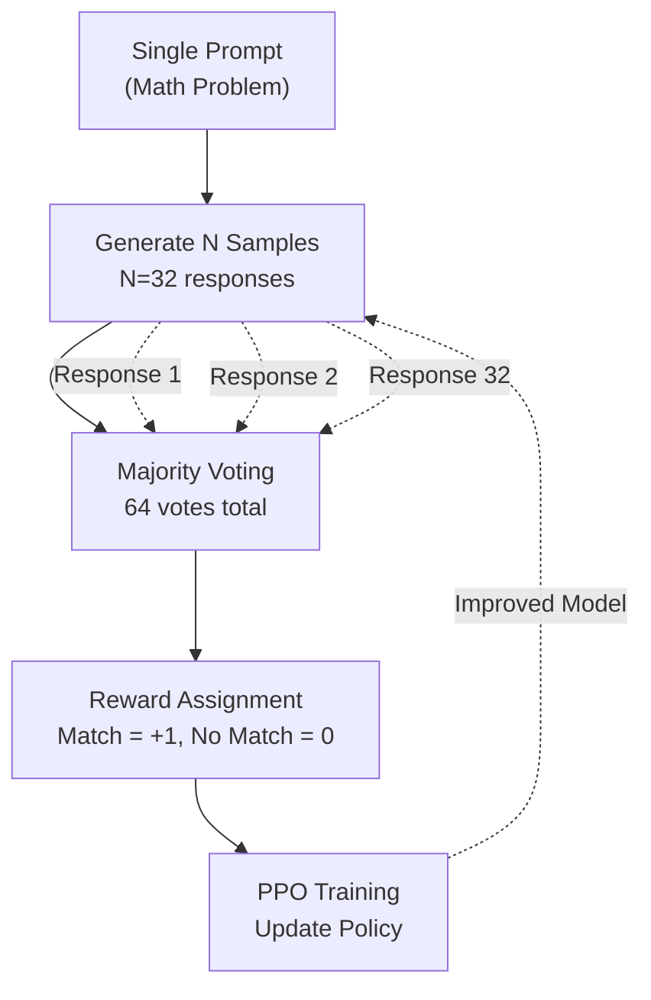
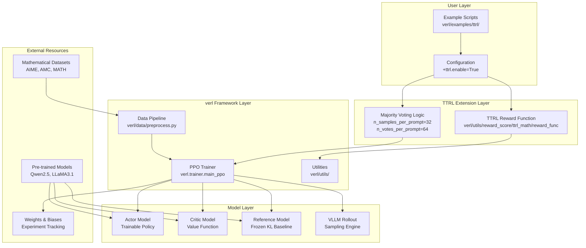
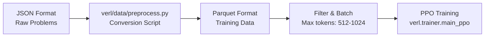
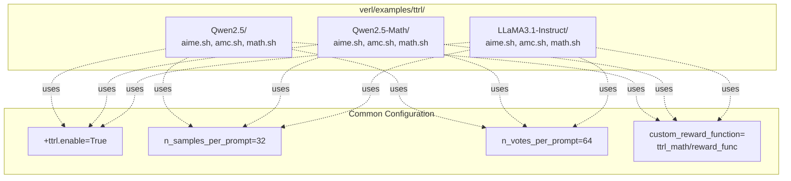
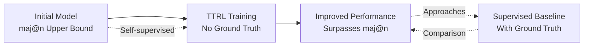
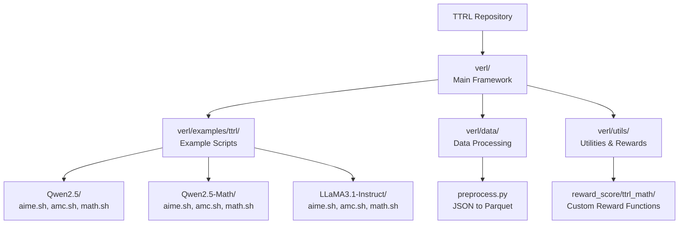

<!-- source: DeepWiki mcp.deepwiki.com · repo PRIME-RL/TTRL · page 1 TTRL System Overview · fetched 2026-10-30 -->

# TTRL System Overview

<details>
<summary>Relevant source files</summary>

The following files were used as context for generating this wiki page:

- [README.md](README.md)
- [figs/overview.png](figs/overview.png)
- [figs/ttrl_reward.png](figs/ttrl_reward.png)

</details>


## Purpose and Scope

This page provides a high-level overview of the TTRL (Test-Time Reinforcement Learning) system, explaining the fundamental problem it solves, its architectural design, and how it integrates with the verl framework. For detailed information about TTRL's core innovation and reward mechanism, see [Core Innovation](#1.1). For architectural details and component interactions, see [System Architecture](#1.2). For experimental results and performance benchmarks, see [Experimental Results](#1.3).

**Sources:** [README.md:1-122]()

---

## The Problem: Reinforcement Learning Without Ground Truth

TTRL addresses a fundamental challenge in reinforcement learning for Large Language Models (LLMs): **how to perform RL training on data without explicit ground-truth labels**, particularly on test data where labels are unavailable by definition.

Traditional reinforcement learning requires explicit reward signals derived from known correct answers. However, for reasoning tasks on test datasets, ground-truth labels are not accessible during inference. This creates a paradox: we want to improve model performance on test data, but we cannot compute conventional rewards to drive learning.

TTRL resolves this by leveraging **majority voting** as a self-supervised reward signal. The insight is that if a model generates multiple responses to the same prompt, the consensus among those responses can serve as a quality indicator, even without knowing the true answer.

| **Traditional RL** | **TTRL** |
|-------------------|----------|
| Requires ground-truth labels | Operates without labels |
| Explicit reward signals | Self-supervised via majority voting |
| Cannot train on test data | Specifically designed for test data |
| Supervised by correct answers | Supervised by consensus |

**Sources:** [README.md:33-36](), [README.md:50-52]()

---

## TTRL Solution Overview

TTRL implements a **self-supervised reinforcement learning** approach using the following core mechanism:



**TTRL Sampling and Voting Workflow**

The system operates in four phases:

1. **Multi-Sample Generation**: For each prompt, generate N=32 different responses using temperature-controlled sampling
2. **Majority Voting**: Aggregate responses using 64 total votes to determine consensus answers
3. **Reward Assignment**: Assign rewards based on whether each sample matches the majority consensus
4. **Policy Update**: Use PPO algorithm to update the model based on these self-supervised rewards

This creates a **bootstrapping effect**: as the model improves, the quality of the majority vote improves, which in turn provides better training signals for further improvement.

**Sources:** [README.md:35-36](), [README.md:95-99]()

---

## System Architecture

TTRL is built as an extension of the **verl framework**, a reinforcement learning library for LLMs. The system can be enabled with a single configuration flag: `+ttrl.enable=True`.



**TTRL System Layers and Integration**

**Sources:** [README.md:28-29](), [README.md:74-84]()

---

## Key Components

### Actor-Critic-Reference Architecture

TTRL employs a four-component model architecture:

| Component | Role | Training Status | Key Configuration |
|-----------|------|----------------|-------------------|
| **Actor** | Policy network that generates responses | Trainable | LR: 5e-7, FSDP enabled |
| **Critic** | Value function estimator | Trainable | LR: 9e-6 (18x faster than Actor) |
| **Reference** | KL divergence baseline | Frozen | CPU offloading for memory efficiency |
| **VLLM Rollout** | High-throughput sampling engine | Inference-only | Temperature: 0.6-1.0, N=32 samples |

### Data Processing Pipeline

The system processes mathematical reasoning tasks through a standardized pipeline:



**Data Conversion and Processing Flow**

**Sources:** [README.md:82]()

### Mathematical Reasoning Tasks

TTRL supports three primary mathematical reasoning benchmarks:

| Dataset | Description | Difficulty Level |
|---------|-------------|------------------|
| **AIME** | American Invitational Mathematics Examination | High (competition-level) |
| **AMC** | American Mathematics Competitions | Medium-High |
| **MATH** | General mathematical reasoning problems | Varied |

**Sources:** [README.md:50](), [README.md:75]()

---

## Enabling TTRL in verl

TTRL is activated through verl's Hydra configuration system. The minimal configuration requires:

```bash
# Basic TTRL activation
+ttrl.enable=True
```

Example scripts are organized by model family:



**Example Script Organization and Configuration**

To run TTRL on AIME 2024 with Qwen2.5:

```bash
bash examples/ttrl/Qwen2.5/aime.sh
```

**Sources:** [README.md:74-79](), [README.md:83]()

---

## Supported Models

TTRL has been validated with three model families:

| Model Family | Size | Specialization | Example Path |
|-------------|------|----------------|--------------|
| **Qwen2.5** | 7B | General-purpose LLM | `verl/examples/ttrl/Qwen2.5/` |
| **Qwen2.5-Math** | 1.5B | Math-specialized model | `verl/examples/ttrl/Qwen2.5-Math/` |
| **LLaMA3.1-Instruct** | 8B | Instruction-tuned model | `verl/examples/ttrl/LLaMA3.1-Instruct/` |

Each model family has dedicated example scripts for all three tasks (AIME, AMC, MATH), totaling 9 example configurations.

**Sources:** [README.md:83]()

---

## Training Configuration Overview

Key hyperparameters shared across TTRL experiments:

| Parameter | Value | Description |
|-----------|-------|-------------|
| `n_samples_per_prompt` | 32 | Number of responses generated per prompt during rollout |
| `n_votes_per_prompt` | 64 | Total votes used for majority voting consensus |
| `actor_lr` | 5e-7 | Learning rate for policy network |
| `critic_lr` | 9e-6 | Learning rate for value network (18x actor) |
| `temperature` | 0.6-1.0 | Sampling temperature (higher for train, lower for validation) |
| `kl_ctrl.kl_coef` | 0.00 | KL divergence penalty coefficient |

For detailed configuration options, see [Configuration Guide](#3) and [Hyperparameter Reference](#3.4).

---

## Performance Highlights

TTRL demonstrates significant performance improvements across multiple benchmarks:

- **211% improvement** on AIME 2024 using Qwen-2.5-Math-7B (`pass@1` metric)
- Consistently **surpasses the initial model's `maj@n` upper bound**
- Approaches the performance of models trained with ground-truth labels
- Verified across 3 independent runs with pass@1 scores of 43.3-46.7



**TTRL Performance Trajectory**

For detailed experimental results and comparison tables, see [Experimental Results](#1.3).

**Sources:** [README.md:50-56](), [README.md:86-88]()

---

## Hardware Requirements

All TTRL experiments reported in the paper were conducted on:

- **8 × NVIDIA A100 80GB GPUs**
- Distributed training using FSDP (Fully Sharded Data Parallel)
- Ray framework for distributed coordination

The system is designed to efficiently utilize GPU memory through:
- Gradient checkpointing
- Parameter offloading (reference model to CPU)
- High-throughput VLLM inference engine (80% GPU memory utilization)

**Sources:** [README.md:88]()

---

## Repository Structure

Key directories and files in the TTRL codebase:



**TTRL Codebase Structure**

**Sources:** [README.md:82-83]()

---

## Next Steps

To get started with TTRL:

1. **Installation**: Follow the setup instructions in [Setup and Installation](#2)
2. **Quick Start**: Run your first TTRL training in [Quick Start](#3.1)
3. **Model Selection**: Choose a model configuration from [Model Configurations](#3.2)
4. **Task Selection**: Configure a task from [Task Configurations](#3.3)
5. **Deep Dive**: Understand the training internals in [Training Pipeline](#4)

For advanced users interested in the underlying verl framework integration, see [verl Framework Integration](#5).

---

**Sources:** [README.md:1-122]()

---

