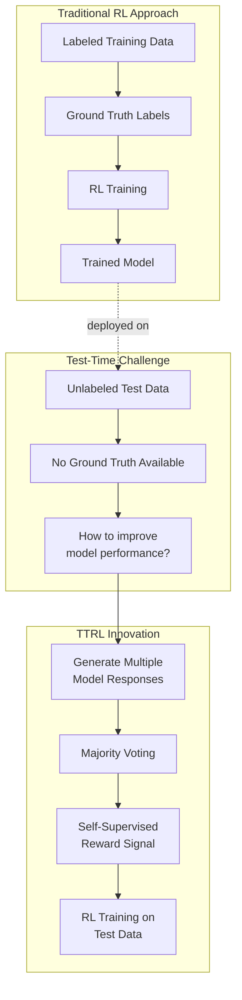
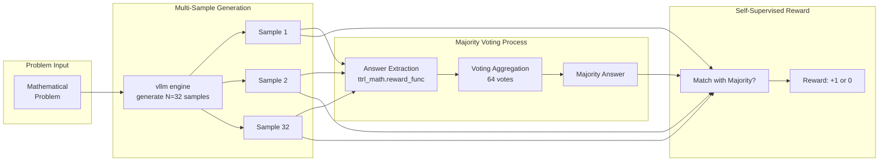
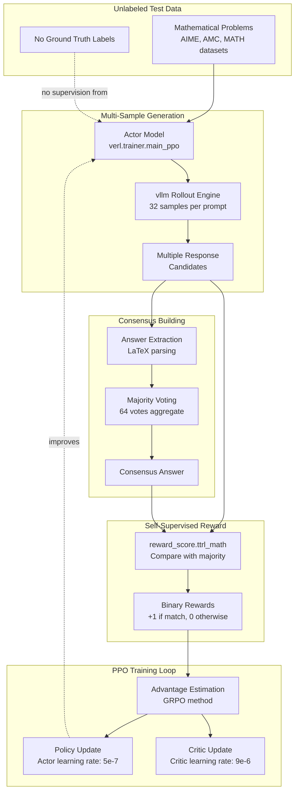
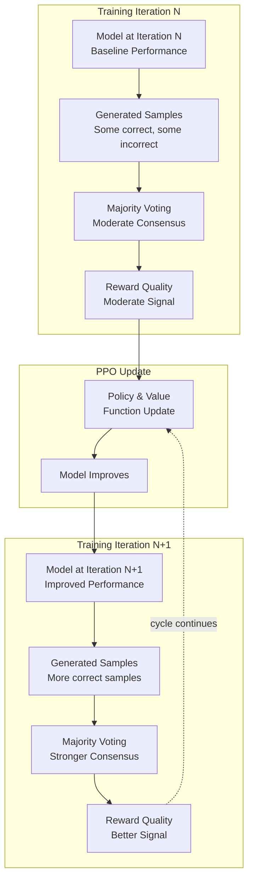

<!-- source: DeepWiki mcp.deepwiki.com · repo PRIME-RL/TTRL · page 1.1 Core Innovation · fetched 2026-10-30 -->

# Core Innovation

Relevant source files

The following files were used as context for generating this wiki page:

- [README.md](README.md)
- [figs/overview.png](figs/overview.png)
- [figs/ttrl_reward.png](figs/ttrl_reward.png)

TTRL (Test-Time Reinforcement Learning) introduces a novel approach to reinforcement learning that operates on unlabeled test data. The core innovation is using majority voting across multiple model responses as a self-supervised reward signal, eliminating the need for ground truth labels during training.

This page explains the fundamental problem TTRL addresses, the key insight behind the solution, and how this innovation enables effective RL training without explicit supervision. For implementation details of the voting mechanism, see [TTRL Voting and Sampling](#4.3). For the overall system architecture, see [System Architecture](#1.2).

## The Fundamental Challenge

Traditional reinforcement learning requires explicit reward signals to train agents. In supervised settings, these rewards come from ground truth labels that indicate whether a model's response is correct. However, this creates a critical limitation: RL cannot be applied to unlabeled data, particularly test data where ground truth is unavailable.

### Problem Statement

| Aspect | Traditional RL | Test-Time Setting |
|--------|---------------|-------------------|
| **Data Source** | Labeled training data | Unlabeled test data |
| **Reward Signal** | Ground truth labels | None available |
| **Training Feasibility** | Possible | Previously infeasible |
| **Adaptation** | Fixed after training | Cannot adapt to new data |

This limitation is particularly problematic for mathematical reasoning tasks, where test data often differs significantly from training distributions. Models that perform well on training data may struggle with out-of-distribution test problems, but traditional RL offers no mechanism to improve on unlabeled test data.

**The Test-Time RL Challenge and TTRL's Solution**

Sources: [README.md:35-36](), [README.md:31]()

## TTRL's Solution: Majority Voting as Self-Supervision

TTRL's key insight is that Test-Time Scaling (TTS) practices, particularly majority voting, can serve as effective reward signals for RL training. When a model generates multiple responses to the same problem, the consensus among these responses provides a reliable proxy for correctness, even without ground truth labels.

### The Core Insight

For mathematical reasoning tasks, correct solutions tend to cluster around the true answer, while incorrect attempts scatter across different wrong answers. By generating multiple samples and identifying the majority consensus, TTRL creates a self-supervised signal that correlates strongly with correctness.

| Component | Traditional RL | TTRL |
|-----------|---------------|------|
| **Reward Source** | External ground truth | Internal consensus (majority voting) |
| **Sample Strategy** | Single response | Multiple responses (`n_samples_per_prompt=32`) |
| **Voting Mechanism** | N/A | `n_votes_per_prompt=64` |
| **Supervision Type** | Fully supervised | Self-supervised |
| **Label Requirement** | Ground truth required | No labels needed |

**TTRL Majority Voting Workflow**

Sources: [README.md:36-37](), [verl/utils/reward_score/ttrl_math/]()

### Connection to Test-Time Scaling

TTRL leverages established TTS practices where generating multiple samples and selecting via majority voting (`maj@n`) improves accuracy on reasoning tasks. However, TTRL goes beyond static voting by using these voting patterns as training signals, creating a dynamic system where the model actively learns from its own consensus patterns.

Sources: [README.md:36]()

## How TTRL Works: High-Level Flow

TTRL operates through a feedback loop where the model generates multiple responses, votes determine consensus, and rewards drive policy improvement. This process requires no external supervision beyond the unlabeled test problems themselves.

### System Overview

**TTRL Training Flow from Unlabeled Data to Policy Updates**

Sources: [verl/trainer/main_ppo.py](), [verl/utils/reward_score/ttrl_math/](), [examples/ttrl/]()

### Key Configuration Parameters

The TTRL system is enabled and configured through specific parameters that control the voting mechanism:

| Parameter | Default Value | Configuration Location | Purpose |
|-----------|--------------|----------------------|---------|
| `ttrl.enable` | `True` | Command-line flag: `+ttrl.enable=True` | Activates TTRL mode in verl framework |
| `n_samples_per_prompt` | 32 | Training script arguments | Number of responses generated per problem |
| `n_votes_per_prompt` | 64 | Training script arguments | Voting iterations for reward estimation |
| `custom_reward_function` | `ttrl_math` | `ppo_trainer_ttrl.yaml` | Reward function for mathematical reasoning |
| `temperature` | 0.6-1.0 | VLLM configuration | Controls response diversity |

Sources: [README.md:28](), [examples/ttrl/Qwen2.5/aime.sh](), [examples/ttrl/Qwen2.5-Math/aime.sh](), [examples/ttrl/LLaMA3.1-Instruct/aime.sh]()

## The Bootstrapping Effect

A critical property of TTRL is its self-reinforcing improvement cycle. As the model becomes better at solving problems, the quality of majority voting improves, which in turn provides better training signals, leading to further improvement.

### Self-Improvement Cycle

**TTRL Self-Reinforcing Improvement Cycle**

### Surpassing Initial Performance Bounds

A remarkable property of TTRL is that it consistently surpasses the initial model's `maj@n` performance, even though `maj@n` serves as the only source of supervision. This demonstrates that the bootstrapping effect creates a virtuous cycle where improved voting quality enables learning beyond the initial baseline.

| Benchmark | Initial `maj@n` | TTRL Final `pass@1` | Relationship |
|-----------|----------------|---------------------|--------------|
| AIME 2024 | Initial baseline | 211% improvement | Exceeds initial `maj@n` |
| Performance ceiling | `maj@n` upper bound | Consistently surpassed | Breaks initial constraint |
| Supervised comparison | N/A (no labels) | Approaches supervised performance | Closes gap without labels |

This property distinguishes TTRL from static test-time scaling: rather than being limited by the initial model's voting accuracy, TTRL actively improves the model, which improves voting quality, enabling further improvement.

Sources: [README.md:52-53]()

## Reward Signal Properties

The majority voting approach generates reward signals with specific mathematical properties that make them suitable for reinforcement learning:

### Signal Characteristics

1. **Consistency**: Responses that match the majority vote receive positive rewards
2. **Confidence Weighting**: Stronger majority consensus produces higher reward magnitudes  
3. **Differentiability**: Rewards provide clear gradients for policy optimization
4. **Noise Resistance**: Multiple voting iterations reduce random fluctuations

### Mathematical Reasoning Alignment

The reward mechanism is specifically designed for mathematical reasoning tasks where:

- Correct answers tend to cluster around the true solution
- Multiple solution paths can lead to the same answer
- Majority voting effectively filters out incorrect reasoning patterns
- Answer extraction can be performed reliably for mathematical expressions

Sources: [README.md:52-55]()

## Configuration and Customization

The reward mechanism supports various configuration options through the training pipeline:

### Key Parameters

- **Sample Count**: Controlled via `N_SAMPLES_PER_PROMPT` in generation settings
- **Vote Count**: Configured through `N_VOTES_PER_PROMPT` parameter  
- **Temperature Settings**: Adjusted for diversity vs. consistency trade-offs
- **Answer Extraction**: Customizable for different mathematical formats

### Integration Points

The reward mechanism integrates with:

- **VLLM Engine**: For high-throughput sample generation
- **PPO Algorithm**: For policy and value function updates  
- **WandB Logging**: For reward signal monitoring and analysis
- **FSDP Training**: For distributed computation of rewards

Sources: Configuration parameters from shell scripts and YAML files

---

