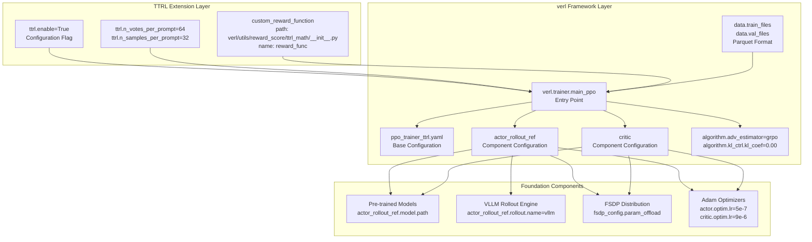
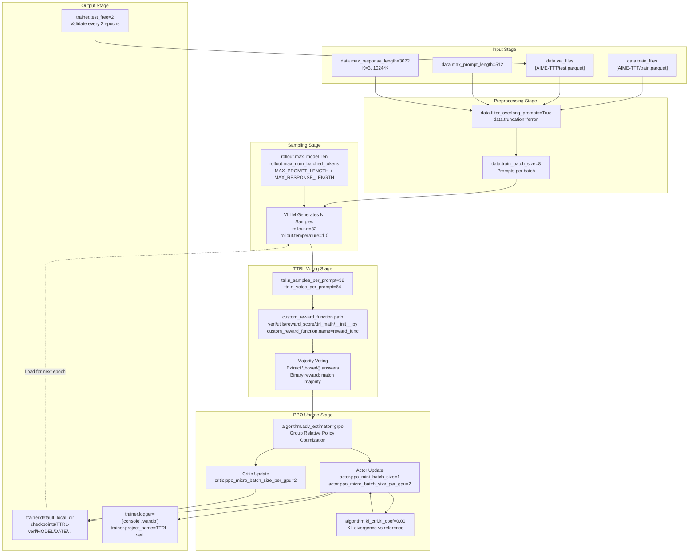
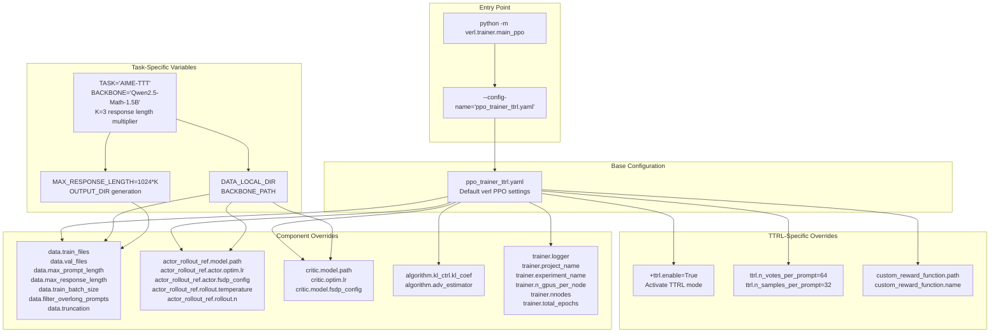
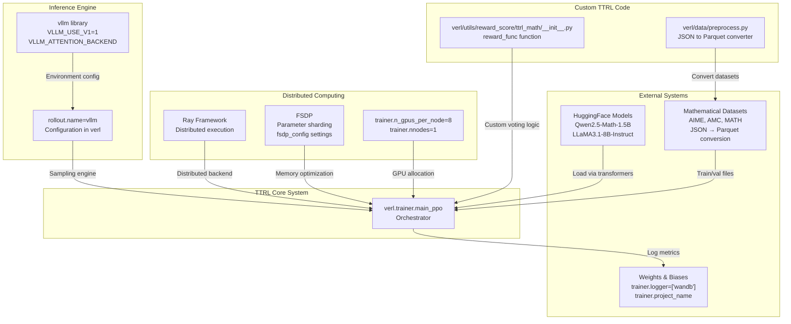

<!-- source: DeepWiki mcp.deepwiki.com · repo PRIME-RL/TTRL · page 1.2 System Architecture · fetched 2026-10-30 -->

# System Architecture

Relevant source files

The following files were used as context for generating this wiki page:

- [README.md](README.md)
- [figs/overview.png](figs/overview.png)
- [figs/ttrl_reward.png](figs/ttrl_reward.png)
- [verl/examples/ttrl/Qwen2.5-Math/aime.sh](verl/examples/ttrl/Qwen2.5-Math/aime.sh)

## Purpose and Scope

This page details the overall architecture of TTRL (Test-Time Reinforcement Learning), including its layered design, component interactions, and data flow. TTRL is built as a modular extension to the verl reinforcement learning framework, adding self-supervised reward estimation capabilities via majority voting.

For information about TTRL's core innovation and reward mechanism, see [Core Innovation](#1.1). For training pipeline internals, see [Training Pipeline](#4). For verl framework integration details, see [verl Framework Integration](#5).

---

## Layered Architecture

TTRL follows a three-layer architectural pattern:

**Diagram 1: Three-Layer Architecture of TTRL**

| Layer | Purpose | Key Configuration |
|-------|---------|-------------------|
| **TTRL Extension** | Self-supervised reward via voting | `+ttrl.enable=True`, voting parameters, custom reward function |
| **verl Framework** | PPO training infrastructure | `ppo_trainer_ttrl.yaml`, component orchestration, data pipeline |
| **Foundation** | Model loading, inference, distribution | Pre-trained models, VLLM, FSDP, optimizers |

The TTRL extension layer is enabled via Hydra configuration overrides and does not modify the verl core. This modular design allows TTRL to be toggled with a single flag while preserving all verl functionality.

**Sources:** [verl/examples/ttrl/Qwen2.5-Math/aime.sh:42-103](), [README.md:28-29]()

---

## Four-Component Model Architecture

TTRL employs a four-component architecture managed by the verl PPO trainer:

```mermaid
graph TB
    subgraph Shared["Shared Backbone"]
        Backbone["Pre-trained Model<br/>Qwen2.5-Math-1.5B<br/>actor_rollout_ref.model.path"]
    end
    
    subgraph ActorSystem["Actor System"]
        Actor["Actor Model<br/>Trainable Policy"]
        ActorFSDP["actor.fsdp_config<br/>param_offload=False<br/>optimizer_offload=False"]
        ActorOpt["actor.optim<br/>lr=5e-7<br/>lr_warmup_steps_ratio=0.03<br/>warmup_style='cosine'"]
        ActorBatch["actor.ppo_mini_batch_size=1<br/>actor.ppo_micro_batch_size_per_gpu=2"]
        ActorKL["actor.use_kl_loss=True"]
    end
    
    subgraph CriticSystem["Critic System"]
        Critic["Critic Model<br/>Value Function"]
        CriticFSDP["critic.model.fsdp_config<br/>param_offload=False<br/>optimizer_offload=False"]
        CriticOpt["critic.optim<br/>lr=9e-6<br/>18x faster than actor"]
        CriticBatch["critic.ppo_micro_batch_size_per_gpu=2"]
    end
    
    subgraph RefSystem["Reference System"]
        Ref["Reference Model<br/>Frozen Policy"]
        RefFSDP["ref.fsdp_config<br/>param_offload=True<br/>CPU offloading"]
        RefLogProb["ref.log_prob_micro_batch_size_per_gpu=2<br/>Computes log probabilities only"]
    end
    
    subgraph RolloutSystem["Rollout System"]
        VLLM["VLLM Engine<br/>rollout.name=vllm<br/>VLLM_USE_V1=1"]
        VLLMConfig["rollout.temperature=1.0<br/>rollout.n=32<br/>rollout.gpu_memory_utilization=0.8<br/>rollout.max_model_len"]
        VLLMVal["rollout.val_kwargs<br/>temperature=0.6<br/>n=16<br/>top_p=0.95"]
    end
    
    Backbone -->|"initialize"| Actor
    Backbone -->|"initialize"| Critic
    Backbone -->|"initialize"| Ref
    Backbone -->|"load into"| VLLM
    
    Actor --> ActorFSDP
    Actor --> ActorOpt
    Actor --> ActorBatch
    Actor --> ActorKL
    
    Critic --> CriticFSDP
    Critic --> CriticOpt
    Critic --> CriticBatch
    
    Ref --> RefFSDP
    Ref --> RefLogProb
    
    VLLM --> VLLMConfig
    VLLM --> VLLMVal
```

**Diagram 2: Four-Component Model System with Configuration Parameters**

### Actor (Policy Network)

The actor is the trainable policy network that generates responses. It uses:
- **Conservative learning rate**: `5e-7` to prevent policy collapse
- **Warmup**: 3% of steps with cosine schedule for stability
- **No FSDP offloading**: Parameters and optimizer states remain on GPU for fast updates
- **Gradient checkpointing**: `enable_gradient_checkpointing=True` reduces memory
- **Remove padding**: `use_remove_padding=True` for efficiency
- **KL loss**: `use_kl_loss=True` to constrain divergence from reference

### Critic (Value Function)

The critic estimates state values for advantage computation. It uses:
- **18x faster learning rate**: `9e-6` vs actor's `5e-7` to track policy changes
- **Shared configuration**: Same FSDP, gradient checkpointing, and batching settings as actor
- **Same backbone**: Initialized from the same pre-trained model

### Reference (KL Baseline)

The reference model provides a frozen policy for KL divergence penalties:
- **CPU offloading**: `param_offload=True` saves GPU memory
- **Frozen weights**: No gradient computation or updates
- **Log probability only**: Computes reference log-probs for KL penalty

### Rollout (VLLM Sampling Engine)

VLLM performs high-throughput inference for generating multiple samples:
- **VLLM v1**: Set via `VLLM_USE_V1=1` environment variable
- **Training sampling**: `temperature=1.0`, `n=32` samples per prompt
- **Validation sampling**: `temperature=0.6`, `n=16`, `top_p=0.95` for less variance
- **Memory utilization**: `0.8` to leave headroom for other operations
- **Tensor parallelism**: `tensor_model_parallel_size=1` (single GPU per instance)

**Sources:** [verl/examples/ttrl/Qwen2.5-Math/aime.sh:51-78](), [verl/examples/ttrl/Qwen2.5-Math/aime.sh:79-86]()

---

## Data Flow Pipeline

**Diagram 3: Complete Data Flow Through TTRL Training Pipeline**

### Pipeline Stages

| Stage | Key Parameters | Purpose |
|-------|----------------|---------|
| **Input** | `train_files`, `val_files`, `max_prompt_length`, `max_response_length` | Load and configure data files |
| **Preprocessing** | `filter_overlong_prompts=True`, `truncation='error'`, `train_batch_size=8` | Filter and batch prompts |
| **Sampling** | `rollout.n=32`, `temperature=1.0`, `max_model_len` | Generate multiple responses per prompt via VLLM |
| **Voting** | `n_votes_per_prompt=64`, `n_samples_per_prompt=32`, `reward_func` | Apply majority voting to create self-supervised rewards |
| **PPO Update** | `adv_estimator=grpo`, mini/micro batch sizes, `kl_coef=0.00` | Update actor and critic via PPO |
| **Output** | `default_local_dir`, `logger`, `test_freq=2` | Save checkpoints and log metrics |

The pipeline is iterative: after each epoch, updated actor weights are loaded back into VLLM for the next sampling round, creating a bootstrapping effect where improved policies generate better consensus signals.

**Sources:** [verl/examples/ttrl/Qwen2.5-Math/aime.sh:44-50](), [verl/examples/ttrl/Qwen2.5-Math/aime.sh:15-22](), [verl/examples/ttrl/Qwen2.5-Math/aime.sh:66-78](), [verl/examples/ttrl/Qwen2.5-Math/aime.sh:88-92]()

---

## Configuration System

TTRL uses Hydra for hierarchical configuration management:

**Diagram 4: Hydra Configuration System with Override Hierarchy**

### Configuration Layers

1. **Base YAML**: `ppo_trainer_ttrl.yaml` provides default verl PPO settings
2. **TTRL Overrides**: Three key additions activate TTRL:
   - `+ttrl.enable=True` (note the `+` prefix for new config groups)
   - `ttrl.n_votes_per_prompt` and `ttrl.n_samples_per_prompt`
   - `custom_reward_function.path` and `name`
3. **Component Overrides**: Fine-tune actor, critic, rollout, and algorithm settings
4. **Task Variables**: Bash script variables for model/task-specific paths and hyperparameters

The configuration is applied via command-line overrides to `verl.trainer.main_ppo`, allowing maximum flexibility without modifying base configuration files.

**Sources:** [verl/examples/ttrl/Qwen2.5-Math/aime.sh:42-103](), [verl/examples/ttrl/Qwen2.5-Math/aime.sh:8-40]()

---

## Integration Points

**Diagram 5: External Integration Points and Dependencies**

### Key Integration Points

| System | Integration Method | Configuration |
|--------|-------------------|---------------|
| **Pre-trained Models** | HuggingFace Transformers | `actor_rollout_ref.model.path`, `critic.model.path` |
| **Datasets** | Parquet files via `datasets` library | `data.train_files`, `data.val_files` |
| **VLLM** | Environment variables + verl config | `VLLM_USE_V1=1`, `rollout.name=vllm` |
| **Ray** | Automatic distributed backend | Implicit via verl, controlled by `trainer.n_gpus_per_node` |
| **FSDP** | PyTorch native | `fsdp_config.param_offload`, `fsdp_config.optimizer_offload` |
| **WandB** | Logger configuration | `trainer.logger=['console','wandb']`, `trainer.project_name` |
| **Custom Reward** | Python module path | `custom_reward_function.path`, `custom_reward_function.name` |

### Environment Variables

TTRL requires specific environment variables for VLLM configuration:

- `VLLM_USE_V1=1`: Enables VLLM v1 API
- `VLLM_ATTENTION_BACKEND`: Set to `XFORMERS` or unset depending on attention implementation

These are typically set at the beginning of training scripts before invoking `main_ppo`.

**Sources:** [verl/examples/ttrl/Qwen2.5-Math/aime.sh:2-4](), [verl/examples/ttrl/Qwen2.5-Math/aime.sh:31-32](), [verl/examples/ttrl/Qwen2.5-Math/aime.sh:88-95](), [README.md:82-84]()

---

## Summary

TTRL's architecture is characterized by:

1. **Modular Extension**: TTRL extends verl via configuration flags without modifying core framework code
2. **Four-Component System**: Actor, Critic, Reference, and Rollout (VLLM) serve distinct roles with different optimization strategies
3. **Self-Supervised Pipeline**: Data flows from datasets → VLLM sampling → majority voting → PPO updates → checkpoints in an iterative loop
4. **Hierarchical Configuration**: Hydra manages base configs and overrides, enabling flexible experimentation
5. **Rich Integration**: Connects to HuggingFace models, VLLM inference engine, Ray distribution, FSDP memory optimization, and WandB logging

The architecture balances **performance** (VLLM for sampling, conservative actor learning rates), **scalability** (FSDP, multi-GPU), and **modularity** (clean separation between verl base and TTRL extension).

**Sources:** [README.md:28-29](), [README.md:82-84](), [verl/examples/ttrl/Qwen2.5-Math/aime.sh:1-105]()

---

