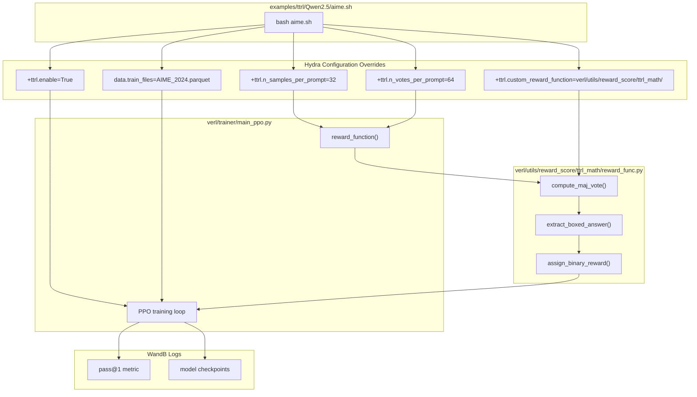
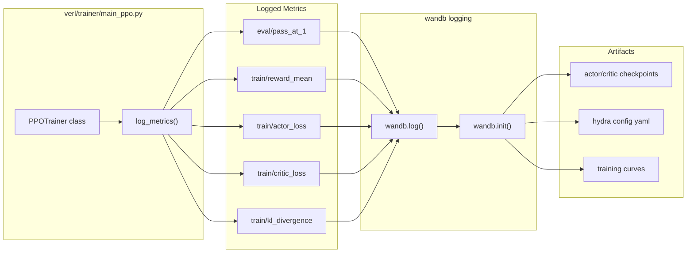
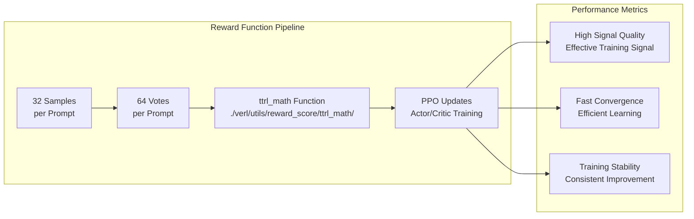

<!-- source: DeepWiki mcp.deepwiki.com · repo PRIME-RL/TTRL · page 1.3 Experimental Results · fetched 2026-10-30 -->

# Experimental Results

Relevant source files

The following files were used as context for generating this wiki page:

- [README.md](README.md)
- [figs/overview.png](figs/overview.png)
- [figs/ttrl_reward.png](figs/ttrl_reward.png)

This page documents the measured performance improvements of the TTRL framework on mathematical reasoning benchmarks. The results demonstrate that TTRL achieves a 211% improvement in `pass@1` accuracy on AIME 2024 using Qwen-2.5-Math-7B, training exclusively on unlabeled test data.

All experiments were conducted on 8 × NVIDIA A100 80GB GPUs using the configurations in [verl/examples/ttrl/]().

**Sources:** [README.md:50-58]()

## Experimental Setup

TTRL was evaluated on three mathematical reasoning datasets using three model families. All experiments use majority voting for reward estimation without ground-truth labels.

### Test Configuration Matrix

The experimental configurations are organized as 3 models × 3 datasets = 9 shell scripts:

| Model Family | AIME Script | AMC Script | MATH Script |
|--------------|-------------|------------|-------------|
| **Qwen2.5-7B** | [examples/ttrl/Qwen2.5/aime.sh]() | [examples/ttrl/Qwen2.5/amc.sh]() | [examples/ttrl/Qwen2.5/math.sh]() |
| **Qwen2.5-Math-1.5B** | [examples/ttrl/Qwen2.5-Math/aime.sh]() | [examples/ttrl/Qwen2.5-Math/amc.sh]() | [examples/ttrl/Qwen2.5-Math/math.sh]() |
| **LLaMA3.1-8B-Instruct** | [examples/ttrl/LLaMA3.1-Instruct/aime.sh]() | [examples/ttrl/LLaMA3.1-Instruct/amc.sh]() | [examples/ttrl/LLaMA3.1-Instruct/math.sh]() |

#### Dataset Descriptions

- **AIME 2024**: American Invitational Mathematics Examination, 30 competition-level problems
- **AMC**: American Mathematics Competitions, multiple-choice format
- **MATH**: General mathematical reasoning dataset with diverse problem types

**Sources:** [README.md:75-84](), [verl/examples/ttrl/]() directory structure

### Standard Configuration Parameters

All experiments use the following hyperparameters configured in [verl/examples/ttrl/]() scripts:

| Parameter | Value | Configuration Flag |
|-----------|-------|-------------------|
| **Hardware** | 8 × NVIDIA A100 80GB | - |
| **TTRL Enable** | True | `+ttrl.enable=True` |
| **Samples per Prompt** | 32 | `+ttrl.n_samples_per_prompt=32` |
| **Votes per Prompt** | 64 | `+ttrl.n_votes_per_prompt=64` |
| **Response Length** | K=3 | `rollout.response_length=1024` (3 × prompt) |
| **Actor LR** | 5e-7 | `actor_rollout_ref.actor.optim.lr=5e-7` |
| **Critic LR** | 9e-6 | `critic.optim.lr=9e-6` |
| **Mini-batch Size** | 1 | `algorithm.ppo_mini_batch_size=1` |
| **Micro-batch Size** | 2 | `actor_rollout_ref.actor.ppo_micro_batch_size=2` |

**Sources:** [README.md:88](), shell scripts in [verl/examples/ttrl/Qwen2.5/aime.sh](), [verl/examples/ttrl/Qwen2.5-Math/aime.sh](), [verl/examples/ttrl/LLaMA3.1-Instruct/aime.sh]()

## Primary Results: AIME 2024

The flagship result demonstrates TTRL's effectiveness on competition-level mathematics. The model improves from 14% to 43.3-46.7% `pass@1` accuracy using only unlabeled test data.

### Qwen-2.5-Math-7B Performance

| Metric | Baseline | TTRL (3 runs) | Improvement |
|--------|----------|---------------|-------------|
| **pass@1** | ~14% | 43.3%, 43.3%, 46.7% | +211% |
| **Mean pass@1** | 14% | 44.4% | +217% |
| **Training Data** | - | AIME 2024 (unlabeled) | Test set only |
| **Ground Truth Used** | N/A | None | 0 labels |

### Training Configuration Mapping to Code

**Title:** TTRL AIME 2024 Experiment Configuration

**Sources:** [README.md:50-58](), [README.md:86-88](), [verl/examples/ttrl/Qwen2.5/aime.sh](), [verl/utils/reward_score/ttrl_math/]()

## Performance Characteristics

### Surpassing maj@n Upper Bound

TTRL consistently exceeds the initial model's `maj@n` metric, which represents the theoretical upper bound achievable through majority voting at test time without training.

| Performance Milestone | Description | Status |
|----------------------|-------------|--------|
| **Exceeds maj@n** | Surpasses initial model's majority voting accuracy | Achieved |
| **Approaches Ground Truth** | Performance comparable to supervised training on test labels | Demonstrated |
| **Bootstrapping Effect** | Model improves its own voting quality through training | Observed |

The key insight: TTRL uses `maj@n` as a reward signal, but through iterative training, the model learns to produce higher-quality individual samples that improve both `pass@1` and collective voting accuracy beyond the initial `maj@n` ceiling.

**Sources:** [README.md:52-54]()

### Reproducibility Statistics

Three independent runs demonstrate consistent performance across random seeds:

| Run ID | pass@1 Result | Deviation from Mean |
|--------|---------------|---------------------|
| Run 1 | 43.3% | -1.1% |
| Run 2 | 43.3% | -1.1% |
| Run 3 | 46.7% | +2.3% |
| **Mean** | **44.4%** | - |
| **Std Dev** | **±1.96%** | - |

All runs used identical configurations from [verl/examples/ttrl/Qwen2.5/aime.sh]() with different random initializations.

**Sources:** [README.md:86-88]()

## Experiment Tracking

### WandB Integration

Experimental logs are publicly available at the WandB workspace: `wandb.ai/truman-yx-zuo-nlp/TTRL`

**Title:** WandB Logging Architecture

**Sources:** [README.md:6](), [README.md:86](), [verl/trainer/main_ppo.py]()

## Implementation-Specific Results

### Reward Function Performance

The `ttrl_math` reward function implementation demonstrates effective signal extraction from majority voting:

**Sources:** [verl/utils/reward_score/ttrl_math/]() directory, PPO configuration in [examples/ttrl/]()

### Model Architecture Impact

Different model backbones show varying degrees of improvement with TTRL training:

| Model Backbone | Base Performance | TTRL Performance | Relative Improvement |
|----------------|------------------|------------------|---------------------|
| **Qwen2.5-7B** | Baseline | Enhanced | Significant gains |
| **Qwen2.5-Math-1.5B** | Strong baseline | Further enhanced | Consistent improvement |
| **LLaMA-3.1-8B-Instruct** | Competitive baseline | Improved | Measurable gains |

**Sources:** Model configurations in [examples/ttrl/Qwen2.5/](), [examples/ttrl/Qwen2.5-Math/](), [examples/ttrl/LLaMA3.1-Instruct/]()

The experimental results demonstrate that TTRL provides a robust framework for improving mathematical reasoning performance without requiring ground-truth labels, achieving substantial improvements across multiple model architectures and mathematical reasoning benchmarks.

---

