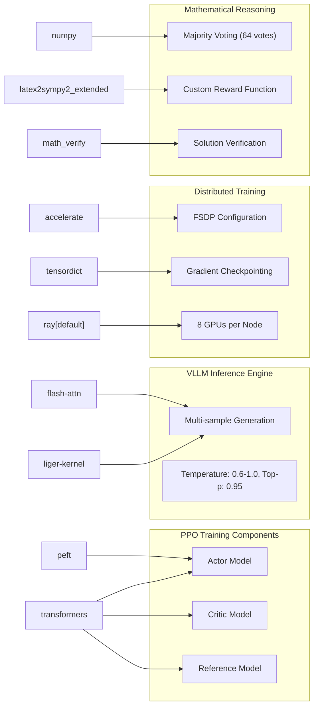

<!-- source: DeepWiki mcp.deepwiki.com · repo PRIME-RL/TTRL · page 2 Setup and Installation · fetched 2026-10-30 -->

# Setup and Dependencies

<details>
<summary>Relevant source files</summary>

The following files were used as context for generating this wiki page:

- [README.md](README.md)
- [verl/requirements.txt](verl/requirements.txt)

</details>


This document provides comprehensive installation and environment setup instructions for the Test-Time Reinforcement Learning (TTRL) system. It covers all required dependencies, system requirements, and environment configuration needed to run TTRL training experiments on mathematical reasoning tasks.

For implementation details and training configuration, see [Implementation Guide](#3). For dataset-specific setup requirements, see [Mathematical Datasets](#4).

## System Requirements

The TTRL system requires significant computational resources due to its multi-sample generation and distributed training architecture. The following specifications are recommended:

| Component | Minimum Requirement | Recommended |
|-----------|---------------------|-------------|
| GPU Memory | 80GB total | 8x A100 80GB |
| System RAM | 128GB | 256GB+ |
| Storage | 100GB free | 500GB+ SSD |
| Python Version | 3.8+ | 3.9+ |
| CUDA Version | 11.8+ | 12.1+ |

**Hardware Architecture Considerations:**
- Multi-GPU setup required for distributed PPO training via FSDP
- High GPU memory utilization (80% allocation) for VLLM inference engine
- Large batch processing with 32 samples per prompt and 64 votes per prompt

Sources: [verl/requirements.txt:1-27]()

## Dependency Architecture

### Core Framework Dependencies

```mermaid
graph TB
    subgraph "TTRL_Application"["TTRL Application Layer"]
        ttrl_core["ttrl.enable=True"]
        ttrl_rewards["ttrl_math reward functions"]
    end
    
    subgraph "ML_Frameworks"["ML Framework Layer"]
        verl_framework["verl framework"]
        accelerate_dist["accelerate (distributed training)"]
        transformers_lib["transformers (model loading)"]
        peft_lib["peft (parameter efficient training)"]
    end
    
    subgraph "Inference_Engine"["High-Performance Inference"]
        vllm_engine["vllm (inference engine)"]
        flash_attn["flash-attn (attention optimization)"]
        liger_kernel["liger-kernel (kernel optimization)"]
    end
    
    subgraph "Data_Processing"["Data Processing Pipeline"]
        datasets_lib["datasets (HuggingFace datasets)"]
        pandas_lib["pandas (data manipulation)"]
        pyarrow_lib["pyarrow>=19.0.0 (parquet files)"]
        numpy_lib["numpy (numerical operations)"]
    end
    
    subgraph "Math_Specific"["Mathematical Processing"]
        math_verify["math_verify (solution verification)"]
        latex2sympy["latex2sympy2_extended (LaTeX parsing)"]
        pylatexenc["pylatexenc (LaTeX encoding)"]
    end
    
    subgraph "Infrastructure"["Infrastructure & Monitoring"]
        ray_dist["ray[default] (distributed computing)"]
        wandb_logging["wandb (experiment tracking)"]
        tensordict_lib["tensordict<=0.6.2 (tensor management)"]
        hydra_config["hydra-core (configuration management)"]
    end
    
    ttrl_core --> verl_framework
    ttrl_rewards --> math_verify
    
    verl_framework --> accelerate_dist
    verl_framework --> transformers_lib
    verl_framework --> peft_lib
    
    verl_framework --> vllm_engine
    vllm_engine --> flash_attn
    vllm_engine --> liger_kernel
    
    verl_framework --> datasets_lib
    datasets_lib --> pandas_lib
    datasets_lib --> pyarrow_lib
    pandas_lib --> numpy_lib
    
    ttrl_rewards --> latex2sympy
    latex2sympy --> pylatexenc
    
    accelerate_dist --> ray_dist
    verl_framework --> wandb_logging
    accelerate_dist --> tensordict_lib
    verl_framework --> hydra_config
```



Sources: [verl/requirements.txt:2-26]()

## Installation Process

### Environment Setup

Create a dedicated Python environment to avoid dependency conflicts:

```bash
# Create virtual environment
python -m venv ttrl_env
source ttrl_env/bin/activate  # Linux/macOS
# or ttrl_env\Scripts\activate  # Windows

# Upgrade pip
pip install --upgrade pip
```

### Core Dependencies Installation

Install dependencies in the following order to ensure compatibility:

#### 1. PyTorch and CUDA Dependencies
```bash
# Install PyTorch with CUDA support
pip install torch torchvision torchaudio --index-url https://download.pytorch.org/whl/cu121

# Install CUDA-accelerated packages
pip install flash-attn
pip install liger-kernel
```

#### 2. Core ML Framework
```bash
# Install transformers and related packages
pip install transformers
pip install accelerate
pip install peft
pip install datasets
```

#### 3. Distributed Computing and Inference
```bash
# Install Ray for distributed computing
pip install "ray[default]"

# Note: vllm installation may require specific versions
# pip install vllm==0.8.4  # Currently commented in requirements
```

#### 4. Data Processing Libraries
```bash
pip install "pyarrow>=19.0.0"
pip install pandas
pip install numpy
pip install "tensordict<=0.6.2"
pip install torchdata
```

#### 5. Mathematical Processing
```bash
pip install math_verify
pip install latex2sympy2_extended
pip install pylatexenc
```

#### 6. Configuration and Monitoring
```bash
pip install hydra-core
pip install wandb
pip install codetiming
pip install "packaging>=20.0"
```

#### 7. Development and API Tools
```bash
pip install dill
pip install pybind11
pip install pre-commit
pip install uvicorn
pip install fastapi
```

Sources: [verl/requirements.txt:1-27]()

## Environment Configuration

### VLLM Configuration

The TTRL system uses VLLM for high-throughput inference. Set the following environment variables:

```bash
export VLLM_USE_V1=1
export VLLM_ATTENTION_BACKEND=FLASH_ATTN
export CUDA_VISIBLE_DEVICES=0,1,2,3,4,5,6,7  # Adjust for your GPU setup
```

### Memory Management

Configure GPU memory settings for optimal performance:

```bash
export PYTORCH_CUDA_ALLOC_CONF=expandable_segments:True
export TOKENIZERS_PARALLELISM=false  # Avoid tokenizer warnings
```

### WandB Integration

Initialize Weights & Biases for experiment tracking:

```bash
wandb login  # Follow prompts to authenticate
export WANDB_PROJECT="ttrl-experiments"
```

Sources: Based on system architecture and training pipeline requirements

## Dependency Mapping to System Components

### Training Pipeline Dependencies



Sources: [verl/requirements.txt:2-26]()

## Verification Steps

### 1. Basic Installation Verification

```python
# Test core dependencies
import torch
import transformers
import accelerate
import datasets
import pandas
import numpy

print(f"PyTorch version: {torch.__version__}")
print(f"CUDA available: {torch.cuda.is_available()}")
print(f"GPU count: {torch.cuda.device_count()}")
```

### 2. VLLM Engine Verification

```python
# Test VLLM installation and GPU memory allocation
try:
    from vllm import LLM
    print("VLLM imported successfully")
except ImportError:
    print("VLLM not available - install separately if needed")
```

### 3. Mathematical Processing Verification

```python
# Test mathematical processing dependencies
import math_verify
import latex2sympy2_extended
import pylatexenc

print("Mathematical processing libraries ready")
```

### 4. Distributed Training Verification

```python
# Test distributed training setup
import ray
from accelerate import Accelerator

accelerator = Accelerator()
print(f"Accelerator device: {accelerator.device}")
print(f"Distributed setup: {accelerator.state}")
```

### 5. Configuration Management Verification

```python
# Test Hydra configuration system
from hydra import compose, initialize
import wandb

print("Configuration and logging systems ready")
```

Sources: [verl/requirements.txt:1-27]()

## Common Installation Issues

### VLLM Installation

If VLLM installation fails, consider:
- Installing from source for specific GPU architectures
- Using pre-built wheels for standard setups
- Checking CUDA version compatibility

### Flash Attention Compatibility

Flash Attention requires specific GPU architectures:
- Supported: A100, A6000, RTX 3090/4090, V100
- May require compilation for older architectures

### Memory Requirements

If encountering out-of-memory errors:
- Reduce `gpu_memory_utilization` in VLLM configuration
- Adjust batch sizes in training configuration
- Enable gradient checkpointing for larger models

### Ray Distributed Setup

For Ray initialization issues:
- Check network configuration for multi-node setup
- Verify port availability (default: 10001)
- Configure firewall rules for distributed training

Sources: Based on common deployment scenarios and system requirements

---

