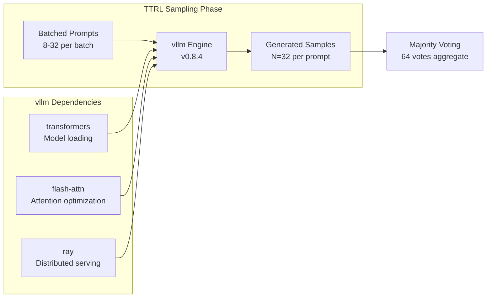
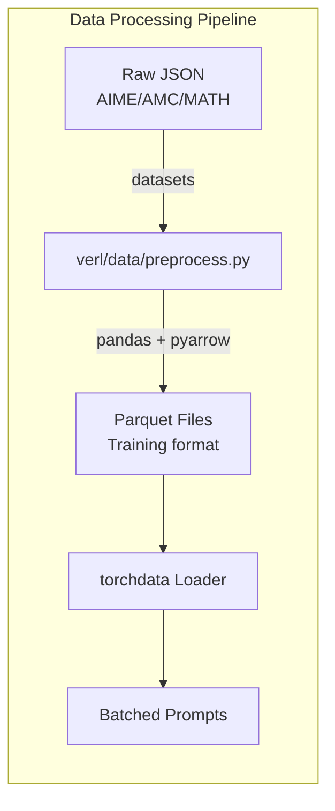
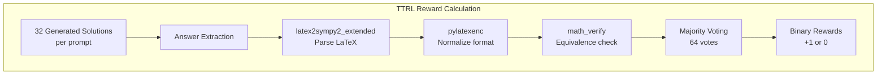
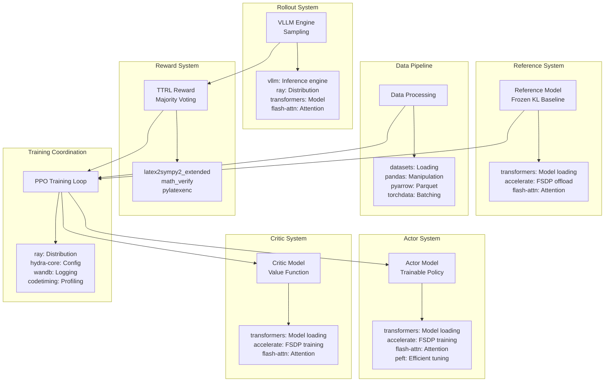
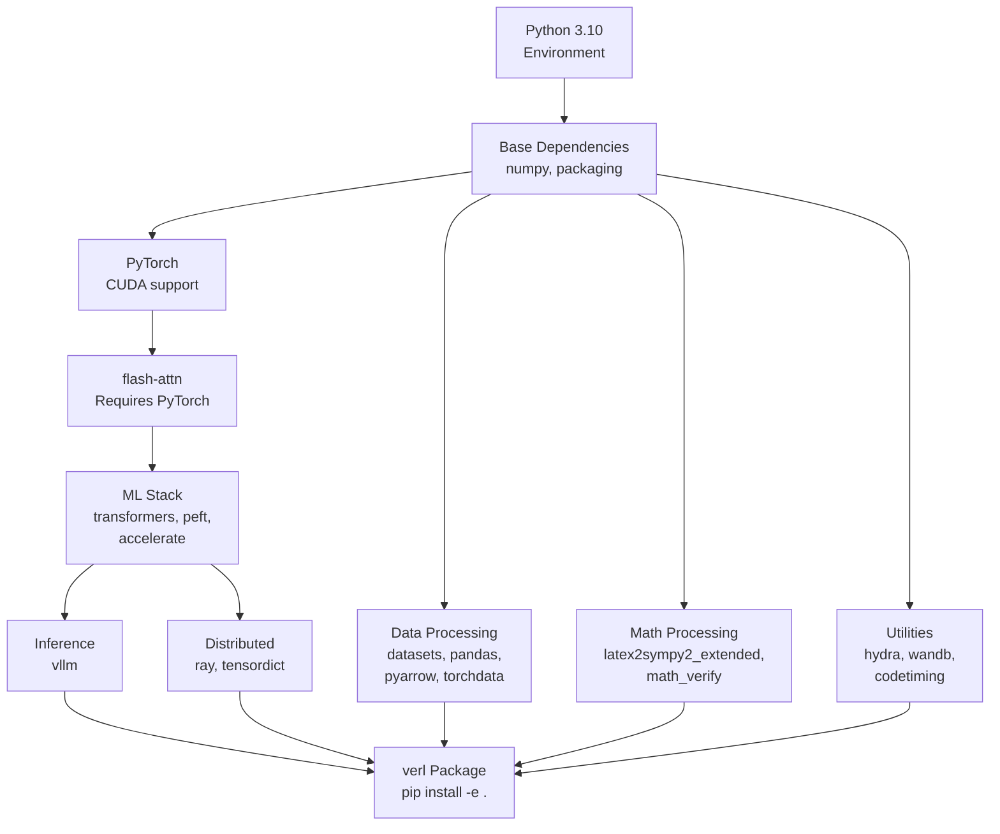

<!-- source: DeepWiki mcp.deepwiki.com · repo PRIME-RL/TTRL · page 2.1 Dependencies and Requirements · fetched 2026-10-30 -->

# Dependencies and Requirements

<details>
<summary>Relevant source files</summary>

The following files were used as context for generating this wiki page:

- [README.md](README.md)
- [verl/requirements.txt](verl/requirements.txt)

</details>


## Purpose and Scope

This page provides a comprehensive reference of all software dependencies required to run TTRL (Test-Time Reinforcement Learning). It explains the role of each dependency in the system architecture and documents version constraints and compatibility requirements. For installation instructions using these dependencies, see [Installation Steps](#2.2). For detailed configuration of specific components like VLLM, see [VLLM Integration](#6.3).

## Overview

TTRL builds upon the verl framework and requires a diverse set of dependencies spanning machine learning infrastructure, distributed computing, high-throughput inference, mathematical processing, and experiment tracking. All dependencies are specified in [verl/requirements.txt:1-27]() and installed via [scripts/install_ttrl_deps.sh]() as described in [README.md:70]().

The system requires Python 3.10 ([README.md:68]()) and is tested on NVIDIA A100 80GB GPUs ([README.md:88]()).

```mermaid
graph TB
    subgraph "TTRL System"
        Core["TTRL Core System"]
    end
    
    subgraph "Dependency Categories"
        ML["Machine Learning<br/>Infrastructure"]
        Inference["Inference &<br/>Sampling"]
        Distributed["Distributed<br/>Computing"]
        Data["Data Pipeline"]
        Math["Mathematical<br/>Processing"]
        Config["Configuration &<br/>Logging"]
    end
    
    Core --> ML
    Core --> Inference
    Core --> Distributed
    Core --> Data
    Core --> Math
    Core --> Config
    
    ML -.-> transformers["transformers"]
    ML -.-> flash_attn["flash-attn"]
    ML -.-> peft["peft"]
    ML -.-> accelerate["accelerate"]
    ML -.-> liger["liger-kernel"]
    
    Inference -.-> vllm["vllm"]
    Inference -.-> fastapi["fastapi"]
    Inference -.-> uvicorn["uvicorn"]
    
    Distributed -.-> ray["ray[default]"]
    Distributed -.-> tensordict["tensordict"]
    
    Data -.-> datasets["datasets"]
    Data -.-> pandas["pandas"]
    Data -.-> pyarrow["pyarrow"]
    Data -.-> torchdata["torchdata"]
    Data -.-> dill["dill"]
    
    Math -.-> latex2sympy["latex2sympy2_extended"]
    Math -.-> math_verify["math_verify"]
    Math -.-> pylatexenc["pylatexenc"]
    
    Config -.-> hydra["hydra-core"]
    Config -.-> wandb["wandb"]
    Config -.-> codetiming["codetiming"]
    Config -.-> precommit["pre-commit"]
```



**Dependency Categories and System Integration**

Sources: [verl/requirements.txt:1-27](), [README.md:62-72]()

---

## Core Dependency Categories

### Machine Learning Infrastructure

These dependencies provide the foundational machine learning capabilities for model loading, training, and optimization.

| Dependency | Version Constraint | Purpose |
|------------|-------------------|---------|
| `transformers` | (latest) | Loads pre-trained LLMs (Qwen2.5, LLaMA3.1) and provides tokenization |
| `flash-attn` | (latest) | Implements optimized attention mechanisms for efficient training |
| `peft` | (latest) | Enables parameter-efficient fine-tuning techniques |
| `accelerate` | (latest) | Provides distributed training infrastructure and FSDP support |
| `liger-kernel` | (latest) | Offers optimized CUDA kernels for transformer operations |
| `numpy` | (latest) | Fundamental numerical computing library |

**Role in TTRL Architecture:**
- `transformers` loads the shared backbone model that initializes Actor, Critic, and Reference components
- `flash-attn` optimizes attention computation during both training (Actor/Critic updates) and rollout (VLLM sampling)
- `peft` supports efficient fine-tuning of large models with limited memory
- `accelerate` coordinates FSDP configurations for Actor, Critic, and Reference models with different offloading strategies

Sources: [verl/requirements.txt:2-11]()

---

### Inference and Sampling Engine

High-throughput inference capabilities are critical for TTRL's multi-sample generation phase where N=32 samples are generated per prompt.

| Dependency | Version Constraint | Purpose |
|------------|-------------------|---------|
| `vllm` | 0.8.4 (commented) | High-throughput LLM inference engine for rollout generation |
| `fastapi` | (latest) | Optional API framework for serving inference endpoints |
| `uvicorn` | (latest) | ASGI server for serving FastAPI applications |

**Role in TTRL Architecture:**
- `vllm` powers the Rollout System, generating 32 samples per prompt with configurable temperature (0.6-1.0)
- Version 0.8.4 is referenced in comments but may vary; see [VLLM Integration](#6.3) for version-specific configuration
- `fastapi` and `uvicorn` enable optional API-based serving of the trained models



**VLLM Dependency Chain in Sampling Pipeline**

Sources: [verl/requirements.txt:20-24]()

---

### Distributed Computing Infrastructure

TTRL leverages distributed computing for both training coordination and high-throughput rollout generation.

| Dependency | Version Constraint | Purpose |
|------------|-------------------|---------|
| `ray[default]` | (latest) | Distributed computing framework for multi-GPU coordination |
| `tensordict` | <=0.6.2 | Efficient dictionary-based tensor storage for distributed workflows |
| `dill` | (latest) | Enhanced serialization for Ray object passing |

**Role in TTRL Architecture:**
- `ray` coordinates distributed workloads across multiple GPUs (tested on 8x A100 80GB)
- Used by both the PPO training loop for multi-GPU FSDP and by VLLM for distributed inference
- `tensordict` stores rollout trajectories (states, actions, rewards) efficiently during distributed sampling
- `dill` handles serialization of complex Python objects (models, configurations) passed between Ray workers

Sources: [verl/requirements.txt:16-18](), [README.md:88]()

---

### Data Pipeline and Processing

The data pipeline transforms raw mathematical problems (JSON format) into training-ready parquet files and manages batch processing.

| Dependency | Version Constraint | Purpose |
|------------|-------------------|---------|
| `datasets` | (latest) | HuggingFace datasets library for loading AIME, AMC, MATH data |
| `pandas` | (latest) | DataFrame operations for data manipulation |
| `pyarrow` | >=19.0.0 | Efficient parquet file format support |
| `torchdata` | (latest) | PyTorch data loading pipelines |
| `pybind11` | (latest) | C++ bindings for performance-critical data operations |

**Role in TTRL Architecture:**
- `datasets` loads raw mathematical reasoning datasets in JSON format
- Preprocessing script [verl/data/preprocess.py]() uses `pandas` and `pyarrow` to convert JSON to parquet ([README.md:82]())
- `pyarrow` version >=19.0.0 ensures compatibility with modern parquet features
- `torchdata` provides efficient data loading during PPO training epochs



**Data Format Conversion Flow**

Sources: [verl/requirements.txt:4-5,10-13](), [README.md:82]()

---

### Mathematical Processing and Verification

TTRL requires specialized libraries for parsing and verifying mathematical expressions, critical for the reward calculation phase.

| Dependency | Version Constraint | Purpose |
|------------|-------------------|---------|
| `latex2sympy2_extended` | (latest) | Parses LaTeX expressions (e.g., `\boxed{}`) into symbolic math |
| `math_verify` | (latest) | Verifies mathematical answer equivalence for reward calculation |
| `pylatexenc` | (latest) | Encodes/decodes LaTeX mathematical notation |

**Role in TTRL Architecture:**
- The custom reward function at `ttrl_math/reward_func` ([README.md:82]()) uses these libraries to extract and compare answers
- `latex2sympy2_extended` parses model-generated answers in `\boxed{...}` format common in math problems
- `math_verify` checks if two mathematical expressions are equivalent (e.g., "1/2" vs "0.5")
- These enable accurate majority voting by normalizing answer formats before comparison



**Mathematical Answer Processing in Reward Function**

Sources: [verl/requirements.txt:25-26](), [README.md:95-100]()

---

### Configuration and Experiment Tracking

TTRL uses sophisticated configuration management and comprehensive experiment tracking to manage complex hyperparameter spaces.

| Dependency | Version Constraint | Purpose |
|------------|-------------------|---------|
| `hydra-core` | (latest) | Hierarchical configuration management system |
| `wandb` | (latest) | Weights & Biases experiment tracking and logging |
| `codetiming` | (latest) | Performance profiling and timing utilities |
| `pre-commit` | (latest) | Code quality and linting hooks (development only) |
| `packaging` | >=20.0 | Version parsing and compatibility utilities |

**Role in TTRL Architecture:**
- `hydra-core` manages the complex configuration hierarchy with base configs (`ppo_trainer_ttrl.yaml`) and per-experiment overrides
- Example scripts like [verl/examples/ttrl/Qwen2.5/aime.sh]() use Hydra overrides to enable TTRL: `+ttrl.enable=True` ([README.md:28]())
- `wandb` logs training metrics, model checkpoints, and performance curves; see experimental logs at [README.md:86]()
- `codetiming` profiles performance bottlenecks in the training pipeline

Sources: [verl/requirements.txt:3,7,15,21-22](), [README.md:28,86]()

---

## Dependency Mapping to System Components

The following diagram maps specific dependencies to the Actor-Critic-Reference-Rollout architecture components:



**Component-Level Dependency Mapping**

Sources: [verl/requirements.txt:1-27]()

---

## Version Constraints and Compatibility

### Critical Version Requirements

| Dependency | Constraint | Reason |
|------------|-----------|--------|
| Python | ==3.10 | Required for TTRL environment setup |
| `pyarrow` | >=19.0.0 | Modern parquet format features for data processing |
| `tensordict` | <=0.6.2 | Compatibility with Ray and distributed tensor storage |
| `vllm` | 0.8.4 (noted) | Specific version for stable VLLM integration |

The `vllm` dependency is commented in [verl/requirements.txt:20]() with version 0.8.4 specified, but actual installation may use a different version. Verify VLLM compatibility based on your GPU architecture and CUDA version.

### GPU and Hardware Requirements

- **Tested Configuration:** 8x NVIDIA A100 80GB GPUs ([README.md:88]())
- **CUDA Support:** Required for `flash-attn`, `vllm`, and GPU-accelerated training
- **Memory:** Large models (7B-8B parameters) require substantial GPU memory; FSDP and gradient checkpointing help manage memory constraints

Sources: [verl/requirements.txt:1-27](), [README.md:68,88]()

---

## Installation Command Summary

All dependencies are installed via the provided script:

```bash
bash scripts/install_ttrl_deps.sh
```

This script, executed after creating a Python 3.10 conda environment ([README.md:68-70]()), installs all dependencies listed in [verl/requirements.txt:1-27](). After dependency installation, the verl package itself is installed in editable mode:

```bash
pip install -e .
```

For detailed installation instructions, see [Installation Steps](#2.2).

Sources: [README.md:62-72]()

---

## Dependency Installation Order

Certain dependencies have installation order requirements due to their interdependencies:



**Dependency Installation Flow**

The installation script [scripts/install_ttrl_deps.sh]() handles this ordering automatically.

Sources: [README.md:70](), [verl/requirements.txt:1-27]()

---

