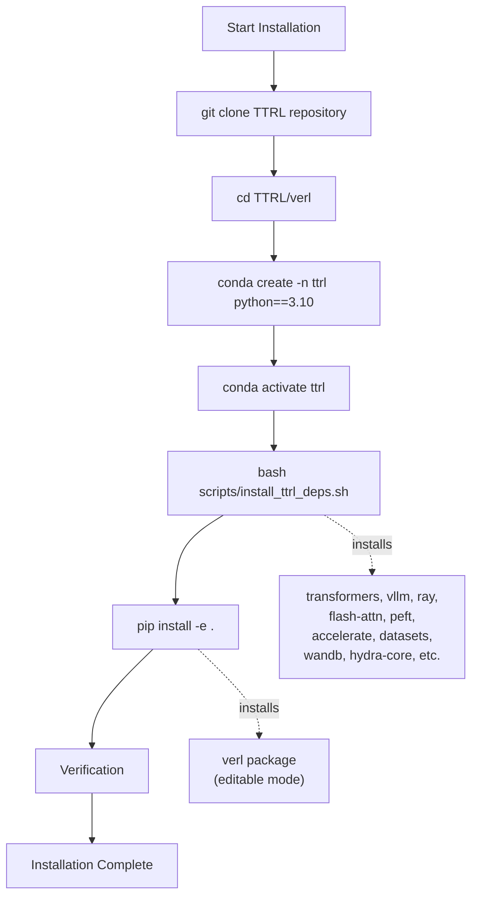
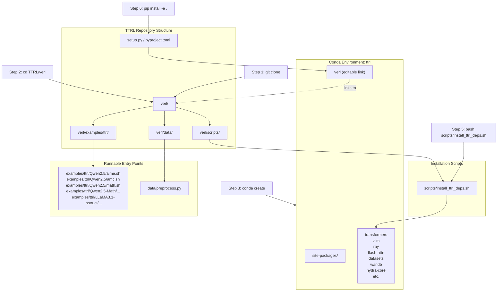
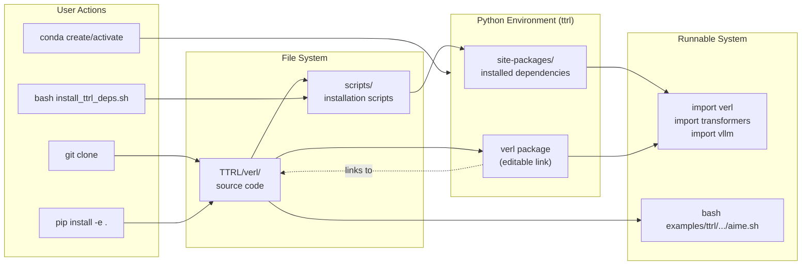

<!-- source: DeepWiki mcp.deepwiki.com · repo PRIME-RL/TTRL · page 2.2 Installation Steps · fetched 2026-10-30 -->

# Installation Steps

<details>
<summary>Relevant source files</summary>

The following files were used as context for generating this wiki page:

- [README.md](README.md)

</details>


This page provides step-by-step instructions for installing TTRL and its dependencies. These instructions will guide you through cloning the repository, setting up a Python environment, installing dependencies, and verifying the installation.

**For details on what each dependency does and why it's required, see [Dependencies and Requirements](#2.1).**

**For configuration and running TTRL after installation, see [Quick Start](#3.1).**

## Purpose and Scope

This document covers the complete installation process for TTRL, from repository cloning through dependency installation. The process is designed for systems with CUDA-capable GPUs (tested on NVIDIA A100 80GB GPUs). The installation integrates TTRL as an extension to the verl framework, installing both systems together.

---

## Installation Overview

The TTRL installation follows a standard Python package installation pattern with conda environment management. The system installs as a verl extension, leveraging verl's infrastructure while adding TTRL-specific components.



**Installation Flow Diagram**: Sequential steps from repository cloning to verification, showing the relationship between installation scripts and installed components.

Sources: [README.md:61-72]()

---

## Prerequisites

Before beginning installation, ensure your system meets these requirements:

| Requirement | Specification |
|-------------|---------------|
| Operating System | Linux (tested on Ubuntu) |
| Python Version | 3.10 |
| GPU | CUDA-capable (recommended: NVIDIA A100 80GB) |
| CUDA | Compatible version for PyTorch and vllm |
| Conda/Mamba | For environment management |
| Git | For repository cloning |
| Disk Space | ~20GB for dependencies and models |

---

## Step-by-Step Installation

### Step 1: Clone Repository

Clone the TTRL repository from GitHub:

```bash
git clone https://github.com/PRIME-RL/TTRL.git
```

This creates a local copy of the repository with the following structure:

```
TTRL/
├── verl/                   # Main verl framework with TTRL extensions
│   ├── examples/ttrl/      # TTRL example scripts
│   ├── scripts/            # Installation and utility scripts
│   ├── data/               # Data processing utilities
│   └── ...
├── figs/                   # Documentation figures
└── README.md
```

Sources: [README.md:64]()

### Step 2: Navigate to verl Directory

Change to the verl subdirectory, which contains the main codebase:

```bash
cd TTRL/verl
```

All subsequent installation commands are executed from this directory [README.md:66]().

Sources: [README.md:66]()

### Step 3: Create Conda Environment

Create a new conda environment named `ttrl` with Python 3.10:

```bash
conda create -n ttrl python==3.10
```

Python 3.10 is specifically required for compatibility with the dependency stack, particularly vllm and transformers versions used by TTRL.

**Note**: You can use `mamba` instead of `conda` for faster environment creation:

```bash
mamba create -n ttrl python==3.10
```

Sources: [README.md:68]()

### Step 4: Activate Environment

Activate the newly created environment:

```bash
conda activate ttrl
```

All subsequent installation steps must be executed within this activated environment.

Sources: [README.md:69]()

### Step 5: Install Dependencies

Execute the dependency installation script:

```bash
bash scripts/install_ttrl_deps.sh
```

This script installs all required dependencies including:

- **Core ML Stack**: `transformers`, `torch`, `accelerate`, `peft`
- **Inference Engine**: `vllm` (v1 with specific version pinning)
- **Distributed Computing**: `ray[default]`
- **Mathematical Processing**: `latex2sympy2_extended`, `math_verify`
- **Data Processing**: `datasets`, `pyarrow`, `pandas`
- **Optimization**: `flash-attn` (compiled from source)
- **Experiment Tracking**: `wandb`, `hydra-core`

The script handles version compatibility and compilation of performance-critical components like flash-attn.

**Installation Time**: This step typically takes 10-20 minutes depending on network speed and whether flash-attn needs compilation.

Sources: [README.md:70]()

### Step 6: Install verl Package

Install the verl package in editable mode:

```bash
pip install -e .
```

The `-e` flag installs the package in editable/development mode, allowing you to modify the source code without reinstalling. This command:

1. Installs the verl package from the current directory
2. Links the package to the source code (editable mode)
3. Makes verl and TTRL modules importable system-wide within the conda environment
4. Installs any additional package-level dependencies specified in `setup.py` or `pyproject.toml`

Sources: [README.md:71]()

---

## Installation Component Mapping

The following diagram maps installation steps to the actual code entities and file structures they create:



**Component Installation Mapping**: Shows how installation steps create and link concrete file structures and Python packages.

Sources: [README.md:61-72]()

---

## Post-Installation Directory Structure

After successful installation, the `TTRL/verl` directory contains the following structure:

| Path | Description |
|------|-------------|
| `examples/ttrl/` | Example scripts for different models and tasks |
| `examples/ttrl/Qwen2.5/*.sh` | Scripts for Qwen2.5-7B model |
| `examples/ttrl/Qwen2.5-Math/*.sh` | Scripts for Qwen2.5-Math-1.5B model |
| `examples/ttrl/LLaMA3.1-Instruct/*.sh` | Scripts for LLaMA3.1-8B-Instruct model |
| `data/preprocess.py` | Data preprocessing utility (JSON→Parquet) |
| `scripts/install_ttrl_deps.sh` | Dependency installation script |
| `verl/` (Python module) | Core verl framework code |
| `setup.py` or `pyproject.toml` | Package metadata and dependencies |

Sources: [README.md:82-84]()

---

## Verification Steps

After installation, verify the setup by checking Python imports and available scripts.

### Verify Python Packages

Test that core packages can be imported:

```bash
python -c "import torch; print(f'PyTorch: {torch.__version__}')"
python -c "import transformers; print(f'Transformers: {transformers.__version__}')"
python -c "import vllm; print(f'VLLM: {vllm.__version__}')"
python -c "import ray; print(f'Ray: {ray.__version__}')"
```

Expected output shows version numbers for each package without import errors.

### Verify verl Installation

Test that verl package is installed and importable:

```bash
python -c "import verl; print('verl package successfully installed')"
```

### Verify TTRL Scripts

Check that example scripts are accessible:

```bash
ls examples/ttrl/Qwen2.5/
```

Expected output:
```
aime.sh  amc.sh  math.sh
```

### Check GPU Availability

Verify CUDA and GPU access:

```bash
python -c "import torch; print(f'CUDA available: {torch.cuda.is_available()}'); print(f'GPU count: {torch.cuda.device_count()}')"
```

Expected output shows `CUDA available: True` and the number of available GPUs.

Sources: [README.md:88]()

---

## Common Installation Issues

### Issue: flash-attn Compilation Failure

**Symptom**: Error during `install_ttrl_deps.sh` when compiling flash-attn

**Solution**: 
- Ensure CUDA toolkit is installed and `nvcc` is in PATH
- Check CUDA version compatibility with PyTorch
- May require `ninja` build system: `conda install ninja`

### Issue: vllm Installation Conflict

**Symptom**: Version conflicts or import errors with vllm

**Solution**:
- TTRL uses vllm v1 with specific version pinning
- If conflicts occur, check the dependency script for exact versions required
- Ensure CUDA version matches vllm requirements

### Issue: Python Version Mismatch

**Symptom**: Import errors or package installation failures

**Solution**:
- Verify Python 3.10 is active: `python --version`
- Recreate environment if wrong version is installed
- Some dependencies require exactly Python 3.10

### Issue: Insufficient Disk Space

**Symptom**: Installation fails partway through

**Solution**:
- Ensure at least 20GB free disk space
- flash-attn compilation requires significant temporary space
- Model checkpoints (downloaded separately) require additional 10-50GB

### Issue: Permission Errors

**Symptom**: "Permission denied" during pip install

**Solution**:
- Ensure you're not using system Python
- Conda environment should have write permissions
- Avoid `sudo pip install` within conda environments

---

## Next Steps

After successful installation:

1. **Prepare Data**: Convert your datasets from JSON to Parquet format using [data/preprocess.py]()
   - See [Data Processing Pipeline](#4.1) for detailed instructions
   
2. **Configure Training**: Review example scripts in `examples/ttrl/` directory
   - See [Quick Start](#3.1) for a minimal example
   - See [Model Configurations](#3.2) for model-specific settings
   
3. **Run TTRL**: Execute an example script to verify end-to-end functionality
   - Example: `bash examples/ttrl/Qwen2.5/aime.sh`
   - See [Configuration Guide](#3) for detailed parameter tuning

4. **Monitor Training**: Set up Weights & Biases for experiment tracking
   - TTRL integrates with WandB for logging
   - See example logs at [README.md:86]()

Sources: [README.md:74-87]()

---

## Installation Architecture Summary



**Installation Architecture**: Relationship between user commands, file system changes, Python environment setup, and the resulting runnable system.

Sources: [README.md:61-72]()

---

