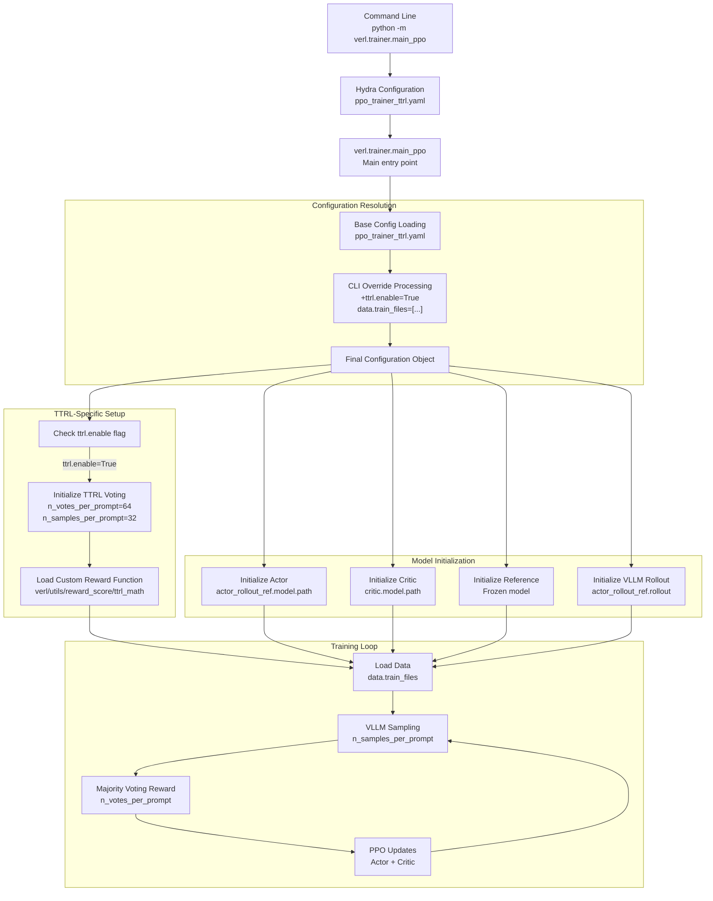
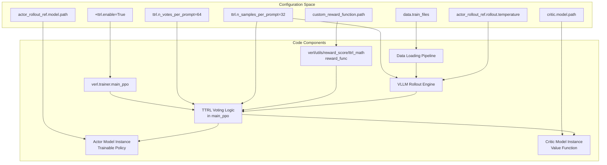

<!-- source: DeepWiki mcp.deepwiki.com · repo PRIME-RL/TTRL · page 3.1 Quick Start · fetched 2026-10-30 -->

# Quick Start

<details>
<summary>Relevant source files</summary>

The following files were used as context for generating this wiki page:

- [README.md](README.md)
- [verl/examples/ttrl/Qwen2.5-Math/aime.sh](verl/examples/ttrl/Qwen2.5-Math/aime.sh)

</details>


This page provides a minimal working example to get TTRL training running quickly. It covers the essential configuration flags needed to start test-time reinforcement learning on unlabeled data using majority voting rewards.

**Prerequisites:** Before following this guide, ensure you have completed the installation steps described in [Installation Steps](#2.2).

**For detailed configuration:** This page focuses on getting started quickly. For comprehensive configuration options across different models and tasks, see [Model Configurations](#3.2) and [Task Configurations](#3.3).

---

## Running Your First TTRL Training

TTRL training is executed through the verl framework's PPO trainer with TTRL-specific configurations. The simplest way to run TTRL is to use one of the provided example scripts.

### Basic Command Structure

All TTRL training jobs follow this pattern:

```bash
python -m verl.trainer.main_ppo \
  --config-name='ppo_trainer_ttrl.yaml' \
  +ttrl.enable=True \
  [additional configuration overrides...]
```

The key components are:
- **`verl.trainer.main_ppo`**: Entry point for PPO training ([verl/trainer/main_ppo.py]())
- **`ppo_trainer_ttrl.yaml`**: Base configuration file for TTRL
- **`+ttrl.enable=True`**: Flag that activates TTRL majority voting rewards

### Minimal Working Example

Here's a minimal command to run TTRL on the AIME 2024 dataset using Qwen2.5-Math-1.5B:

```bash
cd verl

python -m verl.trainer.main_ppo \
  --config-name='ppo_trainer_ttrl.yaml' \
  data.train_files=["data/AIME-TTT/train.parquet"] \
  data.val_files=["data/AIME-TTT/test.parquet"] \
  actor_rollout_ref.model.path="/path/to/Qwen2.5-Math-1.5B" \
  critic.model.path="/path/to/Qwen2.5-Math-1.5B" \
  +ttrl.enable=True \
  ttrl.n_votes_per_prompt=64 \
  ttrl.n_samples_per_prompt=32 \
  custom_reward_function.path="./verl/utils/reward_score/ttrl_math/__init__.py" \
  custom_reward_function.name=reward_func \
  trainer.project_name="TTRL-quickstart" \
  trainer.experiment_name="my-first-ttrl-run"
```

**Sources:** [README.md:61-79](), [verl/examples/ttrl/Qwen2.5-Math/aime.sh:1-105]()

---

## TTRL Execution Flow

The following diagram illustrates how a TTRL training command flows through the codebase:



**Sources:** [verl/examples/ttrl/Qwen2.5-Math/aime.sh:42-103]()

---

## Essential Configuration Parameters

The table below lists the minimum required parameters to run TTRL training:

| Parameter | Purpose | Example Value | Required |
|-----------|---------|---------------|----------|
| **Data Configuration** |
| `data.train_files` | Training data in Parquet format | `["data/AIME-TTT/train.parquet"]` | Yes |
| `data.val_files` | Validation/test data | `["data/AIME-TTT/test.parquet"]` | Yes |
| `data.max_prompt_length` | Maximum tokens in input prompt | `512` | Yes |
| `data.max_response_length` | Maximum tokens in model response | `3072` (3×1024 for K=3) | Yes |
| **Model Paths** |
| `actor_rollout_ref.model.path` | Path to pre-trained model for actor/rollout/reference | `"/path/to/Qwen2.5-Math-1.5B"` | Yes |
| `critic.model.path` | Path to pre-trained model for critic | `"/path/to/Qwen2.5-Math-1.5B"` | Yes |
| **TTRL Configuration** |
| `+ttrl.enable` | Enable TTRL majority voting | `True` | Yes |
| `ttrl.n_votes_per_prompt` | Total votes for consensus building | `64` | Yes |
| `ttrl.n_samples_per_prompt` | Samples generated per prompt during training | `32` | Yes |
| `custom_reward_function.path` | Path to custom reward function | `"./verl/utils/reward_score/ttrl_math/__init__.py"` | Yes |
| `custom_reward_function.name` | Function name in reward module | `reward_func` | Yes |
| **Logging** |
| `trainer.project_name` | WandB project name | `"TTRL-quickstart"` | Recommended |
| `trainer.experiment_name` | Experiment identifier | `"my-first-ttrl-run"` | Recommended |

**Sources:** [verl/examples/ttrl/Qwen2.5-Math/aime.sh:11-103]()

### Critical Parameter Notes

**TTRL Voting Parameters:**
- `n_votes_per_prompt` should typically be 2× `n_samples_per_prompt` to ensure robust consensus
- Standard configuration uses 64 votes from 32 samples ([verl/examples/ttrl/Qwen2.5-Math/aime.sh:26-27]())

**Response Length:**
- Set based on desired reasoning depth: `max_response_length = 1024 × K` where K is the reasoning length multiplier
- Example: K=3 → 3072 tokens for extensive step-by-step reasoning ([verl/examples/ttrl/Qwen2.5-Math/aime.sh:15-17]())

**Custom Reward Function:**
- For mathematical reasoning tasks, use `verl/utils/reward_score/ttrl_math/` which extracts answers from `\boxed{}` LaTeX notation
- The reward function must implement majority voting logic to compare each sample against consensus

---

## Configuration Flag to Code Component Mapping

This diagram shows how key configuration flags map to specific code components and systems:



**Sources:** [verl/examples/ttrl/Qwen2.5-Math/aime.sh:42-103]()

---

## Using Example Scripts

For convenience, TTRL provides pre-configured shell scripts for common model-task combinations. These scripts set all necessary parameters with tested defaults.

### Running an Example Script

```bash
cd verl
bash examples/ttrl/Qwen2.5-Math/aime.sh
```

**Before running, update these variables in the script:**
- `DATA_LOCAL_DIR`: Path to your data directory ([verl/examples/ttrl/Qwen2.5-Math/aime.sh:31]())
- `BACKBONE_PATH`: Path to your model checkpoint ([verl/examples/ttrl/Qwen2.5-Math/aime.sh:32]())

### Available Example Scripts

The following table shows the available model-task combinations:

| Model Family | AIME Script | AMC Script | MATH Script |
|-------------|-------------|------------|-------------|
| Qwen2.5-7B | `examples/ttrl/Qwen2.5/aime.sh` | `examples/ttrl/Qwen2.5/amc.sh` | `examples/ttrl/Qwen2.5/math.sh` |
| Qwen2.5-Math-1.5B | `examples/ttrl/Qwen2.5-Math/aime.sh` | `examples/ttrl/Qwen2.5-Math/amc.sh` | `examples/ttrl/Qwen2.5-Math/math.sh` |
| LLaMA3.1-8B-Instruct | `examples/ttrl/LLaMA3.1-Instruct/aime.sh` | `examples/ttrl/LLaMA3.1-Instruct/amc.sh` | `examples/ttrl/LLaMA3.1-Instruct/math.sh` |

All scripts use consistent TTRL parameters (K=3, N=32, votes=64) unless otherwise specified.

**Sources:** [README.md:75-84]()

---

## Understanding Training Output

### Console Output

During training, you'll see logs indicating:
- **Data loading:** Parquet file processing and prompt batching
- **Rollout generation:** VLLM generating N samples per prompt
- **Voting statistics:** Consensus agreement rates
- **PPO updates:** Actor and critic loss values
- **Validation metrics:** `pass@1` (greedy decoding) and `maj@n` (majority voting)

### Weights & Biases Logging

If WandB logging is enabled ([verl/examples/ttrl/Qwen2.5-Math/aime.sh:93]()), you can monitor:
- Training curves for actor/critic losses
- Reward distributions from majority voting
- Validation performance metrics (`pass@1`, `maj@n`)
- KL divergence from reference model

Example WandB logs are available at: [https://wandb.ai/truman-yx-zuo-nlp/TTRL/workspace](https://wandb.ai/truman-yx-zuo-nlp/TTRL/workspace)

**Sources:** [README.md:86](), [verl/examples/ttrl/Qwen2.5-Math/aime.sh:93-95]()

---

## Data Preparation

TTRL requires data in **Parquet format**. If you have JSON-formatted data, use the preprocessing script:

```bash
python verl/data/preprocess.py \
  --input_file your_data.json \
  --output_file your_data.parquet
```

**Expected data format:**
- Each row must contain a `prompt` field with the mathematical problem
- Ground truth labels are **not required** for training data (TTRL uses majority voting)
- Validation data may optionally include ground truth for evaluation

For details on data formatting and preprocessing options, see [Data Processing Pipeline](#4.1).

**Sources:** [README.md:82]()

---

## Troubleshooting Quick Start Issues

### Common Issues

| Issue | Cause | Solution |
|-------|-------|----------|
| `FileNotFoundError` for model | Invalid `model.path` | Verify model checkpoint path exists and is accessible |
| `FileNotFoundError` for data | Invalid `train_files` or `val_files` | Ensure Parquet files exist at specified paths |
| CUDA out of memory | Insufficient GPU memory | Reduce `data.train_batch_size` or `actor_rollout_ref.rollout.gpu_memory_utilization` |
| VLLM initialization error | Incompatible VLLM version | Ensure `VLLM_USE_V1=1` is set ([verl/examples/ttrl/Qwen2.5-Math/aime.sh:4]()) |
| Import error for reward function | Invalid `custom_reward_function.path` | Verify path to reward function file |

### Environment Variables

TTRL scripts set these environment variables for optimal performance:

```bash
export VLLM_USE_V1=1                    # Use VLLM v1 API
unset VLLM_ATTENTION_BACKEND            # Let VLLM auto-select attention backend
```

**Sources:** [verl/examples/ttrl/Qwen2.5-Math/aime.sh:2-4]()

---

## Next Steps

After successfully running your first TTRL training:

1. **Understand the system architecture:** See [System Architecture](#1.2) for how components interact
2. **Explore model-specific configurations:** See [Model Configurations](#3.2) for optimizing different model families
3. **Configure for different tasks:** See [Task Configurations](#3.3) for AIME, AMC, and MATH datasets
4. **Tune hyperparameters:** See [Hyperparameter Reference](#3.4) for comprehensive parameter documentation
5. **Deep dive into TTRL internals:** See [TTRL Voting and Sampling](#4.3) to understand the majority voting mechanism

**Sources:** [README.md:59-89]()

---

