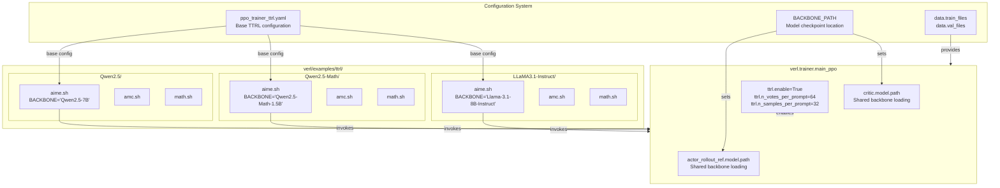
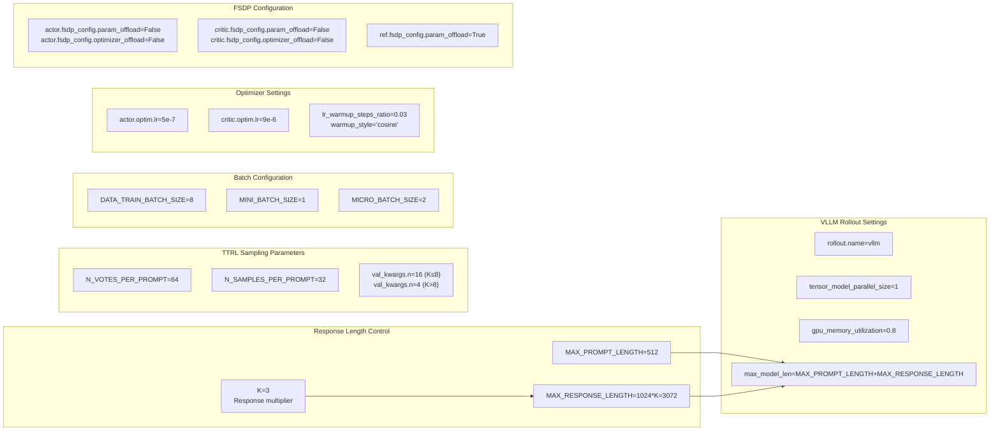
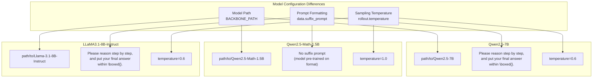
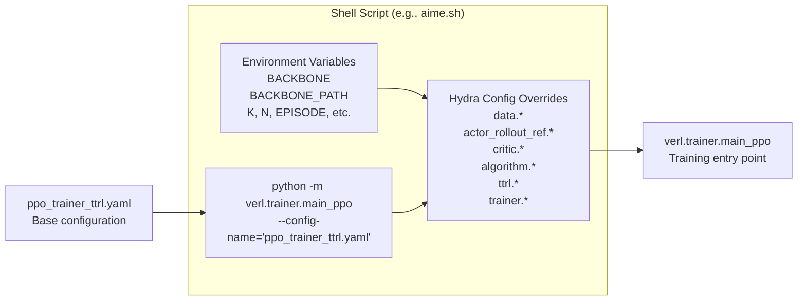

<!-- source: DeepWiki mcp.deepwiki.com · repo PRIME-RL/TTRL · page 3.2 Model Configurations · fetched 2026-10-30 -->

# Model Configurations

<details>
<summary>Relevant source files</summary>

The following files were used as context for generating this wiki page:

- [verl/examples/ttrl/LLaMA3.1-Instruct/aime.sh](verl/examples/ttrl/LLaMA3.1-Instruct/aime.sh)
- [verl/examples/ttrl/Qwen2.5-Math/aime.sh](verl/examples/ttrl/Qwen2.5-Math/aime.sh)
- [verl/examples/ttrl/Qwen2.5/aime.sh](verl/examples/ttrl/Qwen2.5/aime.sh)

</details>


This document provides an overview of the supported model families in TTRL and their configuration differences. TTRL currently supports three model families: Qwen2.5-7B, Qwen2.5-Math-1.5B, and LLaMA3.1-8B-Instruct. Each model family has specific configuration requirements related to prompt formatting, temperature settings, and model paths, while sharing a common set of core training parameters.

For detailed configuration instructions specific to each model family, see [Qwen2.5 Models](#3.2.1), [Qwen2.5-Math Models](#3.2.2), and [LLaMA3.1-Instruct Models](#3.2.3). For task-specific configurations, see [Task Configurations](#3.3).

## Supported Model Families

TTRL supports three pre-trained model families, each with different characteristics suited for mathematical reasoning tasks:

### Model Family Overview

| Model Family | Model Name | Size | Specialization | Training Source |
|--------------|------------|------|----------------|-----------------|
| **Qwen2.5** | `Qwen2.5-7B` | 7B parameters | General purpose language model | General pre-training |
| **Qwen2.5-Math** | `Qwen2.5-Math-1.5B` | 1.5B parameters | Mathematical reasoning specialist | Math-specific fine-tuning |
| **LLaMA3.1-Instruct** | `Llama-3.1-8B-Instruct` | 8B parameters | Instruction-following | Instruction tuning |

All three model families are configured through shell scripts located in [verl/examples/ttrl/]() with separate subdirectories for each family. Each model can be trained on AIME, AMC, or MATH tasks using the corresponding task-specific scripts.

**Sources:** [verl/examples/ttrl/Qwen2.5-Math/aime.sh:12](), [verl/examples/ttrl/Qwen2.5/aime.sh:12](), [verl/examples/ttrl/LLaMA3.1-Instruct/aime.sh:12]()

## Model Configuration Structure

The following diagram illustrates how model configurations are organized in the codebase and how they relate to the training pipeline:



**Sources:** [verl/examples/ttrl/Qwen2.5/aime.sh:42-43](), [verl/examples/ttrl/Qwen2.5-Math/aime.sh:42-43](), [verl/examples/ttrl/LLaMA3.1-Instruct/aime.sh:42-43]()

## Common Configuration Parameters

All three model families share a consistent set of core training parameters defined in their respective shell scripts. These parameters control the TTRL training behavior, memory optimization, and PPO algorithm settings.

### Shared Training Parameters



### Common Configuration Table

| Parameter Category | Parameter | Value | Description |
|-------------------|-----------|-------|-------------|
| **Episode Control** | `EPISODE` | `80` | Total training epochs |
| **Response Generation** | `K` | `3` | Response length multiplier (K × 1024 tokens) |
| | `MAX_PROMPT_LENGTH` | `512` | Maximum input prompt length |
| | `MAX_RESPONSE_LENGTH` | `3072` | Maximum response length (1024 × K) |
| **TTRL Voting** | `N_VOTES_PER_PROMPT` | `64` | Number of votes aggregated per prompt |
| | `N_SAMPLES_PER_PROMPT` | `32` | Training samples generated per prompt |
| | `val_kwargs.n` | `16` (K≤8) or `4` (K>8) | Validation samples per prompt |
| **Batch Sizes** | `DATA_TRAIN_BATCH_SIZE` | `8` | Training batch size |
| | `MINI_BATCH_SIZE` | `1` | PPO mini-batch size |
| | `MICRO_BATCH_SIZE` | `2` | Micro-batch size per GPU |
| **Learning Rates** | `actor.optim.lr` | `5e-7` | Actor (policy) learning rate |
| | `critic.optim.lr` | `9e-6` | Critic (value) learning rate (18× actor) |
| | `lr_warmup_steps_ratio` | `0.03` | Warmup ratio (3% of total steps) |
| | `warmup_style` | `'cosine'` | Cosine warmup schedule |
| **FSDP** | `actor.fsdp_config.param_offload` | `False` | Actor parameter offload to CPU |
| | `critic.fsdp_config.param_offload` | `False` | Critic parameter offload to CPU |
| | `ref.fsdp_config.param_offload` | `True` | Reference model offload to CPU |
| **VLLM** | `tensor_model_parallel_size` | `1` | Tensor parallelism size |
| | `gpu_memory_utilization` | `0.8` | GPU memory utilization (80%) |
| | `val_kwargs.top_p` | `0.95` | Nucleus sampling top-p value |
| **Algorithm** | `algorithm.kl_ctrl.kl_coef` | `0.00` | KL divergence coefficient |
| | `algorithm.adv_estimator` | `'grpo'` | GRPO advantage estimator |
| **Hardware** | `trainer.n_gpus_per_node` | `8` | GPUs per node |
| | `trainer.nnodes` | `1` | Number of nodes |

**Sources:** [verl/examples/ttrl/Qwen2.5/aime.sh:15-29](), [verl/examples/ttrl/Qwen2.5/aime.sh:54-103](), [verl/examples/ttrl/Qwen2.5-Math/aime.sh:15-29](), [verl/examples/ttrl/LLaMA3.1-Instruct/aime.sh:15-29]()

## Model-Specific Differences

While the three model families share most configuration parameters, they differ in critical areas that affect prompt formatting, sampling behavior, and model initialization.

### Key Configuration Differences



### Comparison Table

| Configuration Aspect | Qwen2.5-7B | Qwen2.5-Math-1.5B | LLaMA3.1-8B-Instruct |
|---------------------|------------|-------------------|----------------------|
| **Model Identifier** | `BACKBONE="Qwen2.5-7B"` | `BACKBONE="Qwen2.5-Math-1.5B"` | `BACKBONE="Llama-3.1-8B-Instruct"` |
| **Model Size** | 7 billion parameters | 1.5 billion parameters | 8 billion parameters |
| **Prompt Suffix** | `+data.suffix_prompt='"\nPlease reason step by step, and put your final answer within \boxed{}."'` | Not specified (model already trained on format) | `+data.suffix_prompt='"\nPlease reason step by step, and put your final answer within \boxed{}."'` |
| **Training Temperature** | `rollout.temperature=0.6` | `rollout.temperature=1.0` | `rollout.temperature=0.6` |
| **Validation Temperature** | `val_kwargs.temperature=0.6` | `val_kwargs.temperature=0.6` | `val_kwargs.temperature=0.6` |
| **Script Location** | [verl/examples/ttrl/Qwen2.5/]() | [verl/examples/ttrl/Qwen2.5-Math/]() | [verl/examples/ttrl/LLaMA3.1-Instruct/]() |
| **Specialization** | General-purpose LLM | Math-specialized model | Instruction-following LLM |

### Temperature Settings Explained

The temperature parameter controls sampling randomness during response generation:

- **Qwen2.5-Math-1.5B** uses `temperature=1.0` during training because it is a math-specialized model that benefits from more diverse exploration during training
- **Qwen2.5-7B** and **LLaMA3.1-8B-Instruct** use `temperature=0.6` during training for more focused sampling
- All models use `temperature=0.6` during validation for consistent evaluation

### Prompt Formatting Differences

The prompt suffix instructs models to output answers in the `\boxed{}` LaTeX format required by the reward function:

- **Qwen2.5-7B** and **LLaMA3.1-8B-Instruct** require explicit prompt suffix ([verl/examples/ttrl/Qwen2.5/aime.sh:51](), [verl/examples/ttrl/LLaMA3.1-Instruct/aime.sh:50]())
- **Qwen2.5-Math-1.5B** does not require the suffix as it was pre-trained on mathematical data with this format

**Sources:** [verl/examples/ttrl/Qwen2.5/aime.sh:51](), [verl/examples/ttrl/Qwen2.5/aime.sh:67](), [verl/examples/ttrl/Qwen2.5-Math/aime.sh:66](), [verl/examples/ttrl/LLaMA3.1-Instruct/aime.sh:50](), [verl/examples/ttrl/LLaMA3.1-Instruct/aime.sh:67]()

## Configuration File Structure

Each model family's configuration is specified through shell scripts that invoke [verl.trainer.main_ppo]() with a base configuration file and model-specific overrides.

### Configuration Invocation Pattern



### Key Configuration Groups

All model configurations override the following Hydra configuration groups:

1. **`data`**: Dataset paths, prompt/response lengths, batching
   - `data.train_files`, `data.val_files`
   - `data.max_prompt_length`, `data.max_response_length`
   - `data.train_batch_size`, `data.filter_overlong_prompts`
   - `data.suffix_prompt` (model-specific)

2. **`actor_rollout_ref`**: Actor model, rollout engine, reference model
   - `actor_rollout_ref.model.path` (model checkpoint)
   - `actor_rollout_ref.actor.optim.lr`, `actor_rollout_ref.actor.fsdp_config`
   - `actor_rollout_ref.rollout.temperature`, `actor_rollout_ref.rollout.n`
   - `actor_rollout_ref.ref.fsdp_config.param_offload`

3. **`critic`**: Critic model and optimization
   - `critic.model.path` (same as actor)
   - `critic.optim.lr`, `critic.model.fsdp_config`

4. **`algorithm`**: PPO algorithm settings
   - `algorithm.kl_ctrl.kl_coef`
   - `algorithm.adv_estimator`

5. **`custom_reward_function`**: TTRL reward computation
   - `custom_reward_function.path="./verl/utils/reward_score/ttrl_math/__init__.py"`
   - `custom_reward_function.name=reward_func`

6. **`ttrl`**: TTRL-specific voting parameters
   - `ttrl.enable=True`
   - `ttrl.n_votes_per_prompt`, `ttrl.n_samples_per_prompt`

7. **`trainer`**: Training loop control
   - `trainer.logger`, `trainer.project_name`, `trainer.experiment_name`
   - `trainer.n_gpus_per_node`, `trainer.nnodes`
   - `trainer.total_epochs`, `trainer.test_freq`

**Sources:** [verl/examples/ttrl/Qwen2.5/aime.sh:42-104](), [verl/examples/ttrl/Qwen2.5-Math/aime.sh:42-104](), [verl/examples/ttrl/LLaMA3.1-Instruct/aime.sh:42-104]()

## Configuration Best Practices

### Model Path Configuration

Set `BACKBONE_PATH` to the directory containing the pre-trained model checkpoint:

```bash
BACKBONE_PATH="path/to/Qwen2.5-7B"
```

Both actor and critic load from the same backbone:
```bash
actor_rollout_ref.model.path=$BACKBONE_PATH \
critic.model.path=$BACKBONE_PATH
```

### Memory Optimization Strategy

The configuration implements an asymmetric FSDP strategy to optimize memory usage:

- **Actor and Critic**: No parameter/optimizer offload for fast training ([verl/examples/ttrl/Qwen2.5/aime.sh:60-62](), [verl/examples/ttrl/Qwen2.5/aime.sh:85-86]())
- **Reference Model**: Parameter offload to CPU since it's frozen ([verl/examples/ttrl/Qwen2.5/aime.sh:65]())

### VLLM Environment Setup

All model configurations set VLLM to use version 1 engine:

```bash
export VLLM_USE_V1=1
unset VLLM_ATTENTION_BACKEND
```

This ensures consistent high-throughput sampling behavior across all model families.

**Sources:** [verl/examples/ttrl/Qwen2.5/aime.sh:2-4](), [verl/examples/ttrl/Qwen2.5-Math/aime.sh:2-4](), [verl/examples/ttrl/LLaMA3.1-Instruct/aime.sh:2-4]()

---

