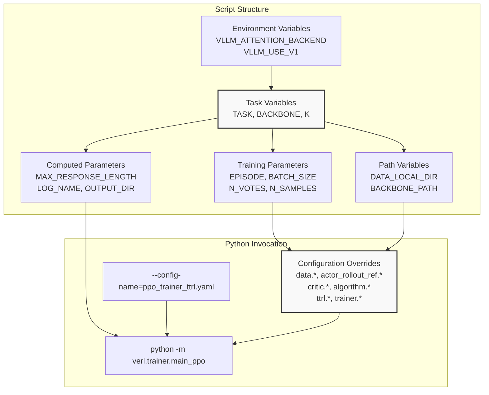
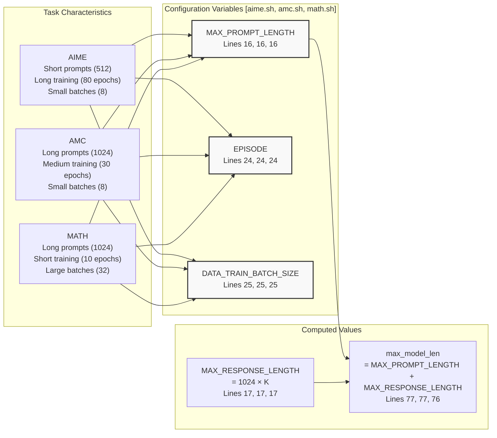
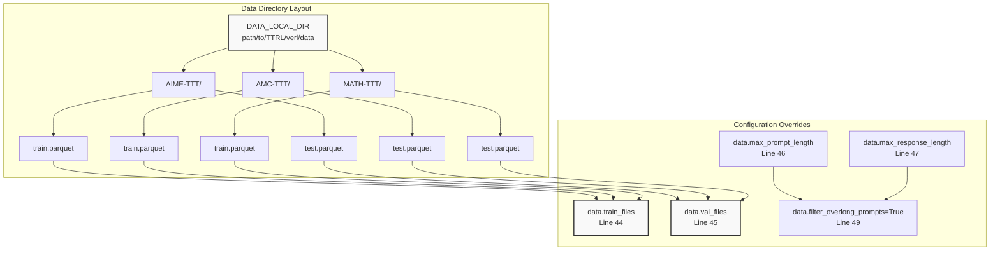
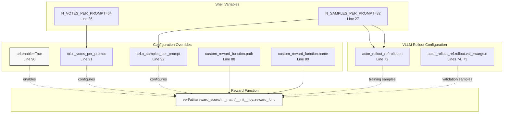
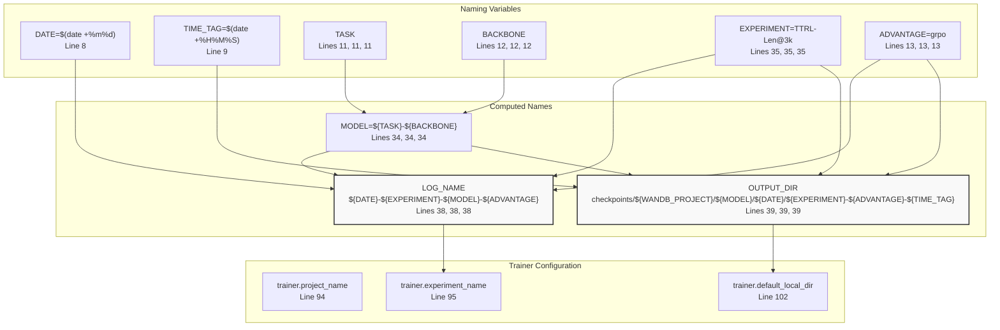
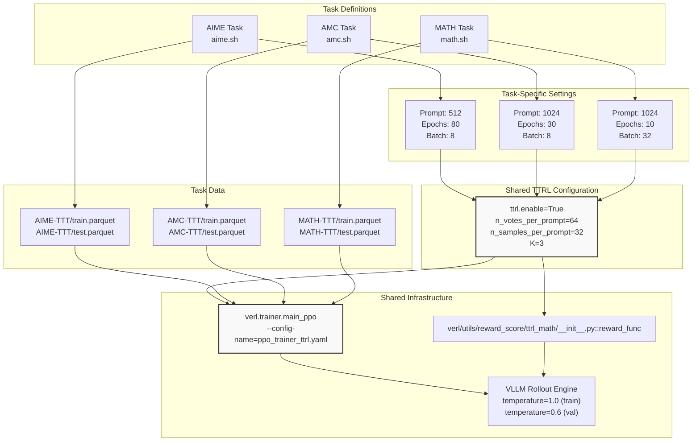

<!-- source: DeepWiki mcp.deepwiki.com · repo PRIME-RL/TTRL · page 3.3 Task Configurations · fetched 2026-10-30 -->

# Task Configurations

<details>
<summary>Relevant source files</summary>

The following files were used as context for generating this wiki page:

- [verl/examples/ttrl/Qwen2.5-Math/aime.sh](verl/examples/ttrl/Qwen2.5-Math/aime.sh)
- [verl/examples/ttrl/Qwen2.5-Math/amc.sh](verl/examples/ttrl/Qwen2.5-Math/amc.sh)
- [verl/examples/ttrl/Qwen2.5-Math/math.sh](verl/examples/ttrl/Qwen2.5-Math/math.sh)

</details>


## Purpose and Scope

This document describes how to configure TTRL training for different mathematical reasoning tasks. It covers the task-specific configuration parameters, data setup, and structural differences between tasks. Each task (AIME, AMC, MATH) has unique characteristics that require different prompt lengths, training epochs, and batch sizes.

For model-specific configurations (Qwen2.5, Qwen2.5-Math, LLaMA3.1), see [Model Configurations](#3.2). For detailed configuration of individual tasks, see [AIME Tasks](#3.3.1), [AMC Tasks](#3.3.2), and [MATH Tasks](#3.3.3).

## Task Configuration Structure

All TTRL task configurations follow a common shell script structure that sets environment variables and invokes `verl.trainer.main_ppo` with task-specific overrides. The configurations are organized in model-family subdirectories under `verl/examples/ttrl/`.

### Common Configuration Pattern



**Configuration Flow**: Each task script sets shell variables that control training parameters, then invokes the main PPO trainer with these values as Hydra configuration overrides.

Sources: [verl/examples/ttrl/Qwen2.5-Math/aime.sh:1-41](), [verl/examples/ttrl/Qwen2.5-Math/amc.sh:1-41](), [verl/examples/ttrl/Qwen2.5-Math/math.sh:1-41]()

## Task-Specific Parameters

Different mathematical reasoning tasks have varying complexity and problem structures, requiring distinct configuration parameters. The following table summarizes the key differences:

| Parameter | AIME | AMC | MATH | Purpose |
|-----------|------|-----|------|---------|
| `TASK` | `"AIME-TTT"` | `"AMC-TTT"` | `"MATH-TTT"` | Task identifier for data loading |
| `MAX_PROMPT_LENGTH` | 512 | 1024 | 1024 | Maximum input problem length |
| `EPISODE` | 80 | 30 | 10 | Total training epochs |
| `DATA_TRAIN_BATCH_SIZE` | 8 | 8 | 32 | Training batch size |
| `K` | 3 | 3 | 3 | Response length multiplier (K × 1024) |
| `N_VOTES_PER_PROMPT` | 64 | 64 | 64 | Votes for majority voting |
| `N_SAMPLES_PER_PROMPT` | 32 | 32 | 32 | Samples generated per prompt |

### Parameter Relationships



**Configuration Rationale**:
- **AIME**: Shorter prompts (512 tokens) accommodate concise problem statements, with longer training (80 epochs) to handle high difficulty
- **AMC**: Standard prompt length (1024 tokens) for moderate complexity, medium training duration (30 epochs)
- **MATH**: Standard prompt length (1024 tokens) with higher batch size (32) and fewer epochs (10) for the larger dataset

Sources: [verl/examples/ttrl/Qwen2.5-Math/aime.sh:11-29](), [verl/examples/ttrl/Qwen2.5-Math/amc.sh:11-29](), [verl/examples/ttrl/Qwen2.5-Math/math.sh:11-29]()

## Data Configuration

Each task requires properly formatted training and validation data in Parquet format. The data paths are specified through configuration overrides.

### Data Path Structure



**Data Configuration Pattern**: Each task script constructs data file paths by combining `DATA_LOCAL_DIR` with the task-specific `TASK` variable, pointing to `train.parquet` and `test.parquet` files within each task directory.

Sources: [verl/examples/ttrl/Qwen2.5-Math/aime.sh:31-50](), [verl/examples/ttrl/Qwen2.5-Math/amc.sh:31-50](), [verl/examples/ttrl/Qwen2.5-Math/math.sh:31-50]()

### Data Configuration Parameters

The following data-related parameters are passed as configuration overrides to `verl.trainer.main_ppo`:

```bash
data.train_files=["$DATA_LOCAL_DIR/$TASK/train.parquet"]
data.val_files=["$DATA_LOCAL_DIR/$TASK/test.parquet"]
data.max_prompt_length=$MAX_PROMPT_LENGTH
data.max_response_length=$MAX_RESPONSE_LENGTH
data.train_batch_size=$DATA_TRAIN_BATCH_SIZE
data.filter_overlong_prompts=True
data.truncation='error'
```

- **`data.train_files`**: List of training data Parquet files
- **`data.val_files`**: List of validation/test data Parquet files
- **`data.max_prompt_length`**: Maximum tokens for input problems (task-specific)
- **`data.max_response_length`**: Maximum tokens for model responses (computed as `1024 × K`)
- **`data.train_batch_size`**: Number of prompts per training batch (task-specific)
- **`data.filter_overlong_prompts`**: Remove prompts exceeding `max_prompt_length`
- **`data.truncation`**: Error on truncation rather than silently truncating

Sources: [verl/examples/ttrl/Qwen2.5-Math/aime.sh:44-50](), [verl/examples/ttrl/Qwen2.5-Math/amc.sh:44-50](), [verl/examples/ttrl/Qwen2.5-Math/math.sh:44-50]()

## TTRL-Specific Configuration

All tasks share the same TTRL voting and reward configuration, which enables the test-time training capability:

```bash
custom_reward_function.path="./verl/utils/reward_score/ttrl_math/__init__.py"
custom_reward_function.name=reward_func
ttrl.enable=True
ttrl.n_votes_per_prompt=$N_VOTES_PER_PROMPT
ttrl.n_samples_per_prompt=$N_SAMPLES_PER_PROMPT
```

### TTRL Configuration Mapping



**TTRL Configuration Consistency**: All tasks use identical TTRL parameters (64 votes, 32 samples), demonstrating that the voting mechanism is task-agnostic and depends only on the mathematical reward function.

Sources: [verl/examples/ttrl/Qwen2.5-Math/aime.sh:26-27,72,88-92](), [verl/examples/ttrl/Qwen2.5-Math/amc.sh:26-27,72,88-92](), [verl/examples/ttrl/Qwen2.5-Math/math.sh:26-27,89-91]()

## Training Configuration

Each task defines training-related parameters that control the overall training loop and checkpoint management:

```bash
trainer.logger=['console','wandb']
trainer.project_name=$WANDB_PROJECT
trainer.experiment_name=$LOG_NAME
trainer.n_gpus_per_node=8
trainer.nnodes=1
trainer.save_freq=2000000
trainer.test_freq=2
trainer.max_actor_ckpt_to_keep=0
trainer.max_critic_ckpt_to_keep=0
trainer.default_local_dir=$OUTPUT_DIR
trainer.total_epochs=$EPISODE
```

### Output Directory Structure



**Output Organization**: Each training run creates a uniquely timestamped directory under `checkpoints/TTRL-verl/{TASK}-{BACKBONE}/{DATE}/` with the experiment name logged to Weights & Biases.

Sources: [verl/examples/ttrl/Qwen2.5-Math/aime.sh:8-39,93-103](), [verl/examples/ttrl/Qwen2.5-Math/amc.sh:8-39,93-103](), [verl/examples/ttrl/Qwen2.5-Math/math.sh:8-39,92-102]()

## Task Comparison Summary

The following diagram illustrates how different tasks map to their specific configurations while sharing common TTRL infrastructure:



**Key Insight**: Task configurations differ only in prompt lengths, training epochs, and batch sizes, while sharing all TTRL-specific mechanisms (voting, sampling, reward computation). This design allows TTRL to be easily adapted to new mathematical reasoning tasks by adjusting only dataset-specific parameters.

Sources: [verl/examples/ttrl/Qwen2.5-Math/aime.sh:1-105](), [verl/examples/ttrl/Qwen2.5-Math/amc.sh:1-105](), [verl/examples/ttrl/Qwen2.5-Math/math.sh:1-104]()

---

