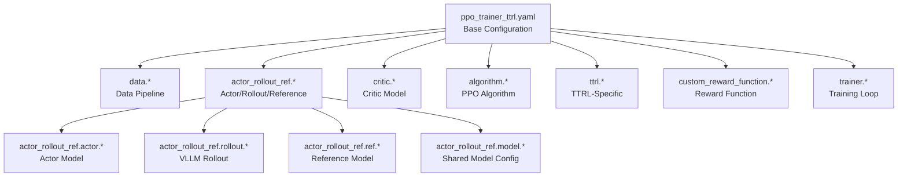
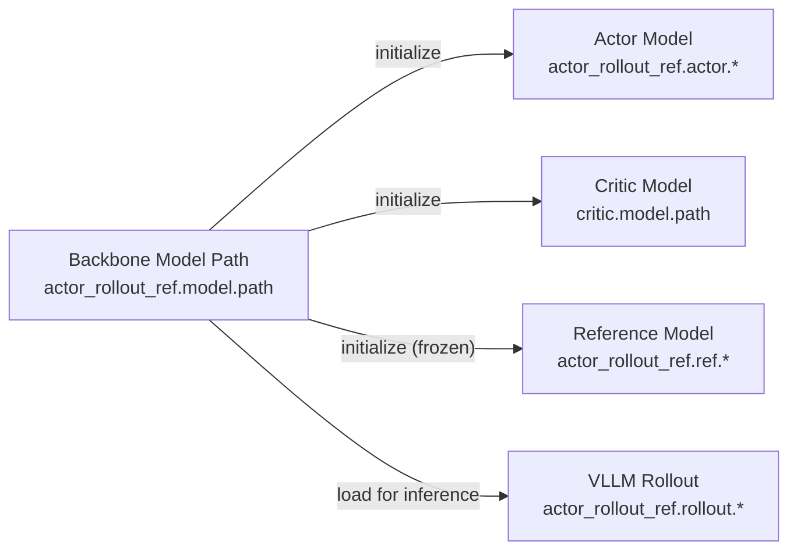
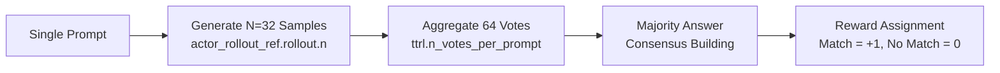
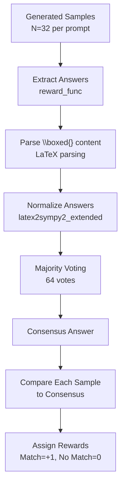
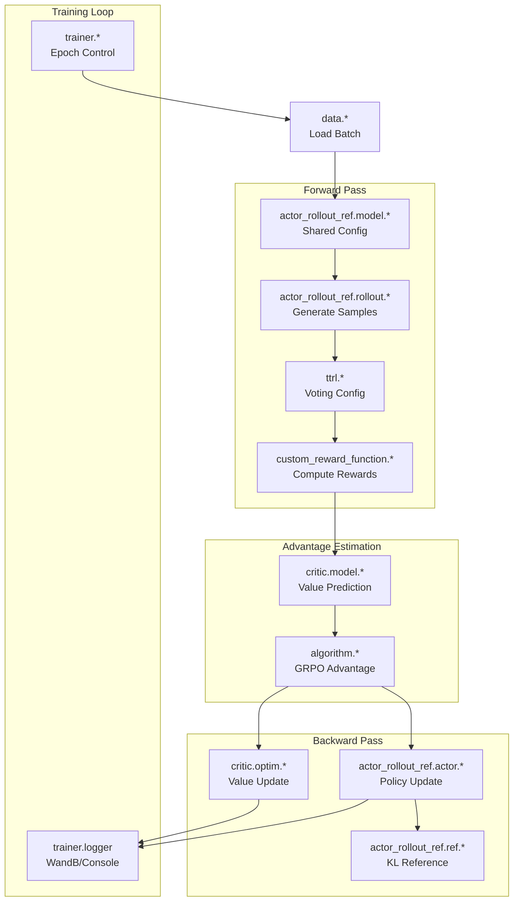

<!-- source: DeepWiki mcp.deepwiki.com · repo PRIME-RL/TTRL · page 3.4 Hyperparameter Reference · fetched 2026-10-30 -->

# Hyperparameter Reference

<details>
<summary>Relevant source files</summary>

The following files were used as context for generating this wiki page:

- [README.md](README.md)
- [verl/examples/ttrl/Qwen2.5-Math/aime.sh](verl/examples/ttrl/Qwen2.5-Math/aime.sh)
- [verl/examples/ttrl/Qwen2.5/aime.sh](verl/examples/ttrl/Qwen2.5/aime.sh)

</details>


## Purpose and Scope

This page provides a comprehensive reference of all configurable hyperparameters in the TTRL system. It documents the parameter hierarchy, explains the purpose of each parameter, and provides recommended value ranges based on the official examples.

For quick start examples using these parameters, see [Quick Start](#3.1). For model-specific configurations, see [Model Configurations](#3.2). For the Hydra-based configuration management system, see [Configuration Management](#5.2).

---

## Configuration Hierarchy

TTRL uses a hierarchical configuration system based on Hydra, with the base configuration file `ppo_trainer_ttrl.yaml`. Parameters are organized into logical groups that correspond to different system components.

**Configuration Structure Overview**



**Sources:** [verl/examples/ttrl/Qwen2.5/aime.sh:42-104](), [verl/examples/ttrl/Qwen2.5-Math/aime.sh:42-103]()

---

## Data Pipeline Parameters

Parameters controlling data loading, preprocessing, and batching.

| Parameter | Type | Default/Example | Description |
|-----------|------|-----------------|-------------|
| `data.train_files` | List[str] | `["path/to/train.parquet"]` | Paths to training data in Parquet format |
| `data.val_files` | List[str] | `["path/to/test.parquet"]` | Paths to validation/test data in Parquet format |
| `data.max_prompt_length` | int | `512` | Maximum length of input prompts in tokens |
| `data.max_response_length` | int | `3072` (1024 × 3) | Maximum length of generated responses in tokens |
| `data.train_batch_size` | int | `8` | Number of prompts per training batch |
| `data.filter_overlong_prompts` | bool | `True` | Filter out prompts exceeding `max_prompt_length` |
| `data.truncation` | str | `'error'` | How to handle overlong sequences: `'error'` or `'truncate'` |
| `data.suffix_prompt` | str | Optional | Suffix appended to all prompts (e.g., instruction text) |

**Example Prompt Suffix:**
```python
# For Qwen2.5 models
data.suffix_prompt='"\nPlease reason step by step, and put your final answer within \boxed{}."'
```

**Response Length Calculation:**
The `max_response_length` is typically computed as `1024 × K` where `K` is the response length multiplier:
- `K=3`: Standard configuration (3072 tokens)
- `K>8`: Use smaller `N` values (4 instead of 16) for validation

**Sources:** [verl/examples/ttrl/Qwen2.5/aime.sh:16-17,44-51](), [verl/examples/ttrl/Qwen2.5-Math/aime.sh:16-17,44-50]()

---

## Model Path and Backbone Parameters

Shared parameters for initializing the actor, critic, and reference models from a pre-trained backbone.

| Parameter | Type | Example | Description |
|-----------|------|---------|-------------|
| `actor_rollout_ref.model.path` | str | `"path/to/Qwen2.5-7B"` | Path to pre-trained model checkpoint |
| `actor_rollout_ref.model.enable_gradient_checkpointing` | bool | `True` | Enable gradient checkpointing for memory efficiency |
| `actor_rollout_ref.model.use_remove_padding` | bool | `True` | Remove padding tokens for memory and speed optimization |

**Model Architecture Configuration Diagram**



**Sources:** [verl/examples/ttrl/Qwen2.5/aime.sh:52-54](), [verl/examples/ttrl/Qwen2.5-Math/aime.sh:51-53]()

---

## Actor Parameters

Parameters controlling the actor model (trainable policy network).

### Training Configuration

| Parameter | Type | Default | Description |
|-----------|------|---------|-------------|
| `actor_rollout_ref.actor.ppo_mini_batch_size` | int | `1` | Number of mini-batches for PPO updates |
| `actor_rollout_ref.actor.ppo_micro_batch_size_per_gpu` | int | `2` | Micro-batch size per GPU for gradient accumulation |
| `actor_rollout_ref.actor.use_kl_loss` | bool | `True` | Enable KL divergence loss vs. reference model |
| `actor_rollout_ref.actor.ppo_max_token_len_per_gpu` | int | `3584` | Maximum total tokens (prompt + response) per GPU |

### Optimizer Configuration

| Parameter | Type | Default | Description |
|-----------|------|---------|-------------|
| `actor_rollout_ref.actor.optim.lr` | float | `5e-7` | Learning rate for actor optimizer (Adam) |
| `actor_rollout_ref.actor.optim.lr_warmup_steps_ratio` | float | `0.03` | Ratio of total steps for learning rate warmup (3%) |
| `actor_rollout_ref.actor.optim.warmup_style` | str | `'cosine'` | Warmup schedule style: `'cosine'` or `'linear'` |

### FSDP Configuration

| Parameter | Type | Default | Description |
|-----------|------|---------|-------------|
| `actor_rollout_ref.actor.fsdp_config.param_offload` | bool | `False` | Offload parameters to CPU (disabled for fast updates) |
| `actor_rollout_ref.actor.fsdp_config.optimizer_offload` | bool | `False` | Offload optimizer states to CPU (disabled for fast updates) |

**Actor Learning Rate Rationale:**
The actor uses a very conservative learning rate (`5e-7`) to ensure stable policy updates. This is 18× slower than the critic learning rate (`9e-6`) to prevent policy from diverging too quickly.

**Sources:** [verl/examples/ttrl/Qwen2.5/aime.sh:55-63](), [verl/examples/ttrl/Qwen2.5-Math/aime.sh:54-62]()

---

## Critic Parameters

Parameters controlling the critic model (value function network).

| Parameter | Type | Default | Description |
|-----------|------|---------|-------------|
| `critic.model.path` | str | Same as backbone | Path to critic model (initialized from backbone) |
| `critic.model.enable_gradient_checkpointing` | bool | `True` | Enable gradient checkpointing for memory efficiency |
| `critic.model.use_remove_padding` | bool | `True` | Remove padding tokens for optimization |
| `critic.ppo_micro_batch_size_per_gpu` | int | `2` | Micro-batch size per GPU |
| `critic.optim.lr` | float | `9e-6` | Learning rate for critic optimizer (18× faster than actor) |
| `critic.model.fsdp_config.param_offload` | bool | `False` | No parameter offloading for fast updates |
| `critic.model.fsdp_config.optimizer_offload` | bool | `False` | No optimizer offloading for fast updates |

**Critic vs. Actor Learning Rates:**
The critic learns 18× faster than the actor (`9e-6` vs. `5e-7`) to quickly adapt to the changing policy and provide accurate value estimates.

**Sources:** [verl/examples/ttrl/Qwen2.5/aime.sh:80-86](), [verl/examples/ttrl/Qwen2.5-Math/aime.sh:79-85]()

---

## Reference Model Parameters

Parameters for the frozen reference model used to compute KL divergence.

| Parameter | Type | Default | Description |
|-----------|------|---------|-------------|
| `actor_rollout_ref.ref.log_prob_micro_batch_size_per_gpu` | int | `2` | Micro-batch size for log probability computation |
| `actor_rollout_ref.ref.fsdp_config.param_offload` | bool | `True` | Offload parameters to CPU (enabled for memory savings) |

**Reference Model Memory Optimization:**
Unlike actor and critic, the reference model has `param_offload=True` because it is frozen (no gradient updates), so offloading parameters to CPU saves GPU memory without affecting training speed.

**Sources:** [verl/examples/ttrl/Qwen2.5/aime.sh:64-65](), [verl/examples/ttrl/Qwen2.5-Math/aime.sh:63-64]()

---

## Rollout/VLLM Parameters

Parameters controlling the VLLM inference engine for high-throughput sampling.

### VLLM Engine Configuration

| Parameter | Type | Default | Description |
|-----------|------|---------|-------------|
| `actor_rollout_ref.rollout.name` | str | `'vllm'` | Rollout engine name |
| `actor_rollout_ref.rollout.tensor_model_parallel_size` | int | `1` | Number of GPUs for tensor parallelism |
| `actor_rollout_ref.rollout.gpu_memory_utilization` | float | `0.8` | Target GPU memory utilization (80%) |
| `actor_rollout_ref.rollout.enforce_eager` | bool | `False` | Force eager execution instead of CUDA graphs |
| `actor_rollout_ref.rollout.free_cache_engine` | bool | `False` | Free KV cache after each generation |
| `actor_rollout_ref.rollout.log_prob_micro_batch_size_per_gpu` | int | `2` | Micro-batch size for log probability computation |
| `actor_rollout_ref.rollout.max_model_len` | int | `3584` | Maximum total sequence length |
| `actor_rollout_ref.rollout.max_num_batched_tokens` | int | `3584` | Maximum tokens in a batched request |

### Training-Time Sampling

| Parameter | Type | Default (Math) | Default (Qwen) | Description |
|-----------|------|----------------|----------------|-------------|
| `actor_rollout_ref.rollout.temperature` | float | `1.0` | `0.6` | Sampling temperature during training |
| `actor_rollout_ref.rollout.n` | int | `32` | `32` | Number of samples per prompt (training) |

### Validation-Time Sampling

| Parameter | Type | Default | Description |
|-----------|------|---------|-------------|
| `actor_rollout_ref.rollout.val_kwargs.do_sample` | bool | `True` | Enable sampling during validation |
| `actor_rollout_ref.rollout.val_kwargs.n` | int | `16` or `4` | Number of samples per prompt (validation) |
| `actor_rollout_ref.rollout.val_kwargs.top_p` | float | `0.95` | Nucleus sampling threshold |
| `actor_rollout_ref.rollout.val_kwargs.temperature` | float | `0.6` | Sampling temperature during validation |

**Temperature Configuration by Model:**
- **Qwen2.5-Math**: Training temperature `1.0` (more exploration)
- **Qwen2.5**: Training temperature `0.6` (less exploration)
- **Validation**: Always `0.6` for consistent evaluation

**Validation Sample Count:**
```bash
if [ "$K" -gt 8 ]; then
  N=4  # Fewer samples for very long responses
else
  N=16  # Standard sample count
fi
```

**VLLM v1 Configuration:**
```bash
export VLLM_USE_V1=1
unset VLLM_ATTENTION_BACKEND
```

**Sources:** [verl/examples/ttrl/Qwen2.5/aime.sh:1-4,18-22,66-79](), [verl/examples/ttrl/Qwen2.5-Math/aime.sh:1-4,18-22,65-78]()

---

## TTRL-Specific Parameters

Parameters unique to the TTRL system for majority voting-based reward estimation.

| Parameter | Type | Default | Description |
|-----------|------|---------|-------------|
| `ttrl.enable` | bool | `True` | Enable TTRL mode (required for test-time RL) |
| `ttrl.n_votes_per_prompt` | int | `64` | Total votes used for majority voting per prompt |
| `ttrl.n_samples_per_prompt` | int | `32` | Number of samples generated per prompt |

**TTRL Voting Mechanism:**



**Vote-to-Sample Ratio:**
With 64 votes from 32 samples, the system effectively votes on each sample twice (`64/32 = 2`), providing redundancy in the consensus estimation.

**Sources:** [verl/examples/ttrl/Qwen2.5/aime.sh:26-27,91-93](), [verl/examples/ttrl/Qwen2.5-Math/aime.sh:26-27,90-92]()

---

## Algorithm Parameters

Parameters controlling the PPO algorithm and advantage estimation.

| Parameter | Type | Default | Description |
|-----------|------|---------|-------------|
| `algorithm.kl_ctrl.kl_coef` | float | `0.00` | KL divergence penalty coefficient (minimal penalty) |
| `algorithm.adv_estimator` | str | `'grpo'` | Advantage estimator: `'grpo'` (Group Relative Policy Optimization) |

**KL Coefficient Rationale:**
The KL coefficient is set to `0.00`, meaning minimal penalty for deviating from the reference policy. TTRL relies on the reward signal from majority voting rather than strict policy regularization.

**GRPO Advantage Estimation:**
GRPO (Group Relative Policy Optimization) computes advantages relative to other samples in the same group, which aligns well with TTRL's majority voting approach.

**Sources:** [verl/examples/ttrl/Qwen2.5/aime.sh:87-88](), [verl/examples/ttrl/Qwen2.5-Math/aime.sh:86-87]()

---

## Custom Reward Function Parameters

Parameters specifying the reward function used to evaluate samples.

| Parameter | Type | Value | Description |
|-----------|------|-------|-------------|
| `custom_reward_function.path` | str | `"./verl/utils/reward_score/ttrl_math/__init__.py"` | Path to reward function module |
| `custom_reward_function.name` | str | `reward_func` | Function name to import from the module |

**Reward Function Workflow:**



For mathematical reasoning tasks, the reward function:
1. Extracts answers from `\boxed{}` LaTeX expressions
2. Normalizes mathematical expressions using `latex2sympy2_extended`
3. Aggregates votes to find majority answer
4. Assigns binary rewards based on match with majority

**Sources:** [verl/examples/ttrl/Qwen2.5/aime.sh:89-90](), [verl/examples/ttrl/Qwen2.5-Math/aime.sh:88-89]()

---

## Trainer Parameters

Parameters controlling the overall training loop and experiment tracking.

### Experiment Tracking

| Parameter | Type | Default | Description |
|-----------|------|---------|-------------|
| `trainer.logger` | List[str] | `['console','wandb']` | Logging backends to use |
| `trainer.project_name` | str | `"TTRL-verl"` | Weights & Biases project name |
| `trainer.experiment_name` | str | Custom | Experiment name for logging |

### Training Schedule

| Parameter | Type | Default | Description |
|-----------|------|---------|-------------|
| `trainer.total_epochs` | int | `80` | Total number of training epochs/episodes |
| `trainer.test_freq` | int | `2` | Frequency of validation evaluation (every N epochs) |
| `trainer.save_freq` | int | `2000000` | Frequency of checkpoint saving (effectively disabled) |

### Distributed Training

| Parameter | Type | Default | Description |
|-----------|------|---------|-------------|
| `trainer.n_gpus_per_node` | int | `8` | Number of GPUs per node |
| `trainer.nnodes` | int | `1` | Number of nodes for distributed training |

### Checkpoint Management

| Parameter | Type | Default | Description |
|-----------|------|---------|-------------|
| `trainer.max_actor_ckpt_to_keep` | int | `0` | Maximum actor checkpoints to keep (0 = none) |
| `trainer.max_critic_ckpt_to_keep` | int | `0` | Maximum critic checkpoints to keep (0 = none) |
| `trainer.default_local_dir` | str | Custom | Directory for saving outputs and logs |

**Checkpoint Strategy:**
By default, checkpoints are not saved (`max_*_ckpt_to_keep=0`, `save_freq=2000000`) to save disk space. For production runs, adjust these values to enable periodic checkpointing.

**Sources:** [verl/examples/ttrl/Qwen2.5/aime.sh:24,94-104](), [verl/examples/ttrl/Qwen2.5-Math/aime.sh:24,93-103]()

---

## Complete Parameter Flow Diagram

This diagram shows how different parameter groups interact during a training iteration:



**Sources:** [verl/examples/ttrl/Qwen2.5/aime.sh:42-104](), [verl/examples/ttrl/Qwen2.5-Math/aime.sh:42-103]()

---

## Recommended Value Ranges

### Critical Parameters for Tuning

| Parameter | Recommended Range | Notes |
|-----------|-------------------|-------|
| `actor_rollout_ref.actor.optim.lr` | `1e-7` to `1e-6` | Start conservative; `5e-7` is safe default |
| `critic.optim.lr` | `5e-6` to `2e-5` | Keep 10-20× faster than actor |
| `data.train_batch_size` | `4` to `16` | Depends on GPU memory; `8` is standard |
| `ttrl.n_samples_per_prompt` | `16` to `64` | Higher = better voting but slower; `32` is balanced |
| `ttrl.n_votes_per_prompt` | `32` to `128` | Should be ≥ `n_samples_per_prompt`; `64` is typical |
| `actor_rollout_ref.rollout.temperature` | `0.6` to `1.0` | Higher for exploration, lower for exploitation |
| `data.max_response_length` | `2048` to `4096` | Depends on task complexity |

### Memory-Constrained Settings

For smaller GPUs (e.g., 40GB instead of 80GB):
- Reduce `data.train_batch_size` from `8` to `4`
- Reduce `ttrl.n_samples_per_prompt` from `32` to `16`
- Reduce `actor_rollout_ref.rollout.gpu_memory_utilization` from `0.8` to `0.7`
- Set `actor_rollout_ref.rollout.tensor_model_parallel_size` to `2` or `4`

### Performance-Optimized Settings

For maximum throughput:
- Set `actor_rollout_ref.model.use_remove_padding=True`
- Set `critic.model.use_remove_padding=True`
- Enable `actor_rollout_ref.model.enable_gradient_checkpointing=True`
- Use `actor_rollout_ref.rollout.enforce_eager=False` (enable CUDA graphs)
- Set `actor_rollout_ref.rollout.free_cache_engine=False` (reuse KV cache)

**Sources:** [verl/examples/ttrl/Qwen2.5/aime.sh:1-104](), [verl/examples/ttrl/Qwen2.5-Math/aime.sh:1-103]()

---

## Parameter Dependencies

Some parameters are interdependent and must be configured consistently:

### Length Constraints
```python
max_total_length = data.max_prompt_length + data.max_response_length
actor_rollout_ref.actor.ppo_max_token_len_per_gpu >= max_total_length
actor_rollout_ref.rollout.max_model_len >= max_total_length
actor_rollout_ref.rollout.max_num_batched_tokens >= max_total_length
```

### Batch Size Relationships
```python
# Effective batch size per GPU
effective_batch_size = actor_rollout_ref.actor.ppo_mini_batch_size × 
                       actor_rollout_ref.actor.ppo_micro_batch_size_per_gpu
```

### TTRL Voting Constraints
```python
# Votes should be multiple of samples for even distribution
ttrl.n_votes_per_prompt % ttrl.n_samples_per_prompt == 0  # Recommended

# Samples must match rollout configuration
ttrl.n_samples_per_prompt == actor_rollout_ref.rollout.n
```

### FSDP Offloading Strategy
```python
# Actor and Critic: No offloading (fast updates)
actor_rollout_ref.actor.fsdp_config.param_offload = False
actor_rollout_ref.actor.fsdp_config.optimizer_offload = False
critic.model.fsdp_config.param_offload = False
critic.model.fsdp_config.optimizer_offload = False

# Reference: Offload parameters (frozen, save memory)
actor_rollout_ref.ref.fsdp_config.param_offload = True
```

**Sources:** [verl/examples/ttrl/Qwen2.5/aime.sh:16-17,28-29,62-63,72-73,78-79](), [verl/examples/ttrl/Qwen2.5-Math/aime.sh:16-17,28-29,61-62,71-72,77-78]()

---

## Environment Variables

TTRL relies on several environment variables that affect VLLM behavior:

| Variable | Recommended Value | Description |
|----------|-------------------|-------------|
| `VLLM_USE_V1` | `1` | Enable VLLM v1 API (required for TTRL) |
| `VLLM_ATTENTION_BACKEND` | unset | Use default attention backend (unset for best performance) |

**Configuration Script:**
```bash
export VLLM_USE_V1=1
unset VLLM_ATTENTION_BACKEND
```

Alternative attention backend (if needed):
```bash
export VLLM_ATTENTION_BACKEND=XFORMERS
```

**Sources:** [verl/examples/ttrl/Qwen2.5/aime.sh:1-4](), [verl/examples/ttrl/Qwen2.5-Math/aime.sh:1-4]()

---

