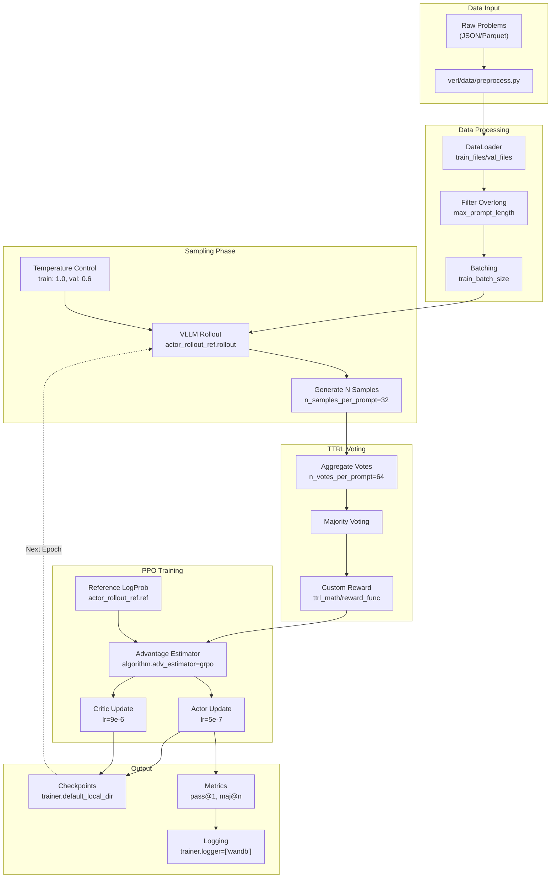
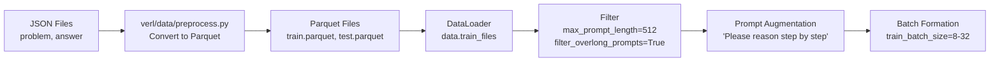
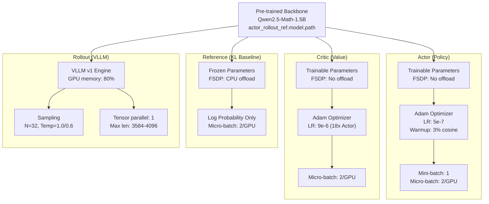
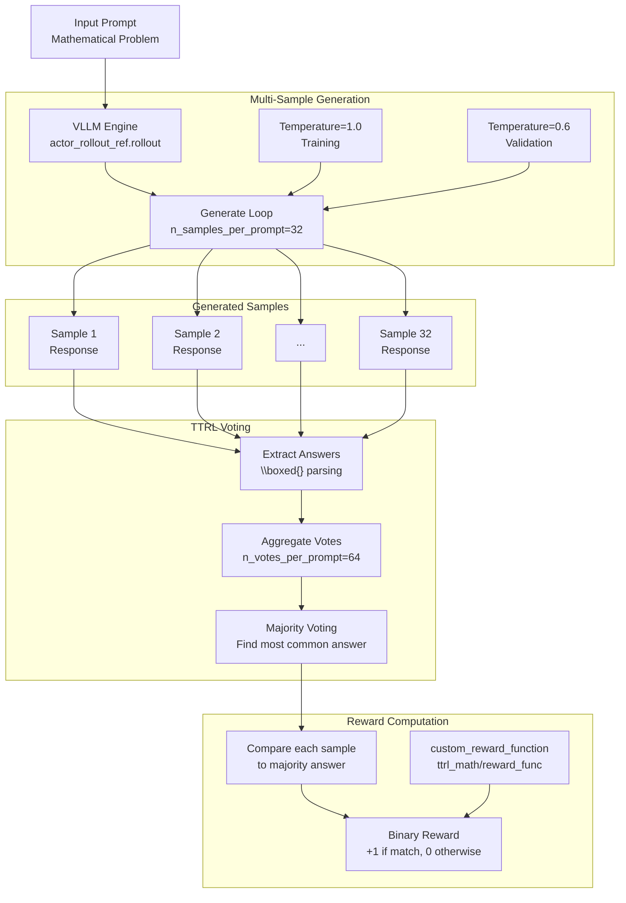
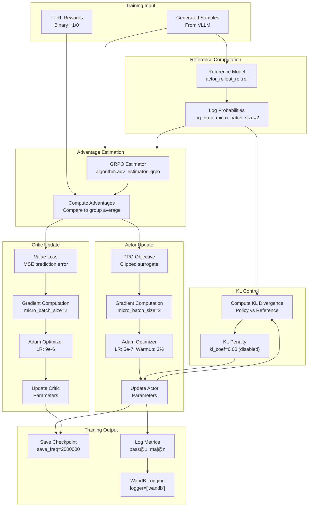

<!-- source: DeepWiki mcp.deepwiki.com · repo PRIME-RL/TTRL · page 4 Training Pipeline · fetched 2026-10-30 -->

# Training Pipeline

<details>
<summary>Relevant source files</summary>

The following files were used as context for generating this wiki page:

- [README.md](README.md)
- [figs/overview.png](figs/overview.png)
- [figs/ttrl_reward.png](figs/ttrl_reward.png)
- [verl/examples/ttrl/Qwen2.5-Math/aime.sh](verl/examples/ttrl/Qwen2.5-Math/aime.sh)

</details>


This document provides a detailed technical explanation of the TTRL training pipeline, covering the complete data flow from raw mathematical problems through preprocessing, sampling, voting, and PPO updates. The pipeline integrates TTRL's majority voting mechanism with the verl framework's PPO implementation to enable reinforcement learning on unlabeled test data.

For information about installing dependencies and environment setup, see [Setup and Installation](#2). For configuration parameters and hyperparameter tuning, see [Configuration Guide](#3). For details on verl framework integration, see [verl Framework Integration](#5).

## Pipeline Overview

The TTRL training pipeline consists of four major stages executed iteratively over multiple epochs:

1. **Data Processing**: Load and preprocess mathematical problems from JSON/Parquet format, apply prompt augmentation, and batch inputs
2. **Sampling & Rollout**: Generate multiple response samples per prompt using VLLM engine with the current policy
3. **Voting & Reward**: Apply majority voting across samples to compute self-supervised rewards without ground truth labels
4. **PPO Update**: Update actor (policy) and critic (value) networks using PPO algorithm with computed rewards

The pipeline entry point is `verl.trainer.main_ppo`, configured via `ppo_trainer_ttrl.yaml` with TTRL enabled through `+ttrl.enable=True`.



**Diagram: TTRL Training Pipeline with verl Configuration Parameters**

Sources: [verl/examples/ttrl/Qwen2.5-Math/aime.sh:1-105](), [README.md:42-105]()

---

## 4.1 Data Processing Pipeline

The data processing pipeline transforms raw mathematical problems into batched tensors suitable for model input. The pipeline handles format conversion, prompt augmentation, length filtering, and batching.

### Data Loading and Format Conversion

TTRL uses Parquet format for efficient data loading. Raw JSON datasets are converted using the preprocessing script at [verl/data/preprocess.py](). The script converts problem-answer pairs into Parquet files with columns for prompts and optional ground truth labels.

Training and validation data are specified via configuration:
```yaml
data.train_files=["$DATA_LOCAL_DIR/$TASK/train.parquet"]
data.val_files=["$DATA_LOCAL_DIR/$TASK/test.parquet"]
```

### Prompt Augmentation

Mathematical reasoning tasks use prompt augmentation to encourage step-by-step reasoning. A common augmentation adds: `"Please reason step by step..."` to guide the model's generation process.

### Length Filtering and Truncation

The pipeline filters prompts and responses based on configured length limits:

| Parameter | Purpose | Typical Value |
|-----------|---------|---------------|
| `data.max_prompt_length` | Maximum input tokens | 512-1024 |
| `data.max_response_length` | Maximum output tokens | 1024×K (K=3-8) |
| `data.filter_overlong_prompts` | Remove long prompts | True |
| `data.truncation` | Truncation strategy | 'error' |

The `filter_overlong_prompts=True` setting removes prompts exceeding the maximum length, while `truncation='error'` raises an error if truncation would be needed during training.

### Batching Strategy

Data is batched according to `data.train_batch_size`, typically set to 8-32 prompts per batch. The pipeline maintains separate batch sizes for training and validation phases.



**Diagram: Data Processing Flow with Configuration Parameters**

Sources: [verl/examples/ttrl/Qwen2.5-Math/aime.sh:44-50](), [README.md:82-83]()

---

## 4.2 Actor-Critic-Reference Architecture

TTRL uses a four-component architecture where all models share a pre-trained backbone but serve distinct roles during training. The components are: Actor (trainable policy), Critic (value function), Reference (frozen KL baseline), and Rollout engine (VLLM for sampling).

### Component Roles and Configuration

| Component | Role | Training Status | Key Config Prefix |
|-----------|------|-----------------|-------------------|
| **Actor** | Policy network generating actions | Trainable | `actor_rollout_ref.actor` |
| **Critic** | Value function estimating returns | Trainable | `critic` |
| **Reference** | Frozen baseline for KL divergence | Frozen | `actor_rollout_ref.ref` |
| **Rollout** | High-throughput sampling engine | Inference only | `actor_rollout_ref.rollout` |

### Actor Configuration

The actor implements the policy network with conservative learning rates to ensure stable training:

```yaml
actor_rollout_ref.actor.optim.lr=5e-7
actor_rollout_ref.actor.optim.lr_warmup_steps_ratio=0.03
actor_rollout_ref.actor.optim.warmup_style='cosine'
actor_rollout_ref.actor.ppo_mini_batch_size=1
actor_rollout_ref.actor.ppo_micro_batch_size_per_gpu=2
actor_rollout_ref.actor.use_kl_loss=True
```

FSDP (Fully Sharded Data Parallel) configuration for the actor:
- `param_offload=False`: Keep parameters on GPU for fast updates
- `optimizer_offload=False`: Keep optimizer states on GPU
- `enable_gradient_checkpointing=True`: Reduce memory via activation checkpointing
- `use_remove_padding=True`: Remove padding tokens for efficiency

### Critic Configuration

The critic learns approximately 18× faster than the actor to track policy changes:

```yaml
critic.optim.lr=9e-6  # 18x larger than actor LR
critic.ppo_micro_batch_size_per_gpu=2
critic.model.enable_gradient_checkpointing=True
critic.model.use_remove_padding=True
```

FSDP configuration mirrors the actor with no parameter/optimizer offload.

### Reference Model Configuration

The reference model remains frozen throughout training and uses CPU offloading to conserve GPU memory:

```yaml
actor_rollout_ref.ref.log_prob_micro_batch_size_per_gpu=2
actor_rollout_ref.ref.fsdp_config.param_offload=True  # Offload to CPU
```

The reference model only computes log probabilities for KL divergence calculation, requiring no gradient computation.

### Rollout Engine (VLLM)

VLLM provides high-throughput inference for generating multiple samples per prompt:

```yaml
actor_rollout_ref.rollout.name=vllm
actor_rollout_ref.rollout.tensor_model_parallel_size=1
actor_rollout_ref.rollout.gpu_memory_utilization=0.8
actor_rollout_ref.rollout.max_model_len=3584-4096
actor_rollout_ref.rollout.n=32  # n_samples_per_prompt
actor_rollout_ref.rollout.temperature=1.0  # Training
actor_rollout_ref.rollout.val_kwargs.temperature=0.6  # Validation
actor_rollout_ref.rollout.val_kwargs.top_p=0.95
```

VLLM v1 is enabled via `export VLLM_USE_V1=1` for improved performance.



**Diagram: Four-Component Architecture with Configuration Parameters**

Sources: [verl/examples/ttrl/Qwen2.5-Math/aime.sh:51-78](), [verl/examples/ttrl/Qwen2.5-Math/aime.sh:79-86]()

---

## 4.3 TTRL Voting and Sampling

The core innovation of TTRL is using majority voting across multiple samples to create self-supervised rewards without ground truth labels. This section details the sampling strategy and voting mechanism.

### Multi-Sample Generation

For each prompt in a batch, VLLM generates `n_samples_per_prompt` responses (typically 32) using the current policy. The sampling uses temperature-controlled generation:

- **Training**: `temperature=1.0` for diverse exploration
- **Validation**: `temperature=0.6` for more focused sampling

Additional sampling parameters:
- `top_p=0.95`: Nucleus sampling threshold
- `do_sample=True`: Enable stochastic sampling
- `max_num_batched_tokens`: Controls batch size based on token length

### Voting Mechanism

TTRL aggregates votes across samples to determine the majority answer:

1. **Sample Collection**: Generate `n_samples_per_prompt=32` responses
2. **Vote Aggregation**: Collect `n_votes_per_prompt=64` votes (can exceed sample count by resampling or collecting multiple votes per sample)
3. **Majority Computation**: Identify the most common answer across all votes
4. **Reward Assignment**: Assign binary rewards (+1 or 0) based on match with majority

The voting configuration is specified as:
```yaml
ttrl.enable=True
ttrl.n_votes_per_prompt=64
ttrl.n_samples_per_prompt=32
```

### Custom Reward Function

The reward computation is implemented in a custom function at [verl/utils/reward_score/ttrl_math/__init__.py]():

```yaml
custom_reward_function.path="./verl/utils/reward_score/ttrl_math/__init__.py"
custom_reward_function.name=reward_func
```

For mathematical reasoning tasks, the reward function:
1. Extracts answers from `\boxed{}` LaTeX notation
2. Normalizes answer formats (e.g., fractions, decimals)
3. Performs majority voting across extracted answers
4. Assigns binary rewards: +1 if sample matches majority, 0 otherwise

### Temperature Scheduling

Different temperature values are used for training vs. validation:

| Phase | Temperature | Purpose |
|-------|-------------|---------|
| Training Rollout | 1.0 | Encourage exploration and diverse samples |
| Validation | 0.6 | More focused sampling for evaluation |

The training rollout uses higher temperature to generate diverse samples, which improves the quality of majority voting by exploring multiple solution paths.



**Diagram: TTRL Sampling and Voting Pipeline**

Sources: [verl/examples/ttrl/Qwen2.5-Math/aime.sh:66-78](), [verl/examples/ttrl/Qwen2.5-Math/aime.sh:88-92](), [README.md:95-99]()

---

## 4.4 PPO Training Loop

The PPO (Proximal Policy Optimization) training loop updates the actor and critic networks using rewards computed from majority voting. TTRL uses the GRPO (Group Relative Policy Optimization) advantage estimator.

### Advantage Estimation

TTRL uses the GRPO advantage estimator configured via:
```yaml
algorithm.adv_estimator=grpo
```

GRPO computes advantages by comparing the reward of each sample against the group average, making it suitable for scenarios where multiple samples per prompt are available.

### Policy Update (Actor)

The actor is updated using PPO with a clipped objective function:

**Learning Rate Schedule**:
- Base LR: `5e-7`
- Warmup: `3%` of total steps
- Schedule: `cosine` decay

**Batch Configuration**:
- `ppo_mini_batch_size=1`: Number of mini-batches per update
- `ppo_micro_batch_size_per_gpu=2`: Micro-batch size for gradient accumulation

**KL Divergence Constraint**:
```yaml
actor_rollout_ref.actor.use_kl_loss=True
algorithm.kl_ctrl.kl_coef=0.00
```

Despite enabling KL loss computation, the coefficient is set to 0.00, effectively disabling the penalty. This allows the policy to deviate more from the reference model.

### Value Function Update (Critic)

The critic is updated to predict expected returns:

**Learning Rate**:
- Base LR: `9e-6` (18× larger than actor)

The higher learning rate allows the critic to quickly adapt to policy changes, maintaining accurate value estimates for advantage computation.

**Batch Configuration**:
- `ppo_micro_batch_size_per_gpu=2`: Matches actor's micro-batch size

### Training Loop Execution

The training loop is executed for `trainer.total_epochs` (typically 80 for AIME tasks):

1. **Rollout Phase**: Generate samples using VLLM with current policy
2. **Reward Computation**: Apply TTRL voting and compute binary rewards
3. **Reference LogProb**: Compute log probabilities from frozen reference model
4. **Advantage Estimation**: Use GRPO to compute advantages
5. **Actor Update**: Update policy parameters via PPO objective
6. **Critic Update**: Update value function to minimize prediction error

### Checkpoint and Evaluation

Model checkpoints and evaluation metrics are controlled by:

```yaml
trainer.save_freq=2000000  # Very high, effectively disabled
trainer.test_freq=2  # Evaluate every 2 epochs
trainer.max_actor_ckpt_to_keep=0  # No checkpoint retention
trainer.max_critic_ckpt_to_keep=0  # No checkpoint retention
trainer.default_local_dir=$OUTPUT_DIR  # Final checkpoint location
```

The configuration prioritizes training speed by minimizing checkpoint I/O, with evaluation performed every 2 epochs.

### Memory Optimization

Several techniques reduce memory usage during training:

| Technique | Configuration | Purpose |
|-----------|---------------|---------|
| Gradient Checkpointing | `enable_gradient_checkpointing=True` | Trade compute for memory |
| Padding Removal | `use_remove_padding=True` | Remove padding tokens from computation |
| Micro-batching | `ppo_micro_batch_size_per_gpu=2` | Accumulate gradients over smaller batches |
| Reference Offload | `ref.fsdp_config.param_offload=True` | Offload frozen reference to CPU |
| FSDP | Implicit via config | Shard parameters across GPUs |



**Diagram: PPO Training Loop with TTRL Integration**

Sources: [verl/examples/ttrl/Qwen2.5-Math/aime.sh:42-103](), [verl/examples/ttrl/Qwen2.5-Math/aime.sh:86-87]()

---

## Training Pipeline Summary

The complete TTRL training pipeline integrates four key systems:

1. **Data Processing**: Converts JSON to Parquet, filters by length, and batches prompts
2. **Model Architecture**: Four-component design (actor, critic, reference, rollout) with distinct learning rates and FSDP configurations
3. **TTRL Mechanism**: Multi-sample generation (32/prompt) with majority voting (64 votes) for self-supervised rewards
4. **PPO Optimization**: GRPO advantage estimation with separate actor (5e-7 LR) and critic (9e-6 LR) updates

The pipeline executes for multiple epochs, with the policy improving through self-supervised feedback from majority voting. The entry point `verl.trainer.main_ppo` with config `ppo_trainer_ttrl.yaml` coordinates all components, while `ttrl.enable=True` activates the TTRL-specific voting and reward logic.

**Key Configuration Files**:
- Main config: `ppo_trainer_ttrl.yaml`
- Example scripts: [verl/examples/ttrl/\<model\>/\<task\>.sh]()
- Custom reward: [verl/utils/reward_score/ttrl_math/\_\_init\_\_.py]()
- Data preprocessing: [verl/data/preprocess.py]()

Sources: [verl/examples/ttrl/Qwen2.5-Math/aime.sh:1-105](), [README.md:59-100]()

---

