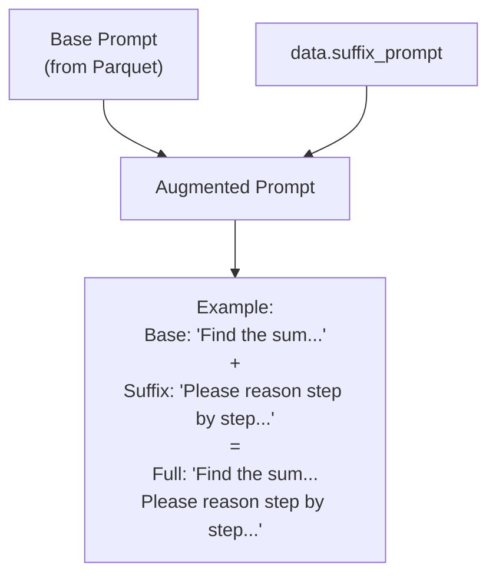
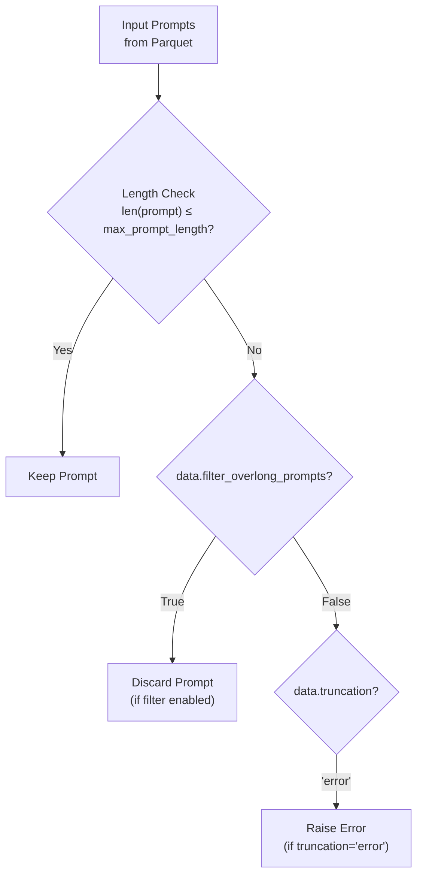
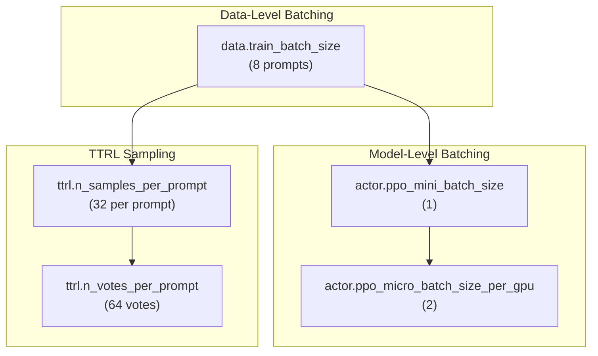
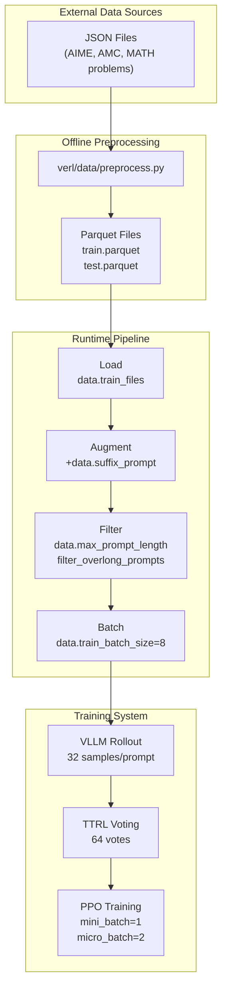

<!-- source: DeepWiki mcp.deepwiki.com · repo PRIME-RL/TTRL · page 4.1 Data Processing Pipeline · fetched 2026-10-30 -->

# Data Processing Pipeline

<details>
<summary>Relevant source files</summary>

The following files were used as context for generating this wiki page:

- [README.md](README.md)
- [verl/examples/ttrl/Qwen2.5-Math/aime.sh](verl/examples/ttrl/Qwen2.5-Math/aime.sh)
- [verl/examples/ttrl/Qwen2.5/aime.sh](verl/examples/ttrl/Qwen2.5/aime.sh)

</details>


## Purpose and Scope

This document describes the data processing pipeline in TTRL, covering how raw mathematical reasoning problems are loaded, preprocessed, and prepared for training. The pipeline transforms data from source formats (JSON) into training-ready batches with augmented prompts.

For information about how these prepared batches are used in the TTRL sampling and voting mechanism, see [TTRL Voting and Sampling](#4.3). For details on the overall training loop that consumes this data, see [PPO Training Loop](#4.4). For dataset-specific configuration details, see [Task Configurations](#3.3).

---

## Pipeline Overview

The TTRL data processing pipeline consists of five sequential stages that transform raw problem data into batched training samples:

```mermaid
flowchart LR
    Raw["Raw Data<br/>(JSON files)"]
    Convert["Preprocessing<br/>verl/data/preprocess.py"]
    Parquet["Parquet Files<br/>train.parquet<br/>test.parquet"]
    Load["Data Loading<br/>data.train_files<br/>data.val_files"]
    Augment["Prompt Augmentation<br/>data.suffix_prompt"]
    Filter["Filtering<br/>data.filter_overlong_prompts<br/>data.max_prompt_length"]
    Batch["Batching<br/>data.train_batch_size"]
    Ready["Training Ready<br/>Batched Prompts"]
    
    Raw --> Convert
    Convert --> Parquet
    Parquet --> Load
    Load --> Augment
    Augment --> Filter
    Filter --> Batch
    Batch --> Ready
```



**Sources:** [README.md:82](), [verl/examples/ttrl/Qwen2.5/aime.sh:44-51]()

---

## Data Format and File Structure

### Input Format

TTRL expects data in **Parquet format** with the following structure:

| Field | Type | Description |
|-------|------|-------------|
| `data_source` | string | Dataset identifier (e.g., "AIME-TTT", "AMC", "MATH") |
| `prompt` | string | The mathematical problem statement |
| Additional fields | varies | Task-specific metadata |

The data is organized into separate files for training and validation:

```
data/
├── AIME-TTT/
│   ├── train.parquet
│   └── test.parquet
├── AMC/
│   ├── train.parquet
│   └── test.parquet
└── MATH/
    ├── train.parquet
    └── test.parquet
```

### Configuration Mapping

Data files are loaded through the following configuration parameters:

| Configuration Key | Purpose | Example Value |
|------------------|---------|---------------|
| `data.train_files` | Training data paths | `["data/AIME-TTT/train.parquet"]` |
| `data.val_files` | Validation data paths | `["data/AIME-TTT/test.parquet"]` |
| `data.train_batch_size` | Number of prompts per training batch | `8` |

**Sources:** [verl/examples/ttrl/Qwen2.5/aime.sh:44-48](), [verl/examples/ttrl/Qwen2.5-Math/aime.sh:44-48]()

---

## Preprocessing: JSON to Parquet Conversion

### Conversion Script

Raw data in JSON format must be converted to Parquet format before training. This is handled by the preprocessing script:

```
verl/data/preprocess.py
```

This script performs the following operations:
1. Reads JSON files containing mathematical problems
2. Validates and normalizes field names
3. Converts to columnar Parquet format for efficient loading
4. Outputs train.parquet and test.parquet files

### Usage Pattern

The preprocessing step is typically performed once as a data preparation step before training begins:

```bash
python verl/data/preprocess.py \
  --input path/to/problems.json \
  --output data/AIME-TTT/train.parquet
```

**Note:** The Parquet format provides:
- Efficient columnar storage for fast batch loading
- Built-in compression
- Schema validation
- Compatibility with verl's data pipeline

**Sources:** [README.md:82]()

---

## Prompt Construction and Augmentation

### Base Prompt Loading

Prompts are loaded directly from the `prompt` field in the Parquet files. These contain the raw mathematical problem statements.

### Suffix Augmentation

TTRL applies **prompt augmentation** by appending instructional text to guide the model's reasoning process. This is controlled via the `data.suffix_prompt` configuration parameter.



### Standard Suffix Templates

The most commonly used suffix template across TTRL experiments is:

```
"\nPlease reason step by step, and put your final answer within \boxed{}."
```

This suffix:
- Encourages chain-of-thought reasoning
- Standardizes answer formatting with LaTeX `\boxed{}` notation
- Enables reliable answer extraction for reward computation

### Model-Specific Variations

| Model Family | Uses Suffix | Configuration |
|-------------|-------------|---------------|
| Qwen2.5-7B | Yes | `+data.suffix_prompt` is set |
| Qwen2.5-Math-1.5B | No | Suffix omitted (model pre-trained with similar instructions) |
| LLaMA3.1-8B-Instruct | Yes | `+data.suffix_prompt` is set |

**Sources:** [verl/examples/ttrl/Qwen2.5/aime.sh:51](), [verl/examples/ttrl/Qwen2.5-Math/aime.sh:44-50]()

---

## Filtering and Validation

### Length-Based Filtering

TTRL implements filtering to ensure prompts fit within model context windows:



### Configuration Parameters

| Parameter | Type | Purpose | Standard Value |
|-----------|------|---------|----------------|
| `data.max_prompt_length` | int | Maximum allowed prompt length in tokens | `512` or `1024` |
| `data.max_response_length` | int | Maximum response length in tokens | `3072` (K=3), `8192` (K=8) |
| `data.filter_overlong_prompts` | bool | Whether to filter out prompts exceeding max length | `True` |
| `data.truncation` | string | Truncation strategy ("error" raises exception) | `"error"` |

### Length Calculation

The maximum response length is typically computed as:

```
MAX_RESPONSE_LENGTH = 1024 * K
```

where `K` is a scaling factor (usually 3 for standard tasks, higher for complex problems):

| K Value | Response Length | Use Case |
|---------|----------------|----------|
| 3 | 3,072 tokens | Standard problems (AIME, AMC, MATH) |
| 8 | 8,192 tokens | Complex multi-step problems |

### Total Context Window

The total context window requirement is:

```
total_context = max_prompt_length + max_response_length
```

This value is used to configure:
- Actor model: `actor_rollout_ref.actor.ppo_max_token_len_per_gpu`
- VLLM engine: `actor_rollout_ref.rollout.max_model_len`

**Sources:** [verl/examples/ttrl/Qwen2.5/aime.sh:15-22,46-50,62,77-78]()

---

## Batching Strategy

### Training Batch Configuration



### Batch Size Hierarchy

TTRL uses a hierarchical batching structure:

1. **Data Batch** (`data.train_batch_size = 8`)
   - Number of unique prompts loaded per training iteration
   - Each prompt generates multiple samples

2. **Mini-Batch** (`actor.ppo_mini_batch_size = 1`)
   - Number of mini-batches for PPO updates
   - With size 1, each data batch is processed as a single mini-batch

3. **Micro-Batch** (`actor.ppo_micro_batch_size_per_gpu = 2`)
   - Number of samples processed per GPU in parallel during gradient computation
   - Enables gradient accumulation for memory efficiency

4. **TTRL Samples** (`ttrl.n_samples_per_prompt = 32`)
   - Number of response samples generated per prompt during rollout
   - Used for majority voting

### Memory-Batch Trade-off

The micro-batch size is constrained by GPU memory:

```
GPU Memory ≈ (max_prompt_length + max_response_length) × micro_batch_size × model_size
```

Standard configuration for 80GB A100:
- `ppo_micro_batch_size_per_gpu = 2`
- `max_prompt_length = 512`
- `max_response_length = 3072`

### Effective Batch Size Calculation

For a standard TTRL configuration:

```
Prompts per iteration = data.train_batch_size = 8
Samples per prompt = ttrl.n_samples_per_prompt = 32
Total samples per iteration = 8 × 32 = 256
```

These 256 samples are processed in micro-batches of 2 across 8 GPUs:

```
Samples per GPU = 256 / 8 = 32
Forward passes per GPU = 32 / 2 = 16
```

**Sources:** [verl/examples/ttrl/Qwen2.5/aime.sh:24-29,54-56](), [verl/examples/ttrl/Qwen2.5-Math/aime.sh:24-29,54-56]()

---

## Configuration Reference

### Complete Data Pipeline Configuration

The following table maps data pipeline stages to their configuration parameters:

| Pipeline Stage | Configuration Parameter | Type | Standard Value |
|---------------|------------------------|------|----------------|
| **Loading** | `data.train_files` | list[str] | `["data/AIME-TTT/train.parquet"]` |
| | `data.val_files` | list[str] | `["data/AIME-TTT/test.parquet"]` |
| **Augmentation** | `data.suffix_prompt` | str | `"\nPlease reason step by step..."` |
| **Filtering** | `data.max_prompt_length` | int | `512` |
| | `data.max_response_length` | int | `3072` |
| | `data.filter_overlong_prompts` | bool | `True` |
| | `data.truncation` | str | `"error"` |
| **Batching** | `data.train_batch_size` | int | `8` |
| | `actor.ppo_mini_batch_size` | int | `1` |
| | `actor.ppo_micro_batch_size_per_gpu` | int | `2` |

### Example Script Configuration Snippet

The data pipeline is configured in training scripts using command-line overrides:

```bash
python -m verl.trainer.main_ppo \
  --config-name='ppo_trainer_ttrl.yaml' \
  data.train_files=["$DATA_LOCAL_DIR/$TASK/train.parquet"] \
  data.val_files=["$DATA_LOCAL_DIR/$TASK/test.parquet"] \
  data.max_prompt_length=$MAX_PROMPT_LENGTH \
  data.max_response_length=$MAX_RESPONSE_LENGTH \
  data.train_batch_size=$DATA_TRAIN_BATCH_SIZE \
  data.filter_overlong_prompts=True \
  data.truncation='error' \
  +data.suffix_prompt='"..."'
```

**Sources:** [verl/examples/ttrl/Qwen2.5/aime.sh:42-51]()

---

## Data Flow Summary



This pipeline ensures that:
1. Data is efficiently stored and loaded (Parquet format)
2. Prompts are augmented to encourage proper reasoning and answer formatting
3. Only valid-length prompts are processed (memory constraints)
4. Batching is optimized for GPU memory and throughput
5. Each prompt generates multiple samples for TTRL voting

**Sources:** [README.md:82](), [verl/examples/ttrl/Qwen2.5/aime.sh:42-104]()

---

