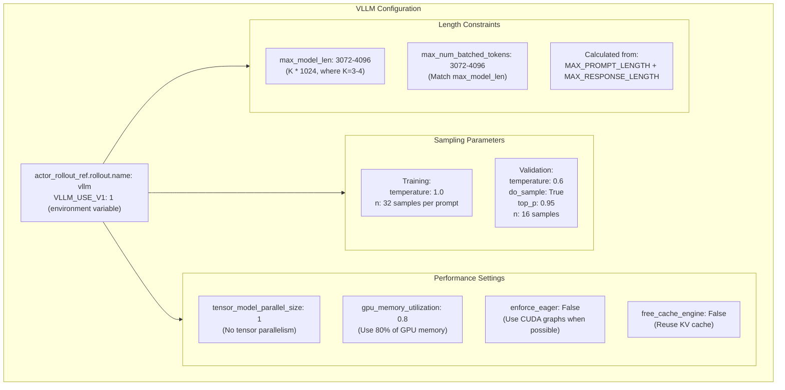
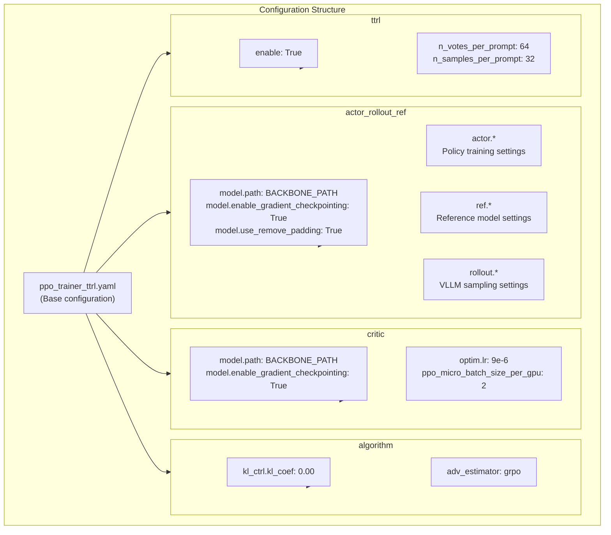
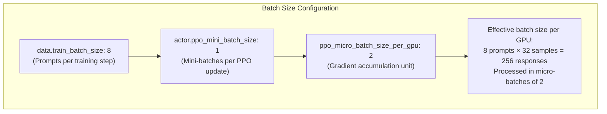

<!-- source: DeepWiki mcp.deepwiki.com · repo PRIME-RL/TTRL · page 4.2 Actor-Critic-Reference Architecture · fetched 2026-10-30 -->

# Actor-Critic-Reference Architecture

<details>
<summary>Relevant source files</summary>

The following files were used as context for generating this wiki page:

- [README.md](README.md)
- [figs/overview.png](figs/overview.png)
- [figs/ttrl_reward.png](figs/ttrl_reward.png)
- [verl/examples/ttrl/Qwen2.5-Math/aime.sh](verl/examples/ttrl/Qwen2.5-Math/aime.sh)

</details>


## Purpose and Scope

This page details the four-component model architecture used in TTRL training: **Actor** (trainable policy network), **Critic** (value function network), **Reference** (frozen policy for KL baseline), and **Rollout** (VLLM sampling engine). Each component serves a distinct purpose in the PPO training loop, with different optimization strategies and memory configurations. This page focuses on the architectural design and configuration of these components.

For information about how these components interact during PPO training, see [PPO Training Loop](#4.4). For data preprocessing before model input, see [Data Processing Pipeline](#4.1). For TTRL's sampling and voting mechanism, see [TTRL Voting and Sampling](#4.3).

---

## Architecture Overview

TTRL employs a four-component architecture where all components share the same pre-trained language model backbone but are configured and optimized differently based on their roles in the training pipeline.

### Component Architecture Diagram

```mermaid
graph TB
    Backbone["Pre-trained LLM Backbone<br/>(Qwen2.5, LLaMA3.1, etc.)"]
    
    subgraph ActorSys["Actor System"]
        Actor["actor_rollout_ref.actor<br/>Trainable Policy Network"]
        ActorOpt["Adam Optimizer<br/>lr: 5e-7<br/>warmup_steps_ratio: 0.03"]
        ActorFSDP["FSDP Configuration<br/>param_offload: False<br/>optimizer_offload: False"]
        ActorBatch["ppo_mini_batch_size: 1<br/>ppo_micro_batch_size_per_gpu: 2"]
    end
    
    subgraph CriticSys["Critic System"]
        Critic["critic.model<br/>Value Function Network"]
        CriticOpt["Adam Optimizer<br/>lr: 9e-6<br/>(18x faster than Actor)"]
        CriticFSDP["FSDP Configuration<br/>param_offload: False<br/>optimizer_offload: False"]
        CriticBatch["ppo_micro_batch_size_per_gpu: 2"]
    end
    
    subgraph RefSys["Reference System"]
        Reference["actor_rollout_ref.ref<br/>Frozen Policy (No Training)"]
        RefFSDP["FSDP Configuration<br/>param_offload: True<br/>(CPU offloading)"]
        RefLogProb["log_prob_micro_batch_size_per_gpu: 2<br/>Compute log probabilities only"]
    end
    
    subgraph RolloutSys["Rollout System"]
        Rollout["actor_rollout_ref.rollout<br/>VLLM Engine v1"]
        RolloutConfig["temperature: 1.0 (train) / 0.6 (val)<br/>n_samples_per_prompt: 32<br/>tensor_model_parallel_size: 1<br/>gpu_memory_utilization: 0.8"]
        RolloutLen["max_model_len: 3584-4096<br/>max_num_batched_tokens: 3584-4096"]
    end
    
    Backbone --> Actor
    Backbone --> Critic
    Backbone --> Reference
    Backbone --> Rollout
    
    Actor --> ActorOpt
    Actor --> ActorFSDP
    Actor --> ActorBatch
    
    Critic --> CriticOpt
    Critic --> CriticFSDP
    Critic --> CriticBatch
    
    Reference --> RefFSDP
    Reference --> RefLogProb
    
    Rollout --> RolloutConfig
    Rollout --> RolloutLen
```



**Sources:** [verl/examples/ttrl/Qwen2.5-Math/aime.sh:51-103]()

---

## Actor System: Trainable Policy Network

The **Actor** is the primary trainable component that represents the policy being optimized. It generates responses during training and is updated via PPO to maximize expected rewards while staying close to the reference policy.

### Actor Configuration

| Configuration Parameter | Value | Purpose |
|------------------------|-------|---------|
| `actor_rollout_ref.model.path` | `$BACKBONE_PATH` | Path to pre-trained model checkpoint |
| `actor_rollout_ref.actor.optim.lr` | `5e-7` | Conservative learning rate for stable policy updates |
| `actor_rollout_ref.actor.optim.lr_warmup_steps_ratio` | `0.03` | Warmup for 3% of training steps |
| `actor_rollout_ref.actor.optim.warmup_style` | `'cosine'` | Cosine warmup schedule |
| `actor_rollout_ref.actor.ppo_mini_batch_size` | `1` | Number of mini-batches per PPO update |
| `actor_rollout_ref.actor.ppo_micro_batch_size_per_gpu` | `2` | Micro-batch size for gradient accumulation |
| `actor_rollout_ref.actor.use_kl_loss` | `True` | Enable KL divergence penalty |
| `actor_rollout_ref.model.enable_gradient_checkpointing` | `True` | Reduce memory via gradient checkpointing |
| `actor_rollout_ref.model.use_remove_padding` | `True` | Remove padding for efficiency |

### Actor FSDP Strategy

The Actor uses Fully Sharded Data Parallel (FSDP) without parameter or optimizer offloading, prioritizing speed over memory efficiency since it requires frequent gradient updates:

```yaml
actor_rollout_ref.actor.fsdp_config.param_offload: False
actor_rollout_ref.actor.fsdp_config.optimizer_offload: False
```

This configuration keeps all actor parameters and optimizer states on GPU for fast backward passes during PPO updates. The conservative learning rate (`5e-7`) ensures stable policy improvement without drastic changes that could destabilize training.

**Sources:** [verl/examples/ttrl/Qwen2.5-Math/aime.sh:51-62]()

---

## Critic System: Value Function Network

The **Critic** estimates state values to compute advantages for policy updates. It learns significantly faster than the Actor to track rapid policy changes.

### Critic Configuration

| Configuration Parameter | Value | Purpose |
|------------------------|-------|---------|
| `critic.model.path` | `$BACKBONE_PATH` | Same backbone as Actor |
| `critic.optim.lr` | `9e-6` | 18x higher learning rate than Actor |
| `critic.ppo_micro_batch_size_per_gpu` | `2` | Batch size for value function training |
| `critic.model.enable_gradient_checkpointing` | `True` | Memory optimization |
| `critic.model.use_remove_padding` | `True` | Efficiency optimization |

### Critic Optimization Strategy

The Critic's learning rate is intentionally set 18x higher than the Actor (`9e-6` vs `5e-7`). This allows the value function to quickly adapt to the changing policy, providing accurate advantage estimates for PPO updates. The value network must track the policy's performance across different states, requiring faster convergence than the policy itself.

### Critic FSDP Configuration

Like the Actor, the Critic uses no parameter or optimizer offloading:

```yaml
critic.model.fsdp_config.param_offload: False
critic.model.fsdp_config.optimizer_offload: False
```

This ensures fast gradient computation during value function training, which occurs in every PPO iteration.

**Sources:** [verl/examples/ttrl/Qwen2.5-Math/aime.sh:79-85]()

---

## Reference System: Frozen KL Baseline

The **Reference** model is a frozen copy of the initial policy used to compute KL divergence, preventing the Actor from deviating too far from the original model's behavior.

### Reference Configuration

| Configuration Parameter | Value | Purpose |
|------------------------|-------|---------|
| `actor_rollout_ref.ref.log_prob_micro_batch_size_per_gpu` | `2` | Batch size for log probability computation |
| `actor_rollout_ref.ref.fsdp_config.param_offload` | `True` | Offload parameters to CPU to save GPU memory |

### Memory Optimization

The Reference model is never trained, only used for computing log probabilities during PPO updates. Therefore, it employs aggressive memory optimization by offloading parameters to CPU:

```yaml
actor_rollout_ref.ref.fsdp_config.param_offload: True
```

This strategy significantly reduces GPU memory requirements since the Reference model is accessed infrequently (only during advantage computation) and does not require optimizer states.

### KL Divergence Control

The KL divergence between Actor and Reference is controlled by the coefficient:

```yaml
algorithm.kl_ctrl.kl_coef: 0.00
```

In TTRL configurations, this coefficient is set to `0.00`, meaning no explicit KL penalty is applied. This allows the policy to explore more freely while still maintaining the reference model for potential future use or monitoring.

**Sources:** [verl/examples/ttrl/Qwen2.5-Math/aime.sh:63-64, 86]()

---

## Rollout System: VLLM Sampling Engine

The **Rollout** system uses VLLM (vLLM) for high-throughput generation of multiple samples per prompt. This is critical for TTRL's majority voting mechanism.

### Rollout Configuration



### VLLM Version and Backend

TTRL uses VLLM v1 with explicit backend configuration:

```bash
export VLLM_USE_V1=1
unset VLLM_ATTENTION_BACKEND
```

The attention backend is explicitly unset to use VLLM's default optimized backend. Some configurations comment out `XFORMERS` backend selection:

```bash
#export VLLM_ATTENTION_BACKEND=XFORMERS
```

**Sources:** [verl/examples/ttrl/Qwen2.5-Math/aime.sh:1-4, 65-78]()

### Training vs Validation Sampling

The Rollout system uses different sampling strategies for training and validation:

**Training Sampling:**
- `temperature: 1.0` - Higher diversity for exploration
- `n_samples_per_prompt: 32` - Generate 32 samples for majority voting

**Validation Sampling:**
- `temperature: 0.6` - Lower temperature for more focused outputs
- `n: 16` - Fewer samples for efficiency
- `do_sample: True` - Enable sampling (vs greedy decoding)
- `top_p: 0.95` - Nucleus sampling threshold

### Length Management

Response length is calculated based on a multiplier `K`:

```bash
K=3
MAX_PROMPT_LENGTH=512
MAX_RESPONSE_LENGTH=$((1024 * $K))  # 3072 tokens
```

For `K > 8`, the number of samples is reduced to `N=4` to manage memory:

```bash
if [ "$K" -gt 8 ]; then
  N=4
else
  N=16
fi
```

**Sources:** [verl/examples/ttrl/Qwen2.5-Math/aime.sh:15-22, 73-76]()

---

## Component Interaction During Training

The four components interact in a coordinated sequence during each training iteration:

### Training Iteration Data Flow

```mermaid
sequenceDiagram
    participant Rollout as "Rollout (VLLM)"
    participant Actor as "Actor (Policy)"
    participant Critic as "Critic (Value)"
    participant Ref as "Reference (Frozen)"
    participant Voting as "TTRL Voting"
    
    Note over Rollout: Load current Actor weights
    Rollout->>Rollout: "Generate N=32 samples<br/>per prompt at T=1.0"
    Rollout->>Voting: "Sampled responses"
    
    Voting->>Voting: "Majority voting<br/>with 64 votes"
    Voting->>Actor: "Rewards based on consensus"
    
    Actor->>Actor: "Compute log probs<br/>for generated responses"
    Ref->>Ref: "Compute reference log probs<br/>(CPU offloaded)"
    Actor->>Actor: "Calculate KL divergence<br/>(coef=0.00)"
    
    Critic->>Critic: "Estimate state values<br/>for advantage computation"
    
    Note over Actor,Critic: "PPO Update Phase"
    Actor->>Actor: "Update policy<br/>lr=5e-7, mini_batch=1"
    Critic->>Critic: "Update value function<br/>lr=9e-6, faster tracking"
    
    Note over Actor: "Actor weights updated for next iteration"
```

**Sources:** [verl/examples/ttrl/Qwen2.5-Math/aime.sh:51-103]()

### Configuration Hierarchy



**Sources:** [verl/examples/ttrl/Qwen2.5-Math/aime.sh:42-103]()

---

## Memory Management Strategy

The four components employ different memory optimization strategies based on their computational requirements:

### Memory Optimization by Component

| Component | Gradient Checkpointing | Remove Padding | FSDP Param Offload | FSDP Optimizer Offload | Rationale |
|-----------|----------------------|----------------|-------------------|----------------------|-----------|
| **Actor** | ✅ Enabled | ✅ Enabled | ❌ Disabled | ❌ Disabled | Frequent updates require fast GPU access |
| **Critic** | ✅ Enabled | ✅ Enabled | ❌ Disabled | ❌ Disabled | Frequent updates, fast value estimation |
| **Reference** | ✅ Enabled | N/A | ✅ Enabled | N/A | Infrequent access, no training, offload to CPU |
| **Rollout** | N/A | N/A | N/A | N/A | Separate VLLM engine, 80% GPU memory allocation |

### Gradient Checkpointing

All trainable components enable gradient checkpointing to reduce memory footprint during backward passes:

```yaml
actor_rollout_ref.model.enable_gradient_checkpointing: True
critic.model.enable_gradient_checkpointing: True
```

This trades computation for memory by recomputing intermediate activations during the backward pass instead of storing them.

### Padding Removal

Both Actor and Critic use padding removal for efficiency:

```yaml
actor_rollout_ref.model.use_remove_padding: True
critic.model.use_remove_padding: True
```

This optimization removes padding tokens from batches, reducing unnecessary computation on padding positions.

### Token Length Management

The maximum token length per GPU is explicitly configured to control memory usage:

```yaml
actor_rollout_ref.actor.ppo_max_token_len_per_gpu: $((MAX_PROMPT_LENGTH + MAX_RESPONSE_LENGTH))
```

For `K=3`: `512 + 3072 = 3584 tokens`

**Sources:** [verl/examples/ttrl/Qwen2.5-Math/aime.sh:52-53, 60-61, 62, 64, 71, 80-82, 84-85]()

---

## Batch Size Configuration

The training pipeline uses a hierarchical batching strategy:

### Batch Size Hierarchy



**Batch Size Breakdown:**

1. **Data Train Batch Size (`8`)**: Number of prompts loaded per training iteration
2. **PPO Mini Batch Size (`1`)**: Number of mini-batches for PPO updates (no further splitting)
3. **PPO Micro Batch Size (`2`)**: Gradient accumulation batch size per GPU

With `32` samples per prompt and `8` prompts, each training step processes `256` responses, split into micro-batches of `2` for gradient accumulation.

**Sources:** [verl/examples/ttrl/Qwen2.5-Math/aime.sh:25-29, 48, 54-55, 63, 69, 83]()

---

## Summary Table: Component Comparison

| Aspect | Actor | Critic | Reference | Rollout |
|--------|-------|--------|-----------|---------|
| **Purpose** | Trainable policy | Value estimation | KL baseline | Sample generation |
| **Training** | ✅ Yes | ✅ Yes | ❌ Frozen | ❌ Inference only |
| **Learning Rate** | `5e-7` | `9e-6` (18x) | N/A | N/A |
| **FSDP Offload** | ❌ No | ❌ No | ✅ CPU | N/A |
| **Micro Batch Size** | `2` | `2` | `2` | N/A |
| **Memory Priority** | Speed | Speed | Memory | Throughput |
| **GPU Memory** | Full | Full | CPU offloaded | 80% utilization |
| **Update Frequency** | Every PPO step | Every PPO step | Never | N/A |

**Sources:** [verl/examples/ttrl/Qwen2.5-Math/aime.sh:51-103]()

---

