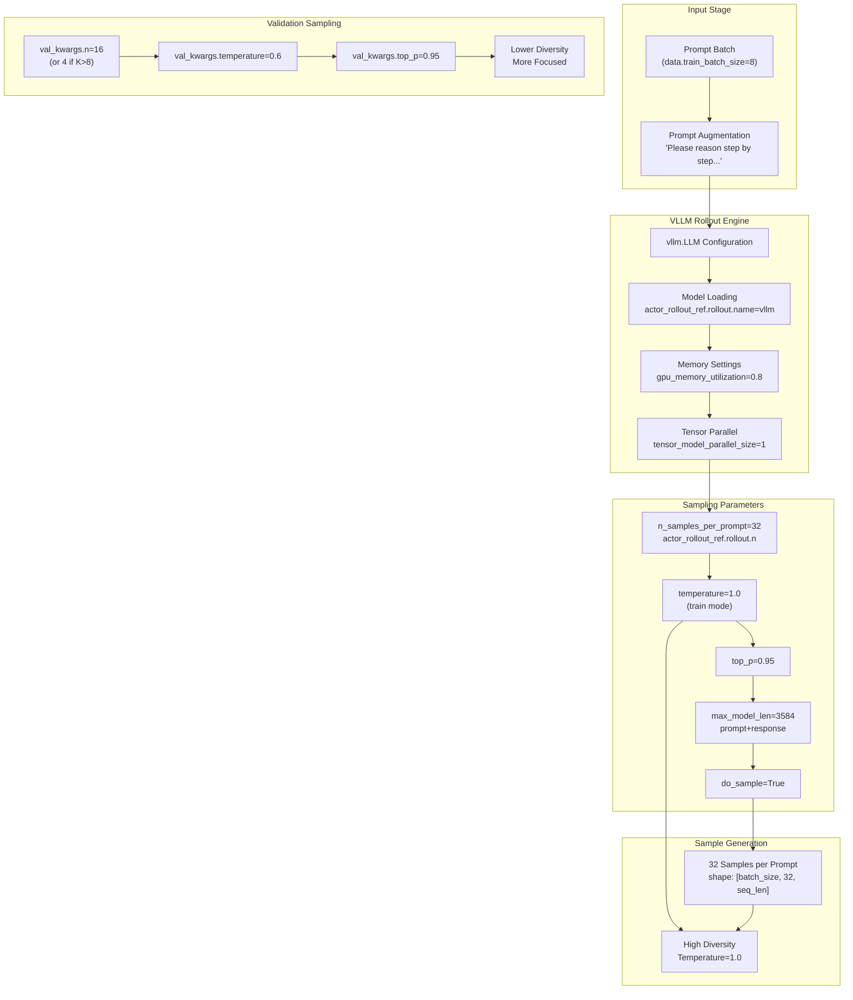
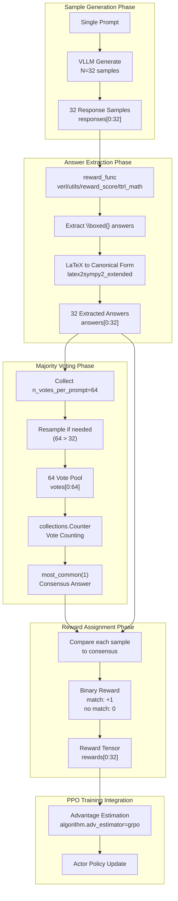
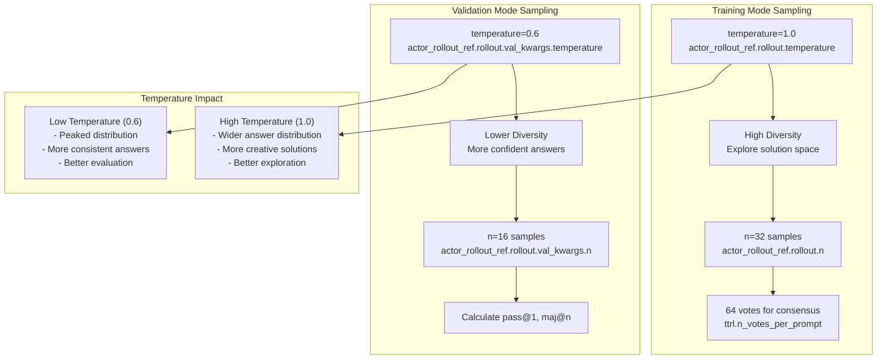

<!-- source: DeepWiki mcp.deepwiki.com · repo PRIME-RL/TTRL · page 4.3 TTRL Voting and Sampling · fetched 2026-10-30 -->

# TTRL Voting and Sampling

<details>
<summary>Relevant source files</summary>

The following files were used as context for generating this wiki page:

- [README.md](README.md)
- [figs/overview.png](figs/overview.png)
- [figs/ttrl_reward.png](figs/ttrl_reward.png)
- [verl/examples/ttrl/Qwen2.5-Math/aime.sh](verl/examples/ttrl/Qwen2.5-Math/aime.sh)

</details>


## Purpose and Scope

This page documents the core TTRL mechanism: how the system generates multiple samples per prompt, aggregates them through majority voting, and assigns rewards without ground truth labels. This voting and sampling process is the fundamental innovation that enables reinforcement learning on unlabeled test data.

For information about the broader PPO training loop that uses these rewards, see [PPO Training Loop](#4.4). For details on the actor-critic-reference architecture, see [Actor-Critic-Reference Architecture](#4.2). For the custom mathematical reward function implementation, see [Custom Reward Functions](#5.3).

---

## Overview

TTRL's voting and sampling mechanism transforms the challenge of training without ground truth labels into an opportunity. The system operates on a simple principle: **consistency across multiple samples indicates correctness**. By generating many diverse samples per prompt and using majority voting to determine consensus, TTRL creates a self-supervised reward signal that drives policy improvement.

The process follows this flow:
1. **Sample Generation**: VLLM generates `n_samples_per_prompt` responses (typically 32) per input prompt
2. **Vote Aggregation**: The system collects `n_votes_per_prompt` votes (typically 64, which may include resampling)
3. **Consensus Determination**: Majority voting identifies the most common answer
4. **Reward Assignment**: Samples matching the consensus receive positive rewards; others receive zero

This creates a bootstrapping effect where improved models generate more consistent high-quality samples, leading to better voting quality, which in turn drives further improvement.

**Sources**: [README.md:36-52](), [verl/examples/ttrl/Qwen2.5-Math/aime.sh:26-27]()

---

## Multi-Sample Generation Architecture

### VLLM Rollout Configuration

TTRL uses the VLLM inference engine to efficiently generate multiple samples per prompt. The rollout system is configured through the `actor_rollout_ref.rollout` namespace in the training configuration.



**Diagram: VLLM Multi-Sample Generation Pipeline with Code Configuration Parameters**

The VLLM engine is configured to maximize sampling efficiency while maintaining sample diversity. Key configuration parameters control the generation process:

| Parameter | Configuration Path | Typical Value | Purpose |
|-----------|-------------------|---------------|---------|
| `n_samples_per_prompt` | `actor_rollout_ref.rollout.n` | 32 | Number of samples generated per training prompt |
| `temperature` | `actor_rollout_ref.rollout.temperature` | 1.0 (train), 0.6 (val) | Controls sampling diversity |
| `top_p` | `actor_rollout_ref.rollout.val_kwargs.top_p` | 0.95 | Nucleus sampling threshold |
| `max_model_len` | `actor_rollout_ref.rollout.max_model_len` | `max_prompt_length + max_response_length` | Maximum sequence length |
| `gpu_memory_utilization` | `actor_rollout_ref.rollout.gpu_memory_utilization` | 0.8 | Fraction of GPU memory for KV cache |
| `tensor_model_parallel_size` | `actor_rollout_ref.rollout.tensor_model_parallel_size` | 1 | Tensor parallelism degree |

**Sources**: [verl/examples/ttrl/Qwen2.5-Math/aime.sh:65-78]()

### Sample Count Adaptation

The number of samples generated adapts based on the response length constraint `K`:

```python
# From configuration logic
if K > 8:
    N = 4
else:
    N = 16
```

This adaptation balances memory constraints with the need for diverse samples. Longer response lengths (larger `K`) require more memory per sample, so fewer samples are generated during validation to prevent OOM errors.

**Sources**: [verl/examples/ttrl/Qwen2.5-Math/aime.sh:18-22]()

---

## Majority Voting Mechanism

### Vote Aggregation Process

TTRL's voting mechanism aggregates multiple samples to determine consensus. The key parameters are:
- `n_samples_per_prompt`: Number of samples generated per prompt (typically 32)
- `n_votes_per_prompt`: Number of votes aggregated per prompt (typically 64)

When `n_votes_per_prompt > n_samples_per_prompt`, the system uses multiple generations or resampling to reach the target vote count.



**Diagram: TTRL Voting Pipeline from Generation to Reward Assignment**

### Consensus Determination

The voting mechanism identifies the consensus answer through these steps:

1. **Answer Extraction**: Extract canonical answers from each response
   - For mathematical problems, extract content from `\boxed{}` LaTeX commands
   - Parse LaTeX to canonical symbolic form using `latex2sympy2_extended`
   - Handle multiple formats and edge cases

2. **Vote Counting**: Aggregate votes using `collections.Counter`
   - Count frequency of each unique answer
   - Handle ties (if any) by selecting the first most common

3. **Majority Selection**: Identify the most common answer
   - Use `Counter.most_common(1)` to get the consensus
   - This answer serves as the "pseudo ground truth" for reward assignment

**Sources**: [verl/examples/ttrl/Qwen2.5-Math/aime.sh:88-92](), [README.md:95-99]()

---

## Reward Calculation Without Ground Truth

### Custom Reward Function Integration

TTRL's reward calculation is implemented through a custom reward function specified in the configuration:

```yaml
custom_reward_function.path="./verl/utils/reward_score/ttrl_math/__init__.py"
custom_reward_function.name=reward_func
```

This function replaces the standard reward function that would normally require ground truth labels.

**Sources**: [verl/examples/ttrl/Qwen2.5-Math/aime.sh:88-89]()

### Binary Reward Assignment

The reward function operates on a simple principle:

```
For each sample i in [1, n_samples_per_prompt]:
    answer_i = extract_answer(sample_i)
    consensus = majority_vote(all_answers)
    
    if answer_i == consensus:
        reward_i = 1.0
    else:
        reward_i = 0.0
```

This binary reward scheme:
- **Encourages Consistency**: Samples matching the consensus are rewarded
- **Penalizes Outliers**: Samples with minority answers receive zero reward
- **No Ground Truth Required**: The consensus itself serves as the target
- **Self-Supervised**: The model's own outputs determine the reward signal

### Mathematical Answer Verification

For mathematical reasoning tasks, the reward function performs sophisticated answer comparison:

1. **Extract** answers from `\boxed{}` commands in LaTeX
2. **Normalize** answers to canonical forms (handle equivalent representations)
3. **Compare** normalized answers for equality
4. **Assign** binary rewards based on matches

The `ttrl_math` reward function handles various answer formats:
- Numerical values (integers, decimals, fractions)
- Algebraic expressions
- Multiple representations of the same answer (e.g., "1/2" vs "0.5")

**Sources**: [verl/examples/ttrl/Qwen2.5-Math/aime.sh:88-89]()

---

## Temperature Control Strategy

### Training vs Validation Temperature

TTRL uses different temperature settings for training and validation to balance exploration and exploitation:

| Mode | Temperature | Purpose | Sample Count |
|------|-------------|---------|--------------|
| Training | 1.0 | Maximum diversity for exploration | 32 per prompt |
| Validation | 0.6 | More focused, reliable answers | 16 per prompt (or 4 if K>8) |



**Diagram: Temperature Control Strategy Across Training and Validation Modes**

### Rationale for Temperature Settings

**Training Temperature = 1.0**:
- Maintains high diversity in generated samples
- Enables exploration of the solution space
- Prevents premature convergence to suboptimal solutions
- Supports the voting mechanism by providing varied candidates

**Validation Temperature = 0.6**:
- Produces more consistent, confident predictions
- Better represents the model's true capabilities
- Provides reliable metrics (pass@1, maj@n)
- Reduces noise in evaluation

The temperature difference creates a natural separation between exploration (training) and exploitation (evaluation).

**Sources**: [verl/examples/ttrl/Qwen2.5-Math/aime.sh:66](), [verl/examples/ttrl/Qwen2.5-Math/aime.sh:73-76]()

---

## TTRL Configuration Parameters

### Complete Parameter Reference

| Parameter | Config Path | Default | Description |
|-----------|-------------|---------|-------------|
| **TTRL Enable** | `ttrl.enable` | `True` | Master switch for TTRL mode |
| **Votes per Prompt** | `ttrl.n_votes_per_prompt` | 64 | Total votes for consensus |
| **Samples per Prompt** | `ttrl.n_samples_per_prompt` | 32 | Samples generated per prompt |
| **Training Temperature** | `actor_rollout_ref.rollout.temperature` | 1.0 | Sampling temperature (train) |
| **Validation Temperature** | `actor_rollout_ref.rollout.val_kwargs.temperature` | 0.6 | Sampling temperature (val) |
| **Validation Samples** | `actor_rollout_ref.rollout.val_kwargs.n` | 16 | Samples per prompt (val) |
| **Top-p** | `actor_rollout_ref.rollout.val_kwargs.top_p` | 0.95 | Nucleus sampling threshold |
| **Custom Reward Path** | `custom_reward_function.path` | `./verl/utils/reward_score/ttrl_math/__init__.py` | Path to reward function |
| **Custom Reward Name** | `custom_reward_function.name` | `reward_func` | Function name in module |

### Configuration Example

```bash
python -m verl.trainer.main_ppo \
  --config-name='ppo_trainer_ttrl.yaml' \
  ttrl.enable=True \
  ttrl.n_votes_per_prompt=64 \
  ttrl.n_samples_per_prompt=32 \
  actor_rollout_ref.rollout.temperature=1.0 \
  actor_rollout_ref.rollout.n=32 \
  actor_rollout_ref.rollout.val_kwargs.temperature=0.6 \
  actor_rollout_ref.rollout.val_kwargs.n=16 \
  custom_reward_function.path="./verl/utils/reward_score/ttrl_math/__init__.py" \
  custom_reward_function.name=reward_func
```

**Sources**: [verl/examples/ttrl/Qwen2.5-Math/aime.sh:90-92](), [verl/examples/ttrl/Qwen2.5-Math/aime.sh:66-76]()

---

## Bootstrapping Effect and Performance Improvement

### Self-Improvement Through Voting

TTRL's voting mechanism creates a powerful bootstrapping effect:

```mermaid
graph LR
    subgraph Iteration_N["Training Iteration N"]
        ModelN["Policy πN"]
        SamplesN["Generate 32 samples"]
        VotingN["Majority voting<br/>Quality = QN"]
        RewardsN["Rewards based on<br/>consensus QN"]
    end
    
    subgraph Update["PPO Update"]
        PPO["Policy Update<br/>πN → πN+1"]
    end
    
    subgraph Iteration_N1["Training Iteration N+1"]
        ModelN1["Improved Policy πN+1"]
        SamplesN1["Generate 32 samples<br/>(higher quality)"]
        VotingN1["Majority voting<br/>Quality = QN+1 > QN"]
        RewardsN1["Better rewards<br/>from improved consensus"]
    end
    
    subgraph Outcome["Outcome"]
        Surpass["Surpass Initial maj@n<br/>Upper Bound"]
        Performance["211% gain on AIME 2024"]
    end
    
    ModelN --> SamplesN
    SamplesN --> VotingN
    VotingN --> RewardsN
    RewardsN --> PPO
    
    PPO --> ModelN1
    ModelN1 --> SamplesN1
    SamplesN1 --> VotingN1
    VotingN1 --> RewardsN1
    
    RewardsN1 --> Surpass
    Surpass --> Performance
```



**Diagram: TTRL Bootstrapping Effect and Performance Improvement Cycle**

### Key Mechanisms

1. **Improved Samples**: As the policy improves, it generates higher-quality samples
2. **Better Consensus**: Higher-quality samples lead to more accurate majority voting
3. **Stronger Signal**: More accurate consensus provides a stronger training signal
4. **Accelerated Learning**: Stronger signals accelerate policy improvement
5. **Surpassing Bounds**: Eventually surpasses the initial model's `maj@n` upper bound

This creates a positive feedback loop where:
- Better policy → Better samples → Better voting → Better rewards → Better policy

### Performance Evidence

TTRL demonstrates this bootstrapping effect empirically:
- **211% improvement** on AIME 2024 with Qwen-2.5-Math-7B
- **Surpasses initial `maj@n`**: Exceeds the upper bound of the initial model's majority voting performance
- **Approaches supervised performance**: Gets close to models trained with ground truth labels

The voting mechanism transforms unlabeled test data into a viable training signal through self-supervision.

**Sources**: [README.md:48-52]()

---

## Integration with PPO Training Loop

The voting and sampling mechanism integrates seamlessly with the PPO training loop:

1. **Rollout Phase**: VLLM generates 32 samples per prompt with temperature 1.0
2. **Voting Phase**: Aggregate 64 votes and determine consensus answer
3. **Reward Phase**: Assign binary rewards based on consensus matches
4. **Advantage Estimation**: Use GRPO to compute advantages from rewards
5. **Policy Update**: Update actor policy to maximize expected rewards
6. **Iteration**: Repeat with improved policy generating better samples

For details on the PPO training loop, see [PPO Training Loop](#4.4). For information on advantage estimation methods, see [PPO Training Loop](#4.4).

**Sources**: [verl/examples/ttrl/Qwen2.5-Math/aime.sh:86-87]()

---

## Summary

TTRL's voting and sampling mechanism provides a practical solution to training reinforcement learning models without ground truth labels. By generating multiple diverse samples and using majority voting to determine consensus, the system creates self-supervised rewards that drive policy improvement. The bootstrapping effect enables the model to eventually surpass its initial capabilities, achieving dramatic performance gains on challenging mathematical reasoning tasks.

Key takeaways:
- **Multi-sample generation** (32 samples) provides diverse candidates
- **Majority voting** (64 votes) determines consensus without ground truth
- **Binary rewards** encourage consistency and penalize outliers
- **Temperature control** balances exploration (1.0) and evaluation (0.6)
- **Bootstrapping effect** enables surpassing initial model's `maj@n` bound
- **Configuration flexibility** allows adaptation to different models and tasks

---

