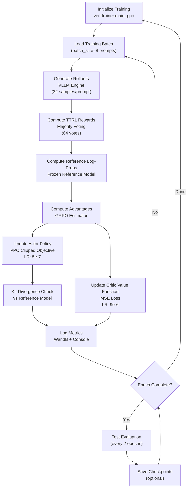
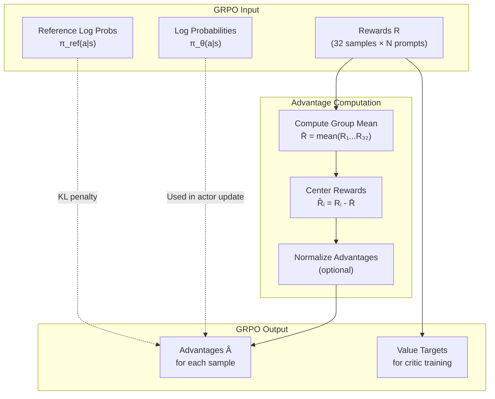
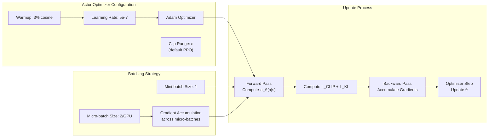
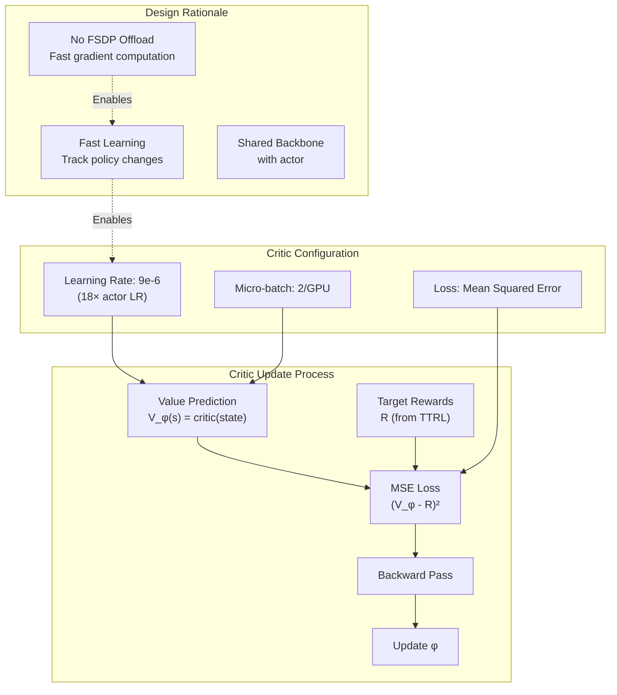
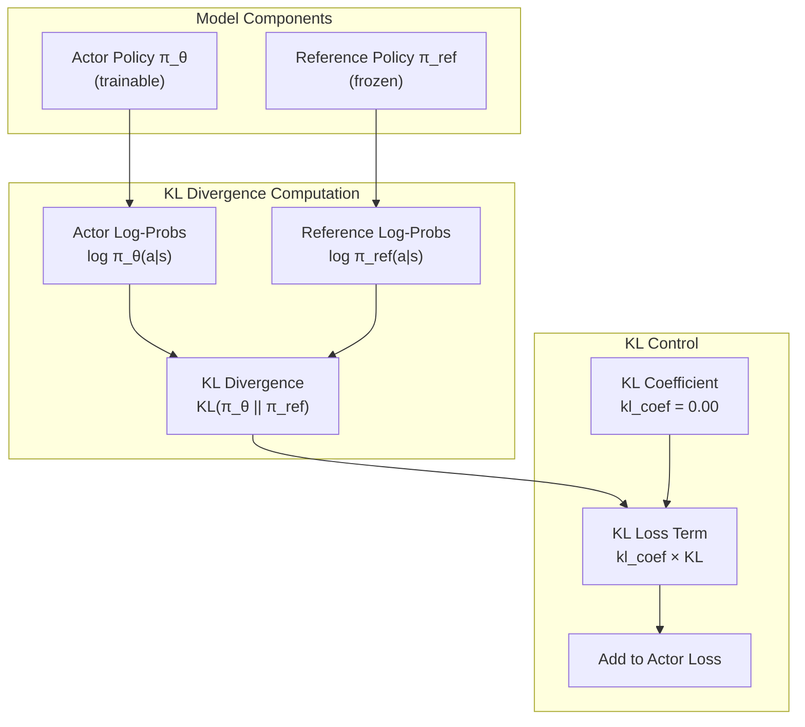
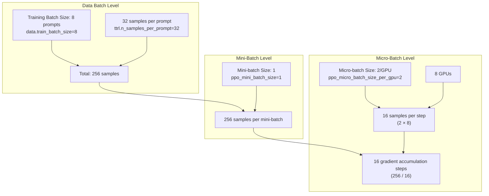
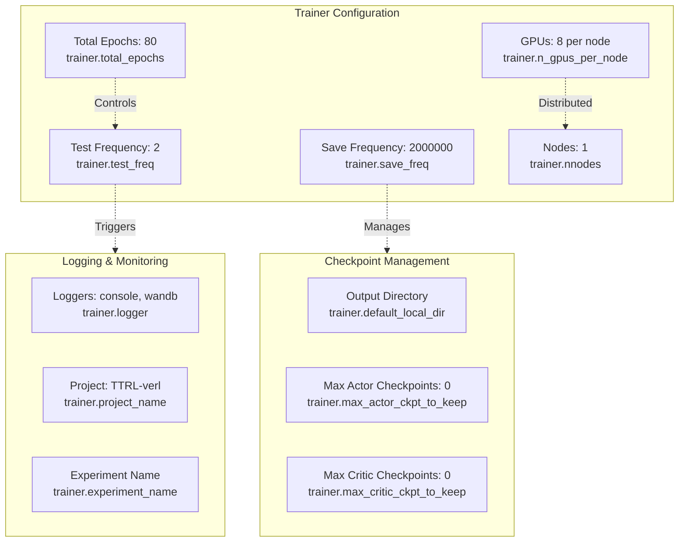

<!-- source: DeepWiki mcp.deepwiki.com · repo PRIME-RL/TTRL · page 4.4 PPO Training Loop · fetched 2026-10-30 -->

# PPO Training Loop

<details>
<summary>Relevant source files</summary>

The following files were used as context for generating this wiki page:

- [README.md](README.md)
- [verl/examples/ttrl/Qwen2.5-Math/aime.sh](verl/examples/ttrl/Qwen2.5-Math/aime.sh)
- [verl/examples/ttrl/Qwen2.5/aime.sh](verl/examples/ttrl/Qwen2.5/aime.sh)

</details>


## Purpose and Scope

This page describes the Proximal Policy Optimization (PPO) training loop implementation in TTRL, focusing on the algorithmic mechanics of policy and value function updates. The content covers advantage estimation using GRPO (Group Relative Policy Optimization), actor policy updates with clipped objectives, critic value function training, KL divergence constraints, and the batching strategy that orchestrates gradient computation.

For information about the overall training pipeline and data flow, see [Training Pipeline](#4). For details on the actor-critic-reference model architecture, see [Actor-Critic-Reference Architecture](#4.2). For the TTRL-specific reward computation via majority voting, see [TTRL Voting and Sampling](#4.3).

---

## PPO Algorithm Configuration

The TTRL system uses the PPO algorithm with specific hyperparameter settings optimized for test-time reinforcement learning. The algorithm configuration is specified through command-line arguments that override the base configuration.

| Parameter | Value | Purpose |
|-----------|-------|---------|
| `algorithm.adv_estimator` | `grpo` | Advantage estimation method |
| `algorithm.kl_ctrl.kl_coef` | `0.00` | KL divergence penalty coefficient |
| `actor.optim.lr` | `5e-7` | Actor learning rate |
| `actor.optim.lr_warmup_steps_ratio` | `0.03` | Learning rate warmup (3% of steps) |
| `actor.optim.warmup_style` | `cosine` | Cosine warmup schedule |
| `critic.optim.lr` | `9e-6` | Critic learning rate (18x actor) |
| `actor.ppo_mini_batch_size` | `1` | Mini-batches per update |
| `actor.ppo_micro_batch_size_per_gpu` | `2` | Micro-batch size for gradient accumulation |
| `actor.use_kl_loss` | `True` | Enable KL divergence in loss |

**Sources:** [verl/examples/ttrl/Qwen2.5/aime.sh:58-88](), [verl/examples/ttrl/Qwen2.5-Math/aime.sh:58-88]()

---

## Training Loop Architecture

The PPO training loop orchestrates multiple components to perform policy improvement. The main training entry point is `verl.trainer.main_ppo`, which manages the interaction between data loading, rollout generation, reward computation, and model updates.

### High-Level Training Flow



**Diagram: PPO Training Loop Flow**

The training loop performs 80 epochs (configurable via `trainer.total_epochs`), with each epoch processing the entire training dataset. Test evaluation occurs every 2 epochs as specified by `trainer.test_freq=2`.

**Sources:** [verl/examples/ttrl/Qwen2.5/aime.sh:42-104](), [README.md:29]()

---

## GRPO Advantage Estimation

TTRL uses Group Relative Policy Optimization (GRPO) for advantage estimation. Unlike standard PPO which uses Generalized Advantage Estimation (GAE) with a baseline value function, GRPO computes advantages relative to the mean reward within a group of samples.

### GRPO Mechanism



**Diagram: GRPO Advantage Estimation Process**

The GRPO estimator computes advantages by:
1. Grouping samples by prompt (32 samples per prompt)
2. Computing the mean reward R̄ within each group
3. Centering rewards: Âᵢ = Rᵢ - R̄
4. Optionally normalizing advantages across the batch

This approach makes the advantage estimation relative to the model's current performance on each prompt, enabling effective learning without requiring a trained value function baseline during early training.

**Sources:** [verl/examples/ttrl/Qwen2.5/aime.sh:87](), [README.md:36]()

---

## Actor Policy Update

The actor policy is updated using the PPO clipped objective, which prevents excessively large policy updates that could destabilize training.

### PPO Clipped Objective

The actor loss function combines three components:

1. **Policy Loss (Clipped):**
   ```
   L_CLIP(θ) = -𝔼[min(r(θ)·Â, clip(r(θ), 1-ε, 1+ε)·Â)]
   where r(θ) = π_θ(a|s) / π_old(a|s)
   ```

2. **KL Divergence Penalty:**
   ```
   L_KL(θ) = kl_coef · 𝔼[KL(π_θ || π_ref)]
   ```
   With `kl_coef=0.00`, this is effectively disabled in TTRL.

3. **Total Actor Loss:**
   ```
   L_actor = L_CLIP + L_KL
   ```

### Actor Update Configuration



**Diagram: Actor Policy Update Process**

### Mini-batch vs Micro-batch

- **Mini-batch size (1):** Number of PPO update iterations per epoch. With size 1, the entire batch is used for a single update.
- **Micro-batch size (2/GPU):** Batch size for gradient accumulation. With 8 GPUs and micro-batch size 2, each GPU processes 2 samples at a time, accumulating gradients before the optimizer step.

The conservative learning rate (`5e-7`) combined with cosine warmup prevents policy collapse during the initial training phase when the TTRL reward signal may be noisy.

**Sources:** [verl/examples/ttrl/Qwen2.5/aime.sh:55-62]()

---

## Critic Value Function Update

The critic is trained to predict the expected return for each state-action pair, providing value estimates that can be used for advantage estimation in alternative configurations or for monitoring training progress.

### Critic Training Objective

The critic minimizes the mean squared error between predicted values and target returns:

```
L_critic(φ) = 𝔼[(V_φ(s) - R_target)²]
where R_target = rewards (from TTRL voting)
```

### Critic Learning Configuration



**Diagram: Critic Value Function Training**

The critic uses a learning rate 18× higher than the actor (`9e-6` vs `5e-7`) to rapidly adapt to policy changes. This is crucial because:

1. The critic needs to track the improving policy throughout training
2. Stale value estimates would provide poor baselines for advantage estimation
3. The critic has an easier optimization landscape (regression vs policy optimization)

Like the actor, the critic uses FSDP with no parameter or optimizer offloading (`fsdp_config.param_offload=False`, `fsdp_config.optimizer_offload=False`) to minimize training latency.

**Sources:** [verl/examples/ttrl/Qwen2.5/aime.sh:79-86]()

---

## KL Divergence Control

The KL divergence term constrains the policy to remain close to a reference policy, preventing overly aggressive updates that could lead to policy collapse or exploitation of reward model weaknesses.

### KL Constraint Mechanism



**Diagram: KL Divergence Control Mechanism**

### TTRL-Specific KL Configuration

In TTRL, the KL coefficient is set to **0.00**, effectively disabling the KL penalty:

| Configuration | Value | Impact |
|---------------|-------|--------|
| `algorithm.kl_ctrl.kl_coef` | `0.00` | No KL penalty in loss |
| `actor.use_kl_loss` | `True` | KL term computed but not penalized |
| `ref.fsdp_config.param_offload` | `True` | Reference model offloaded to CPU |

Despite the zero coefficient, the reference model is still maintained and KL divergence is computed for monitoring purposes. The reference model uses FSDP with CPU offloading to reduce GPU memory usage, as it only needs to perform forward passes for log-probability computation.

### Design Rationale

The zero KL coefficient reflects TTRL's unique training scenario:

1. **Test-time adaptation:** The model is adapting to specific test distributions, where deviation from the initial policy may be desirable
2. **Self-supervised rewards:** TTRL rewards are based on consensus, not external labels, reducing risk of reward hacking
3. **Short training duration:** With limited epochs (80), aggressive policy updates are acceptable

**Sources:** [verl/examples/ttrl/Qwen2.5/aime.sh:57, 64, 86]()

---

## Batching and Gradient Accumulation

The batching strategy balances memory efficiency, training stability, and computational throughput through a three-level hierarchy.

### Batching Hierarchy



**Diagram: Three-Level Batching Hierarchy**

### Memory and Computation Trade-offs

| Level | Size | Purpose |
|-------|------|---------|
| **Data Batch** | 8 prompts → 256 samples | Data loading granularity |
| **Mini-batch** | 1 × 256 samples | PPO update frequency |
| **Micro-batch** | 2 samples/GPU × 8 GPUs | GPU memory management |

The micro-batch size of 2 per GPU is chosen to:
1. Fit within GPU memory limits (A100 80GB)
2. Enable efficient gradient accumulation
3. Maintain stable gradient estimates

With gradient checkpointing enabled (`enable_gradient_checkpointing=True`), the system trades computation for memory by recomputing activations during the backward pass rather than storing them.

**Sources:** [verl/examples/ttrl/Qwen2.5/aime.sh:25-29, 52-56]()

---

## Training Loop Integration

The complete training loop integrates all components through the main PPO trainer module.

### Training Configuration



**Diagram: Training Loop Configuration**

### Execution Flow

The training loop executes through `python -m verl.trainer.main_ppo` with configuration loaded from `ppo_trainer_ttrl.yaml` and command-line overrides. Each epoch performs:

1. **Data Loading:** Load 8 prompts from training parquet files
2. **Rollout Generation:** Generate 32 samples per prompt using VLLM
3. **Reward Computation:** Compute TTRL rewards via majority voting (64 votes)
4. **Advantage Estimation:** Compute GRPO advantages from rewards
5. **Actor Update:** Update policy using PPO clipped objective
6. **Critic Update:** Update value function using MSE loss
7. **Logging:** Log metrics to WandB and console
8. **Evaluation:** Every 2 epochs, evaluate on test set

The training continues for 80 epochs with no checkpoint saving (`save_freq=2000000` effectively disables it, and `max_*_ckpt_to_keep=0` prevents storage).

**Sources:** [verl/examples/ttrl/Qwen2.5/aime.sh:42-104]()

---

## Key Implementation Details

### Learning Rate Schedule

Both actor and critic use cosine warmup schedules:

- **Warmup Duration:** 3% of total training steps (`lr_warmup_steps_ratio=0.03`)
- **Warmup Style:** Cosine curve (`warmup_style='cosine'`)
- **Effect:** Gradual learning rate increase prevents instability during initial training when TTRL rewards may be noisy

### Memory Optimization

| Component | FSDP Parameter Offload | FSDP Optimizer Offload | Rationale |
|-----------|----------------------|----------------------|-----------|
| **Actor** | False | False | Fast gradient updates |
| **Critic** | False | False | Fast value function training |
| **Reference** | True | N/A (no optimizer) | Memory savings, infrequent use |

The actor and critic keep all parameters and optimizer states on GPU for fast training, while the reference model offloads to CPU since it only performs forward passes.

### Gradient Checkpointing

All trainable models (`actor`, `critic`) use gradient checkpointing:
- `enable_gradient_checkpointing=True`
- Trades computation for memory by recomputing activations
- Essential for fitting large language models (7B-8B parameters) on available GPU memory

### Padding Removal

Both actor and critic use padding removal optimization:
- `use_remove_padding=True`
- Removes padding tokens from computation to reduce unnecessary operations
- Improves training efficiency for variable-length sequences

**Sources:** [verl/examples/ttrl/Qwen2.5/aime.sh:52-86]()

---

## Summary

The PPO training loop in TTRL implements a carefully tuned reinforcement learning algorithm for test-time adaptation:

1. **GRPO Advantage Estimation:** Provides stable advantage estimates without requiring a trained baseline
2. **Conservative Actor Updates:** Learning rate of 5e-7 with cosine warmup prevents policy collapse
3. **Rapid Critic Adaptation:** Learning rate 18× faster than actor tracks policy improvements
4. **Zero KL Penalty:** Allows aggressive policy updates appropriate for test-time scenarios
5. **Efficient Batching:** Three-level hierarchy balances memory and computation
6. **Memory Optimization:** FSDP, gradient checkpointing, and padding removal enable training of 7B-8B parameter models

This configuration achieves the 211% performance improvement on AIME 2024 reported in the main results.

**Sources:** [README.md:50](), [verl/examples/ttrl/Qwen2.5/aime.sh](), [verl/examples/ttrl/Qwen2.5-Math/aime.sh]()

---

