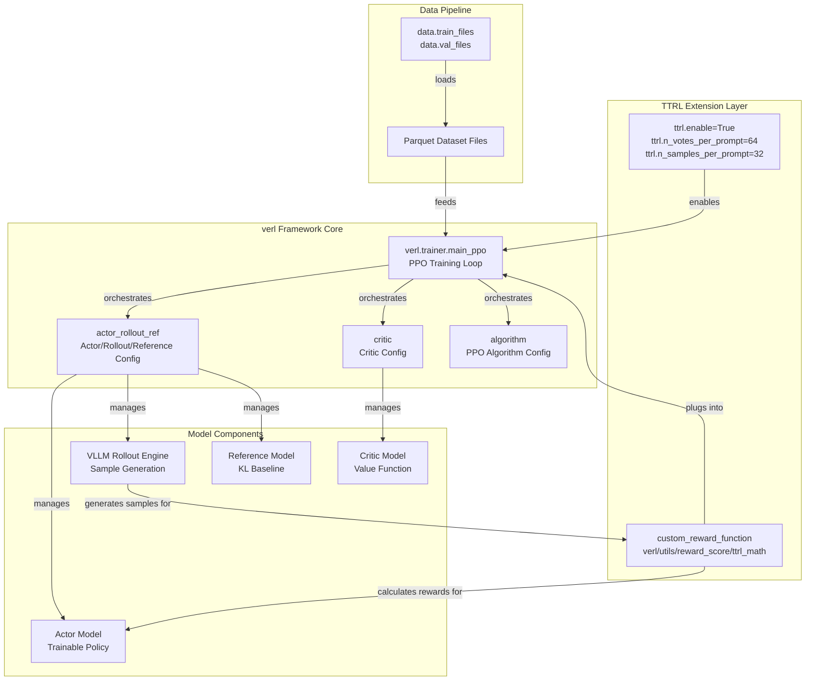
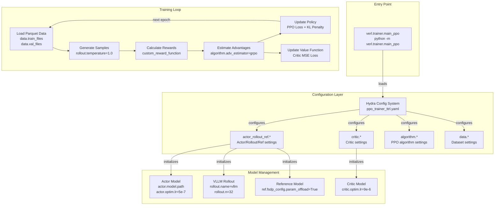
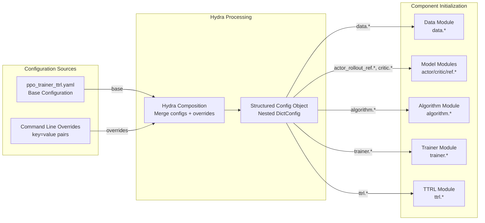
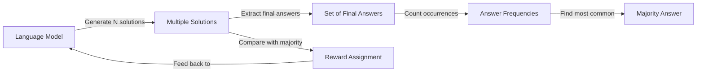
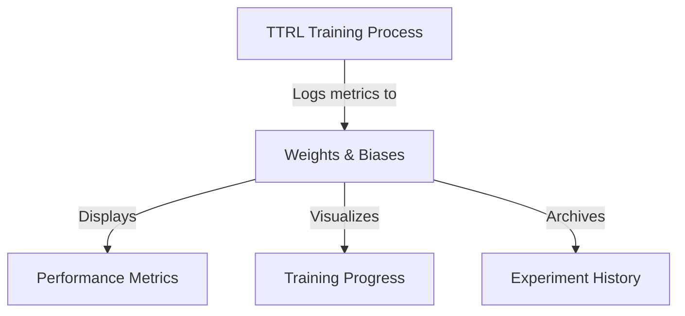

<!-- source: DeepWiki mcp.deepwiki.com · repo PRIME-RL/TTRL · page 5 verl Framework Integration · fetched 2026-10-30 -->

# verl Framework Integration

<details>
<summary>Relevant source files</summary>

The following files were used as context for generating this wiki page:

- [README.md](README.md)
- [verl/examples/ttrl/Qwen2.5-Math/aime.sh](verl/examples/ttrl/Qwen2.5-Math/aime.sh)

</details>


## Purpose and Scope

This document explains how TTRL (Test-Time Reinforcement Learning) integrates with and extends the verl reinforcement learning framework. TTRL is implemented as a modular extension to verl, leveraging verl's PPO training infrastructure while adding TTRL's majority voting reward mechanism through configuration and custom reward functions. For information about the core reward mechanism, see page 1.1. For details on the training pipeline, see page 4.

## Overview of verl Integration

TTRL is built on top of the verl framework, a reinforcement learning system designed for training large language models with PPO (Proximal Policy Optimization). The integration is achieved through:

1. **Configuration-based enablement**: TTRL can be activated by setting `+ttrl.enable=True` in the configuration
2. **Custom reward functions**: TTRL's majority voting logic is implemented as a pluggable reward function
3. **Hydra-based configuration**: All parameters are managed through Hydra's hierarchical configuration system

#### TTRL-verl Integration Architecture



Sources: [README.md:28-29](), [verl/examples/ttrl/Qwen2.5-Math/aime.sh:42-103]()

## verl Overview

verl is a reinforcement learning framework specifically designed for training large language models using PPO. It provides a complete infrastructure for actor-critic-reference model training with support for distributed computing, efficient memory management, and high-throughput inference.

### verl Architecture Components

| Component | Configuration Path | Purpose |
|-----------|-------------------|---------|
| **Main PPO Trainer** | `verl.trainer.main_ppo` | Orchestrates the entire training loop, manages epochs, handles checkpointing |
| **Actor** | `actor_rollout_ref.actor` | Trainable policy model that generates responses and is updated via PPO |
| **Critic** | `critic` | Value function model that estimates expected returns for advantage computation |
| **Reference** | `actor_rollout_ref.ref` | Frozen copy of initial policy for KL divergence calculation |
| **Rollout Engine** | `actor_rollout_ref.rollout` | VLLM-based inference engine for efficient sample generation |
| **Data Pipeline** | `data` | Handles loading, preprocessing, and batching of training/validation data |

#### verl PPO Training Components



Sources: [verl/examples/ttrl/Qwen2.5-Math/aime.sh:42-103]()

### How TTRL Extends verl

TTRL integrates with verl through three key mechanisms:

1. **Configuration flags**: Setting `+ttrl.enable=True` activates TTRL-specific logic within verl
2. **TTRL-specific parameters**: `ttrl.n_votes_per_prompt` and `ttrl.n_samples_per_prompt` control the majority voting behavior
3. **Custom reward function**: The `custom_reward_function` parameter points to TTRL's majority voting reward implementation

The beauty of this design is that TTRL adds no changes to verl's core code—all TTRL functionality is enabled through configuration and pluggable reward functions.

Sources: [verl/examples/ttrl/Qwen2.5-Math/aime.sh:88-92](), [README.md:28-29]()

## Configuration Management

TTRL uses Hydra, a powerful configuration management framework, to handle the complex parameter space of reinforcement learning training. All configuration is managed through YAML files with command-line overrides.

### Configuration Hierarchy

The configuration system follows a hierarchical structure:

```
ppo_trainer_ttrl.yaml (base config)
├── data.*                      # Dataset configuration
├── actor_rollout_ref.*         # Actor, rollout, and reference settings
│   ├── model.*                # Shared model settings
│   ├── actor.*                # Actor-specific settings
│   ├── rollout.*              # VLLM rollout settings
│   └── ref.*                  # Reference model settings
├── critic.*                    # Critic model and optimizer
├── algorithm.*                 # PPO algorithm parameters
├── custom_reward_function.*    # Reward function configuration
├── ttrl.*                      # TTRL-specific settings
└── trainer.*                   # Training loop settings
```

#### Configuration Flow in TTRL



### Key Configuration Parameters

#### Data Configuration

| Parameter | Example Value | Purpose |
|-----------|---------------|---------|
| `data.train_files` | `["path/to/train.parquet"]` | List of training data files in Parquet format |
| `data.val_files` | `["path/to/test.parquet"]` | List of validation data files |
| `data.max_prompt_length` | `512` | Maximum length of input prompts |
| `data.max_response_length` | `3072` | Maximum length of generated responses |
| `data.train_batch_size` | `8` | Number of prompts per training batch |
| `data.filter_overlong_prompts` | `True` | Whether to filter prompts exceeding max length |

Sources: [verl/examples/ttrl/Qwen2.5-Math/aime.sh:44-50]()

#### Actor Configuration

| Parameter | Example Value | Purpose |
|-----------|---------------|---------|
| `actor_rollout_ref.model.path` | `"path/to/Qwen2.5-Math-1.5B"` | Path to pre-trained model checkpoint |
| `actor_rollout_ref.actor.optim.lr` | `5e-7` | Learning rate for actor optimizer (very conservative) |
| `actor_rollout_ref.actor.optim.lr_warmup_steps_ratio` | `0.03` | Fraction of steps for learning rate warmup |
| `actor_rollout_ref.actor.ppo_mini_batch_size` | `1` | Mini-batch size for PPO updates |
| `actor_rollout_ref.actor.ppo_micro_batch_size_per_gpu` | `2` | Micro-batch size per GPU for gradient accumulation |
| `actor_rollout_ref.actor.use_kl_loss` | `True` | Whether to include KL divergence penalty |
| `actor_rollout_ref.actor.fsdp_config.param_offload` | `False` | Disable parameter offloading for fast updates |

Sources: [verl/examples/ttrl/Qwen2.5-Math/aime.sh:51-62]()

#### VLLM Rollout Configuration

| Parameter | Example Value | Purpose |
|-----------|---------------|---------|
| `actor_rollout_ref.rollout.name` | `vllm` | Use VLLM as the rollout engine |
| `actor_rollout_ref.rollout.n` | `32` | Number of samples to generate per prompt (training) |
| `actor_rollout_ref.rollout.temperature` | `1.0` | Sampling temperature for training |
| `actor_rollout_ref.rollout.val_kwargs.temperature` | `0.6` | Sampling temperature for validation |
| `actor_rollout_ref.rollout.val_kwargs.top_p` | `0.95` | Nucleus sampling threshold |
| `actor_rollout_ref.rollout.gpu_memory_utilization` | `0.8` | Fraction of GPU memory for VLLM |
| `actor_rollout_ref.rollout.tensor_model_parallel_size` | `1` | Tensor parallelism degree |

Sources: [verl/examples/ttrl/Qwen2.5-Math/aime.sh:65-78]()

#### Critic Configuration

| Parameter | Example Value | Purpose |
|-----------|---------------|---------|
| `critic.model.path` | `"path/to/Qwen2.5-Math-1.5B"` | Path to model for critic initialization |
| `critic.optim.lr` | `9e-6` | Learning rate for critic (18x faster than actor) |
| `critic.ppo_micro_batch_size_per_gpu` | `2` | Micro-batch size for critic training |
| `critic.model.fsdp_config.param_offload` | `False` | Disable parameter offloading |

Sources: [verl/examples/ttrl/Qwen2.5-Math/aime.sh:79-85]()

#### TTRL-Specific Configuration

| Parameter | Example Value | Purpose |
|-----------|---------------|---------|
| `ttrl.enable` | `True` | Enable TTRL mode |
| `ttrl.n_votes_per_prompt` | `64` | Total number of votes for majority voting |
| `ttrl.n_samples_per_prompt` | `32` | Number of samples generated per prompt |
| `custom_reward_function.path` | `"./verl/utils/reward_score/ttrl_math/__init__.py"` | Path to custom reward function |
| `custom_reward_function.name` | `reward_func` | Function name within the module |

Sources: [verl/examples/ttrl/Qwen2.5-Math/aime.sh:88-92]()

### Example: Running TTRL Training

To run TTRL training on the AIME dataset with Qwen2.5-Math-1.5B:

```bash
python -m verl.trainer.main_ppo \
  --config-name='ppo_trainer_ttrl.yaml' \
  data.train_files=["path/to/AIME-TTT/train.parquet"] \
  data.val_files=["path/to/AIME-TTT/test.parquet"] \
  actor_rollout_ref.model.path="path/to/Qwen2.5-Math-1.5B" \
  +ttrl.enable=True \
  ttrl.n_votes_per_prompt=64 \
  ttrl.n_samples_per_prompt=32 \
  custom_reward_function.path="./verl/utils/reward_score/ttrl_math/__init__.py" \
  custom_reward_function.name=reward_func
```

The `+ttrl.enable=True` syntax (with `+` prefix) adds a new configuration key that doesn't exist in the base YAML, enabling TTRL mode.

Sources: [verl/examples/ttrl/Qwen2.5-Math/aime.sh:42-103](), [README.md:78-79]()

## Majority Voting Reward Implementation

The key innovation of TTRL is its majority voting reward function that enables reinforcement learning without ground-truth labels. This function is integrated into the RL frameworks by modifying the reward calculation mechanism.



Sources: [README.md:79-82]()

## Logging and Metrics Integration

TTRL integrates with Weights & Biases (WandB) for experiment tracking and visualization of training metrics.

### Key Metrics Tracked

- Pass@1: Direct model performance (single generation correct)
- Maj@N: Accuracy of majority voting across N generations
- Training loss
- Reward values
- Model parameter updates



Sources: [README.md:64-65]()

## Hardware Requirements and Performance Considerations

The TTRL system has significant computational requirements:

- **Hardware**: All experiments were conducted on 8 NVIDIA A100 40GB GPUs
- **Performance**: The system exhibits some instability on AIME 2024 dataset, with pass@1 results ranging from 43.3 to 46.7 across different runs
- **Validation**: For reproducibility, multiple runs are recommended to ensure stable results

Sources: [README.md:87-88](), [README.md:64-65]()

## Future Integration Plans

The current TTRL implementation is described as a "preview version" with plans for further optimization and official integration:

1. Continued enhancement of the current OpenRLHF-based implementation
2. Official integration into OpenRLHF repository
3. Integration into the verl framework

These integrations will make TTRL more accessible to researchers and practitioners working with different reinforcement learning frameworks.

Sources: [README.md:84-85]()

---

