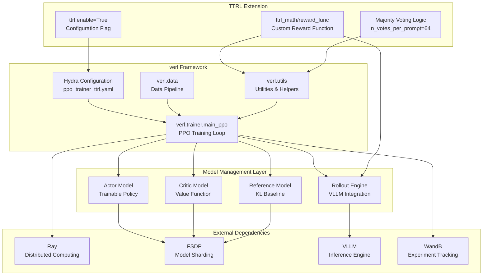
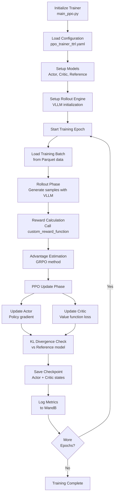
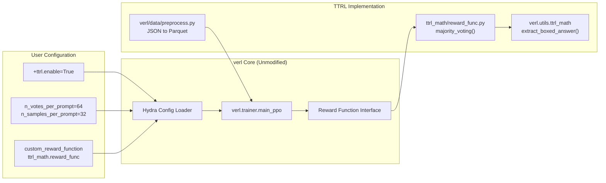
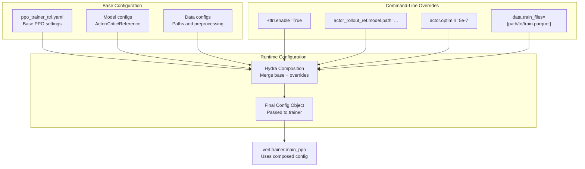

<!-- source: DeepWiki mcp.deepwiki.com · repo PRIME-RL/TTRL · page 5.1 verl Overview · fetched 2026-10-30 -->

# verl Overview

<details>
<summary>Relevant source files</summary>

The following files were used as context for generating this wiki page:

- [README.md](README.md)
- [verl/requirements.txt](verl/requirements.txt)

</details>


## Purpose and Scope

This page introduces the **verl framework** as the foundational infrastructure underlying TTRL. verl (Volcano Engine Reinforcement Learning) is an open-source PPO (Proximal Policy Optimization) training framework that provides the core RL training loop, model management, and distributed training capabilities. TTRL extends verl by adding a custom reward mechanism based on majority voting.

This document covers:
- verl's core architecture and component organization
- The PPO training loop structure in `verl.trainer.main_ppo`
- Integration points where TTRL extends verl functionality
- Data pipeline and configuration management systems

For specific TTRL configuration details, see [Configuration Management](#5.2). For implementing custom reward functions, see [Custom Reward Functions](#5.3).

**Sources:** [README.md:28-29](), [README.md:84]()

---

## verl Framework Architecture

verl provides a modular PPO training framework with four primary component systems: **Trainer**, **Data Pipeline**, **Model Management**, and **Utilities**. TTRL operates as a configuration-driven extension that plugs into this architecture without requiring core framework modifications.

### Core Component Organization



**Diagram: verl Framework Component Architecture**

The framework separates concerns into distinct layers:

| Layer | Components | Purpose |
|-------|-----------|---------|
| **Training Core** | `verl.trainer.main_ppo` | Orchestrates PPO training loop, manages epochs and batches |
| **Data Pipeline** | `verl.data.preprocess`, data loaders | Converts JSON to Parquet, handles batching and filtering |
| **Model Management** | Actor, Critic, Reference, Rollout | Manages four-component RL architecture with different optimization strategies |
| **Utilities** | `verl.utils.reward_score`, `ttrl_math` | Provides reward calculation, metric computation, and helper functions |
| **Configuration** | Hydra configs, YAML files | Manages hyperparameters, model paths, and training settings |

**Sources:** [README.md:29](), [README.md:82-84]()

---

## PPO Trainer Core

The `verl.trainer.main_ppo` module implements the central PPO training loop. TTRL leverages this trainer without modification, inserting custom behavior through configuration and callback mechanisms.

### Training Loop Structure



**Diagram: PPO Training Loop in verl.trainer.main_ppo**

### Key Training Components

The PPO trainer manages several critical operations:

**1. Model Initialization**
- Loads pre-trained backbone for Actor, Critic, and Reference
- Configures FSDP sharding strategies per component
- Sets up optimizers with different learning rates (Actor: 5e-7, Critic: 9e-6)

**2. Rollout Generation**
- Delegates to VLLM engine for high-throughput sampling
- Generates `n_samples_per_prompt` responses (default: 32)
- Controls temperature and sampling parameters

**3. Reward Computation**
- Calls user-specified `custom_reward_function` from configuration
- For TTRL: invokes `ttrl_math/reward_func` with majority voting logic
- Returns reward tensor for each generated sample

**4. PPO Updates**
- Computes advantages using GRPO (Group Relative Policy Optimization)
- Updates actor via clipped policy gradient
- Updates critic via value function regression
- Monitors KL divergence against frozen reference model

**Sources:** [README.md:84](), [README.md:95-99]()

---

## TTRL Integration Points

TTRL integrates with verl through three primary mechanisms: **configuration flags**, **custom reward functions**, and **utility extensions**. This design allows TTRL to remain a modular add-on without modifying verl's core code.

### Integration Architecture



**Diagram: TTRL Integration with verl Framework**

### Configuration-Based Extension

TTRL is enabled entirely through configuration parameters passed to verl's Hydra system:

```yaml
# Core TTRL activation
+ttrl.enable=True

# Voting parameters
+ttrl.n_votes_per_prompt=64
+ttrl.n_samples_per_prompt=32

# Custom reward function path
+custom_reward_function=ttrl_math.reward_func
```

The `+` prefix in Hydra notation adds new configuration keys that don't exist in the base schema. When `ttrl.enable=True`, verl's trainer:

1. Loads the specified custom reward function (`ttrl_math/reward_func`)
2. Configures rollout to generate multiple samples per prompt (32 samples)
3. Passes voting parameters to the reward function (64 votes)
4. Uses majority consensus as the reward signal instead of ground-truth labels

### Reward Function Interface

verl defines a standard reward function signature that TTRL implements:

```python
def custom_reward_function(
    prompts: List[str],
    responses: List[List[str]],  # n_samples per prompt
    **kwargs
) -> torch.Tensor:
    """
    Returns: Reward tensor of shape [batch_size, n_samples]
    """
```

TTRL's `ttrl_math/reward_func` implements this interface using majority voting:
- Extracts mathematical answers from LaTeX `\boxed{}` notation
- Aggregates votes across all samples for each prompt
- Assigns reward=1 to samples matching the majority answer, reward=0 otherwise

**Sources:** [README.md:28](), [README.md:82-83](), [README.md:95-99]()

---

## Data Pipeline

verl's data pipeline handles preprocessing, batching, and serving training data. TTRL leverages this pipeline with minimal modifications.

### Data Flow Architecture

```mermaid
flowchart LR
    subgraph input["Data Input"]
        json_files["JSON Files<br/>{'prompt': ..., 'solution': ...}"]
        datasets_lib["HuggingFace datasets<br/>Library"]
    end
    
    subgraph preprocessing["verl.data.preprocess"]
        preprocess_script["preprocess.py<br/>convert_to_parquet()"]
        prompt_aug["Prompt Augmentation<br/>'Please reason step by step'"]
        filter_long["Filter Overlong<br/>Max 512-1024 tokens"]
    end
    
    subgraph storage["Parquet Storage"]
        train_parquet["train.parquet<br/>Training split"]
        val_parquet["val.parquet<br/>Validation split"]
    end
    
    subgraph loading["Data Loading"]
        dataloader["verl DataLoader<br/>Ray-based batching"]
        batch_config["Batch Configuration<br/>rollout_batch_size=8-32"]
    end
    
    subgraph trainer["verl.trainer.main_ppo"]
        training_loop["Training Loop<br/>Consumes batches"]
    end
    
    json_files --> preprocess_script
    datasets_lib --> preprocess_script
    preprocess_script --> prompt_aug
    prompt_aug --> filter_long
    
    filter_long --> train_parquet
    filter_long --> val_parquet
    
    train_parquet --> dataloader
    val_parquet --> dataloader
    dataloader --> batch_config
    batch_config --> training_loop
```



**Diagram: verl Data Pipeline from JSON to Training Loop**

### Preprocessing Script

The `verl/data/preprocess.py` script converts task-specific JSON datasets into verl's Parquet format:

**Input Format (JSON):**
```json
{
  "prompt": "Solve the equation: x^2 + 5x + 6 = 0",
  "solution": "The solutions are x = -2 and x = -3"
}
```

**Output Format (Parquet):**
- `prompt` column: Input prompts with optional augmentation
- `solution` column: Reference solutions (unused in TTRL's unlabeled setting)
- Metadata columns: Token counts, difficulty levels, etc.

The script handles:
- Prompt augmentation (prepending "Please reason step by step...")
- Length filtering (removing prompts exceeding token limits)
- Train/validation splitting
- Efficient Parquet serialization for fast loading

### Batching Strategy

verl uses Ray-based distributed data loading with configurable batch sizes:

| Parameter | Typical Value | Purpose |
|-----------|--------------|---------|
| `rollout_batch_size` | 8-32 | Prompts per rollout batch |
| `train_batch_size` | 1 | Mini-batches for PPO updates |
| `micro_batch_size` | 2 per GPU | Gradient accumulation batches |

For TTRL, each prompt generates 32 samples, so a `rollout_batch_size=8` produces 256 total responses per rollout iteration.

**Sources:** [README.md:82](), [verl/requirements.txt:1-27]()

---

## Dependency Management

verl integrates numerous external libraries to provide its functionality. TTRL inherits these dependencies without additional requirements.

### Core Dependencies

The following table maps verl's key dependencies to their roles:

| Dependency | Version Constraint | Role in verl |
|------------|-------------------|-------------|
| `transformers` | - | Model loading, tokenization, HuggingFace integration |
| `accelerate` | - | Distributed training, device placement, gradient accumulation |
| `ray[default]` | - | Distributed computing framework, data parallelism |
| `vllm` | (commented: 0.8.4) | High-throughput inference engine for rollouts |
| `peft` | - | Parameter-efficient fine-tuning (LoRA support) |
| `flash-attn` | - | Optimized attention computation |
| `hydra-core` | - | Configuration management system |
| `wandb` | - | Experiment tracking and logging |
| `datasets` | - | HuggingFace datasets library for data loading |
| `pyarrow` | >=19.0.0 | Efficient Parquet serialization |
| `pandas` | - | DataFrame operations for data processing |

### TTRL-Specific Dependencies

TTRL adds mathematical reasoning capabilities through these libraries:

| Dependency | Purpose |
|------------|---------|
| `latex2sympy2_extended` | Parse LaTeX mathematical notation to symbolic expressions |
| `math_verify` | Verify equivalence of mathematical answers |
| `pylatexenc` | Encode/decode LaTeX strings |

These enable TTRL's reward function to extract and compare answers in `\boxed{}` format from model outputs.

### Installation Process

The installation script `scripts/install_ttrl_deps.sh` handles dependency setup:

```bash
# Typical installation flow
conda create -n ttrl python==3.10
conda activate ttrl
bash scripts/install_ttrl_deps.sh  # Installs requirements.txt
pip install -e .                    # Installs verl in editable mode
```

**Sources:** [verl/requirements.txt:1-27](), [README.md:63-72]()

---

## Configuration System

verl uses **Hydra** for hierarchical configuration management, allowing users to override parameters via command-line arguments and compose configurations from multiple YAML files.

### Configuration Hierarchy



**Diagram: Hydra Configuration System in verl**

### Example Configuration Override

TTRL scripts (e.g., `examples/ttrl/Qwen2.5/aime.sh`) typically set configurations via command-line:

```bash
python -m verl.trainer.main_ppo \
  --config-path=/path/to/configs \
  --config-name=ppo_trainer_ttrl \
  +ttrl.enable=True \
  +ttrl.n_votes_per_prompt=64 \
  +ttrl.n_samples_per_prompt=32 \
  actor_rollout_ref.model.path=/path/to/qwen2.5-7b \
  data.train_files=[/path/to/aime_train.parquet] \
  actor.optim.lr=5e-7 \
  critic.optim.lr=9e-6
```

The `+` prefix adds new configuration keys (TTRL-specific), while standard keys override base values.

### Configuration Structure

The `ppo_trainer_ttrl.yaml` typically contains:

| Section | Configuration Keys | Purpose |
|---------|-------------------|---------|
| `actor` | `model.path`, `optim.lr`, `fsdp` | Actor model configuration and optimization |
| `critic` | `model.path`, `optim.lr`, `fsdp` | Critic model configuration and optimization |
| `actor_rollout_ref` | `model.path`, `rollout.temperature` | Shared configuration for Actor and Reference |
| `data` | `train_files`, `val_files`, `prompt_key` | Data paths and column mappings |
| `algorithm` | `kl_ctrl.coeff`, `adv_estimator` | PPO algorithm hyperparameters |
| `trainer` | `total_epochs`, `save_freq` | Training loop settings |

**Sources:** [README.md:78-79](), [README.md:84]()

---

## Summary

verl provides a production-grade PPO training framework with the following characteristics:

| Aspect | Implementation |
|--------|---------------|
| **Training Loop** | `verl.trainer.main_ppo` orchestrates PPO algorithm with actor-critic updates |
| **Model Management** | Supports four-component architecture (Actor, Critic, Reference, Rollout) with FSDP sharding |
| **Data Pipeline** | JSON → Parquet preprocessing with Ray-based distributed loading |
| **Configuration** | Hydra-based hierarchical configs with command-line override support |
| **Extensibility** | Custom reward functions via configuration, no core code modification |
| **Dependencies** | Integrates transformers, VLLM, Ray, FSDP, and WandB |

TTRL extends verl by:
1. Setting `+ttrl.enable=True` configuration flag
2. Providing `ttrl_math/reward_func` as the custom reward function
3. Using majority voting across 32 samples with 64 votes per prompt
4. Leveraging verl's unchanged PPO training loop and model management

This modular design allows TTRL to benefit from verl's optimizations (FSDP, VLLM, gradient checkpointing) while adding its self-supervised reward mechanism as a clean extension.

**Sources:** [README.md:28-29](), [README.md:84](), [verl/requirements.txt:1-27]()

---

