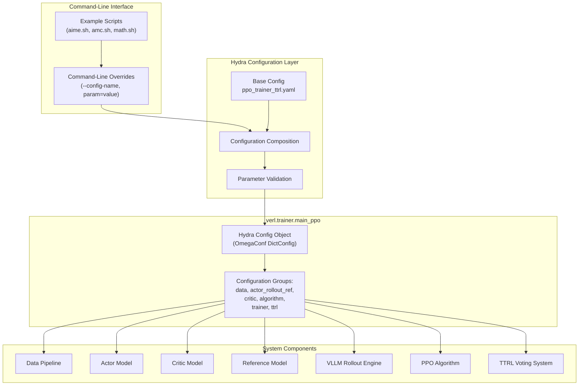
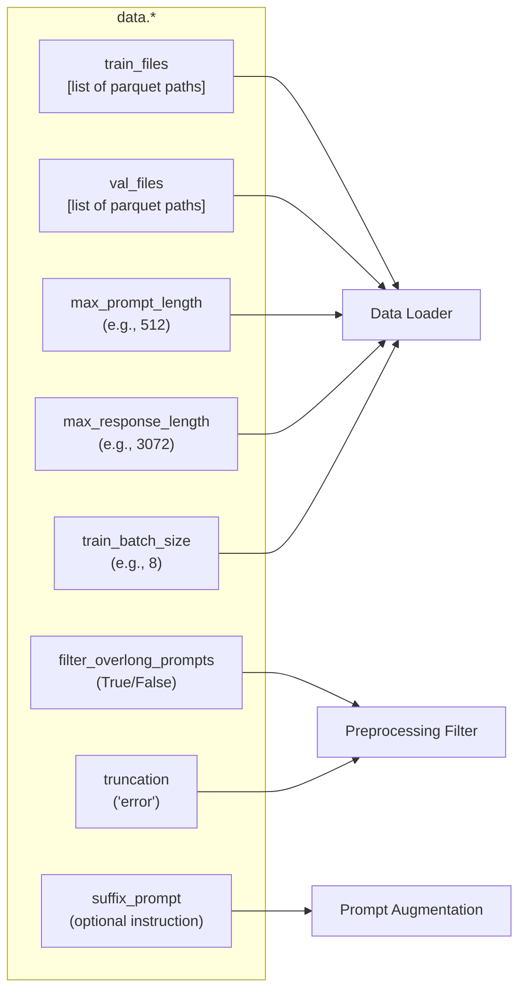
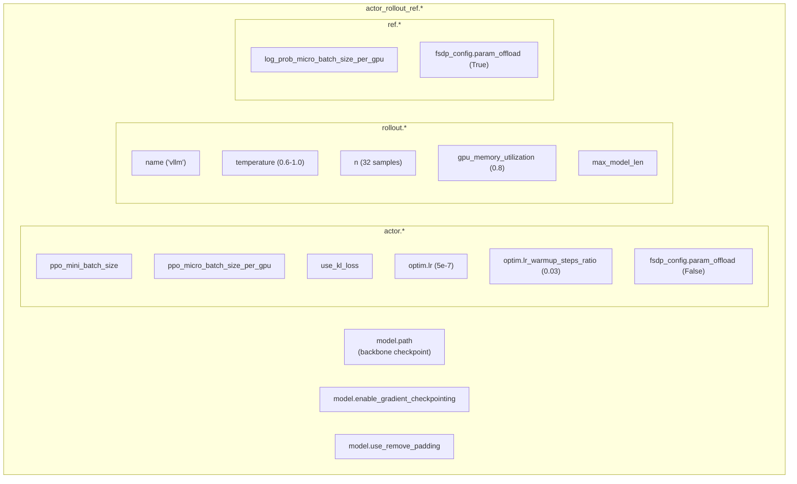
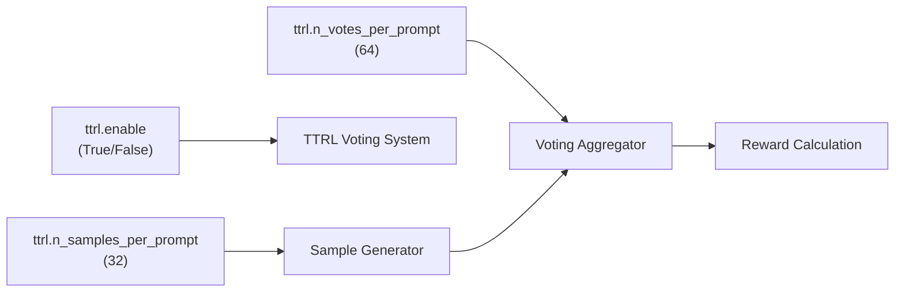
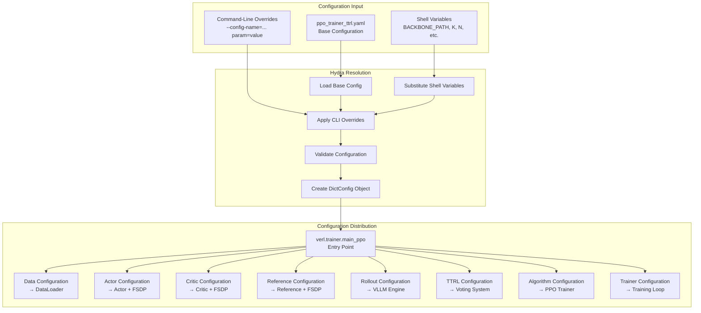

<!-- source: DeepWiki mcp.deepwiki.com · repo PRIME-RL/TTRL · page 5.2 Configuration Management · fetched 2026-10-30 -->

# Configuration Management

<details>
<summary>Relevant source files</summary>

The following files were used as context for generating this wiki page:

- [README.md](README.md)
- [verl/examples/ttrl/Qwen2.5-Math/aime.sh](verl/examples/ttrl/Qwen2.5-Math/aime.sh)
- [verl/examples/ttrl/Qwen2.5/aime.sh](verl/examples/ttrl/Qwen2.5/aime.sh)

</details>


## Purpose and Scope

This document explains TTRL's Hydra-based configuration management system, which controls all aspects of training including data processing, model architecture, PPO algorithm parameters, and TTRL-specific settings. The configuration system uses a base YAML file (`ppo_trainer_ttrl.yaml`) with command-line overrides to enable flexible experimentation without code changes.

For implementation details of custom reward functions referenced in configurations, see [Custom Reward Functions](#5.3). For the overall verl framework architecture, see [verl Overview](#5.1).

---

## Configuration System Architecture

TTRL's configuration system is built on Hydra, which provides hierarchical configuration composition with command-line overrides. The system operates in three layers:



**Configuration Flow**: Example scripts invoke `verl.trainer.main_ppo` with the base config name and overrides. Hydra merges the base configuration with overrides, validates parameters, and creates an `OmegaConf DictConfig` object that is distributed to system components.

**Sources**: [verl/examples/ttrl/Qwen2.5/aime.sh:42-43](), [verl/examples/ttrl/Qwen2.5-Math/aime.sh:42-43]()

---

## Base Configuration File

The base configuration file `ppo_trainer_ttrl.yaml` defines default values for all training parameters. While this file is not provided in the repository excerpts, its structure is inferred from the command-line overrides used in example scripts.

### Configuration Groups

The configuration is organized into logical groups that map to system components:

| Group | Purpose | Key Parameters |
|-------|---------|----------------|
| `data` | Data loading and preprocessing | `train_files`, `val_files`, `max_prompt_length`, `max_response_length`, `train_batch_size`, `filter_overlong_prompts`, `truncation`, `suffix_prompt` |
| `actor_rollout_ref` | Actor, rollout, and reference model configuration | `model.path`, `actor.*`, `rollout.*`, `ref.*` |
| `actor_rollout_ref.model` | Shared model settings | `path`, `enable_gradient_checkpointing`, `use_remove_padding` |
| `actor_rollout_ref.actor` | Actor-specific training parameters | `ppo_mini_batch_size`, `ppo_micro_batch_size_per_gpu`, `use_kl_loss`, `optim.lr`, `optim.lr_warmup_steps_ratio`, `optim.warmup_style`, `fsdp_config.*` |
| `actor_rollout_ref.rollout` | VLLM rollout engine settings | `name`, `temperature`, `n`, `val_kwargs.*`, `tensor_model_parallel_size`, `gpu_memory_utilization`, `max_model_len` |
| `actor_rollout_ref.ref` | Reference model settings | `log_prob_micro_batch_size_per_gpu`, `fsdp_config.param_offload` |
| `critic` | Critic model configuration | `model.path`, `optim.lr`, `ppo_micro_batch_size_per_gpu`, `model.fsdp_config.*` |
| `algorithm` | PPO algorithm parameters | `kl_ctrl.kl_coef`, `adv_estimator` |
| `custom_reward_function` | Custom reward function specification | `path`, `name` |
| `ttrl` | TTRL-specific settings | `enable`, `n_votes_per_prompt`, `n_samples_per_prompt` |
| `trainer` | Training loop and logging | `logger`, `project_name`, `experiment_name`, `n_gpus_per_node`, `nnodes`, `save_freq`, `test_freq`, `total_epochs`, `default_local_dir` |

**Sources**: [verl/examples/ttrl/Qwen2.5/aime.sh:44-104](), [verl/examples/ttrl/Qwen2.5-Math/aime.sh:44-105]()

---

## Override Syntax

Hydra uses dot-notation to specify nested configuration parameters and special prefixes for advanced operations:

### Standard Override Syntax

```bash
# Nested parameter access
data.train_batch_size=8

# Deep nesting
actor_rollout_ref.actor.optim.lr=5e-7
```

### Addition Syntax (`+`)

The `+` prefix adds a new parameter that doesn't exist in the base configuration:

```bash
# Add a new parameter
+data.suffix_prompt='"\nPlease reason step by step..."'

# Enable TTRL mode
+ttrl.enable=True
```

**Example from Qwen2.5 scripts**: [verl/examples/ttrl/Qwen2.5/aime.sh:51]() uses `+data.suffix_prompt` to inject additional instructions into prompts.

**Sources**: [verl/examples/ttrl/Qwen2.5/aime.sh:51](), [verl/examples/ttrl/Qwen2.5/aime.sh:91]()

### List Values

Lists are specified using bracket notation:

```bash
# File paths as lists
data.train_files=["$DATA_LOCAL_DIR/$TASK/train.parquet"]
data.val_files=["$DATA_LOCAL_DIR/$TASK/test.parquet"]

# Multiple loggers
trainer.logger=['console','wandb']
```

**Sources**: [verl/examples/ttrl/Qwen2.5/aime.sh:44-45](), [verl/examples/ttrl/Qwen2.5/aime.sh:94]()

### Expression Evaluation

Shell variables and expressions are evaluated before being passed to Hydra:

```bash
K=3
MAX_RESPONSE_LENGTH=$((1024 * $K))
data.max_response_length=$MAX_RESPONSE_LENGTH
```

**Sources**: [verl/examples/ttrl/Qwen2.5/aime.sh:15-17]()

---

## Configuration Groups Deep Dive

### Data Configuration

The `data` group controls data loading and preprocessing:



**Key Parameters**:
- `train_files` / `val_files`: Parquet file paths for training and validation
- `max_prompt_length`: Maximum tokens in input prompt (typically 512-1024)
- `max_response_length`: Maximum tokens in model response (K × 1024, where K=3 typically)
- `filter_overlong_prompts`: Whether to filter prompts exceeding `max_prompt_length`
- `suffix_prompt`: Additional instruction text appended to prompts (e.g., "Please reason step by step...")

**Sources**: [verl/examples/ttrl/Qwen2.5/aime.sh:44-51]()

---

### Actor-Rollout-Reference Configuration

The `actor_rollout_ref` group configures the actor model, VLLM rollout engine, and reference model:



**Actor Parameters**:
- `ppo_mini_batch_size`: Mini-batches per PPO update (typically 1)
- `ppo_micro_batch_size_per_gpu`: Micro-batch size per GPU for gradient accumulation (typically 2)
- `optim.lr`: Actor learning rate (5e-7, very conservative)
- `fsdp_config.param_offload`: Whether to offload parameters to CPU (False for actor)

**Rollout Parameters**:
- `name`: Rollout engine type (`vllm`)
- `temperature`: Sampling temperature (1.0 for training, 0.6 for validation)
- `n`: Number of samples per prompt (32 for TTRL voting)
- `gpu_memory_utilization`: Fraction of GPU memory for VLLM (0.8)

**Reference Parameters**:
- `fsdp_config.param_offload`: Whether to offload to CPU (True for reference model to save memory)

**Sources**: [verl/examples/ttrl/Qwen2.5/aime.sh:52-79]()

---

### Critic Configuration

The `critic` group configures the value function model:

```bash
critic.model.path=$BACKBONE_PATH
critic.optim.lr=9e-6  # 18x faster than actor
critic.ppo_micro_batch_size_per_gpu=$MICRO_BATCH_SIZE
critic.model.enable_gradient_checkpointing=True
critic.model.use_remove_padding=True
critic.model.fsdp_config.param_offload=False
critic.model.fsdp_config.optimizer_offload=False
```

**Key Difference**: The critic learning rate (9e-6) is 18× higher than the actor (5e-7) to enable faster value function tracking of policy changes.

**Sources**: [verl/examples/ttrl/Qwen2.5/aime.sh:80-86]()

---

### Algorithm Configuration

The `algorithm` group specifies PPO algorithm behavior:

```bash
algorithm.kl_ctrl.kl_coef=0.00  # KL divergence coefficient (disabled)
algorithm.adv_estimator=grpo    # Advantage estimator (GRPO)
```

| Parameter | Value | Meaning |
|-----------|-------|---------|
| `kl_ctrl.kl_coef` | 0.00 | KL divergence penalty coefficient (0 = disabled) |
| `adv_estimator` | `grpo` | Advantage estimation method (Group Relative Policy Optimization) |

**Sources**: [verl/examples/ttrl/Qwen2.5/aime.sh:87-88]()

---

### TTRL Configuration

The `ttrl` group enables and configures TTRL-specific functionality:



**Parameters**:
- `ttrl.enable`: Boolean flag to enable TTRL mode (default: False)
- `ttrl.n_votes_per_prompt`: Total votes for majority voting (typically 64)
- `ttrl.n_samples_per_prompt`: Samples generated per prompt (typically 32)

**Note**: When `ttrl.enable=True`, the system uses majority voting across multiple samples instead of ground-truth labels for reward calculation.

**Sources**: [verl/examples/ttrl/Qwen2.5/aime.sh:91-93]()

---

### Custom Reward Function Configuration

The `custom_reward_function` group specifies which reward function to use:

```bash
custom_reward_function.path="./verl/utils/reward_score/ttrl_math/__init__.py"
custom_reward_function.name=reward_func
```

**Parameters**:
- `path`: File path to the module containing the reward function
- `name`: Function name within the module (must be callable)

This configuration points to the TTRL mathematical reasoning reward function that extracts answers from `\boxed{}` LaTeX notation and compares them to the majority vote.

**Sources**: [verl/examples/ttrl/Qwen2.5/aime.sh:89-90]()

---

### Trainer Configuration

The `trainer` group controls the training loop, logging, and checkpointing:

```bash
trainer.logger=['console','wandb']
trainer.project_name=$WANDB_PROJECT
trainer.experiment_name=$LOG_NAME
trainer.n_gpus_per_node=8
trainer.nnodes=1
trainer.save_freq=2000000  # Effectively disabled
trainer.test_freq=2
trainer.max_actor_ckpt_to_keep=0
trainer.max_critic_ckpt_to_keep=0
trainer.default_local_dir=$OUTPUT_DIR
trainer.total_epochs=$EPISODE
```

| Parameter | Typical Value | Description |
|-----------|---------------|-------------|
| `logger` | `['console','wandb']` | Logging backends |
| `project_name` | `"TTRL-verl"` | WandB project name |
| `experiment_name` | Date + experiment description | WandB run name |
| `n_gpus_per_node` | 8 | GPUs per node for distributed training |
| `nnodes` | 1 | Number of nodes |
| `save_freq` | 2000000 | Checkpoint frequency (high = disabled) |
| `test_freq` | 2 | Validation frequency in epochs |
| `total_epochs` | 80 | Total training epochs |
| `default_local_dir` | Checkpoints path | Directory for outputs |

**Sources**: [verl/examples/ttrl/Qwen2.5/aime.sh:94-104]()

---

## Configuration Resolution Flow

The following diagram shows how configurations are resolved and propagated through the system:



**Resolution Steps**:
1. Shell script defines variables (e.g., `K=3`, `BACKBONE_PATH="..."`)
2. Hydra loads base configuration file `ppo_trainer_ttrl.yaml`
3. Shell variables are substituted into command-line arguments
4. CLI overrides are applied on top of base configuration
5. Hydra validates the final configuration
6. A `DictConfig` object is created and passed to `verl.trainer.main_ppo`
7. The main PPO trainer distributes configuration sections to appropriate system components

**Sources**: [verl/examples/ttrl/Qwen2.5/aime.sh:7-104]()

---

## Practical Configuration Examples

### Minimal TTRL Configuration

The minimum required overrides to enable TTRL:

```bash
python -m verl.trainer.main_ppo \
  --config-name='ppo_trainer_ttrl.yaml' \
  data.train_files=["./data/train.parquet"] \
  actor_rollout_ref.model.path="./model_checkpoint" \
  critic.model.path="./model_checkpoint" \
  ttrl.enable=True \
  custom_reward_function.path="./verl/utils/reward_score/ttrl_math/__init__.py" \
  custom_reward_function.name=reward_func
```

### Model-Specific Adjustments

Different models may require different configurations:

**Qwen2.5-7B** (larger model):
```bash
actor_rollout_ref.rollout.gpu_memory_utilization=0.8
actor_rollout_ref.rollout.tensor_model_parallel_size=1
```

**Qwen2.5-Math-1.5B** (smaller, specialized model):
```bash
# Typically no suffix_prompt needed (already instruction-tuned for math)
# Same VLLM settings work with lower memory usage
```

**Sources**: [verl/examples/ttrl/Qwen2.5/aime.sh:51]() vs [verl/examples/ttrl/Qwen2.5-Math/aime.sh]() (no suffix_prompt)

### Task-Specific Adjustments

Different tasks may require different prompt lengths and response lengths:

**AIME** (complex, long solutions):
```bash
K=3
MAX_RESPONSE_LENGTH=$((1024 * 3))  # 3072 tokens
```

**AMC** (shorter problems):
```bash
K=2
MAX_RESPONSE_LENGTH=$((1024 * 2))  # 2048 tokens
```

---

## Configuration Validation and Error Handling

The Hydra configuration system performs validation at several stages:

1. **Syntax Validation**: Hydra checks YAML syntax and override syntax
2. **Type Validation**: Ensures parameters have correct types (int, float, str, list, etc.)
3. **Path Validation**: The `truncation='error'` setting causes training to fail if prompts exceed length limits, preventing silent truncation

**Common Configuration Errors**:

| Error Type | Example | Solution |
|------------|---------|----------|
| Missing required parameter | No `model.path` specified | Add `actor_rollout_ref.model.path=...` |
| Type mismatch | `train_batch_size="8"` (string instead of int) | Remove quotes: `train_batch_size=8` |
| Invalid list syntax | `train_files="file.parquet"` | Use brackets: `train_files=["file.parquet"]` |
| Path not found | `model.path=/nonexistent/path` | Verify path exists before running |

**Sources**: [verl/examples/ttrl/Qwen2.5/aime.sh:50]() (truncation='error')

---

## Configuration Best Practices

1. **Use Shell Variables**: Define commonly changed values as shell variables for easy modification
2. **Consistent Naming**: Use descriptive experiment names that include date, model, and task
3. **Memory Safety**: For larger models, reduce `gpu_memory_utilization` from 0.8 to 0.7
4. **Checkpoint Management**: Set `save_freq` to a high value to avoid excessive checkpointing
5. **Validation Frequency**: Use `test_freq=2` to validate every 2 epochs for quick feedback
6. **WandB Integration**: Always include both `console` and `wandb` loggers for comprehensive monitoring

**Sources**: [verl/examples/ttrl/Qwen2.5/aime.sh:7-40]() (shell variable setup), [verl/examples/ttrl/Qwen2.5/aime.sh:94-104]() (logging and checkpointing)

---

