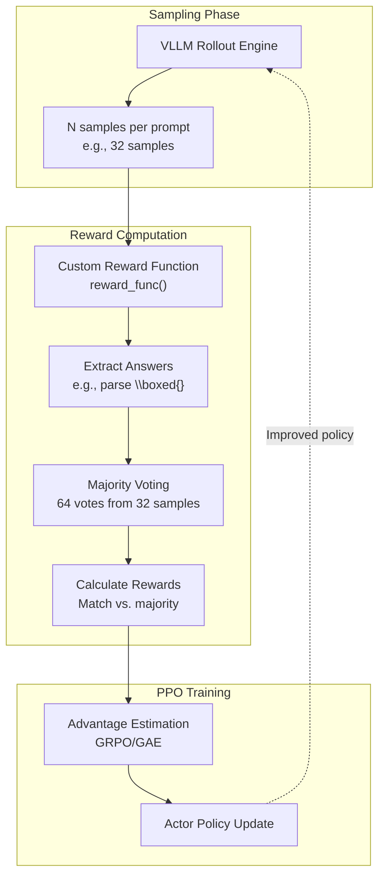
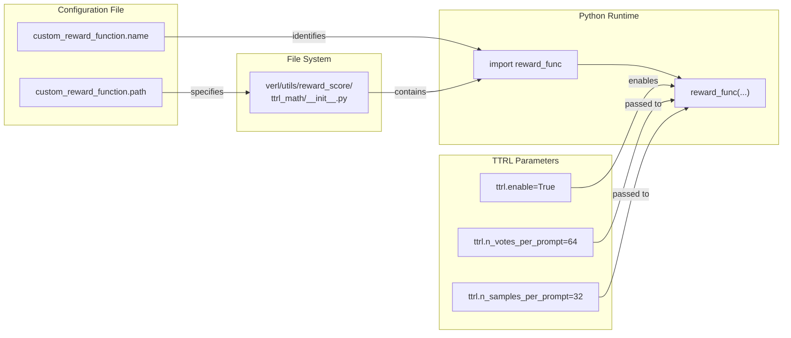
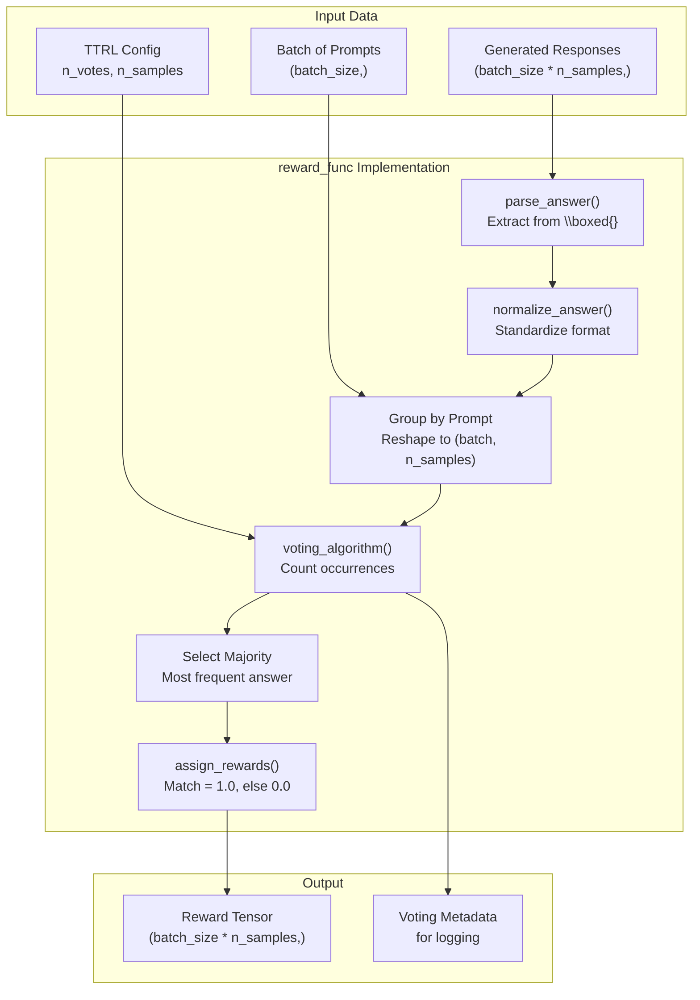
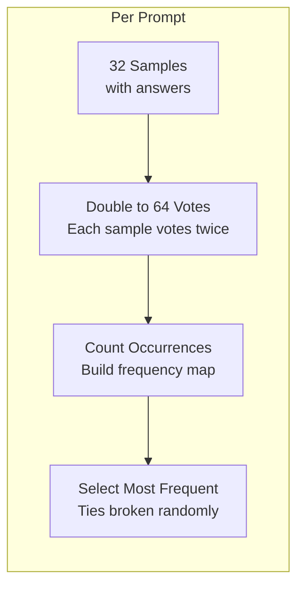
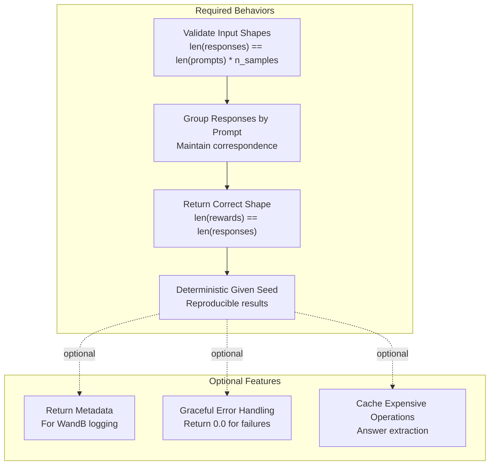
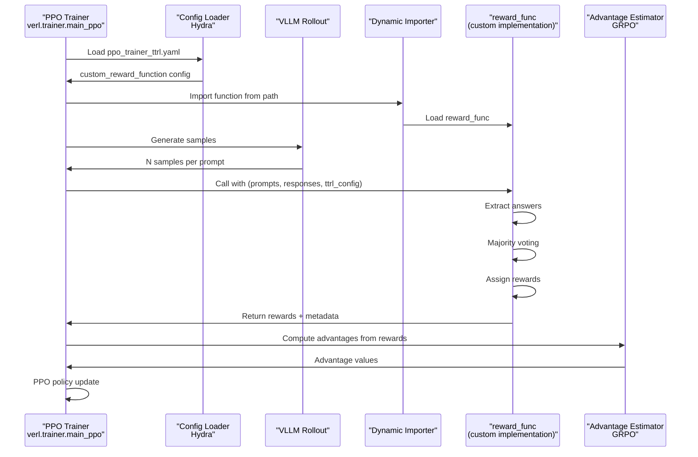
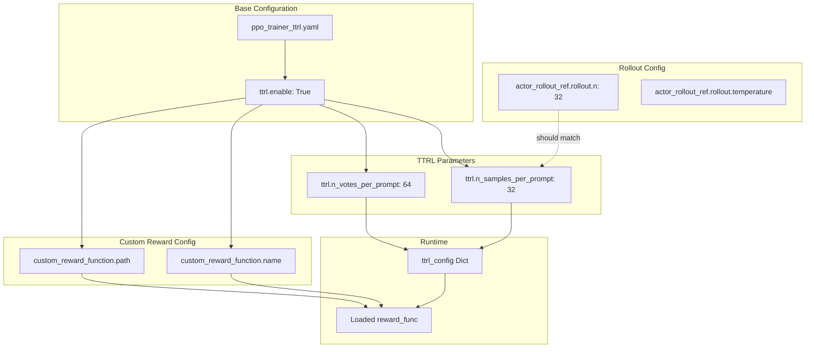

<!-- source: DeepWiki mcp.deepwiki.com · repo PRIME-RL/TTRL · page 5.3 Custom Reward Functions · fetched 2026-10-30 -->

# Custom Reward Functions

<details>
<summary>Relevant source files</summary>

The following files were used as context for generating this wiki page:

- [README.md](README.md)
- [verl/examples/ttrl/Qwen2.5-Math/aime.sh](verl/examples/ttrl/Qwen2.5-Math/aime.sh)

</details>


## Purpose and Scope

This page explains how to implement and configure custom reward functions in TTRL. Custom reward functions are the core mechanism by which TTRL evaluates generated responses without ground-truth labels, using majority voting to create self-supervised reward signals. This guide covers the configuration interface, the implementation of the `ttrl_math` reward function for mathematical reasoning tasks, and instructions for creating reward functions for other domains.

For information about the broader verl framework integration, see [verl Overview](#5.1). For general configuration management, see [Configuration Management](#5.2). For the training pipeline that uses these rewards, see [PPO Training Loop](#4.4).

---

## Reward Function Role in TTRL

Custom reward functions transform multiple model-generated responses into scalar reward values that drive reinforcement learning. In TTRL, the reward function implements the majority voting mechanism that enables training without ground-truth labels.

### System Integration



**Reward Function Pipeline**: The reward function receives multiple samples from VLLM, extracts structured answers, performs majority voting, and assigns binary rewards based on consensus.

Sources: [README.md:35-52](), [Diagram 2: TTRL Training Pipeline]()

---

## Configuration Interface

Custom reward functions are configured through two primary parameters in the verl configuration system:

| Parameter | Type | Description | Example |
|-----------|------|-------------|---------|
| `custom_reward_function.path` | string | File path to reward function implementation | `"./verl/utils/reward_score/ttrl_math/__init__.py"` |
| `custom_reward_function.name` | string | Function name to import and call | `"reward_func"` |

### Configuration Mapping



**Configuration Flow**: The path and name parameters specify which Python function to dynamically import and invoke during training.

### Example Configuration

From the AIME training script:

```bash
custom_reward_function.path="./verl/utils/reward_score/ttrl_math/__init__.py" \
custom_reward_function.name=reward_func \
ttrl.enable=True \
ttrl.n_votes_per_prompt=64 \
ttrl.n_samples_per_prompt=32
```

Sources: [verl/examples/ttrl/Qwen2.5-Math/aime.sh:88-92]()

---

## The ttrl_math Reward Function

The `ttrl_math` reward function is designed for mathematical reasoning tasks. It extracts boxed answers from LaTeX-formatted responses and uses majority voting to assign rewards.

### Implementation Architecture



**ttrl_math Architecture**: The reward function processes responses through answer extraction, normalization, voting, and reward assignment stages.

### Key Components

#### Answer Extraction

The reward function extracts mathematical answers from model responses, typically looking for answers enclosed in LaTeX `\boxed{}` commands:

- **Pattern matching**: Regex-based extraction of `\boxed{...}` content
- **Fallback strategies**: Alternative patterns if primary extraction fails
- **Error handling**: Returns empty string or null for unparseable responses

#### Answer Normalization

Extracted answers are normalized to ensure consistent comparison:

- **Whitespace removal**: Strip leading/trailing spaces
- **Numeric standardization**: Convert to consistent numeric format (e.g., `3.0` → `3`)
- **LaTeX simplification**: Remove unnecessary LaTeX formatting
- **Case handling**: Lowercase text when appropriate

#### Majority Voting Algorithm

The voting mechanism aggregates multiple samples to identify consensus:



**Voting Process**: Each of the 32 samples votes twice (creating 64 total votes per prompt), votes are tallied, and the most frequent answer becomes the majority label.

#### Reward Assignment

Binary rewards are assigned based on match with majority:

| Condition | Reward Value | Interpretation |
|-----------|--------------|----------------|
| Sample answer == Majority answer | `1.0` | Agrees with consensus |
| Sample answer != Majority answer | `0.0` | Disagrees with consensus |
| Unparseable answer | `0.0` | Invalid or no answer |

This creates a self-supervised signal where samples that align with the group consensus receive positive reinforcement.

Sources: [README.md:95-99](), [Diagram 3: TTRL Core Innovation]()

---

## Reward Function Interface Contract

Custom reward functions must implement a specific interface to integrate with the verl training pipeline:

### Function Signature

```python
def reward_func(
    prompts: List[str],
    responses: List[str],
    ttrl_config: Dict[str, Any],
    **kwargs
) -> Union[List[float], Tuple[List[float], Dict[str, Any]]]
```

### Input Parameters

| Parameter | Type | Description |
|-----------|------|-------------|
| `prompts` | `List[str]` | Batch of input prompts (length = `batch_size`) |
| `responses` | `List[str]` | Generated responses (length = `batch_size * n_samples_per_prompt`) |
| `ttrl_config` | `Dict[str, Any]` | Configuration dict containing `n_votes_per_prompt`, `n_samples_per_prompt`, etc. |
| `**kwargs` | `Dict` | Additional parameters (e.g., `tokenizer`, `device`) |

### Return Value

The function must return either:
- **Simple**: `List[float]` - Reward values (length must match `responses`)
- **With metadata**: `Tuple[List[float], Dict[str, Any]]` - Rewards plus logging metadata

### Implementation Requirements



**Interface Contract**: Required behaviors ensure correct integration with PPO training, while optional features improve logging and performance.

Sources: [verl/examples/ttrl/Qwen2.5-Math/aime.sh:88-92]()

---

## Creating Custom Reward Functions

To implement a reward function for a different domain or task:

### Step 1: Define Answer Extraction

Implement domain-specific logic to extract answers from model responses:

```python
def extract_answer(response: str) -> str:
    """
    Extract the answer from a model response.
    
    Examples:
    - Math: Extract from \boxed{...}
    - Code: Extract final return value or print output
    - QA: Extract final sentence or marked answer
    """
    # Domain-specific extraction logic
    pass
```

**File location**: Create a new module under [verl/utils/reward_score/]():
- `verl/utils/reward_score/custom_domain/__init__.py`

### Step 2: Implement Normalization

Standardize extracted answers for consistent comparison:

```python
def normalize_answer(answer: str) -> str:
    """
    Normalize answer format for fair comparison.
    
    Examples:
    - Math: Simplify numeric expressions
    - Code: Strip whitespace, normalize indentation
    - QA: Lowercase, remove punctuation
    """
    # Normalization logic
    pass
```

### Step 3: Implement Voting Logic

Aggregate multiple samples using the TTRL voting mechanism:

```python
def compute_majority_vote(
    answers: List[str],
    n_votes_per_prompt: int
) -> str:
    """
    Compute majority vote from list of answers.
    
    Args:
        answers: List of n_samples answers for one prompt
        n_votes_per_prompt: Total votes (typically 2 * n_samples)
    
    Returns:
        Most frequent answer (majority label)
    """
    # Voting logic
    pass
```

### Step 4: Assemble Reward Function

Combine components into the main reward function:

```python
def reward_func(
    prompts: List[str],
    responses: List[str],
    ttrl_config: Dict[str, Any],
    **kwargs
) -> Tuple[List[float], Dict[str, Any]]:
    """Custom reward function for [domain]."""
    
    n_samples = ttrl_config['n_samples_per_prompt']
    n_votes = ttrl_config['n_votes_per_prompt']
    
    # 1. Extract answers
    answers = [extract_answer(r) for r in responses]
    
    # 2. Normalize answers
    normalized = [normalize_answer(a) for a in answers]
    
    # 3. Group by prompt
    batch_size = len(prompts)
    grouped = [
        normalized[i*n_samples:(i+1)*n_samples]
        for i in range(batch_size)
    ]
    
    # 4. Compute majority for each prompt
    majorities = [
        compute_majority_vote(group, n_votes)
        for group in grouped
    ]
    
    # 5. Assign rewards
    rewards = []
    for i, group in enumerate(grouped):
        majority = majorities[i]
        for answer in group:
            reward = 1.0 if answer == majority else 0.0
            rewards.append(reward)
    
    # 6. Prepare metadata for logging
    metadata = {
        'majority_agreement_rate': sum(rewards) / len(rewards),
        'unique_answers_per_prompt': [len(set(g)) for g in grouped],
    }
    
    return rewards, metadata
```

### Step 5: Configure Training Script

Update the training script to use the new reward function:

```bash
custom_reward_function.path="./verl/utils/reward_score/custom_domain/__init__.py" \
custom_reward_function.name=reward_func \
ttrl.enable=True \
ttrl.n_votes_per_prompt=64 \
ttrl.n_samples_per_prompt=32
```

### Domain-Specific Considerations

| Domain | Answer Extraction | Normalization | Special Considerations |
|--------|------------------|---------------|----------------------|
| **Mathematics** | Extract from `\boxed{}` | Simplify numeric expressions | Handle equivalent forms (e.g., fractions) |
| **Code Generation** | Extract final output or return | Strip whitespace, standardize formatting | Consider execution equivalence |
| **Question Answering** | Extract final sentence | Lowercase, remove punctuation | Handle synonyms and paraphrases |
| **Reasoning Tasks** | Extract conclusion step | Standardize logical notation | Consider chain-of-thought structure |

Sources: [README.md:95-99](), [verl/examples/ttrl/Qwen2.5-Math/aime.sh:88-92]()

---

## Integration with verl Training Pipeline

### Reward Function Call Flow



**Training Integration**: The reward function is dynamically imported and called after each rollout to compute rewards for PPO updates.

### Configuration Schema

The custom reward function interacts with the following configuration parameters:



**Configuration Dependencies**: The rollout configuration must produce the number of samples expected by the TTRL configuration.

Sources: [verl/examples/ttrl/Qwen2.5-Math/aime.sh:42-103]()

---

## Best Practices

### Performance Optimization

| Optimization | Benefit | Implementation |
|--------------|---------|----------------|
| **Batch answer extraction** | Reduce Python loops | Vectorize regex operations where possible |
| **Cache normalized answers** | Avoid redundant work | Store normalized form after first computation |
| **Efficient voting** | Fast majority selection | Use `collections.Counter` for vote tallying |
| **Lazy metadata** | Reduce overhead | Only compute detailed logs when needed |

### Testing and Validation

```python
def test_reward_func():
    """Test reward function with mock data."""
    
    # Test case: Simple majority
    prompts = ["Solve: 2+2=?"]
    responses = [
        "The answer is \\boxed{4}",  # 3 samples agree
        "\\boxed{4}",
        "The answer is \\boxed{4}",
        "\\boxed{5}",  # 1 sample disagrees
    ]
    ttrl_config = {
        'n_votes_per_prompt': 8,
        'n_samples_per_prompt': 4,
    }
    
    rewards, metadata = reward_func(prompts, responses, ttrl_config)
    
    assert len(rewards) == 4
    assert sum(rewards) == 3.0  # 3 samples match majority
    assert rewards[-1] == 0.0  # Last sample disagrees
```

### Error Handling

Robust reward functions should handle edge cases:

- **Empty responses**: Return reward `0.0`
- **Unparseable answers**: Return reward `0.0`
- **Ties in voting**: Break randomly or deterministically with seed
- **Malformed input**: Validate shapes and raise clear errors

Sources: [verl/examples/ttrl/Qwen2.5-Math/aime.sh:88-92](), [README.md:95-99]()

---

## Summary

Custom reward functions are the core innovation of TTRL, enabling reinforcement learning without ground-truth labels through majority voting:

- **Configuration**: Specified via `custom_reward_function.path` and `custom_reward_function.name`
- **Interface**: Functions receive prompts, responses, and config; return rewards
- **ttrl_math**: Reference implementation for mathematical reasoning with boxed answer extraction
- **Extensibility**: New domains require domain-specific answer extraction and normalization
- **Integration**: Dynamically loaded by verl trainer and called after each rollout

The modular design allows TTRL to be adapted to diverse reasoning tasks by implementing appropriate answer extraction and comparison logic for each domain.

---

