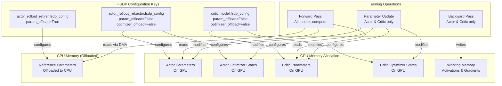
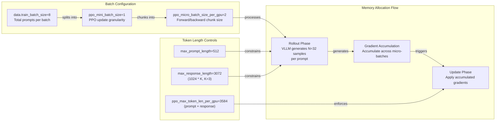
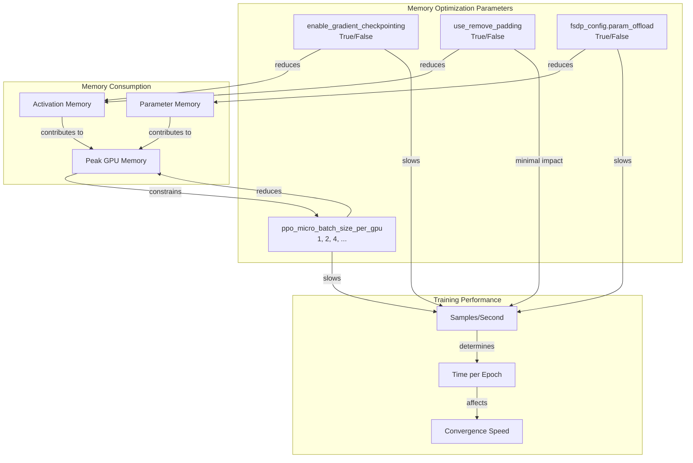
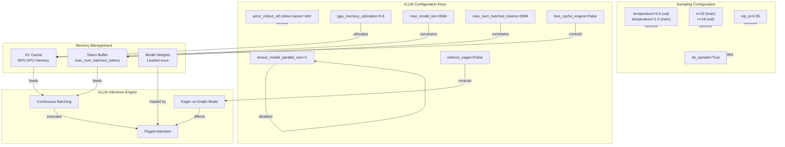
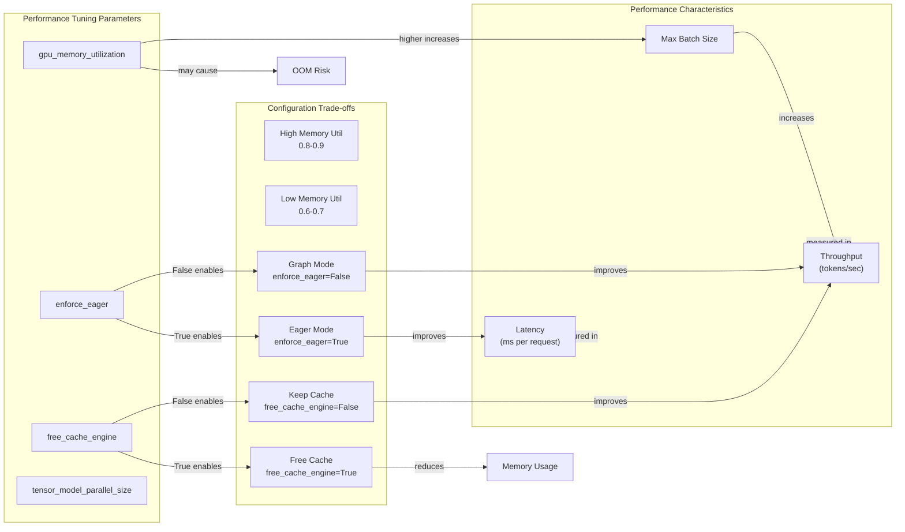
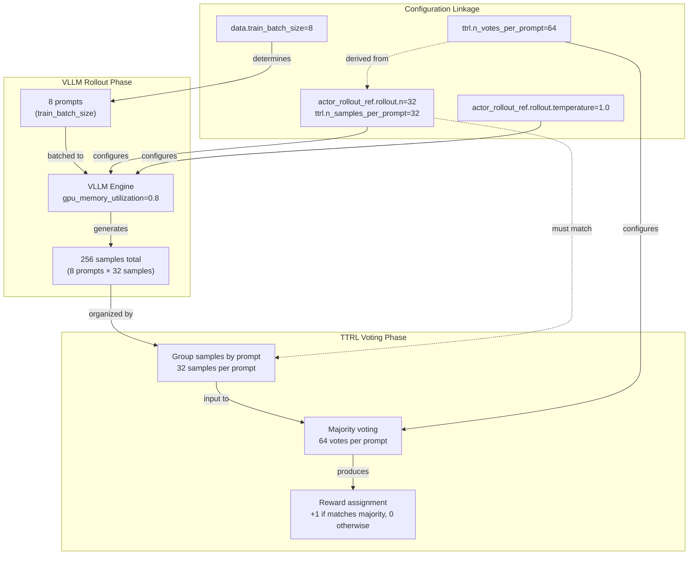

<!-- source: DeepWiki mcp.deepwiki.com · repo PRIME-RL/TTRL · page 6 Advanced Topics · fetched 2026-10-30 -->

# Advanced Topics

<details>
<summary>Relevant source files</summary>

The following files were used as context for generating this wiki page:

- [verl/examples/ttrl/Qwen2.5-Math/aime.sh](verl/examples/ttrl/Qwen2.5-Math/aime.sh)
- [verl/examples/ttrl/Qwen2.5/aime.sh](verl/examples/ttrl/Qwen2.5/aime.sh)
- [verl/requirements.txt](verl/requirements.txt)

</details>


This document covers advanced configuration and optimization techniques for expert users working with TTRL. It focuses on three critical areas for scaling and performance: distributed training with FSDP, memory optimization strategies, and VLLM integration for high-throughput inference. For basic configuration and setup, see [Configuration Guide](#3). For understanding the training pipeline mechanics, see [Training Pipeline](#4).

## 6.1 Distributed Training with FSDP

TTRL leverages PyTorch's Fully Sharded Data Parallel (FSDP) to enable training large language models across multiple GPUs with reduced memory footprint. The system applies different FSDP strategies to each model component based on their computational requirements and memory constraints.

### FSDP Strategy by Component

TTRL configures FSDP differently for actor, critic, and reference models to balance training speed and memory efficiency:

| Component | Parameter Offload | Optimizer Offload | Rationale |
|-----------|------------------|-------------------|-----------|
| Actor | `False` | `False` | Frequent updates require fast GPU access |
| Critic | `False` | `False` | 18x faster learning rate needs GPU speed |
| Reference | `True` | N/A | Frozen model only computes log probabilities; CPU offload saves memory |

The configuration appears in shell scripts as:

```bash
# Actor FSDP configuration
actor_rollout_ref.actor.fsdp_config.param_offload=False
actor_rollout_ref.actor.fsdp_config.optimizer_offload=False

# Critic FSDP configuration  
critic.model.fsdp_config.param_offload=False
critic.model.fsdp_config.optimizer_offload=False

# Reference FSDP configuration
actor_rollout_ref.ref.fsdp_config.param_offload=True
```

**Sources:** [verl/examples/ttrl/Qwen2.5/aime.sh:60-65](), [verl/examples/ttrl/Qwen2.5/aime.sh:84-86](), [verl/examples/ttrl/Qwen2.5-Math/aime.sh:60-65](), [verl/examples/ttrl/Qwen2.5-Math/aime.sh:84-86]()

### FSDP Configuration Architecture



**Diagram:** FSDP memory allocation and configuration flow showing how different components utilize GPU vs CPU memory

**Sources:** [verl/examples/ttrl/Qwen2.5/aime.sh:60-65](), [verl/examples/ttrl/Qwen2.5/aime.sh:84-86]()

### Multi-Node Configuration

For distributed training across multiple nodes, TTRL uses the following configuration pattern:

```bash
trainer.n_gpus_per_node=8
trainer.nnodes=1
```

Each node runs a separate process group, and FSDP automatically shards model parameters across all GPUs. The `nnodes` parameter can be increased for larger-scale training, with FSDP handling inter-node communication.

**Sources:** [verl/examples/ttrl/Qwen2.5/aime.sh:96-97](), [verl/examples/ttrl/Qwen2.5-Math/aime.sh:96-97]()

## 6.2 Memory Optimization

TTRL implements multiple memory optimization techniques to enable training 7B-8B parameter models on consumer hardware. These optimizations work together to reduce peak memory consumption while maintaining training throughput.

### Memory Optimization Techniques

The system employs four primary memory optimization strategies:

| Technique | Configuration Key | Memory Savings | Performance Impact |
|-----------|------------------|----------------|-------------------|
| Gradient Checkpointing | `enable_gradient_checkpointing=True` | ~40% activation memory | ~20% slower forward pass |
| Padding Removal | `use_remove_padding=True` | Variable (depends on sequence length variance) | Minimal |
| Micro-batching | `ppo_micro_batch_size_per_gpu` | Enables larger effective batch sizes | Increases training time linearly |
| Max Token Length Control | `ppo_max_token_len_per_gpu` | Prevents OOM on long sequences | None (safety mechanism) |

**Sources:** [verl/examples/ttrl/Qwen2.5/aime.sh:52-54](), [verl/examples/ttrl/Qwen2.5/aime.sh:80-83]()

### Gradient Checkpointing

Gradient checkpointing trades computation for memory by not storing intermediate activations during the forward pass. Instead, activations are recomputed during the backward pass as needed. This is enabled for both actor and critic:

```bash
actor_rollout_ref.model.enable_gradient_checkpointing=True
critic.model.enable_gradient_checkpointing=True
```

**Sources:** [verl/examples/ttrl/Qwen2.5/aime.sh:52](), [verl/examples/ttrl/Qwen2.5/aime.sh:82]()

### Padding Removal Optimization

The `use_remove_padding` optimization eliminates unnecessary computation on padding tokens by dynamically packing sequences. This is particularly effective when sequence lengths vary significantly:

```bash
actor_rollout_ref.model.use_remove_padding=True
critic.model.use_remove_padding=True
```

This optimization integrates with Flash Attention (via `flash-attn` in requirements) to process only non-padding tokens.

**Sources:** [verl/examples/ttrl/Qwen2.5/aime.sh:54](), [verl/examples/ttrl/Qwen2.5/aime.sh:81](), [verl/requirements.txt:6]()

### Micro-batching Strategy



**Diagram:** Micro-batching and token length control configuration showing how batches are subdivided and memory limits enforced

TTRL uses a three-tier batching strategy:

1. **Train Batch Size** (`data.train_batch_size=8`): Total number of unique prompts processed per training iteration
2. **Mini-batch Size** (`ppo_mini_batch_size=1`): Subset of data used for each PPO update
3. **Micro-batch Size** (`ppo_micro_batch_size_per_gpu=2`): Number of sequences processed together in a single forward/backward pass per GPU

The micro-batch size is the primary memory control knob. Reducing it from 2 to 1 halves peak memory usage but doubles training time.

**Sources:** [verl/examples/ttrl/Qwen2.5/aime.sh:25](), [verl/examples/ttrl/Qwen2.5/aime.sh:28-29](), [verl/examples/ttrl/Qwen2.5/aime.sh:54-56]()

### Token Length Management

Maximum token lengths are configured at three points:

```bash
# Data preprocessing limits
data.max_prompt_length=512
data.max_response_length=3072  # 1024 * K, where K=3

# Training memory limit (per GPU)
actor_rollout_ref.actor.ppo_max_token_len_per_gpu=3584

# VLLM rollout limits
actor_rollout_ref.rollout.max_model_len=3584
actor_rollout_ref.rollout.max_num_batched_tokens=3584
```

The `ppo_max_token_len_per_gpu` parameter acts as a hard limit preventing OOM errors when individual sequences exceed expected lengths. The `filter_overlong_prompts=True` flag removes prompts exceeding `max_prompt_length` during data loading.

**Sources:** [verl/examples/ttrl/Qwen2.5/aime.sh:15-17](), [verl/examples/ttrl/Qwen2.5/aime.sh:46-47](), [verl/examples/ttrl/Qwen2.5/aime.sh:49](), [verl/examples/ttrl/Qwen2.5/aime.sh:62](), [verl/examples/ttrl/Qwen2.5/aime.sh:77-78]()

### Memory Optimization Trade-offs



**Diagram:** Memory optimization parameter relationships and their impact on memory consumption and training performance

**Sources:** [verl/examples/ttrl/Qwen2.5/aime.sh:52-65](), [verl/examples/ttrl/Qwen2.5/aime.sh:80-86]()

## 6.3 VLLM Integration

TTRL uses VLLM (v0.8.4 and v1) as its high-throughput inference engine for generating rollout samples during training. VLLM provides efficient GPU utilization through continuous batching and optimized attention kernels.

### VLLM Version and Backend Selection

The example scripts configure VLLM v1 with flexible attention backend selection:

```bash
#!/bin/bash
#export VLLM_ATTENTION_BACKEND=XFORMERS
unset VLLM_ATTENTION_BACKEND
export VLLM_USE_V1=1
```

- **VLLM v1** (`VLLM_USE_V1=1`): Enables the newer VLLM architecture with improved memory management
- **Attention Backend**: Can use either Flash Attention (default when unset) or xFormers (when `VLLM_ATTENTION_BACKEND=XFORMERS`)
- The commented-out xFormers option suggests Flash Attention is preferred for performance

**Sources:** [verl/examples/ttrl/Qwen2.5/aime.sh:2-4](), [verl/examples/ttrl/Qwen2.5-Math/aime.sh:2-4]()

### VLLM Core Configuration



**Diagram:** VLLM configuration hierarchy showing core engine settings, sampling parameters, and memory management

The main VLLM configuration parameters:

| Parameter | Train Value | Validation Value | Purpose |
|-----------|-------------|------------------|---------|
| `name` | `vllm` | `vllm` | Selects VLLM as rollout engine |
| `tensor_model_parallel_size` | `1` | `1` | Disables tensor parallelism (single GPU per model) |
| `gpu_memory_utilization` | `0.8` | `0.8` | Allocates 80% of GPU memory to KV cache |
| `max_model_len` | `3584` | `3584` | Maximum sequence length (prompt + response) |
| `max_num_batched_tokens` | `3584` | `3584` | Maximum tokens processed in a single batch |
| `enforce_eager` | `False` | `False` | Enables CUDA graph optimization |
| `free_cache_engine` | `False` | `False` | Keeps KV cache allocated between batches |

**Sources:** [verl/examples/ttrl/Qwen2.5/aime.sh:65-78]()

### Sampling Strategy Configuration

TTRL uses different sampling strategies for training and validation:

```bash
# Training rollout
actor_rollout_ref.rollout.temperature=1.0
actor_rollout_ref.rollout.n=32  # N_SAMPLES_PER_PROMPT

# Validation rollout
actor_rollout_ref.rollout.val_kwargs.do_sample=True
actor_rollout_ref.rollout.val_kwargs.n=16
actor_rollout_ref.rollout.val_kwargs.top_p=0.95
actor_rollout_ref.rollout.val_kwargs.temperature=0.6
```

**Training**: Higher temperature (`1.0`) encourages exploration, generating diverse samples for robust majority voting. Generates 32 samples per prompt for TTRL's voting mechanism.

**Validation**: Lower temperature (`0.6`) produces more focused outputs closer to the mode of the distribution. Uses fewer samples (`16`) to reduce evaluation time while still enabling maj@n metric computation.

**Sources:** [verl/examples/ttrl/Qwen2.5/aime.sh:66-67](), [verl/examples/ttrl/Qwen2.5/aime.sh:72-77](), [verl/examples/ttrl/Qwen2.5-Math/aime.sh:66](), [verl/examples/ttrl/Qwen2.5-Math/aime.sh:72-77]()

### VLLM Performance Tuning



**Diagram:** VLLM performance tuning parameters and their effects on throughput, latency, and memory usage

#### GPU Memory Utilization

The `gpu_memory_utilization=0.8` setting reserves 80% of GPU memory for VLLM's KV cache. Increasing this value allows larger batch sizes but risks OOM errors when memory usage spikes. Recommended values:

- **0.7-0.8**: Conservative, safe for most workloads
- **0.85-0.9**: Aggressive, maximizes throughput but requires careful monitoring
- **0.6-0.65**: Use when actor/critic training requires more GPU memory

#### Eager Mode vs. Graph Mode

When `enforce_eager=False` (default), VLLM compiles a CUDA graph for the inference kernel, reducing Python overhead. This improves throughput but adds compilation time at startup and consumes additional GPU memory for graph storage.

Set `enforce_eager=True` when:
- Debugging inference issues
- Memory is extremely constrained
- Model architecture is dynamic (rare)

#### Cache Engine Management

The `free_cache_engine=False` setting keeps VLLM's KV cache allocated between rollout batches, avoiding reallocation overhead. Set to `True` only if you need to reclaim GPU memory between training steps, which will reduce throughput.

**Sources:** [verl/examples/ttrl/Qwen2.5/aime.sh:67-72]()

### VLLM Micro-batch Configuration

VLLM processes responses in micro-batches for log probability computation:

```bash
actor_rollout_ref.rollout.log_prob_micro_batch_size_per_gpu=2
actor_rollout_ref.ref.log_prob_micro_batch_size_per_gpu=2
```

This parameter controls how many sequences are processed together when computing log probabilities for PPO updates. It should match or be a multiple of the training micro-batch size for optimal pipeline efficiency.

**Sources:** [verl/examples/ttrl/Qwen2.5/aime.sh:63-64](), [verl/examples/ttrl/Qwen2.5/aime.sh:69]()

### Integration with TTRL Voting



**Diagram:** VLLM integration with TTRL voting mechanism showing data flow from rollout generation to reward computation

VLLM generates exactly `n_samples_per_prompt=32` samples for each prompt during training. These samples feed into TTRL's majority voting mechanism, which uses `n_votes_per_prompt=64` votes (by sampling from the 32 generated responses with replacement) to determine consensus answers. The high temperature (`1.0`) during training ensures diverse samples, improving voting quality.

**Sources:** [verl/examples/ttrl/Qwen2.5/aime.sh:25-27](), [verl/examples/ttrl/Qwen2.5/aime.sh:66-67](), [verl/examples/ttrl/Qwen2.5/aime.sh:72-73](), [verl/examples/ttrl/Qwen2.5/aime.sh:91-92]()

---

