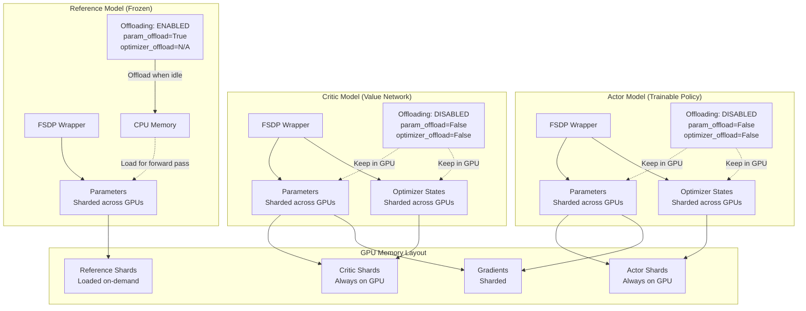
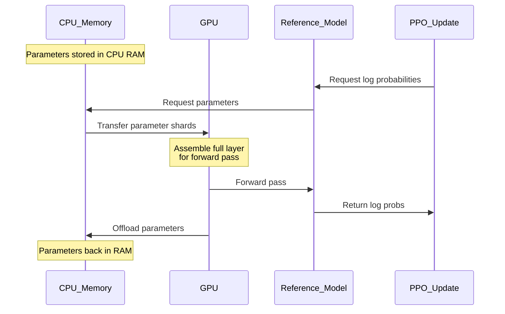
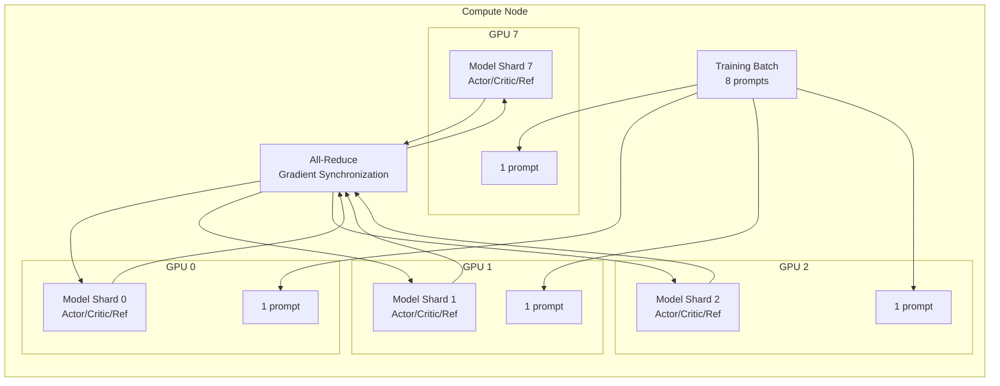
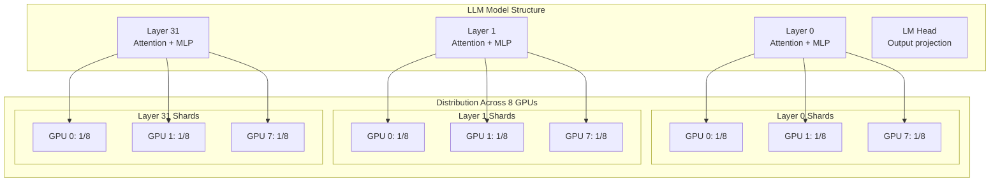
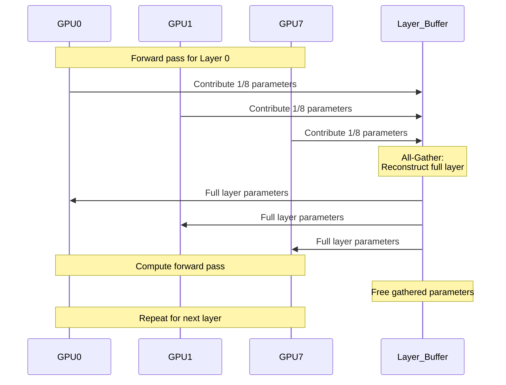
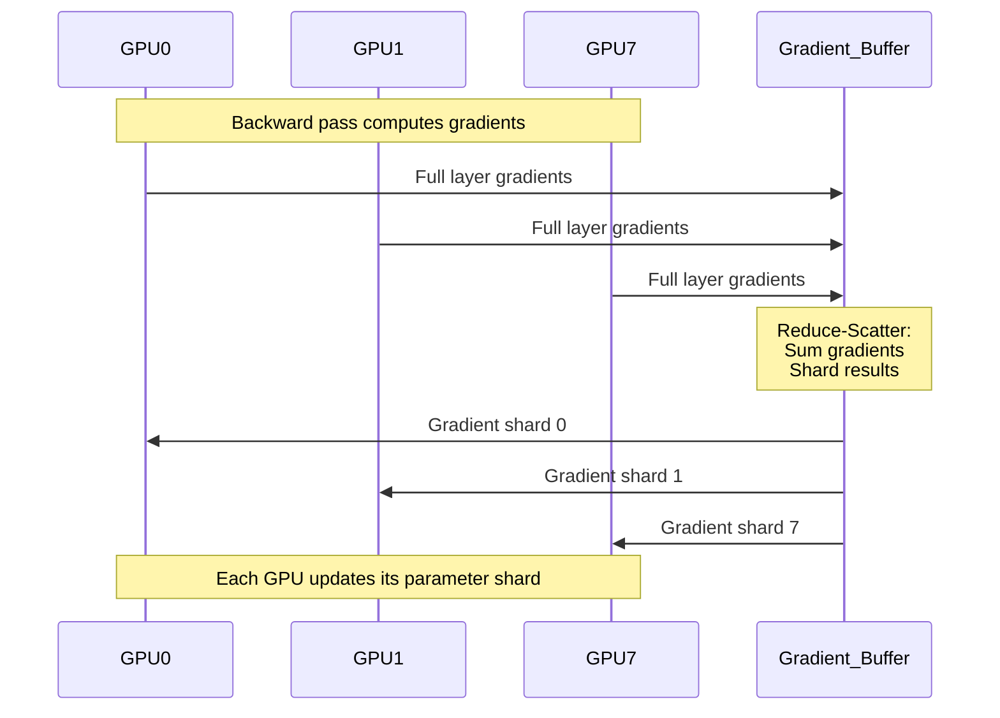
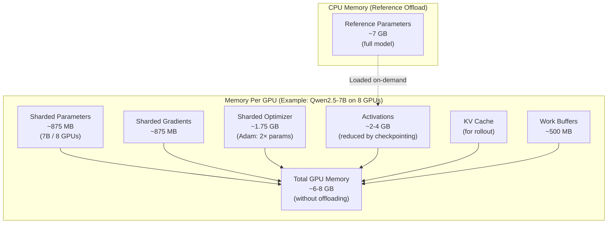
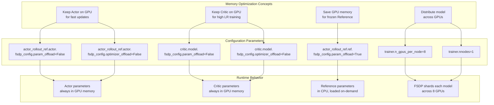

<!-- source: DeepWiki mcp.deepwiki.com · repo PRIME-RL/TTRL · page 6.1 Distributed Training with FSDP · fetched 2026-10-30 -->

# Distributed Training with FSDP

<details>
<summary>Relevant source files</summary>

The following files were used as context for generating this wiki page:

- [verl/examples/ttrl/Qwen2.5-Math/aime.sh](verl/examples/ttrl/Qwen2.5-Math/aime.sh)
- [verl/examples/ttrl/Qwen2.5/aime.sh](verl/examples/ttrl/Qwen2.5/aime.sh)

</details>


## Purpose and Scope

This document explains how TTRL uses Fully Sharded Data Parallel (FSDP) to enable memory-efficient distributed training of large language models across multiple GPUs. FSDP is a PyTorch-native technique that shards model parameters, gradients, and optimizer states across devices to reduce per-GPU memory requirements while maintaining training efficiency.

This page covers:
- FSDP configuration for each TTRL component (Actor, Critic, Reference)
- Parameter and optimizer offloading strategies
- Multi-GPU coordination and communication patterns
- Memory optimization trade-offs

For general memory optimization techniques beyond FSDP, see [Memory Optimization](#6.2). For VLLM-specific distributed inference, see [VLLM Integration](#6.3). For overall system architecture, see [System Architecture](#1.2).

---

## FSDP in TTRL Architecture

TTRL employs FSDP differently across its three trainable components to balance memory efficiency with computational performance. Each component has distinct memory requirements and access patterns that inform its FSDP configuration.

### Component-Specific FSDP Strategy



**Key Design Decisions:**

| Component | Parameter Offload | Optimizer Offload | Rationale |
|-----------|------------------|-------------------|-----------|
| Actor | Disabled | Disabled | Frequent gradient updates require fast GPU access |
| Critic | Disabled | Disabled | High learning rate (18x Actor) needs low-latency optimization |
| Reference | Enabled | N/A (no training) | Frozen model only needs forward pass; CPU storage saves GPU memory |

Sources: [verl/examples/ttrl/Qwen2.5/aime.sh:61-65](), [verl/examples/ttrl/Qwen2.5/aime.sh:85-86](), [verl/examples/ttrl/Qwen2.5-Math/aime.sh:60-65](), [verl/examples/ttrl/Qwen2.5-Math/aime.sh:84-86]()

---

## Configuration Parameters

### Actor FSDP Configuration

The Actor model performs policy updates via PPO and requires frequent gradient computation and optimization steps. FSDP is configured to keep all data on GPU for minimal latency.

**Configuration Flags:**

```yaml
actor_rollout_ref.actor.fsdp_config.param_offload=False
actor_rollout_ref.actor.fsdp_config.optimizer_offload=False
```

**Related Settings:**

| Parameter | Value | Purpose |
|-----------|-------|---------|
| `ppo_mini_batch_size` | 1 | Number of mini-batches per PPO update |
| `ppo_micro_batch_size_per_gpu` | 2 | Micro-batch size for gradient accumulation |
| `enable_gradient_checkpointing` | True | Trade compute for memory via activation checkpointing |
| `use_remove_padding` | True | Remove padding tokens to reduce memory waste |
| `ppo_max_token_len_per_gpu` | `MAX_PROMPT_LENGTH + MAX_RESPONSE_LENGTH` | Maximum token capacity per GPU |

**Memory Impact:**

With FSDP enabled but offloading disabled, each GPU stores:
- **Sharded Parameters**: 1/N of model parameters (N = number of GPUs)
- **Sharded Gradients**: 1/N of gradients
- **Sharded Optimizer States**: 1/N of optimizer memory (Adam: 2x parameter count for momentum and variance)
- **Full Activations**: Complete activation tensors for local micro-batches (reduced by gradient checkpointing)

Sources: [verl/examples/ttrl/Qwen2.5/aime.sh:52-63](), [verl/examples/ttrl/Qwen2.5-Math/aime.sh:52-62]()

---

### Critic FSDP Configuration

The Critic model estimates value functions and trains with a higher learning rate (`9e-6` vs Actor's `5e-7`, an 18x difference) to quickly adapt to policy changes. Like the Actor, it requires GPU-resident parameters for efficient training.

**Configuration Flags:**

```yaml
critic.model.fsdp_config.param_offload=False
critic.model.fsdp_config.optimizer_offload=False
```

**Related Settings:**

| Parameter | Value | Purpose |
|-----------|-------|---------|
| `ppo_micro_batch_size_per_gpu` | 2 | Micro-batch size matching Actor |
| `enable_gradient_checkpointing` | True | Activation checkpointing for memory efficiency |
| `use_remove_padding` | True | Remove padding tokens |
| `optim.lr` | `9e-6` | Higher learning rate for fast value function adaptation |

**Training Characteristics:**

The Critic's higher learning rate and frequent updates necessitate keeping parameters on GPU to avoid CPU-GPU transfer overhead. During each PPO iteration:
1. Critic processes rollout trajectories
2. Computes value estimates for advantage calculation
3. Updates value function to minimize Bellman error
4. Repeats for each mini-batch within the PPO update

Sources: [verl/examples/ttrl/Qwen2.5/aime.sh:80-86](), [verl/examples/ttrl/Qwen2.5-Math/aime.sh:79-86]()

---

### Reference Model FSDP Configuration

The Reference model is a frozen copy of the initial policy used to compute KL divergence penalties. It never updates its parameters, making it an ideal candidate for parameter offloading.

**Configuration Flags:**

```yaml
actor_rollout_ref.ref.fsdp_config.param_offload=True
```

**Memory Optimization Rationale:**

The Reference model only performs forward passes to compute log probabilities during PPO updates. By offloading parameters to CPU:
- **Memory Savings**: Frees substantial GPU memory (equivalent to model size divided by number of GPUs)
- **Performance Trade-off**: Acceptable latency increase for infrequent reference computations
- **No Optimizer States**: Frozen model has zero optimizer memory footprint

**Computation Pattern:**



**Micro-batching:**

The Reference model processes data in micro-batches to further reduce peak memory:

```yaml
actor_rollout_ref.ref.log_prob_micro_batch_size_per_gpu=2
```

Sources: [verl/examples/ttrl/Qwen2.5/aime.sh:64-65](), [verl/examples/ttrl/Qwen2.5-Math/aime.sh:64]()

---

## Multi-GPU Coordination

TTRL distributes training across multiple GPUs using a data-parallel approach coordinated by the trainer configuration.

### Trainer Parallelism Settings

```yaml
trainer.n_gpus_per_node=8
trainer.nnodes=1
```

**Typical Configuration:**

| Setting | Value | Description |
|---------|-------|-------------|
| `n_gpus_per_node` | 8 | Number of GPUs per compute node |
| `nnodes` | 1 | Number of compute nodes |
| Total GPUs | 8 | Total parallelism degree |

### Data Distribution



**Data Flow:**

1. **Batch Size**: `data.train_batch_size=8` prompts distributed across 8 GPUs
2. **Per-GPU Data**: Each GPU processes 1 prompt (8 prompts / 8 GPUs)
3. **Micro-batching**: Each prompt split into micro-batches of size 2 for gradient accumulation
4. **Gradient Synchronization**: FSDP performs all-reduce to aggregate gradients across GPUs
5. **Parameter Update**: All GPUs update their sharded parameters synchronously

Sources: [verl/examples/ttrl/Qwen2.5/aime.sh:25](), [verl/examples/ttrl/Qwen2.5/aime.sh:96-98]()

---

## FSDP Communication Patterns

### Parameter Sharding Strategy

FSDP shards model parameters across GPUs using a layer-wise approach. Each GPU stores a subset of each layer's parameters.



### Forward Pass All-Gather

During forward propagation, FSDP temporarily reconstructs full layers via all-gather operations:



**Memory-Compute Trade-off:**

- **Compute**: All-gather operation requires inter-GPU communication (latency depends on interconnect bandwidth)
- **Memory**: Full layer parameters temporarily reconstructed in GPU memory during computation
- **Gradient Checkpointing**: Reduces memory by discarding intermediate activations and recomputing during backward pass

### Backward Pass Reduce-Scatter

During backward propagation, FSDP aggregates gradients and redistributes shards:



Sources: Based on FSDP implementation patterns referenced in [verl/examples/ttrl/Qwen2.5/aime.sh:60-62](), [verl/examples/ttrl/Qwen2.5/aime.sh:84-86]()

---

## Memory Optimization Interactions

FSDP works in conjunction with other memory optimization techniques in TTRL:

### Optimization Stack

| Technique | Configuration | Memory Savings | Computation Cost |
|-----------|---------------|----------------|------------------|
| **FSDP Sharding** | Enabled (all components) | ~N× reduction (N = #GPUs) | All-gather/reduce-scatter overhead |
| **Gradient Checkpointing** | `enable_gradient_checkpointing=True` | ~30-50% activation memory | 30-40% increased compute |
| **Padding Removal** | `use_remove_padding=True` | 5-20% (depends on sequence length variance) | Minimal overhead |
| **Parameter Offload** | Reference only | Reference model size | CPU-GPU transfer latency |
| **Micro-batching** | `ppo_micro_batch_size_per_gpu=2` | Reduced peak memory | Increased training steps |

### Combined Memory Layout



**Memory Budget Example (8× A100 80GB GPUs):**

- **Actor**: ~6-8 GB per GPU (FSDP sharded, no offload)
- **Critic**: ~6-8 GB per GPU (FSDP sharded, no offload)
- **Reference**: ~1-2 GB per GPU (sharded in CPU, loaded on-demand)
- **VLLM Rollout**: ~50-60 GB per GPU (`gpu_memory_utilization=0.8` of 80GB)
- **Total Utilization**: ~70-78 GB per GPU

Sources: [verl/examples/ttrl/Qwen2.5/aime.sh:52-53](), [verl/examples/ttrl/Qwen2.5/aime.sh:71](), [verl/examples/ttrl/Qwen2.5-Math/aime.sh:52-53](), [verl/examples/ttrl/Qwen2.5-Math/aime.sh:71]()

---

## Configuration Mapping: Natural Language to Code

The following diagram maps conceptual FSDP settings to actual configuration parameters used in TTRL scripts:



Sources: [verl/examples/ttrl/Qwen2.5/aime.sh:60-65](), [verl/examples/ttrl/Qwen2.5/aime.sh:84-86](), [verl/examples/ttrl/Qwen2.5/aime.sh:96-98]()

---

## Best Practices

### When to Enable Parameter Offloading

**Enable for:**
- Reference models (frozen, infrequent access)
- Evaluation-only models
- Models with limited backward pass frequency

**Disable for:**
- Actor models (frequent gradient updates)
- Critic models (high learning rate, frequent updates)
- Models requiring low-latency inference

### When to Enable Optimizer Offloading

**Enable for:**
- Extremely large models (>70B parameters) where optimizer states dominate memory
- Single-GPU training where memory is constrained
- Debugging scenarios where training speed is not critical

**Disable for:**
- TTRL's Actor and Critic (default configuration)
- Any model with high update frequency
- Production training where throughput matters

### Scaling to Multiple Nodes

For multi-node training (`nnodes > 1`), additional considerations apply:

**Configuration Changes:**

```yaml
trainer.nnodes=4              # Scale to 4 nodes
trainer.n_gpus_per_node=8     # 8 GPUs per node
# Total: 32 GPUs
```

**Network Requirements:**

- High-bandwidth interconnect (InfiniBand, NVLink) recommended
- FSDP communication overhead increases with node count
- Consider gradient compression for slower networks

**Memory Implications:**

- Per-GPU memory decreases proportionally (1/32 instead of 1/8)
- Communication overhead may require larger micro-batch sizes
- All-gather operations span multiple nodes

### Tuning Micro-batch Size

The micro-batch size affects both memory and FSDP efficiency:

```yaml
actor_rollout_ref.actor.ppo_micro_batch_size_per_gpu=2
```

**Trade-offs:**

| Micro-batch Size | Memory Usage | FSDP Efficiency | Training Speed |
|------------------|--------------|-----------------|----------------|
| 1 | Lowest | Lower (more frequent all-gather) | Slower |
| 2 (default) | Moderate | Balanced | Balanced |
| 4+ | Higher | Higher (fewer all-gather ops) | Faster (if memory allows) |

**Recommendation**: Start with `2` and increase if GPU memory allows, monitoring for out-of-memory errors.

Sources: [verl/examples/ttrl/Qwen2.5/aime.sh:29](), [verl/examples/ttrl/Qwen2.5/aime.sh:56](), [verl/examples/ttrl/Qwen2.5/aime.sh:83]()

---

## Troubleshooting

### Out of Memory Errors

**Symptoms:**
```
RuntimeError: CUDA out of memory
```

**Solutions:**

1. **Enable Reference Offloading** (should already be enabled):
   ```yaml
   actor_rollout_ref.ref.fsdp_config.param_offload=True
   ```

2. **Reduce Micro-batch Size**:
   ```yaml
   actor_rollout_ref.actor.ppo_micro_batch_size_per_gpu=1
   ```

3. **Increase GPU Count**:
   ```yaml
   trainer.n_gpus_per_node=16  # If available
   ```

4. **Reduce Max Token Length**:
   ```yaml
   data.max_response_length=$((1024 * 2))  # Reduce from 3k to 2k
   ```

5. **Reduce VLLM Memory Usage**:
   ```yaml
   actor_rollout_ref.rollout.gpu_memory_utilization=0.7  # Reduce from 0.8
   ```

### Slow Training Speed

**Symptoms:**
- Training significantly slower than expected
- High CPU utilization during training

**Possible Causes:**

1. **Parameter Offloading Enabled on Actor/Critic**:
   - Verify: `actor_rollout_ref.actor.fsdp_config.param_offload=False`
   - Verify: `critic.model.fsdp_config.param_offload=False`

2. **Network Bottleneck (Multi-node)**:
   - Check interconnect bandwidth
   - Consider reducing `nnodes` or increasing `n_gpus_per_node`

3. **Excessive Gradient Checkpointing**:
   - Trade-off between memory and compute
   - Consider disabling if memory allows: `enable_gradient_checkpointing=False`

### FSDP Synchronization Errors

**Symptoms:**
```
RuntimeError: Detected mismatch between collectives on ranks
```

**Solutions:**

1. **Ensure Consistent Configuration**: All GPUs must have identical model and FSDP configurations
2. **Check Data Distribution**: Verify batch size is evenly divisible by GPU count
3. **Verify NCCL Setup**: Ensure NCCL environment variables are correctly set for multi-node

Sources: [verl/examples/ttrl/Qwen2.5/aime.sh:60-65](), [verl/examples/ttrl/Qwen2.5/aime.sh:71](), [verl/examples/ttrl/Qwen2.5/aime.sh:84-86]()

---

