<!-- source: DeepWiki mcp.deepwiki.com · repo PRIME-RL/TTRL · page 6.2 Memory Optimization · fetched 2026-10-30 -->

# Memory Optimization

<details>
<summary>Relevant source files</summary>

The following files were used as context for generating this wiki page:

- [verl/examples/ttrl/LLaMA3.1-Instruct/aime.sh](verl/examples/ttrl/LLaMA3.1-Instruct/aime.sh)
- [verl/examples/ttrl/Qwen2.5-Math/aime.sh](verl/examples/ttrl/Qwen2.5-Math/aime.sh)

</details>


## Purpose and Scope

This page documents memory optimization techniques used in TTRL to train large language models efficiently across multiple GPUs. TTRL manages four separate model components (actor, critic, reference, and rollout engine), each with different memory requirements and optimization strategies. This page covers gradient checkpointing, padding removal, FSDP offloading configurations, micro-batching, and VLLM memory management.

For distributed training configuration details, see [Distributed Training with FSDP](#6.1). For VLLM-specific optimizations, see [VLLM Integration](#6.3).

---

## Memory Optimization Overview

TTRL employs a multi-layered memory optimization strategy to fit large models (7B-8B parameters) on GPU clusters. The system must simultaneously maintain:

- **Actor model** (trainable policy): Requires gradients, optimizer states, and backward pass memory
- **Critic model** (value function): Requires gradients, optimizer states, and backward pass memory  
- **Reference model** (frozen policy): Requires only forward pass memory, no gradients
- **VLLM rollout engine**: Requires KV cache for efficient sampling

Each component uses different optimization strategies based on its computational role and memory access patterns.

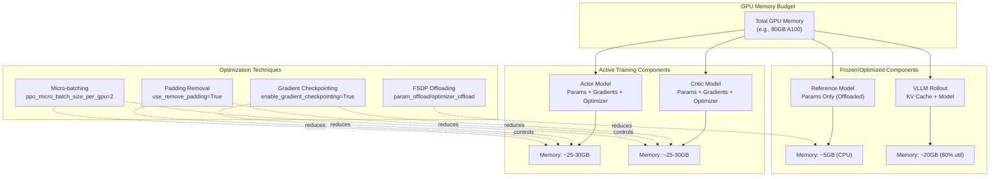

**Memory Allocation Strategy Across TTRL Components**

Sources: [verl/examples/ttrl/Qwen2.5-Math/aime.sh:52-86](), [verl/examples/ttrl/LLaMA3.1-Instruct/aime.sh:52-86]()

---

## Gradient Checkpointing

Gradient checkpointing (also called activation checkpointing) trades compute for memory by recomputing forward pass activations during the backward pass instead of storing them. This is enabled for both actor and critic models to reduce peak memory consumption during training.

### Configuration Parameters

| Parameter | Component | Value | Description |
|-----------|-----------|-------|-------------|
| `actor_rollout_ref.model.enable_gradient_checkpointing` | Actor | `True` | Enable gradient checkpointing for actor model |
| `critic.model.enable_gradient_checkpointing` | Critic | `True` | Enable gradient checkpointing for critic model |

### Memory Impact

Gradient checkpointing typically reduces activation memory by **50-70%** at the cost of **20-30%** additional compute time. For 7B-8B parameter models, this can save **10-15GB** of GPU memory per model.

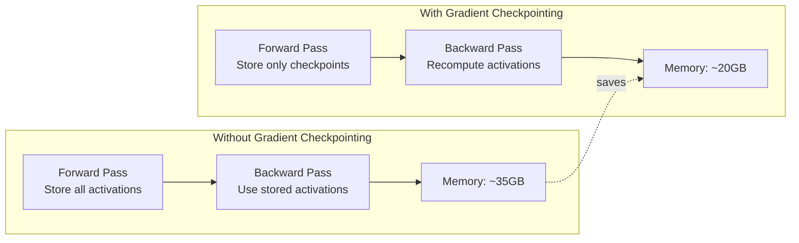

**Gradient Checkpointing Memory Trade-off**

### Implementation Details

The gradient checkpointing is configured at the model initialization level. The verl framework applies checkpointing to transformer layers, storing only a subset of layer outputs and recomputing intermediate activations during backward passes.

**Why only actor and critic?** The reference model does not require backpropagation (frozen weights), so gradient checkpointing provides no benefit. The VLLM rollout engine handles only inference and uses its own memory optimizations.

Sources: [verl/examples/ttrl/Qwen2.5-Math/aime.sh:52,82](), [verl/examples/ttrl/LLaMA3.1-Instruct/aime.sh:53,83]()

---

## Padding Removal

Padding removal (`use_remove_padding`) eliminates unnecessary padding tokens from sequences during computation, reducing both memory footprint and computational overhead. This is particularly effective for variable-length mathematical reasoning tasks where responses vary significantly in length.

### Configuration Parameters

| Parameter | Component | Value | Description |
|-----------|-----------|-------|-------------|
| `actor_rollout_ref.model.use_remove_padding` | Actor | `True` | Remove padding tokens during actor computation |
| `critic.model.use_remove_padding` | Critic | `True` | Remove padding tokens during critic computation |

### Mechanism

Traditional batched processing pads all sequences to the maximum length in the batch:

```
Traditional Batching:
Prompt 1: [tok1, tok2, tok3, PAD, PAD, PAD, PAD]  <- 3 real + 4 padding
Prompt 2: [tok1, tok2, tok3, tok4, tok5, PAD, PAD] <- 5 real + 2 padding
Prompt 3: [tok1, tok2, PAD, PAD, PAD, PAD, PAD]   <- 2 real + 5 padding
```

With padding removal, only actual tokens are processed:

```
Padding Removal:
Prompt 1: [tok1, tok2, tok3]           <- 3 tokens only
Prompt 2: [tok1, tok2, tok3, tok4, tok5] <- 5 tokens only
Prompt 3: [tok1, tok2]                  <- 2 tokens only
Total: 10 tokens vs 21 tokens (52% reduction)
```

### Memory Savings

For mathematical reasoning tasks with response length variation (100-3000 tokens), padding removal can reduce:
- **Memory usage** by 30-40%
- **Compute operations** by 30-40%
- **Training throughput** improves proportionally

This is especially beneficial when `MAX_RESPONSE_LENGTH` is set to 3072 tokens (K=3) but many responses are only 500-1000 tokens.

Sources: [verl/examples/ttrl/Qwen2.5-Math/aime.sh:53,80](), [verl/examples/ttrl/LLaMA3.1-Instruct/aime.sh:54,81]()

---

## FSDP Offloading Strategies

TTRL uses different FSDP (Fully Sharded Data Parallel) offloading configurations for each model component based on their access patterns and memory requirements. This creates a heterogeneous memory optimization strategy.

### Offloading Configuration Matrix

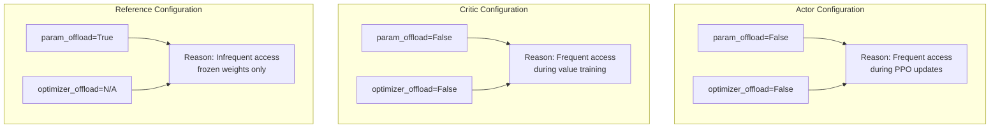

**FSDP Offloading Strategies by Component**

### Configuration Details

| Component | `param_offload` | `optimizer_offload` | Rationale |
|-----------|-----------------|---------------------|-----------|
| **Actor** | `False` | `False` | High-frequency access during PPO policy updates; keep in GPU memory |
| **Critic** | `False` | `False` | High-frequency access during value function training; keep in GPU memory |
| **Reference** | `True` | N/A (frozen) | Low-frequency access only for KL divergence; offload to CPU to save GPU memory |

### Memory Trade-offs

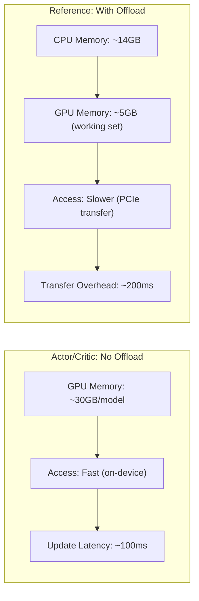

**Memory Access Trade-offs for Offloading**

### Implementation Notes

The reference model uses parameter offloading because:
1. It is accessed **infrequently** (only during KL divergence computation, once per training step)
2. It is **frozen** (no optimizer state needed)
3. PCIe transfer overhead (~200ms) is negligible compared to PPO update time (~5-10s)

Actor and critic models **do not use offloading** because:
1. They are accessed **frequently** (multiple times per mini-batch during PPO updates)
2. They require **optimizer states** (Adam: momentum and variance, doubling memory)
3. PCIe transfer would create a bottleneck in the training loop

Sources: [verl/examples/ttrl/Qwen2.5-Math/aime.sh:60-61,64,84-85](), [verl/examples/ttrl/LLaMA3.1-Instruct/aime.sh:61-62,65,85-86]()

---

## Micro-batching Configuration

Micro-batching splits each mini-batch into smaller chunks that are processed sequentially, reducing peak memory consumption while maintaining effective batch size for gradient accumulation.

### Batching Hierarchy

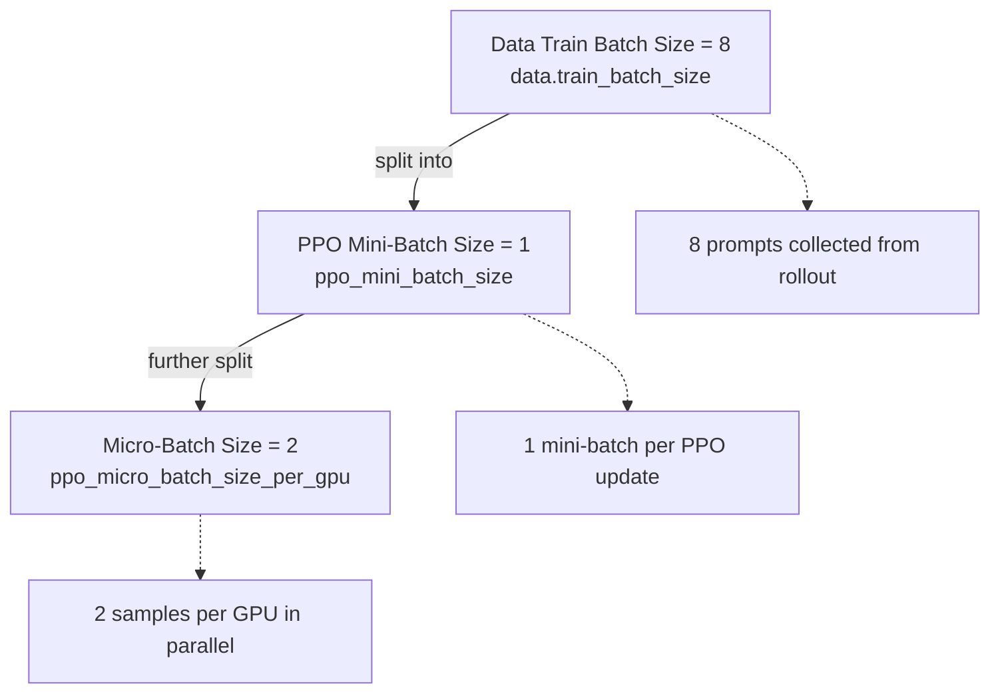

**TTRL Batching Hierarchy**

### Configuration Parameters

| Parameter | Value | Component | Description |
|-----------|-------|-----------|-------------|
| `DATA_TRAIN_BATCH_SIZE` | 8 | Data pipeline | Number of prompts sampled per rollout |
| `MINI_BATCH_SIZE` | 1 | PPO training | Number of mini-batches per PPO update |
| `MICRO_BATCH_SIZE` | 2 | GPU processing | Samples processed per GPU in parallel |

These parameters are set as:
- `data.train_batch_size=$DATA_TRAIN_BATCH_SIZE`
- `actor_rollout_ref.actor.ppo_mini_batch_size=$MINI_BATCH_SIZE`
- `actor_rollout_ref.actor.ppo_micro_batch_size_per_gpu=$MICRO_BATCH_SIZE`
- `critic.ppo_micro_batch_size_per_gpu=$MICRO_BATCH_SIZE`
- `actor_rollout_ref.ref.log_prob_micro_batch_size_per_gpu=$MICRO_BATCH_SIZE`
- `actor_rollout_ref.rollout.log_prob_micro_batch_size_per_gpu=$MICRO_BATCH_SIZE`

### Memory Impact

With 8 GPUs and `MICRO_BATCH_SIZE=2`:
- Each GPU processes 2 samples simultaneously
- Total throughput: 8 GPUs × 2 samples = 16 samples in parallel
- Peak memory per GPU: Memory for 2 sequences (forward + backward)
- Gradient accumulation: Effective batch size maintained at 8

Increasing `MICRO_BATCH_SIZE` to 4 would:
- **Double** peak memory per GPU
- **Reduce** number of gradient accumulation steps
- **Potentially increase** throughput (if memory allows)

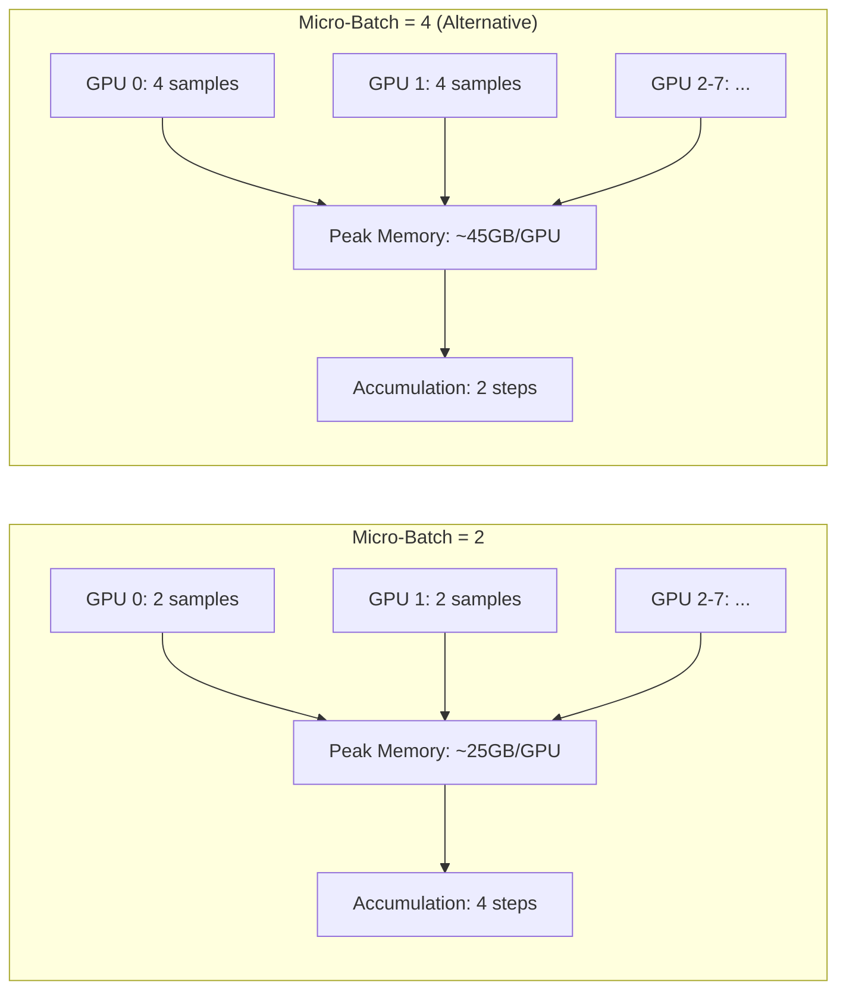

**Micro-batch Size Trade-off**

Sources: [verl/examples/ttrl/Qwen2.5-Math/aime.sh:25-29,54-55,63,69,83](), [verl/examples/ttrl/LLaMA3.1-Instruct/aime.sh:25-29,55-56,64,70,84]()

---

## VLLM Memory Management

The VLLM rollout engine uses separate memory optimization strategies focused on inference efficiency and KV cache management.

### Key Configuration Parameters

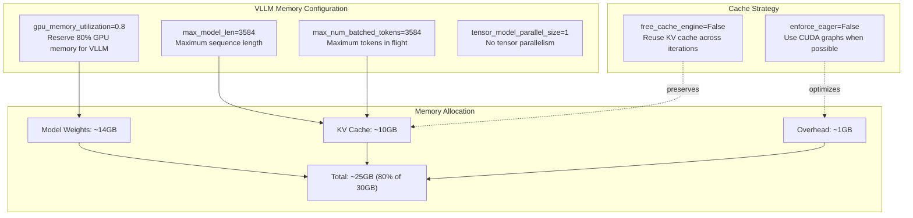

**VLLM Memory Management Architecture**

### Configuration Details

| Parameter | Value | Purpose |
|-----------|-------|---------|
| `gpu_memory_utilization` | `0.8` | Reserve 80% of GPU memory for VLLM (leaves 20% buffer) |
| `max_model_len` | `MAX_PROMPT_LENGTH + MAX_RESPONSE_LENGTH` | Maximum total sequence length (typically 3584 tokens) |
| `max_num_batched_tokens` | Same as `max_model_len` | Maximum tokens processed in single batch |
| `enforce_eager` | `False` | Enable CUDA graph optimizations when possible |
| `free_cache_engine` | `False` | Reuse KV cache across training iterations |
| `tensor_model_parallel_size` | `1` | No tensor parallelism (model fits on single GPU) |

### Memory Budget Breakdown

For a 7B model with `max_model_len=3584`:

```
Model Weights:           ~14 GB  (FP16, 7B params × 2 bytes)
KV Cache (32 samples):   ~10 GB  (depends on batch size and sequence length)
CUDA Graphs & Overhead:  ~1 GB
Working Memory:          ~5 GB   (activations, etc.)
─────────────────────────────────
Total Reserved:          ~30 GB  (80% of A100's 40GB, or H100's 80GB)
```

### Cache Reuse Strategy

Setting `free_cache_engine=False` instructs VLLM to **reuse KV cache** across iterations:

1. **First iteration**: Allocate KV cache for maximum configuration
2. **Subsequent iterations**: Reuse allocated cache memory
3. **Benefit**: Eliminates memory allocation overhead (~200-500ms per iteration)
4. **Cost**: Memory remains allocated even when generating shorter sequences

This is optimal for TTRL because:
- All iterations use similar prompt/response lengths
- Training runs for many iterations (80 episodes)
- Memory allocation overhead would accumulate significantly

Sources: [verl/examples/ttrl/Qwen2.5-Math/aime.sh:67-78](), [verl/examples/ttrl/LLaMA3.1-Instruct/aime.sh:68-79]()

---

## Token Length Constraints

Carefully configured maximum lengths prevent memory overflow while accommodating mathematical reasoning responses.

### Length Configuration

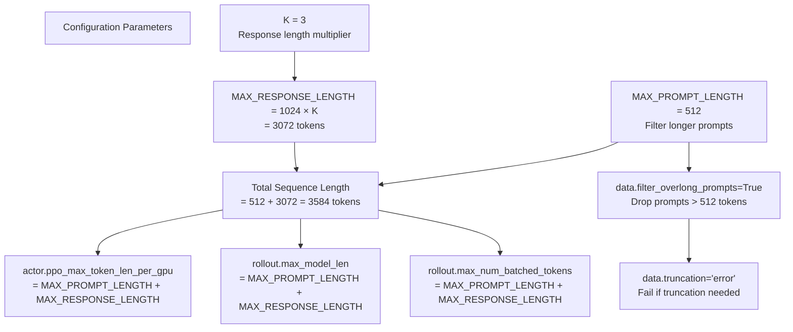

**Token Length Configuration Flow**

### Parameter Mapping

| Variable | Formula | Example Value | Applied To |
|----------|---------|---------------|------------|
| `K` | User-defined multiplier | 3 | - |
| `MAX_PROMPT_LENGTH` | Fixed | 512 | Data filtering |
| `MAX_RESPONSE_LENGTH` | `1024 × K` | 3072 | Response generation |
| `ppo_max_token_len_per_gpu` | `MAX_PROMPT_LENGTH + MAX_RESPONSE_LENGTH` | 3584 | Actor training |
| `max_model_len` | `MAX_PROMPT_LENGTH + MAX_RESPONSE_LENGTH` | 3584 | VLLM engine |
| `max_num_batched_tokens` | `MAX_PROMPT_LENGTH + MAX_RESPONSE_LENGTH` | 3584 | VLLM batching |

### Memory Implications

The `K` multiplier directly affects memory consumption:

| K | Max Response | Total Length | Approx. Memory/Sample |
|---|--------------|--------------|----------------------|
| 1 | 1024 | 1536 | ~2 GB |
| 3 | 3072 | 3584 | ~5 GB |
| 5 | 5120 | 5632 | ~8 GB |
| 8 | 8192 | 8704 | ~12 GB |

With `K > 8`, the script automatically reduces `N_SAMPLES_PER_PROMPT` from 16 to 4 to manage memory:

```bash
if [ "$K" -gt 8 ]; then
  N=4
else
  N=16
fi
```

This dynamic adjustment maintains memory usage within GPU capacity when generating longer responses.

### Data Filtering

Two complementary mechanisms ensure sequences stay within bounds:

1. **`filter_overlong_prompts=True`**: Drop prompts exceeding `MAX_PROMPT_LENGTH` during data loading
2. **`truncation='error'`**: Fail training if truncation would be required (prevents silent data corruption)

Sources: [verl/examples/ttrl/Qwen2.5-Math/aime.sh:15-22,46-50,62,77-78](), [verl/examples/ttrl/LLaMA3.1-Instruct/aime.sh:15-22,46-51,63,78-79]()

---

## Configuration Trade-offs

Different memory optimization techniques interact in complex ways. This section presents the key trade-offs and recommended configurations.

### Memory vs. Speed Trade-off Matrix

| Technique | Memory Saved | Speed Impact | Recommended For |
|-----------|-------------|--------------|-----------------|
| Gradient Checkpointing | 10-15 GB | -20% to -30% | Always (actor/critic) |
| Padding Removal | 5-10 GB | +10% to +20% | Always |
| FSDP Param Offload (Ref) | 10-12 GB | Minimal | Always (reference only) |
| FSDP Param Offload (Actor/Critic) | 10-12 GB per model | -50% to -70% | **Never** (too slow) |
| Micro-batch Size = 2 | Baseline | Baseline | Small GPUs (40GB) |
| Micro-batch Size = 4 | -15-20 GB | +10% to +15% | Large GPUs (80GB) |
| K = 3 | Baseline | Baseline | Standard tasks |
| K = 8 | -25 GB | Varies | Long reasoning (reduce N) |

### Component-Specific Optimization Strategies

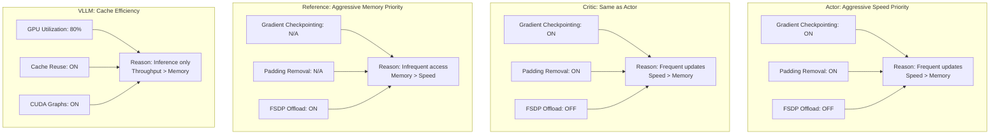

**Component-Specific Memory Optimization Philosophy**

### GPU Memory Size Recommendations

Based on different GPU configurations:

#### 40GB GPUs (A100-40GB)
```yaml
MICRO_BATCH_SIZE: 2
K: 3
gpu_memory_utilization: 0.75  # More conservative
tensor_model_parallel_size: 1
```
**Total Memory**: ~38GB used (close to limit)

#### 80GB GPUs (A100-80GB, H100)
```yaml
MICRO_BATCH_SIZE: 4              # Double throughput
K: 5                             # Longer responses
gpu_memory_utilization: 0.8
tensor_model_parallel_size: 1
```
**Total Memory**: ~65GB used (comfortable margin)

#### Multiple Smaller GPUs (24GB × N)
```yaml
MICRO_BATCH_SIZE: 1
K: 3
gpu_memory_utilization: 0.7
tensor_model_parallel_size: 2    # Split across 2 GPUs
```
**Requires**: Tensor parallelism for VLLM, FSDP sharding for actor/critic

Sources: [verl/examples/ttrl/Qwen2.5-Math/aime.sh](), [verl/examples/ttrl/LLaMA3.1-Instruct/aime.sh]()

---

## Memory Budget Analysis

This section provides a detailed breakdown of memory allocation across all components for a typical TTRL training run.

### Single GPU Memory Budget (80GB A100)

```mermaid
graph TB
    Total["Total GPU Memory: 80 GB"]
    
    subgraph Actor_Memory["Actor Model: ~28 GB"]
        ActorParams["Parameters: 14 GB<br/>(7B × 2 bytes FP16)"]
        ActorGrad["Gradients: 14 GB<br/>(same as params)"]
        ActorOpt["Optimizer States: 0 GB<br/>(sharded across GPUs)"]
        ActorAct["Activations: ~8 GB<br/>(reduced by checkpointing)"]
    end
    
    subgraph Critic_Memory["Critic Model: ~28 GB"]
        CriticParams["Parameters: 14 GB"]
        CriticGrad["Gradients: 14 GB"]
        CriticOpt["Optimizer States: 0 GB<br/>(sharded)"]
        CriticAct["Activations: ~8 GB"]
    end
    
    subgraph Reference_Memory["Reference Model: ~2 GB"]
        RefParams["Parameters: 0 GB<br/>(offloaded to CPU)"]
        RefAct["Activations: ~2 GB<br/>(forward pass only)"]
    end
    
    subgraph VLLM_Memory["VLLM Engine: ~20 GB"]
        VLLMModel["Model Weights: 14 GB"]
        VLLMCache["KV Cache: 5 GB"]
        VLLMWork["Working Memory: 1 GB"]
    end
    
    Overhead["System Overhead: ~2 GB"]
    
    Total --> Actor_Memory
    Total --> Critic_Memory
    Total --> Reference_Memory
    Total --> VLLM_Memory
    Total --> Overhead
    
    ActorParams --> Actor_Memory
    ActorGrad --> Actor_Memory
    ActorAct --> Actor_Memory
    
    CriticParams --> Critic_Memory
    CriticGrad --> Critic_Memory
    CriticAct --> Critic_Memory
    
    RefParams --> Reference_Memory
    RefAct --> Reference_Memory
    
    VLLMModel --> VLLM_Memory
    VLLMCache --> VLLM_Memory
    VLLMWork --> VLLM_Memory
```

**Detailed Memory Allocation (Single 80GB GPU)**

### Multi-GPU Sharding (8 × A100-80GB)

With FSDP, memory is distributed across 8 GPUs:

| Component | Total Memory | Per-GPU Memory (Sharded) | Offloaded? |
|-----------|--------------|--------------------------|------------|
| **Actor Parameters** | 14 GB | 1.75 GB | No |
| **Actor Gradients** | 14 GB | 1.75 GB | No |
| **Actor Optimizer** | 28 GB | 3.5 GB | No |
| **Actor Activations** | 8 GB | 8 GB (not sharded) | No |
| **Critic Parameters** | 14 GB | 1.75 GB | No |
| **Critic Gradients** | 14 GB | 1.75 GB | No |
| **Critic Optimizer** | 28 GB | 3.5 GB | No |
| **Critic Activations** | 8 GB | 8 GB (not sharded) | No |
| **Reference Parameters** | 14 GB | 0 GB | Yes (CPU) |
| **Reference Activations** | 2 GB | 2 GB | No |
| **VLLM Model** | 14 GB | 14 GB (replicated) | No |
| **VLLM KV Cache** | 5 GB | 5 GB | No |
| **System Overhead** | 2 GB | 2 GB | No |
| **Total Per GPU** | - | **~53 GB** | - |

**Total per GPU: ~53 GB / 80 GB (66% utilization)**

This leaves ~27 GB margin for:
- Temporary allocations during communication
- Peak memory spikes during gradient accumulation
- CUDA memory pool fragmentation

### Memory Optimization Impact

Here's how each optimization technique contributes to fitting TTRL on 80GB GPUs:

| Optimization | Memory Saved | Without This | With This | Critical? |
|--------------|--------------|--------------|-----------|-----------|
| **Gradient Checkpointing** | ~24 GB | 77 GB | 53 GB | Yes |
| **Padding Removal** | ~8 GB | 61 GB | 53 GB | Yes |
| **Reference Offload** | ~12 GB | 65 GB | 53 GB | Yes |
| **Micro-batch = 2** | ~15 GB | 68 GB | 53 GB | Yes |
| **All Combined** | **~59 GB** | **112 GB** | **53 GB** | **Essential** |

**Without these optimizations, TTRL would require ~112 GB per GPU (impossible on A100-80GB).**

Sources: [verl/examples/ttrl/Qwen2.5-Math/aime.sh:15-103](), [verl/examples/ttrl/LLaMA3.1-Instruct/aime.sh:15-104]()

---

## Configuration File Structure

All memory optimization parameters are configured through command-line overrides to the base `ppo_trainer_ttrl.yaml` configuration file.

### Memory-Related Configuration Groups

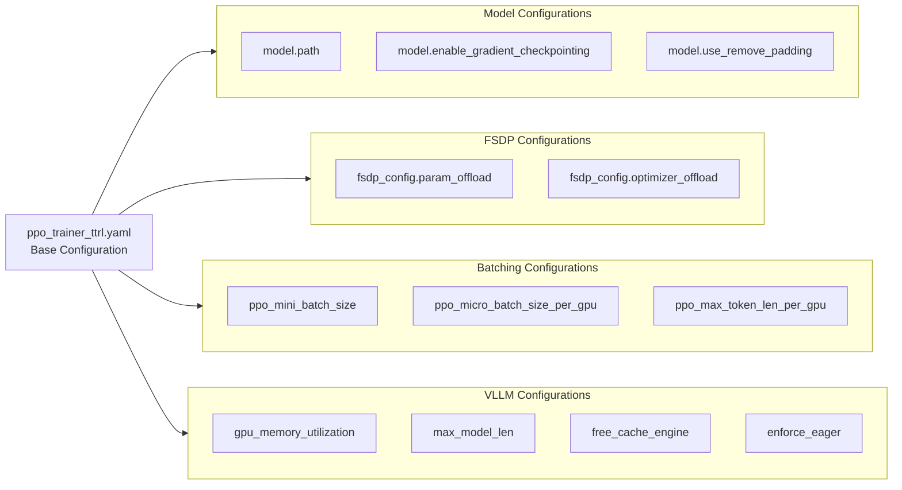

**Configuration Hierarchy for Memory Optimization**

### Example Configuration Override

All parameters shown in this document can be configured via command-line overrides:

```bash
python -m verl.trainer.main_ppo \
  --config-name='ppo_trainer_ttrl.yaml' \
  # Model memory optimizations
  actor_rollout_ref.model.enable_gradient_checkpointing=True \
  actor_rollout_ref.model.use_remove_padding=True \
  critic.model.enable_gradient_checkpointing=True \
  critic.model.use_remove_padding=True \
  # FSDP offloading
  actor_rollout_ref.actor.fsdp_config.param_offload=False \
  actor_rollout_ref.actor.fsdp_config.optimizer_offload=False \
  actor_rollout_ref.ref.fsdp_config.param_offload=True \
  critic.model.fsdp_config.param_offload=False \
  critic.model.fsdp_config.optimizer_offload=False \
  # Batching configuration
  actor_rollout_ref.actor.ppo_mini_batch_size=1 \
  actor_rollout_ref.actor.ppo_micro_batch_size_per_gpu=2 \
  critic.ppo_micro_batch_size_per_gpu=2 \
  # VLLM memory management
  actor_rollout_ref.rollout.gpu_memory_utilization=0.8 \
  actor_rollout_ref.rollout.free_cache_engine=False \
  actor_rollout_ref.rollout.enforce_eager=False
```

Sources: [verl/examples/ttrl/Qwen2.5-Math/aime.sh:42-103](), [verl/examples/ttrl/LLaMA3.1-Instruct/aime.sh:42-104]()

---

