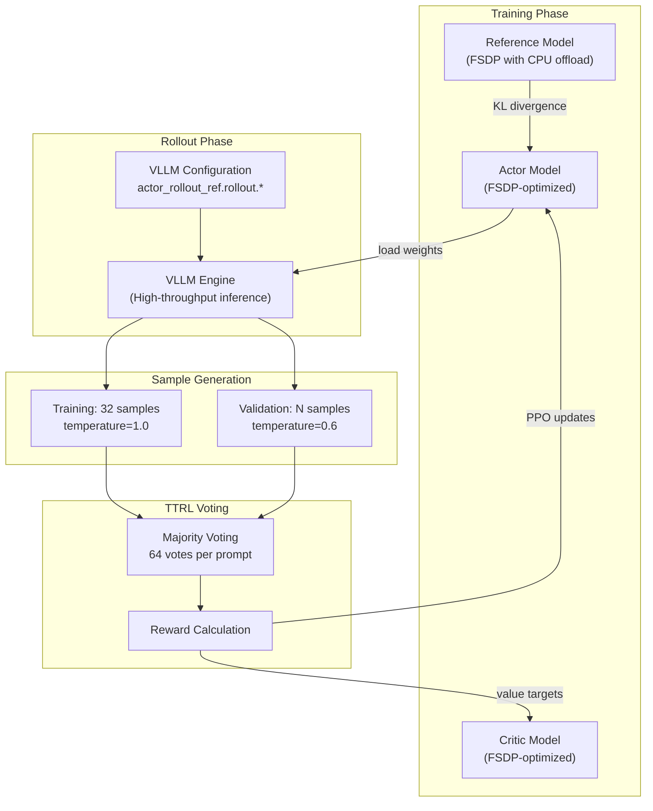
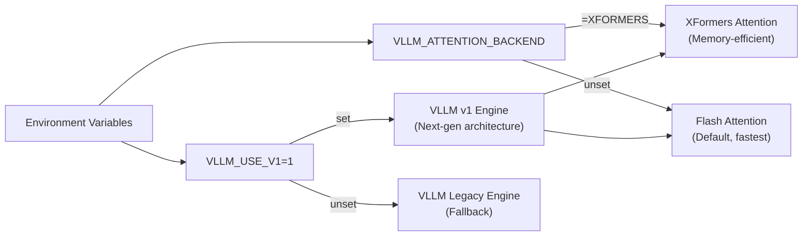
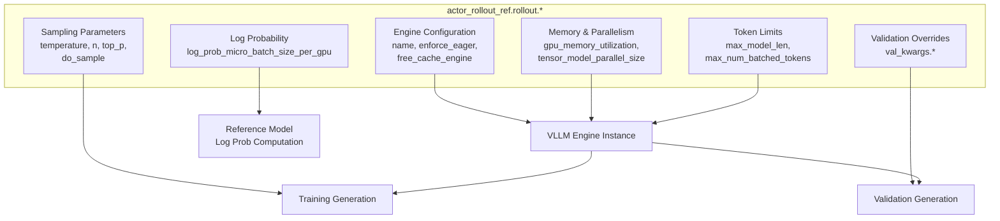
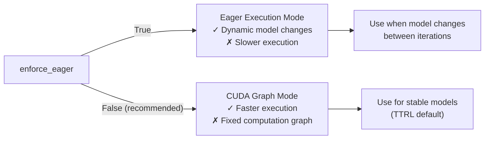
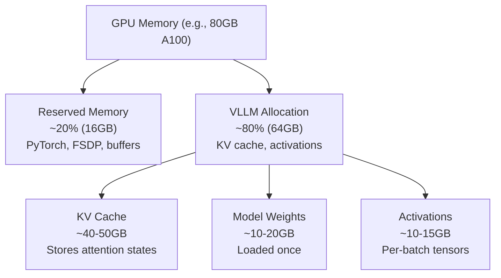
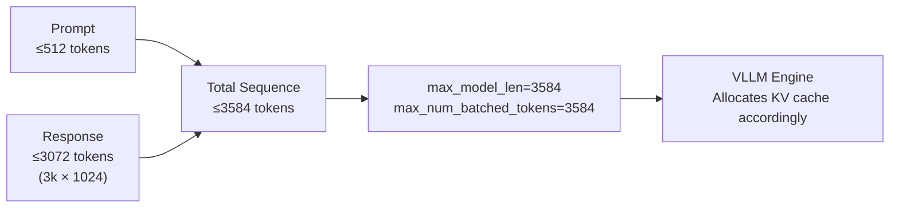
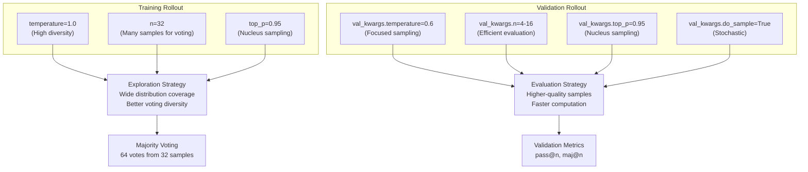
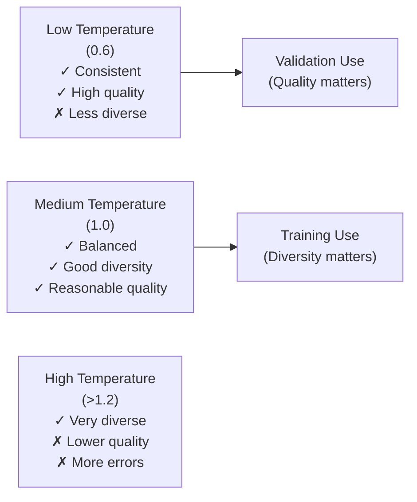
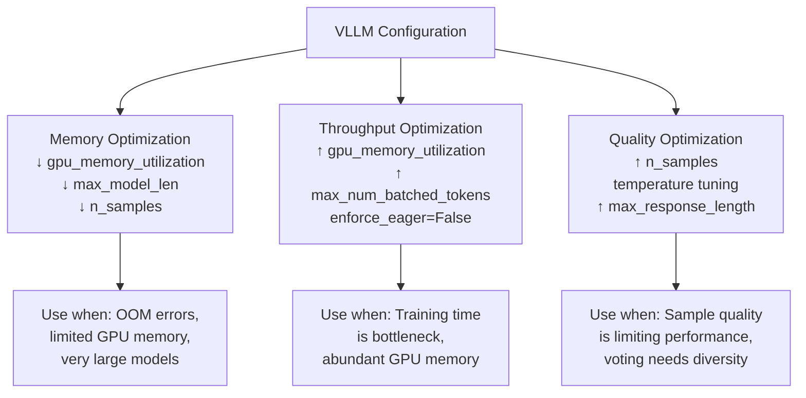
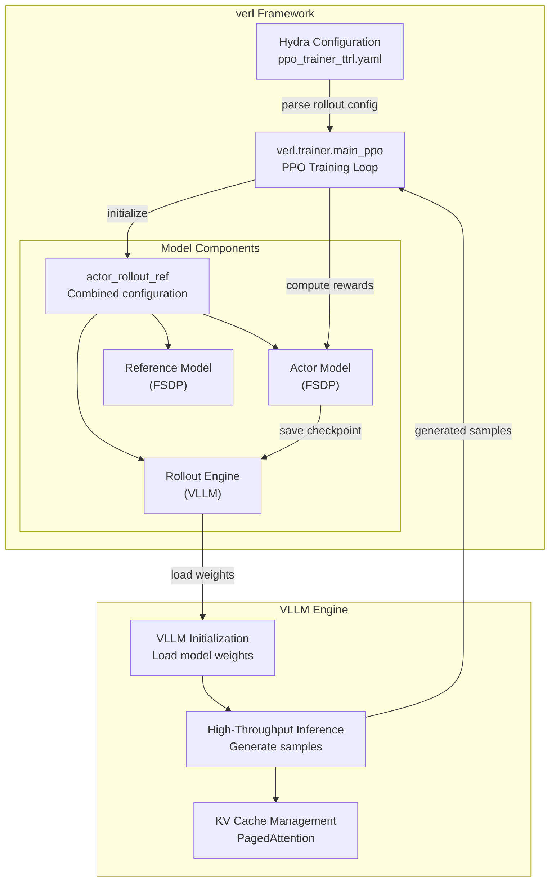

<!-- source: DeepWiki mcp.deepwiki.com · repo PRIME-RL/TTRL · page 6.3 VLLM Integration · fetched 2026-10-30 -->

# VLLM Integration

<details>
<summary>Relevant source files</summary>

The following files were used as context for generating this wiki page:

- [verl/examples/ttrl/Qwen2.5-Math/aime.sh](verl/examples/ttrl/Qwen2.5-Math/aime.sh)
- [verl/requirements.txt](verl/requirements.txt)

</details>


## Purpose and Scope

This document covers the integration and configuration of VLLM (Very Large Language Model serving) as the rollout engine in the TTRL training pipeline. VLLM provides high-throughput, memory-efficient inference for generating the multiple samples per prompt required by TTRL's majority voting mechanism. For information about the overall TTRL training pipeline, see [Training Pipeline](#4). For information about the TTRL voting mechanism that consumes VLLM's outputs, see [TTRL Voting and Sampling](#4.3).

---

## VLLM Role in TTRL Architecture

VLLM serves as the **rollout engine** in TTRL's four-component model architecture, responsible for generating multiple response samples during both training and validation. Unlike the Actor, Critic, and Reference models which use standard PyTorch/FSDP for forward/backward passes, VLLM is optimized specifically for high-throughput inference with advanced batching, memory management, and attention optimizations.

### System Context



**Sources:** [verl/examples/ttrl/Qwen2.5-Math/aime.sh:1-105]()

---

## VLLM Version Selection

TTRL uses **VLLM v1** (the next-generation VLLM engine) for improved performance and stability. Version selection is controlled via environment variables.

### Version Configuration

| Environment Variable | Value | Purpose |
|---------------------|-------|---------|
| `VLLM_USE_V1` | `1` | Enable VLLM v1 engine |
| `VLLM_ATTENTION_BACKEND` | `unset` or `XFORMERS` | Control attention implementation |



### Configuration in Scripts

Example configuration pattern from training scripts:

```bash
# Unset to use default Flash Attention (recommended)
unset VLLM_ATTENTION_BACKEND

# Enable VLLM v1
export VLLM_USE_V1=1
```

**Recommendation:** Use VLLM v1 with default attention backend (Flash Attention) for optimal performance. Only set `VLLM_ATTENTION_BACKEND=XFORMERS` if compatibility issues arise.

**Sources:** [verl/examples/ttrl/Qwen2.5-Math/aime.sh:2-4]()

---

## Core Configuration Parameters

VLLM configuration is specified under the `actor_rollout_ref.rollout.*` namespace in the training configuration. All parameters are passed to the verl rollout system, which initializes the VLLM engine.

### Parameter Categories



**Sources:** [verl/examples/ttrl/Qwen2.5-Math/aime.sh:65-78]()

---

### Engine Configuration

| Parameter | Type | Example Value | Purpose |
|-----------|------|---------------|---------|
| `name` | string | `vllm` | Specifies VLLM as the rollout engine |
| `enforce_eager` | boolean | `False` | Controls eager vs. CUDA graph execution |
| `free_cache_engine` | boolean | `False` | Whether to free KV cache between batches |

#### Eager vs. CUDA Graph Execution



**Recommendation:** Set `enforce_eager=False` for maximum performance in TTRL, since the model architecture remains fixed during rollout generation.

**Sources:** [verl/examples/ttrl/Qwen2.5-Math/aime.sh:67-68]()

---

### Memory and Parallelism Configuration

| Parameter | Type | Example Value | Purpose |
|-----------|------|---------------|---------|
| `gpu_memory_utilization` | float | `0.8` | Fraction of GPU memory VLLM can use |
| `tensor_model_parallel_size` | int | `1` | Number of GPUs for tensor parallelism |

#### Memory Utilization Strategy



**Configuration Guidelines:**

- **`gpu_memory_utilization=0.8`**: Standard setting for dedicated VLLM processes
  - Leaves 20% for PyTorch overhead, FSDP communication, and safety margin
  - Increase to `0.85-0.9` if VLLM is the only GPU user
  - Decrease to `0.7-0.75` if encountering OOM errors

- **`tensor_model_parallel_size=1`**: No tensor parallelism (single GPU per model instance)
  - Increase to `2`, `4`, or `8` for models that don't fit in single GPU memory
  - Must divide evenly into total GPUs used for rollout
  - TTRL typically uses single-GPU instances for 7B-8B models

**Sources:** [verl/examples/ttrl/Qwen2.5-Math/aime.sh:70-71]()

---

### Token and Sequence Limits

| Parameter | Type | Typical Value | Purpose |
|-----------|------|---------------|---------|
| `max_model_len` | int | `3584-4096` | Maximum total sequence length (prompt + response) |
| `max_num_batched_tokens` | int | `3584-4096` | Maximum tokens processed in a single batch |

#### Sequence Length Calculation

The maximum sequence length is dynamically calculated based on the response length parameter `K`:

```
MAX_PROMPT_LENGTH = 512
K = 3  # Response length multiplier (3k tokens)
MAX_RESPONSE_LENGTH = 1024 × K = 3072

max_model_len = MAX_PROMPT_LENGTH + MAX_RESPONSE_LENGTH
              = 512 + 3072
              = 3584 tokens
```



**Configuration Pattern:**

```python
K = 3  # or 4, 8, 12 depending on task
MAX_PROMPT_LENGTH = 512
MAX_RESPONSE_LENGTH = 1024 * K

actor_rollout_ref.rollout.max_model_len = MAX_PROMPT_LENGTH + MAX_RESPONSE_LENGTH
actor_rollout_ref.rollout.max_num_batched_tokens = MAX_PROMPT_LENGTH + MAX_RESPONSE_LENGTH
```

**Important:** These limits must match or exceed the actual prompt and response lengths used in training, or sequences will be truncated.

**Sources:** [verl/examples/ttrl/Qwen2.5-Math/aime.sh:16-17, 77-78]()

---

### Sampling Configuration

VLLM supports separate sampling configurations for training and validation, enabling different exploration strategies.

#### Training Sampling Parameters

| Parameter | Value | Purpose |
|-----------|-------|---------|
| `temperature` | `1.0` | High diversity for exploration |
| `n` | `32` | Samples per prompt (for voting) |
| `top_p` | `0.95` (implicit) | Nucleus sampling threshold |
| `do_sample` | `True` (implicit) | Enable stochastic sampling |

#### Validation Sampling Parameters (val_kwargs)

| Parameter | Value | Purpose |
|-----------|-------|---------|
| `val_kwargs.temperature` | `0.6` | Lower diversity for quality |
| `val_kwargs.n` | `4-16` | Fewer samples (validation efficiency) |
| `val_kwargs.top_p` | `0.95` | Nucleus sampling threshold |
| `val_kwargs.do_sample` | `True` | Enable stochastic sampling |



#### Temperature Effects



**Adaptive N Sampling:**

The number of validation samples adapts based on response length to balance computation and evaluation quality:

```python
if K > 8:  # Very long responses (>8k tokens)
    N = 4   # Fewer samples to avoid memory/time issues
else:       # Standard responses (≤8k tokens)
    N = 16  # More samples for better evaluation
```

**Sources:** [verl/examples/ttrl/Qwen2.5-Math/aime.sh:15-22, 66, 72-76]()

---

### Log Probability Configuration

| Parameter | Type | Value | Purpose |
|-----------|------|-------|---------|
| `log_prob_micro_batch_size_per_gpu` | int | `2` | Micro-batch size for reference model log prob computation |

This parameter controls batching when computing log probabilities from generated sequences, used for KL divergence calculation against the reference model. It should match the actor's micro-batch size for consistent memory usage.

**Sources:** [verl/examples/ttrl/Qwen2.5-Math/aime.sh:69]()

---

## Configuration Summary Table

The following table summarizes the standard VLLM configuration used across TTRL training scripts:

| Category | Parameter | Training Value | Validation Value | Notes |
|----------|-----------|----------------|------------------|-------|
| **Engine** | `name` | `vllm` | - | Engine selector |
| | `enforce_eager` | `False` | - | Use CUDA graphs |
| | `free_cache_engine` | `False` | - | Keep cache alive |
| **Memory** | `gpu_memory_utilization` | `0.8` | - | 80% GPU memory |
| | `tensor_model_parallel_size` | `1` | - | Single GPU |
| **Limits** | `max_model_len` | `3584-4096` | - | Depends on K |
| | `max_num_batched_tokens` | `3584-4096` | - | Matches max_model_len |
| **Sampling** | `temperature` | `1.0` | `0.6` | Higher for training |
| | `n` | `32` | `4-16` | More for training |
| | `top_p` | `0.95` | `0.95` | Consistent |
| | `do_sample` | `True` | `True` | Always stochastic |
| **Batch** | `log_prob_micro_batch_size_per_gpu` | `2` | - | Matches micro-batch |

**Sources:** [verl/examples/ttrl/Qwen2.5-Math/aime.sh:65-78]()

---

## Performance Optimization Strategies

### Memory-Throughput Trade-offs



### Optimization Recommendations

1. **For OOM Issues:**
   - Reduce `gpu_memory_utilization` from `0.8` to `0.7`
   - Decrease `max_model_len` if responses can be shorter
   - Reduce training `n` from `32` to `16` (but keep voting samples at 64 by reusing)
   - Enable `free_cache_engine=True` to clear cache between batches

2. **For Maximum Throughput:**
   - Increase `gpu_memory_utilization` to `0.85-0.9` if no other GPU processes
   - Set `enforce_eager=False` (CUDA graphs)
   - Increase `max_num_batched_tokens` to fit more sequences per batch
   - Use tensor parallelism (`tensor_model_parallel_size > 1`) for very large models

3. **For Better Sample Quality:**
   - Tune `temperature`: start at `1.0`, adjust based on voting agreement
   - Increase validation `n` from `4-16` to `32` for more robust metrics
   - Adjust `top_p` from `0.95` to `0.9` for slightly more focused sampling

**Sources:** [verl/examples/ttrl/Qwen2.5-Math/aime.sh:65-78]()

---

## Integration with verl Framework

VLLM is integrated into the verl framework through the rollout component abstraction. The framework handles model loading, batching, and coordination between VLLM and the FSDP-based training components.

### Component Integration



### Configuration Namespace Mapping

The `actor_rollout_ref` configuration namespace combines settings for three components:

| Namespace | Component | Purpose |
|-----------|-----------|---------|
| `actor_rollout_ref.actor.*` | Actor Model | Policy network training parameters |
| `actor_rollout_ref.rollout.*` | VLLM Rollout | Sample generation configuration |
| `actor_rollout_ref.ref.*` | Reference Model | KL baseline computation |
| `actor_rollout_ref.model.*` | Shared Backbone | Model path and base settings |

This unified namespace ensures all three components use consistent model paths and coordinate during training.

**Sources:** [verl/examples/ttrl/Qwen2.5-Math/aime.sh:51-78]()

---

## Environment Variable Reference

### Required Environment Variables

```bash
# Enable VLLM v1 (required for optimal performance)
export VLLM_USE_V1=1

# Unset attention backend to use default (Flash Attention)
# Or set explicitly: export VLLM_ATTENTION_BACKEND=XFORMERS
unset VLLM_ATTENTION_BACKEND
```

### Optional Environment Variables

| Variable | Purpose | Default | When to Set |
|----------|---------|---------|-------------|
| `VLLM_ATTENTION_BACKEND` | Select attention implementation | Flash Attention | Set to `XFORMERS` for compatibility |
| `VLLM_WORKER_MULTIPROC_METHOD` | Multi-process spawn method | `spawn` | Set to `fork` for debugging |
| `VLLM_LOGGING_LEVEL` | VLLM log verbosity | `INFO` | Set to `DEBUG` for troubleshooting |
| `CUDA_VISIBLE_DEVICES` | GPU visibility | All GPUs | Restrict VLLM to specific GPUs |

**Sources:** [verl/examples/ttrl/Qwen2.5-Math/aime.sh:2-4]()

---

## Troubleshooting Common Issues

### OOM (Out of Memory) Errors

**Symptoms:** CUDA out of memory errors during rollout generation

**Solutions:**
1. Reduce `gpu_memory_utilization` from `0.8` to `0.7` or `0.6`
2. Decrease `max_model_len` and `max_num_batched_tokens`
3. Reduce training `n` (samples per prompt)
4. Enable `free_cache_engine=True`
5. Check for memory leaks by monitoring GPU memory over time

### Slow Sampling Performance

**Symptoms:** Rollout phase takes significantly longer than training updates

**Solutions:**
1. Verify `enforce_eager=False` (use CUDA graphs)
2. Verify `VLLM_USE_V1=1` is set
3. Increase `gpu_memory_utilization` if memory is available
4. Check `tensor_model_parallel_size` matches hardware topology
5. Profile with `VLLM_LOGGING_LEVEL=DEBUG` to identify bottlenecks

### Inconsistent Sample Quality

**Symptoms:** High variance in validation metrics, poor voting agreement

**Solutions:**
1. Adjust `temperature`: reduce from `1.0` to `0.8-0.9` for training
2. Increase training `n` to generate more diverse samples
3. Verify `top_p=0.95` is set correctly
4. Check that `val_kwargs.do_sample=True` for validation

### Version Compatibility Issues

**Symptoms:** Import errors, API mismatches, deprecation warnings

**Solutions:**
1. Ensure `VLLM_USE_V1=1` is exported before running
2. Check VLLM version in `requirements.txt`: `vllm==0.8.4` (may be commented)
3. Install matching versions of `transformers`, `accelerate`, and `flash-attn`
4. Clear Python cache: `rm -rf __pycache__`

**Sources:** [verl/examples/ttrl/Qwen2.5-Math/aime.sh:1-105](), [verl/requirements.txt:20]()

---

## Best Practices

### Configuration Checklist

- [ ] Set `VLLM_USE_V1=1` in environment
- [ ] Unset `VLLM_ATTENTION_BACKEND` (or set to `XFORMERS` if needed)
- [ ] Configure `gpu_memory_utilization=0.8` (adjust for hardware)
- [ ] Set `enforce_eager=False` for performance
- [ ] Calculate `max_model_len` based on prompt and response lengths
- [ ] Use `temperature=1.0` for training, `0.6` for validation
- [ ] Set training `n=32`, validation `n` adaptive to response length
- [ ] Match `log_prob_micro_batch_size_per_gpu` to actor micro-batch size
- [ ] Keep `free_cache_engine=False` for performance (enable only for OOM)
- [ ] Use `tensor_model_parallel_size=1` for models ≤8B parameters

### Monitoring and Validation

Monitor these metrics during training to verify VLLM is configured correctly:

1. **GPU Memory Usage:** Should be ~80% during rollout (matches `gpu_memory_utilization`)
2. **Rollout Throughput:** Samples generated per second (should increase with VLLM v1)
3. **Sample Diversity:** Check voting agreement rates (50-70% is healthy)
4. **Generation Time:** Time per rollout batch (should be <5-10% of total epoch time)

**Sources:** [verl/examples/ttrl/Qwen2.5-Math/aime.sh:65-78]()

---

