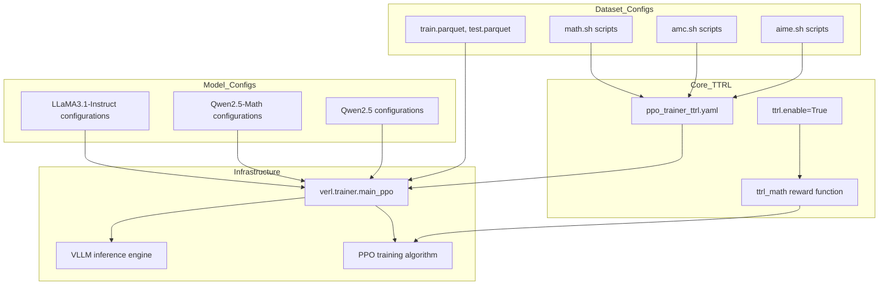
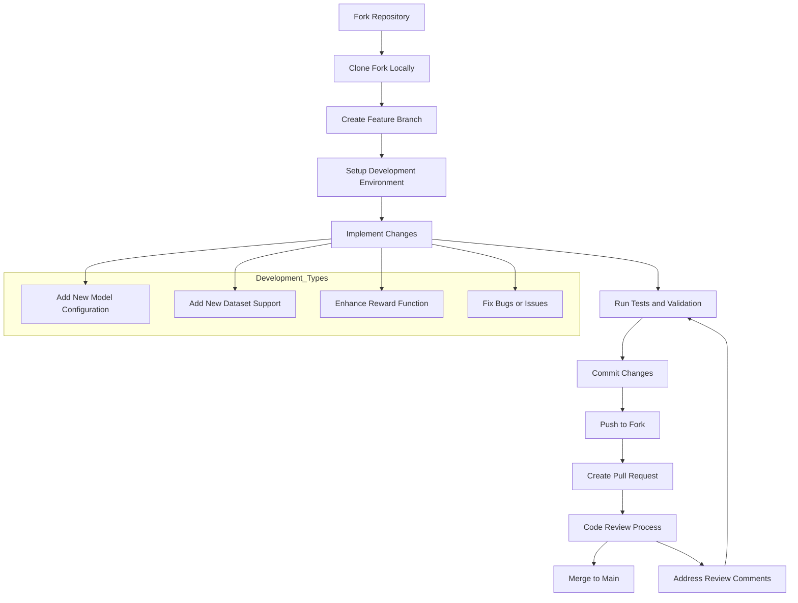

<!-- source: DeepWiki mcp.deepwiki.com · repo PRIME-RL/TTRL · page 7 License · fetched 2026-10-30 -->

# License and Contribution

Relevant source files

The following files were used as context for generating this wiki page:

- [LICENSE](LICENSE)

This document covers the licensing terms for the TTRL (Test-Time Reinforcement Learning) system and provides comprehensive guidelines for contributing to the project. The TTRL framework enables test-time training of language models on mathematical reasoning tasks through majority voting rewards.

For information about system setup and dependencies, see [Setup and Dependencies](#2). For technical implementation details, see [Implementation Guide](#3).

## License Terms

The TTRL project is released under the MIT License, which grants broad permissions for use, modification, and distribution of the software.

### MIT License Summary

| Permission | Description |
|------------|-------------|
| **Commercial Use** | Permitted for commercial applications |
| **Modification** | Code can be modified and adapted |
| **Distribution** | Can be distributed in source or binary form |
| **Private Use** | Permitted for private/internal use |
| **Sublicensing** | Can be sublicensed under compatible terms |

### License Requirements

The MIT License requires inclusion of the copyright notice and license terms in all copies or substantial portions of the software. The full license text is located in [LICENSE:1-22]().

### Warranty Disclaimer

The software is provided "AS IS" without warranty of any kind. The authors disclaim liability for any damages arising from the use of the software, as specified in [LICENSE:15-21]().

**Sources:** [LICENSE:1-22]()

## Project Structure for Contributors

Understanding the TTRL codebase structure is essential for effective contributions. The system integrates with the `verl` framework and extends it with test-time training capabilities.

### TTRL System Components

**Sources:** Based on system architecture diagrams and configuration files

### Key Directories and Files

| Path | Purpose | Contribution Focus |
|------|---------|-------------------|
| `configs/` | YAML configuration files | Add new model/dataset configs |
| `shell_scripts/` | Training script launchers | Create new training scenarios |
| `verl/utils/reward_score/ttrl_math/` | Reward calculation logic | Improve reward mechanisms |
| `data/` | Parquet dataset files | Add new mathematical datasets |
| `LICENSE` | MIT license terms | Legal compliance |

## Contributing to TTRL

### Development Workflow

Contributors should follow this workflow for submitting changes to the TTRL system:

**Sources:** Standard open-source contribution workflow

### Code Standards

#### Configuration Files

- Use consistent YAML formatting in configuration files
- Follow existing parameter naming conventions
- Include comments explaining non-obvious configuration choices
- Validate configurations before submitting

#### Shell Scripts

- Include proper error handling with `set -e` and `set -u`
- Use environment variable validation
- Follow consistent parameter passing patterns
- Include usage documentation in script headers

#### Python Integration

- Follow PEP 8 style guidelines for any Python modifications
- Ensure compatibility with the `verl` framework APIs
- Include type hints where applicable
- Add comprehensive docstrings for new functions

### Testing Requirements

#### Validation Steps

| Test Type | Requirement | Command Example |
|-----------|-------------|-----------------|
| **Configuration Validation** | Verify YAML syntax | `python -c "import yaml; yaml.safe_load(open('config.yaml'))"` |
| **Model Loading** | Test model initialization | Run with `--dry_run` flag |
| **Dataset Loading** | Verify parquet files | Check data format and schema |
| **Training Smoke Test** | Short training run | Single epoch with minimal data |

#### Performance Testing

- Verify GPU memory usage stays within expected bounds
- Test distributed training setup with multiple GPUs
- Validate VLLM inference performance
- Check WandB logging functionality

**Sources:** Based on TTRL training pipeline and infrastructure requirements

### Contribution Areas

#### High-Priority Contributions

1. **New Model Support**: Add configurations for additional language models
2. **Dataset Expansion**: Support for new mathematical reasoning datasets  
3. **Reward Function Improvements**: Enhance the `ttrl_math` reward mechanism
4. **Performance Optimization**: Improve training efficiency and memory usage
5. **Documentation**: Expand wiki pages and code documentation

#### Configuration Contributions

When adding new model or dataset configurations:

- Create corresponding shell scripts following existing patterns
- Update YAML base configurations with appropriate parameters
- Test with small-scale experiments before full training runs
- Document any special requirements or dependencies

#### Reward Function Contributions

Improvements to the majority voting reward system should:

- Maintain backward compatibility with existing experiments
- Include validation against known mathematical reasoning benchmarks
- Provide clear documentation of changes and expected impact
- Consider computational efficiency in multi-sample scenarios

**Sources:** [LICENSE:1-22](), system architecture requirements

### Pull Request Guidelines

#### Required Information

- **Description**: Clear explanation of changes and motivation
- **Testing**: Evidence of validation and testing performed
- **Configuration**: Any new configuration files or parameter changes
- **Documentation**: Updates to relevant wiki pages or code comments
- **Compatibility**: Confirmation of backward compatibility where applicable

#### Review Process

Pull requests undergo review for:

- Code quality and adherence to project standards
- Technical correctness and integration with existing systems
- Performance impact and resource requirements
- Documentation completeness and accuracy
- License compliance and intellectual property considerations

The project maintainers will provide feedback and guidance throughout the review process to ensure high-quality contributions that advance the TTRL framework's capabilities.

**Sources:** [LICENSE:1-22](), standard open-source development practices