# Page: TTRL System Overview

# TTRL System Overview

<details>
<summary>Relevant source files</summary>

The following files were used as context for generating this wiki page:

- [README.md](README.md)
- [figs/overview.png](figs/overview.png)
- [figs/ttrl_reward.png](figs/ttrl_reward.png)

</details>


## Purpose and Scope

This page provides a high-level overview of the TTRL (Test-Time Reinforcement Learning) system, explaining the fundamental problem it solves, its architectural design, and how it integrates with the verl framework. For detailed information about TTRL's core innovation and reward mechanism, see [Core Innovation](#1.1). For architectural details and component interactions, see [System Architecture](#1.2). For experimental results and performance benchmarks, see [Experimental Results](#1.3).

**Sources:** [README.md:1-122]()

---

## The Problem: Reinforcement Learning Without Ground Truth

TTRL addresses a fundamental challenge in reinforcement learning for Large Language Models (LLMs): **how to perform RL training on data without explicit ground-truth labels**, particularly on test data where labels are unavailable by definition.

Traditional reinforcement learning requires explicit reward signals derived from known correct answers. However, for reasoning tasks on test datasets, ground-truth labels are not accessible during inference. This creates a paradox: we want to improve model performance on test data, but we cannot compute conventional rewards to drive learning.

TTRL resolves this by leveraging **majority voting** as a self-supervised reward signal. The insight is that if a model generates multiple responses to the same prompt, the consensus among those responses can serve as a quality indicator, even without knowing the true answer.

| **Traditional RL** | **TTRL** |
|-------------------|----------|
| Requires ground-truth labels | Operates without labels |
| Explicit reward signals | Self-supervised via majority voting |
| Cannot train on test data | Specifically designed for test data |
| Supervised by correct answers | Supervised by consensus |

**Sources:** [README.md:33-36](), [README.md:50-52]()

---

## TTRL Solution Overview

TTRL implements a **self-supervised reinforcement learning** approach using the following core mechanism:

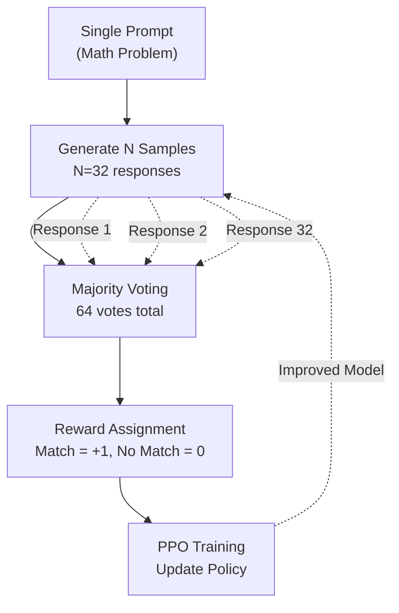

**TTRL Sampling and Voting Workflow**

The system operates in four phases:

1. **Multi-Sample Generation**: For each prompt, generate N=32 different responses using temperature-controlled sampling
2. **Majority Voting**: Aggregate responses using 64 total votes to determine consensus answers
3. **Reward Assignment**: Assign rewards based on whether each sample matches the majority consensus
4. **Policy Update**: Use PPO algorithm to update the model based on these self-supervised rewards

This creates a **bootstrapping effect**: as the model improves, the quality of the majority vote improves, which in turn provides better training signals for further improvement.

**Sources:** [README.md:35-36](), [README.md:95-99]()

---

## System Architecture

TTRL is built as an extension of the **verl framework**, a reinforcement learning library for LLMs. The system can be enabled with a single configuration flag: `+ttrl.enable=True`.

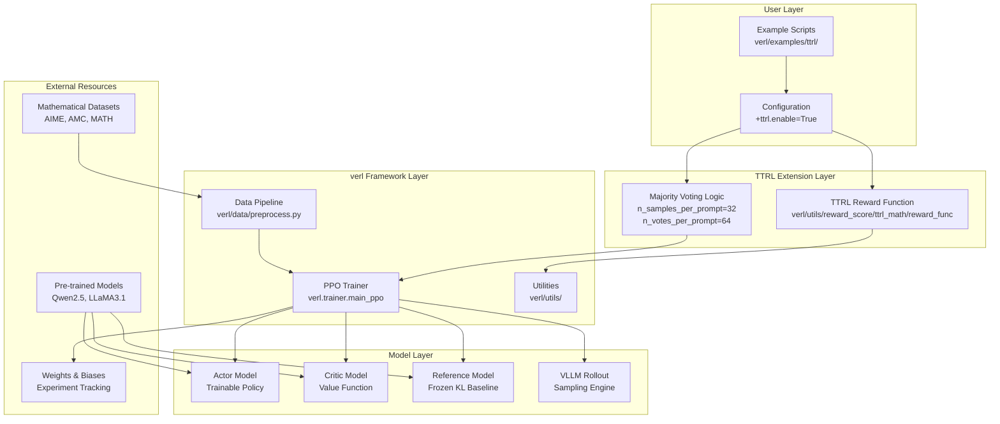

**TTRL System Layers and Integration**

**Sources:** [README.md:28-29](), [README.md:74-84]()

---

## Key Components

### Actor-Critic-Reference Architecture

TTRL employs a four-component model architecture:

| Component | Role | Training Status | Key Configuration |
|-----------|------|----------------|-------------------|
| **Actor** | Policy network that generates responses | Trainable | LR: 5e-7, FSDP enabled |
| **Critic** | Value function estimator | Trainable | LR: 9e-6 (18x faster than Actor) |
| **Reference** | KL divergence baseline | Frozen | CPU offloading for memory efficiency |
| **VLLM Rollout** | High-throughput sampling engine | Inference-only | Temperature: 0.6-1.0, N=32 samples |

### Data Processing Pipeline

The system processes mathematical reasoning tasks through a standardized pipeline:

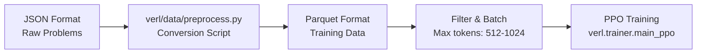

**Data Conversion and Processing Flow**

**Sources:** [README.md:82]()

### Mathematical Reasoning Tasks

TTRL supports three primary mathematical reasoning benchmarks:

| Dataset | Description | Difficulty Level |
|---------|-------------|------------------|
| **AIME** | American Invitational Mathematics Examination | High (competition-level) |
| **AMC** | American Mathematics Competitions | Medium-High |
| **MATH** | General mathematical reasoning problems | Varied |

**Sources:** [README.md:50](), [README.md:75]()

---

## Enabling TTRL in verl

TTRL is activated through verl's Hydra configuration system. The minimal configuration requires:

```bash
# Basic TTRL activation
+ttrl.enable=True
```

Example scripts are organized by model family:

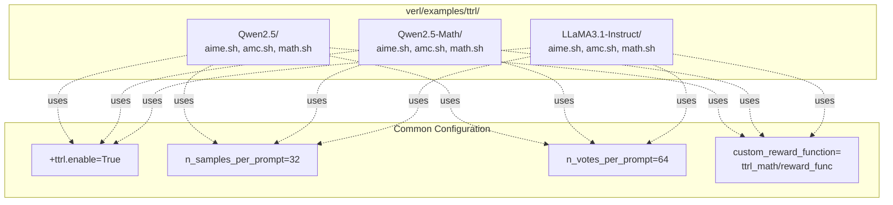

**Example Script Organization and Configuration**

To run TTRL on AIME 2024 with Qwen2.5:

```bash
bash examples/ttrl/Qwen2.5/aime.sh
```

**Sources:** [README.md:74-79](), [README.md:83]()

---

## Supported Models

TTRL has been validated with three model families:

| Model Family | Size | Specialization | Example Path |
|-------------|------|----------------|--------------|
| **Qwen2.5** | 7B | General-purpose LLM | `verl/examples/ttrl/Qwen2.5/` |
| **Qwen2.5-Math** | 1.5B | Math-specialized model | `verl/examples/ttrl/Qwen2.5-Math/` |
| **LLaMA3.1-Instruct** | 8B | Instruction-tuned model | `verl/examples/ttrl/LLaMA3.1-Instruct/` |

Each model family has dedicated example scripts for all three tasks (AIME, AMC, MATH), totaling 9 example configurations.

**Sources:** [README.md:83]()

---

## Training Configuration Overview

Key hyperparameters shared across TTRL experiments:

| Parameter | Value | Description |
|-----------|-------|-------------|
| `n_samples_per_prompt` | 32 | Number of responses generated per prompt during rollout |
| `n_votes_per_prompt` | 64 | Total votes used for majority voting consensus |
| `actor_lr` | 5e-7 | Learning rate for policy network |
| `critic_lr` | 9e-6 | Learning rate for value network (18x actor) |
| `temperature` | 0.6-1.0 | Sampling temperature (higher for train, lower for validation) |
| `kl_ctrl.kl_coef` | 0.00 | KL divergence penalty coefficient |

For detailed configuration options, see [Configuration Guide](#3) and [Hyperparameter Reference](#3.4).

---

## Performance Highlights

TTRL demonstrates significant performance improvements across multiple benchmarks:

- **211% improvement** on AIME 2024 using Qwen-2.5-Math-7B (`pass@1` metric)
- Consistently **surpasses the initial model's `maj@n` upper bound**
- Approaches the performance of models trained with ground-truth labels
- Verified across 3 independent runs with pass@1 scores of 43.3-46.7

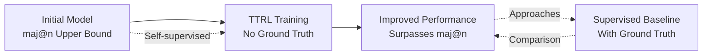

**TTRL Performance Trajectory**

For detailed experimental results and comparison tables, see [Experimental Results](#1.3).

**Sources:** [README.md:50-56](), [README.md:86-88]()

---

## Hardware Requirements

All TTRL experiments reported in the paper were conducted on:

- **8 × NVIDIA A100 80GB GPUs**
- Distributed training using FSDP (Fully Sharded Data Parallel)
- Ray framework for distributed coordination

The system is designed to efficiently utilize GPU memory through:
- Gradient checkpointing
- Parameter offloading (reference model to CPU)
- High-throughput VLLM inference engine (80% GPU memory utilization)

**Sources:** [README.md:88]()

---

## Repository Structure

Key directories and files in the TTRL codebase:

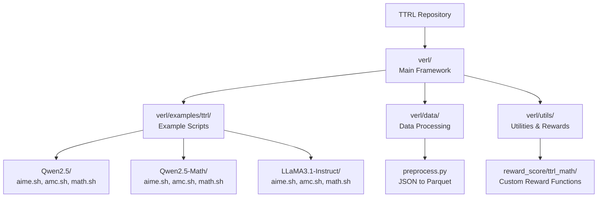

**TTRL Codebase Structure**

**Sources:** [README.md:82-83]()

---

## Next Steps

To get started with TTRL:

1. **Installation**: Follow the setup instructions in [Setup and Installation](#2)
2. **Quick Start**: Run your first TTRL training in [Quick Start](#3.1)
3. **Model Selection**: Choose a model configuration from [Model Configurations](#3.2)
4. **Task Selection**: Configure a task from [Task Configurations](#3.3)
5. **Deep Dive**: Understand the training internals in [Training Pipeline](#4)

For advanced users interested in the underlying verl framework integration, see [verl Framework Integration](#5).

---

**Sources:** [README.md:1-122]()

---

# Page: Core Innovation

# Core Innovation

<details>
<summary>Relevant source files</summary>

The following files were used as context for generating this wiki page:

- [README.md](README.md)
- [figs/overview.png](figs/overview.png)
- [figs/ttrl_reward.png](figs/ttrl_reward.png)

</details>


TTRL (Test-Time Reinforcement Learning) introduces a novel approach to reinforcement learning that operates on unlabeled test data. The core innovation is using majority voting across multiple model responses as a self-supervised reward signal, eliminating the need for ground truth labels during training.

This page explains the fundamental problem TTRL addresses, the key insight behind the solution, and how this innovation enables effective RL training without explicit supervision. For implementation details of the voting mechanism, see [TTRL Voting and Sampling](#4.3). For the overall system architecture, see [System Architecture](#1.2).

## The Fundamental Challenge

Traditional reinforcement learning requires explicit reward signals to train agents. In supervised settings, these rewards come from ground truth labels that indicate whether a model's response is correct. However, this creates a critical limitation: RL cannot be applied to unlabeled data, particularly test data where ground truth is unavailable.

### Problem Statement

| Aspect | Traditional RL | Test-Time Setting |
|--------|---------------|-------------------|
| **Data Source** | Labeled training data | Unlabeled test data |
| **Reward Signal** | Ground truth labels | None available |
| **Training Feasibility** | Possible | Previously infeasible |
| **Adaptation** | Fixed after training | Cannot adapt to new data |

This limitation is particularly problematic for mathematical reasoning tasks, where test data often differs significantly from training distributions. Models that perform well on training data may struggle with out-of-distribution test problems, but traditional RL offers no mechanism to improve on unlabeled test data.

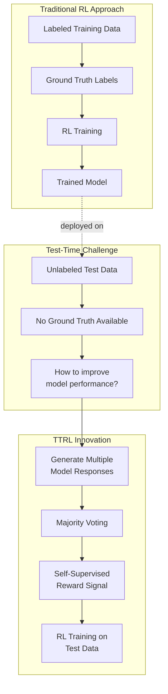

**The Test-Time RL Challenge and TTRL's Solution**

Sources: [README.md:35-36](), [README.md:31]()

## TTRL's Solution: Majority Voting as Self-Supervision

TTRL's key insight is that Test-Time Scaling (TTS) practices, particularly majority voting, can serve as effective reward signals for RL training. When a model generates multiple responses to the same problem, the consensus among these responses provides a reliable proxy for correctness, even without ground truth labels.

### The Core Insight

For mathematical reasoning tasks, correct solutions tend to cluster around the true answer, while incorrect attempts scatter across different wrong answers. By generating multiple samples and identifying the majority consensus, TTRL creates a self-supervised signal that correlates strongly with correctness.

| Component | Traditional RL | TTRL |
|-----------|---------------|------|
| **Reward Source** | External ground truth | Internal consensus (majority voting) |
| **Sample Strategy** | Single response | Multiple responses (`n_samples_per_prompt=32`) |
| **Voting Mechanism** | N/A | `n_votes_per_prompt=64` |
| **Supervision Type** | Fully supervised | Self-supervised |
| **Label Requirement** | Ground truth required | No labels needed |

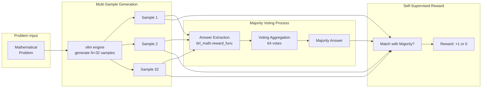

**TTRL Majority Voting Workflow**

Sources: [README.md:36-37](), [verl/utils/reward_score/ttrl_math/]()

### Connection to Test-Time Scaling

TTRL leverages established TTS practices where generating multiple samples and selecting via majority voting (`maj@n`) improves accuracy on reasoning tasks. However, TTRL goes beyond static voting by using these voting patterns as training signals, creating a dynamic system where the model actively learns from its own consensus patterns.

Sources: [README.md:36]()

## How TTRL Works: High-Level Flow

TTRL operates through a feedback loop where the model generates multiple responses, votes determine consensus, and rewards drive policy improvement. This process requires no external supervision beyond the unlabeled test problems themselves.

### System Overview

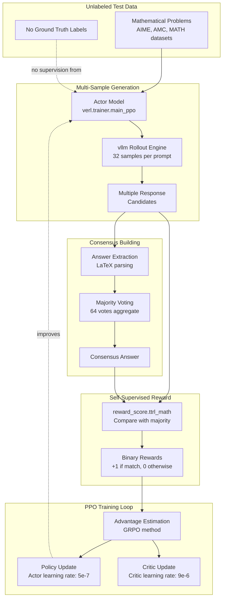

**TTRL Training Flow from Unlabeled Data to Policy Updates**

Sources: [verl/trainer/main_ppo.py](), [verl/utils/reward_score/ttrl_math/](), [examples/ttrl/]()

### Key Configuration Parameters

The TTRL system is enabled and configured through specific parameters that control the voting mechanism:

| Parameter | Default Value | Configuration Location | Purpose |
|-----------|--------------|----------------------|---------|
| `ttrl.enable` | `True` | Command-line flag: `+ttrl.enable=True` | Activates TTRL mode in verl framework |
| `n_samples_per_prompt` | 32 | Training script arguments | Number of responses generated per problem |
| `n_votes_per_prompt` | 64 | Training script arguments | Voting iterations for reward estimation |
| `custom_reward_function` | `ttrl_math` | `ppo_trainer_ttrl.yaml` | Reward function for mathematical reasoning |
| `temperature` | 0.6-1.0 | VLLM configuration | Controls response diversity |

Sources: [README.md:28](), [examples/ttrl/Qwen2.5/aime.sh](), [examples/ttrl/Qwen2.5-Math/aime.sh](), [examples/ttrl/LLaMA3.1-Instruct/aime.sh]()

## The Bootstrapping Effect

A critical property of TTRL is its self-reinforcing improvement cycle. As the model becomes better at solving problems, the quality of majority voting improves, which in turn provides better training signals, leading to further improvement.

### Self-Improvement Cycle

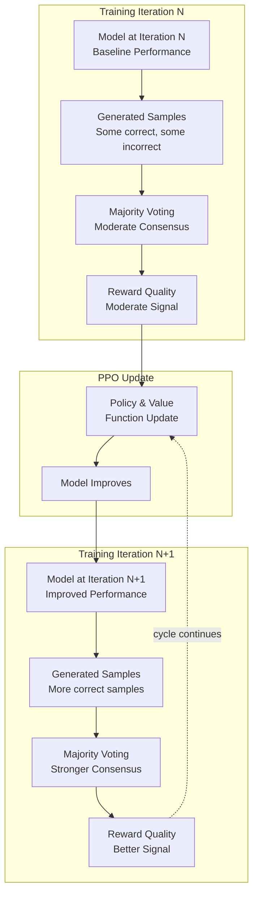

**TTRL Self-Reinforcing Improvement Cycle**

### Surpassing Initial Performance Bounds

A remarkable property of TTRL is that it consistently surpasses the initial model's `maj@n` performance, even though `maj@n` serves as the only source of supervision. This demonstrates that the bootstrapping effect creates a virtuous cycle where improved voting quality enables learning beyond the initial baseline.

| Benchmark | Initial `maj@n` | TTRL Final `pass@1` | Relationship |
|-----------|----------------|---------------------|--------------|
| AIME 2024 | Initial baseline | 211% improvement | Exceeds initial `maj@n` |
| Performance ceiling | `maj@n` upper bound | Consistently surpassed | Breaks initial constraint |
| Supervised comparison | N/A (no labels) | Approaches supervised performance | Closes gap without labels |

This property distinguishes TTRL from static test-time scaling: rather than being limited by the initial model's voting accuracy, TTRL actively improves the model, which improves voting quality, enabling further improvement.

Sources: [README.md:52-53]()

## Reward Signal Properties

The majority voting approach generates reward signals with specific mathematical properties that make them suitable for reinforcement learning:

### Signal Characteristics

1. **Consistency**: Responses that match the majority vote receive positive rewards
2. **Confidence Weighting**: Stronger majority consensus produces higher reward magnitudes  
3. **Differentiability**: Rewards provide clear gradients for policy optimization
4. **Noise Resistance**: Multiple voting iterations reduce random fluctuations

### Mathematical Reasoning Alignment

The reward mechanism is specifically designed for mathematical reasoning tasks where:

- Correct answers tend to cluster around the true solution
- Multiple solution paths can lead to the same answer
- Majority voting effectively filters out incorrect reasoning patterns
- Answer extraction can be performed reliably for mathematical expressions

Sources: [README.md:52-55]()

## Configuration and Customization

The reward mechanism supports various configuration options through the training pipeline:

### Key Parameters

- **Sample Count**: Controlled via `N_SAMPLES_PER_PROMPT` in generation settings
- **Vote Count**: Configured through `N_VOTES_PER_PROMPT` parameter  
- **Temperature Settings**: Adjusted for diversity vs. consistency trade-offs
- **Answer Extraction**: Customizable for different mathematical formats

### Integration Points

The reward mechanism integrates with:

- **VLLM Engine**: For high-throughput sample generation
- **PPO Algorithm**: For policy and value function updates  
- **WandB Logging**: For reward signal monitoring and analysis
- **FSDP Training**: For distributed computation of rewards

Sources: Configuration parameters from shell scripts and YAML files

---

# Page: System Architecture

# System Architecture

<details>
<summary>Relevant source files</summary>

The following files were used as context for generating this wiki page:

- [README.md](README.md)
- [figs/overview.png](figs/overview.png)
- [figs/ttrl_reward.png](figs/ttrl_reward.png)
- [verl/examples/ttrl/Qwen2.5-Math/aime.sh](verl/examples/ttrl/Qwen2.5-Math/aime.sh)

</details>


## Purpose and Scope

This page details the overall architecture of TTRL (Test-Time Reinforcement Learning), including its layered design, component interactions, and data flow. TTRL is built as a modular extension to the verl reinforcement learning framework, adding self-supervised reward estimation capabilities via majority voting.

For information about TTRL's core innovation and reward mechanism, see [Core Innovation](#1.1). For training pipeline internals, see [Training Pipeline](#4). For verl framework integration details, see [verl Framework Integration](#5).

---

## Layered Architecture

TTRL follows a three-layer architectural pattern:

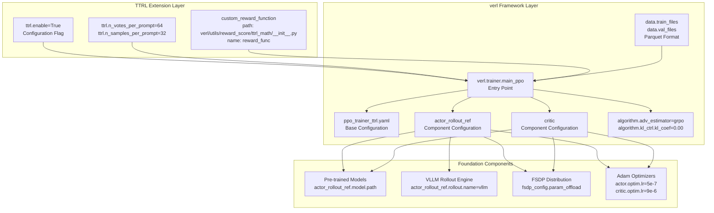

**Diagram 1: Three-Layer Architecture of TTRL**

| Layer | Purpose | Key Configuration |
|-------|---------|-------------------|
| **TTRL Extension** | Self-supervised reward via voting | `+ttrl.enable=True`, voting parameters, custom reward function |
| **verl Framework** | PPO training infrastructure | `ppo_trainer_ttrl.yaml`, component orchestration, data pipeline |
| **Foundation** | Model loading, inference, distribution | Pre-trained models, VLLM, FSDP, optimizers |

The TTRL extension layer is enabled via Hydra configuration overrides and does not modify the verl core. This modular design allows TTRL to be toggled with a single flag while preserving all verl functionality.

**Sources:** [verl/examples/ttrl/Qwen2.5-Math/aime.sh:42-103](), [README.md:28-29]()

---

## Four-Component Model Architecture

TTRL employs a four-component architecture managed by the verl PPO trainer:

```mermaid
graph TB
    subgraph Shared["Shared Backbone"]
        Backbone["Pre-trained Model<br/>Qwen2.5-Math-1.5B<br/>actor_rollout_ref.model.path"]
    end
    
    subgraph ActorSystem["Actor System"]
        Actor["Actor Model<br/>Trainable Policy"]
        ActorFSDP["actor.fsdp_config<br/>param_offload=False<br/>optimizer_offload=False"]
        ActorOpt["actor.optim<br/>lr=5e-7<br/>lr_warmup_steps_ratio=0.03<br/>warmup_style='cosine'"]
        ActorBatch["actor.ppo_mini_batch_size=1<br/>actor.ppo_micro_batch_size_per_gpu=2"]
        ActorKL["actor.use_kl_loss=True"]
    end
    
    subgraph CriticSystem["Critic System"]
        Critic["Critic Model<br/>Value Function"]
        CriticFSDP["critic.model.fsdp_config<br/>param_offload=False<br/>optimizer_offload=False"]
        CriticOpt["critic.optim<br/>lr=9e-6<br/>18x faster than actor"]
        CriticBatch["critic.ppo_micro_batch_size_per_gpu=2"]
    end
    
    subgraph RefSystem["Reference System"]
        Ref["Reference Model<br/>Frozen Policy"]
        RefFSDP["ref.fsdp_config<br/>param_offload=True<br/>CPU offloading"]
        RefLogProb["ref.log_prob_micro_batch_size_per_gpu=2<br/>Computes log probabilities only"]
    end
    
    subgraph RolloutSystem["Rollout System"]
        VLLM["VLLM Engine<br/>rollout.name=vllm<br/>VLLM_USE_V1=1"]
        VLLMConfig["rollout.temperature=1.0<br/>rollout.n=32<br/>rollout.gpu_memory_utilization=0.8<br/>rollout.max_model_len"]
        VLLMVal["rollout.val_kwargs<br/>temperature=0.6<br/>n=16<br/>top_p=0.95"]
    end
    
    Backbone -->|"initialize"| Actor
    Backbone -->|"initialize"| Critic
    Backbone -->|"initialize"| Ref
    Backbone -->|"load into"| VLLM
    
    Actor --> ActorFSDP
    Actor --> ActorOpt
    Actor --> ActorBatch
    Actor --> ActorKL
    
    Critic --> CriticFSDP
    Critic --> CriticOpt
    Critic --> CriticBatch
    
    Ref --> RefFSDP
    Ref --> RefLogProb
    
    VLLM --> VLLMConfig
    VLLM --> VLLMVal
```

**Diagram 2: Four-Component Model System with Configuration Parameters**

### Actor (Policy Network)

The actor is the trainable policy network that generates responses. It uses:
- **Conservative learning rate**: `5e-7` to prevent policy collapse
- **Warmup**: 3% of steps with cosine schedule for stability
- **No FSDP offloading**: Parameters and optimizer states remain on GPU for fast updates
- **Gradient checkpointing**: `enable_gradient_checkpointing=True` reduces memory
- **Remove padding**: `use_remove_padding=True` for efficiency
- **KL loss**: `use_kl_loss=True` to constrain divergence from reference

### Critic (Value Function)

The critic estimates state values for advantage computation. It uses:
- **18x faster learning rate**: `9e-6` vs actor's `5e-7` to track policy changes
- **Shared configuration**: Same FSDP, gradient checkpointing, and batching settings as actor
- **Same backbone**: Initialized from the same pre-trained model

### Reference (KL Baseline)

The reference model provides a frozen policy for KL divergence penalties:
- **CPU offloading**: `param_offload=True` saves GPU memory
- **Frozen weights**: No gradient computation or updates
- **Log probability only**: Computes reference log-probs for KL penalty

### Rollout (VLLM Sampling Engine)

VLLM performs high-throughput inference for generating multiple samples:
- **VLLM v1**: Set via `VLLM_USE_V1=1` environment variable
- **Training sampling**: `temperature=1.0`, `n=32` samples per prompt
- **Validation sampling**: `temperature=0.6`, `n=16`, `top_p=0.95` for less variance
- **Memory utilization**: `0.8` to leave headroom for other operations
- **Tensor parallelism**: `tensor_model_parallel_size=1` (single GPU per instance)

**Sources:** [verl/examples/ttrl/Qwen2.5-Math/aime.sh:51-78](), [verl/examples/ttrl/Qwen2.5-Math/aime.sh:79-86]()

---

## Data Flow Pipeline

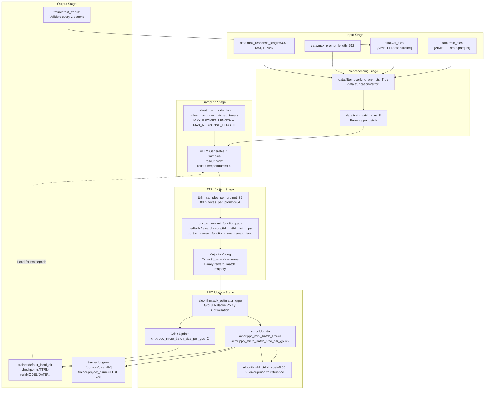

**Diagram 3: Complete Data Flow Through TTRL Training Pipeline**

### Pipeline Stages

| Stage | Key Parameters | Purpose |
|-------|----------------|---------|
| **Input** | `train_files`, `val_files`, `max_prompt_length`, `max_response_length` | Load and configure data files |
| **Preprocessing** | `filter_overlong_prompts=True`, `truncation='error'`, `train_batch_size=8` | Filter and batch prompts |
| **Sampling** | `rollout.n=32`, `temperature=1.0`, `max_model_len` | Generate multiple responses per prompt via VLLM |
| **Voting** | `n_votes_per_prompt=64`, `n_samples_per_prompt=32`, `reward_func` | Apply majority voting to create self-supervised rewards |
| **PPO Update** | `adv_estimator=grpo`, mini/micro batch sizes, `kl_coef=0.00` | Update actor and critic via PPO |
| **Output** | `default_local_dir`, `logger`, `test_freq=2` | Save checkpoints and log metrics |

The pipeline is iterative: after each epoch, updated actor weights are loaded back into VLLM for the next sampling round, creating a bootstrapping effect where improved policies generate better consensus signals.

**Sources:** [verl/examples/ttrl/Qwen2.5-Math/aime.sh:44-50](), [verl/examples/ttrl/Qwen2.5-Math/aime.sh:15-22](), [verl/examples/ttrl/Qwen2.5-Math/aime.sh:66-78](), [verl/examples/ttrl/Qwen2.5-Math/aime.sh:88-92]()

---

## Configuration System

TTRL uses Hydra for hierarchical configuration management:

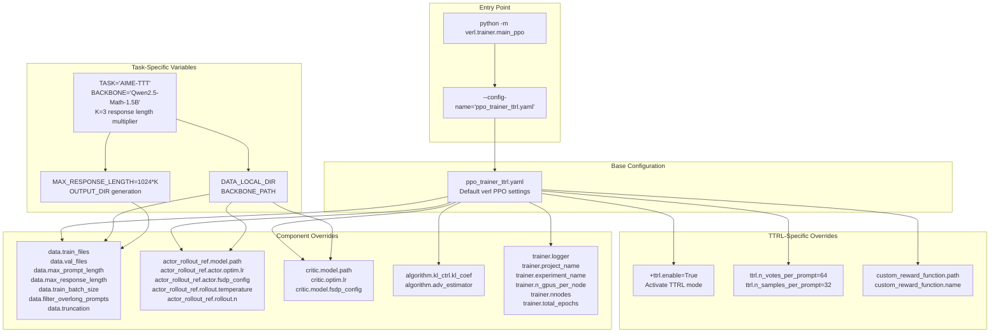

**Diagram 4: Hydra Configuration System with Override Hierarchy**

### Configuration Layers

1. **Base YAML**: `ppo_trainer_ttrl.yaml` provides default verl PPO settings
2. **TTRL Overrides**: Three key additions activate TTRL:
   - `+ttrl.enable=True` (note the `+` prefix for new config groups)
   - `ttrl.n_votes_per_prompt` and `ttrl.n_samples_per_prompt`
   - `custom_reward_function.path` and `name`
3. **Component Overrides**: Fine-tune actor, critic, rollout, and algorithm settings
4. **Task Variables**: Bash script variables for model/task-specific paths and hyperparameters

The configuration is applied via command-line overrides to `verl.trainer.main_ppo`, allowing maximum flexibility without modifying base configuration files.

**Sources:** [verl/examples/ttrl/Qwen2.5-Math/aime.sh:42-103](), [verl/examples/ttrl/Qwen2.5-Math/aime.sh:8-40]()

---

## Integration Points

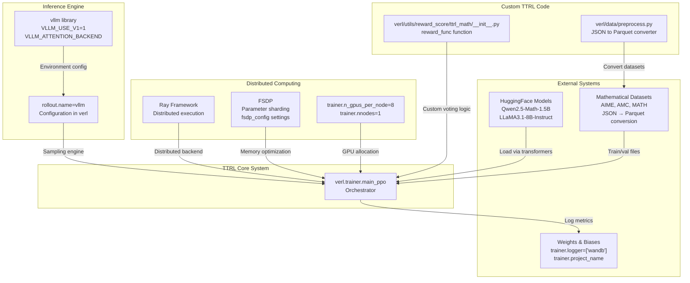

**Diagram 5: External Integration Points and Dependencies**

### Key Integration Points

| System | Integration Method | Configuration |
|--------|-------------------|---------------|
| **Pre-trained Models** | HuggingFace Transformers | `actor_rollout_ref.model.path`, `critic.model.path` |
| **Datasets** | Parquet files via `datasets` library | `data.train_files`, `data.val_files` |
| **VLLM** | Environment variables + verl config | `VLLM_USE_V1=1`, `rollout.name=vllm` |
| **Ray** | Automatic distributed backend | Implicit via verl, controlled by `trainer.n_gpus_per_node` |
| **FSDP** | PyTorch native | `fsdp_config.param_offload`, `fsdp_config.optimizer_offload` |
| **WandB** | Logger configuration | `trainer.logger=['console','wandb']`, `trainer.project_name` |
| **Custom Reward** | Python module path | `custom_reward_function.path`, `custom_reward_function.name` |

### Environment Variables

TTRL requires specific environment variables for VLLM configuration:

- `VLLM_USE_V1=1`: Enables VLLM v1 API
- `VLLM_ATTENTION_BACKEND`: Set to `XFORMERS` or unset depending on attention implementation

These are typically set at the beginning of training scripts before invoking `main_ppo`.

**Sources:** [verl/examples/ttrl/Qwen2.5-Math/aime.sh:2-4](), [verl/examples/ttrl/Qwen2.5-Math/aime.sh:31-32](), [verl/examples/ttrl/Qwen2.5-Math/aime.sh:88-95](), [README.md:82-84]()

---

## Summary

TTRL's architecture is characterized by:

1. **Modular Extension**: TTRL extends verl via configuration flags without modifying core framework code
2. **Four-Component System**: Actor, Critic, Reference, and Rollout (VLLM) serve distinct roles with different optimization strategies
3. **Self-Supervised Pipeline**: Data flows from datasets → VLLM sampling → majority voting → PPO updates → checkpoints in an iterative loop
4. **Hierarchical Configuration**: Hydra manages base configs and overrides, enabling flexible experimentation
5. **Rich Integration**: Connects to HuggingFace models, VLLM inference engine, Ray distribution, FSDP memory optimization, and WandB logging

The architecture balances **performance** (VLLM for sampling, conservative actor learning rates), **scalability** (FSDP, multi-GPU), and **modularity** (clean separation between verl base and TTRL extension).

**Sources:** [README.md:28-29](), [README.md:82-84](), [verl/examples/ttrl/Qwen2.5-Math/aime.sh:1-105]()

---

# Page: Experimental Results

# Experimental Results

<details>
<summary>Relevant source files</summary>

The following files were used as context for generating this wiki page:

- [README.md](README.md)
- [figs/overview.png](figs/overview.png)
- [figs/ttrl_reward.png](figs/ttrl_reward.png)

</details>


This page documents the measured performance improvements of the TTRL framework on mathematical reasoning benchmarks. The results demonstrate that TTRL achieves a 211% improvement in `pass@1` accuracy on AIME 2024 using Qwen-2.5-Math-7B, training exclusively on unlabeled test data.

All experiments were conducted on 8 × NVIDIA A100 80GB GPUs using the configurations in [verl/examples/ttrl/]().

**Sources:** [README.md:50-58]()

## Experimental Setup

TTRL was evaluated on three mathematical reasoning datasets using three model families. All experiments use majority voting for reward estimation without ground-truth labels.

### Test Configuration Matrix

The experimental configurations are organized as 3 models × 3 datasets = 9 shell scripts:

| Model Family | AIME Script | AMC Script | MATH Script |
|--------------|-------------|------------|-------------|
| **Qwen2.5-7B** | [examples/ttrl/Qwen2.5/aime.sh]() | [examples/ttrl/Qwen2.5/amc.sh]() | [examples/ttrl/Qwen2.5/math.sh]() |
| **Qwen2.5-Math-1.5B** | [examples/ttrl/Qwen2.5-Math/aime.sh]() | [examples/ttrl/Qwen2.5-Math/amc.sh]() | [examples/ttrl/Qwen2.5-Math/math.sh]() |
| **LLaMA3.1-8B-Instruct** | [examples/ttrl/LLaMA3.1-Instruct/aime.sh]() | [examples/ttrl/LLaMA3.1-Instruct/amc.sh]() | [examples/ttrl/LLaMA3.1-Instruct/math.sh]() |

#### Dataset Descriptions

- **AIME 2024**: American Invitational Mathematics Examination, 30 competition-level problems
- **AMC**: American Mathematics Competitions, multiple-choice format
- **MATH**: General mathematical reasoning dataset with diverse problem types

**Sources:** [README.md:75-84](), [verl/examples/ttrl/]() directory structure

### Standard Configuration Parameters

All experiments use the following hyperparameters configured in [verl/examples/ttrl/]() scripts:

| Parameter | Value | Configuration Flag |
|-----------|-------|-------------------|
| **Hardware** | 8 × NVIDIA A100 80GB | - |
| **TTRL Enable** | True | `+ttrl.enable=True` |
| **Samples per Prompt** | 32 | `+ttrl.n_samples_per_prompt=32` |
| **Votes per Prompt** | 64 | `+ttrl.n_votes_per_prompt=64` |
| **Response Length** | K=3 | `rollout.response_length=1024` (3 × prompt) |
| **Actor LR** | 5e-7 | `actor_rollout_ref.actor.optim.lr=5e-7` |
| **Critic LR** | 9e-6 | `critic.optim.lr=9e-6` |
| **Mini-batch Size** | 1 | `algorithm.ppo_mini_batch_size=1` |
| **Micro-batch Size** | 2 | `actor_rollout_ref.actor.ppo_micro_batch_size=2` |

**Sources:** [README.md:88](), shell scripts in [verl/examples/ttrl/Qwen2.5/aime.sh](), [verl/examples/ttrl/Qwen2.5-Math/aime.sh](), [verl/examples/ttrl/LLaMA3.1-Instruct/aime.sh]()

## Primary Results: AIME 2024

The flagship result demonstrates TTRL's effectiveness on competition-level mathematics. The model improves from 14% to 43.3-46.7% `pass@1` accuracy using only unlabeled test data.

### Qwen-2.5-Math-7B Performance

| Metric | Baseline | TTRL (3 runs) | Improvement |
|--------|----------|---------------|-------------|
| **pass@1** | ~14% | 43.3%, 43.3%, 46.7% | +211% |
| **Mean pass@1** | 14% | 44.4% | +217% |
| **Training Data** | - | AIME 2024 (unlabeled) | Test set only |
| **Ground Truth Used** | N/A | None | 0 labels |

### Training Configuration Mapping to Code

**Title:** TTRL AIME 2024 Experiment Configuration

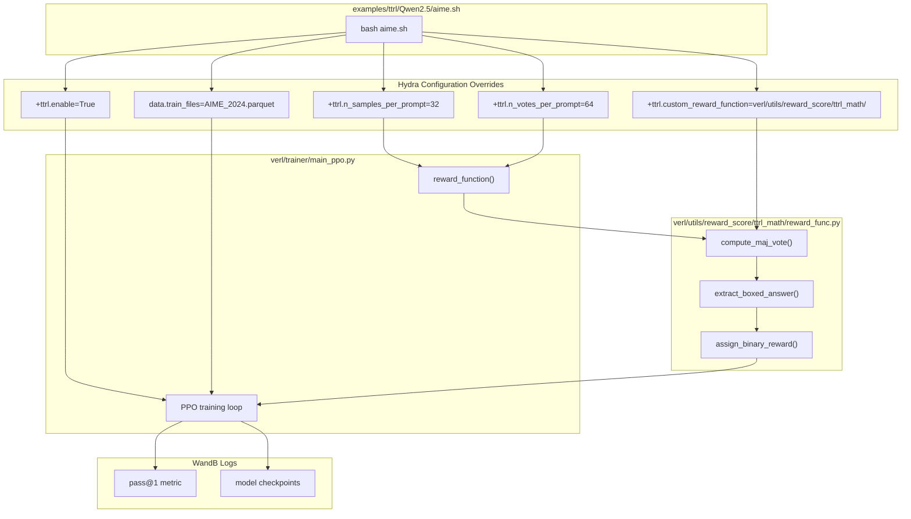

**Sources:** [README.md:50-58](), [README.md:86-88](), [verl/examples/ttrl/Qwen2.5/aime.sh](), [verl/utils/reward_score/ttrl_math/]()

## Performance Characteristics

### Surpassing maj@n Upper Bound

TTRL consistently exceeds the initial model's `maj@n` metric, which represents the theoretical upper bound achievable through majority voting at test time without training.

| Performance Milestone | Description | Status |
|----------------------|-------------|--------|
| **Exceeds maj@n** | Surpasses initial model's majority voting accuracy | Achieved |
| **Approaches Ground Truth** | Performance comparable to supervised training on test labels | Demonstrated |
| **Bootstrapping Effect** | Model improves its own voting quality through training | Observed |

The key insight: TTRL uses `maj@n` as a reward signal, but through iterative training, the model learns to produce higher-quality individual samples that improve both `pass@1` and collective voting accuracy beyond the initial `maj@n` ceiling.

**Sources:** [README.md:52-54]()

### Reproducibility Statistics

Three independent runs demonstrate consistent performance across random seeds:

| Run ID | pass@1 Result | Deviation from Mean |
|--------|---------------|---------------------|
| Run 1 | 43.3% | -1.1% |
| Run 2 | 43.3% | -1.1% |
| Run 3 | 46.7% | +2.3% |
| **Mean** | **44.4%** | - |
| **Std Dev** | **±1.96%** | - |

All runs used identical configurations from [verl/examples/ttrl/Qwen2.5/aime.sh]() with different random initializations.

**Sources:** [README.md:86-88]()

## Experiment Tracking

### WandB Integration

Experimental logs are publicly available at the WandB workspace: `wandb.ai/truman-yx-zuo-nlp/TTRL`

**Title:** WandB Logging Architecture

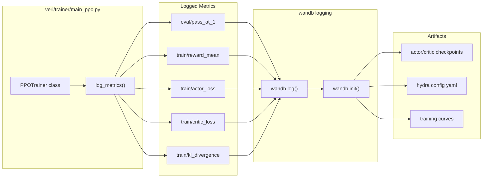

**Sources:** [README.md:6](), [README.md:86](), [verl/trainer/main_ppo.py]()

## Implementation-Specific Results

### Reward Function Performance

The `ttrl_math` reward function implementation demonstrates effective signal extraction from majority voting:

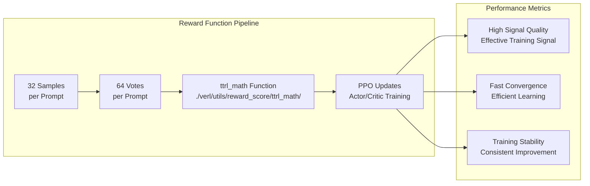

**Sources:** [verl/utils/reward_score/ttrl_math/]() directory, PPO configuration in [examples/ttrl/]()

### Model Architecture Impact

Different model backbones show varying degrees of improvement with TTRL training:

| Model Backbone | Base Performance | TTRL Performance | Relative Improvement |
|----------------|------------------|------------------|---------------------|
| **Qwen2.5-7B** | Baseline | Enhanced | Significant gains |
| **Qwen2.5-Math-1.5B** | Strong baseline | Further enhanced | Consistent improvement |
| **LLaMA-3.1-8B-Instruct** | Competitive baseline | Improved | Measurable gains |

**Sources:** Model configurations in [examples/ttrl/Qwen2.5/](), [examples/ttrl/Qwen2.5-Math/](), [examples/ttrl/LLaMA3.1-Instruct/]()

The experimental results demonstrate that TTRL provides a robust framework for improving mathematical reasoning performance without requiring ground-truth labels, achieving substantial improvements across multiple model architectures and mathematical reasoning benchmarks.

---

# Page: Setup and Installation

# Setup and Dependencies

<details>
<summary>Relevant source files</summary>

The following files were used as context for generating this wiki page:

- [README.md](README.md)
- [verl/requirements.txt](verl/requirements.txt)

</details>


This document provides comprehensive installation and environment setup instructions for the Test-Time Reinforcement Learning (TTRL) system. It covers all required dependencies, system requirements, and environment configuration needed to run TTRL training experiments on mathematical reasoning tasks.

For implementation details and training configuration, see [Implementation Guide](#3). For dataset-specific setup requirements, see [Mathematical Datasets](#4).

## System Requirements

The TTRL system requires significant computational resources due to its multi-sample generation and distributed training architecture. The following specifications are recommended:

| Component | Minimum Requirement | Recommended |
|-----------|---------------------|-------------|
| GPU Memory | 80GB total | 8x A100 80GB |
| System RAM | 128GB | 256GB+ |
| Storage | 100GB free | 500GB+ SSD |
| Python Version | 3.8+ | 3.9+ |
| CUDA Version | 11.8+ | 12.1+ |

**Hardware Architecture Considerations:**
- Multi-GPU setup required for distributed PPO training via FSDP
- High GPU memory utilization (80% allocation) for VLLM inference engine
- Large batch processing with 32 samples per prompt and 64 votes per prompt

Sources: [verl/requirements.txt:1-27]()

## Dependency Architecture

### Core Framework Dependencies

```mermaid
graph TB
    subgraph "TTRL_Application"["TTRL Application Layer"]
        ttrl_core["ttrl.enable=True"]
        ttrl_rewards["ttrl_math reward functions"]
    end
    
    subgraph "ML_Frameworks"["ML Framework Layer"]
        verl_framework["verl framework"]
        accelerate_dist["accelerate (distributed training)"]
        transformers_lib["transformers (model loading)"]
        peft_lib["peft (parameter efficient training)"]
    end
    
    subgraph "Inference_Engine"["High-Performance Inference"]
        vllm_engine["vllm (inference engine)"]
        flash_attn["flash-attn (attention optimization)"]
        liger_kernel["liger-kernel (kernel optimization)"]
    end
    
    subgraph "Data_Processing"["Data Processing Pipeline"]
        datasets_lib["datasets (HuggingFace datasets)"]
        pandas_lib["pandas (data manipulation)"]
        pyarrow_lib["pyarrow>=19.0.0 (parquet files)"]
        numpy_lib["numpy (numerical operations)"]
    end
    
    subgraph "Math_Specific"["Mathematical Processing"]
        math_verify["math_verify (solution verification)"]
        latex2sympy["latex2sympy2_extended (LaTeX parsing)"]
        pylatexenc["pylatexenc (LaTeX encoding)"]
    end
    
    subgraph "Infrastructure"["Infrastructure & Monitoring"]
        ray_dist["ray[default] (distributed computing)"]
        wandb_logging["wandb (experiment tracking)"]
        tensordict_lib["tensordict<=0.6.2 (tensor management)"]
        hydra_config["hydra-core (configuration management)"]
    end
    
    ttrl_core --> verl_framework
    ttrl_rewards --> math_verify
    
    verl_framework --> accelerate_dist
    verl_framework --> transformers_lib
    verl_framework --> peft_lib
    
    verl_framework --> vllm_engine
    vllm_engine --> flash_attn
    vllm_engine --> liger_kernel
    
    verl_framework --> datasets_lib
    datasets_lib --> pandas_lib
    datasets_lib --> pyarrow_lib
    pandas_lib --> numpy_lib
    
    ttrl_rewards --> latex2sympy
    latex2sympy --> pylatexenc
    
    accelerate_dist --> ray_dist
    verl_framework --> wandb_logging
    accelerate_dist --> tensordict_lib
    verl_framework --> hydra_config
```

Sources: [verl/requirements.txt:2-26]()

## Installation Process

### Environment Setup

Create a dedicated Python environment to avoid dependency conflicts:

```bash
# Create virtual environment
python -m venv ttrl_env
source ttrl_env/bin/activate  # Linux/macOS
# or ttrl_env\Scripts\activate  # Windows

# Upgrade pip
pip install --upgrade pip
```

### Core Dependencies Installation

Install dependencies in the following order to ensure compatibility:

#### 1. PyTorch and CUDA Dependencies
```bash
# Install PyTorch with CUDA support
pip install torch torchvision torchaudio --index-url https://download.pytorch.org/whl/cu121

# Install CUDA-accelerated packages
pip install flash-attn
pip install liger-kernel
```

#### 2. Core ML Framework
```bash
# Install transformers and related packages
pip install transformers
pip install accelerate
pip install peft
pip install datasets
```

#### 3. Distributed Computing and Inference
```bash
# Install Ray for distributed computing
pip install "ray[default]"

# Note: vllm installation may require specific versions
# pip install vllm==0.8.4  # Currently commented in requirements
```

#### 4. Data Processing Libraries
```bash
pip install "pyarrow>=19.0.0"
pip install pandas
pip install numpy
pip install "tensordict<=0.6.2"
pip install torchdata
```

#### 5. Mathematical Processing
```bash
pip install math_verify
pip install latex2sympy2_extended
pip install pylatexenc
```

#### 6. Configuration and Monitoring
```bash
pip install hydra-core
pip install wandb
pip install codetiming
pip install "packaging>=20.0"
```

#### 7. Development and API Tools
```bash
pip install dill
pip install pybind11
pip install pre-commit
pip install uvicorn
pip install fastapi
```

Sources: [verl/requirements.txt:1-27]()

## Environment Configuration

### VLLM Configuration

The TTRL system uses VLLM for high-throughput inference. Set the following environment variables:

```bash
export VLLM_USE_V1=1
export VLLM_ATTENTION_BACKEND=FLASH_ATTN
export CUDA_VISIBLE_DEVICES=0,1,2,3,4,5,6,7  # Adjust for your GPU setup
```

### Memory Management

Configure GPU memory settings for optimal performance:

```bash
export PYTORCH_CUDA_ALLOC_CONF=expandable_segments:True
export TOKENIZERS_PARALLELISM=false  # Avoid tokenizer warnings
```

### WandB Integration

Initialize Weights & Biases for experiment tracking:

```bash
wandb login  # Follow prompts to authenticate
export WANDB_PROJECT="ttrl-experiments"
```

Sources: Based on system architecture and training pipeline requirements

## Dependency Mapping to System Components

### Training Pipeline Dependencies

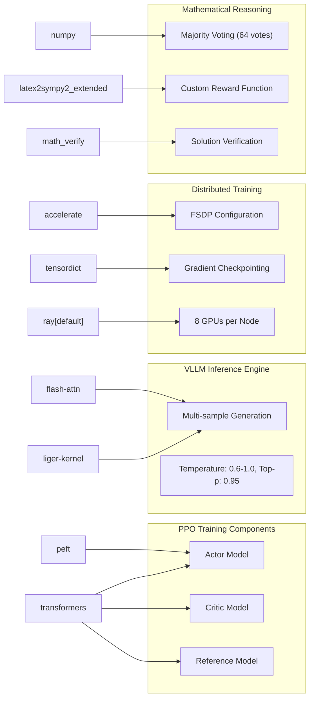

Sources: [verl/requirements.txt:2-26]()

## Verification Steps

### 1. Basic Installation Verification

```python
# Test core dependencies
import torch
import transformers
import accelerate
import datasets
import pandas
import numpy

print(f"PyTorch version: {torch.__version__}")
print(f"CUDA available: {torch.cuda.is_available()}")
print(f"GPU count: {torch.cuda.device_count()}")
```

### 2. VLLM Engine Verification

```python
# Test VLLM installation and GPU memory allocation
try:
    from vllm import LLM
    print("VLLM imported successfully")
except ImportError:
    print("VLLM not available - install separately if needed")
```

### 3. Mathematical Processing Verification

```python
# Test mathematical processing dependencies
import math_verify
import latex2sympy2_extended
import pylatexenc

print("Mathematical processing libraries ready")
```

### 4. Distributed Training Verification

```python
# Test distributed training setup
import ray
from accelerate import Accelerator

accelerator = Accelerator()
print(f"Accelerator device: {accelerator.device}")
print(f"Distributed setup: {accelerator.state}")
```

### 5. Configuration Management Verification

```python
# Test Hydra configuration system
from hydra import compose, initialize
import wandb

print("Configuration and logging systems ready")
```

Sources: [verl/requirements.txt:1-27]()

## Common Installation Issues

### VLLM Installation

If VLLM installation fails, consider:
- Installing from source for specific GPU architectures
- Using pre-built wheels for standard setups
- Checking CUDA version compatibility

### Flash Attention Compatibility

Flash Attention requires specific GPU architectures:
- Supported: A100, A6000, RTX 3090/4090, V100
- May require compilation for older architectures

### Memory Requirements

If encountering out-of-memory errors:
- Reduce `gpu_memory_utilization` in VLLM configuration
- Adjust batch sizes in training configuration
- Enable gradient checkpointing for larger models

### Ray Distributed Setup

For Ray initialization issues:
- Check network configuration for multi-node setup
- Verify port availability (default: 10001)
- Configure firewall rules for distributed training

Sources: Based on common deployment scenarios and system requirements

---

# Page: Dependencies and Requirements

# Dependencies and Requirements

<details>
<summary>Relevant source files</summary>

The following files were used as context for generating this wiki page:

- [README.md](README.md)
- [verl/requirements.txt](verl/requirements.txt)

</details>


## Purpose and Scope

This page provides a comprehensive reference of all software dependencies required to run TTRL (Test-Time Reinforcement Learning). It explains the role of each dependency in the system architecture and documents version constraints and compatibility requirements. For installation instructions using these dependencies, see [Installation Steps](#2.2). For detailed configuration of specific components like VLLM, see [VLLM Integration](#6.3).

## Overview

TTRL builds upon the verl framework and requires a diverse set of dependencies spanning machine learning infrastructure, distributed computing, high-throughput inference, mathematical processing, and experiment tracking. All dependencies are specified in [verl/requirements.txt:1-27]() and installed via [scripts/install_ttrl_deps.sh]() as described in [README.md:70]().

The system requires Python 3.10 ([README.md:68]()) and is tested on NVIDIA A100 80GB GPUs ([README.md:88]()).

```mermaid
graph TB
    subgraph "TTRL System"
        Core["TTRL Core System"]
    end
    
    subgraph "Dependency Categories"
        ML["Machine Learning<br/>Infrastructure"]
        Inference["Inference &<br/>Sampling"]
        Distributed["Distributed<br/>Computing"]
        Data["Data Pipeline"]
        Math["Mathematical<br/>Processing"]
        Config["Configuration &<br/>Logging"]
    end
    
    Core --> ML
    Core --> Inference
    Core --> Distributed
    Core --> Data
    Core --> Math
    Core --> Config
    
    ML -.-> transformers["transformers"]
    ML -.-> flash_attn["flash-attn"]
    ML -.-> peft["peft"]
    ML -.-> accelerate["accelerate"]
    ML -.-> liger["liger-kernel"]
    
    Inference -.-> vllm["vllm"]
    Inference -.-> fastapi["fastapi"]
    Inference -.-> uvicorn["uvicorn"]
    
    Distributed -.-> ray["ray[default]"]
    Distributed -.-> tensordict["tensordict"]
    
    Data -.-> datasets["datasets"]
    Data -.-> pandas["pandas"]
    Data -.-> pyarrow["pyarrow"]
    Data -.-> torchdata["torchdata"]
    Data -.-> dill["dill"]
    
    Math -.-> latex2sympy["latex2sympy2_extended"]
    Math -.-> math_verify["math_verify"]
    Math -.-> pylatexenc["pylatexenc"]
    
    Config -.-> hydra["hydra-core"]
    Config -.-> wandb["wandb"]
    Config -.-> codetiming["codetiming"]
    Config -.-> precommit["pre-commit"]
```

**Dependency Categories and System Integration**

Sources: [verl/requirements.txt:1-27](), [README.md:62-72]()

---

## Core Dependency Categories

### Machine Learning Infrastructure

These dependencies provide the foundational machine learning capabilities for model loading, training, and optimization.

| Dependency | Version Constraint | Purpose |
|------------|-------------------|---------|
| `transformers` | (latest) | Loads pre-trained LLMs (Qwen2.5, LLaMA3.1) and provides tokenization |
| `flash-attn` | (latest) | Implements optimized attention mechanisms for efficient training |
| `peft` | (latest) | Enables parameter-efficient fine-tuning techniques |
| `accelerate` | (latest) | Provides distributed training infrastructure and FSDP support |
| `liger-kernel` | (latest) | Offers optimized CUDA kernels for transformer operations |
| `numpy` | (latest) | Fundamental numerical computing library |

**Role in TTRL Architecture:**
- `transformers` loads the shared backbone model that initializes Actor, Critic, and Reference components
- `flash-attn` optimizes attention computation during both training (Actor/Critic updates) and rollout (VLLM sampling)
- `peft` supports efficient fine-tuning of large models with limited memory
- `accelerate` coordinates FSDP configurations for Actor, Critic, and Reference models with different offloading strategies

Sources: [verl/requirements.txt:2-11]()

---

### Inference and Sampling Engine

High-throughput inference capabilities are critical for TTRL's multi-sample generation phase where N=32 samples are generated per prompt.

| Dependency | Version Constraint | Purpose |
|------------|-------------------|---------|
| `vllm` | 0.8.4 (commented) | High-throughput LLM inference engine for rollout generation |
| `fastapi` | (latest) | Optional API framework for serving inference endpoints |
| `uvicorn` | (latest) | ASGI server for serving FastAPI applications |

**Role in TTRL Architecture:**
- `vllm` powers the Rollout System, generating 32 samples per prompt with configurable temperature (0.6-1.0)
- Version 0.8.4 is referenced in comments but may vary; see [VLLM Integration](#6.3) for version-specific configuration
- `fastapi` and `uvicorn` enable optional API-based serving of the trained models

```mermaid
graph LR
    subgraph "TTRL Sampling Phase"
        Prompts["Batched Prompts<br/>8-32 per batch"]
        VLLM_Engine["vllm Engine<br/>v0.8.4"]
        Samples["Generated Samples<br/>N=32 per prompt"]
    end
    
    subgraph "vllm Dependencies"
        transformers_vllm["transformers<br/>Model loading"]
        flash_attn_vllm["flash-attn<br/>Attention optimization"]
        ray_vllm["ray<br/>Distributed serving"]
    end
    
    Prompts --> VLLM_Engine
    VLLM_Engine --> Samples
    
    transformers_vllm --> VLLM_Engine
    flash_attn_vllm --> VLLM_Engine
    ray_vllm --> VLLM_Engine
    
    Samples --> MajVote["Majority Voting<br/>64 votes aggregate"]
```

**VLLM Dependency Chain in Sampling Pipeline**

Sources: [verl/requirements.txt:20-24]()

---

### Distributed Computing Infrastructure

TTRL leverages distributed computing for both training coordination and high-throughput rollout generation.

| Dependency | Version Constraint | Purpose |
|------------|-------------------|---------|
| `ray[default]` | (latest) | Distributed computing framework for multi-GPU coordination |
| `tensordict` | <=0.6.2 | Efficient dictionary-based tensor storage for distributed workflows |
| `dill` | (latest) | Enhanced serialization for Ray object passing |

**Role in TTRL Architecture:**
- `ray` coordinates distributed workloads across multiple GPUs (tested on 8x A100 80GB)
- Used by both the PPO training loop for multi-GPU FSDP and by VLLM for distributed inference
- `tensordict` stores rollout trajectories (states, actions, rewards) efficiently during distributed sampling
- `dill` handles serialization of complex Python objects (models, configurations) passed between Ray workers

Sources: [verl/requirements.txt:16-18](), [README.md:88]()

---

### Data Pipeline and Processing

The data pipeline transforms raw mathematical problems (JSON format) into training-ready parquet files and manages batch processing.

| Dependency | Version Constraint | Purpose |
|------------|-------------------|---------|
| `datasets` | (latest) | HuggingFace datasets library for loading AIME, AMC, MATH data |
| `pandas` | (latest) | DataFrame operations for data manipulation |
| `pyarrow` | >=19.0.0 | Efficient parquet file format support |
| `torchdata` | (latest) | PyTorch data loading pipelines |
| `pybind11` | (latest) | C++ bindings for performance-critical data operations |

**Role in TTRL Architecture:**
- `datasets` loads raw mathematical reasoning datasets in JSON format
- Preprocessing script [verl/data/preprocess.py]() uses `pandas` and `pyarrow` to convert JSON to parquet ([README.md:82]())
- `pyarrow` version >=19.0.0 ensures compatibility with modern parquet features
- `torchdata` provides efficient data loading during PPO training epochs

```mermaid
flowchart LR
    subgraph "Data Processing Pipeline"
        JSON["Raw JSON<br/>AIME/AMC/MATH"]
        Preprocess["verl/data/preprocess.py"]
        Parquet["Parquet Files<br/>Training format"]
        DataLoader["torchdata Loader"]
        Batches["Batched Prompts"]
    end
    
    JSON -->|"datasets"| Preprocess
    Preprocess -->|"pandas + pyarrow"| Parquet
    Parquet --> DataLoader
    DataLoader --> Batches
```

**Data Format Conversion Flow**

Sources: [verl/requirements.txt:4-5,10-13](), [README.md:82]()

---

### Mathematical Processing and Verification

TTRL requires specialized libraries for parsing and verifying mathematical expressions, critical for the reward calculation phase.

| Dependency | Version Constraint | Purpose |
|------------|-------------------|---------|
| `latex2sympy2_extended` | (latest) | Parses LaTeX expressions (e.g., `\boxed{}`) into symbolic math |
| `math_verify` | (latest) | Verifies mathematical answer equivalence for reward calculation |
| `pylatexenc` | (latest) | Encodes/decodes LaTeX mathematical notation |

**Role in TTRL Architecture:**
- The custom reward function at `ttrl_math/reward_func` ([README.md:82]()) uses these libraries to extract and compare answers
- `latex2sympy2_extended` parses model-generated answers in `\boxed{...}` format common in math problems
- `math_verify` checks if two mathematical expressions are equivalent (e.g., "1/2" vs "0.5")
- These enable accurate majority voting by normalizing answer formats before comparison

```mermaid
graph TB
    subgraph "TTRL Reward Calculation"
        Samples["32 Generated Solutions<br/>per prompt"]
        Extract["Answer Extraction"]
        Parse["latex2sympy2_extended<br/>Parse LaTeX"]
        Normalize["pylatexenc<br/>Normalize format"]
        Compare["math_verify<br/>Equivalence check"]
        Vote["Majority Voting<br/>64 votes"]
        Reward["Binary Rewards<br/>+1 or 0"]
    end
    
    Samples --> Extract
    Extract --> Parse
    Parse --> Normalize
    Normalize --> Compare
    Compare --> Vote
    Vote --> Reward
```

**Mathematical Answer Processing in Reward Function**

Sources: [verl/requirements.txt:25-26](), [README.md:95-100]()

---

### Configuration and Experiment Tracking

TTRL uses sophisticated configuration management and comprehensive experiment tracking to manage complex hyperparameter spaces.

| Dependency | Version Constraint | Purpose |
|------------|-------------------|---------|
| `hydra-core` | (latest) | Hierarchical configuration management system |
| `wandb` | (latest) | Weights & Biases experiment tracking and logging |
| `codetiming` | (latest) | Performance profiling and timing utilities |
| `pre-commit` | (latest) | Code quality and linting hooks (development only) |
| `packaging` | >=20.0 | Version parsing and compatibility utilities |

**Role in TTRL Architecture:**
- `hydra-core` manages the complex configuration hierarchy with base configs (`ppo_trainer_ttrl.yaml`) and per-experiment overrides
- Example scripts like [verl/examples/ttrl/Qwen2.5/aime.sh]() use Hydra overrides to enable TTRL: `+ttrl.enable=True` ([README.md:28]())
- `wandb` logs training metrics, model checkpoints, and performance curves; see experimental logs at [README.md:86]()
- `codetiming` profiles performance bottlenecks in the training pipeline

Sources: [verl/requirements.txt:3,7,15,21-22](), [README.md:28,86]()

---

## Dependency Mapping to System Components

The following diagram maps specific dependencies to the Actor-Critic-Reference-Rollout architecture components:

```mermaid
graph TB
    subgraph "Actor System"
        Actor["Actor Model<br/>Trainable Policy"]
        ActorDeps["transformers: Model loading<br/>accelerate: FSDP training<br/>flash-attn: Attention<br/>peft: Efficient tuning"]
    end
    
    subgraph "Critic System"
        Critic["Critic Model<br/>Value Function"]
        CriticDeps["transformers: Model loading<br/>accelerate: FSDP training<br/>flash-attn: Attention"]
    end
    
    subgraph "Reference System"
        Reference["Reference Model<br/>Frozen KL Baseline"]
        RefDeps["transformers: Model loading<br/>accelerate: FSDP offload<br/>flash-attn: Attention"]
    end
    
    subgraph "Rollout System"
        VLLM["VLLM Engine<br/>Sampling"]
        VLLMDeps["vllm: Inference engine<br/>ray: Distribution<br/>transformers: Model<br/>flash-attn: Attention"]
    end
    
    subgraph "Data Pipeline"
        Data["Data Processing"]
        DataDeps["datasets: Loading<br/>pandas: Manipulation<br/>pyarrow: Parquet<br/>torchdata: Batching"]
    end
    
    subgraph "Reward System"
        Reward["TTRL Reward<br/>Majority Voting"]
        RewardDeps["latex2sympy2_extended<br/>math_verify<br/>pylatexenc"]
    end
    
    subgraph "Training Coordination"
        PPO["PPO Training Loop"]
        PPODeps["ray: Distribution<br/>hydra-core: Config<br/>wandb: Logging<br/>codetiming: Profiling"]
    end
    
    Actor --> ActorDeps
    Critic --> CriticDeps
    Reference --> RefDeps
    VLLM --> VLLMDeps
    Data --> DataDeps
    Reward --> RewardDeps
    PPO --> PPODeps
    
    Data --> PPO
    VLLM --> Reward
    Reward --> PPO
    PPO --> Actor
    PPO --> Critic
    Reference --> PPO
```

**Component-Level Dependency Mapping**

Sources: [verl/requirements.txt:1-27]()

---

## Version Constraints and Compatibility

### Critical Version Requirements

| Dependency | Constraint | Reason |
|------------|-----------|--------|
| Python | ==3.10 | Required for TTRL environment setup |
| `pyarrow` | >=19.0.0 | Modern parquet format features for data processing |
| `tensordict` | <=0.6.2 | Compatibility with Ray and distributed tensor storage |
| `vllm` | 0.8.4 (noted) | Specific version for stable VLLM integration |

The `vllm` dependency is commented in [verl/requirements.txt:20]() with version 0.8.4 specified, but actual installation may use a different version. Verify VLLM compatibility based on your GPU architecture and CUDA version.

### GPU and Hardware Requirements

- **Tested Configuration:** 8x NVIDIA A100 80GB GPUs ([README.md:88]())
- **CUDA Support:** Required for `flash-attn`, `vllm`, and GPU-accelerated training
- **Memory:** Large models (7B-8B parameters) require substantial GPU memory; FSDP and gradient checkpointing help manage memory constraints

Sources: [verl/requirements.txt:1-27](), [README.md:68,88]()

---

## Installation Command Summary

All dependencies are installed via the provided script:

```bash
bash scripts/install_ttrl_deps.sh
```

This script, executed after creating a Python 3.10 conda environment ([README.md:68-70]()), installs all dependencies listed in [verl/requirements.txt:1-27](). After dependency installation, the verl package itself is installed in editable mode:

```bash
pip install -e .
```

For detailed installation instructions, see [Installation Steps](#2.2).

Sources: [README.md:62-72]()

---

## Dependency Installation Order

Certain dependencies have installation order requirements due to their interdependencies:

```mermaid
flowchart TD
    Start["Python 3.10<br/>Environment"]
    Base["Base Dependencies<br/>numpy, packaging"]
    PyTorch["PyTorch<br/>CUDA support"]
    Flash["flash-attn<br/>Requires PyTorch"]
    ML["ML Stack<br/>transformers, peft,<br/>accelerate"]
    Inference["Inference<br/>vllm"]
    Distributed["Distributed<br/>ray, tensordict"]
    Data["Data Processing<br/>datasets, pandas,<br/>pyarrow, torchdata"]
    Math["Math Processing<br/>latex2sympy2_extended,<br/>math_verify"]
    Utils["Utilities<br/>hydra, wandb,<br/>codetiming"]
    VERL["verl Package<br/>pip install -e ."]
    
    Start --> Base
    Base --> PyTorch
    PyTorch --> Flash
    Flash --> ML
    ML --> Inference
    ML --> Distributed
    Base --> Data
    Base --> Math
    Base --> Utils
    
    Inference --> VERL
    Distributed --> VERL
    Data --> VERL
    Math --> VERL
    Utils --> VERL
```

**Dependency Installation Flow**

The installation script [scripts/install_ttrl_deps.sh]() handles this ordering automatically.

Sources: [README.md:70](), [verl/requirements.txt:1-27]()

---

# Page: Installation Steps

# Installation Steps

<details>
<summary>Relevant source files</summary>

The following files were used as context for generating this wiki page:

- [README.md](README.md)

</details>


This page provides step-by-step instructions for installing TTRL and its dependencies. These instructions will guide you through cloning the repository, setting up a Python environment, installing dependencies, and verifying the installation.

**For details on what each dependency does and why it's required, see [Dependencies and Requirements](#2.1).**

**For configuration and running TTRL after installation, see [Quick Start](#3.1).**

## Purpose and Scope

This document covers the complete installation process for TTRL, from repository cloning through dependency installation. The process is designed for systems with CUDA-capable GPUs (tested on NVIDIA A100 80GB GPUs). The installation integrates TTRL as an extension to the verl framework, installing both systems together.

---

## Installation Overview

The TTRL installation follows a standard Python package installation pattern with conda environment management. The system installs as a verl extension, leveraging verl's infrastructure while adding TTRL-specific components.

```mermaid
flowchart TD
    Start["Start Installation"]
    Clone["git clone TTRL repository"]
    Navigate["cd TTRL/verl"]
    CreateEnv["conda create -n ttrl python==3.10"]
    ActivateEnv["conda activate ttrl"]
    InstallDeps["bash scripts/install_ttrl_deps.sh"]
    InstallPackage["pip install -e ."]
    Verify["Verification"]
    Complete["Installation Complete"]
    
    Start --> Clone
    Clone --> Navigate
    Navigate --> CreateEnv
    CreateEnv --> ActivateEnv
    ActivateEnv --> InstallDeps
    InstallDeps --> InstallPackage
    InstallPackage --> Verify
    Verify --> Complete
    
    InstallDeps -.->|"installs"| DepList["transformers, vllm, ray,<br/>flash-attn, peft,<br/>accelerate, datasets,<br/>wandb, hydra-core, etc."]
    InstallPackage -.->|"installs"| VerlPkg["verl package<br/>(editable mode)"]
```

**Installation Flow Diagram**: Sequential steps from repository cloning to verification, showing the relationship between installation scripts and installed components.

Sources: [README.md:61-72]()

---

## Prerequisites

Before beginning installation, ensure your system meets these requirements:

| Requirement | Specification |
|-------------|---------------|
| Operating System | Linux (tested on Ubuntu) |
| Python Version | 3.10 |
| GPU | CUDA-capable (recommended: NVIDIA A100 80GB) |
| CUDA | Compatible version for PyTorch and vllm |
| Conda/Mamba | For environment management |
| Git | For repository cloning |
| Disk Space | ~20GB for dependencies and models |

---

## Step-by-Step Installation

### Step 1: Clone Repository

Clone the TTRL repository from GitHub:

```bash
git clone https://github.com/PRIME-RL/TTRL.git
```

This creates a local copy of the repository with the following structure:

```
TTRL/
├── verl/                   # Main verl framework with TTRL extensions
│   ├── examples/ttrl/      # TTRL example scripts
│   ├── scripts/            # Installation and utility scripts
│   ├── data/               # Data processing utilities
│   └── ...
├── figs/                   # Documentation figures
└── README.md
```

Sources: [README.md:64]()

### Step 2: Navigate to verl Directory

Change to the verl subdirectory, which contains the main codebase:

```bash
cd TTRL/verl
```

All subsequent installation commands are executed from this directory [README.md:66]().

Sources: [README.md:66]()

### Step 3: Create Conda Environment

Create a new conda environment named `ttrl` with Python 3.10:

```bash
conda create -n ttrl python==3.10
```

Python 3.10 is specifically required for compatibility with the dependency stack, particularly vllm and transformers versions used by TTRL.

**Note**: You can use `mamba` instead of `conda` for faster environment creation:

```bash
mamba create -n ttrl python==3.10
```

Sources: [README.md:68]()

### Step 4: Activate Environment

Activate the newly created environment:

```bash
conda activate ttrl
```

All subsequent installation steps must be executed within this activated environment.

Sources: [README.md:69]()

### Step 5: Install Dependencies

Execute the dependency installation script:

```bash
bash scripts/install_ttrl_deps.sh
```

This script installs all required dependencies including:

- **Core ML Stack**: `transformers`, `torch`, `accelerate`, `peft`
- **Inference Engine**: `vllm` (v1 with specific version pinning)
- **Distributed Computing**: `ray[default]`
- **Mathematical Processing**: `latex2sympy2_extended`, `math_verify`
- **Data Processing**: `datasets`, `pyarrow`, `pandas`
- **Optimization**: `flash-attn` (compiled from source)
- **Experiment Tracking**: `wandb`, `hydra-core`

The script handles version compatibility and compilation of performance-critical components like flash-attn.

**Installation Time**: This step typically takes 10-20 minutes depending on network speed and whether flash-attn needs compilation.

Sources: [README.md:70]()

### Step 6: Install verl Package

Install the verl package in editable mode:

```bash
pip install -e .
```

The `-e` flag installs the package in editable/development mode, allowing you to modify the source code without reinstalling. This command:

1. Installs the verl package from the current directory
2. Links the package to the source code (editable mode)
3. Makes verl and TTRL modules importable system-wide within the conda environment
4. Installs any additional package-level dependencies specified in `setup.py` or `pyproject.toml`

Sources: [README.md:71]()

---

## Installation Component Mapping

The following diagram maps installation steps to the actual code entities and file structures they create:

```mermaid
graph TB
    subgraph Repository["TTRL Repository Structure"]
        VerlDir["verl/"]
        ScriptsDir["verl/scripts/"]
        ExamplesDir["verl/examples/ttrl/"]
        DataDir["verl/data/"]
        SetupFiles["setup.py / pyproject.toml"]
    end
    
    subgraph InstallScripts["Installation Scripts"]
        InstallScript["scripts/install_ttrl_deps.sh"]
    end
    
    subgraph PythonEnv["Conda Environment: ttrl"]
        SitePackages["site-packages/"]
        VerlPackage["verl (editable link)"]
        Dependencies["transformers<br/>vllm<br/>ray<br/>flash-attn<br/>datasets<br/>wandb<br/>hydra-core<br/>etc."]
    end
    
    subgraph Executables["Runnable Entry Points"]
        ExampleScripts["examples/ttrl/Qwen2.5/aime.sh<br/>examples/ttrl/Qwen2.5/amc.sh<br/>examples/ttrl/Qwen2.5/math.sh<br/>examples/ttrl/Qwen2.5-Math/...<br/>examples/ttrl/LLaMA3.1-Instruct/..."]
        PreprocessScript["data/preprocess.py"]
    end
    
    Clone["Step 1: git clone"] --> VerlDir
    Navigate["Step 2: cd TTRL/verl"] --> VerlDir
    CreateEnv["Step 3: conda create"] --> PythonEnv
    InstallDeps["Step 5: bash scripts/install_ttrl_deps.sh"] --> InstallScript
    InstallScript --> Dependencies
    InstallPkg["Step 6: pip install -e ."] --> SetupFiles
    SetupFiles --> VerlPackage
    VerlPackage -.->|"links to"| VerlDir
    
    VerlDir --> ExamplesDir
    VerlDir --> DataDir
    VerlDir --> ScriptsDir
    ExamplesDir --> ExampleScripts
    DataDir --> PreprocessScript
    ScriptsDir --> InstallScript
```

**Component Installation Mapping**: Shows how installation steps create and link concrete file structures and Python packages.

Sources: [README.md:61-72]()

---

## Post-Installation Directory Structure

After successful installation, the `TTRL/verl` directory contains the following structure:

| Path | Description |
|------|-------------|
| `examples/ttrl/` | Example scripts for different models and tasks |
| `examples/ttrl/Qwen2.5/*.sh` | Scripts for Qwen2.5-7B model |
| `examples/ttrl/Qwen2.5-Math/*.sh` | Scripts for Qwen2.5-Math-1.5B model |
| `examples/ttrl/LLaMA3.1-Instruct/*.sh` | Scripts for LLaMA3.1-8B-Instruct model |
| `data/preprocess.py` | Data preprocessing utility (JSON→Parquet) |
| `scripts/install_ttrl_deps.sh` | Dependency installation script |
| `verl/` (Python module) | Core verl framework code |
| `setup.py` or `pyproject.toml` | Package metadata and dependencies |

Sources: [README.md:82-84]()

---

## Verification Steps

After installation, verify the setup by checking Python imports and available scripts.

### Verify Python Packages

Test that core packages can be imported:

```bash
python -c "import torch; print(f'PyTorch: {torch.__version__}')"
python -c "import transformers; print(f'Transformers: {transformers.__version__}')"
python -c "import vllm; print(f'VLLM: {vllm.__version__}')"
python -c "import ray; print(f'Ray: {ray.__version__}')"
```

Expected output shows version numbers for each package without import errors.

### Verify verl Installation

Test that verl package is installed and importable:

```bash
python -c "import verl; print('verl package successfully installed')"
```

### Verify TTRL Scripts

Check that example scripts are accessible:

```bash
ls examples/ttrl/Qwen2.5/
```

Expected output:
```
aime.sh  amc.sh  math.sh
```

### Check GPU Availability

Verify CUDA and GPU access:

```bash
python -c "import torch; print(f'CUDA available: {torch.cuda.is_available()}'); print(f'GPU count: {torch.cuda.device_count()}')"
```

Expected output shows `CUDA available: True` and the number of available GPUs.

Sources: [README.md:88]()

---

## Common Installation Issues

### Issue: flash-attn Compilation Failure

**Symptom**: Error during `install_ttrl_deps.sh` when compiling flash-attn

**Solution**: 
- Ensure CUDA toolkit is installed and `nvcc` is in PATH
- Check CUDA version compatibility with PyTorch
- May require `ninja` build system: `conda install ninja`

### Issue: vllm Installation Conflict

**Symptom**: Version conflicts or import errors with vllm

**Solution**:
- TTRL uses vllm v1 with specific version pinning
- If conflicts occur, check the dependency script for exact versions required
- Ensure CUDA version matches vllm requirements

### Issue: Python Version Mismatch

**Symptom**: Import errors or package installation failures

**Solution**:
- Verify Python 3.10 is active: `python --version`
- Recreate environment if wrong version is installed
- Some dependencies require exactly Python 3.10

### Issue: Insufficient Disk Space

**Symptom**: Installation fails partway through

**Solution**:
- Ensure at least 20GB free disk space
- flash-attn compilation requires significant temporary space
- Model checkpoints (downloaded separately) require additional 10-50GB

### Issue: Permission Errors

**Symptom**: "Permission denied" during pip install

**Solution**:
- Ensure you're not using system Python
- Conda environment should have write permissions
- Avoid `sudo pip install` within conda environments

---

## Next Steps

After successful installation:

1. **Prepare Data**: Convert your datasets from JSON to Parquet format using [data/preprocess.py]()
   - See [Data Processing Pipeline](#4.1) for detailed instructions
   
2. **Configure Training**: Review example scripts in `examples/ttrl/` directory
   - See [Quick Start](#3.1) for a minimal example
   - See [Model Configurations](#3.2) for model-specific settings
   
3. **Run TTRL**: Execute an example script to verify end-to-end functionality
   - Example: `bash examples/ttrl/Qwen2.5/aime.sh`
   - See [Configuration Guide](#3) for detailed parameter tuning

4. **Monitor Training**: Set up Weights & Biases for experiment tracking
   - TTRL integrates with WandB for logging
   - See example logs at [README.md:86]()

Sources: [README.md:74-87]()

---

## Installation Architecture Summary

```mermaid
graph LR
    subgraph User_Actions["User Actions"]
        CloneCmd["git clone"]
        CondaCmd["conda create/activate"]
        BashCmd["bash install_ttrl_deps.sh"]
        PipCmd["pip install -e ."]
    end
    
    subgraph File_System["File System"]
        Repo["TTRL/verl/<br/>source code"]
        Scripts["scripts/<br/>installation scripts"]
    end
    
    subgraph Python_Environment["Python Environment (ttrl)"]
        SitePackages["site-packages/<br/>installed dependencies"]
        EditableLink["verl package<br/>(editable link)"]
    end
    
    subgraph Runnable_System["Runnable System"]
        ImportableModules["import verl<br/>import transformers<br/>import vllm"]
        ExecutableScripts["bash examples/ttrl/.../aime.sh"]
    end
    
    CloneCmd --> Repo
    Repo --> Scripts
    CondaCmd --> Python_Environment
    BashCmd --> Scripts
    Scripts --> SitePackages
    PipCmd --> Repo
    Repo --> EditableLink
    EditableLink -.->|"links to"| Repo
    
    SitePackages --> ImportableModules
    EditableLink --> ImportableModules
    Repo --> ExecutableScripts
```

**Installation Architecture**: Relationship between user commands, file system changes, Python environment setup, and the resulting runnable system.

Sources: [README.md:61-72]()

---

# Page: Configuration Guide

# Configuration Guide

<details>
<summary>Relevant source files</summary>

The following files were used as context for generating this wiki page:

- [README.md](README.md)
- [verl/examples/ttrl/Qwen2.5-Math/aime.sh](verl/examples/ttrl/Qwen2.5-Math/aime.sh)
- [verl/examples/ttrl/Qwen2.5/aime.sh](verl/examples/ttrl/Qwen2.5/aime.sh)

</details>


This guide provides comprehensive instructions for configuring and running TTRL training experiments across different models and tasks. TTRL uses a Hydra-based configuration system built on top of the verl framework. For installation instructions, see page 2. For an overview of the TTRL system architecture, see page 1.

## Configuration System Overview

TTRL configurations are managed through shell scripts that override parameters from a base configuration file. The system follows this structure:

**Configuration System Architecture**
```mermaid
flowchart TB
    BaseConfig["ppo_trainer_ttrl.yaml<br>Base Configuration"]
    ShellScript["Example Shell Script<br>aime.sh, amc.sh, math.sh"]
    HydraOverrides["Hydra Command-Line Overrides"]
    MainPPO["verl.trainer.main_ppo<br>PPO Training Entry Point"]
    
    BaseConfig --> MainPPO
    ShellScript --> HydraOverrides
    HydraOverrides --> MainPPO
    
    subgraph "Configuration Categories"
        DataConfig["data.*<br>Dataset paths, lengths, batching"]
        ModelConfig["actor_rollout_ref.model.*<br>Model paths and settings"]
        ActorConfig["actor_rollout_ref.actor.*<br>Policy network training"]
        CriticConfig["critic.*<br>Value network training"]
        RolloutConfig["actor_rollout_ref.rollout.*<br>VLLM sampling settings"]
        RefConfig["actor_rollout_ref.ref.*<br>Reference model settings"]
        TTRLConfig["ttrl.*<br>TTRL-specific settings"]
        AlgoConfig["algorithm.*<br>PPO algorithm parameters"]
        TrainerConfig["trainer.*<br>Training loop settings"]
        RewardConfig["custom_reward_function.*<br>Reward function path"]
    end
    
    MainPPO --> DataConfig
    MainPPO --> ModelConfig
    MainPPO --> ActorConfig
    MainPPO --> CriticConfig
    MainPPO --> RolloutConfig
    MainPPO --> RefConfig
    MainPPO --> TTRLConfig
    MainPPO --> AlgoConfig
    MainPPO --> TrainerConfig
    MainPPO --> RewardConfig
```

Sources: [verl/examples/ttrl/Qwen2.5/aime.sh:42-104](), [verl/examples/ttrl/Qwen2.5-Math/aime.sh:42-105]()

## Core TTRL Configuration Parameters

The following table lists the essential TTRL-specific configuration parameters that must be set to enable TTRL functionality:

| Parameter | Type | Description | Typical Value |
|-----------|------|-------------|---------------|
| `ttrl.enable` | boolean | Enables TTRL training mode | `True` |
| `ttrl.n_votes_per_prompt` | integer | Number of votes used for majority voting | `64` |
| `ttrl.n_samples_per_prompt` | integer | Number of samples generated per prompt during training | `32` |
| `custom_reward_function.path` | string | Path to custom reward function module | `"./verl/utils/reward_score/ttrl_math/__init__.py"` |
| `custom_reward_function.name` | string | Function name within the module | `reward_func` |

Sources: [verl/examples/ttrl/Qwen2.5/aime.sh:88-93](), [verl/examples/ttrl/Qwen2.5-Math/aime.sh:88-93]()

## Quick Start

The simplest way to run TTRL training is through the provided example scripts. Here is a minimal example for training on AIME 2024 with Qwen2.5-7B:

**Step 1: Prepare Environment Variables**
```bash
export VLLM_USE_V1=1
unset VLLM_ATTENTION_BACKEND
```

**Step 2: Set Paths**
```bash
DATA_LOCAL_DIR="path/to/TTRL/verl/data"
BACKBONE_PATH="path/to/Qwen2.5-7B"
```

**Step 3: Run Training**
```bash
bash examples/ttrl/Qwen2.5/aime.sh
```

Before running, you must edit the shell script to set the correct paths for `DATA_LOCAL_DIR` and `BACKBONE_PATH` [verl/examples/ttrl/Qwen2.5/aime.sh:31-32]().

**Configuration Flow for Quick Start**
```mermaid
flowchart LR
    EnvVars["Environment Variables<br>VLLM_USE_V1=1"]
    Paths["Path Configuration<br>DATA_LOCAL_DIR<br>BACKBONE_PATH"]
    Script["Shell Script<br>aime.sh"]
    MainPPO["verl.trainer.main_ppo"]
    Training["TTRL Training Loop"]
    
    EnvVars --> Script
    Paths --> Script
    Script --> MainPPO
    MainPPO --> Training
```

Sources: [README.md:74-79](), [verl/examples/ttrl/Qwen2.5/aime.sh:1-40]()

## Model Configuration Structure

All model configurations in TTRL share a common structure but differ in specific parameter values. The configuration hierarchy separates concerns into distinct components:

**Model Component Configuration Hierarchy**
```mermaid
flowchart TB
    SharedBackbone["Shared Backbone Model<br>actor_rollout_ref.model.path"]
    
    subgraph Actor["Actor Component (Policy)"]
        ActorOpt["actor_rollout_ref.actor.optim.*<br>Learning rate, warmup"]
        ActorFSDP["actor_rollout_ref.actor.fsdp_config.*<br>Offload settings"]
        ActorBatch["actor_rollout_ref.actor.ppo_mini_batch_size<br>ppo_micro_batch_size_per_gpu"]
    end
    
    subgraph Critic["Critic Component (Value)"]
        CriticOpt["critic.optim.*<br>Learning rate"]
        CriticFSDP["critic.model.fsdp_config.*<br>Offload settings"]
        CriticBatch["critic.ppo_micro_batch_size_per_gpu"]
    end
    
    subgraph Reference["Reference Component (KL Baseline)"]
        RefFSDP["actor_rollout_ref.ref.fsdp_config.*<br>param_offload=True"]
        RefBatch["actor_rollout_ref.ref.log_prob_micro_batch_size_per_gpu"]
    end
    
    subgraph Rollout["Rollout Component (VLLM)"]
        RolloutEngine["actor_rollout_ref.rollout.name=vllm"]
        RolloutTemp["actor_rollout_ref.rollout.temperature"]
        RolloutN["actor_rollout_ref.rollout.n"]
        RolloutMem["actor_rollout_ref.rollout.gpu_memory_utilization"]
    end
    
    SharedBackbone --> Actor
    SharedBackbone --> Critic
    SharedBackbone --> Reference
    SharedBackbone --> Rollout
```

Sources: [verl/examples/ttrl/Qwen2.5/aime.sh:51-79](), [verl/examples/ttrl/Qwen2.5-Math/aime.sh:51-79]()

## Data Configuration

Data configuration controls dataset loading, preprocessing, and batching. The key parameters are:

| Parameter | Type | Description | Example Values |
|-----------|------|-------------|----------------|
| `data.train_files` | list[string] | Paths to training data files in Parquet format | `["$DATA_LOCAL_DIR/AIME-TTT/train.parquet"]` |
| `data.val_files` | list[string] | Paths to validation data files | `["$DATA_LOCAL_DIR/AIME-TTT/test.parquet"]` |
| `data.max_prompt_length` | integer | Maximum token length for prompts | `512`, `1024` |
| `data.max_response_length` | integer | Maximum token length for responses | `3072` (for K=3), `8192` (for K=8) |
| `data.train_batch_size` | integer | Number of prompts per training batch | `8` |
| `data.filter_overlong_prompts` | boolean | Filter out prompts exceeding max length | `True` |
| `data.truncation` | string | Truncation strategy | `'error'` |
| `data.suffix_prompt` | string | Additional prompt suffix for instruction | `'"\nPlease reason step by step..."'` |

**Response Length Calculation**: The `max_response_length` is typically calculated as `1024 * K` where `K` is the response length multiplier (commonly 3, 5, or 8) [verl/examples/ttrl/Qwen2.5/aime.sh:15-17]().

**Data Preprocessing**: Raw data must be converted from JSON to Parquet format using [verl/data/preprocess.py]() before training.

Sources: [verl/examples/ttrl/Qwen2.5/aime.sh:44-51](), [verl/examples/ttrl/Qwen2.5-Math/aime.sh:44-50](), [README.md:82]()

## Actor Configuration

The Actor component represents the trainable policy network. Configuration parameters control optimization, memory management, and batch processing:

| Parameter | Type | Description | Typical Value |
|-----------|------|-------------|---------------|
| `actor_rollout_ref.actor.ppo_mini_batch_size` | integer | Mini-batch size for PPO updates | `1` |
| `actor_rollout_ref.actor.ppo_micro_batch_size_per_gpu` | integer | Micro-batch size per GPU | `2` |
| `actor_rollout_ref.actor.use_kl_loss` | boolean | Enable KL divergence loss | `True` |
| `actor_rollout_ref.actor.optim.lr` | float | Learning rate | `5e-7` |
| `actor_rollout_ref.actor.optim.lr_warmup_steps_ratio` | float | Warmup steps as fraction of total | `0.03` (3%) |
| `actor_rollout_ref.actor.optim.warmup_style` | string | Warmup schedule type | `'cosine'` |
| `actor_rollout_ref.actor.fsdp_config.param_offload` | boolean | Offload parameters to CPU | `False` |
| `actor_rollout_ref.actor.fsdp_config.optimizer_offload` | boolean | Offload optimizer states to CPU | `False` |
| `actor_rollout_ref.actor.ppo_max_token_len_per_gpu` | integer | Maximum total tokens per GPU | `MAX_PROMPT_LENGTH + MAX_RESPONSE_LENGTH` |
| `actor_rollout_ref.model.enable_gradient_checkpointing` | boolean | Enable gradient checkpointing | `True` |
| `actor_rollout_ref.model.use_remove_padding` | boolean | Remove padding for efficiency | `True` |

**Key Design Choices**:
- Very conservative learning rate (`5e-7`) for stable policy updates
- No parameter or optimizer offloading for fast gradient computation
- Gradient checkpointing enabled to save memory
- Small micro-batch sizes for memory efficiency

Sources: [verl/examples/ttrl/Qwen2.5/aime.sh:52-63](), [verl/examples/ttrl/Qwen2.5-Math/aime.sh:52-63]()

## Critic Configuration

The Critic component implements the value function for advantage estimation. It uses a significantly higher learning rate than the Actor:

| Parameter | Type | Description | Typical Value |
|-----------|------|-------------|---------------|
| `critic.optim.lr` | float | Learning rate (18x faster than Actor) | `9e-6` |
| `critic.ppo_micro_batch_size_per_gpu` | integer | Micro-batch size per GPU | `2` |
| `critic.model.path` | string | Path to model checkpoint (same as Actor) | `$BACKBONE_PATH` |
| `critic.model.enable_gradient_checkpointing` | boolean | Enable gradient checkpointing | `True` |
| `critic.model.use_remove_padding` | boolean | Remove padding for efficiency | `True` |
| `critic.model.fsdp_config.param_offload` | boolean | Offload parameters to CPU | `False` |
| `critic.model.fsdp_config.optimizer_offload` | boolean | Offload optimizer states to CPU | `False` |

**Learning Rate Ratio**: The Critic learning rate (`9e-6`) is 18 times higher than the Actor learning rate (`5e-7`), allowing the value function to track policy changes more quickly [verl/examples/ttrl/Qwen2.5/aime.sh:80]().

Sources: [verl/examples/ttrl/Qwen2.5/aime.sh:80-86](), [verl/examples/ttrl/Qwen2.5-Math/aime.sh:80-86]()

## Reference Model Configuration

The Reference model remains frozen during training and provides log probabilities for KL divergence computation:

| Parameter | Type | Description | Typical Value |
|-----------|------|-------------|---------------|
| `actor_rollout_ref.ref.log_prob_micro_batch_size_per_gpu` | integer | Micro-batch size for log prob computation | `2` |
| `actor_rollout_ref.ref.fsdp_config.param_offload` | boolean | Offload parameters to CPU (memory optimization) | `True` |

**Memory Optimization**: Unlike the Actor and Critic, the Reference model has `param_offload=True`, enabling CPU offloading to save GPU memory since it only performs forward passes for log probability computation [verl/examples/ttrl/Qwen2.5/aime.sh:64-65]().

Sources: [verl/examples/ttrl/Qwen2.5/aime.sh:64-65](), [verl/examples/ttrl/Qwen2.5-Math/aime.sh:64-65]()

## Rollout Configuration (VLLM)

The Rollout component uses VLLM for efficient high-throughput sampling during training and evaluation:

| Parameter | Type | Description | Typical Value |
|-----------|------|-------------|---------------|
| `actor_rollout_ref.rollout.name` | string | Rollout engine type | `vllm` |
| `actor_rollout_ref.rollout.temperature` | float | Sampling temperature for training | `0.6` - `1.0` |
| `actor_rollout_ref.rollout.n` | integer | Number of samples per prompt | `$N_SAMPLES_PER_PROMPT` (32) |
| `actor_rollout_ref.rollout.enforce_eager` | boolean | Disable CUDA graph optimization | `False` |
| `actor_rollout_ref.rollout.free_cache_engine` | boolean | Free cache after rollout | `False` |
| `actor_rollout_ref.rollout.tensor_model_parallel_size` | integer | Tensor parallelism degree | `1` |
| `actor_rollout_ref.rollout.gpu_memory_utilization` | float | GPU memory utilization target | `0.8` (80%) |
| `actor_rollout_ref.rollout.max_model_len` | integer | Maximum sequence length | `MAX_PROMPT_LENGTH + MAX_RESPONSE_LENGTH` |
| `actor_rollout_ref.rollout.max_num_batched_tokens` | integer | Maximum batched tokens | `MAX_PROMPT_LENGTH + MAX_RESPONSE_LENGTH` |
| `actor_rollout_ref.rollout.log_prob_micro_batch_size_per_gpu` | integer | Micro-batch size for log prob | `2` |

**Validation Sampling Parameters**:
| Parameter | Type | Description | Typical Value |
|-----------|------|-------------|---------------|
| `actor_rollout_ref.rollout.val_kwargs.do_sample` | boolean | Enable sampling during validation | `True` |
| `actor_rollout_ref.rollout.val_kwargs.n` | integer | Number of validation samples | `16` (variable based on K) |
| `actor_rollout_ref.rollout.val_kwargs.top_p` | float | Nucleus sampling parameter | `0.95` |
| `actor_rollout_ref.rollout.val_kwargs.temperature` | float | Validation temperature | `0.6` |

**Temperature Settings**: Training typically uses higher temperature (0.6-1.0) for exploration, while validation uses lower temperature (0.6) for more focused sampling [verl/examples/ttrl/Qwen2.5/aime.sh:67](), [verl/examples/ttrl/Qwen2.5-Math/aime.sh:66]().

**VLLM Version**: TTRL requires VLLM v1, set via `export VLLM_USE_V1=1` [verl/examples/ttrl/Qwen2.5/aime.sh:4]().

Sources: [verl/examples/ttrl/Qwen2.5/aime.sh:66-79](), [verl/examples/ttrl/Qwen2.5-Math/aime.sh:65-79]()

## Algorithm Configuration

Algorithm parameters control the PPO training process and advantage estimation:

| Parameter | Type | Description | Typical Value |
|-----------|------|-------------|---------------|
| `algorithm.kl_ctrl.kl_coef` | float | KL divergence penalty coefficient | `0.00` |
| `algorithm.adv_estimator` | string | Advantage estimation method | `grpo` |

**GRPO Advantage Estimation**: TTRL uses Group Relative Policy Optimization (GRPO) for advantage estimation [verl/examples/ttrl/Qwen2.5/aime.sh:88]().

**KL Coefficient**: Set to `0.00`, indicating minimal KL penalty is applied during training [verl/examples/ttrl/Qwen2.5/aime.sh:87]().

Sources: [verl/examples/ttrl/Qwen2.5/aime.sh:87-88](), [verl/examples/ttrl/Qwen2.5-Math/aime.sh:87-88]()

## Trainer Configuration

Trainer parameters control the overall training loop, logging, and checkpointing:

| Parameter | Type | Description | Typical Value |
|-----------|------|-------------|---------------|
| `trainer.logger` | list[string] | Logging backends | `['console','wandb']` |
| `trainer.project_name` | string | Weights & Biases project name | `TTRL-verl` |
| `trainer.experiment_name` | string | Experiment name for logging | Generated from date and config |
| `trainer.n_gpus_per_node` | integer | Number of GPUs per node | `8` |
| `trainer.nnodes` | integer | Number of nodes | `1` |
| `trainer.save_freq` | integer | Checkpoint save frequency (epochs) | `2000000` (effectively disabled) |
| `trainer.test_freq` | integer | Validation frequency (epochs) | `2` |
| `trainer.max_actor_ckpt_to_keep` | integer | Maximum actor checkpoints to keep | `0` (no checkpoints saved) |
| `trainer.max_critic_ckpt_to_keep` | integer | Maximum critic checkpoints to keep | `0` (no checkpoints saved) |
| `trainer.default_local_dir` | string | Output directory for logs and checkpoints | `$OUTPUT_DIR` |
| `trainer.total_epochs` | integer | Total number of training epochs | `80` |

**Checkpointing Strategy**: By default, checkpointing is effectively disabled (`save_freq=2000000`, `max_*_ckpt_to_keep=0`) to save storage space. Adjust these parameters if you need to save intermediate checkpoints [verl/examples/ttrl/Qwen2.5/aime.sh:98-101]().

Sources: [verl/examples/ttrl/Qwen2.5/aime.sh:94-104](), [verl/examples/ttrl/Qwen2.5-Math/aime.sh:94-105]()

## Configuration Options

The TTRL system provides several configuration options that can be adjusted to optimize performance for specific use cases:

| Parameter | Description | Default Value | Notes |
|-----------|-------------|---------------|-------|
| `num_solutions` | Number of solutions to generate per problem | 16 | Higher values may improve reward accuracy but increase computation |
| `model_name` | Base language model to use | qwen2.5-math-7b | Currently tested with Qwen2.5-Math-7B |
| `learning_rate` | Learning rate for RL training | 5e-7 | May need adjustment based on model size |
| `max_length` | Maximum token length for generated solutions | 2048 | Adjust based on problem complexity |
| `batch_size` | Batch size for training | 4 | Depends on available GPU memory |

Sources: [README.md:62-76]()

## Monitoring and Evaluation

TTRL uses Weights & Biases for tracking experiments and visualizing results. To monitor your training runs:

1. Ensure you have a Weights & Biases account and API key
2. Pass the API key to the training script
3. Access your experiment logs at the [Weights & Biases dashboard](https://wandb.ai/)

Example metrics tracked include:
- pass@1 (percentage of problems solved correctly on first attempt)
- Maj@N (majority voting accuracy with N solutions)
- Training loss
- Solution quality metrics

Sources: [README.md:62-64]()

## Experimental Validation

For reproducibility, the TTRL authors conducted multiple independent runs on AIME 2024:
- Two runs achieved pass@1 of 43.3%
- One run reached pass@1 of 46.7%

These results represent significant improvements over the baseline model performance, demonstrating the effectiveness of the TTRL approach.

Sources: [README.md:62-64]()

## Troubleshooting

Common issues and their solutions:

| Issue | Possible Solution |
|-------|-------------------|
| Out of memory errors | Reduce batch size or number of solutions per problem |
| Poor convergence | Adjust learning rate or increase training iterations |
| Installation problems | Ensure compatible versions of PyTorch and CUDA |
| Dataset loading errors | Verify dataset paths and formats |

For further assistance, contact the TTRL team using the information provided in the [Contact](#4) section.

## Next Steps

After successfully implementing TTRL, you may want to:
1. Experiment with different base models
2. Try different mathematical datasets (see [Mathematical Datasets](#3))
3. Customize the reward function for specific domains
4. Contribute improvements back to the TTRL project

For detailed information about the training pipeline, see [Training Pipeline](#2.1). For information about framework integration, see [Framework Integration](#2.2).

Sources: [README.md:1-105]()

---

# Page: Quick Start

# Quick Start

<details>
<summary>Relevant source files</summary>

The following files were used as context for generating this wiki page:

- [README.md](README.md)
- [verl/examples/ttrl/Qwen2.5-Math/aime.sh](verl/examples/ttrl/Qwen2.5-Math/aime.sh)

</details>


This page provides a minimal working example to get TTRL training running quickly. It covers the essential configuration flags needed to start test-time reinforcement learning on unlabeled data using majority voting rewards.

**Prerequisites:** Before following this guide, ensure you have completed the installation steps described in [Installation Steps](#2.2).

**For detailed configuration:** This page focuses on getting started quickly. For comprehensive configuration options across different models and tasks, see [Model Configurations](#3.2) and [Task Configurations](#3.3).

---

## Running Your First TTRL Training

TTRL training is executed through the verl framework's PPO trainer with TTRL-specific configurations. The simplest way to run TTRL is to use one of the provided example scripts.

### Basic Command Structure

All TTRL training jobs follow this pattern:

```bash
python -m verl.trainer.main_ppo \
  --config-name='ppo_trainer_ttrl.yaml' \
  +ttrl.enable=True \
  [additional configuration overrides...]
```

The key components are:
- **`verl.trainer.main_ppo`**: Entry point for PPO training ([verl/trainer/main_ppo.py]())
- **`ppo_trainer_ttrl.yaml`**: Base configuration file for TTRL
- **`+ttrl.enable=True`**: Flag that activates TTRL majority voting rewards

### Minimal Working Example

Here's a minimal command to run TTRL on the AIME 2024 dataset using Qwen2.5-Math-1.5B:

```bash
cd verl

python -m verl.trainer.main_ppo \
  --config-name='ppo_trainer_ttrl.yaml' \
  data.train_files=["data/AIME-TTT/train.parquet"] \
  data.val_files=["data/AIME-TTT/test.parquet"] \
  actor_rollout_ref.model.path="/path/to/Qwen2.5-Math-1.5B" \
  critic.model.path="/path/to/Qwen2.5-Math-1.5B" \
  +ttrl.enable=True \
  ttrl.n_votes_per_prompt=64 \
  ttrl.n_samples_per_prompt=32 \
  custom_reward_function.path="./verl/utils/reward_score/ttrl_math/__init__.py" \
  custom_reward_function.name=reward_func \
  trainer.project_name="TTRL-quickstart" \
  trainer.experiment_name="my-first-ttrl-run"
```

**Sources:** [README.md:61-79](), [verl/examples/ttrl/Qwen2.5-Math/aime.sh:1-105]()

---

## TTRL Execution Flow

The following diagram illustrates how a TTRL training command flows through the codebase:

```mermaid
flowchart TB
    CLI["Command Line<br/>python -m verl.trainer.main_ppo"]
    Hydra["Hydra Configuration<br/>ppo_trainer_ttrl.yaml"]
    MainPPO["verl.trainer.main_ppo<br/>Main entry point"]
    
    subgraph "Configuration Resolution"
        BaseConfig["Base Config Loading<br/>ppo_trainer_ttrl.yaml"]
        Overrides["CLI Override Processing<br/>+ttrl.enable=True<br/>data.train_files=[...]"]
        FinalConfig["Final Configuration Object"]
    end
    
    subgraph "TTRL-Specific Setup"
        TTRLCheck["Check ttrl.enable flag"]
        TTRLVoting["Initialize TTRL Voting<br/>n_votes_per_prompt=64<br/>n_samples_per_prompt=32"]
        CustomReward["Load Custom Reward Function<br/>verl/utils/reward_score/ttrl_math"]
    end
    
    subgraph "Model Initialization"
        ActorInit["Initialize Actor<br/>actor_rollout_ref.model.path"]
        CriticInit["Initialize Critic<br/>critic.model.path"]
        RefInit["Initialize Reference<br/>Frozen model"]
        VLLMInit["Initialize VLLM Rollout<br/>actor_rollout_ref.rollout"]
    end
    
    subgraph "Training Loop"
        DataLoad["Load Data<br/>data.train_files"]
        Rollout["VLLM Sampling<br/>n_samples_per_prompt"]
        Voting["Majority Voting Reward<br/>n_votes_per_prompt"]
        PPOUpdate["PPO Updates<br/>Actor + Critic"]
    end
    
    CLI --> Hydra
    Hydra --> MainPPO
    MainPPO --> BaseConfig
    BaseConfig --> Overrides
    Overrides --> FinalConfig
    
    FinalConfig --> TTRLCheck
    TTRLCheck -->|"ttrl.enable=True"| TTRLVoting
    TTRLVoting --> CustomReward
    
    FinalConfig --> ActorInit
    FinalConfig --> CriticInit
    FinalConfig --> RefInit
    FinalConfig --> VLLMInit
    
    CustomReward --> DataLoad
    ActorInit --> DataLoad
    CriticInit --> DataLoad
    RefInit --> DataLoad
    VLLMInit --> DataLoad
    
    DataLoad --> Rollout
    Rollout --> Voting
    Voting --> PPOUpdate
    PPOUpdate --> Rollout
```

**Sources:** [verl/examples/ttrl/Qwen2.5-Math/aime.sh:42-103]()

---

## Essential Configuration Parameters

The table below lists the minimum required parameters to run TTRL training:

| Parameter | Purpose | Example Value | Required |
|-----------|---------|---------------|----------|
| **Data Configuration** |
| `data.train_files` | Training data in Parquet format | `["data/AIME-TTT/train.parquet"]` | Yes |
| `data.val_files` | Validation/test data | `["data/AIME-TTT/test.parquet"]` | Yes |
| `data.max_prompt_length` | Maximum tokens in input prompt | `512` | Yes |
| `data.max_response_length` | Maximum tokens in model response | `3072` (3×1024 for K=3) | Yes |
| **Model Paths** |
| `actor_rollout_ref.model.path` | Path to pre-trained model for actor/rollout/reference | `"/path/to/Qwen2.5-Math-1.5B"` | Yes |
| `critic.model.path` | Path to pre-trained model for critic | `"/path/to/Qwen2.5-Math-1.5B"` | Yes |
| **TTRL Configuration** |
| `+ttrl.enable` | Enable TTRL majority voting | `True` | Yes |
| `ttrl.n_votes_per_prompt` | Total votes for consensus building | `64` | Yes |
| `ttrl.n_samples_per_prompt` | Samples generated per prompt during training | `32` | Yes |
| `custom_reward_function.path` | Path to custom reward function | `"./verl/utils/reward_score/ttrl_math/__init__.py"` | Yes |
| `custom_reward_function.name` | Function name in reward module | `reward_func` | Yes |
| **Logging** |
| `trainer.project_name` | WandB project name | `"TTRL-quickstart"` | Recommended |
| `trainer.experiment_name` | Experiment identifier | `"my-first-ttrl-run"` | Recommended |

**Sources:** [verl/examples/ttrl/Qwen2.5-Math/aime.sh:11-103]()

### Critical Parameter Notes

**TTRL Voting Parameters:**
- `n_votes_per_prompt` should typically be 2× `n_samples_per_prompt` to ensure robust consensus
- Standard configuration uses 64 votes from 32 samples ([verl/examples/ttrl/Qwen2.5-Math/aime.sh:26-27]())

**Response Length:**
- Set based on desired reasoning depth: `max_response_length = 1024 × K` where K is the reasoning length multiplier
- Example: K=3 → 3072 tokens for extensive step-by-step reasoning ([verl/examples/ttrl/Qwen2.5-Math/aime.sh:15-17]())

**Custom Reward Function:**
- For mathematical reasoning tasks, use `verl/utils/reward_score/ttrl_math/` which extracts answers from `\boxed{}` LaTeX notation
- The reward function must implement majority voting logic to compare each sample against consensus

---

## Configuration Flag to Code Component Mapping

This diagram shows how key configuration flags map to specific code components and systems:

```mermaid
graph TB
    subgraph "Configuration Space"
        TTRLEnable["+ttrl.enable=True"]
        NVotes["ttrl.n_votes_per_prompt=64"]
        NSamples["ttrl.n_samples_per_prompt=32"]
        CustomReward["custom_reward_function.path"]
        ActorPath["actor_rollout_ref.model.path"]
        CriticPath["critic.model.path"]
        DataFiles["data.train_files"]
        RolloutTemp["actor_rollout_ref.rollout.temperature"]
    end
    
    subgraph "Code Components"
        MainPPO["verl.trainer.main_ppo"]
        TTRLLogic["TTRL Voting Logic<br/>in main_ppo"]
        RewardFunc["verl/utils/reward_score/ttrl_math<br/>reward_func"]
        ActorModel["Actor Model Instance<br/>Trainable Policy"]
        CriticModel["Critic Model Instance<br/>Value Function"]
        VLLMEngine["VLLM Rollout Engine"]
        DataPipeline["Data Loading Pipeline"]
    end
    
    TTRLEnable --> MainPPO
    MainPPO --> TTRLLogic
    
    NVotes --> TTRLLogic
    NSamples --> TTRLLogic
    NSamples --> VLLMEngine
    
    CustomReward --> RewardFunc
    RewardFunc --> TTRLLogic
    
    ActorPath --> ActorModel
    CriticPath --> CriticModel
    
    DataFiles --> DataPipeline
    DataPipeline --> VLLMEngine
    
    RolloutTemp --> VLLMEngine
    
    VLLMEngine --> TTRLLogic
    TTRLLogic --> ActorModel
    TTRLLogic --> CriticModel
```

**Sources:** [verl/examples/ttrl/Qwen2.5-Math/aime.sh:42-103]()

---

## Using Example Scripts

For convenience, TTRL provides pre-configured shell scripts for common model-task combinations. These scripts set all necessary parameters with tested defaults.

### Running an Example Script

```bash
cd verl
bash examples/ttrl/Qwen2.5-Math/aime.sh
```

**Before running, update these variables in the script:**
- `DATA_LOCAL_DIR`: Path to your data directory ([verl/examples/ttrl/Qwen2.5-Math/aime.sh:31]())
- `BACKBONE_PATH`: Path to your model checkpoint ([verl/examples/ttrl/Qwen2.5-Math/aime.sh:32]())

### Available Example Scripts

The following table shows the available model-task combinations:

| Model Family | AIME Script | AMC Script | MATH Script |
|-------------|-------------|------------|-------------|
| Qwen2.5-7B | `examples/ttrl/Qwen2.5/aime.sh` | `examples/ttrl/Qwen2.5/amc.sh` | `examples/ttrl/Qwen2.5/math.sh` |
| Qwen2.5-Math-1.5B | `examples/ttrl/Qwen2.5-Math/aime.sh` | `examples/ttrl/Qwen2.5-Math/amc.sh` | `examples/ttrl/Qwen2.5-Math/math.sh` |
| LLaMA3.1-8B-Instruct | `examples/ttrl/LLaMA3.1-Instruct/aime.sh` | `examples/ttrl/LLaMA3.1-Instruct/amc.sh` | `examples/ttrl/LLaMA3.1-Instruct/math.sh` |

All scripts use consistent TTRL parameters (K=3, N=32, votes=64) unless otherwise specified.

**Sources:** [README.md:75-84]()

---

## Understanding Training Output

### Console Output

During training, you'll see logs indicating:
- **Data loading:** Parquet file processing and prompt batching
- **Rollout generation:** VLLM generating N samples per prompt
- **Voting statistics:** Consensus agreement rates
- **PPO updates:** Actor and critic loss values
- **Validation metrics:** `pass@1` (greedy decoding) and `maj@n` (majority voting)

### Weights & Biases Logging

If WandB logging is enabled ([verl/examples/ttrl/Qwen2.5-Math/aime.sh:93]()), you can monitor:
- Training curves for actor/critic losses
- Reward distributions from majority voting
- Validation performance metrics (`pass@1`, `maj@n`)
- KL divergence from reference model

Example WandB logs are available at: [https://wandb.ai/truman-yx-zuo-nlp/TTRL/workspace](https://wandb.ai/truman-yx-zuo-nlp/TTRL/workspace)

**Sources:** [README.md:86](), [verl/examples/ttrl/Qwen2.5-Math/aime.sh:93-95]()

---

## Data Preparation

TTRL requires data in **Parquet format**. If you have JSON-formatted data, use the preprocessing script:

```bash
python verl/data/preprocess.py \
  --input_file your_data.json \
  --output_file your_data.parquet
```

**Expected data format:**
- Each row must contain a `prompt` field with the mathematical problem
- Ground truth labels are **not required** for training data (TTRL uses majority voting)
- Validation data may optionally include ground truth for evaluation

For details on data formatting and preprocessing options, see [Data Processing Pipeline](#4.1).

**Sources:** [README.md:82]()

---

## Troubleshooting Quick Start Issues

### Common Issues

| Issue | Cause | Solution |
|-------|-------|----------|
| `FileNotFoundError` for model | Invalid `model.path` | Verify model checkpoint path exists and is accessible |
| `FileNotFoundError` for data | Invalid `train_files` or `val_files` | Ensure Parquet files exist at specified paths |
| CUDA out of memory | Insufficient GPU memory | Reduce `data.train_batch_size` or `actor_rollout_ref.rollout.gpu_memory_utilization` |
| VLLM initialization error | Incompatible VLLM version | Ensure `VLLM_USE_V1=1` is set ([verl/examples/ttrl/Qwen2.5-Math/aime.sh:4]()) |
| Import error for reward function | Invalid `custom_reward_function.path` | Verify path to reward function file |

### Environment Variables

TTRL scripts set these environment variables for optimal performance:

```bash
export VLLM_USE_V1=1                    # Use VLLM v1 API
unset VLLM_ATTENTION_BACKEND            # Let VLLM auto-select attention backend
```

**Sources:** [verl/examples/ttrl/Qwen2.5-Math/aime.sh:2-4]()

---

## Next Steps

After successfully running your first TTRL training:

1. **Understand the system architecture:** See [System Architecture](#1.2) for how components interact
2. **Explore model-specific configurations:** See [Model Configurations](#3.2) for optimizing different model families
3. **Configure for different tasks:** See [Task Configurations](#3.3) for AIME, AMC, and MATH datasets
4. **Tune hyperparameters:** See [Hyperparameter Reference](#3.4) for comprehensive parameter documentation
5. **Deep dive into TTRL internals:** See [TTRL Voting and Sampling](#4.3) to understand the majority voting mechanism

**Sources:** [README.md:59-89]()

---

# Page: Model Configurations

# Model Configurations

<details>
<summary>Relevant source files</summary>

The following files were used as context for generating this wiki page:

- [verl/examples/ttrl/LLaMA3.1-Instruct/aime.sh](verl/examples/ttrl/LLaMA3.1-Instruct/aime.sh)
- [verl/examples/ttrl/Qwen2.5-Math/aime.sh](verl/examples/ttrl/Qwen2.5-Math/aime.sh)
- [verl/examples/ttrl/Qwen2.5/aime.sh](verl/examples/ttrl/Qwen2.5/aime.sh)

</details>


This document provides an overview of the supported model families in TTRL and their configuration differences. TTRL currently supports three model families: Qwen2.5-7B, Qwen2.5-Math-1.5B, and LLaMA3.1-8B-Instruct. Each model family has specific configuration requirements related to prompt formatting, temperature settings, and model paths, while sharing a common set of core training parameters.

For detailed configuration instructions specific to each model family, see [Qwen2.5 Models](#3.2.1), [Qwen2.5-Math Models](#3.2.2), and [LLaMA3.1-Instruct Models](#3.2.3). For task-specific configurations, see [Task Configurations](#3.3).

## Supported Model Families

TTRL supports three pre-trained model families, each with different characteristics suited for mathematical reasoning tasks:

### Model Family Overview

| Model Family | Model Name | Size | Specialization | Training Source |
|--------------|------------|------|----------------|-----------------|
| **Qwen2.5** | `Qwen2.5-7B` | 7B parameters | General purpose language model | General pre-training |
| **Qwen2.5-Math** | `Qwen2.5-Math-1.5B` | 1.5B parameters | Mathematical reasoning specialist | Math-specific fine-tuning |
| **LLaMA3.1-Instruct** | `Llama-3.1-8B-Instruct` | 8B parameters | Instruction-following | Instruction tuning |

All three model families are configured through shell scripts located in [verl/examples/ttrl/]() with separate subdirectories for each family. Each model can be trained on AIME, AMC, or MATH tasks using the corresponding task-specific scripts.

**Sources:** [verl/examples/ttrl/Qwen2.5-Math/aime.sh:12](), [verl/examples/ttrl/Qwen2.5/aime.sh:12](), [verl/examples/ttrl/LLaMA3.1-Instruct/aime.sh:12]()

## Model Configuration Structure

The following diagram illustrates how model configurations are organized in the codebase and how they relate to the training pipeline:

```mermaid
graph TB
    subgraph Examples["verl/examples/ttrl/"]
        subgraph Qwen25["Qwen2.5/"]
            Q25_AIME["aime.sh<br/>BACKBONE='Qwen2.5-7B'"]
            Q25_AMC["amc.sh"]
            Q25_MATH["math.sh"]
        end
        
        subgraph Qwen25Math["Qwen2.5-Math/"]
            Q25M_AIME["aime.sh<br/>BACKBONE='Qwen2.5-Math-1.5B'"]
            Q25M_AMC["amc.sh"]
            Q25M_MATH["math.sh"]
        end
        
        subgraph LLaMA["LLaMA3.1-Instruct/"]
            LL_AIME["aime.sh<br/>BACKBONE='Llama-3.1-8B-Instruct'"]
            LL_AMC["amc.sh"]
            LL_MATH["math.sh"]
        end
    end
    
    subgraph Config["Configuration System"]
        BaseConfig["ppo_trainer_ttrl.yaml<br/>Base TTRL configuration"]
        ModelPath["BACKBONE_PATH<br/>Model checkpoint location"]
        DataConfig["data.train_files<br/>data.val_files"]
    end
    
    subgraph Training["verl.trainer.main_ppo"]
        ActorRolloutRef["actor_rollout_ref.model.path<br/>Shared backbone loading"]
        CriticModel["critic.model.path<br/>Shared backbone loading"]
        TTRLConfig["ttrl.enable=True<br/>ttrl.n_votes_per_prompt=64<br/>ttrl.n_samples_per_prompt=32"]
    end
    
    Q25_AIME -->|invokes| Training
    Q25M_AIME -->|invokes| Training
    LL_AIME -->|invokes| Training
    
    BaseConfig -->|base config| Q25_AIME
    BaseConfig -->|base config| Q25M_AIME
    BaseConfig -->|base config| LL_AIME
    
    ModelPath -->|sets| ActorRolloutRef
    ModelPath -->|sets| CriticModel
    DataConfig -->|provides| Training
    TTRLConfig -->|enables| Training
```

**Sources:** [verl/examples/ttrl/Qwen2.5/aime.sh:42-43](), [verl/examples/ttrl/Qwen2.5-Math/aime.sh:42-43](), [verl/examples/ttrl/LLaMA3.1-Instruct/aime.sh:42-43]()

## Common Configuration Parameters

All three model families share a consistent set of core training parameters defined in their respective shell scripts. These parameters control the TTRL training behavior, memory optimization, and PPO algorithm settings.

### Shared Training Parameters

```mermaid
graph LR
    subgraph ResponseLength["Response Length Control"]
        K["K=3<br/>Response multiplier"]
        MaxPrompt["MAX_PROMPT_LENGTH=512"]
        MaxResponse["MAX_RESPONSE_LENGTH=1024*K=3072"]
    end
    
    subgraph Sampling["TTRL Sampling Parameters"]
        NVotes["N_VOTES_PER_PROMPT=64"]
        NSamples["N_SAMPLES_PER_PROMPT=32"]
        ValN["val_kwargs.n=16 (K≤8)<br/>val_kwargs.n=4 (K>8)"]
    end
    
    subgraph Batching["Batch Configuration"]
        TrainBatch["DATA_TRAIN_BATCH_SIZE=8"]
        MiniBatch["MINI_BATCH_SIZE=1"]
        MicroBatch["MICRO_BATCH_SIZE=2"]
    end
    
    subgraph Optimization["Optimizer Settings"]
        ActorLR["actor.optim.lr=5e-7"]
        CriticLR["critic.optim.lr=9e-6"]
        Warmup["lr_warmup_steps_ratio=0.03<br/>warmup_style='cosine'"]
    end
    
    subgraph FSDP_Config["FSDP Configuration"]
        ActorFSDP["actor.fsdp_config.param_offload=False<br/>actor.fsdp_config.optimizer_offload=False"]
        CriticFSDP["critic.fsdp_config.param_offload=False<br/>critic.fsdp_config.optimizer_offload=False"]
        RefFSDP["ref.fsdp_config.param_offload=True"]
    end
    
    subgraph VLLM_Config["VLLM Rollout Settings"]
        VLLMEngine["rollout.name=vllm"]
        TensorParallel["tensor_model_parallel_size=1"]
        GPUMem["gpu_memory_utilization=0.8"]
        MaxLen["max_model_len=MAX_PROMPT_LENGTH+MAX_RESPONSE_LENGTH"]
    end
    
    K --> MaxResponse
    MaxPrompt --> MaxLen
    MaxResponse --> MaxLen
```

### Common Configuration Table

| Parameter Category | Parameter | Value | Description |
|-------------------|-----------|-------|-------------|
| **Episode Control** | `EPISODE` | `80` | Total training epochs |
| **Response Generation** | `K` | `3` | Response length multiplier (K × 1024 tokens) |
| | `MAX_PROMPT_LENGTH` | `512` | Maximum input prompt length |
| | `MAX_RESPONSE_LENGTH` | `3072` | Maximum response length (1024 × K) |
| **TTRL Voting** | `N_VOTES_PER_PROMPT` | `64` | Number of votes aggregated per prompt |
| | `N_SAMPLES_PER_PROMPT` | `32` | Training samples generated per prompt |
| | `val_kwargs.n` | `16` (K≤8) or `4` (K>8) | Validation samples per prompt |
| **Batch Sizes** | `DATA_TRAIN_BATCH_SIZE` | `8` | Training batch size |
| | `MINI_BATCH_SIZE` | `1` | PPO mini-batch size |
| | `MICRO_BATCH_SIZE` | `2` | Micro-batch size per GPU |
| **Learning Rates** | `actor.optim.lr` | `5e-7` | Actor (policy) learning rate |
| | `critic.optim.lr` | `9e-6` | Critic (value) learning rate (18× actor) |
| | `lr_warmup_steps_ratio` | `0.03` | Warmup ratio (3% of total steps) |
| | `warmup_style` | `'cosine'` | Cosine warmup schedule |
| **FSDP** | `actor.fsdp_config.param_offload` | `False` | Actor parameter offload to CPU |
| | `critic.fsdp_config.param_offload` | `False` | Critic parameter offload to CPU |
| | `ref.fsdp_config.param_offload` | `True` | Reference model offload to CPU |
| **VLLM** | `tensor_model_parallel_size` | `1` | Tensor parallelism size |
| | `gpu_memory_utilization` | `0.8` | GPU memory utilization (80%) |
| | `val_kwargs.top_p` | `0.95` | Nucleus sampling top-p value |
| **Algorithm** | `algorithm.kl_ctrl.kl_coef` | `0.00` | KL divergence coefficient |
| | `algorithm.adv_estimator` | `'grpo'` | GRPO advantage estimator |
| **Hardware** | `trainer.n_gpus_per_node` | `8` | GPUs per node |
| | `trainer.nnodes` | `1` | Number of nodes |

**Sources:** [verl/examples/ttrl/Qwen2.5/aime.sh:15-29](), [verl/examples/ttrl/Qwen2.5/aime.sh:54-103](), [verl/examples/ttrl/Qwen2.5-Math/aime.sh:15-29](), [verl/examples/ttrl/LLaMA3.1-Instruct/aime.sh:15-29]()

## Model-Specific Differences

While the three model families share most configuration parameters, they differ in critical areas that affect prompt formatting, sampling behavior, and model initialization.

### Key Configuration Differences

```mermaid
graph TB
    subgraph Configuration["Model Configuration Differences"]
        ModelPath["Model Path<br/>BACKBONE_PATH"]
        PromptFormat["Prompt Formatting<br/>data.suffix_prompt"]
        Temperature["Sampling Temperature<br/>rollout.temperature"]
    end
    
    subgraph Qwen25["Qwen2.5-7B"]
        Q25Path["path/to/Qwen2.5-7B"]
        Q25Suffix["Please reason step by step,<br/>and put your final answer<br/>within \boxed{}."]
        Q25Temp["temperature=0.6"]
    end
    
    subgraph Qwen25Math["Qwen2.5-Math-1.5B"]
        Q25MPath["path/to/Qwen2.5-Math-1.5B"]
        Q25MSuffix["No suffix prompt<br/>(model pre-trained on format)"]
        Q25MTemp["temperature=1.0"]
    end
    
    subgraph LLaMA31["LLaMA3.1-8B-Instruct"]
        LLPath["path/to/Llama-3.1-8B-Instruct"]
        LLSuffix["Please reason step by step,<br/>and put your final answer<br/>within \boxed{}."]
        LLTemp["temperature=0.6"]
    end
    
    ModelPath --> Q25Path
    ModelPath --> Q25MPath
    ModelPath --> LLPath
    
    PromptFormat --> Q25Suffix
    PromptFormat --> Q25MSuffix
    PromptFormat --> LLSuffix
    
    Temperature --> Q25Temp
    Temperature --> Q25MTemp
    Temperature --> LLTemp
```

### Comparison Table

| Configuration Aspect | Qwen2.5-7B | Qwen2.5-Math-1.5B | LLaMA3.1-8B-Instruct |
|---------------------|------------|-------------------|----------------------|
| **Model Identifier** | `BACKBONE="Qwen2.5-7B"` | `BACKBONE="Qwen2.5-Math-1.5B"` | `BACKBONE="Llama-3.1-8B-Instruct"` |
| **Model Size** | 7 billion parameters | 1.5 billion parameters | 8 billion parameters |
| **Prompt Suffix** | `+data.suffix_prompt='"\nPlease reason step by step, and put your final answer within \boxed{}."'` | Not specified (model already trained on format) | `+data.suffix_prompt='"\nPlease reason step by step, and put your final answer within \boxed{}."'` |
| **Training Temperature** | `rollout.temperature=0.6` | `rollout.temperature=1.0` | `rollout.temperature=0.6` |
| **Validation Temperature** | `val_kwargs.temperature=0.6` | `val_kwargs.temperature=0.6` | `val_kwargs.temperature=0.6` |
| **Script Location** | [verl/examples/ttrl/Qwen2.5/]() | [verl/examples/ttrl/Qwen2.5-Math/]() | [verl/examples/ttrl/LLaMA3.1-Instruct/]() |
| **Specialization** | General-purpose LLM | Math-specialized model | Instruction-following LLM |

### Temperature Settings Explained

The temperature parameter controls sampling randomness during response generation:

- **Qwen2.5-Math-1.5B** uses `temperature=1.0` during training because it is a math-specialized model that benefits from more diverse exploration during training
- **Qwen2.5-7B** and **LLaMA3.1-8B-Instruct** use `temperature=0.6` during training for more focused sampling
- All models use `temperature=0.6` during validation for consistent evaluation

### Prompt Formatting Differences

The prompt suffix instructs models to output answers in the `\boxed{}` LaTeX format required by the reward function:

- **Qwen2.5-7B** and **LLaMA3.1-8B-Instruct** require explicit prompt suffix ([verl/examples/ttrl/Qwen2.5/aime.sh:51](), [verl/examples/ttrl/LLaMA3.1-Instruct/aime.sh:50]())
- **Qwen2.5-Math-1.5B** does not require the suffix as it was pre-trained on mathematical data with this format

**Sources:** [verl/examples/ttrl/Qwen2.5/aime.sh:51](), [verl/examples/ttrl/Qwen2.5/aime.sh:67](), [verl/examples/ttrl/Qwen2.5-Math/aime.sh:66](), [verl/examples/ttrl/LLaMA3.1-Instruct/aime.sh:50](), [verl/examples/ttrl/LLaMA3.1-Instruct/aime.sh:67]()

## Configuration File Structure

Each model family's configuration is specified through shell scripts that invoke [verl.trainer.main_ppo]() with a base configuration file and model-specific overrides.

### Configuration Invocation Pattern

```mermaid
graph LR
    subgraph ShellScript["Shell Script (e.g., aime.sh)"]
        Variables["Environment Variables<br/>BACKBONE<br/>BACKBONE_PATH<br/>K, N, EPISODE, etc."]
        Invocation["python -m verl.trainer.main_ppo<br/>--config-name='ppo_trainer_ttrl.yaml'"]
        Overrides["Hydra Config Overrides<br/>data.*<br/>actor_rollout_ref.*<br/>critic.*<br/>algorithm.*<br/>ttrl.*<br/>trainer.*"]
    end
    
    BaseConfig["ppo_trainer_ttrl.yaml<br/>Base configuration"]
    MainPPO["verl.trainer.main_ppo<br/>Training entry point"]
    
    Variables --> Overrides
    BaseConfig --> Invocation
    Invocation --> Overrides
    Overrides --> MainPPO
```

### Key Configuration Groups

All model configurations override the following Hydra configuration groups:

1. **`data`**: Dataset paths, prompt/response lengths, batching
   - `data.train_files`, `data.val_files`
   - `data.max_prompt_length`, `data.max_response_length`
   - `data.train_batch_size`, `data.filter_overlong_prompts`
   - `data.suffix_prompt` (model-specific)

2. **`actor_rollout_ref`**: Actor model, rollout engine, reference model
   - `actor_rollout_ref.model.path` (model checkpoint)
   - `actor_rollout_ref.actor.optim.lr`, `actor_rollout_ref.actor.fsdp_config`
   - `actor_rollout_ref.rollout.temperature`, `actor_rollout_ref.rollout.n`
   - `actor_rollout_ref.ref.fsdp_config.param_offload`

3. **`critic`**: Critic model and optimization
   - `critic.model.path` (same as actor)
   - `critic.optim.lr`, `critic.model.fsdp_config`

4. **`algorithm`**: PPO algorithm settings
   - `algorithm.kl_ctrl.kl_coef`
   - `algorithm.adv_estimator`

5. **`custom_reward_function`**: TTRL reward computation
   - `custom_reward_function.path="./verl/utils/reward_score/ttrl_math/__init__.py"`
   - `custom_reward_function.name=reward_func`

6. **`ttrl`**: TTRL-specific voting parameters
   - `ttrl.enable=True`
   - `ttrl.n_votes_per_prompt`, `ttrl.n_samples_per_prompt`

7. **`trainer`**: Training loop control
   - `trainer.logger`, `trainer.project_name`, `trainer.experiment_name`
   - `trainer.n_gpus_per_node`, `trainer.nnodes`
   - `trainer.total_epochs`, `trainer.test_freq`

**Sources:** [verl/examples/ttrl/Qwen2.5/aime.sh:42-104](), [verl/examples/ttrl/Qwen2.5-Math/aime.sh:42-104](), [verl/examples/ttrl/LLaMA3.1-Instruct/aime.sh:42-104]()

## Configuration Best Practices

### Model Path Configuration

Set `BACKBONE_PATH` to the directory containing the pre-trained model checkpoint:

```bash
BACKBONE_PATH="path/to/Qwen2.5-7B"
```

Both actor and critic load from the same backbone:
```bash
actor_rollout_ref.model.path=$BACKBONE_PATH \
critic.model.path=$BACKBONE_PATH
```

### Memory Optimization Strategy

The configuration implements an asymmetric FSDP strategy to optimize memory usage:

- **Actor and Critic**: No parameter/optimizer offload for fast training ([verl/examples/ttrl/Qwen2.5/aime.sh:60-62](), [verl/examples/ttrl/Qwen2.5/aime.sh:85-86]())
- **Reference Model**: Parameter offload to CPU since it's frozen ([verl/examples/ttrl/Qwen2.5/aime.sh:65]())

### VLLM Environment Setup

All model configurations set VLLM to use version 1 engine:

```bash
export VLLM_USE_V1=1
unset VLLM_ATTENTION_BACKEND
```

This ensures consistent high-throughput sampling behavior across all model families.

**Sources:** [verl/examples/ttrl/Qwen2.5/aime.sh:2-4](), [verl/examples/ttrl/Qwen2.5-Math/aime.sh:2-4](), [verl/examples/ttrl/LLaMA3.1-Instruct/aime.sh:2-4]()

---

# Page: Qwen2.5 Models

# Qwen2.5 Models

<details>
<summary>Relevant source files</summary>

The following files were used as context for generating this wiki page:

- [verl/examples/ttrl/Qwen2.5/aime.sh](verl/examples/ttrl/Qwen2.5/aime.sh)
- [verl/examples/ttrl/Qwen2.5/amc.sh](verl/examples/ttrl/Qwen2.5/amc.sh)
- [verl/examples/ttrl/Qwen2.5/math.sh](verl/examples/ttrl/Qwen2.5/math.sh)

</details>


This page documents the configuration details specific to training TTRL with Qwen2.5-7B models. Qwen2.5-7B is a general-purpose 7-billion parameter language model used as the backbone for TTRL mathematical reasoning tasks.

For math-specialized model configurations, see [Qwen2.5-Math Models](#3.2.2). For general model configuration concepts, see [Model Configurations](#3.2). For task-specific data setup, see [Task Configurations](#3.3).

## Model Specifications

The Qwen2.5 configuration targets the **Qwen2.5-7B** model with the following specifications:

| Parameter | Value | Description |
|-----------|-------|-------------|
| Model Size | 7B parameters | General-purpose language model |
| Model Path Variable | `BACKBONE_PATH` | Points to local Qwen2.5-7B checkpoint |
| Default K Value | 3 | Response length multiplier (3k tokens = 3072 tokens) |
| Supported Tasks | AIME, AMC, MATH | Mathematical reasoning benchmarks |

All three example scripts ([verl/examples/ttrl/Qwen2.5/aime.sh](), [verl/examples/ttrl/Qwen2.5/amc.sh](), [verl/examples/ttrl/Qwen2.5/math.sh]()) use identical model configurations with task-specific variations in prompt length, training batch size, and epoch count.

**Sources:** [verl/examples/ttrl/Qwen2.5/aime.sh:12](), [verl/examples/ttrl/Qwen2.5/amc.sh:12](), [verl/examples/ttrl/Qwen2.5/math.sh:12]()

## Configuration Script Structure

```mermaid
graph TB
    subgraph "Script Variables [Lines 8-39]"
        DateVars["DATE=$(date +%m%d)<br/>TIME_TAG=$(date +%H%M%S)"]
        TaskVars["TASK (AIME/AMC/MATH)<br/>BACKBONE='Qwen2.5-7B'<br/>ADVANTAGE='grpo'"]
        LengthVars["K=3<br/>MAX_PROMPT_LENGTH<br/>MAX_RESPONSE_LENGTH=$((1024*K))"]
        TrainingVars["EPISODE<br/>DATA_TRAIN_BATCH_SIZE<br/>N_VOTES_PER_PROMPT=64<br/>N_SAMPLES_PER_PROMPT=32"]
        PathVars["DATA_LOCAL_DIR<br/>BACKBONE_PATH<br/>OUTPUT_DIR"]
    end
    
    subgraph "Python Invocation [Line 42]"
        MainPPO["python -m verl.trainer.main_ppo<br/>--config-name='ppo_trainer_ttrl.yaml'"]
    end
    
    subgraph "Configuration Overrides [Lines 44-104]"
        DataConfig["data.train_files<br/>data.val_files<br/>data.max_prompt_length<br/>data.max_response_length<br/>+data.suffix_prompt"]
        ActorConfig["actor_rollout_ref.model.path=$BACKBONE_PATH<br/>actor_rollout_ref.actor.optim.lr=5e-7<br/>actor_rollout_ref.actor.fsdp_config.*"]
        CriticConfig["critic.model.path=$BACKBONE_PATH<br/>critic.optim.lr=9e-6<br/>critic.model.fsdp_config.*"]
        RolloutConfig["actor_rollout_ref.rollout.name=vllm<br/>actor_rollout_ref.rollout.temperature=0.6<br/>actor_rollout_ref.rollout.n=$N_SAMPLES_PER_PROMPT"]
        TTRLConfig["ttrl.enable=True<br/>ttrl.n_votes_per_prompt=64<br/>ttrl.n_samples_per_prompt=32"]
        RewardConfig["custom_reward_function.path<br/>custom_reward_function.name=reward_func"]
        TrainerConfig["trainer.logger=['console','wandb']<br/>trainer.n_gpus_per_node=8<br/>trainer.total_epochs=$EPISODE"]
    end
    
    DateVars --> PathVars
    TaskVars --> PathVars
    LengthVars --> DataConfig
    TrainingVars --> TTRLConfig
    PathVars --> ActorConfig
    PathVars --> CriticConfig
    
    TaskVars --> MainPPO
    MainPPO --> DataConfig
    MainPPO --> ActorConfig
    MainPPO --> CriticConfig
    MainPPO --> RolloutConfig
    MainPPO --> TTRLConfig
    MainPPO --> RewardConfig
    MainPPO --> TrainerConfig
```

**Configuration Script Structure for Qwen2.5**

All Qwen2.5 scripts follow this pattern: shell variables define experiment parameters (lines 8-39), which are then passed as Hydra configuration overrides to `verl.trainer.main_ppo` (lines 42-104).

**Sources:** [verl/examples/ttrl/Qwen2.5/aime.sh:1-106](), [verl/examples/ttrl/Qwen2.5/amc.sh:1-106](), [verl/examples/ttrl/Qwen2.5/math.sh:1-106]()

## Actor-Critic Model Configuration

```mermaid
graph LR
    subgraph "Shared Model Configuration"
        BackbonePath["actor_rollout_ref.model.path=$BACKBONE_PATH<br/>critic.model.path=$BACKBONE_PATH"]
        GradCheckpoint["enable_gradient_checkpointing=True"]
        RemovePadding["use_remove_padding=True"]
    end
    
    subgraph "Actor-Specific [Lines 52-63]"
        ActorLR["actor.optim.lr=5e-7<br/>lr_warmup_steps_ratio=0.03<br/>warmup_style='cosine'"]
        ActorFSDP["fsdp_config.param_offload=False<br/>fsdp_config.optimizer_offload=False"]
        ActorBatch["ppo_mini_batch_size=1<br/>ppo_micro_batch_size_per_gpu=2"]
        ActorKL["use_kl_loss=True"]
        ActorTokenLen["ppo_max_token_len_per_gpu=$((MAX_PROMPT_LENGTH+MAX_RESPONSE_LENGTH))"]
    end
    
    subgraph "Critic-Specific [Lines 80-86]"
        CriticLR["critic.optim.lr=9e-6<br/>(18x faster than actor)"]
        CriticFSDP["fsdp_config.param_offload=False<br/>fsdp_config.optimizer_offload=False"]
        CriticBatch["ppo_micro_batch_size_per_gpu=2"]
    end
    
    subgraph "Reference Model [Lines 64-65]"
        RefFSDP["ref.fsdp_config.param_offload=True<br/>(CPU offload for memory)"]
        RefBatch["ref.log_prob_micro_batch_size_per_gpu=2"]
    end
    
    BackbonePath --> ActorLR
    BackbonePath --> CriticLR
    BackbonePath --> RefFSDP
    
    GradCheckpoint --> ActorLR
    GradCheckpoint --> CriticLR
    
    RemovePadding --> ActorLR
    RemovePadding --> CriticLR
```

**Actor-Critic-Reference Configuration Mapping**

The configuration creates three model instances from the same `BACKBONE_PATH`. The actor uses conservative learning (5e-7) with no FSDP offloading for fast updates. The critic learns 18x faster (9e-6) with matching FSDP settings. The reference model enables CPU parameter offloading to reduce GPU memory usage.

**Sources:** [verl/examples/ttrl/Qwen2.5/aime.sh:52-86]()

## Memory Optimization Strategy

The Qwen2.5-7B configuration employs aggressive memory optimization to fit the model on 8 GPUs:

| Component | Configuration | Purpose |
|-----------|--------------|---------|
| **Actor FSDP** | `param_offload=False`, `optimizer_offload=False` | Keep actor fully on GPU for fast training |
| **Critic FSDP** | `param_offload=False`, `optimizer_offload=False` | Keep critic fully on GPU for fast value updates |
| **Reference FSDP** | `param_offload=True` | Offload frozen parameters to CPU to save GPU memory |
| **Gradient Checkpointing** | `enable_gradient_checkpointing=True` | Trade compute for memory during backpropagation |
| **Padding Removal** | `use_remove_padding=True` | Remove padding tokens from sequences |
| **Micro-batching** | `ppo_micro_batch_size_per_gpu=2` | Process 2 sequences per GPU at a time |
| **Mini-batching** | `ppo_mini_batch_size=1` | Single mini-batch for PPO updates |

**Sources:** [verl/examples/ttrl/Qwen2.5/aime.sh:53-86]()

## VLLM Rollout Configuration

```mermaid
graph TB
    subgraph "VLLM Environment [Lines 2-4]"
        VLLMEnv["unset VLLM_ATTENTION_BACKEND<br/>export VLLM_USE_V1=1"]
    end
    
    subgraph "VLLM Engine Settings [Lines 66-79]"
        EngineName["rollout.name=vllm"]
        TensorParallel["tensor_model_parallel_size=1<br/>(No tensor parallelism)"]
        MemUtil["gpu_memory_utilization=0.8<br/>(80% GPU memory for KV cache)"]
        CacheSettings["enforce_eager=False<br/>free_cache_engine=False"]
        MaxLength["max_model_len=$((MAX_PROMPT_LENGTH+MAX_RESPONSE_LENGTH))<br/>max_num_batched_tokens=$((MAX_PROMPT_LENGTH+MAX_RESPONSE_LENGTH))"]
    end
    
    subgraph "Sampling Parameters [Lines 67,73-77]"
        TrainSample["Training:<br/>temperature=0.6<br/>n=$N_SAMPLES_PER_PROMPT (32)"]
        ValSample["Validation:<br/>val_kwargs.temperature=0.6<br/>val_kwargs.n=$N (16)<br/>val_kwargs.do_sample=True<br/>val_kwargs.top_p=0.95"]
    end
    
    VLLMEnv --> EngineName
    EngineName --> TensorParallel
    TensorParallel --> MemUtil
    MemUtil --> CacheSettings
    CacheSettings --> MaxLength
    
    MaxLength --> TrainSample
    MaxLength --> ValSample
```

**VLLM Configuration for Qwen2.5 Rollout**

The rollout engine uses VLLM v1 with 80% GPU memory allocation for KV caching. Temperature is set to 0.6 for both training and validation, with 32 samples during training and 16 samples during validation (when K≤8).

**Sources:** [verl/examples/ttrl/Qwen2.5/aime.sh:2-4,66-79]()

## Hyperparameter Settings

### Learning Rate Configuration

```mermaid
graph LR
    subgraph "Actor Optimizer [Lines 58-60]"
        ActorLR["Base LR: 5e-7"]
        ActorWarmup["Warmup: 3% of steps<br/>Style: cosine"]
        ActorSchedule["Cosine decay after warmup"]
    end
    
    subgraph "Critic Optimizer [Line 80]"
        CriticLR["Base LR: 9e-6<br/>(18x actor LR)"]
    end
    
    subgraph "KL Control [Line 87]"
        KLCoef["kl_coef=0.00<br/>(No KL penalty)"]
    end
    
    ActorLR --> ActorWarmup
    ActorWarmup --> ActorSchedule
    CriticLR -.->|"Learns faster to<br/>track policy changes"| ActorSchedule
    KLCoef -.->|"No constraint on<br/>actor updates"| ActorLR
```

**Learning Rate and Optimization Schedule**

The actor uses a very conservative learning rate (5e-7) with 3% warmup and cosine decay. The critic learns 18x faster (9e-6) to track rapid policy changes. KL divergence coefficient is set to 0.00, effectively disabling KL penalties against the reference model.

**Sources:** [verl/examples/ttrl/Qwen2.5/aime.sh:58-60,80,87]()

### Response Length Control

The response length configuration uses a multiplier system:

```python
K=3  # Response length multiplier
MAX_RESPONSE_LENGTH=$((1024 * $K))  # 3072 tokens
if [ "$K" -gt 8 ]; then
  N=4  # Validation samples
else
  N=16  # Validation samples
fi
```

**Sources:** [verl/examples/ttrl/Qwen2.5/aime.sh:15-22]()

| K Value | Response Length | Validation Samples (N) | Use Case |
|---------|----------------|------------------------|----------|
| K=3 | 3072 tokens | 16 | Default configuration for all Qwen2.5 tasks |
| K>8 | >8192 tokens | 4 | Reduced samples for very long responses |

## TTRL-Specific Configuration

The TTRL voting mechanism configuration is identical across all Qwen2.5 tasks:

```yaml
ttrl.enable=True
ttrl.n_votes_per_prompt=64
ttrl.n_samples_per_prompt=32
custom_reward_function.path="./verl/utils/reward_score/ttrl_math/__init__.py"
custom_reward_function.name=reward_func
```

**Sources:** [verl/examples/ttrl/Qwen2.5/aime.sh:89-93]()

This configuration:
- Enables TTRL voting mechanism (`ttrl.enable=True`)
- Generates 32 samples per prompt during training
- Uses 64 total votes for majority consensus (2 votes per sample)
- Points to the `reward_func` in `ttrl_math` module for mathematical answer extraction

For details on the reward function implementation, see [Custom Reward Functions](#5.3).

## Task-Specific Variations

While model configurations remain constant, the three Qwen2.5 scripts vary in task-specific parameters:

| Parameter | AIME | AMC | MATH |
|-----------|------|-----|------|
| **Max Prompt Length** | 512 tokens | 1024 tokens | 1024 tokens |
| **Training Epochs** | 80 | 30 | 10 |
| **Train Batch Size** | 8 | 8 | 32 |
| **Test Frequency** | Every 2 epochs | Every 2 epochs | Every 2 epochs |

**Sources:** [verl/examples/ttrl/Qwen2.5/aime.sh:16,24-25](), [verl/examples/ttrl/Qwen2.5/amc.sh:16,24-25](), [verl/examples/ttrl/Qwen2.5/math.sh:16,24-25]()

### AIME Configuration
- Shorter prompts (512 tokens) due to concise problem statements
- More epochs (80) for harder problems
- Smaller batch size (8) for memory efficiency

**Sources:** [verl/examples/ttrl/Qwen2.5/aime.sh:16,24-25]()

### AMC Configuration
- Medium prompts (1024 tokens)
- Medium epochs (30)
- Standard batch size (8)

**Sources:** [verl/examples/ttrl/Qwen2.5/amc.sh:16,24-25]()

### MATH Configuration
- Medium prompts (1024 tokens)
- Fewer epochs (10) for larger dataset
- Larger batch size (32) for throughput

**Sources:** [verl/examples/ttrl/Qwen2.5/math.sh:16,24-25]()

## Data Configuration

All Qwen2.5 scripts use the same data processing configuration:

```yaml
data.train_files=["$DATA_LOCAL_DIR/$TASK/train.parquet"]
data.val_files=["$DATA_LOCAL_DIR/$TASK/test.parquet"]
data.filter_overlong_prompts=True
data.truncation='error'
+data.suffix_prompt='"\nPlease reason step by step, and put your final answer within \boxed{}."'
```

**Sources:** [verl/examples/ttrl/Qwen2.5/aime.sh:44-51]()

The `+data.suffix_prompt` adds a instruction suffix to every prompt, instructing the model to:
1. Provide step-by-step reasoning
2. Place the final answer in LaTeX `\boxed{}` format for extraction

## Trainer Configuration

```mermaid
graph TB
    subgraph "Logging [Lines 94-96]"
        Loggers["logger=['console','wandb']"]
        WandBProject["project_name=$WANDB_PROJECT<br/>(TTRL-verl)"]
        ExpName["experiment_name=$LOG_NAME<br/>($DATE-$EXPERIMENT-$MODEL-$ADVANTAGE)"]
    end
    
    subgraph "Hardware [Lines 97-98]"
        GPUs["n_gpus_per_node=8"]
        Nodes["nnodes=1"]
    end
    
    subgraph "Checkpointing [Lines 99-103]"
        SaveFreq["save_freq=2000000<br/>(Effectively disabled)"]
        TestFreq["test_freq=2<br/>(Validate every 2 epochs)"]
        ActorCkpt["max_actor_ckpt_to_keep=0<br/>(No intermediate saves)"]
        CriticCkpt["max_critic_ckpt_to_keep=0<br/>(No intermediate saves)"]
        OutputDir["default_local_dir=$OUTPUT_DIR"]
    end
    
    subgraph "Training [Line 104]"
        TotalEpochs["total_epochs=$EPISODE<br/>(Task-specific)"]
    end
    
    Loggers --> WandBProject
    WandBProject --> ExpName
    
    GPUs --> Nodes
    
    SaveFreq --> TestFreq
    TestFreq --> ActorCkpt
    ActorCkpt --> CriticCkpt
    CriticCkpt --> OutputDir
    
    ExpName --> TotalEpochs
    OutputDir --> TotalEpochs
```

**Trainer Configuration Mapping**

The trainer is configured for single-node 8-GPU training with WandB logging. Checkpointing is effectively disabled during training (`save_freq=2000000`, `max_*_ckpt_to_keep=0`) but validation runs every 2 epochs (`test_freq=2`).

**Sources:** [verl/examples/ttrl/Qwen2.5/aime.sh:94-104]()

## Running Qwen2.5 Scripts

Before running, update the path variables:

```bash
DATA_LOCAL_DIR="path/to/TTRL/verl/data"  # Line 31
BACKBONE_PATH="path/to/${BACKBONE}"      # Line 32
```

**Sources:** [verl/examples/ttrl/Qwen2.5/aime.sh:31-32]()

To run AIME training:
```bash
bash verl/examples/ttrl/Qwen2.5/aime.sh
```

To run with custom arguments:
```bash
bash verl/examples/ttrl/Qwen2.5/aime.sh trainer.n_gpus_per_node=4
```

The output directory structure:
```
checkpoints/TTRL-verl/${MODEL}/${DATE}/${EXPERIMENT}-${ADVANTAGE}-${TIME_TAG}/
```

**Sources:** [verl/examples/ttrl/Qwen2.5/aime.sh:39,106]()

## Configuration Parameter Reference

### Complete Actor Configuration Block

```yaml
actor_rollout_ref.model.path=$BACKBONE_PATH                               # Line 52
actor_rollout_ref.model.enable_gradient_checkpointing=True               # Line 53
actor_rollout_ref.model.use_remove_padding=True                          # Line 54
actor_rollout_ref.actor.ppo_mini_batch_size=1                            # Line 55
actor_rollout_ref.actor.ppo_micro_batch_size_per_gpu=2                   # Line 56
actor_rollout_ref.actor.use_kl_loss=True                                 # Line 57
actor_rollout_ref.actor.optim.lr=5e-7                                    # Line 58
actor_rollout_ref.actor.optim.lr_warmup_steps_ratio=0.03                 # Line 59
actor_rollout_ref.actor.optim.warmup_style='cosine'                      # Line 60
actor_rollout_ref.actor.fsdp_config.param_offload=False                  # Line 61
actor_rollout_ref.actor.fsdp_config.optimizer_offload=False              # Line 62
actor_rollout_ref.actor.ppo_max_token_len_per_gpu=$((MAX_PROMPT_LENGTH + MAX_RESPONSE_LENGTH))  # Line 63
```

**Sources:** [verl/examples/ttrl/Qwen2.5/aime.sh:52-63]()

### Complete Critic Configuration Block

```yaml
critic.optim.lr=9e-6                                    # Line 80
critic.model.use_remove_padding=True                    # Line 81
critic.model.path=$BACKBONE_PATH                        # Line 82
critic.model.enable_gradient_checkpointing=True         # Line 83
critic.ppo_micro_batch_size_per_gpu=2                   # Line 84
critic.model.fsdp_config.param_offload=False            # Line 85
critic.model.fsdp_config.optimizer_offload=False        # Line 86
```

**Sources:** [verl/examples/ttrl/Qwen2.5/aime.sh:80-86]()

### Complete VLLM Configuration Block

```yaml
actor_rollout_ref.rollout.name=vllm                                                      # Line 66
actor_rollout_ref.rollout.temperature=0.6                                                # Line 67
actor_rollout_ref.rollout.enforce_eager=False                                            # Line 68
actor_rollout_ref.rollout.free_cache_engine=False                                        # Line 69
actor_rollout_ref.rollout.log_prob_micro_batch_size_per_gpu=2                            # Line 70
actor_rollout_ref.rollout.tensor_model_parallel_size=1                                   # Line 71
actor_rollout_ref.rollout.gpu_memory_utilization=0.8                                     # Line 72
actor_rollout_ref.rollout.n=32                                                           # Line 73
actor_rollout_ref.rollout.val_kwargs.do_sample=True                                      # Line 74
actor_rollout_ref.rollout.val_kwargs.n=16                                                # Line 75
actor_rollout_ref.rollout.val_kwargs.top_p=0.95                                          # Line 76
actor_rollout_ref.rollout.val_kwargs.temperature=0.6                                     # Line 77
actor_rollout_ref.rollout.max_model_len=$((MAX_PROMPT_LENGTH + MAX_RESPONSE_LENGTH))    # Line 78
actor_rollout_ref.rollout.max_num_batched_tokens=$((MAX_PROMPT_LENGTH + MAX_RESPONSE_LENGTH))  # Line 79
```

**Sources:** [verl/examples/ttrl/Qwen2.5/aime.sh:66-79]()

---

# Page: Qwen2.5-Math Models

# Qwen2.5-Math Models

<details>
<summary>Relevant source files</summary>

The following files were used as context for generating this wiki page:

- [verl/examples/ttrl/Qwen2.5-Math/aime.sh](verl/examples/ttrl/Qwen2.5-Math/aime.sh)
- [verl/examples/ttrl/Qwen2.5-Math/amc.sh](verl/examples/ttrl/Qwen2.5-Math/amc.sh)
- [verl/examples/ttrl/Qwen2.5-Math/math.sh](verl/examples/ttrl/Qwen2.5-Math/math.sh)

</details>


This page documents configuration details specific to the Qwen2.5-Math-1.5B model, a specialized mathematical reasoning model. Qwen2.5-Math is a 1.5B parameter model pre-trained specifically for mathematical problem-solving tasks, making it well-suited for TTRL training on AIME, AMC, and MATH datasets.

For general-purpose Qwen2.5 models (7B parameters), see [Qwen2.5 Models](#3.2.1). For LLaMA3.1-Instruct configurations, see [LLaMA3.1-Instruct Models](#3.2.3). For dataset-specific configurations, see [Task Configurations](#3.3).

## Model Overview

The Qwen2.5-Math-1.5B model is a compact, domain-specialized variant of the Qwen2.5 family optimized for mathematical reasoning. Its smaller size (1.5B vs 7B parameters) enables:

- **Lower memory footprint**: Reduced GPU memory requirements for training
- **Faster iteration**: Quicker training cycles for experimentation
- **Task specialization**: Pre-trained specifically on mathematical content
- **Efficient scaling**: Suitable for multi-GPU setups without extreme memory optimization

The model is accessed via the identifier `Qwen2.5-Math-1.5B` in all example scripts and must be downloaded from HuggingFace or other model repositories before use.

Sources: [verl/examples/ttrl/Qwen2.5-Math/aime.sh:12](), [verl/examples/ttrl/Qwen2.5-Math/amc.sh:12](), [verl/examples/ttrl/Qwen2.5-Math/math.sh:12]()

## Script Organization

TTRL provides three pre-configured scripts for Qwen2.5-Math-1.5B, each targeting a different mathematical reasoning benchmark:

```mermaid
graph TB
    BaseConfig["ppo_trainer_ttrl.yaml<br/>Base TTRL Configuration"]
    
    subgraph Qwen25Math["verl/examples/ttrl/Qwen2.5-Math/"]
        AIME["aime.sh<br/>BACKBONE='Qwen2.5-Math-1.5B'<br/>TASK='AIME-TTT'"]
        AMC["amc.sh<br/>BACKBONE='Qwen2.5-Math-1.5B'<br/>TASK='AMC-TTT'"]
        MATH["math.sh<br/>BACKBONE='Qwen2.5-Math-1.5B'<br/>TASK='MATH-TTT'"]
    end
    
    subgraph SharedParams["Shared Configuration Parameters"]
        ModelPath["actor_rollout_ref.model.path<br/>$BACKBONE_PATH"]
        TTRLEnable["ttrl.enable=True<br/>ttrl.n_votes_per_prompt=64<br/>ttrl.n_samples_per_prompt=32"]
        RewardFunc["custom_reward_function.path<br/>'./verl/utils/reward_score/ttrl_math/__init__.py'"]
    end
    
    subgraph TaskSpecific["Task-Specific Parameters"]
        Episodes["AIME: 80 epochs<br/>AMC: 30 epochs<br/>MATH: 10 epochs"]
        PromptLen["AIME: max_prompt_length=512<br/>AMC: max_prompt_length=1024<br/>MATH: max_prompt_length=1024"]
        BatchSize["AIME: train_batch_size=8<br/>AMC: train_batch_size=8<br/>MATH: train_batch_size=32"]
    end
    
    BaseConfig --> AIME
    BaseConfig --> AMC
    BaseConfig --> MATH
    
    AIME --> ModelPath
    AMC --> ModelPath
    MATH --> ModelPath
    
    AIME --> TTRLEnable
    AMC --> TTRLEnable
    MATH --> TTRLEnable
    
    AIME --> RewardFunc
    AMC --> RewardFunc
    MATH --> RewardFunc
    
    AIME --> Episodes
    AMC --> Episodes
    MATH --> Episodes
    
    AIME --> PromptLen
    AMC --> PromptLen
    MATH --> PromptLen
    
    AIME --> BatchSize
    AMC --> BatchSize
    MATH --> BatchSize
```

**Script Organization Diagram**: Shows how the three Qwen2.5-Math example scripts inherit from the base TTRL configuration and customize parameters for their respective tasks.

Sources: [verl/examples/ttrl/Qwen2.5-Math/aime.sh:1-105](), [verl/examples/ttrl/Qwen2.5-Math/amc.sh:1-105](), [verl/examples/ttrl/Qwen2.5-Math/math.sh:1-105]()

## Common Configuration Parameters

All three Qwen2.5-Math scripts share a consistent set of configuration parameters that define the TTRL training setup:

### Environment Setup

```bash
unset VLLM_ATTENTION_BACKEND
export VLLM_USE_V1=1
```

These environment variables configure the VLLM inference engine to use version 1 and unset the attention backend preference, allowing VLLM to automatically select the optimal backend.

Sources: [verl/examples/ttrl/Qwen2.5-Math/aime.sh:3-4]()

### Model and Path Configuration

| Parameter | Value | Description |
|-----------|-------|-------------|
| `BACKBONE` | `Qwen2.5-Math-1.5B` | Model identifier |
| `BACKBONE_PATH` | `path/to/Qwen2.5-Math-1.5B` | Local path to model checkpoint |
| `DATA_LOCAL_DIR` | `path/to/TTRL/verl/data` | Base directory for training/test data |

**Note**: Users must update `BACKBONE_PATH` to point to their local Qwen2.5-Math-1.5B checkpoint directory before running the scripts.

Sources: [verl/examples/ttrl/Qwen2.5-Math/aime.sh:31-32]()

### Response Length Configuration

```bash
K=3
MAX_PROMPT_LENGTH=512  # or 1024 for AMC/MATH
MAX_RESPONSE_LENGTH=$((1024 * $K))  # 3072 tokens
```

The response length is controlled by the `K` parameter, which sets the maximum response to `K * 1024` tokens. For Qwen2.5-Math, `K=3` provides 3072 tokens for step-by-step mathematical reasoning.

Sources: [verl/examples/ttrl/Qwen2.5-Math/aime.sh:15-17]()

### TTRL-Specific Parameters

```bash
N_VOTES_PER_PROMPT=64
N_SAMPLES_PER_PROMPT=32
```

These parameters control the majority voting mechanism:
- `N_VOTES_PER_PROMPT`: Number of samples to aggregate for voting (64)
- `N_SAMPLES_PER_PROMPT`: Number of responses generated per prompt during training (32)

For validation, the number of samples is determined by the conditional logic:

```bash
if [ "$K" -gt 8 ]; then
  N=4
else
  N=16
fi
```

With `K=3`, validation uses `N=16` samples per prompt.

Sources: [verl/examples/ttrl/Qwen2.5-Math/aime.sh:18-27]()

### Batching Configuration

| Parameter | Value | Description |
|-----------|-------|-------------|
| `MINI_BATCH_SIZE` | 1 | PPO mini-batch size |
| `MICRO_BATCH_SIZE` | 2 | Micro-batch size per GPU |

These small batch sizes are necessary for the 1.5B model with 3K+ token sequences to fit in GPU memory.

Sources: [verl/examples/ttrl/Qwen2.5-Math/aime.sh:28-29]()

## Actor-Critic-Reference Configuration

The following diagram illustrates how the Qwen2.5-Math-1.5B checkpoint is loaded into the three model components:

```mermaid
graph TB
    Checkpoint["$BACKBONE_PATH<br/>Qwen2.5-Math-1.5B checkpoint"]
    
    subgraph ActorConfig["Actor Configuration"]
        ActorPath["actor_rollout_ref.model.path=$BACKBONE_PATH"]
        ActorGrad["enable_gradient_checkpointing=True"]
        ActorPad["use_remove_padding=True"]
        ActorLR["optim.lr=5e-7"]
        ActorWarmup["lr_warmup_steps_ratio=0.03<br/>warmup_style='cosine'"]
        ActorFSDP["fsdp_config.param_offload=False<br/>fsdp_config.optimizer_offload=False"]
    end
    
    subgraph CriticConfig["Critic Configuration"]
        CriticPath["critic.model.path=$BACKBONE_PATH"]
        CriticGrad["enable_gradient_checkpointing=True"]
        CriticPad["use_remove_padding=True"]
        CriticLR["optim.lr=9e-6"]
        CriticFSDP["fsdp_config.param_offload=False<br/>fsdp_config.optimizer_offload=False"]
    end
    
    subgraph ReferenceConfig["Reference Configuration"]
        RefPath["actor_rollout_ref.model.path=$BACKBONE_PATH<br/>(shared with actor)"]
        RefFSDP["ref.fsdp_config.param_offload=True<br/>(offload to CPU)"]
    end
    
    subgraph RolloutConfig["Rollout/VLLM Configuration"]
        RolloutName["rollout.name=vllm"]
        RolloutTemp["temperature=1.0 (train)<br/>temperature=0.6 (val)"]
        RolloutN["n=$N_SAMPLES_PER_PROMPT (32)"]
        RolloutMem["gpu_memory_utilization=0.8"]
        RolloutMaxLen["max_model_len=$((MAX_PROMPT_LENGTH + MAX_RESPONSE_LENGTH))"]
    end
    
    Checkpoint --> ActorPath
    Checkpoint --> CriticPath
    Checkpoint --> RefPath
    Checkpoint --> RolloutName
    
    ActorPath --> ActorGrad
    ActorGrad --> ActorPad
    ActorPad --> ActorLR
    ActorLR --> ActorWarmup
    ActorWarmup --> ActorFSDP
    
    CriticPath --> CriticGrad
    CriticGrad --> CriticPad
    CriticPad --> CriticLR
    CriticLR --> CriticFSDP
    
    RefPath --> RefFSDP
    
    RolloutName --> RolloutTemp
    RolloutTemp --> RolloutN
    RolloutN --> RolloutMem
    RolloutMem --> RolloutMaxLen
```

**Model Component Configuration**: Shows how the same Qwen2.5-Math-1.5B checkpoint initializes all four components (actor, critic, reference, rollout) with component-specific optimizations.

Sources: [verl/examples/ttrl/Qwen2.5-Math/aime.sh:51-78]()

### Actor Configuration Details

The actor (trainable policy network) uses conservative training settings:

```bash
actor_rollout_ref.actor.optim.lr=5e-7
actor_rollout_ref.actor.optim.lr_warmup_steps_ratio=0.03
actor_rollout_ref.actor.optim.warmup_style='cosine'
actor_rollout_ref.actor.fsdp_config.param_offload=False
actor_rollout_ref.actor.fsdp_config.optimizer_offload=False
```

Key aspects:
- **Learning rate**: `5e-7` (very conservative to prevent destabilization)
- **Warmup**: 3% of training steps with cosine schedule
- **FSDP**: No parameter or optimizer offloading for fast updates
- **Gradient checkpointing**: Enabled to reduce memory usage

Sources: [verl/examples/ttrl/Qwen2.5-Math/aime.sh:57-61]()

### Critic Configuration Details

The critic (value network) learns faster than the actor:

```bash
critic.optim.lr=9e-6
critic.model.enable_gradient_checkpointing=True
critic.ppo_micro_batch_size_per_gpu=$MICRO_BATCH_SIZE
critic.model.fsdp_config.param_offload=False
critic.model.fsdp_config.optimizer_offload=False
```

Key aspects:
- **Learning rate**: `9e-6` (18x faster than actor at `5e-7`)
- **FSDP**: Same no-offload configuration as actor
- **Micro-batching**: Uses same `MICRO_BATCH_SIZE=2` as actor

The higher learning rate allows the critic to track the rapidly changing policy value estimates.

Sources: [verl/examples/ttrl/Qwen2.5-Math/aime.sh:79-85]()

### Reference Model Configuration

The reference model remains frozen and uses CPU offloading:

```bash
actor_rollout_ref.ref.fsdp_config.param_offload=True
actor_rollout_ref.ref.log_prob_micro_batch_size_per_gpu=$MICRO_BATCH_SIZE
```

The reference model shares the same checkpoint path as the actor but:
- Offloads parameters to CPU to save GPU memory
- Only computes log probabilities (no gradient updates)
- Uses micro-batching for memory efficiency

Sources: [verl/examples/ttrl/Qwen2.5-Math/aime.sh:63-64]()

### VLLM Rollout Configuration

The VLLM engine handles high-throughput inference during rollout:

```bash
actor_rollout_ref.rollout.name=vllm
actor_rollout_ref.rollout.temperature=1.0
actor_rollout_ref.rollout.gpu_memory_utilization=0.8
actor_rollout_ref.rollout.tensor_model_parallel_size=1
actor_rollout_ref.rollout.n=$N_SAMPLES_PER_PROMPT
```

Key settings:
- **Engine**: VLLM v1 (set via environment variable)
- **Temperature**: 1.0 for training diversity, 0.6 for validation consistency
- **GPU utilization**: 80% of available memory
- **Tensor parallelism**: 1 (no model parallelism for 1.5B model)
- **Samples**: 32 per prompt during training

Sources: [verl/examples/ttrl/Qwen2.5-Math/aime.sh:65-77]()

## Task-Specific Configuration Differences

The three example scripts differ primarily in their task-specific parameters:

### Configuration Comparison Table

| Parameter | AIME | AMC | MATH |
|-----------|------|-----|------|
| **Task Name** | `AIME-TTT` | `AMC-TTT` | `MATH-TTT` |
| **Max Prompt Length** | 512 | 1024 | 1024 |
| **Max Response Length** | 3072 (K=3) | 3072 (K=3) | 3072 (K=3) |
| **Total Epochs** | 80 | 30 | 10 |
| **Train Batch Size** | 8 | 8 | 32 |
| **Validation Samples** | 16 | 16 | 16 |
| **Data Path** | `data/AIME-TTT/` | `data/AMC-TTT/` | `data/MATH-TTT/` |

Sources: [verl/examples/ttrl/Qwen2.5-Math/aime.sh:11-48](), [verl/examples/ttrl/Qwen2.5-Math/amc.sh:11-48](), [verl/examples/ttrl/Qwen2.5-Math/math.sh:11-48]()

### AIME Configuration

AIME (American Invitational Mathematics Examination) requires:
- **Shorter prompts**: `MAX_PROMPT_LENGTH=512` (problems are concise)
- **Long training**: `EPISODE=80` (challenging problems need more iterations)
- **Small batches**: `DATA_TRAIN_BATCH_SIZE=8` (limited training data)

```bash
TASK="AIME-TTT"
MAX_PROMPT_LENGTH=512
EPISODE=80
DATA_TRAIN_BATCH_SIZE=8
```

Sources: [verl/examples/ttrl/Qwen2.5-Math/aime.sh:11-25]()

### AMC Configuration

AMC (American Mathematics Competitions) requires:
- **Medium prompts**: `MAX_PROMPT_LENGTH=1024` (more context than AIME)
- **Medium training**: `EPISODE=30` (moderate difficulty)
- **Small batches**: `DATA_TRAIN_BATCH_SIZE=8` (similar to AIME)

```bash
TASK="AMC-TTT"
MAX_PROMPT_LENGTH=1024
EPISODE=30
DATA_TRAIN_BATCH_SIZE=8
```

Sources: [verl/examples/ttrl/Qwen2.5-Math/amc.sh:11-25]()

### MATH Configuration

MATH (general mathematical problems) requires:
- **Medium prompts**: `MAX_PROMPT_LENGTH=1024` (varied problem types)
- **Short training**: `EPISODE=10` (larger, more diverse dataset)
- **Large batches**: `DATA_TRAIN_BATCH_SIZE=32` (4x larger for efficiency)

```bash
TASK="MATH-TTT"
MAX_PROMPT_LENGTH=1024
EPISODE=10
DATA_TRAIN_BATCH_SIZE=32
```

Sources: [verl/examples/ttrl/Qwen2.5-Math/math.sh:11-25]()

## Algorithm and Reward Configuration

All Qwen2.5-Math scripts use identical algorithm and reward settings:

### PPO Algorithm Settings

```bash
algorithm.kl_ctrl.kl_coef=0.00
algorithm.adv_estimator=$ADVANTAGE  # "grpo"
```

- **KL coefficient**: 0.00 (no KL penalty between actor and reference)
- **Advantage estimator**: GRPO (Group Relative Policy Optimization)

Sources: [verl/examples/ttrl/Qwen2.5-Math/aime.sh:86-87]()

### Custom Reward Function

```bash
custom_reward_function.path="./verl/utils/reward_score/ttrl_math/__init__.py"
custom_reward_function.name=reward_func
```

The reward function extracts `\boxed{}` answers from mathematical solutions and compares them to the majority vote consensus. See [Custom Reward Functions](#5.3) for implementation details.

Sources: [verl/examples/ttrl/Qwen2.5-Math/aime.sh:88-89]()

### TTRL Voting Configuration

```bash
ttrl.enable=True
ttrl.n_votes_per_prompt=$N_VOTES_PER_PROMPT  # 64
ttrl.n_samples_per_prompt=$N_SAMPLES_PER_PROMPT  # 32
```

This enables the TTRL majority voting mechanism with 64 votes aggregated from 32 samples per prompt.

Sources: [verl/examples/ttrl/Qwen2.5-Math/aime.sh:90-92]()

## Training Infrastructure

### Distributed Training Setup

```bash
trainer.n_gpus_per_node=8
trainer.nnodes=1
```

All scripts are configured for single-node, 8-GPU training. For multi-node setups, adjust `trainer.nnodes` accordingly.

Sources: [verl/examples/ttrl/Qwen2.5-Math/aime.sh:96-97]()

### Checkpoint and Logging Configuration

```bash
trainer.save_freq=2000000  # Effectively disabled (very large number)
trainer.test_freq=2  # Evaluate every 2 epochs
trainer.max_actor_ckpt_to_keep=0  # No checkpoints kept
trainer.max_critic_ckpt_to_keep=0  # No checkpoints kept
```

The default configuration disables checkpoint saving (useful for rapid experimentation). To enable checkpoints:
- Set `trainer.save_freq` to a reasonable value (e.g., 1000 steps)
- Set `trainer.max_actor_ckpt_to_keep` and `trainer.max_critic_ckpt_to_keep` to positive values

Sources: [verl/examples/ttrl/Qwen2.5-Math/aime.sh:98-101]()

### WandB Integration

```bash
trainer.logger=['console','wandb']
trainer.project_name=$WANDB_PROJECT  # "TTRL-verl"
trainer.experiment_name=$LOG_NAME
```

Training metrics are logged to both console and Weights & Biases with automatic experiment naming based on date, model, and task.

Sources: [verl/examples/ttrl/Qwen2.5-Math/aime.sh:93-95]()

## Memory Requirements

```mermaid
graph LR
    subgraph GPU_Memory["GPU Memory Allocation (per GPU)"]
        Actor["Actor (Trainable)<br/>~6-8 GB<br/>No offloading"]
        Critic["Critic (Trainable)<br/>~6-8 GB<br/>No offloading"]
        Reference["Reference (Frozen)<br/>~2-3 GB on CPU<br/>Offloaded"]
        VLLM["VLLM Rollout<br/>~10-12 GB<br/>80% utilization"]
    end
    
    subgraph Memory_Opts["Memory Optimizations"]
        GradCheck["Gradient Checkpointing<br/>Actor & Critic"]
        RemovePad["Remove Padding<br/>Actor & Critic"]
        MicroBatch["Micro-batching<br/>Size = 2"]
        RefOffload["CPU Offloading<br/>Reference Only"]
    end
    
    Actor --> GradCheck
    Critic --> GradCheck
    Actor --> RemovePad
    Critic --> RemovePad
    Actor --> MicroBatch
    Critic --> MicroBatch
    Reference --> RefOffload
    
    Total["Total Per GPU:<br/>~24-28 GB<br/>(fits in 32GB A100/H100)"]
    
    Actor --> Total
    Critic --> Total
    Reference --> Total
    VLLM --> Total
```

**Memory Allocation Diagram**: Shows approximate GPU memory usage for Qwen2.5-Math-1.5B with enabled optimizations.

The 1.5B model size allows for comfortable training on 8x 32GB GPUs without aggressive memory optimization. Key memory-saving features:

1. **Gradient checkpointing**: Trades computation for memory
2. **Remove padding**: Eliminates padding tokens from computation
3. **Reference offloading**: Moves frozen reference model to CPU
4. **Micro-batching**: Processes 2 sequences per GPU at a time

Sources: [verl/examples/ttrl/Qwen2.5-Math/aime.sh:52-85]()

## Comparison with Qwen2.5-7B

| Aspect | Qwen2.5-Math-1.5B | Qwen2.5-7B |
|--------|-------------------|------------|
| **Parameter Count** | 1.5B | 7B |
| **Specialization** | Mathematical reasoning | General purpose |
| **Memory per GPU** | ~24-28 GB | ~40-50 GB |
| **Recommended GPUs** | 8x 32GB | 8x 80GB |
| **Training Speed** | Faster (~1.5x) | Slower |
| **Actor Learning Rate** | 5e-7 | 5e-7 (same) |
| **Critic Learning Rate** | 9e-6 | 9e-6 (same) |
| **FSDP Offloading** | None (actor/critic) | May need offloading |

The smaller Qwen2.5-Math model enables faster experimentation while maintaining strong performance on mathematical tasks due to its domain-specific pretraining.

Sources: [verl/examples/ttrl/Qwen2.5-Math/aime.sh:1-105]()

## Running Training

To run TTRL training with Qwen2.5-Math-1.5B:

1. **Download the model checkpoint** and update the path:
   ```bash
   BACKBONE_PATH="path/to/Qwen2.5-Math-1.5B"
   ```

2. **Prepare dataset** (see [Task Configurations](#3.3) for details):
   ```bash
   DATA_LOCAL_DIR="path/to/TTRL/verl/data"
   ```

3. **Choose a task** and run the corresponding script:
   ```bash
   # For AIME
   bash verl/examples/ttrl/Qwen2.5-Math/aime.sh
   
   # For AMC
   bash verl/examples/ttrl/Qwen2.5-Math/amc.sh
   
   # For MATH
   bash verl/examples/ttrl/Qwen2.5-Math/math.sh
   ```

4. **Monitor training** via WandB dashboard or console output

5. **Adjust hyperparameters** by passing additional arguments:
   ```bash
   bash verl/examples/ttrl/Qwen2.5-Math/aime.sh \
     trainer.n_gpus_per_node=4 \
     trainer.total_epochs=40
   ```

The output checkpoints will be saved to the directory specified by `$OUTPUT_DIR`, which includes timestamp and configuration details for easy identification.

Sources: [verl/examples/ttrl/Qwen2.5-Math/aime.sh:42-105]()

## Configuration Flow

```mermaid
flowchart TB
    Start["bash aime.sh / amc.sh / math.sh"]
    
    EnvSetup["Environment Setup<br/>unset VLLM_ATTENTION_BACKEND<br/>export VLLM_USE_V1=1"]
    
    Variables["Script Variables<br/>TASK, BACKBONE, K, EPISODE<br/>MAX_PROMPT_LENGTH, MAX_RESPONSE_LENGTH"]
    
    Paths["Path Configuration<br/>BACKBONE_PATH, DATA_LOCAL_DIR<br/>OUTPUT_DIR with timestamp"]
    
    MainPPO["python -m verl.trainer.main_ppo<br/>--config-name='ppo_trainer_ttrl.yaml'"]
    
    DataConfig["Data Configuration<br/>data.train_files<br/>data.val_files<br/>data.max_prompt_length<br/>data.max_response_length"]
    
    ModelConfig["Model Configuration<br/>actor_rollout_ref.model.path<br/>critic.model.path<br/>enable_gradient_checkpointing<br/>use_remove_padding"]
    
    ActorConfig["Actor Configuration<br/>optim.lr=5e-7<br/>ppo_mini_batch_size=1<br/>ppo_micro_batch_size_per_gpu=2<br/>fsdp_config (no offload)"]
    
    CriticConfig["Critic Configuration<br/>optim.lr=9e-6<br/>ppo_micro_batch_size_per_gpu=2<br/>fsdp_config (no offload)"]
    
    RolloutConfig["Rollout Configuration<br/>rollout.name=vllm<br/>temperature=1.0 (train) / 0.6 (val)<br/>n=32 samples<br/>gpu_memory_utilization=0.8"]
    
    TTRLConfig["TTRL Configuration<br/>ttrl.enable=True<br/>ttrl.n_votes_per_prompt=64<br/>ttrl.n_samples_per_prompt=32"]
    
    RewardConfig["Reward Configuration<br/>custom_reward_function.path<br/>ttrl_math/__init__.py<br/>reward_func"]
    
    TrainerConfig["Trainer Configuration<br/>n_gpus_per_node=8<br/>total_epochs<br/>test_freq=2<br/>WandB logging"]
    
    Training["Training Execution<br/>PPO with GRPO<br/>Majority Voting<br/>Model Updates"]
    
    Start --> EnvSetup
    EnvSetup --> Variables
    Variables --> Paths
    Paths --> MainPPO
    MainPPO --> DataConfig
    DataConfig --> ModelConfig
    ModelConfig --> ActorConfig
    ModelConfig --> CriticConfig
    ModelConfig --> RolloutConfig
    ActorConfig --> TTRLConfig
    CriticConfig --> TTRLConfig
    RolloutConfig --> TTRLConfig
    TTRLConfig --> RewardConfig
    RewardConfig --> TrainerConfig
    TrainerConfig --> Training
```

**Configuration Flow Diagram**: Illustrates the complete configuration pipeline from script execution to training, showing how parameters flow through the system.

Sources: [verl/examples/ttrl/Qwen2.5-Math/aime.sh:1-103]()

---

# Page: LLaMA3.1-Instruct Models

# LLaMA3.1-Instruct Models

<details>
<summary>Relevant source files</summary>

The following files were used as context for generating this wiki page:

- [verl/examples/ttrl/LLaMA3.1-Instruct/aime.sh](verl/examples/ttrl/LLaMA3.1-Instruct/aime.sh)
- [verl/examples/ttrl/LLaMA3.1-Instruct/amc.sh](verl/examples/ttrl/LLaMA3.1-Instruct/amc.sh)
- [verl/examples/ttrl/LLaMA3.1-Instruct/math.sh](verl/examples/ttrl/LLaMA3.1-Instruct/math.sh)

</details>


This page documents the configuration and usage of **LLaMA3.1-8B-Instruct** models within the TTRL framework. LLaMA3.1-Instruct is Meta's instruction-tuned model that has been optimized for following instructions and reasoning tasks. The TTRL implementation provides ready-to-use shell scripts for training this model on mathematical reasoning benchmarks (AIME, AMC, MATH).

For general model configuration concepts, see [Model Configurations](#3.2). For task-specific dataset details, see [Task Configurations](#3.3).

---

## Overview

The LLaMA3.1-Instruct configuration uses the **Llama-3.1-8B-Instruct** model as the shared backbone for the actor, critic, and reference components. This instruction-tuned variant is particularly well-suited for TTRL's mathematical reasoning tasks due to its strong instruction-following capabilities and reasoning performance.

Three example scripts are provided in [verl/examples/ttrl/LLaMA3.1-Instruct/]():
- `aime.sh` - AIME (American Invitational Mathematics Examination)
- `amc.sh` - AMC (American Mathematics Competitions)
- `math.sh` - MATH (general mathematical problems)

All scripts follow a consistent configuration pattern with task-specific adjustments for prompt length, training episodes, and batch size.

**Sources:** [verl/examples/ttrl/LLaMA3.1-Instruct/aime.sh:1-106](), [verl/examples/ttrl/LLaMA3.1-Instruct/amc.sh:1-106](), [verl/examples/ttrl/LLaMA3.1-Instruct/math.sh:1-106]()

---

## Environment Setup

### Required Environment Variables

All LLaMA3.1-Instruct scripts configure VLLM-specific environment variables:

```bash
unset VLLM_ATTENTION_BACKEND
export VLLM_USE_V1=1
```

**Configuration Details:**

| Environment Variable | Value | Purpose |
|---------------------|-------|---------|
| `VLLM_ATTENTION_BACKEND` | unset | Disables specific attention backend, allowing VLLM to auto-select |
| `VLLM_USE_V1` | `1` | Enables VLLM v1 engine for improved performance |

The VLLM v1 engine provides enhanced throughput and memory efficiency for the rollout phase. The unset attention backend allows VLLM to automatically choose the optimal implementation based on available hardware.

**Sources:** [verl/examples/ttrl/LLaMA3.1-Instruct/aime.sh:2-4](), [verl/examples/ttrl/LLaMA3.1-Instruct/amc.sh:2-4](), [verl/examples/ttrl/LLaMA3.1-Instruct/math.sh:2-4]()

### Model Path Configuration

```bash
BACKBONE="Llama-3.1-8B-Instruct"
BACKBONE_PATH="path/to/${BACKBONE}"
```

Users must update `BACKBONE_PATH` to point to their local LLaMA3.1-8B-Instruct checkpoint. The model should be in HuggingFace format, compatible with the `transformers` library. The same path is used to initialize the actor, critic, and reference models:

```bash
actor_rollout_ref.model.path=$BACKBONE_PATH
critic.model.path=$BACKBONE_PATH
```

**Sources:** [verl/examples/ttrl/LLaMA3.1-Instruct/aime.sh:12,32,52,82]()

---

## Configuration Architecture

### Script Structure and Parameter Flow

```mermaid
graph TB
    subgraph Shell["Shell Script Layer"]
        EnvVars["Environment Variables<br/>VLLM_USE_V1=1<br/>unset VLLM_ATTENTION_BACKEND"]
        TaskVars["Task Variables<br/>TASK, BACKBONE<br/>MAX_PROMPT_LENGTH<br/>EPISODE"]
        TTRLVars["TTRL Parameters<br/>N_VOTES_PER_PROMPT=64<br/>N_SAMPLES_PER_PROMPT=32<br/>K=3"]
        PathVars["Path Variables<br/>BACKBONE_PATH<br/>DATA_LOCAL_DIR<br/>OUTPUT_DIR"]
    end
    
    subgraph Hydra["Hydra Configuration System"]
        BaseConfig["ppo_trainer_ttrl.yaml<br/>Base configuration"]
        DataOverrides["Data Overrides<br/>data.train_files<br/>data.max_prompt_length<br/>data.suffix_prompt"]
        ModelOverrides["Model Overrides<br/>actor_rollout_ref.model.path<br/>critic.model.path"]
        AlgoOverrides["Algorithm Overrides<br/>algorithm.kl_ctrl.kl_coef<br/>algorithm.adv_estimator"]
        TTRLOverrides["TTRL Overrides<br/>ttrl.enable=True<br/>ttrl.n_votes_per_prompt"]
    end
    
    subgraph Components["TTRL Components"]
        Actor["Actor Model<br/>LR: 5e-7<br/>No offload"]
        Critic["Critic Model<br/>LR: 9e-6<br/>No offload"]
        Reference["Reference Model<br/>Param offload: True"]
        VLLM["VLLM Rollout<br/>temp=0.6, n=32"]
    end
    
    EnvVars --> VLLM
    TaskVars --> DataOverrides
    TTRLVars --> TTRLOverrides
    PathVars --> ModelOverrides
    
    BaseConfig --> DataOverrides
    BaseConfig --> ModelOverrides
    BaseConfig --> AlgoOverrides
    BaseConfig --> TTRLOverrides
    
    DataOverrides --> Actor
    DataOverrides --> Critic
    DataOverrides --> VLLM
    
    ModelOverrides --> Actor
    ModelOverrides --> Critic
    ModelOverrides --> Reference
    
    TTRLOverrides --> VLLM
    AlgoOverrides --> Actor
    
    style TTRLOverrides fill:#f9f9f9,stroke:#333,stroke-width:2px
    style TTRLVars fill:#f9f9f9,stroke:#333,stroke-width:2px
```

**Diagram: Configuration Flow from Shell Variables to TTRL Components**

The configuration follows a layered approach:
1. **Shell variables** define task-specific and model-specific parameters
2. **Hydra overrides** pass these to `verl.trainer.main_ppo` via command-line arguments
3. **TTRL components** receive final merged configuration

**Sources:** [verl/examples/ttrl/LLaMA3.1-Instruct/aime.sh:8-104]()

---

## Common TTRL Configuration

All LLaMA3.1-Instruct scripts share a consistent TTRL configuration pattern:

### Response Length Configuration

```bash
K=3
MAX_RESPONSE_LENGTH=$((1024 * $K))
```

The parameter `K` controls the maximum response length multiplier. With `K=3`, the model can generate responses up to 3,072 tokens. The conditional logic adjusts sampling budget based on response length:

```bash
if [ "$K" -gt 8 ]; then
  N=4
else
  N=16
fi
```

For `K=3`, validation sampling uses `N=16` samples per prompt, while training uses 32 samples (`N_SAMPLES_PER_PROMPT`).

**Sources:** [verl/examples/ttrl/LLaMA3.1-Instruct/aime.sh:15-22]()

### TTRL Voting Parameters

```bash
N_VOTES_PER_PROMPT=64
N_SAMPLES_PER_PROMPT=32
```

These control the majority voting mechanism:
- **64 votes** are aggregated across multiple sampling rounds
- **32 samples** are generated per prompt during training rollout
- Voting creates self-supervised reward signal without ground truth labels

The configuration is passed to the trainer:

```bash
ttrl.enable=True
ttrl.n_votes_per_prompt=$N_VOTES_PER_PROMPT
ttrl.n_samples_per_prompt=$N_SAMPLES_PER_PROMPT
```

**Sources:** [verl/examples/ttrl/LLaMA3.1-Instruct/aime.sh:26-27,91-93]()

### Batch Size Configuration

```bash
MINI_BATCH_SIZE=1
MICRO_BATCH_SIZE=2
```

| Parameter | Value | Applied To | Purpose |
|-----------|-------|------------|---------|
| `MINI_BATCH_SIZE` | 1 | Actor PPO | Number of mini-batches per PPO update |
| `MICRO_BATCH_SIZE` | 2 | Actor, Critic, Reference | Micro-batches per GPU for gradient accumulation |

These values balance memory usage and training stability on 8 GPUs with 80GB memory each.

**Sources:** [verl/examples/ttrl/LLaMA3.1-Instruct/aime.sh:28-29,55-56,64,70,84]()

---

## Hyperparameter Configuration

### Actor Model Settings

```mermaid
graph LR
    subgraph ActorConfig["actor_rollout_ref.actor Configuration"]
        OptimConfig["Optimizer<br/>LR: 5e-7<br/>Warmup: 3% cosine<br/>Adam optimizer"]
        FSDPConfig["FSDP<br/>param_offload: False<br/>optimizer_offload: False"]
        PPOConfig["PPO<br/>mini_batch_size: 1<br/>micro_batch_size: 2<br/>use_kl_loss: True"]
        ModelConfig["Model Settings<br/>gradient_checkpointing: True<br/>use_remove_padding: True<br/>max_token_len: 3584"]
    end
    
    subgraph Memory["Memory Optimization"]
        NoOffload["No Parameter Offload<br/>Fast GPU access"]
        GradCheck["Gradient Checkpointing<br/>Reduce activation memory"]
        RemovePad["Remove Padding<br/>Efficient token processing"]
    end
    
    OptimConfig --> ActorUpdate["Actor Policy Updates"]
    FSDPConfig --> NoOffload
    ModelConfig --> GradCheck
    ModelConfig --> RemovePad
    PPOConfig --> ActorUpdate
    
    NoOffload --> Speed["Faster Training"]
    GradCheck --> Memory2["Lower Memory"]
    RemovePad --> Efficiency["Higher Efficiency"]
```

**Diagram: Actor Model Configuration and Memory Strategy**

Key actor hyperparameters from [verl/examples/ttrl/LLaMA3.1-Instruct/aime.sh:52-63]():

```bash
actor_rollout_ref.actor.optim.lr=5e-7
actor_rollout_ref.actor.optim.lr_warmup_steps_ratio=0.03
actor_rollout_ref.actor.optim.warmup_style='cosine'
actor_rollout_ref.actor.fsdp_config.param_offload=False
actor_rollout_ref.actor.fsdp_config.optimizer_offload=False
```

**Configuration Rationale:**
- **Conservative learning rate (5e-7)**: Prevents catastrophic forgetting in the pre-trained model
- **3% warmup**: Gradual learning rate increase for stable training start
- **No FSDP offloading**: Parameters remain on GPU for fast access during frequent updates
- **Gradient checkpointing**: Trades computation for memory by recomputing activations

**Sources:** [verl/examples/ttrl/LLaMA3.1-Instruct/aime.sh:52-63]()

### Critic Model Settings

The critic uses a significantly higher learning rate to track the changing actor policy:

```bash
critic.optim.lr=9e-6
critic.model.fsdp_config.param_offload=False
critic.model.fsdp_config.optimizer_offload=False
```

**Critic vs Actor Learning Rates:**

| Component | Learning Rate | Ratio | Justification |
|-----------|--------------|-------|---------------|
| Actor | 5e-7 | 1.0x | Slow, stable policy updates |
| Critic | 9e-6 | 18x | Fast value function adaptation |

The critic learns 18x faster than the actor to quickly adjust value estimates as the policy evolves. Like the actor, critic parameters are not offloaded for efficient training.

**Sources:** [verl/examples/ttrl/LLaMA3.1-Instruct/aime.sh:80-86]()

### Reference Model Settings

The reference model configuration emphasizes memory efficiency:

```bash
actor_rollout_ref.ref.log_prob_micro_batch_size_per_gpu=$MICRO_BATCH_SIZE
actor_rollout_ref.ref.fsdp_config.param_offload=True
```

Unlike actor and critic, the reference model:
- **Remains frozen** (no gradient updates)
- **Offloads parameters to CPU** (`param_offload=True`)
- **Only computes log probabilities** for KL divergence calculation

This configuration saves GPU memory for the trainable components while maintaining the reference policy baseline.

**Sources:** [verl/examples/ttrl/LLaMA3.1-Instruct/aime.sh:64-65]()

### VLLM Rollout Configuration

```mermaid
graph TB
    subgraph VLLMConfig["VLLM Configuration - actor_rollout_ref.rollout"]
        Engine["name: vllm<br/>VLLM_USE_V1=1"]
        Sampling["Sampling Parameters<br/>temperature: 0.6<br/>n: 32<br/>top_p: 0.95"]
        Memory["Memory Settings<br/>gpu_memory_utilization: 0.8<br/>tensor_model_parallel_size: 1"]
        Tokens["Token Limits<br/>max_model_len: 3584<br/>max_num_batched_tokens: 3584"]
        Control["Control Flags<br/>enforce_eager: False<br/>free_cache_engine: False"]
    end
    
    subgraph Performance["Performance Impact"]
        Throughput["High Throughput<br/>32 samples/prompt"]
        Quality["Sample Quality<br/>Temperature 0.6<br/>Balanced diversity"]
        Efficiency["Memory Efficiency<br/>80% GPU utilization"]
    end
    
    Engine --> Throughput
    Sampling --> Quality
    Sampling --> Throughput
    Memory --> Efficiency
    Tokens --> Throughput
    
    style Engine fill:#f9f9f9,stroke:#333,stroke-width:2px
    style Sampling fill:#f9f9f9,stroke:#333,stroke-width:2px
```

**Diagram: VLLM Rollout Configuration and Performance Characteristics**

Complete VLLM configuration from [verl/examples/ttrl/LLaMA3.1-Instruct/aime.sh:66-79]():

| Parameter | Value | Purpose |
|-----------|-------|---------|
| `name` | `vllm` | Use VLLM engine for rollout |
| `temperature` | 0.6 | Moderate sampling diversity |
| `n` | 32 | Generate 32 samples per prompt |
| `top_p` | 0.95 | Nucleus sampling threshold |
| `tensor_model_parallel_size` | 1 | Single-GPU inference (no tensor parallelism) |
| `gpu_memory_utilization` | 0.8 | Use 80% of GPU memory |
| `max_model_len` | 3584 | Maximum sequence length (512+3072) |
| `enforce_eager` | False | Allow CUDA graph optimization |
| `free_cache_engine` | False | Keep KV cache between batches |

**Temperature Strategy:**
- **Training**: 0.6 - Moderate diversity for exploration
- **Validation**: 0.6 - Consistent evaluation conditions

**Sources:** [verl/examples/ttrl/LLaMA3.1-Instruct/aime.sh:66-79]()

### Algorithm Configuration

```bash
algorithm.kl_ctrl.kl_coef=0.00
algorithm.adv_estimator=grpo
```

| Parameter | Value | Explanation |
|-----------|-------|-------------|
| `kl_coef` | 0.00 | No KL penalty (TTRL relies on majority voting for constraint) |
| `adv_estimator` | `grpo` | Group Relative Policy Optimization for advantage estimation |

The zero KL coefficient is a key TTRL design choice - the majority voting mechanism provides sufficient regularization without explicit KL divergence penalties.

**Sources:** [verl/examples/ttrl/LLaMA3.1-Instruct/aime.sh:87-88]()

---

## Task-Specific Configurations

### Configuration Comparison Table

| Parameter | AIME | AMC | MATH | Notes |
|-----------|------|-----|------|-------|
| `TASK` | `AIME-TTT` | `AMC-TTT` | `MATH-TTT` | Dataset identifier |
| `MAX_PROMPT_LENGTH` | 512 | 1024 | 1024 | AIME has shorter prompts |
| `MAX_RESPONSE_LENGTH` | 3072 | 3072 | 3072 | All use K=3 (3×1024) |
| `EPISODE` | 80 | 30 | 10 | Training epochs |
| `DATA_TRAIN_BATCH_SIZE` | 8 | 8 | 32 | MATH uses larger batches |
| `trainer.test_freq` | 2 | 2 | 2 | Validation every 2 epochs |

**Sources:** [verl/examples/ttrl/LLaMA3.1-Instruct/aime.sh:11-25](), [verl/examples/ttrl/LLaMA3.1-Instruct/amc.sh:11-25](), [verl/examples/ttrl/LLaMA3.1-Instruct/math.sh:11-25]()

### AIME Configuration

```bash
TASK="AIME-TTT"
MAX_PROMPT_LENGTH=512
EPISODE=80
DATA_TRAIN_BATCH_SIZE=8
```

AIME problems are typically shorter but more challenging, requiring:
- **Shorter prompts (512 tokens)**: AIME problems are concise competition questions
- **More training episodes (80)**: Difficult problems benefit from extended training
- **Smaller batches (8)**: Memory constraints with longer response generation

**Data paths:**
```bash
data.train_files=["$DATA_LOCAL_DIR/$TASK/train.parquet"]
data.val_files=["$DATA_LOCAL_DIR/$TASK/test.parquet"]
```

**Sources:** [verl/examples/ttrl/LLaMA3.1-Instruct/aime.sh:11-25,44-45]()

### AMC Configuration

```bash
TASK="AMC-TTT"
MAX_PROMPT_LENGTH=1024
EPISODE=30
DATA_TRAIN_BATCH_SIZE=8
```

AMC problems have moderate complexity:
- **Standard prompts (1024 tokens)**: Accommodates longer problem statements
- **Moderate training (30 epochs)**: Balanced training duration
- **Standard batches (8)**: Similar to AIME configuration

**Sources:** [verl/examples/ttrl/LLaMA3.1-Instruct/amc.sh:11-25]()

### MATH Configuration

```bash
TASK="MATH-TTT"
MAX_PROMPT_LENGTH=1024
EPISODE=10
DATA_TRAIN_BATCH_SIZE=32
```

The MATH dataset has diverse problems with varied difficulty:
- **Standard prompts (1024 tokens)**: Supports diverse problem formats
- **Fewer episodes (10)**: Larger dataset requires less training
- **Larger batches (32)**: Better gradient estimates with diverse problems

**Sources:** [verl/examples/ttrl/LLaMA3.1-Instruct/math.sh:11-25]()

---

## Data Configuration

### Prompt Augmentation

All scripts append a standardized instruction suffix to prompts:

```bash
+data.suffix_prompt='"\nPlease reason step by step, and put your final answer within \boxed{}."'
```

This instruction:
1. **Encourages step-by-step reasoning**: Improves solution quality and interpretability
2. **Standardizes answer format**: Ensures answers are in `\boxed{}` LaTeX format
3. **Facilitates reward extraction**: The `reward_func` parses boxed answers for voting

**Sources:** [verl/examples/ttrl/LLaMA3.1-Instruct/aime.sh:50]()

### Data Filtering and Truncation

```bash
data.filter_overlong_prompts=True
data.truncation='error'
```

| Setting | Value | Behavior |
|---------|-------|----------|
| `filter_overlong_prompts` | True | Remove prompts exceeding `max_prompt_length` |
| `truncation` | `error` | Raise error if truncation would occur (fail-fast) |

The `error` truncation mode ensures data quality by rejecting any prompt that would require truncation, rather than silently truncating and potentially losing critical problem information.

**Sources:** [verl/examples/ttrl/LLaMA3.1-Instruct/aime.sh:49,51]()

---

## Custom Reward Function

All LLaMA3.1-Instruct configurations use the TTRL math reward function:

```bash
custom_reward_function.path="./verl/utils/reward_score/ttrl_math/__init__.py"
custom_reward_function.name=reward_func
```

This function:
1. **Extracts boxed answers** from LaTeX responses using regex patterns
2. **Performs majority voting** across multiple samples per prompt
3. **Assigns binary rewards**: +1 for matching majority, 0 otherwise
4. **Enables self-supervised learning** without ground truth labels

For implementation details, see [Custom Reward Functions](#5.3).

**Sources:** [verl/examples/ttrl/LLaMA3.1-Instruct/aime.sh:89-90]()

---

## Logging and Checkpointing

### WandB Integration

```bash
trainer.logger=['console','wandb']
trainer.project_name=$WANDB_PROJECT
trainer.experiment_name=$LOG_NAME
```

Where:
```bash
WANDB_PROJECT="TTRL-verl"
LOG_NAME="${DATE}-${EXPERIMENT}-${MODEL}-${ADVANTAGE}"
```

Example experiment name: `1215-TTRL-Len@3k-AIME-TTT-Llama-3.1-8B-Instruct-grpo`

**Sources:** [verl/examples/ttrl/LLaMA3.1-Instruct/aime.sh:37-38,94-96]()

### Checkpoint Configuration

```bash
trainer.save_freq=2000000
trainer.max_actor_ckpt_to_keep=0
trainer.max_critic_ckpt_to_keep=0
trainer.default_local_dir=$OUTPUT_DIR
```

| Parameter | Value | Effect |
|-----------|-------|--------|
| `save_freq` | 2000000 | Effectively disable periodic checkpointing (very high frequency) |
| `max_actor_ckpt_to_keep` | 0 | Do not save actor checkpoints |
| `max_critic_ckpt_to_keep` | 0 | Do not save critic checkpoints |
| `default_local_dir` | Custom output path | Save location for any checkpoints/logs |

This configuration prioritizes experimental iteration over checkpoint retention, with validation metrics logged to WandB for analysis.

**Sources:** [verl/examples/ttrl/LLaMA3.1-Instruct/aime.sh:99-103]()

---

## Execution and Resource Requirements

### Hardware Requirements

```bash
trainer.n_gpus_per_node=8
trainer.nnodes=1
```

LLaMA3.1-8B-Instruct training requires:
- **8 GPUs per node** (typically A100 80GB or H100)
- **Single-node training** (no multi-node distribution)
- **~80% GPU memory utilization** for VLLM rollout

**Sources:** [verl/examples/ttrl/LLaMA3.1-Instruct/aime.sh:97-98]()

### Running a Training Script

```bash
# Update paths in the script
BACKBONE_PATH="path/to/Llama-3.1-8B-Instruct"
DATA_LOCAL_DIR="path/to/TTRL/verl/data"

# Execute training
bash verl/examples/ttrl/LLaMA3.1-Instruct/aime.sh
```

The script will:
1. Set VLLM environment variables
2. Configure all hyperparameters
3. Launch `verl.trainer.main_ppo` with Hydra overrides
4. Output checkpoint directory path at completion

**Output example:**
```
Output directory: checkpoints/TTRL-verl/AIME-TTT-Llama-3.1-8B-Instruct/1215/TTRL-Len@3k-grpo-143052
```

**Sources:** [verl/examples/ttrl/LLaMA3.1-Instruct/aime.sh:42-106]()

---

## Key Differences from Other Model Families

### LLaMA3.1-Instruct vs Qwen2.5

| Aspect | LLaMA3.1-Instruct | Qwen2.5 |
|--------|-------------------|---------|
| Model Size | 8B parameters | 7B parameters |
| Instruction Tuning | Explicitly instruction-tuned | General purpose |
| Attention Backend | VLLM auto-select (unset) | XFORMERS or auto |
| Typical Use | Instruction-following tasks | Broad applications |

### LLaMA3.1-Instruct vs Qwen2.5-Math

| Aspect | LLaMA3.1-Instruct | Qwen2.5-Math |
|--------|-------------------|--------------|
| Model Size | 8B parameters | 1.5B parameters |
| Specialization | General instruction-following | Math-specific pre-training |
| Training Strategy | Leverage instruction capability | Leverage math domain knowledge |
| Parameter Efficiency | Less efficient (larger) | More efficient (smaller, specialized) |

For Qwen configurations, see [Qwen2.5 Models](#3.2.1) and [Qwen2.5-Math Models](#3.2.2).

**Sources:** [verl/examples/ttrl/LLaMA3.1-Instruct/aime.sh:12](), [verl/examples/ttrl/Qwen2.5/aime.sh](), [verl/examples/ttrl/Qwen2.5-Math/aime.sh]()

---

## Summary

The LLaMA3.1-Instruct configuration demonstrates TTRL's flexibility in working with instruction-tuned models. Key characteristics:

- **Conservative training**: Low learning rate (5e-7) preserves instruction-following capabilities
- **Memory-efficient**: Strategic FSDP offloading for reference model only
- **High throughput**: VLLM v1 engine with 32 samples per prompt
- **Task-adaptable**: Three pre-configured scripts for different mathematical reasoning benchmarks
- **Self-supervised**: Majority voting rewards without ground truth labels

All three example scripts share consistent TTRL hyperparameters (64 votes, 32 samples, K=3) while adapting prompt length, training episodes, and batch size to task characteristics.

**Sources:** [verl/examples/ttrl/LLaMA3.1-Instruct/aime.sh:1-106](), [verl/examples/ttrl/LLaMA3.1-Instruct/amc.sh:1-106](), [verl/examples/ttrl/LLaMA3.1-Instruct/math.sh:1-106]()

---

# Page: Task Configurations

# Task Configurations

<details>
<summary>Relevant source files</summary>

The following files were used as context for generating this wiki page:

- [verl/examples/ttrl/Qwen2.5-Math/aime.sh](verl/examples/ttrl/Qwen2.5-Math/aime.sh)
- [verl/examples/ttrl/Qwen2.5-Math/amc.sh](verl/examples/ttrl/Qwen2.5-Math/amc.sh)
- [verl/examples/ttrl/Qwen2.5-Math/math.sh](verl/examples/ttrl/Qwen2.5-Math/math.sh)

</details>


## Purpose and Scope

This document describes how to configure TTRL training for different mathematical reasoning tasks. It covers the task-specific configuration parameters, data setup, and structural differences between tasks. Each task (AIME, AMC, MATH) has unique characteristics that require different prompt lengths, training epochs, and batch sizes.

For model-specific configurations (Qwen2.5, Qwen2.5-Math, LLaMA3.1), see [Model Configurations](#3.2). For detailed configuration of individual tasks, see [AIME Tasks](#3.3.1), [AMC Tasks](#3.3.2), and [MATH Tasks](#3.3.3).

## Task Configuration Structure

All TTRL task configurations follow a common shell script structure that sets environment variables and invokes `verl.trainer.main_ppo` with task-specific overrides. The configurations are organized in model-family subdirectories under `verl/examples/ttrl/`.

### Common Configuration Pattern

```mermaid
graph TB
    subgraph "Script Structure"
        EnvVars["Environment Variables<br/>VLLM_ATTENTION_BACKEND<br/>VLLM_USE_V1"]
        TaskVars["Task Variables<br/>TASK, BACKBONE, K"]
        ComputeVars["Computed Parameters<br/>MAX_RESPONSE_LENGTH<br/>LOG_NAME, OUTPUT_DIR"]
        TrainingVars["Training Parameters<br/>EPISODE, BATCH_SIZE<br/>N_VOTES, N_SAMPLES"]
        PathVars["Path Variables<br/>DATA_LOCAL_DIR<br/>BACKBONE_PATH"]
    end
    
    subgraph "Python Invocation"
        MainPPO["python -m verl.trainer.main_ppo"]
        ConfigName["--config-name=ppo_trainer_ttrl.yaml"]
        Overrides["Configuration Overrides<br/>data.*, actor_rollout_ref.*<br/>critic.*, algorithm.*<br/>ttrl.*, trainer.*"]
    end
    
    EnvVars --> TaskVars
    TaskVars --> ComputeVars
    TaskVars --> TrainingVars
    TaskVars --> PathVars
    
    ComputeVars --> MainPPO
    TrainingVars --> Overrides
    PathVars --> Overrides
    ConfigName --> MainPPO
    Overrides --> MainPPO
    
    style TaskVars fill:#f9f9f9,stroke:#333,stroke-width:2px
    style Overrides fill:#f9f9f9,stroke:#333,stroke-width:2px
```

**Configuration Flow**: Each task script sets shell variables that control training parameters, then invokes the main PPO trainer with these values as Hydra configuration overrides.

Sources: [verl/examples/ttrl/Qwen2.5-Math/aime.sh:1-41](), [verl/examples/ttrl/Qwen2.5-Math/amc.sh:1-41](), [verl/examples/ttrl/Qwen2.5-Math/math.sh:1-41]()

## Task-Specific Parameters

Different mathematical reasoning tasks have varying complexity and problem structures, requiring distinct configuration parameters. The following table summarizes the key differences:

| Parameter | AIME | AMC | MATH | Purpose |
|-----------|------|-----|------|---------|
| `TASK` | `"AIME-TTT"` | `"AMC-TTT"` | `"MATH-TTT"` | Task identifier for data loading |
| `MAX_PROMPT_LENGTH` | 512 | 1024 | 1024 | Maximum input problem length |
| `EPISODE` | 80 | 30 | 10 | Total training epochs |
| `DATA_TRAIN_BATCH_SIZE` | 8 | 8 | 32 | Training batch size |
| `K` | 3 | 3 | 3 | Response length multiplier (K × 1024) |
| `N_VOTES_PER_PROMPT` | 64 | 64 | 64 | Votes for majority voting |
| `N_SAMPLES_PER_PROMPT` | 32 | 32 | 32 | Samples generated per prompt |

### Parameter Relationships

```mermaid
graph LR
    subgraph "Task Characteristics"
        AIME_Char["AIME<br/>Short prompts (512)<br/>Long training (80 epochs)<br/>Small batches (8)"]
        AMC_Char["AMC<br/>Long prompts (1024)<br/>Medium training (30 epochs)<br/>Small batches (8)"]
        MATH_Char["MATH<br/>Long prompts (1024)<br/>Short training (10 epochs)<br/>Large batches (32)"]
    end
    
    subgraph "Configuration Variables [aime.sh, amc.sh, math.sh]"
        MaxPrompt["MAX_PROMPT_LENGTH<br/>Lines 16, 16, 16"]
        Episodes["EPISODE<br/>Lines 24, 24, 24"]
        BatchSize["DATA_TRAIN_BATCH_SIZE<br/>Lines 25, 25, 25"]
    end
    
    subgraph "Computed Values"
        MaxResponse["MAX_RESPONSE_LENGTH<br/>= 1024 × K<br/>Lines 17, 17, 17"]
        MaxTokens["max_model_len<br/>= MAX_PROMPT_LENGTH + MAX_RESPONSE_LENGTH<br/>Lines 77, 77, 76"]
    end
    
    AIME_Char --> MaxPrompt
    AMC_Char --> MaxPrompt
    MATH_Char --> MaxPrompt
    
    AIME_Char --> Episodes
    AMC_Char --> Episodes
    MATH_Char --> Episodes
    
    AIME_Char --> BatchSize
    AMC_Char --> BatchSize
    MATH_Char --> BatchSize
    
    MaxPrompt --> MaxTokens
    MaxResponse --> MaxTokens
    
    style MaxPrompt fill:#f9f9f9,stroke:#333,stroke-width:2px
    style Episodes fill:#f9f9f9,stroke:#333,stroke-width:2px
    style BatchSize fill:#f9f9f9,stroke:#333,stroke-width:2px
```

**Configuration Rationale**:
- **AIME**: Shorter prompts (512 tokens) accommodate concise problem statements, with longer training (80 epochs) to handle high difficulty
- **AMC**: Standard prompt length (1024 tokens) for moderate complexity, medium training duration (30 epochs)
- **MATH**: Standard prompt length (1024 tokens) with higher batch size (32) and fewer epochs (10) for the larger dataset

Sources: [verl/examples/ttrl/Qwen2.5-Math/aime.sh:11-29](), [verl/examples/ttrl/Qwen2.5-Math/amc.sh:11-29](), [verl/examples/ttrl/Qwen2.5-Math/math.sh:11-29]()

## Data Configuration

Each task requires properly formatted training and validation data in Parquet format. The data paths are specified through configuration overrides.

### Data Path Structure

```mermaid
graph TB
    subgraph "Data Directory Layout"
        DataRoot["DATA_LOCAL_DIR<br/>path/to/TTRL/verl/data"]
        
        AIME_Dir["AIME-TTT/"]
        AMC_Dir["AMC-TTT/"]
        MATH_Dir["MATH-TTT/"]
        
        AIME_Train["train.parquet"]
        AIME_Test["test.parquet"]
        AMC_Train["train.parquet"]
        AMC_Test["test.parquet"]
        MATH_Train["train.parquet"]
        MATH_Test["test.parquet"]
    end
    
    subgraph "Configuration Overrides"
        TrainFiles["data.train_files<br/>Line 44"]
        ValFiles["data.val_files<br/>Line 45"]
        MaxPromptLen["data.max_prompt_length<br/>Line 46"]
        MaxRespLen["data.max_response_length<br/>Line 47"]
        FilterOverlong["data.filter_overlong_prompts=True<br/>Line 49"]
    end
    
    DataRoot --> AIME_Dir
    DataRoot --> AMC_Dir
    DataRoot --> MATH_Dir
    
    AIME_Dir --> AIME_Train
    AIME_Dir --> AIME_Test
    AMC_Dir --> AMC_Train
    AMC_Dir --> AMC_Test
    MATH_Dir --> MATH_Train
    MATH_Dir --> MATH_Test
    
    AIME_Train --> TrainFiles
    AIME_Test --> ValFiles
    AMC_Train --> TrainFiles
    AMC_Test --> ValFiles
    MATH_Train --> TrainFiles
    MATH_Test --> ValFiles
    
    MaxPromptLen --> FilterOverlong
    MaxRespLen --> FilterOverlong
    
    style DataRoot fill:#f9f9f9,stroke:#333,stroke-width:2px
    style TrainFiles fill:#f9f9f9,stroke:#333,stroke-width:2px
    style ValFiles fill:#f9f9f9,stroke:#333,stroke-width:2px
```

**Data Configuration Pattern**: Each task script constructs data file paths by combining `DATA_LOCAL_DIR` with the task-specific `TASK` variable, pointing to `train.parquet` and `test.parquet` files within each task directory.

Sources: [verl/examples/ttrl/Qwen2.5-Math/aime.sh:31-50](), [verl/examples/ttrl/Qwen2.5-Math/amc.sh:31-50](), [verl/examples/ttrl/Qwen2.5-Math/math.sh:31-50]()

### Data Configuration Parameters

The following data-related parameters are passed as configuration overrides to `verl.trainer.main_ppo`:

```bash
data.train_files=["$DATA_LOCAL_DIR/$TASK/train.parquet"]
data.val_files=["$DATA_LOCAL_DIR/$TASK/test.parquet"]
data.max_prompt_length=$MAX_PROMPT_LENGTH
data.max_response_length=$MAX_RESPONSE_LENGTH
data.train_batch_size=$DATA_TRAIN_BATCH_SIZE
data.filter_overlong_prompts=True
data.truncation='error'
```

- **`data.train_files`**: List of training data Parquet files
- **`data.val_files`**: List of validation/test data Parquet files
- **`data.max_prompt_length`**: Maximum tokens for input problems (task-specific)
- **`data.max_response_length`**: Maximum tokens for model responses (computed as `1024 × K`)
- **`data.train_batch_size`**: Number of prompts per training batch (task-specific)
- **`data.filter_overlong_prompts`**: Remove prompts exceeding `max_prompt_length`
- **`data.truncation`**: Error on truncation rather than silently truncating

Sources: [verl/examples/ttrl/Qwen2.5-Math/aime.sh:44-50](), [verl/examples/ttrl/Qwen2.5-Math/amc.sh:44-50](), [verl/examples/ttrl/Qwen2.5-Math/math.sh:44-50]()

## TTRL-Specific Configuration

All tasks share the same TTRL voting and reward configuration, which enables the test-time training capability:

```bash
custom_reward_function.path="./verl/utils/reward_score/ttrl_math/__init__.py"
custom_reward_function.name=reward_func
ttrl.enable=True
ttrl.n_votes_per_prompt=$N_VOTES_PER_PROMPT
ttrl.n_samples_per_prompt=$N_SAMPLES_PER_PROMPT
```

### TTRL Configuration Mapping

```mermaid
graph TB
    subgraph "Shell Variables"
        NVotes["N_VOTES_PER_PROMPT=64<br/>Line 26"]
        NSamples["N_SAMPLES_PER_PROMPT=32<br/>Line 27"]
    end
    
    subgraph "Configuration Overrides"
        TTRLEnable["ttrl.enable=True<br/>Line 90"]
        TTRLVotes["ttrl.n_votes_per_prompt<br/>Line 91"]
        TTRLSamples["ttrl.n_samples_per_prompt<br/>Line 92"]
        RewardPath["custom_reward_function.path<br/>Line 88"]
        RewardName["custom_reward_function.name<br/>Line 89"]
    end
    
    subgraph "Reward Function"
        RewardFunc["verl/utils/reward_score/ttrl_math/__init__.py::reward_func"]
    end
    
    subgraph "VLLM Rollout Configuration"
        RolloutN["actor_rollout_ref.rollout.n<br/>Line 72"]
        ValN["actor_rollout_ref.rollout.val_kwargs.n<br/>Lines 74, 73"]
    end
    
    NVotes --> TTRLVotes
    NSamples --> TTRLSamples
    NSamples --> RolloutN
    
    TTRLEnable -.->|"enables"| RewardFunc
    TTRLVotes -.->|"configures"| RewardFunc
    TTRLSamples -.->|"configures"| RewardFunc
    RewardPath --> RewardFunc
    RewardName --> RewardFunc
    
    NSamples --> RolloutN
    RolloutN -.->|"training samples"| RewardFunc
    ValN -.->|"validation samples"| RewardFunc
    
    style TTRLEnable fill:#f9f9f9,stroke:#333,stroke-width:2px
    style RewardFunc fill:#f9f9f9,stroke:#333,stroke-width:2px
```

**TTRL Configuration Consistency**: All tasks use identical TTRL parameters (64 votes, 32 samples), demonstrating that the voting mechanism is task-agnostic and depends only on the mathematical reward function.

Sources: [verl/examples/ttrl/Qwen2.5-Math/aime.sh:26-27,72,88-92](), [verl/examples/ttrl/Qwen2.5-Math/amc.sh:26-27,72,88-92](), [verl/examples/ttrl/Qwen2.5-Math/math.sh:26-27,89-91]()

## Training Configuration

Each task defines training-related parameters that control the overall training loop and checkpoint management:

```bash
trainer.logger=['console','wandb']
trainer.project_name=$WANDB_PROJECT
trainer.experiment_name=$LOG_NAME
trainer.n_gpus_per_node=8
trainer.nnodes=1
trainer.save_freq=2000000
trainer.test_freq=2
trainer.max_actor_ckpt_to_keep=0
trainer.max_critic_ckpt_to_keep=0
trainer.default_local_dir=$OUTPUT_DIR
trainer.total_epochs=$EPISODE
```

### Output Directory Structure

```mermaid
graph TB
    subgraph "Naming Variables"
        Date["DATE=$(date +%m%d)<br/>Line 8"]
        TimeTag["TIME_TAG=$(date +%H%M%S)<br/>Line 9"]
        Task["TASK<br/>Lines 11, 11, 11"]
        Backbone["BACKBONE<br/>Lines 12, 12, 12"]
        Experiment["EXPERIMENT=TTRL-Len@3k<br/>Lines 35, 35, 35"]
        Advantage["ADVANTAGE=grpo<br/>Lines 13, 13, 13"]
    end
    
    subgraph "Computed Names"
        Model["MODEL=${TASK}-${BACKBONE}<br/>Lines 34, 34, 34"]
        LogName["LOG_NAME<br/>${DATE}-${EXPERIMENT}-${MODEL}-${ADVANTAGE}<br/>Lines 38, 38, 38"]
        OutputDir["OUTPUT_DIR<br/>checkpoints/${WANDB_PROJECT}/${MODEL}/${DATE}/${EXPERIMENT}-${ADVANTAGE}-${TIME_TAG}<br/>Lines 39, 39, 39"]
    end
    
    subgraph "Trainer Configuration"
        ProjectName["trainer.project_name<br/>Line 94"]
        ExperimentName["trainer.experiment_name<br/>Line 95"]
        DefaultLocalDir["trainer.default_local_dir<br/>Line 102"]
    end
    
    Date --> LogName
    TimeTag --> OutputDir
    Task --> Model
    Backbone --> Model
    Experiment --> LogName
    Experiment --> OutputDir
    Advantage --> LogName
    Advantage --> OutputDir
    
    Model --> LogName
    Model --> OutputDir
    
    LogName --> ExperimentName
    OutputDir --> DefaultLocalDir
    
    style OutputDir fill:#f9f9f9,stroke:#333,stroke-width:2px
    style LogName fill:#f9f9f9,stroke:#333,stroke-width:2px
```

**Output Organization**: Each training run creates a uniquely timestamped directory under `checkpoints/TTRL-verl/{TASK}-{BACKBONE}/{DATE}/` with the experiment name logged to Weights & Biases.

Sources: [verl/examples/ttrl/Qwen2.5-Math/aime.sh:8-39,93-103](), [verl/examples/ttrl/Qwen2.5-Math/amc.sh:8-39,93-103](), [verl/examples/ttrl/Qwen2.5-Math/math.sh:8-39,92-102]()

## Task Comparison Summary

The following diagram illustrates how different tasks map to their specific configurations while sharing common TTRL infrastructure:

```mermaid
graph TB
    subgraph "Task Definitions"
        AIME["AIME Task<br/>aime.sh"]
        AMC["AMC Task<br/>amc.sh"]
        MATH["MATH Task<br/>math.sh"]
    end
    
    subgraph "Task-Specific Settings"
        AIME_Config["Prompt: 512<br/>Epochs: 80<br/>Batch: 8"]
        AMC_Config["Prompt: 1024<br/>Epochs: 30<br/>Batch: 8"]
        MATH_Config["Prompt: 1024<br/>Epochs: 10<br/>Batch: 32"]
    end
    
    subgraph "Shared TTRL Configuration"
        SharedTTRL["ttrl.enable=True<br/>n_votes_per_prompt=64<br/>n_samples_per_prompt=32<br/>K=3"]
    end
    
    subgraph "Shared Infrastructure"
        PPOTrainer["verl.trainer.main_ppo<br/>--config-name=ppo_trainer_ttrl.yaml"]
        RewardFunc["verl/utils/reward_score/ttrl_math/__init__.py::reward_func"]
        VLLMEngine["VLLM Rollout Engine<br/>temperature=1.0 (train)<br/>temperature=0.6 (val)"]
    end
    
    subgraph "Task Data"
        AIME_Data["AIME-TTT/train.parquet<br/>AIME-TTT/test.parquet"]
        AMC_Data["AMC-TTT/train.parquet<br/>AMC-TTT/test.parquet"]
        MATH_Data["MATH-TTT/train.parquet<br/>MATH-TTT/test.parquet"]
    end
    
    AIME --> AIME_Config
    AMC --> AMC_Config
    MATH --> MATH_Config
    
    AIME --> AIME_Data
    AMC --> AMC_Data
    MATH --> MATH_Data
    
    AIME_Config --> SharedTTRL
    AMC_Config --> SharedTTRL
    MATH_Config --> SharedTTRL
    
    SharedTTRL --> PPOTrainer
    SharedTTRL --> RewardFunc
    
    PPOTrainer --> VLLMEngine
    RewardFunc --> VLLMEngine
    
    AIME_Data --> PPOTrainer
    AMC_Data --> PPOTrainer
    MATH_Data --> PPOTrainer
    
    style SharedTTRL fill:#f9f9f9,stroke:#333,stroke-width:2px
    style PPOTrainer fill:#f9f9f9,stroke:#333,stroke-width:2px
```

**Key Insight**: Task configurations differ only in prompt lengths, training epochs, and batch sizes, while sharing all TTRL-specific mechanisms (voting, sampling, reward computation). This design allows TTRL to be easily adapted to new mathematical reasoning tasks by adjusting only dataset-specific parameters.

Sources: [verl/examples/ttrl/Qwen2.5-Math/aime.sh:1-105](), [verl/examples/ttrl/Qwen2.5-Math/amc.sh:1-105](), [verl/examples/ttrl/Qwen2.5-Math/math.sh:1-104]()

---

# Page: AIME Tasks

# AIME Tasks

<details>
<summary>Relevant source files</summary>

The following files were used as context for generating this wiki page:

- [verl/examples/ttrl/LLaMA3.1-Instruct/aime.sh](verl/examples/ttrl/LLaMA3.1-Instruct/aime.sh)
- [verl/examples/ttrl/Qwen2.5-Math/aime.sh](verl/examples/ttrl/Qwen2.5-Math/aime.sh)
- [verl/examples/ttrl/Qwen2.5/aime.sh](verl/examples/ttrl/Qwen2.5/aime.sh)

</details>


## Purpose and Scope

This page documents the configuration and setup for training TTRL on AIME (American Invitational Mathematics Examination) tasks. AIME is a 15-question, 3-hour examination for high school students, featuring challenging mathematical problems that require integer answers between 0 and 999. This page covers data preparation, task-specific configuration parameters, and model-specific variations for running TTRL training on AIME datasets.

For general task configuration concepts, see [Task Configurations](#3.3). For model-specific details, see [Qwen2.5 Models](#3.2.1), [Qwen2.5-Math Models](#3.2.2), or [LLaMA3.1-Instruct Models](#3.2.3).

---

## AIME Task Overview

AIME problems are distinguished by their difficulty level and structured answer format. The task is identified in the codebase as `AIME-TTT` (AIME Test-Time Training), which reflects TTRL's focus on test-time adaptation.

### Task Characteristics

| Characteristic | Value |
|----------------|-------|
| Task Identifier | `AIME-TTT` |
| Answer Format | Integer (0-999) |
| Problem Complexity | High school competition level |
| Reasoning Type | Multi-step mathematical reasoning |
| Dataset Structure | Parquet files (train/test split) |

The AIME task requires models to perform step-by-step reasoning and extract final answers in the `\boxed{}` LaTeX format for evaluation.

**Sources:** [verl/examples/ttrl/Qwen2.5/aime.sh:11](), [verl/examples/ttrl/Qwen2.5-Math/aime.sh:11](), [verl/examples/ttrl/LLaMA3.1-Instruct/aime.sh:11]()

---

## Data Setup and Structure

### Data File Organization

AIME datasets must be organized in the following directory structure:

```
verl/data/AIME-TTT/
├── train.parquet
└── test.parquet
```

The `DATA_LOCAL_DIR` variable in the shell scripts points to the base data directory (`verl/data`), and the task subdirectory (`AIME-TTT`) is automatically appended.

```mermaid
graph TD
    DataDir["DATA_LOCAL_DIR<br/>verl/data/"]
    TaskDir["AIME-TTT/<br/>Task Subdirectory"]
    TrainFile["train.parquet<br/>Training Data"]
    TestFile["test.parquet<br/>Validation/Test Data"]
    
    DataDir --> TaskDir
    TaskDir --> TrainFile
    TaskDir --> TestFile
    
    Config["Script Configuration<br/>data.train_files"]
    ValConfig["Script Configuration<br/>data.val_files"]
    
    TrainFile --> Config
    TestFile --> ValConfig
```

**Diagram: AIME Data File Structure and Loading Path**

**Sources:** [verl/examples/ttrl/Qwen2.5/aime.sh:31](), [verl/examples/ttrl/Qwen2.5/aime.sh:44-45]()

### Data Format Requirements

The parquet files must contain columns compatible with the verl data processing pipeline:

| Column | Description | Required |
|--------|-------------|----------|
| `data_source` | Problem source identifier | Yes |
| `prompt` | Problem statement | Yes |
| `ability` | Problem difficulty/category | Optional |
| `reward_model` | Ground truth answer (unused in TTRL) | Optional |

During TTRL training, the `reward_model` column (ground truth) is not used for reward calculation, as TTRL relies on majority voting for self-supervised rewards.

**Sources:** [verl/examples/ttrl/Qwen2.5/aime.sh:44-50]()

---

## Core Configuration Parameters

All AIME training scripts share a common set of configuration parameters optimized for the task's characteristics.

### Response Length Configuration

```mermaid
graph LR
    K["K = 3<br/>Length Factor"]
    MaxPrompt["MAX_PROMPT_LENGTH<br/>512 tokens"]
    MaxResponse["MAX_RESPONSE_LENGTH<br/>3072 tokens<br/>(1024 × K)"]
    TotalLen["Total Sequence Length<br/>3584 tokens"]
    
    K --> MaxResponse
    MaxResponse --> TotalLen
    MaxPrompt --> TotalLen
    
    VLLMConfig["actor_rollout_ref.rollout<br/>.max_model_len"]
    ActorConfig["actor_rollout_ref.actor<br/>.ppo_max_token_len_per_gpu"]
    
    TotalLen --> VLLMConfig
    TotalLen --> ActorConfig
```

**Diagram: AIME Token Length Configuration Chain**

The `K=3` parameter sets the response length factor, resulting in:
- Maximum prompt length: 512 tokens
- Maximum response length: 3072 tokens (1024 × 3)
- Total sequence length: 3584 tokens

This configuration allows models to generate detailed step-by-step solutions for complex AIME problems.

**Sources:** [verl/examples/ttrl/Qwen2.5/aime.sh:15-17](), [verl/examples/ttrl/Qwen2.5/aime.sh:46-47](), [verl/examples/ttrl/Qwen2.5/aime.sh:78]()

### TTRL Voting Parameters

```mermaid
graph TB
    subgraph "Training Phase"
        NSamplesTrain["N_SAMPLES_PER_PROMPT = 32<br/>Samples per prompt"]
        NVotes["N_VOTES_PER_PROMPT = 64<br/>Total votes"]
    end
    
    subgraph "Validation Phase"
        NSamplesVal["N = 16<br/>Validation samples"]
    end
    
    subgraph "Configuration Mapping"
        RolloutN["actor_rollout_ref.rollout.n<br/>Training sampling"]
        TTRLSamples["ttrl.n_samples_per_prompt<br/>TTRL sample count"]
        TTRLVotes["ttrl.n_votes_per_prompt<br/>TTRL vote count"]
        ValN["actor_rollout_ref.rollout<br/>.val_kwargs.n<br/>Validation sampling"]
    end
    
    NSamplesTrain --> RolloutN
    NSamplesTrain --> TTRLSamples
    NVotes --> TTRLVotes
    NSamplesVal --> ValN
```

**Diagram: AIME Voting Parameter Configuration Mapping**

The voting configuration for AIME:

| Parameter | Training Value | Validation Value | Configuration Key |
|-----------|----------------|------------------|-------------------|
| Samples per prompt | 32 | 16 | `actor_rollout_ref.rollout.n` |
| Votes per prompt | 64 | N/A | `ttrl.n_votes_per_prompt` |
| Temperature | 1.0 | 0.6 | `actor_rollout_ref.rollout.temperature` |

The validation phase uses fewer samples (`N=16`) when `K ≤ 8` to reduce computational cost while still providing meaningful evaluation metrics.

**Sources:** [verl/examples/ttrl/Qwen2.5/aime.sh:18-22](), [verl/examples/ttrl/Qwen2.5/aime.sh:26-27](), [verl/examples/ttrl/Qwen2.5/aime.sh:72-77]()

### Batch Size Configuration

```mermaid
graph TD
    DataBatch["DATA_TRAIN_BATCH_SIZE = 8<br/>Data loading batch size"]
    MiniBatch["MINI_BATCH_SIZE = 1<br/>PPO mini-batch"]
    MicroBatch["MICRO_BATCH_SIZE = 2<br/>Per-GPU micro-batch"]
    
    DataBatch --> Pipeline["Data Pipeline<br/>data.train_batch_size"]
    MiniBatch --> ActorPPO["Actor PPO Config<br/>ppo_mini_batch_size"]
    MicroBatch --> ActorMicro["Actor Micro-batch<br/>ppo_micro_batch_size_per_gpu"]
    MicroBatch --> CriticMicro["Critic Micro-batch<br/>ppo_micro_batch_size_per_gpu"]
    MicroBatch --> RefMicro["Reference Model<br/>log_prob_micro_batch_size_per_gpu"]
    MicroBatch --> RolloutMicro["Rollout Engine<br/>log_prob_micro_batch_size_per_gpu"]
```

**Diagram: AIME Batch Size Configuration Hierarchy**

**Sources:** [verl/examples/ttrl/Qwen2.5/aime.sh:25](), [verl/examples/ttrl/Qwen2.5/aime.sh:28-29](), [verl/examples/ttrl/Qwen2.5/aime.sh:48]()

---

## Training Configuration

### Training Duration and Checkpointing

| Parameter | Value | Configuration Key | Purpose |
|-----------|-------|-------------------|---------|
| Total Epochs | 80 | `trainer.total_epochs` | Complete training duration |
| Test Frequency | 2 | `trainer.test_freq` | Validation every 2 epochs |
| Save Frequency | 2000000 | `trainer.save_freq` | Effectively disables saving |
| Max Actor Checkpoints | 0 | `trainer.max_actor_ckpt_to_keep` | No intermediate checkpoints |
| Max Critic Checkpoints | 0 | `trainer.max_critic_ckpt_to_keep` | No intermediate checkpoints |

The checkpoint configuration is designed to minimize disk I/O during training. Only the final model is retained.

**Sources:** [verl/examples/ttrl/Qwen2.5/aime.sh:24](), [verl/examples/ttrl/Qwen2.5/aime.sh:98-102]()

### Learning Rate Configuration

```mermaid
graph TB
    subgraph "Actor Optimization"
        ActorLR["Learning Rate: 5e-7<br/>Very conservative"]
        ActorWarmup["Warmup Ratio: 0.03<br/>3% of total steps"]
        ActorSchedule["Schedule: cosine<br/>Smooth decay"]
    end
    
    subgraph "Critic Optimization"
        CriticLR["Learning Rate: 9e-6<br/>18x faster than actor"]
    end
    
    subgraph "Configuration"
        ActorConfig["actor_rollout_ref.actor.optim.lr<br/>actor_rollout_ref.actor.optim.lr_warmup_steps_ratio<br/>actor_rollout_ref.actor.optim.warmup_style"]
        CriticConfig["critic.optim.lr"]
    end
    
    ActorLR --> ActorConfig
    ActorWarmup --> ActorConfig
    ActorSchedule --> ActorConfig
    CriticLR --> CriticConfig
```

**Diagram: AIME Learning Rate Configuration**

The actor uses an extremely conservative learning rate (5e-7) to ensure stable policy updates, while the critic learns significantly faster (9e-6) to track policy changes effectively.

**Sources:** [verl/examples/ttrl/Qwen2.5/aime.sh:57-60](), [verl/examples/ttrl/Qwen2.5/aime.sh:79]()

---

## Model-Specific Variations

### Prompt Augmentation

Different model families require different prompt formats for optimal performance:

```mermaid
graph TD
    subgraph "Qwen2.5-7B & LLaMA3.1-8B"
        AddSuffix["Suffix Prompt Added<br/>'+data.suffix_prompt'"]
        SuffixText["'\\nPlease reason step by step,<br/>and put your final answer<br/>within \\boxed{{}.'"]
    end
    
    subgraph "Qwen2.5-Math-1.5B"
        NoSuffix["No Suffix Prompt<br/>Math-specialized model<br/>pre-trained for this format"]
    end
    
    AddSuffix --> SuffixText
```

**Diagram: Model-Specific Prompt Augmentation Strategy**

| Model Family | Suffix Prompt | Reason |
|--------------|---------------|--------|
| Qwen2.5-7B | Yes | General-purpose model needs explicit instructions |
| LLaMA3.1-8B-Instruct | Yes | Instruction-tuned but benefits from step-by-step guidance |
| Qwen2.5-Math-1.5B | No | Pre-trained on mathematical reasoning with this format |

**Sources:** [verl/examples/ttrl/Qwen2.5/aime.sh:51](), [verl/examples/ttrl/LLaMA3.1-Instruct/aime.sh:50](), [verl/examples/ttrl/Qwen2.5-Math/aime.sh:42-50]()

### Temperature Settings

Temperature controls sampling diversity during rollout:

| Model Family | Training Temperature | Validation Temperature | Configuration |
|--------------|---------------------|------------------------|---------------|
| Qwen2.5-7B | 0.6 | 0.6 | [verl/examples/ttrl/Qwen2.5/aime.sh:67]() |
| Qwen2.5-Math-1.5B | 1.0 | 0.6 | [verl/examples/ttrl/Qwen2.5-Math/aime.sh:66]() |
| LLaMA3.1-8B-Instruct | 0.6 | 0.6 | [verl/examples/ttrl/LLaMA3.1-Instruct/aime.sh:67]() |

Qwen2.5-Math uses higher training temperature (1.0) to encourage exploration during the self-supervised learning phase, while maintaining lower temperature (0.6) during validation for more focused predictions.

**Sources:** [verl/examples/ttrl/Qwen2.5/aime.sh:67](), [verl/examples/ttrl/Qwen2.5/aime.sh:77](), [verl/examples/ttrl/Qwen2.5-Math/aime.sh:66](), [verl/examples/ttrl/Qwen2.5-Math/aime.sh:76]()

---

## Reward Function Configuration

All AIME tasks use the `ttrl_math` custom reward function for answer extraction and validation:

```mermaid
graph LR
    RewardPath["custom_reward_function.path<br/>'./verl/utils/reward_score/ttrl_math/__init__.py'"]
    RewardFunc["custom_reward_function.name<br/>'reward_func'"]
    
    RewardPath --> Implementation["ttrl_math Package"]
    RewardFunc --> Implementation
    
    Implementation --> Extract["Extract \\boxed{{}} answers"]
    Implementation --> Compare["Compare with majority vote"]
    Implementation --> Score["Binary reward: +1 or 0"]
```

**Diagram: AIME Reward Function Configuration Flow**

The reward function:
1. Extracts answers enclosed in `\boxed{}` LaTeX markup
2. Computes majority vote across 64 samples (from 32 generated samples per prompt, each voted twice)
3. Assigns binary rewards: +1 if sample matches majority, 0 otherwise

This enables TTRL's self-supervised learning without ground truth labels.

**Sources:** [verl/examples/ttrl/Qwen2.5/aime.sh:88-90]()

---

## Memory Optimization

AIME tasks use aggressive memory optimization to handle long sequences (3584 tokens total):

```mermaid
graph TB
    subgraph "Actor Optimizations"
        ActorGradCheck["enable_gradient_checkpointing = True"]
        ActorRemovePad["use_remove_padding = True"]
        ActorNoOffload["param_offload = False<br/>optimizer_offload = False"]
    end
    
    subgraph "Critic Optimizations"
        CriticGradCheck["enable_gradient_checkpointing = True"]
        CriticRemovePad["use_remove_padding = True"]
        CriticNoOffload["param_offload = False<br/>optimizer_offload = False"]
    end
    
    subgraph "Reference Model"
        RefOffload["param_offload = True<br/>CPU offloading for memory"]
    end
    
    subgraph "VLLM Rollout"
        VLLMMemUtil["gpu_memory_utilization = 0.8<br/>80% GPU memory cap"]
        VLLMNoEager["enforce_eager = False<br/>CUDA graphs enabled"]
        VLLMNoFreeCache["free_cache_engine = False<br/>Cache persistence"]
    end
```

**Diagram: AIME Memory Optimization Strategy**

| Component | Gradient Checkpointing | Padding Removal | Offloading | Purpose |
|-----------|----------------------|-----------------|------------|---------|
| Actor | ✓ | ✓ | × | Fast updates, no offload overhead |
| Critic | ✓ | ✓ | × | Fast value updates, no offload overhead |
| Reference | N/A | N/A | CPU | Frozen model, save GPU memory |
| VLLM Rollout | N/A | N/A | N/A | 80% GPU cap for inference |

**Sources:** [verl/examples/ttrl/Qwen2.5/aime.sh:52-54](), [verl/examples/ttrl/Qwen2.5/aime.sh:60-61](), [verl/examples/ttrl/Qwen2.5/aime.sh:64](), [verl/examples/ttrl/Qwen2.5/aime.sh:67-72](), [verl/examples/ttrl/Qwen2.5/aime.sh:80-86]()

---

## Logging and Monitoring

AIME training scripts configure comprehensive experiment tracking:

```mermaid
graph TD
    Loggers["trainer.logger<br/>['console', 'wandb']"]
    Project["trainer.project_name<br/>'TTRL-verl'"]
    ExpName["trainer.experiment_name<br/>'MMDD-TTRL-Len@3k-AIME-TTT-{MODEL}-grpo'"]
    OutputDir["trainer.default_local_dir<br/>'checkpoints/TTRL-verl/{MODEL}/{DATE}/<br/>TTRL-Len@3k-grpo-{TIMESTAMP}'"]
    
    Loggers --> Console["Console Output<br/>Real-time logs"]
    Loggers --> WandB["Weights & Biases<br/>Remote tracking"]
    
    Project --> WandB
    ExpName --> WandB
    
    OutputDir --> LocalCkpt["Local Checkpoint Storage"]
```

**Diagram: AIME Experiment Tracking Configuration**

Experiment naming convention:
- Date prefix (MMDD)
- Experiment type (TTRL-Len@3k)
- Task (AIME-TTT)
- Model (Qwen2.5-7B / Qwen2.5-Math-1.5B / Llama-3.1-8B-Instruct)
- Advantage estimator (grpo)

**Sources:** [verl/examples/ttrl/Qwen2.5/aime.sh:8-9](), [verl/examples/ttrl/Qwen2.5/aime.sh:37-39](), [verl/examples/ttrl/Qwen2.5/aime.sh:93-96](), [verl/examples/ttrl/Qwen2.5/aime.sh:102]()

---

## Running AIME Training

### Execution Command

All AIME scripts follow the same execution pattern:

```bash
python -m verl.trainer.main_ppo \
  --config-name='ppo_trainer_ttrl.yaml' \
  [configuration overrides...]
```

The base configuration `ppo_trainer_ttrl.yaml` is loaded from the verl configuration directory, and all task-specific parameters are passed as command-line overrides.

**Sources:** [verl/examples/ttrl/Qwen2.5/aime.sh:42-43]()

### Environment Variables

Required environment setup:

| Variable | Value | Purpose |
|----------|-------|---------|
| `VLLM_ATTENTION_BACKEND` | unset | Use default attention implementation |
| `VLLM_USE_V1` | 1 | Enable VLLM v1 API |

**Sources:** [verl/examples/ttrl/Qwen2.5/aime.sh:2-4]()

### Example Execution

```bash
# Set environment
unset VLLM_ATTENTION_BACKEND
export VLLM_USE_V1=1

# Update paths in script
# - DATA_LOCAL_DIR: Point to your data directory
# - BACKBONE_PATH: Point to your model checkpoint

# Run training
bash verl/examples/ttrl/Qwen2.5/aime.sh
```

**Sources:** [verl/examples/ttrl/Qwen2.5/aime.sh:1-106]()

---

## Summary

AIME task configuration in TTRL is characterized by:

1. **Long sequences**: K=3 factor → 3584 total tokens for complex reasoning
2. **Intensive voting**: 64 votes from 32 samples for robust self-supervision
3. **Extended training**: 80 epochs with validation every 2 epochs
4. **Conservative optimization**: Very low actor LR (5e-7), 18x faster critic (9e-6)
5. **Memory efficiency**: Gradient checkpointing, padding removal, reference offloading
6. **Model-specific prompts**: Math-specialized models skip explicit instructions
7. **Custom rewards**: LaTeX answer extraction via `ttrl_math` package

These configurations are optimized for AIME's high difficulty level and structured integer answer format, enabling TTRL to achieve significant performance gains through test-time adaptation without ground truth labels.

**Sources:** [verl/examples/ttrl/Qwen2.5/aime.sh:1-106](), [verl/examples/ttrl/Qwen2.5-Math/aime.sh:1-105](), [verl/examples/ttrl/LLaMA3.1-Instruct/aime.sh:1-106]()

---

# Page: AMC Tasks

# AMC Tasks

<details>
<summary>Relevant source files</summary>

The following files were used as context for generating this wiki page:

- [verl/examples/ttrl/LLaMA3.1-Instruct/amc.sh](verl/examples/ttrl/LLaMA3.1-Instruct/amc.sh)
- [verl/examples/ttrl/Qwen2.5-Math/amc.sh](verl/examples/ttrl/Qwen2.5-Math/amc.sh)
- [verl/examples/ttrl/Qwen2.5/amc.sh](verl/examples/ttrl/Qwen2.5/amc.sh)

</details>


This page covers configuration and data setup for training TTRL on AMC (American Mathematics Competitions) tasks. AMC represents a specific mathematical reasoning benchmark focused on competition-style problems.

For general task configuration concepts, see [Task Configurations](#3.3). For other mathematical reasoning tasks, see [AIME Tasks](#3.3.1) and [MATH Tasks](#3.3.3). For model-specific configuration details, see [Model Configurations](#3.2).

---

## Overview

AMC (American Mathematics Competitions) is a series of standardized mathematical examinations that test problem-solving abilities in algebra, geometry, number theory, and combinatorics. In the TTRL framework, AMC tasks are configured with the task identifier `"AMC-TTT"` and are available for all three supported model families: Qwen2.5, Qwen2.5-Math, and LLaMA3.1-Instruct.

**Scope of this document:**
- AMC dataset structure and file paths
- Task-specific configuration parameters
- Model-specific script variations for AMC
- Execution procedures for AMC training

---

## Task Identifier and Data Structure

The AMC task uses a consistent identifier and data structure across all model configurations:

| Configuration | Value | Description |
|---------------|-------|-------------|
| Task Identifier | `AMC-TTT` | Task name used in file paths and experiment naming |
| Training Data | `$DATA_LOCAL_DIR/AMC-TTT/train.parquet` | Parquet file containing training problems |
| Validation Data | `$DATA_LOCAL_DIR/AMC-TTT/test.parquet` | Parquet file containing test problems |
| Data Format | Parquet | Preprocessed from JSON using `verl/data/preprocess.py` |

### Data File Paths

```mermaid
graph LR
    DataRoot["DATA_LOCAL_DIR<br/>'path/to/TTRL/verl/data'"]
    TaskDir["AMC-TTT/"]
    TrainFile["train.parquet"]
    TestFile["test.parquet"]
    
    DataRoot --> TaskDir
    TaskDir --> TrainFile
    TaskDir --> TestFile
    
    TrainFile --> Config["data.train_files"]
    TestFile --> Config2["data.val_files"]
```

**Sources:** [verl/examples/ttrl/Qwen2.5-Math/amc.sh:31](), [verl/examples/ttrl/Qwen2.5-Math/amc.sh:44-45]()

The `DATA_LOCAL_DIR` environment variable must be set to point to the directory containing preprocessed AMC data before running training scripts.

---

## Core Configuration Parameters

### Response Length Configuration

All AMC scripts use a parametric response length configuration based on the `K` parameter:

```bash
K=3
MAX_PROMPT_LENGTH=1024
MAX_RESPONSE_LENGTH=$((1024 * $K))  # 3072 tokens
```

**Sources:** [verl/examples/ttrl/Qwen2.5/amc.sh:15-17]()

The `K` parameter controls the maximum response length in multiples of 1024 tokens. For AMC tasks, `K=3` provides 3072 tokens for the model to generate step-by-step reasoning and final answers.

### TTRL Voting Parameters

AMC tasks use the standard TTRL voting configuration:

| Parameter | Value | Configuration Key |
|-----------|-------|-------------------|
| Votes per Prompt | 64 | `ttrl.n_votes_per_prompt` |
| Samples per Prompt | 32 | `ttrl.n_samples_per_prompt` |
| Validation Samples | 16 | `actor_rollout_ref.rollout.val_kwargs.n` |

**Sources:** [verl/examples/ttrl/Qwen2.5/amc.sh:26-27](), [verl/examples/ttrl/Qwen2.5/amc.sh:74]()

The system generates 32 samples during training and 16 during validation, using 64 votes to determine majority consensus for reward calculation.

### Training Hyperparameters

```mermaid
graph TB
    subgraph Training["Training Configuration"]
        Episodes["EPISODE=30<br/>trainer.total_epochs"]
        BatchSize["DATA_TRAIN_BATCH_SIZE=8<br/>data.train_batch_size"]
        MiniBatch["MINI_BATCH_SIZE=1<br/>actor.ppo_mini_batch_size"]
        MicroBatch["MICRO_BATCH_SIZE=2<br/>ppo_micro_batch_size_per_gpu"]
    end
    
    subgraph Optimization["Optimizer Settings"]
        ActorLR["Actor LR: 5e-7<br/>actor.optim.lr"]
        CriticLR["Critic LR: 9e-6<br/>critic.optim.lr"]
        Warmup["Warmup: 3% cosine<br/>lr_warmup_steps_ratio"]
        KLCoef["KL Coef: 0.00<br/>kl_ctrl.kl_coef"]
    end
    
    subgraph Advantage["Advantage Estimation"]
        GRPO["ADVANTAGE='grpo'<br/>algorithm.adv_estimator"]
    end
    
    Training --> Optimization
    Training --> Advantage
```

**Sources:** [verl/examples/ttrl/Qwen2.5/amc.sh:24-29](), [verl/examples/ttrl/Qwen2.5/amc.sh:58-59](), [verl/examples/ttrl/Qwen2.5/amc.sh:80](), [verl/examples/ttrl/Qwen2.5/amc.sh:87]()

---

## Model-Specific Variations

### Temperature Configuration Differences

```mermaid
graph TB
    subgraph Qwen25Math["Qwen2.5-Math-1.5B"]
        Math_Train["Training Temperature<br/>rollout.temperature=1.0"]
        Math_Val["Validation Temperature<br/>val_kwargs.temperature=0.6"]
        Math_Prompt["Suffix Prompt<br/>Not configured"]
    end
    
    subgraph Qwen25["Qwen2.5-7B"]
        Q25_Train["Training Temperature<br/>rollout.temperature=0.6"]
        Q25_Val["Validation Temperature<br/>val_kwargs.temperature=0.6"]
        Q25_Prompt["Suffix Prompt<br/>step by step + boxed"]
    end
    
    subgraph LLaMA31["LLaMA3.1-8B-Instruct"]
        LL_Train["Training Temperature<br/>rollout.temperature=0.6"]
        LL_Val["Validation Temperature<br/>val_kwargs.temperature=0.6"]
        LL_Prompt["Suffix Prompt<br/>step by step + boxed"]
    end
```

**Sources:** [verl/examples/ttrl/Qwen2.5-Math/amc.sh:66](), [verl/examples/ttrl/Qwen2.5/amc.sh:67](), [verl/examples/ttrl/LLaMA3.1-Instruct/amc.sh:67]()

#### Qwen2.5-Math-1.5B Configuration

```bash
actor_rollout_ref.rollout.temperature=1.0
actor_rollout_ref.rollout.val_kwargs.temperature=0.6
# No suffix prompt configured
```

**Sources:** [verl/examples/ttrl/Qwen2.5-Math/amc.sh:66](), [verl/examples/ttrl/Qwen2.5-Math/amc.sh:76]()

Qwen2.5-Math uses higher training temperature (1.0) for more diverse exploration but does not include a suffix prompt, relying on its specialized mathematical training.

#### Qwen2.5-7B Configuration

```bash
actor_rollout_ref.rollout.temperature=0.6
+data.suffix_prompt='"\nPlease reason step by step, and put your final answer within \boxed{}."'
```

**Sources:** [verl/examples/ttrl/Qwen2.5/amc.sh:51](), [verl/examples/ttrl/Qwen2.5/amc.sh:67]()

Qwen2.5 uses a consistent temperature (0.6) and includes an explicit prompt suffix to guide the model's reasoning format.

#### LLaMA3.1-8B-Instruct Configuration

```bash
actor_rollout_ref.rollout.temperature=0.6
+data.suffix_prompt='"\nPlease reason step by step, and put your final answer within \boxed{}."'
```

**Sources:** [verl/examples/ttrl/LLaMA3.1-Instruct/amc.sh:50](), [verl/examples/ttrl/LLaMA3.1-Instruct/amc.sh:67]()

LLaMA3.1 uses identical configuration to Qwen2.5 for AMC tasks.

---

## Script Execution Flow

```mermaid
flowchart TB
    Start["Script Invocation<br/>./amc.sh"]
    
    subgraph EnvSetup["Environment Setup"]
        VLLM["export VLLM_USE_V1=1<br/>unset VLLM_ATTENTION_BACKEND"]
    end
    
    subgraph VarConfig["Variable Configuration"]
        Task["TASK='AMC-TTT'"]
        Backbone["BACKBONE=model_name"]
        Paths["DATA_LOCAL_DIR, BACKBONE_PATH"]
        Params["K, EPISODE, BATCH_SIZE"]
    end
    
    subgraph Execution["Training Execution"]
        MainPPO["python -m verl.trainer.main_ppo"]
        ConfigFile["--config-name='ppo_trainer_ttrl.yaml'"]
        Overrides["Command-line parameter overrides"]
    end
    
    subgraph Outputs["Output Management"]
        OutputDir["OUTPUT_DIR<br/>checkpoints/TTRL-verl/AMC-TTT-{model}/"]
        WandB["WANDB_PROJECT='TTRL-verl'"]
        LogName["LOG_NAME={date}-TTRL-Len@{K}k-{model}"]
    end
    
    Start --> EnvSetup
    EnvSetup --> VarConfig
    VarConfig --> Execution
    Execution --> Outputs
```

**Sources:** [verl/examples/ttrl/Qwen2.5/amc.sh:1-106]()

### Execution Steps

1. **Environment Configuration** [verl/examples/ttrl/Qwen2.5/amc.sh:2-4]()
   - Enable VLLM v1 engine
   - Clear attention backend to use default

2. **Path Setup** [verl/examples/ttrl/Qwen2.5/amc.sh:31-32]()
   ```bash
   DATA_LOCAL_DIR="path/to/TTRL/verl/data"
   BACKBONE_PATH="path/to/${BACKBONE}"
   ```
   Update these paths to point to your local data directory and model checkpoint.

3. **Launch Training** [verl/examples/ttrl/Qwen2.5/amc.sh:42-104]()
   ```bash
   python -m verl.trainer.main_ppo \
   --config-name='ppo_trainer_ttrl.yaml' \
   data.train_files=["$DATA_LOCAL_DIR/$TASK/train.parquet"] \
   # ... additional overrides
   ```

---

## Complete Configuration Mapping

```mermaid
graph TB
    subgraph DataConfig["Data Configuration"]
        DataTrain["data.train_files<br/>AMC-TTT/train.parquet"]
        DataVal["data.val_files<br/>AMC-TTT/test.parquet"]
        MaxPrompt["data.max_prompt_length<br/>1024"]
        MaxResp["data.max_response_length<br/>3072"]
        FilterLong["data.filter_overlong_prompts<br/>True"]
        Truncation["data.truncation<br/>'error'"]
        SuffixPrompt["data.suffix_prompt<br/>step-by-step instruction"]
    end
    
    subgraph ActorConfig["Actor Configuration"]
        ActorPath["model.path<br/>BACKBONE_PATH"]
        ActorGradCheck["enable_gradient_checkpointing<br/>True"]
        ActorPadding["use_remove_padding<br/>True"]
        ActorMiniBatch["ppo_mini_batch_size<br/>1"]
        ActorMicroBatch["ppo_micro_batch_size_per_gpu<br/>2"]
        ActorLRVal["optim.lr<br/>5e-7"]
        ActorFSDP["fsdp_config.param_offload<br/>False"]
    end
    
    subgraph CriticConfig["Critic Configuration"]
        CriticPath["model.path<br/>BACKBONE_PATH"]
        CriticLRVal["optim.lr<br/>9e-6"]
        CriticGradCheck["enable_gradient_checkpointing<br/>True"]
        CriticFSDP["fsdp_config.param_offload<br/>False"]
    end
    
    subgraph RolloutConfig["Rollout Configuration (VLLM)"]
        RolloutName["name<br/>'vllm'"]
        RolloutTemp["temperature<br/>0.6 or 1.0"]
        RolloutN["n<br/>32"]
        RolloutGPU["gpu_memory_utilization<br/>0.8"]
        RolloutMaxLen["max_model_len<br/>4096"]
    end
    
    subgraph TTRLConfig["TTRL-Specific Configuration"]
        TTRLEnable["ttrl.enable<br/>True"]
        TTRLVotes["ttrl.n_votes_per_prompt<br/>64"]
        TTRLSamples["ttrl.n_samples_per_prompt<br/>32"]
        RewardFunc["custom_reward_function.path<br/>ttrl_math/__init__.py"]
        RewardName["custom_reward_function.name<br/>reward_func"]
    end
    
    subgraph AlgorithmConfig["Algorithm Configuration"]
        AdvEst["adv_estimator<br/>'grpo'"]
        KLCoefVal["kl_ctrl.kl_coef<br/>0.00"]
    end
```

**Sources:** [verl/examples/ttrl/Qwen2.5/amc.sh:44-93]()

### Critical Configuration Parameters

| Category | Parameter | Value | Line Reference |
|----------|-----------|-------|----------------|
| Task | `TASK` | `"AMC-TTT"` | [verl/examples/ttrl/Qwen2.5/amc.sh:11]() |
| Episodes | `EPISODE` | `30` | [verl/examples/ttrl/Qwen2.5/amc.sh:24]() |
| Response Length | `MAX_RESPONSE_LENGTH` | `3072` (K=3) | [verl/examples/ttrl/Qwen2.5/amc.sh:17]() |
| Actor LR | `actor.optim.lr` | `5e-7` | [verl/examples/ttrl/Qwen2.5/amc.sh:58]() |
| Critic LR | `critic.optim.lr` | `9e-6` | [verl/examples/ttrl/Qwen2.5/amc.sh:80]() |
| TTRL Votes | `ttrl.n_votes_per_prompt` | `64` | [verl/examples/ttrl/Qwen2.5/amc.sh:92]() |
| Reward Function | `custom_reward_function.path` | `./verl/utils/reward_score/ttrl_math/__init__.py` | [verl/examples/ttrl/Qwen2.5/amc.sh:89]() |

---

## Checkpoint and Logging Configuration

### Output Directory Structure

```mermaid
graph TB
    Root["checkpoints/"]
    Project["TTRL-verl/"]
    Model["AMC-TTT-{BACKBONE}/"]
    Date["{DATE}/"]
    Experiment["TTRL-Len@3k-{ADVANTAGE}-{TIME_TAG}/"]
    
    Root --> Project
    Project --> Model
    Model --> Date
    Date --> Experiment
    
    Experiment --> ActorCkpt["Actor checkpoints"]
    Experiment --> CriticCkpt["Critic checkpoints"]
    Experiment --> Logs["Training logs"]
```

**Sources:** [verl/examples/ttrl/Qwen2.5/amc.sh:39](), [verl/examples/ttrl/Qwen2.5/amc.sh:103]()

### Logging Configuration

| Parameter | Value | Purpose |
|-----------|-------|---------|
| `trainer.logger` | `['console','wandb']` | Log to console and WandB |
| `trainer.project_name` | `'TTRL-verl'` | WandB project name |
| `trainer.experiment_name` | `{DATE}-TTRL-Len@{K}k-{MODEL}-{ADVANTAGE}` | Unique experiment identifier |
| `trainer.save_freq` | `2000000` | Checkpoint save frequency (effectively disabled) |
| `trainer.test_freq` | `2` | Run validation every 2 epochs |
| `trainer.max_actor_ckpt_to_keep` | `0` | Disable automatic checkpoint cleanup |
| `trainer.max_critic_ckpt_to_keep` | `0` | Disable automatic checkpoint cleanup |

**Sources:** [verl/examples/ttrl/Qwen2.5/amc.sh:94-102]()

---

## Key Differences from Other Tasks

### Comparison with AIME and MATH

| Aspect | AMC | AIME | MATH |
|--------|-----|------|------|
| Task Identifier | `AMC-TTT` | `AIME-TTT` | `MATH-TTT` |
| Problem Difficulty | Intermediate | Advanced | General |
| Response Length (K) | 3 | 3 | 3 |
| Configuration Complexity | Standard | Standard | Standard |
| Suffix Prompt | Model-dependent | Model-dependent | Model-dependent |

**Sources:** [verl/examples/ttrl/Qwen2.5/amc.sh:11]()

All three tasks (AMC, AIME, MATH) share identical TTRL configuration parameters, differing only in the dataset files loaded. This consistency allows for easy comparison of model performance across different mathematical reasoning benchmarks.

---

## Prerequisites and Dependencies

Before running AMC training scripts, ensure:

1. **Data Preparation**: AMC dataset must be preprocessed into Parquet format
   - Training file: `AMC-TTT/train.parquet`
   - Test file: `AMC-TTT/test.parquet`
   - See [Data Processing Pipeline](#4.1) for preprocessing steps

2. **Model Checkpoints**: Pre-trained model must be downloaded
   - Qwen2.5-7B, Qwen2.5-Math-1.5B, or LLaMA3.1-8B-Instruct
   - Update `BACKBONE_PATH` in the script

3. **Environment Variables**:
   - `VLLM_USE_V1=1` (set in script)
   - `VLLM_ATTENTION_BACKEND` (unset in script)

4. **GPU Resources**: 
   - Configuration assumes 8 GPUs per node (`trainer.n_gpus_per_node=8`)
   - Single node setup (`trainer.nnodes=1`)

**Sources:** [verl/examples/ttrl/Qwen2.5/amc.sh:1-4](), [verl/examples/ttrl/Qwen2.5/amc.sh:31-32](), [verl/examples/ttrl/Qwen2.5/amc.sh:97-98]()

---

# Page: MATH Tasks

# MATH Tasks

<details>
<summary>Relevant source files</summary>

The following files were used as context for generating this wiki page:

- [verl/examples/ttrl/LLaMA3.1-Instruct/math.sh](verl/examples/ttrl/LLaMA3.1-Instruct/math.sh)
- [verl/examples/ttrl/Qwen2.5-Math/math.sh](verl/examples/ttrl/Qwen2.5-Math/math.sh)
- [verl/examples/ttrl/Qwen2.5/math.sh](verl/examples/ttrl/Qwen2.5/math.sh)

</details>


This page documents the configuration and data setup for running TTRL training on the MATH dataset. The MATH dataset provides general mathematical reasoning problems and is configured as the `MATH-TTT` task in the TTRL system.

For related task configurations, see [3.3.1]() for AIME tasks and [3.3.2]() for AMC tasks.

## Task Overview

The MATH task (`MATH-TTT`) is a general mathematical reasoning benchmark for TTRL training. Data is stored in parquet format at `$DATA_LOCAL_DIR/MATH-TTT/` with separate files for training and testing.

MATH Task Data Structure

```mermaid
flowchart LR
    subgraph "Data Directory Structure"
        DATA_LOCAL_DIR["$DATA_LOCAL_DIR"]
        MATH_DIR["MATH-TTT/"]
        TRAIN["train.parquet"]
        TEST["test.parquet"]
        
        DATA_LOCAL_DIR --> MATH_DIR
        MATH_DIR --> TRAIN
        MATH_DIR --> TEST
    end
    
    subgraph "Shell Script Entry Points"
        QWEN25["Qwen2.5/math.sh"]
        QWEN25M["Qwen2.5-Math/math.sh"]
        LLAMA31["LLaMA3.1-Instruct/math.sh"]
    end
    
    subgraph "Task Variable"
        TASK_VAR["TASK='MATH-TTT'"]
    end
    
    QWEN25 --> TASK_VAR
    QWEN25M --> TASK_VAR
    LLAMA31 --> TASK_VAR
    TASK_VAR --> MATH_DIR
```

Sources:
- [verl/examples/ttrl/Qwen2.5/math.sh:11]()
- [verl/examples/ttrl/Qwen2.5/math.sh:44-45]()
- [verl/examples/ttrl/Qwen2.5-Math/math.sh:11]()
- [verl/examples/ttrl/LLaMA3.1-Instruct/math.sh:11]()

## Shell Script Configuration

All three model variants use consistent task configuration parameters but differ in model paths and prompt augmentation strategies.

### Common Task Parameters

| Variable | Value | Description |
|----------|-------|-------------|
| `TASK` | `"MATH-TTT"` | Task identifier used in file paths |
| `K` | 3 | Response length multiplier (3k tokens) |
| `MAX_PROMPT_LENGTH` | 1024 | Maximum prompt tokens |
| `MAX_RESPONSE_LENGTH` | `$((1024 * $K))` | 3072 tokens maximum response |
| `EPISODE` | 10 | Total training epochs |
| `DATA_TRAIN_BATCH_SIZE` | 32 | Training batch size |
| `N_VOTES_PER_PROMPT` | 64 | TTRL voting samples |
| `N_SAMPLES_PER_PROMPT` | 32 | Generation samples per prompt |
| `MINI_BATCH_SIZE` | 1 | PPO mini-batch size |
| `MICRO_BATCH_SIZE` | 2 | Micro-batch size per GPU |

### Model Backbone Paths

| Script | `BACKBONE` Variable | `BACKBONE_PATH` |
|--------|---------------------|-----------------|
| `Qwen2.5/math.sh` | `"Qwen2.5-7B"` | `"path/to/Qwen2.5-7B"` |
| `Qwen2.5-Math/math.sh` | `"Qwen2.5-Math-1.5B"` | `"path/to/Qwen2.5-Math-1.5B"` |
| `LLaMA3.1-Instruct/math.sh` | `"Llama-3.1-8B-Instruct"` | `"path/to/Llama-3.1-8B-Instruct"` |

Sources:
- [verl/examples/ttrl/Qwen2.5/math.sh:11-32]()
- [verl/examples/ttrl/Qwen2.5-Math/math.sh:11-32]()
- [verl/examples/ttrl/LLaMA3.1-Instruct/math.sh:11-32]()

## Command Line Invocation

Each shell script invokes `verl.trainer.main_ppo` with task-specific data file paths and TTRL configuration.

MATH Task Training Pipeline

```mermaid
flowchart LR
    subgraph "Shell Script"
        MATH_SH["math.sh"]
        PYTHON_CMD["python -m verl.trainer.main_ppo"]
    end
    
    subgraph "Data Arguments"
        TRAIN_ARG["data.train_files=['$DATA_LOCAL_DIR/$TASK/train.parquet']"]
        VAL_ARG["data.val_files=['$DATA_LOCAL_DIR/$TASK/test.parquet']"]
    end
    
    subgraph "TTRL Configuration"
        TTRL_ENABLE["ttrl.enable=True"]
        TTRL_VOTES["ttrl.n_votes_per_prompt=$N_VOTES_PER_PROMPT"]
        TTRL_SAMPLES["ttrl.n_samples_per_prompt=$N_SAMPLES_PER_PROMPT"]
    end
    
    subgraph "Reward Function"
        REWARD_PATH["custom_reward_function.path='./verl/utils/reward_score/ttrl_math/__init__.py'"]
        REWARD_NAME["custom_reward_function.name=reward_func"]
    end
    
    subgraph "Config File"
        BASE_CONFIG["--config-name='ppo_trainer_ttrl.yaml'"]
    end
    
    MATH_SH --> PYTHON_CMD
    PYTHON_CMD --> BASE_CONFIG
    PYTHON_CMD --> TRAIN_ARG
    PYTHON_CMD --> VAL_ARG
    PYTHON_CMD --> TTRL_ENABLE
    PYTHON_CMD --> TTRL_VOTES
    PYTHON_CMD --> TTRL_SAMPLES
    PYTHON_CMD --> REWARD_PATH
    PYTHON_CMD --> REWARD_NAME
```

Sources:
- [verl/examples/ttrl/Qwen2.5/math.sh:42-43]()
- [verl/examples/ttrl/Qwen2.5/math.sh:44-45]()
- [verl/examples/ttrl/Qwen2.5/math.sh:87-93]()

## Data Processing Configuration

The MATH dataset uses parquet format for efficient data loading and processing. The data configuration includes specific parameters for prompt handling and response generation.

### Data Configuration Parameters

| Parameter | Value | Description |
|-----------|-------|-------------|
| `data.max_prompt_length` | 1024 | Maximum input prompt length |
| `data.max_response_length` | 3072 | Maximum response length (3 × 1024) |
| `data.train_batch_size` | 32 | Training batch size |
| `data.filter_overlong_prompts` | True | Filter prompts exceeding max length |
| `data.truncation` | 'error' | Error on truncation required |

### Prompt Augmentation

Qwen2.5 and LLaMA 3.1 configurations add a suffix prompt to encourage step-by-step reasoning:

```bash
+data.suffix_prompt='"\nPlease reason step by step, and put your final answer within \boxed{}."'
```

Qwen2.5-Math omits this suffix since the model is pre-trained for mathematical reasoning.

| Model | Suffix Prompt | Line Reference |
|-------|---------------|----------------|
| Qwen2.5 | Yes | [verl/examples/ttrl/Qwen2.5/math.sh:51]() |
| Qwen2.5-Math | No | - |
| LLaMA3.1-Instruct | Yes | [verl/examples/ttrl/LLaMA3.1-Instruct/math.sh:50]() |

Sources:
- [verl/examples/ttrl/Qwen2.5/math.sh:51]()
- [verl/examples/ttrl/LLaMA3.1-Instruct/math.sh:50]()

## TTRL and Reward Configuration

All MATH task scripts enable TTRL mode and configure the `reward_func` from the `ttrl_math` module.

### TTRL Parameters

| Parameter | Value | Description |
|-----------|-------|-------------|
| `ttrl.enable` | `True` | Enable TTRL voting mechanism |
| `ttrl.n_votes_per_prompt` | `$N_VOTES_PER_PROMPT` (64) | Total voting samples |
| `ttrl.n_samples_per_prompt` | `$N_SAMPLES_PER_PROMPT` (32) | Samples generated per prompt |

### Custom Reward Function

| Parameter | Value |
|-----------|-------|
| `custom_reward_function.path` | `"./verl/utils/reward_score/ttrl_math/__init__.py"` |
| `custom_reward_function.name` | `reward_func` |

The `reward_func` extracts answers from `\boxed{}` LaTeX notation and compares generated samples against the majority vote consensus. See [5.3]() for details on custom reward functions.

Sources:
- [verl/examples/ttrl/Qwen2.5/math.sh:87-93]()
- [verl/examples/ttrl/Qwen2.5-Math/math.sh:87-93]()
- [verl/examples/ttrl/LLaMA3.1-Instruct/math.sh:87-93]()

## Actor and Rollout Configuration

Actor and rollout parameters control model training and sample generation behavior.

### Actor Configuration

| Parameter | Value | Purpose |
|-----------|-------|---------|
| `actor_rollout_ref.actor.optim.lr` | 5e-7 | Actor learning rate |
| `actor_rollout_ref.actor.optim.lr_warmup_steps_ratio` | 0.03 | Warmup ratio (3%) |
| `actor_rollout_ref.actor.optim.warmup_style` | `'cosine'` | Cosine warmup schedule |
| `actor_rollout_ref.actor.ppo_mini_batch_size` | `$MINI_BATCH_SIZE` (1) | Mini-batch size |
| `actor_rollout_ref.actor.ppo_micro_batch_size_per_gpu` | `$MICRO_BATCH_SIZE` (2) | Micro-batch per GPU |
| `actor_rollout_ref.actor.use_kl_loss` | `True` | Enable KL divergence loss |
| `actor_rollout_ref.actor.fsdp_config.param_offload` | `False` | No parameter offloading |
| `actor_rollout_ref.actor.fsdp_config.optimizer_offload` | `False` | No optimizer offloading |

### Rollout (VLLM) Configuration

| Parameter | Qwen2.5 | Qwen2.5-Math | LLaMA3.1 |
|-----------|---------|--------------|----------|
| `rollout.name` | `vllm` | `vllm` | `vllm` |
| `rollout.temperature` | 0.6 | 1.0 | 0.6 |
| `rollout.n` | - | - | `$N_SAMPLES_PER_PROMPT` |
| `rollout.tensor_model_parallel_size` | 1 | 1 | 1 |
| `rollout.gpu_memory_utilization` | 0.8 | 0.8 | 0.8 |
| `rollout.val_kwargs.temperature` | 0.6 | 0.6 | 0.6 |
| `rollout.val_kwargs.n` | `$N` (16) | `$N` (16) | `$N` (16) |
| `rollout.val_kwargs.top_p` | 0.95 | 0.95 | 0.95 |

Note: Qwen2.5-Math uses `temperature=1.0` during training rollout for exploration, while maintaining `val_kwargs.temperature=0.6` for validation.

Sources:
- [verl/examples/ttrl/Qwen2.5/math.sh:52-77]()
- [verl/examples/ttrl/Qwen2.5-Math/math.sh:52-76]()
- [verl/examples/ttrl/LLaMA3.1-Instruct/math.sh:52-79]()

## Trainer Configuration

Trainer parameters control experiment logging, checkpointing, and training duration.

| Parameter | Value | Description |
|-----------|-------|-------------|
| `trainer.logger` | `['console','wandb']` | Console and WandB logging |
| `trainer.project_name` | `$WANDB_PROJECT` (`"TTRL-verl"`) | WandB project name |
| `trainer.experiment_name` | `$LOG_NAME` | Experiment identifier |
| `trainer.n_gpus_per_node` | 8 | GPUs per node |
| `trainer.nnodes` | 1 | Number of nodes |
| `trainer.save_freq` | 2000000 | Checkpoint save frequency (high = rare saves) |
| `trainer.test_freq` | 2 | Test evaluation every 2 epochs |
| `trainer.max_actor_ckpt_to_keep` | 0 | Keep no actor checkpoints |
| `trainer.max_critic_ckpt_to_keep` | 0 | Keep no critic checkpoints |
| `trainer.default_local_dir` | `$OUTPUT_DIR` | Output directory for logs |
| `trainer.total_epochs` | `$EPISODE` (10) | Total training epochs |

### Output Directory Structure

The `OUTPUT_DIR` variable constructs a hierarchical checkpoint path:

```bash
OUTPUT_DIR="checkpoints/${WANDB_PROJECT}/${MODEL}/${DATE}/${EXPERIMENT}-${ADVANTAGE}-${TIME_TAG}"
```

Example: `checkpoints/TTRL-verl/MATH-TTT-Qwen2.5-7B/1215/TTRL-Len@3k-grpo-143022`

Sources:
- [verl/examples/ttrl/Qwen2.5/math.sh:37-39]()
- [verl/examples/ttrl/Qwen2.5/math.sh:92-102]()

## Execution

Execute the appropriate shell script for the target model:

```bash
# Qwen2.5-7B
bash verl/examples/ttrl/Qwen2.5/math.sh

# Qwen2.5-Math-1.5B
bash verl/examples/ttrl/Qwen2.5-Math/math.sh

# LLaMA3.1-8B-Instruct
bash verl/examples/ttrl/LLaMA3.1-Instruct/math.sh
```

Before execution, update the `DATA_LOCAL_DIR` and `BACKBONE_PATH` variables to point to your local data and model directories.

Sources:
- [verl/examples/ttrl/Qwen2.5/math.sh:31-32]()
- [verl/examples/ttrl/Qwen2.5-Math/math.sh:31-32]()
- [verl/examples/ttrl/LLaMA3.1-Instruct/math.sh:31-32]()

## Critic Configuration

The critic (value network) uses a higher learning rate than the actor for faster value function approximation.

| Parameter | Value | Description |
|-----------|-------|-------------|
| `critic.optim.lr` | 9e-6 | Critic learning rate (18x actor) |
| `critic.ppo_micro_batch_size_per_gpu` | `$MICRO_BATCH_SIZE` (2) | Micro-batch per GPU |
| `critic.model.use_remove_padding` | `True` | Remove padding for efficiency |
| `critic.model.enable_gradient_checkpointing` | `True` | Enable gradient checkpointing |
| `critic.model.fsdp_config.param_offload` | `False` | No parameter offloading |
| `critic.model.fsdp_config.optimizer_offload` | `False` | No optimizer offloading |

Sources:
- [verl/examples/ttrl/Qwen2.5/math.sh:78-86]()
- [verl/examples/ttrl/Qwen2.5-Math/math.sh:78-86]()
- [verl/examples/ttrl/LLaMA3.1-Instruct/math.sh:80-86]()

## Algorithm Configuration

| Parameter | Value | Description |
|-----------|-------|-------------|
| `algorithm.kl_ctrl.kl_coef` | 0.00 | KL divergence coefficient (disabled) |
| `algorithm.adv_estimator` | `$ADVANTAGE` (`"grpo"`) | GRPO advantage estimation |

The KL coefficient is set to 0.00, meaning KL divergence regularization is effectively disabled for MATH tasks.

Sources:
- [verl/examples/ttrl/Qwen2.5/math.sh:85-86]()
- [verl/examples/ttrl/Qwen2.5-Math/math.sh:85-86]()
- [verl/examples/ttrl/LLaMA3.1-Instruct/math.sh:87-88]()

## Using MATH Datasets in TTRL

The MATH datasets play a crucial role in the TTRL system by providing challenging mathematical problems for testing and improving language model performance. The following steps outline how these datasets are used:

1. **Data Loading**: The MATH datasets are loaded from their JSON files into the TTRL system.
2. **Problem Presentation**: Individual problems are presented to the language model.
3. **Solution Generation**: The model generates multiple solutions for each problem.
4. **Reward Calculation**: Using the majority voting mechanism, a reward signal is calculated without using ground truth.
5. **Model Updating**: The language model is updated using reinforcement learning based on these rewards.
6. **Performance Evaluation**: The model's performance is evaluated on unseen test problems.

Sources:
- `code/data/MATH-L1-TTT/test.json`
- `code/data/MATH-L1-TTT/train.json`
- `code/data/MATH-L2-TTT/test.json`
- `code/data/MATH-L3-TTT/test.json`

## Conclusion

The MATH datasets provide a comprehensive benchmark for evaluating and improving the mathematical reasoning capabilities of language models in the TTRL system. With three difficulty levels and a wide range of mathematical domains, these datasets enable systematic testing and enhancement of model performance on increasingly complex mathematical problems. The structured JSON format and detailed solutions make them particularly useful for the test-time reinforcement learning approach, where models are improved using unlabeled data through majority voting as a reward mechanism.

---

# Page: Hyperparameter Reference

# Hyperparameter Reference

<details>
<summary>Relevant source files</summary>

The following files were used as context for generating this wiki page:

- [README.md](README.md)
- [verl/examples/ttrl/Qwen2.5-Math/aime.sh](verl/examples/ttrl/Qwen2.5-Math/aime.sh)
- [verl/examples/ttrl/Qwen2.5/aime.sh](verl/examples/ttrl/Qwen2.5/aime.sh)

</details>


## Purpose and Scope

This page provides a comprehensive reference of all configurable hyperparameters in the TTRL system. It documents the parameter hierarchy, explains the purpose of each parameter, and provides recommended value ranges based on the official examples.

For quick start examples using these parameters, see [Quick Start](#3.1). For model-specific configurations, see [Model Configurations](#3.2). For the Hydra-based configuration management system, see [Configuration Management](#5.2).

---

## Configuration Hierarchy

TTRL uses a hierarchical configuration system based on Hydra, with the base configuration file `ppo_trainer_ttrl.yaml`. Parameters are organized into logical groups that correspond to different system components.

**Configuration Structure Overview**

```mermaid
graph TB
    Config["ppo_trainer_ttrl.yaml<br/>Base Configuration"]
    
    Data["data.*<br/>Data Pipeline"]
    ActorRolloutRef["actor_rollout_ref.*<br/>Actor/Rollout/Reference"]
    Critic["critic.*<br/>Critic Model"]
    Algorithm["algorithm.*<br/>PPO Algorithm"]
    TTRL["ttrl.*<br/>TTRL-Specific"]
    CustomReward["custom_reward_function.*<br/>Reward Function"]
    Trainer["trainer.*<br/>Training Loop"]
    
    Actor["actor_rollout_ref.actor.*<br/>Actor Model"]
    Rollout["actor_rollout_ref.rollout.*<br/>VLLM Rollout"]
    Ref["actor_rollout_ref.ref.*<br/>Reference Model"]
    Model["actor_rollout_ref.model.*<br/>Shared Model Config"]
    
    Config --> Data
    Config --> ActorRolloutRef
    Config --> Critic
    Config --> Algorithm
    Config --> TTRL
    Config --> CustomReward
    Config --> Trainer
    
    ActorRolloutRef --> Actor
    ActorRolloutRef --> Rollout
    ActorRolloutRef --> Ref
    ActorRolloutRef --> Model
```

**Sources:** [verl/examples/ttrl/Qwen2.5/aime.sh:42-104](), [verl/examples/ttrl/Qwen2.5-Math/aime.sh:42-103]()

---

## Data Pipeline Parameters

Parameters controlling data loading, preprocessing, and batching.

| Parameter | Type | Default/Example | Description |
|-----------|------|-----------------|-------------|
| `data.train_files` | List[str] | `["path/to/train.parquet"]` | Paths to training data in Parquet format |
| `data.val_files` | List[str] | `["path/to/test.parquet"]` | Paths to validation/test data in Parquet format |
| `data.max_prompt_length` | int | `512` | Maximum length of input prompts in tokens |
| `data.max_response_length` | int | `3072` (1024 × 3) | Maximum length of generated responses in tokens |
| `data.train_batch_size` | int | `8` | Number of prompts per training batch |
| `data.filter_overlong_prompts` | bool | `True` | Filter out prompts exceeding `max_prompt_length` |
| `data.truncation` | str | `'error'` | How to handle overlong sequences: `'error'` or `'truncate'` |
| `data.suffix_prompt` | str | Optional | Suffix appended to all prompts (e.g., instruction text) |

**Example Prompt Suffix:**
```python
# For Qwen2.5 models
data.suffix_prompt='"\nPlease reason step by step, and put your final answer within \boxed{}."'
```

**Response Length Calculation:**
The `max_response_length` is typically computed as `1024 × K` where `K` is the response length multiplier:
- `K=3`: Standard configuration (3072 tokens)
- `K>8`: Use smaller `N` values (4 instead of 16) for validation

**Sources:** [verl/examples/ttrl/Qwen2.5/aime.sh:16-17,44-51](), [verl/examples/ttrl/Qwen2.5-Math/aime.sh:16-17,44-50]()

---

## Model Path and Backbone Parameters

Shared parameters for initializing the actor, critic, and reference models from a pre-trained backbone.

| Parameter | Type | Example | Description |
|-----------|------|---------|-------------|
| `actor_rollout_ref.model.path` | str | `"path/to/Qwen2.5-7B"` | Path to pre-trained model checkpoint |
| `actor_rollout_ref.model.enable_gradient_checkpointing` | bool | `True` | Enable gradient checkpointing for memory efficiency |
| `actor_rollout_ref.model.use_remove_padding` | bool | `True` | Remove padding tokens for memory and speed optimization |

**Model Architecture Configuration Diagram**

```mermaid
graph LR
    Backbone["Backbone Model Path<br/>actor_rollout_ref.model.path"]
    
    Actor["Actor Model<br/>actor_rollout_ref.actor.*"]
    Critic["Critic Model<br/>critic.model.path"]
    Reference["Reference Model<br/>actor_rollout_ref.ref.*"]
    Rollout["VLLM Rollout<br/>actor_rollout_ref.rollout.*"]
    
    Backbone -->|"initialize"| Actor
    Backbone -->|"initialize"| Critic
    Backbone -->|"initialize (frozen)"| Reference
    Backbone -->|"load for inference"| Rollout
```

**Sources:** [verl/examples/ttrl/Qwen2.5/aime.sh:52-54](), [verl/examples/ttrl/Qwen2.5-Math/aime.sh:51-53]()

---

## Actor Parameters

Parameters controlling the actor model (trainable policy network).

### Training Configuration

| Parameter | Type | Default | Description |
|-----------|------|---------|-------------|
| `actor_rollout_ref.actor.ppo_mini_batch_size` | int | `1` | Number of mini-batches for PPO updates |
| `actor_rollout_ref.actor.ppo_micro_batch_size_per_gpu` | int | `2` | Micro-batch size per GPU for gradient accumulation |
| `actor_rollout_ref.actor.use_kl_loss` | bool | `True` | Enable KL divergence loss vs. reference model |
| `actor_rollout_ref.actor.ppo_max_token_len_per_gpu` | int | `3584` | Maximum total tokens (prompt + response) per GPU |

### Optimizer Configuration

| Parameter | Type | Default | Description |
|-----------|------|---------|-------------|
| `actor_rollout_ref.actor.optim.lr` | float | `5e-7` | Learning rate for actor optimizer (Adam) |
| `actor_rollout_ref.actor.optim.lr_warmup_steps_ratio` | float | `0.03` | Ratio of total steps for learning rate warmup (3%) |
| `actor_rollout_ref.actor.optim.warmup_style` | str | `'cosine'` | Warmup schedule style: `'cosine'` or `'linear'` |

### FSDP Configuration

| Parameter | Type | Default | Description |
|-----------|------|---------|-------------|
| `actor_rollout_ref.actor.fsdp_config.param_offload` | bool | `False` | Offload parameters to CPU (disabled for fast updates) |
| `actor_rollout_ref.actor.fsdp_config.optimizer_offload` | bool | `False` | Offload optimizer states to CPU (disabled for fast updates) |

**Actor Learning Rate Rationale:**
The actor uses a very conservative learning rate (`5e-7`) to ensure stable policy updates. This is 18× slower than the critic learning rate (`9e-6`) to prevent policy from diverging too quickly.

**Sources:** [verl/examples/ttrl/Qwen2.5/aime.sh:55-63](), [verl/examples/ttrl/Qwen2.5-Math/aime.sh:54-62]()

---

## Critic Parameters

Parameters controlling the critic model (value function network).

| Parameter | Type | Default | Description |
|-----------|------|---------|-------------|
| `critic.model.path` | str | Same as backbone | Path to critic model (initialized from backbone) |
| `critic.model.enable_gradient_checkpointing` | bool | `True` | Enable gradient checkpointing for memory efficiency |
| `critic.model.use_remove_padding` | bool | `True` | Remove padding tokens for optimization |
| `critic.ppo_micro_batch_size_per_gpu` | int | `2` | Micro-batch size per GPU |
| `critic.optim.lr` | float | `9e-6` | Learning rate for critic optimizer (18× faster than actor) |
| `critic.model.fsdp_config.param_offload` | bool | `False` | No parameter offloading for fast updates |
| `critic.model.fsdp_config.optimizer_offload` | bool | `False` | No optimizer offloading for fast updates |

**Critic vs. Actor Learning Rates:**
The critic learns 18× faster than the actor (`9e-6` vs. `5e-7`) to quickly adapt to the changing policy and provide accurate value estimates.

**Sources:** [verl/examples/ttrl/Qwen2.5/aime.sh:80-86](), [verl/examples/ttrl/Qwen2.5-Math/aime.sh:79-85]()

---

## Reference Model Parameters

Parameters for the frozen reference model used to compute KL divergence.

| Parameter | Type | Default | Description |
|-----------|------|---------|-------------|
| `actor_rollout_ref.ref.log_prob_micro_batch_size_per_gpu` | int | `2` | Micro-batch size for log probability computation |
| `actor_rollout_ref.ref.fsdp_config.param_offload` | bool | `True` | Offload parameters to CPU (enabled for memory savings) |

**Reference Model Memory Optimization:**
Unlike actor and critic, the reference model has `param_offload=True` because it is frozen (no gradient updates), so offloading parameters to CPU saves GPU memory without affecting training speed.

**Sources:** [verl/examples/ttrl/Qwen2.5/aime.sh:64-65](), [verl/examples/ttrl/Qwen2.5-Math/aime.sh:63-64]()

---

## Rollout/VLLM Parameters

Parameters controlling the VLLM inference engine for high-throughput sampling.

### VLLM Engine Configuration

| Parameter | Type | Default | Description |
|-----------|------|---------|-------------|
| `actor_rollout_ref.rollout.name` | str | `'vllm'` | Rollout engine name |
| `actor_rollout_ref.rollout.tensor_model_parallel_size` | int | `1` | Number of GPUs for tensor parallelism |
| `actor_rollout_ref.rollout.gpu_memory_utilization` | float | `0.8` | Target GPU memory utilization (80%) |
| `actor_rollout_ref.rollout.enforce_eager` | bool | `False` | Force eager execution instead of CUDA graphs |
| `actor_rollout_ref.rollout.free_cache_engine` | bool | `False` | Free KV cache after each generation |
| `actor_rollout_ref.rollout.log_prob_micro_batch_size_per_gpu` | int | `2` | Micro-batch size for log probability computation |
| `actor_rollout_ref.rollout.max_model_len` | int | `3584` | Maximum total sequence length |
| `actor_rollout_ref.rollout.max_num_batched_tokens` | int | `3584` | Maximum tokens in a batched request |

### Training-Time Sampling

| Parameter | Type | Default (Math) | Default (Qwen) | Description |
|-----------|------|----------------|----------------|-------------|
| `actor_rollout_ref.rollout.temperature` | float | `1.0` | `0.6` | Sampling temperature during training |
| `actor_rollout_ref.rollout.n` | int | `32` | `32` | Number of samples per prompt (training) |

### Validation-Time Sampling

| Parameter | Type | Default | Description |
|-----------|------|---------|-------------|
| `actor_rollout_ref.rollout.val_kwargs.do_sample` | bool | `True` | Enable sampling during validation |
| `actor_rollout_ref.rollout.val_kwargs.n` | int | `16` or `4` | Number of samples per prompt (validation) |
| `actor_rollout_ref.rollout.val_kwargs.top_p` | float | `0.95` | Nucleus sampling threshold |
| `actor_rollout_ref.rollout.val_kwargs.temperature` | float | `0.6` | Sampling temperature during validation |

**Temperature Configuration by Model:**
- **Qwen2.5-Math**: Training temperature `1.0` (more exploration)
- **Qwen2.5**: Training temperature `0.6` (less exploration)
- **Validation**: Always `0.6` for consistent evaluation

**Validation Sample Count:**
```bash
if [ "$K" -gt 8 ]; then
  N=4  # Fewer samples for very long responses
else
  N=16  # Standard sample count
fi
```

**VLLM v1 Configuration:**
```bash
export VLLM_USE_V1=1
unset VLLM_ATTENTION_BACKEND
```

**Sources:** [verl/examples/ttrl/Qwen2.5/aime.sh:1-4,18-22,66-79](), [verl/examples/ttrl/Qwen2.5-Math/aime.sh:1-4,18-22,65-78]()

---

## TTRL-Specific Parameters

Parameters unique to the TTRL system for majority voting-based reward estimation.

| Parameter | Type | Default | Description |
|-----------|------|---------|-------------|
| `ttrl.enable` | bool | `True` | Enable TTRL mode (required for test-time RL) |
| `ttrl.n_votes_per_prompt` | int | `64` | Total votes used for majority voting per prompt |
| `ttrl.n_samples_per_prompt` | int | `32` | Number of samples generated per prompt |

**TTRL Voting Mechanism:**

```mermaid
graph LR
    Prompt["Single Prompt"]
    Generate["Generate N=32 Samples<br/>actor_rollout_ref.rollout.n"]
    Vote["Aggregate 64 Votes<br/>ttrl.n_votes_per_prompt"]
    Majority["Majority Answer<br/>Consensus Building"]
    Reward["Reward Assignment<br/>Match = +1, No Match = 0"]
    
    Prompt --> Generate
    Generate --> Vote
    Vote --> Majority
    Majority --> Reward
```

**Vote-to-Sample Ratio:**
With 64 votes from 32 samples, the system effectively votes on each sample twice (`64/32 = 2`), providing redundancy in the consensus estimation.

**Sources:** [verl/examples/ttrl/Qwen2.5/aime.sh:26-27,91-93](), [verl/examples/ttrl/Qwen2.5-Math/aime.sh:26-27,90-92]()

---

## Algorithm Parameters

Parameters controlling the PPO algorithm and advantage estimation.

| Parameter | Type | Default | Description |
|-----------|------|---------|-------------|
| `algorithm.kl_ctrl.kl_coef` | float | `0.00` | KL divergence penalty coefficient (minimal penalty) |
| `algorithm.adv_estimator` | str | `'grpo'` | Advantage estimator: `'grpo'` (Group Relative Policy Optimization) |

**KL Coefficient Rationale:**
The KL coefficient is set to `0.00`, meaning minimal penalty for deviating from the reference policy. TTRL relies on the reward signal from majority voting rather than strict policy regularization.

**GRPO Advantage Estimation:**
GRPO (Group Relative Policy Optimization) computes advantages relative to other samples in the same group, which aligns well with TTRL's majority voting approach.

**Sources:** [verl/examples/ttrl/Qwen2.5/aime.sh:87-88](), [verl/examples/ttrl/Qwen2.5-Math/aime.sh:86-87]()

---

## Custom Reward Function Parameters

Parameters specifying the reward function used to evaluate samples.

| Parameter | Type | Value | Description |
|-----------|------|-------|-------------|
| `custom_reward_function.path` | str | `"./verl/utils/reward_score/ttrl_math/__init__.py"` | Path to reward function module |
| `custom_reward_function.name` | str | `reward_func` | Function name to import from the module |

**Reward Function Workflow:**

```mermaid
graph TB
    Samples["Generated Samples<br/>N=32 per prompt"]
    Extract["Extract Answers<br/>reward_func"]
    Boxed["Parse \\boxed{} content<br/>LaTeX parsing"]
    Normalize["Normalize Answers<br/>latex2sympy2_extended"]
    Vote["Majority Voting<br/>64 votes"]
    Consensus["Consensus Answer"]
    Compare["Compare Each Sample<br/>to Consensus"]
    Reward["Assign Rewards<br/>Match=+1, No Match=0"]
    
    Samples --> Extract
    Extract --> Boxed
    Boxed --> Normalize
    Normalize --> Vote
    Vote --> Consensus
    Consensus --> Compare
    Compare --> Reward
```

For mathematical reasoning tasks, the reward function:
1. Extracts answers from `\boxed{}` LaTeX expressions
2. Normalizes mathematical expressions using `latex2sympy2_extended`
3. Aggregates votes to find majority answer
4. Assigns binary rewards based on match with majority

**Sources:** [verl/examples/ttrl/Qwen2.5/aime.sh:89-90](), [verl/examples/ttrl/Qwen2.5-Math/aime.sh:88-89]()

---

## Trainer Parameters

Parameters controlling the overall training loop and experiment tracking.

### Experiment Tracking

| Parameter | Type | Default | Description |
|-----------|------|---------|-------------|
| `trainer.logger` | List[str] | `['console','wandb']` | Logging backends to use |
| `trainer.project_name` | str | `"TTRL-verl"` | Weights & Biases project name |
| `trainer.experiment_name` | str | Custom | Experiment name for logging |

### Training Schedule

| Parameter | Type | Default | Description |
|-----------|------|---------|-------------|
| `trainer.total_epochs` | int | `80` | Total number of training epochs/episodes |
| `trainer.test_freq` | int | `2` | Frequency of validation evaluation (every N epochs) |
| `trainer.save_freq` | int | `2000000` | Frequency of checkpoint saving (effectively disabled) |

### Distributed Training

| Parameter | Type | Default | Description |
|-----------|------|---------|-------------|
| `trainer.n_gpus_per_node` | int | `8` | Number of GPUs per node |
| `trainer.nnodes` | int | `1` | Number of nodes for distributed training |

### Checkpoint Management

| Parameter | Type | Default | Description |
|-----------|------|---------|-------------|
| `trainer.max_actor_ckpt_to_keep` | int | `0` | Maximum actor checkpoints to keep (0 = none) |
| `trainer.max_critic_ckpt_to_keep` | int | `0` | Maximum critic checkpoints to keep (0 = none) |
| `trainer.default_local_dir` | str | Custom | Directory for saving outputs and logs |

**Checkpoint Strategy:**
By default, checkpoints are not saved (`max_*_ckpt_to_keep=0`, `save_freq=2000000`) to save disk space. For production runs, adjust these values to enable periodic checkpointing.

**Sources:** [verl/examples/ttrl/Qwen2.5/aime.sh:24,94-104](), [verl/examples/ttrl/Qwen2.5-Math/aime.sh:24,93-103]()

---

## Complete Parameter Flow Diagram

This diagram shows how different parameter groups interact during a training iteration:

```mermaid
graph TB
    Data["data.*<br/>Load Batch"]
    
    subgraph "Forward Pass"
        ActorModel["actor_rollout_ref.model.*<br/>Shared Config"]
        Rollout["actor_rollout_ref.rollout.*<br/>Generate Samples"]
        TTRL_Params["ttrl.*<br/>Voting Config"]
        Reward["custom_reward_function.*<br/>Compute Rewards"]
    end
    
    subgraph "Advantage Estimation"
        Critic_Forward["critic.model.*<br/>Value Prediction"]
        Algorithm["algorithm.*<br/>GRPO Advantage"]
    end
    
    subgraph "Backward Pass"
        Actor_Train["actor_rollout_ref.actor.*<br/>Policy Update"]
        Critic_Train["critic.optim.*<br/>Value Update"]
        Ref["actor_rollout_ref.ref.*<br/>KL Reference"]
    end
    
    subgraph "Training Loop"
        Trainer_Loop["trainer.*<br/>Epoch Control"]
        Logger["trainer.logger<br/>WandB/Console"]
    end
    
    Data --> ActorModel
    ActorModel --> Rollout
    Rollout --> TTRL_Params
    TTRL_Params --> Reward
    
    Reward --> Critic_Forward
    Critic_Forward --> Algorithm
    
    Algorithm --> Actor_Train
    Algorithm --> Critic_Train
    Actor_Train --> Ref
    
    Trainer_Loop --> Data
    Actor_Train --> Logger
    Critic_Train --> Logger
```

**Sources:** [verl/examples/ttrl/Qwen2.5/aime.sh:42-104](), [verl/examples/ttrl/Qwen2.5-Math/aime.sh:42-103]()

---

## Recommended Value Ranges

### Critical Parameters for Tuning

| Parameter | Recommended Range | Notes |
|-----------|-------------------|-------|
| `actor_rollout_ref.actor.optim.lr` | `1e-7` to `1e-6` | Start conservative; `5e-7` is safe default |
| `critic.optim.lr` | `5e-6` to `2e-5` | Keep 10-20× faster than actor |
| `data.train_batch_size` | `4` to `16` | Depends on GPU memory; `8` is standard |
| `ttrl.n_samples_per_prompt` | `16` to `64` | Higher = better voting but slower; `32` is balanced |
| `ttrl.n_votes_per_prompt` | `32` to `128` | Should be ≥ `n_samples_per_prompt`; `64` is typical |
| `actor_rollout_ref.rollout.temperature` | `0.6` to `1.0` | Higher for exploration, lower for exploitation |
| `data.max_response_length` | `2048` to `4096` | Depends on task complexity |

### Memory-Constrained Settings

For smaller GPUs (e.g., 40GB instead of 80GB):
- Reduce `data.train_batch_size` from `8` to `4`
- Reduce `ttrl.n_samples_per_prompt` from `32` to `16`
- Reduce `actor_rollout_ref.rollout.gpu_memory_utilization` from `0.8` to `0.7`
- Set `actor_rollout_ref.rollout.tensor_model_parallel_size` to `2` or `4`

### Performance-Optimized Settings

For maximum throughput:
- Set `actor_rollout_ref.model.use_remove_padding=True`
- Set `critic.model.use_remove_padding=True`
- Enable `actor_rollout_ref.model.enable_gradient_checkpointing=True`
- Use `actor_rollout_ref.rollout.enforce_eager=False` (enable CUDA graphs)
- Set `actor_rollout_ref.rollout.free_cache_engine=False` (reuse KV cache)

**Sources:** [verl/examples/ttrl/Qwen2.5/aime.sh:1-104](), [verl/examples/ttrl/Qwen2.5-Math/aime.sh:1-103]()

---

## Parameter Dependencies

Some parameters are interdependent and must be configured consistently:

### Length Constraints
```python
max_total_length = data.max_prompt_length + data.max_response_length
actor_rollout_ref.actor.ppo_max_token_len_per_gpu >= max_total_length
actor_rollout_ref.rollout.max_model_len >= max_total_length
actor_rollout_ref.rollout.max_num_batched_tokens >= max_total_length
```

### Batch Size Relationships
```python
# Effective batch size per GPU
effective_batch_size = actor_rollout_ref.actor.ppo_mini_batch_size × 
                       actor_rollout_ref.actor.ppo_micro_batch_size_per_gpu
```

### TTRL Voting Constraints
```python
# Votes should be multiple of samples for even distribution
ttrl.n_votes_per_prompt % ttrl.n_samples_per_prompt == 0  # Recommended

# Samples must match rollout configuration
ttrl.n_samples_per_prompt == actor_rollout_ref.rollout.n
```

### FSDP Offloading Strategy
```python
# Actor and Critic: No offloading (fast updates)
actor_rollout_ref.actor.fsdp_config.param_offload = False
actor_rollout_ref.actor.fsdp_config.optimizer_offload = False
critic.model.fsdp_config.param_offload = False
critic.model.fsdp_config.optimizer_offload = False

# Reference: Offload parameters (frozen, save memory)
actor_rollout_ref.ref.fsdp_config.param_offload = True
```

**Sources:** [verl/examples/ttrl/Qwen2.5/aime.sh:16-17,28-29,62-63,72-73,78-79](), [verl/examples/ttrl/Qwen2.5-Math/aime.sh:16-17,28-29,61-62,71-72,77-78]()

---

## Environment Variables

TTRL relies on several environment variables that affect VLLM behavior:

| Variable | Recommended Value | Description |
|----------|-------------------|-------------|
| `VLLM_USE_V1` | `1` | Enable VLLM v1 API (required for TTRL) |
| `VLLM_ATTENTION_BACKEND` | unset | Use default attention backend (unset for best performance) |

**Configuration Script:**
```bash
export VLLM_USE_V1=1
unset VLLM_ATTENTION_BACKEND
```

Alternative attention backend (if needed):
```bash
export VLLM_ATTENTION_BACKEND=XFORMERS
```

**Sources:** [verl/examples/ttrl/Qwen2.5/aime.sh:1-4](), [verl/examples/ttrl/Qwen2.5-Math/aime.sh:1-4]()

---

# Page: Training Pipeline

# Training Pipeline

<details>
<summary>Relevant source files</summary>

The following files were used as context for generating this wiki page:

- [README.md](README.md)
- [figs/overview.png](figs/overview.png)
- [figs/ttrl_reward.png](figs/ttrl_reward.png)
- [verl/examples/ttrl/Qwen2.5-Math/aime.sh](verl/examples/ttrl/Qwen2.5-Math/aime.sh)

</details>


This document provides a detailed technical explanation of the TTRL training pipeline, covering the complete data flow from raw mathematical problems through preprocessing, sampling, voting, and PPO updates. The pipeline integrates TTRL's majority voting mechanism with the verl framework's PPO implementation to enable reinforcement learning on unlabeled test data.

For information about installing dependencies and environment setup, see [Setup and Installation](#2). For configuration parameters and hyperparameter tuning, see [Configuration Guide](#3). For details on verl framework integration, see [verl Framework Integration](#5).

## Pipeline Overview

The TTRL training pipeline consists of four major stages executed iteratively over multiple epochs:

1. **Data Processing**: Load and preprocess mathematical problems from JSON/Parquet format, apply prompt augmentation, and batch inputs
2. **Sampling & Rollout**: Generate multiple response samples per prompt using VLLM engine with the current policy
3. **Voting & Reward**: Apply majority voting across samples to compute self-supervised rewards without ground truth labels
4. **PPO Update**: Update actor (policy) and critic (value) networks using PPO algorithm with computed rewards

The pipeline entry point is `verl.trainer.main_ppo`, configured via `ppo_trainer_ttrl.yaml` with TTRL enabled through `+ttrl.enable=True`.

```mermaid
flowchart TB
    subgraph Input["Data Input"]
        Raw["Raw Problems<br/>(JSON/Parquet)"]
        PreProc["verl/data/preprocess.py"]
    end
    
    subgraph DataProc["Data Processing"]
        Load["DataLoader<br/>train_files/val_files"]
        Filter["Filter Overlong<br/>max_prompt_length"]
        Batch["Batching<br/>train_batch_size"]
    end
    
    subgraph Sampling["Sampling Phase"]
        VLLM["VLLM Rollout<br/>actor_rollout_ref.rollout"]
        GenN["Generate N Samples<br/>n_samples_per_prompt=32"]
        Temp["Temperature Control<br/>train: 1.0, val: 0.6"]
    end
    
    subgraph Voting["TTRL Voting"]
        VoteN["Aggregate Votes<br/>n_votes_per_prompt=64"]
        Majority["Majority Voting"]
        RewardFunc["Custom Reward<br/>ttrl_math/reward_func"]
    end
    
    subgraph PPO["PPO Training"]
        AdvEst["Advantage Estimator<br/>algorithm.adv_estimator=grpo"]
        ActorUp["Actor Update<br/>lr=5e-7"]
        CriticUp["Critic Update<br/>lr=9e-6"]
        RefLogProb["Reference LogProb<br/>actor_rollout_ref.ref"]
    end
    
    subgraph Output["Output"]
        Ckpt["Checkpoints<br/>trainer.default_local_dir"]
        Metrics["Metrics<br/>pass@1, maj@n"]
        WandB["Logging<br/>trainer.logger=['wandb']"]
    end
    
    Raw --> PreProc
    PreProc --> Load
    Load --> Filter
    Filter --> Batch
    Batch --> VLLM
    
    VLLM --> GenN
    Temp --> VLLM
    GenN --> VoteN
    VoteN --> Majority
    Majority --> RewardFunc
    
    RewardFunc --> AdvEst
    AdvEst --> ActorUp
    AdvEst --> CriticUp
    RefLogProb --> AdvEst
    
    ActorUp --> Ckpt
    CriticUp --> Ckpt
    ActorUp --> Metrics
    Metrics --> WandB
    
    Ckpt -.->|"Next Epoch"| VLLM
```

**Diagram: TTRL Training Pipeline with verl Configuration Parameters**

Sources: [verl/examples/ttrl/Qwen2.5-Math/aime.sh:1-105](), [README.md:42-105]()

---

## 4.1 Data Processing Pipeline

The data processing pipeline transforms raw mathematical problems into batched tensors suitable for model input. The pipeline handles format conversion, prompt augmentation, length filtering, and batching.

### Data Loading and Format Conversion

TTRL uses Parquet format for efficient data loading. Raw JSON datasets are converted using the preprocessing script at [verl/data/preprocess.py](). The script converts problem-answer pairs into Parquet files with columns for prompts and optional ground truth labels.

Training and validation data are specified via configuration:
```yaml
data.train_files=["$DATA_LOCAL_DIR/$TASK/train.parquet"]
data.val_files=["$DATA_LOCAL_DIR/$TASK/test.parquet"]
```

### Prompt Augmentation

Mathematical reasoning tasks use prompt augmentation to encourage step-by-step reasoning. A common augmentation adds: `"Please reason step by step..."` to guide the model's generation process.

### Length Filtering and Truncation

The pipeline filters prompts and responses based on configured length limits:

| Parameter | Purpose | Typical Value |
|-----------|---------|---------------|
| `data.max_prompt_length` | Maximum input tokens | 512-1024 |
| `data.max_response_length` | Maximum output tokens | 1024×K (K=3-8) |
| `data.filter_overlong_prompts` | Remove long prompts | True |
| `data.truncation` | Truncation strategy | 'error' |

The `filter_overlong_prompts=True` setting removes prompts exceeding the maximum length, while `truncation='error'` raises an error if truncation would be needed during training.

### Batching Strategy

Data is batched according to `data.train_batch_size`, typically set to 8-32 prompts per batch. The pipeline maintains separate batch sizes for training and validation phases.

```mermaid
flowchart LR
    JSON["JSON Files<br/>problem, answer"]
    Preprocess["verl/data/preprocess.py<br/>Convert to Parquet"]
    Parquet["Parquet Files<br/>train.parquet, test.parquet"]
    
    DataLoader["DataLoader<br/>data.train_files"]
    Filter["Filter<br/>max_prompt_length=512<br/>filter_overlong_prompts=True"]
    Augment["Prompt Augmentation<br/>'Please reason step by step'"]
    Batch["Batch Formation<br/>train_batch_size=8-32"]
    
    JSON --> Preprocess
    Preprocess --> Parquet
    Parquet --> DataLoader
    DataLoader --> Filter
    Filter --> Augment
    Augment --> Batch
```

**Diagram: Data Processing Flow with Configuration Parameters**

Sources: [verl/examples/ttrl/Qwen2.5-Math/aime.sh:44-50](), [README.md:82-83]()

---

## 4.2 Actor-Critic-Reference Architecture

TTRL uses a four-component architecture where all models share a pre-trained backbone but serve distinct roles during training. The components are: Actor (trainable policy), Critic (value function), Reference (frozen KL baseline), and Rollout engine (VLLM for sampling).

### Component Roles and Configuration

| Component | Role | Training Status | Key Config Prefix |
|-----------|------|-----------------|-------------------|
| **Actor** | Policy network generating actions | Trainable | `actor_rollout_ref.actor` |
| **Critic** | Value function estimating returns | Trainable | `critic` |
| **Reference** | Frozen baseline for KL divergence | Frozen | `actor_rollout_ref.ref` |
| **Rollout** | High-throughput sampling engine | Inference only | `actor_rollout_ref.rollout` |

### Actor Configuration

The actor implements the policy network with conservative learning rates to ensure stable training:

```yaml
actor_rollout_ref.actor.optim.lr=5e-7
actor_rollout_ref.actor.optim.lr_warmup_steps_ratio=0.03
actor_rollout_ref.actor.optim.warmup_style='cosine'
actor_rollout_ref.actor.ppo_mini_batch_size=1
actor_rollout_ref.actor.ppo_micro_batch_size_per_gpu=2
actor_rollout_ref.actor.use_kl_loss=True
```

FSDP (Fully Sharded Data Parallel) configuration for the actor:
- `param_offload=False`: Keep parameters on GPU for fast updates
- `optimizer_offload=False`: Keep optimizer states on GPU
- `enable_gradient_checkpointing=True`: Reduce memory via activation checkpointing
- `use_remove_padding=True`: Remove padding tokens for efficiency

### Critic Configuration

The critic learns approximately 18× faster than the actor to track policy changes:

```yaml
critic.optim.lr=9e-6  # 18x larger than actor LR
critic.ppo_micro_batch_size_per_gpu=2
critic.model.enable_gradient_checkpointing=True
critic.model.use_remove_padding=True
```

FSDP configuration mirrors the actor with no parameter/optimizer offload.

### Reference Model Configuration

The reference model remains frozen throughout training and uses CPU offloading to conserve GPU memory:

```yaml
actor_rollout_ref.ref.log_prob_micro_batch_size_per_gpu=2
actor_rollout_ref.ref.fsdp_config.param_offload=True  # Offload to CPU
```

The reference model only computes log probabilities for KL divergence calculation, requiring no gradient computation.

### Rollout Engine (VLLM)

VLLM provides high-throughput inference for generating multiple samples per prompt:

```yaml
actor_rollout_ref.rollout.name=vllm
actor_rollout_ref.rollout.tensor_model_parallel_size=1
actor_rollout_ref.rollout.gpu_memory_utilization=0.8
actor_rollout_ref.rollout.max_model_len=3584-4096
actor_rollout_ref.rollout.n=32  # n_samples_per_prompt
actor_rollout_ref.rollout.temperature=1.0  # Training
actor_rollout_ref.rollout.val_kwargs.temperature=0.6  # Validation
actor_rollout_ref.rollout.val_kwargs.top_p=0.95
```

VLLM v1 is enabled via `export VLLM_USE_V1=1` for improved performance.

```mermaid
graph TB
    Backbone["Pre-trained Backbone<br/>Qwen2.5-Math-1.5B<br/>actor_rollout_ref.model.path"]
    
    subgraph Actor["Actor (Policy)"]
        ActorModel["Trainable Parameters<br/>FSDP: No offload"]
        ActorOpt["Adam Optimizer<br/>LR: 5e-7<br/>Warmup: 3% cosine"]
        ActorBatch["Mini-batch: 1<br/>Micro-batch: 2/GPU"]
    end
    
    subgraph Critic["Critic (Value)"]
        CriticModel["Trainable Parameters<br/>FSDP: No offload"]
        CriticOpt["Adam Optimizer<br/>LR: 9e-6 (18x Actor)"]
        CriticBatch["Micro-batch: 2/GPU"]
    end
    
    subgraph Reference["Reference (KL Baseline)"]
        RefModel["Frozen Parameters<br/>FSDP: CPU offload"]
        RefLogProb["Log Probability Only<br/>Micro-batch: 2/GPU"]
    end
    
    subgraph Rollout["Rollout (VLLM)"]
        VLLMEngine["VLLM v1 Engine<br/>GPU memory: 80%"]
        VLLMSample["Sampling<br/>N=32, Temp=1.0/0.6"]
        VLLMConfig["Tensor parallel: 1<br/>Max len: 3584-4096"]
    end
    
    Backbone --> ActorModel
    Backbone --> CriticModel
    Backbone --> RefModel
    Backbone --> VLLMEngine
    
    ActorModel --> ActorOpt
    ActorOpt --> ActorBatch
    
    CriticModel --> CriticOpt
    CriticOpt --> CriticBatch
    
    RefModel --> RefLogProb
    
    VLLMEngine --> VLLMSample
    VLLMEngine --> VLLMConfig
```

**Diagram: Four-Component Architecture with Configuration Parameters**

Sources: [verl/examples/ttrl/Qwen2.5-Math/aime.sh:51-78](), [verl/examples/ttrl/Qwen2.5-Math/aime.sh:79-86]()

---

## 4.3 TTRL Voting and Sampling

The core innovation of TTRL is using majority voting across multiple samples to create self-supervised rewards without ground truth labels. This section details the sampling strategy and voting mechanism.

### Multi-Sample Generation

For each prompt in a batch, VLLM generates `n_samples_per_prompt` responses (typically 32) using the current policy. The sampling uses temperature-controlled generation:

- **Training**: `temperature=1.0` for diverse exploration
- **Validation**: `temperature=0.6` for more focused sampling

Additional sampling parameters:
- `top_p=0.95`: Nucleus sampling threshold
- `do_sample=True`: Enable stochastic sampling
- `max_num_batched_tokens`: Controls batch size based on token length

### Voting Mechanism

TTRL aggregates votes across samples to determine the majority answer:

1. **Sample Collection**: Generate `n_samples_per_prompt=32` responses
2. **Vote Aggregation**: Collect `n_votes_per_prompt=64` votes (can exceed sample count by resampling or collecting multiple votes per sample)
3. **Majority Computation**: Identify the most common answer across all votes
4. **Reward Assignment**: Assign binary rewards (+1 or 0) based on match with majority

The voting configuration is specified as:
```yaml
ttrl.enable=True
ttrl.n_votes_per_prompt=64
ttrl.n_samples_per_prompt=32
```

### Custom Reward Function

The reward computation is implemented in a custom function at [verl/utils/reward_score/ttrl_math/__init__.py]():

```yaml
custom_reward_function.path="./verl/utils/reward_score/ttrl_math/__init__.py"
custom_reward_function.name=reward_func
```

For mathematical reasoning tasks, the reward function:
1. Extracts answers from `\boxed{}` LaTeX notation
2. Normalizes answer formats (e.g., fractions, decimals)
3. Performs majority voting across extracted answers
4. Assigns binary rewards: +1 if sample matches majority, 0 otherwise

### Temperature Scheduling

Different temperature values are used for training vs. validation:

| Phase | Temperature | Purpose |
|-------|-------------|---------|
| Training Rollout | 1.0 | Encourage exploration and diverse samples |
| Validation | 0.6 | More focused sampling for evaluation |

The training rollout uses higher temperature to generate diverse samples, which improves the quality of majority voting by exploring multiple solution paths.

```mermaid
flowchart TB
    Prompt["Input Prompt<br/>Mathematical Problem"]
    
    subgraph Sampling["Multi-Sample Generation"]
        VLLM["VLLM Engine<br/>actor_rollout_ref.rollout"]
        GenLoop["Generate Loop<br/>n_samples_per_prompt=32"]
        TempTrain["Temperature=1.0<br/>Training"]
        TempVal["Temperature=0.6<br/>Validation"]
    end
    
    subgraph Samples["Generated Samples"]
        S1["Sample 1<br/>Response"]
        S2["Sample 2<br/>Response"]
        Sdots["..."]
        S32["Sample 32<br/>Response"]
    end
    
    subgraph Voting["TTRL Voting"]
        ExtractAns["Extract Answers<br/>\\boxed{} parsing"]
        Aggregate["Aggregate Votes<br/>n_votes_per_prompt=64"]
        MajVote["Majority Voting<br/>Find most common answer"]
    end
    
    subgraph Reward["Reward Computation"]
        Compare["Compare each sample<br/>to majority answer"]
        Binary["Binary Reward<br/>+1 if match, 0 otherwise"]
        RewardFunc["custom_reward_function<br/>ttrl_math/reward_func"]
    end
    
    Prompt --> VLLM
    VLLM --> GenLoop
    TempTrain --> GenLoop
    TempVal --> GenLoop
    
    GenLoop --> S1
    GenLoop --> S2
    GenLoop --> Sdots
    GenLoop --> S32
    
    S1 --> ExtractAns
    S2 --> ExtractAns
    Sdots --> ExtractAns
    S32 --> ExtractAns
    
    ExtractAns --> Aggregate
    Aggregate --> MajVote
    
    MajVote --> Compare
    Compare --> Binary
    RewardFunc --> Binary
```

**Diagram: TTRL Sampling and Voting Pipeline**

Sources: [verl/examples/ttrl/Qwen2.5-Math/aime.sh:66-78](), [verl/examples/ttrl/Qwen2.5-Math/aime.sh:88-92](), [README.md:95-99]()

---

## 4.4 PPO Training Loop

The PPO (Proximal Policy Optimization) training loop updates the actor and critic networks using rewards computed from majority voting. TTRL uses the GRPO (Group Relative Policy Optimization) advantage estimator.

### Advantage Estimation

TTRL uses the GRPO advantage estimator configured via:
```yaml
algorithm.adv_estimator=grpo
```

GRPO computes advantages by comparing the reward of each sample against the group average, making it suitable for scenarios where multiple samples per prompt are available.

### Policy Update (Actor)

The actor is updated using PPO with a clipped objective function:

**Learning Rate Schedule**:
- Base LR: `5e-7`
- Warmup: `3%` of total steps
- Schedule: `cosine` decay

**Batch Configuration**:
- `ppo_mini_batch_size=1`: Number of mini-batches per update
- `ppo_micro_batch_size_per_gpu=2`: Micro-batch size for gradient accumulation

**KL Divergence Constraint**:
```yaml
actor_rollout_ref.actor.use_kl_loss=True
algorithm.kl_ctrl.kl_coef=0.00
```

Despite enabling KL loss computation, the coefficient is set to 0.00, effectively disabling the penalty. This allows the policy to deviate more from the reference model.

### Value Function Update (Critic)

The critic is updated to predict expected returns:

**Learning Rate**:
- Base LR: `9e-6` (18× larger than actor)

The higher learning rate allows the critic to quickly adapt to policy changes, maintaining accurate value estimates for advantage computation.

**Batch Configuration**:
- `ppo_micro_batch_size_per_gpu=2`: Matches actor's micro-batch size

### Training Loop Execution

The training loop is executed for `trainer.total_epochs` (typically 80 for AIME tasks):

1. **Rollout Phase**: Generate samples using VLLM with current policy
2. **Reward Computation**: Apply TTRL voting and compute binary rewards
3. **Reference LogProb**: Compute log probabilities from frozen reference model
4. **Advantage Estimation**: Use GRPO to compute advantages
5. **Actor Update**: Update policy parameters via PPO objective
6. **Critic Update**: Update value function to minimize prediction error

### Checkpoint and Evaluation

Model checkpoints and evaluation metrics are controlled by:

```yaml
trainer.save_freq=2000000  # Very high, effectively disabled
trainer.test_freq=2  # Evaluate every 2 epochs
trainer.max_actor_ckpt_to_keep=0  # No checkpoint retention
trainer.max_critic_ckpt_to_keep=0  # No checkpoint retention
trainer.default_local_dir=$OUTPUT_DIR  # Final checkpoint location
```

The configuration prioritizes training speed by minimizing checkpoint I/O, with evaluation performed every 2 epochs.

### Memory Optimization

Several techniques reduce memory usage during training:

| Technique | Configuration | Purpose |
|-----------|---------------|---------|
| Gradient Checkpointing | `enable_gradient_checkpointing=True` | Trade compute for memory |
| Padding Removal | `use_remove_padding=True` | Remove padding tokens from computation |
| Micro-batching | `ppo_micro_batch_size_per_gpu=2` | Accumulate gradients over smaller batches |
| Reference Offload | `ref.fsdp_config.param_offload=True` | Offload frozen reference to CPU |
| FSDP | Implicit via config | Shard parameters across GPUs |

```mermaid
flowchart TB
    subgraph Input["Training Input"]
        Samples["Generated Samples<br/>From VLLM"]
        Rewards["TTRL Rewards<br/>Binary +1/0"]
    end
    
    subgraph RefComp["Reference Computation"]
        RefModel["Reference Model<br/>actor_rollout_ref.ref"]
        RefLogProb["Log Probabilities<br/>log_prob_micro_batch_size=2"]
    end
    
    subgraph AdvEst["Advantage Estimation"]
        GRPO["GRPO Estimator<br/>algorithm.adv_estimator=grpo"]
        AdvCalc["Compute Advantages<br/>Compare to group average"]
    end
    
    subgraph ActorUpdate["Actor Update"]
        PPOObj["PPO Objective<br/>Clipped surrogate"]
        ActorGrad["Gradient Computation<br/>micro_batch_size=2"]
        ActorOpt["Adam Optimizer<br/>LR: 5e-7, Warmup: 3%"]
        ActorParams["Update Actor<br/>Parameters"]
    end
    
    subgraph CriticUpdate["Critic Update"]
        ValueLoss["Value Loss<br/>MSE prediction error"]
        CriticGrad["Gradient Computation<br/>micro_batch_size=2"]
        CriticOpt["Adam Optimizer<br/>LR: 9e-6"]
        CriticParams["Update Critic<br/>Parameters"]
    end
    
    subgraph KLCtrl["KL Control"]
        KLComp["Compute KL Divergence<br/>Policy vs Reference"]
        KLPenalty["KL Penalty<br/>kl_coef=0.00 (disabled)"]
    end
    
    subgraph Output["Training Output"]
        Checkpoint["Save Checkpoint<br/>save_freq=2000000"]
        Metrics["Log Metrics<br/>pass@1, maj@n"]
        WandB["WandB Logging<br/>logger=['wandb']"]
    end
    
    Samples --> AdvEst
    Rewards --> AdvCalc
    
    Samples --> RefModel
    RefModel --> RefLogProb
    RefLogProb --> AdvEst
    
    GRPO --> AdvCalc
    AdvCalc --> PPOObj
    
    PPOObj --> ActorGrad
    ActorGrad --> ActorOpt
    ActorOpt --> ActorParams
    
    AdvCalc --> ValueLoss
    ValueLoss --> CriticGrad
    CriticGrad --> CriticOpt
    CriticOpt --> CriticParams
    
    ActorParams --> KLComp
    RefLogProb --> KLComp
    KLComp --> KLPenalty
    KLPenalty --> ActorParams
    
    ActorParams --> Checkpoint
    CriticParams --> Checkpoint
    ActorParams --> Metrics
    Metrics --> WandB
```

**Diagram: PPO Training Loop with TTRL Integration**

Sources: [verl/examples/ttrl/Qwen2.5-Math/aime.sh:42-103](), [verl/examples/ttrl/Qwen2.5-Math/aime.sh:86-87]()

---

## Training Pipeline Summary

The complete TTRL training pipeline integrates four key systems:

1. **Data Processing**: Converts JSON to Parquet, filters by length, and batches prompts
2. **Model Architecture**: Four-component design (actor, critic, reference, rollout) with distinct learning rates and FSDP configurations
3. **TTRL Mechanism**: Multi-sample generation (32/prompt) with majority voting (64 votes) for self-supervised rewards
4. **PPO Optimization**: GRPO advantage estimation with separate actor (5e-7 LR) and critic (9e-6 LR) updates

The pipeline executes for multiple epochs, with the policy improving through self-supervised feedback from majority voting. The entry point `verl.trainer.main_ppo` with config `ppo_trainer_ttrl.yaml` coordinates all components, while `ttrl.enable=True` activates the TTRL-specific voting and reward logic.

**Key Configuration Files**:
- Main config: `ppo_trainer_ttrl.yaml`
- Example scripts: [verl/examples/ttrl/\<model\>/\<task\>.sh]()
- Custom reward: [verl/utils/reward_score/ttrl_math/\_\_init\_\_.py]()
- Data preprocessing: [verl/data/preprocess.py]()

Sources: [verl/examples/ttrl/Qwen2.5-Math/aime.sh:1-105](), [README.md:59-100]()

---

# Page: Data Processing Pipeline

# Data Processing Pipeline

<details>
<summary>Relevant source files</summary>

The following files were used as context for generating this wiki page:

- [README.md](README.md)
- [verl/examples/ttrl/Qwen2.5-Math/aime.sh](verl/examples/ttrl/Qwen2.5-Math/aime.sh)
- [verl/examples/ttrl/Qwen2.5/aime.sh](verl/examples/ttrl/Qwen2.5/aime.sh)

</details>


## Purpose and Scope

This document describes the data processing pipeline in TTRL, covering how raw mathematical reasoning problems are loaded, preprocessed, and prepared for training. The pipeline transforms data from source formats (JSON) into training-ready batches with augmented prompts.

For information about how these prepared batches are used in the TTRL sampling and voting mechanism, see [TTRL Voting and Sampling](#4.3). For details on the overall training loop that consumes this data, see [PPO Training Loop](#4.4). For dataset-specific configuration details, see [Task Configurations](#3.3).

---

## Pipeline Overview

The TTRL data processing pipeline consists of five sequential stages that transform raw problem data into batched training samples:

```mermaid
flowchart LR
    Raw["Raw Data<br/>(JSON files)"]
    Convert["Preprocessing<br/>verl/data/preprocess.py"]
    Parquet["Parquet Files<br/>train.parquet<br/>test.parquet"]
    Load["Data Loading<br/>data.train_files<br/>data.val_files"]
    Augment["Prompt Augmentation<br/>data.suffix_prompt"]
    Filter["Filtering<br/>data.filter_overlong_prompts<br/>data.max_prompt_length"]
    Batch["Batching<br/>data.train_batch_size"]
    Ready["Training Ready<br/>Batched Prompts"]
    
    Raw --> Convert
    Convert --> Parquet
    Parquet --> Load
    Load --> Augment
    Augment --> Filter
    Filter --> Batch
    Batch --> Ready
```

**Sources:** [README.md:82](), [verl/examples/ttrl/Qwen2.5/aime.sh:44-51]()

---

## Data Format and File Structure

### Input Format

TTRL expects data in **Parquet format** with the following structure:

| Field | Type | Description |
|-------|------|-------------|
| `data_source` | string | Dataset identifier (e.g., "AIME-TTT", "AMC", "MATH") |
| `prompt` | string | The mathematical problem statement |
| Additional fields | varies | Task-specific metadata |

The data is organized into separate files for training and validation:

```
data/
├── AIME-TTT/
│   ├── train.parquet
│   └── test.parquet
├── AMC/
│   ├── train.parquet
│   └── test.parquet
└── MATH/
    ├── train.parquet
    └── test.parquet
```

### Configuration Mapping

Data files are loaded through the following configuration parameters:

| Configuration Key | Purpose | Example Value |
|------------------|---------|---------------|
| `data.train_files` | Training data paths | `["data/AIME-TTT/train.parquet"]` |
| `data.val_files` | Validation data paths | `["data/AIME-TTT/test.parquet"]` |
| `data.train_batch_size` | Number of prompts per training batch | `8` |

**Sources:** [verl/examples/ttrl/Qwen2.5/aime.sh:44-48](), [verl/examples/ttrl/Qwen2.5-Math/aime.sh:44-48]()

---

## Preprocessing: JSON to Parquet Conversion

### Conversion Script

Raw data in JSON format must be converted to Parquet format before training. This is handled by the preprocessing script:

```
verl/data/preprocess.py
```

This script performs the following operations:
1. Reads JSON files containing mathematical problems
2. Validates and normalizes field names
3. Converts to columnar Parquet format for efficient loading
4. Outputs train.parquet and test.parquet files

### Usage Pattern

The preprocessing step is typically performed once as a data preparation step before training begins:

```bash
python verl/data/preprocess.py \
  --input path/to/problems.json \
  --output data/AIME-TTT/train.parquet
```

**Note:** The Parquet format provides:
- Efficient columnar storage for fast batch loading
- Built-in compression
- Schema validation
- Compatibility with verl's data pipeline

**Sources:** [README.md:82]()

---

## Prompt Construction and Augmentation

### Base Prompt Loading

Prompts are loaded directly from the `prompt` field in the Parquet files. These contain the raw mathematical problem statements.

### Suffix Augmentation

TTRL applies **prompt augmentation** by appending instructional text to guide the model's reasoning process. This is controlled via the `data.suffix_prompt` configuration parameter.

```mermaid
flowchart TB
    BasePrompt["Base Prompt<br/>(from Parquet)"]
    SuffixConfig["data.suffix_prompt"]
    Augmented["Augmented Prompt"]
    Example["Example:<br/>Base: 'Find the sum...'<br/>+<br/>Suffix: 'Please reason step by step...'<br/>=<br/>Full: 'Find the sum...\nPlease reason step by step...'"]
    
    BasePrompt --> Augmented
    SuffixConfig --> Augmented
    Augmented --> Example
```

### Standard Suffix Templates

The most commonly used suffix template across TTRL experiments is:

```
"\nPlease reason step by step, and put your final answer within \boxed{}."
```

This suffix:
- Encourages chain-of-thought reasoning
- Standardizes answer formatting with LaTeX `\boxed{}` notation
- Enables reliable answer extraction for reward computation

### Model-Specific Variations

| Model Family | Uses Suffix | Configuration |
|-------------|-------------|---------------|
| Qwen2.5-7B | Yes | `+data.suffix_prompt` is set |
| Qwen2.5-Math-1.5B | No | Suffix omitted (model pre-trained with similar instructions) |
| LLaMA3.1-8B-Instruct | Yes | `+data.suffix_prompt` is set |

**Sources:** [verl/examples/ttrl/Qwen2.5/aime.sh:51](), [verl/examples/ttrl/Qwen2.5-Math/aime.sh:44-50]()

---

## Filtering and Validation

### Length-Based Filtering

TTRL implements filtering to ensure prompts fit within model context windows:

```mermaid
flowchart TB
    Input["Input Prompts<br/>from Parquet"]
    CheckLength{"Length Check<br/>len(prompt) ≤ max_prompt_length?"}
    Keep["Keep Prompt"]
    Discard["Discard Prompt<br/>(if filter enabled)"]
    Error["Raise Error<br/>(if truncation='error')"]
    
    Input --> CheckLength
    CheckLength -->|"Yes"| Keep
    CheckLength -->|"No"| FilterMode{"data.filter_overlong_prompts?"}
    FilterMode -->|"True"| Discard
    FilterMode -->|"False"| TruncMode{"data.truncation?"}
    TruncMode -->|"'error'"| Error
```

### Configuration Parameters

| Parameter | Type | Purpose | Standard Value |
|-----------|------|---------|----------------|
| `data.max_prompt_length` | int | Maximum allowed prompt length in tokens | `512` or `1024` |
| `data.max_response_length` | int | Maximum response length in tokens | `3072` (K=3), `8192` (K=8) |
| `data.filter_overlong_prompts` | bool | Whether to filter out prompts exceeding max length | `True` |
| `data.truncation` | string | Truncation strategy ("error" raises exception) | `"error"` |

### Length Calculation

The maximum response length is typically computed as:

```
MAX_RESPONSE_LENGTH = 1024 * K
```

where `K` is a scaling factor (usually 3 for standard tasks, higher for complex problems):

| K Value | Response Length | Use Case |
|---------|----------------|----------|
| 3 | 3,072 tokens | Standard problems (AIME, AMC, MATH) |
| 8 | 8,192 tokens | Complex multi-step problems |

### Total Context Window

The total context window requirement is:

```
total_context = max_prompt_length + max_response_length
```

This value is used to configure:
- Actor model: `actor_rollout_ref.actor.ppo_max_token_len_per_gpu`
- VLLM engine: `actor_rollout_ref.rollout.max_model_len`

**Sources:** [verl/examples/ttrl/Qwen2.5/aime.sh:15-22,46-50,62,77-78]()

---

## Batching Strategy

### Training Batch Configuration

```mermaid
flowchart TB
    subgraph DataLevel["Data-Level Batching"]
        TrainBatch["data.train_batch_size<br/>(8 prompts)"]
    end
    
    subgraph ModelLevel["Model-Level Batching"]
        MiniBatch["actor.ppo_mini_batch_size<br/>(1)"]
        MicroBatch["actor.ppo_micro_batch_size_per_gpu<br/>(2)"]
    end
    
    subgraph TTRLLevel["TTRL Sampling"]
        NSamples["ttrl.n_samples_per_prompt<br/>(32 per prompt)"]
        NVotes["ttrl.n_votes_per_prompt<br/>(64 votes)"]
    end
    
    TrainBatch --> MiniBatch
    MiniBatch --> MicroBatch
    TrainBatch --> NSamples
    NSamples --> NVotes
```

### Batch Size Hierarchy

TTRL uses a hierarchical batching structure:

1. **Data Batch** (`data.train_batch_size = 8`)
   - Number of unique prompts loaded per training iteration
   - Each prompt generates multiple samples

2. **Mini-Batch** (`actor.ppo_mini_batch_size = 1`)
   - Number of mini-batches for PPO updates
   - With size 1, each data batch is processed as a single mini-batch

3. **Micro-Batch** (`actor.ppo_micro_batch_size_per_gpu = 2`)
   - Number of samples processed per GPU in parallel during gradient computation
   - Enables gradient accumulation for memory efficiency

4. **TTRL Samples** (`ttrl.n_samples_per_prompt = 32`)
   - Number of response samples generated per prompt during rollout
   - Used for majority voting

### Memory-Batch Trade-off

The micro-batch size is constrained by GPU memory:

```
GPU Memory ≈ (max_prompt_length + max_response_length) × micro_batch_size × model_size
```

Standard configuration for 80GB A100:
- `ppo_micro_batch_size_per_gpu = 2`
- `max_prompt_length = 512`
- `max_response_length = 3072`

### Effective Batch Size Calculation

For a standard TTRL configuration:

```
Prompts per iteration = data.train_batch_size = 8
Samples per prompt = ttrl.n_samples_per_prompt = 32
Total samples per iteration = 8 × 32 = 256
```

These 256 samples are processed in micro-batches of 2 across 8 GPUs:

```
Samples per GPU = 256 / 8 = 32
Forward passes per GPU = 32 / 2 = 16
```

**Sources:** [verl/examples/ttrl/Qwen2.5/aime.sh:24-29,54-56](), [verl/examples/ttrl/Qwen2.5-Math/aime.sh:24-29,54-56]()

---

## Configuration Reference

### Complete Data Pipeline Configuration

The following table maps data pipeline stages to their configuration parameters:

| Pipeline Stage | Configuration Parameter | Type | Standard Value |
|---------------|------------------------|------|----------------|
| **Loading** | `data.train_files` | list[str] | `["data/AIME-TTT/train.parquet"]` |
| | `data.val_files` | list[str] | `["data/AIME-TTT/test.parquet"]` |
| **Augmentation** | `data.suffix_prompt` | str | `"\nPlease reason step by step..."` |
| **Filtering** | `data.max_prompt_length` | int | `512` |
| | `data.max_response_length` | int | `3072` |
| | `data.filter_overlong_prompts` | bool | `True` |
| | `data.truncation` | str | `"error"` |
| **Batching** | `data.train_batch_size` | int | `8` |
| | `actor.ppo_mini_batch_size` | int | `1` |
| | `actor.ppo_micro_batch_size_per_gpu` | int | `2` |

### Example Script Configuration Snippet

The data pipeline is configured in training scripts using command-line overrides:

```bash
python -m verl.trainer.main_ppo \
  --config-name='ppo_trainer_ttrl.yaml' \
  data.train_files=["$DATA_LOCAL_DIR/$TASK/train.parquet"] \
  data.val_files=["$DATA_LOCAL_DIR/$TASK/test.parquet"] \
  data.max_prompt_length=$MAX_PROMPT_LENGTH \
  data.max_response_length=$MAX_RESPONSE_LENGTH \
  data.train_batch_size=$DATA_TRAIN_BATCH_SIZE \
  data.filter_overlong_prompts=True \
  data.truncation='error' \
  +data.suffix_prompt='"..."'
```

**Sources:** [verl/examples/ttrl/Qwen2.5/aime.sh:42-51]()

---

## Data Flow Summary

```mermaid
flowchart TB
    subgraph External["External Data Sources"]
        JSON["JSON Files<br/>(AIME, AMC, MATH problems)"]
    end
    
    subgraph Preprocessing["Offline Preprocessing"]
        Script["verl/data/preprocess.py"]
        Parquet["Parquet Files<br/>train.parquet<br/>test.parquet"]
    end
    
    subgraph Runtime["Runtime Pipeline"]
        Load["Load<br/>data.train_files"]
        Augment["Augment<br/>+data.suffix_prompt"]
        Filter["Filter<br/>data.max_prompt_length<br/>filter_overlong_prompts"]
        Batch["Batch<br/>data.train_batch_size=8"]
    end
    
    subgraph Training["Training System"]
        VLLM["VLLM Rollout<br/>32 samples/prompt"]
        Voting["TTRL Voting<br/>64 votes"]
        PPO["PPO Training<br/>mini_batch=1<br/>micro_batch=2"]
    end
    
    JSON --> Script
    Script --> Parquet
    Parquet --> Load
    Load --> Augment
    Augment --> Filter
    Filter --> Batch
    Batch --> VLLM
    VLLM --> Voting
    Voting --> PPO
```

This pipeline ensures that:
1. Data is efficiently stored and loaded (Parquet format)
2. Prompts are augmented to encourage proper reasoning and answer formatting
3. Only valid-length prompts are processed (memory constraints)
4. Batching is optimized for GPU memory and throughput
5. Each prompt generates multiple samples for TTRL voting

**Sources:** [README.md:82](), [verl/examples/ttrl/Qwen2.5/aime.sh:42-104]()

---

# Page: Actor-Critic-Reference Architecture

# Actor-Critic-Reference Architecture

<details>
<summary>Relevant source files</summary>

The following files were used as context for generating this wiki page:

- [README.md](README.md)
- [figs/overview.png](figs/overview.png)
- [figs/ttrl_reward.png](figs/ttrl_reward.png)
- [verl/examples/ttrl/Qwen2.5-Math/aime.sh](verl/examples/ttrl/Qwen2.5-Math/aime.sh)

</details>


## Purpose and Scope

This page details the four-component model architecture used in TTRL training: **Actor** (trainable policy network), **Critic** (value function network), **Reference** (frozen policy for KL baseline), and **Rollout** (VLLM sampling engine). Each component serves a distinct purpose in the PPO training loop, with different optimization strategies and memory configurations. This page focuses on the architectural design and configuration of these components.

For information about how these components interact during PPO training, see [PPO Training Loop](#4.4). For data preprocessing before model input, see [Data Processing Pipeline](#4.1). For TTRL's sampling and voting mechanism, see [TTRL Voting and Sampling](#4.3).

---

## Architecture Overview

TTRL employs a four-component architecture where all components share the same pre-trained language model backbone but are configured and optimized differently based on their roles in the training pipeline.

### Component Architecture Diagram

```mermaid
graph TB
    Backbone["Pre-trained LLM Backbone<br/>(Qwen2.5, LLaMA3.1, etc.)"]
    
    subgraph ActorSys["Actor System"]
        Actor["actor_rollout_ref.actor<br/>Trainable Policy Network"]
        ActorOpt["Adam Optimizer<br/>lr: 5e-7<br/>warmup_steps_ratio: 0.03"]
        ActorFSDP["FSDP Configuration<br/>param_offload: False<br/>optimizer_offload: False"]
        ActorBatch["ppo_mini_batch_size: 1<br/>ppo_micro_batch_size_per_gpu: 2"]
    end
    
    subgraph CriticSys["Critic System"]
        Critic["critic.model<br/>Value Function Network"]
        CriticOpt["Adam Optimizer<br/>lr: 9e-6<br/>(18x faster than Actor)"]
        CriticFSDP["FSDP Configuration<br/>param_offload: False<br/>optimizer_offload: False"]
        CriticBatch["ppo_micro_batch_size_per_gpu: 2"]
    end
    
    subgraph RefSys["Reference System"]
        Reference["actor_rollout_ref.ref<br/>Frozen Policy (No Training)"]
        RefFSDP["FSDP Configuration<br/>param_offload: True<br/>(CPU offloading)"]
        RefLogProb["log_prob_micro_batch_size_per_gpu: 2<br/>Compute log probabilities only"]
    end
    
    subgraph RolloutSys["Rollout System"]
        Rollout["actor_rollout_ref.rollout<br/>VLLM Engine v1"]
        RolloutConfig["temperature: 1.0 (train) / 0.6 (val)<br/>n_samples_per_prompt: 32<br/>tensor_model_parallel_size: 1<br/>gpu_memory_utilization: 0.8"]
        RolloutLen["max_model_len: 3584-4096<br/>max_num_batched_tokens: 3584-4096"]
    end
    
    Backbone --> Actor
    Backbone --> Critic
    Backbone --> Reference
    Backbone --> Rollout
    
    Actor --> ActorOpt
    Actor --> ActorFSDP
    Actor --> ActorBatch
    
    Critic --> CriticOpt
    Critic --> CriticFSDP
    Critic --> CriticBatch
    
    Reference --> RefFSDP
    Reference --> RefLogProb
    
    Rollout --> RolloutConfig
    Rollout --> RolloutLen
```

**Sources:** [verl/examples/ttrl/Qwen2.5-Math/aime.sh:51-103]()

---

## Actor System: Trainable Policy Network

The **Actor** is the primary trainable component that represents the policy being optimized. It generates responses during training and is updated via PPO to maximize expected rewards while staying close to the reference policy.

### Actor Configuration

| Configuration Parameter | Value | Purpose |
|------------------------|-------|---------|
| `actor_rollout_ref.model.path` | `$BACKBONE_PATH` | Path to pre-trained model checkpoint |
| `actor_rollout_ref.actor.optim.lr` | `5e-7` | Conservative learning rate for stable policy updates |
| `actor_rollout_ref.actor.optim.lr_warmup_steps_ratio` | `0.03` | Warmup for 3% of training steps |
| `actor_rollout_ref.actor.optim.warmup_style` | `'cosine'` | Cosine warmup schedule |
| `actor_rollout_ref.actor.ppo_mini_batch_size` | `1` | Number of mini-batches per PPO update |
| `actor_rollout_ref.actor.ppo_micro_batch_size_per_gpu` | `2` | Micro-batch size for gradient accumulation |
| `actor_rollout_ref.actor.use_kl_loss` | `True` | Enable KL divergence penalty |
| `actor_rollout_ref.model.enable_gradient_checkpointing` | `True` | Reduce memory via gradient checkpointing |
| `actor_rollout_ref.model.use_remove_padding` | `True` | Remove padding for efficiency |

### Actor FSDP Strategy

The Actor uses Fully Sharded Data Parallel (FSDP) without parameter or optimizer offloading, prioritizing speed over memory efficiency since it requires frequent gradient updates:

```yaml
actor_rollout_ref.actor.fsdp_config.param_offload: False
actor_rollout_ref.actor.fsdp_config.optimizer_offload: False
```

This configuration keeps all actor parameters and optimizer states on GPU for fast backward passes during PPO updates. The conservative learning rate (`5e-7`) ensures stable policy improvement without drastic changes that could destabilize training.

**Sources:** [verl/examples/ttrl/Qwen2.5-Math/aime.sh:51-62]()

---

## Critic System: Value Function Network

The **Critic** estimates state values to compute advantages for policy updates. It learns significantly faster than the Actor to track rapid policy changes.

### Critic Configuration

| Configuration Parameter | Value | Purpose |
|------------------------|-------|---------|
| `critic.model.path` | `$BACKBONE_PATH` | Same backbone as Actor |
| `critic.optim.lr` | `9e-6` | 18x higher learning rate than Actor |
| `critic.ppo_micro_batch_size_per_gpu` | `2` | Batch size for value function training |
| `critic.model.enable_gradient_checkpointing` | `True` | Memory optimization |
| `critic.model.use_remove_padding` | `True` | Efficiency optimization |

### Critic Optimization Strategy

The Critic's learning rate is intentionally set 18x higher than the Actor (`9e-6` vs `5e-7`). This allows the value function to quickly adapt to the changing policy, providing accurate advantage estimates for PPO updates. The value network must track the policy's performance across different states, requiring faster convergence than the policy itself.

### Critic FSDP Configuration

Like the Actor, the Critic uses no parameter or optimizer offloading:

```yaml
critic.model.fsdp_config.param_offload: False
critic.model.fsdp_config.optimizer_offload: False
```

This ensures fast gradient computation during value function training, which occurs in every PPO iteration.

**Sources:** [verl/examples/ttrl/Qwen2.5-Math/aime.sh:79-85]()

---

## Reference System: Frozen KL Baseline

The **Reference** model is a frozen copy of the initial policy used to compute KL divergence, preventing the Actor from deviating too far from the original model's behavior.

### Reference Configuration

| Configuration Parameter | Value | Purpose |
|------------------------|-------|---------|
| `actor_rollout_ref.ref.log_prob_micro_batch_size_per_gpu` | `2` | Batch size for log probability computation |
| `actor_rollout_ref.ref.fsdp_config.param_offload` | `True` | Offload parameters to CPU to save GPU memory |

### Memory Optimization

The Reference model is never trained, only used for computing log probabilities during PPO updates. Therefore, it employs aggressive memory optimization by offloading parameters to CPU:

```yaml
actor_rollout_ref.ref.fsdp_config.param_offload: True
```

This strategy significantly reduces GPU memory requirements since the Reference model is accessed infrequently (only during advantage computation) and does not require optimizer states.

### KL Divergence Control

The KL divergence between Actor and Reference is controlled by the coefficient:

```yaml
algorithm.kl_ctrl.kl_coef: 0.00
```

In TTRL configurations, this coefficient is set to `0.00`, meaning no explicit KL penalty is applied. This allows the policy to explore more freely while still maintaining the reference model for potential future use or monitoring.

**Sources:** [verl/examples/ttrl/Qwen2.5-Math/aime.sh:63-64, 86]()

---

## Rollout System: VLLM Sampling Engine

The **Rollout** system uses VLLM (vLLM) for high-throughput generation of multiple samples per prompt. This is critical for TTRL's majority voting mechanism.

### Rollout Configuration

```mermaid
graph TB
    subgraph VLLMConfig["VLLM Configuration"]
        Engine["actor_rollout_ref.rollout.name: vllm<br/>VLLM_USE_V1: 1 (environment variable)"]
        
        subgraph Sampling["Sampling Parameters"]
            TrainSample["Training:<br/>temperature: 1.0<br/>n: 32 samples per prompt"]
            ValSample["Validation:<br/>temperature: 0.6<br/>do_sample: True<br/>top_p: 0.95<br/>n: 16 samples"]
        end
        
        subgraph Performance["Performance Settings"]
            Parallel["tensor_model_parallel_size: 1<br/>(No tensor parallelism)"]
            Memory["gpu_memory_utilization: 0.8<br/>(Use 80% of GPU memory)"]
            Eager["enforce_eager: False<br/>(Use CUDA graphs when possible)"]
            Cache["free_cache_engine: False<br/>(Reuse KV cache)"]
        end
        
        subgraph Limits["Length Constraints"]
            MaxLen["max_model_len: 3072-4096<br/>(K * 1024, where K=3-4)"]
            MaxTokens["max_num_batched_tokens: 3072-4096<br/>(Match max_model_len)"]
            CalcLen["Calculated from:<br/>MAX_PROMPT_LENGTH + MAX_RESPONSE_LENGTH"]
        end
    end
    
    Engine --> Sampling
    Engine --> Performance
    Engine --> Limits
```

### VLLM Version and Backend

TTRL uses VLLM v1 with explicit backend configuration:

```bash
export VLLM_USE_V1=1
unset VLLM_ATTENTION_BACKEND
```

The attention backend is explicitly unset to use VLLM's default optimized backend. Some configurations comment out `XFORMERS` backend selection:

```bash
#export VLLM_ATTENTION_BACKEND=XFORMERS
```

**Sources:** [verl/examples/ttrl/Qwen2.5-Math/aime.sh:1-4, 65-78]()

### Training vs Validation Sampling

The Rollout system uses different sampling strategies for training and validation:

**Training Sampling:**
- `temperature: 1.0` - Higher diversity for exploration
- `n_samples_per_prompt: 32` - Generate 32 samples for majority voting

**Validation Sampling:**
- `temperature: 0.6` - Lower temperature for more focused outputs
- `n: 16` - Fewer samples for efficiency
- `do_sample: True` - Enable sampling (vs greedy decoding)
- `top_p: 0.95` - Nucleus sampling threshold

### Length Management

Response length is calculated based on a multiplier `K`:

```bash
K=3
MAX_PROMPT_LENGTH=512
MAX_RESPONSE_LENGTH=$((1024 * $K))  # 3072 tokens
```

For `K > 8`, the number of samples is reduced to `N=4` to manage memory:

```bash
if [ "$K" -gt 8 ]; then
  N=4
else
  N=16
fi
```

**Sources:** [verl/examples/ttrl/Qwen2.5-Math/aime.sh:15-22, 73-76]()

---

## Component Interaction During Training

The four components interact in a coordinated sequence during each training iteration:

### Training Iteration Data Flow

```mermaid
sequenceDiagram
    participant Rollout as "Rollout (VLLM)"
    participant Actor as "Actor (Policy)"
    participant Critic as "Critic (Value)"
    participant Ref as "Reference (Frozen)"
    participant Voting as "TTRL Voting"
    
    Note over Rollout: Load current Actor weights
    Rollout->>Rollout: "Generate N=32 samples<br/>per prompt at T=1.0"
    Rollout->>Voting: "Sampled responses"
    
    Voting->>Voting: "Majority voting<br/>with 64 votes"
    Voting->>Actor: "Rewards based on consensus"
    
    Actor->>Actor: "Compute log probs<br/>for generated responses"
    Ref->>Ref: "Compute reference log probs<br/>(CPU offloaded)"
    Actor->>Actor: "Calculate KL divergence<br/>(coef=0.00)"
    
    Critic->>Critic: "Estimate state values<br/>for advantage computation"
    
    Note over Actor,Critic: "PPO Update Phase"
    Actor->>Actor: "Update policy<br/>lr=5e-7, mini_batch=1"
    Critic->>Critic: "Update value function<br/>lr=9e-6, faster tracking"
    
    Note over Actor: "Actor weights updated for next iteration"
```

**Sources:** [verl/examples/ttrl/Qwen2.5-Math/aime.sh:51-103]()

### Configuration Hierarchy

```mermaid
graph TB
    subgraph ConfigTree["Configuration Structure"]
        Root["ppo_trainer_ttrl.yaml<br/>(Base configuration)"]
        
        subgraph ActorRefRollout["actor_rollout_ref"]
            ModelCommon["model.path: BACKBONE_PATH<br/>model.enable_gradient_checkpointing: True<br/>model.use_remove_padding: True"]
            
            ActorConf["actor.*<br/>Policy training settings"]
            RefConf["ref.*<br/>Reference model settings"]
            RolloutConf["rollout.*<br/>VLLM sampling settings"]
        end
        
        subgraph CriticConf["critic"]
            CriticModel["model.path: BACKBONE_PATH<br/>model.enable_gradient_checkpointing: True"]
            CriticOpt["optim.lr: 9e-6<br/>ppo_micro_batch_size_per_gpu: 2"]
        end
        
        subgraph AlgoConf["algorithm"]
            KL["kl_ctrl.kl_coef: 0.00"]
            Adv["adv_estimator: grpo"]
        end
        
        subgraph TTRLConf["ttrl"]
            Enable["enable: True"]
            Votes["n_votes_per_prompt: 64<br/>n_samples_per_prompt: 32"]
        end
    end
    
    Root --> ActorRefRollout
    Root --> CriticConf
    Root --> AlgoConf
    Root --> TTRLConf
    
    ActorRefRollout --> ModelCommon
    ActorRefRollout --> ActorConf
    ActorRefRollout --> RefConf
    ActorRefRollout --> RolloutConf
    
    CriticConf --> CriticModel
    CriticConf --> CriticOpt
    
    AlgoConf --> KL
    AlgoConf --> Adv
    
    TTRLConf --> Enable
    TTRLConf --> Votes
```

**Sources:** [verl/examples/ttrl/Qwen2.5-Math/aime.sh:42-103]()

---

## Memory Management Strategy

The four components employ different memory optimization strategies based on their computational requirements:

### Memory Optimization by Component

| Component | Gradient Checkpointing | Remove Padding | FSDP Param Offload | FSDP Optimizer Offload | Rationale |
|-----------|----------------------|----------------|-------------------|----------------------|-----------|
| **Actor** | ✅ Enabled | ✅ Enabled | ❌ Disabled | ❌ Disabled | Frequent updates require fast GPU access |
| **Critic** | ✅ Enabled | ✅ Enabled | ❌ Disabled | ❌ Disabled | Frequent updates, fast value estimation |
| **Reference** | ✅ Enabled | N/A | ✅ Enabled | N/A | Infrequent access, no training, offload to CPU |
| **Rollout** | N/A | N/A | N/A | N/A | Separate VLLM engine, 80% GPU memory allocation |

### Gradient Checkpointing

All trainable components enable gradient checkpointing to reduce memory footprint during backward passes:

```yaml
actor_rollout_ref.model.enable_gradient_checkpointing: True
critic.model.enable_gradient_checkpointing: True
```

This trades computation for memory by recomputing intermediate activations during the backward pass instead of storing them.

### Padding Removal

Both Actor and Critic use padding removal for efficiency:

```yaml
actor_rollout_ref.model.use_remove_padding: True
critic.model.use_remove_padding: True
```

This optimization removes padding tokens from batches, reducing unnecessary computation on padding positions.

### Token Length Management

The maximum token length per GPU is explicitly configured to control memory usage:

```yaml
actor_rollout_ref.actor.ppo_max_token_len_per_gpu: $((MAX_PROMPT_LENGTH + MAX_RESPONSE_LENGTH))
```

For `K=3`: `512 + 3072 = 3584 tokens`

**Sources:** [verl/examples/ttrl/Qwen2.5-Math/aime.sh:52-53, 60-61, 62, 64, 71, 80-82, 84-85]()

---

## Batch Size Configuration

The training pipeline uses a hierarchical batching strategy:

### Batch Size Hierarchy

```mermaid
graph TB
    subgraph Batching["Batch Size Configuration"]
        DataBatch["data.train_batch_size: 8<br/>(Prompts per training step)"]
        
        MiniBatch["actor.ppo_mini_batch_size: 1<br/>(Mini-batches per PPO update)"]
        
        MicroBatch["ppo_micro_batch_size_per_gpu: 2<br/>(Gradient accumulation unit)"]
        
        EffectiveBatch["Effective batch size per GPU:<br/>8 prompts × 32 samples = 256 responses<br/>Processed in micro-batches of 2"]
    end
    
    DataBatch --> MiniBatch
    MiniBatch --> MicroBatch
    MicroBatch --> EffectiveBatch
```

**Batch Size Breakdown:**

1. **Data Train Batch Size (`8`)**: Number of prompts loaded per training iteration
2. **PPO Mini Batch Size (`1`)**: Number of mini-batches for PPO updates (no further splitting)
3. **PPO Micro Batch Size (`2`)**: Gradient accumulation batch size per GPU

With `32` samples per prompt and `8` prompts, each training step processes `256` responses, split into micro-batches of `2` for gradient accumulation.

**Sources:** [verl/examples/ttrl/Qwen2.5-Math/aime.sh:25-29, 48, 54-55, 63, 69, 83]()

---

## Summary Table: Component Comparison

| Aspect | Actor | Critic | Reference | Rollout |
|--------|-------|--------|-----------|---------|
| **Purpose** | Trainable policy | Value estimation | KL baseline | Sample generation |
| **Training** | ✅ Yes | ✅ Yes | ❌ Frozen | ❌ Inference only |
| **Learning Rate** | `5e-7` | `9e-6` (18x) | N/A | N/A |
| **FSDP Offload** | ❌ No | ❌ No | ✅ CPU | N/A |
| **Micro Batch Size** | `2` | `2` | `2` | N/A |
| **Memory Priority** | Speed | Speed | Memory | Throughput |
| **GPU Memory** | Full | Full | CPU offloaded | 80% utilization |
| **Update Frequency** | Every PPO step | Every PPO step | Never | N/A |

**Sources:** [verl/examples/ttrl/Qwen2.5-Math/aime.sh:51-103]()

---

# Page: TTRL Voting and Sampling

# TTRL Voting and Sampling

<details>
<summary>Relevant source files</summary>

The following files were used as context for generating this wiki page:

- [README.md](README.md)
- [figs/overview.png](figs/overview.png)
- [figs/ttrl_reward.png](figs/ttrl_reward.png)
- [verl/examples/ttrl/Qwen2.5-Math/aime.sh](verl/examples/ttrl/Qwen2.5-Math/aime.sh)

</details>


## Purpose and Scope

This page documents the core TTRL mechanism: how the system generates multiple samples per prompt, aggregates them through majority voting, and assigns rewards without ground truth labels. This voting and sampling process is the fundamental innovation that enables reinforcement learning on unlabeled test data.

For information about the broader PPO training loop that uses these rewards, see [PPO Training Loop](#4.4). For details on the actor-critic-reference architecture, see [Actor-Critic-Reference Architecture](#4.2). For the custom mathematical reward function implementation, see [Custom Reward Functions](#5.3).

---

## Overview

TTRL's voting and sampling mechanism transforms the challenge of training without ground truth labels into an opportunity. The system operates on a simple principle: **consistency across multiple samples indicates correctness**. By generating many diverse samples per prompt and using majority voting to determine consensus, TTRL creates a self-supervised reward signal that drives policy improvement.

The process follows this flow:
1. **Sample Generation**: VLLM generates `n_samples_per_prompt` responses (typically 32) per input prompt
2. **Vote Aggregation**: The system collects `n_votes_per_prompt` votes (typically 64, which may include resampling)
3. **Consensus Determination**: Majority voting identifies the most common answer
4. **Reward Assignment**: Samples matching the consensus receive positive rewards; others receive zero

This creates a bootstrapping effect where improved models generate more consistent high-quality samples, leading to better voting quality, which in turn drives further improvement.

**Sources**: [README.md:36-52](), [verl/examples/ttrl/Qwen2.5-Math/aime.sh:26-27]()

---

## Multi-Sample Generation Architecture

### VLLM Rollout Configuration

TTRL uses the VLLM inference engine to efficiently generate multiple samples per prompt. The rollout system is configured through the `actor_rollout_ref.rollout` namespace in the training configuration.

```mermaid
graph TB
    subgraph Input["Input Stage"]
        Prompt["Prompt Batch<br/>(data.train_batch_size=8)"]
        PromptAug["Prompt Augmentation<br/>'Please reason step by step...'"]
    end
    
    subgraph VLLM_Engine["VLLM Rollout Engine"]
        VLLMConfig["vllm.LLM Configuration"]
        ModelLoader["Model Loading<br/>actor_rollout_ref.rollout.name=vllm"]
        MemoryConfig["Memory Settings<br/>gpu_memory_utilization=0.8"]
        ParallelConfig["Tensor Parallel<br/>tensor_model_parallel_size=1"]
    end
    
    subgraph Sampling_Params["Sampling Parameters"]
        NSamples["n_samples_per_prompt=32<br/>actor_rollout_ref.rollout.n"]
        Temperature["temperature=1.0<br/>(train mode)"]
        TopP["top_p=0.95"]
        MaxLen["max_model_len=3584<br/>prompt+response"]
        DoSample["do_sample=True"]
    end
    
    subgraph Output["Sample Generation"]
        Samples32["32 Samples per Prompt<br/>shape: [batch_size, 32, seq_len]"]
        Diversity["High Diversity<br/>Temperature=1.0"]
    end
    
    subgraph Validation_Mode["Validation Sampling"]
        ValN["val_kwargs.n=16<br/>(or 4 if K>8)"]
        ValTemp["val_kwargs.temperature=0.6"]
        ValTopP["val_kwargs.top_p=0.95"]
        ValSamples["Lower Diversity<br/>More Focused"]
    end
    
    Prompt --> PromptAug
    PromptAug --> VLLMConfig
    VLLMConfig --> ModelLoader
    ModelLoader --> MemoryConfig
    MemoryConfig --> ParallelConfig
    
    ParallelConfig --> NSamples
    NSamples --> Temperature
    Temperature --> TopP
    TopP --> MaxLen
    MaxLen --> DoSample
    
    DoSample --> Samples32
    Temperature --> Diversity
    Samples32 --> Diversity
    
    ValN --> ValTemp
    ValTemp --> ValTopP
    ValTopP --> ValSamples
```

**Diagram: VLLM Multi-Sample Generation Pipeline with Code Configuration Parameters**

The VLLM engine is configured to maximize sampling efficiency while maintaining sample diversity. Key configuration parameters control the generation process:

| Parameter | Configuration Path | Typical Value | Purpose |
|-----------|-------------------|---------------|---------|
| `n_samples_per_prompt` | `actor_rollout_ref.rollout.n` | 32 | Number of samples generated per training prompt |
| `temperature` | `actor_rollout_ref.rollout.temperature` | 1.0 (train), 0.6 (val) | Controls sampling diversity |
| `top_p` | `actor_rollout_ref.rollout.val_kwargs.top_p` | 0.95 | Nucleus sampling threshold |
| `max_model_len` | `actor_rollout_ref.rollout.max_model_len` | `max_prompt_length + max_response_length` | Maximum sequence length |
| `gpu_memory_utilization` | `actor_rollout_ref.rollout.gpu_memory_utilization` | 0.8 | Fraction of GPU memory for KV cache |
| `tensor_model_parallel_size` | `actor_rollout_ref.rollout.tensor_model_parallel_size` | 1 | Tensor parallelism degree |

**Sources**: [verl/examples/ttrl/Qwen2.5-Math/aime.sh:65-78]()

### Sample Count Adaptation

The number of samples generated adapts based on the response length constraint `K`:

```python
# From configuration logic
if K > 8:
    N = 4
else:
    N = 16
```

This adaptation balances memory constraints with the need for diverse samples. Longer response lengths (larger `K`) require more memory per sample, so fewer samples are generated during validation to prevent OOM errors.

**Sources**: [verl/examples/ttrl/Qwen2.5-Math/aime.sh:18-22]()

---

## Majority Voting Mechanism

### Vote Aggregation Process

TTRL's voting mechanism aggregates multiple samples to determine consensus. The key parameters are:
- `n_samples_per_prompt`: Number of samples generated per prompt (typically 32)
- `n_votes_per_prompt`: Number of votes aggregated per prompt (typically 64)

When `n_votes_per_prompt > n_samples_per_prompt`, the system uses multiple generations or resampling to reach the target vote count.

```mermaid
flowchart TB
    subgraph Generation["Sample Generation Phase"]
        Prompt["Single Prompt"]
        Generate["VLLM Generate<br/>N=32 samples"]
        Samples["32 Response Samples<br/>responses[0:32]"]
    end
    
    subgraph Extraction["Answer Extraction Phase"]
        ExtractFunc["reward_func<br/>verl/utils/reward_score/ttrl_math"]
        BoxedPattern["Extract \\boxed{} answers"]
        ParseLatex["LaTeX to Canonical Form<br/>latex2sympy2_extended"]
        Answers32["32 Extracted Answers<br/>answers[0:32]"]
    end
    
    subgraph Voting["Majority Voting Phase"]
        VoteCollection["Collect n_votes_per_prompt=64"]
        Resample["Resample if needed<br/>(64 > 32)"]
        VotePool["64 Vote Pool<br/>votes[0:64]"]
        CountVotes["collections.Counter<br/>Vote Counting"]
        Majority["most_common(1)<br/>Consensus Answer"]
    end
    
    subgraph Reward["Reward Assignment Phase"]
        Compare["Compare each sample<br/>to consensus"]
        BinaryReward["Binary Reward<br/>match: +1<br/>no match: 0"]
        RewardTensor["Reward Tensor<br/>rewards[0:32]"]
    end
    
    subgraph PPO["PPO Training Integration"]
        AdvEst["Advantage Estimation<br/>algorithm.adv_estimator=grpo"]
        PolicyUpdate["Actor Policy Update"]
    end
    
    Prompt --> Generate
    Generate --> Samples
    
    Samples --> ExtractFunc
    ExtractFunc --> BoxedPattern
    BoxedPattern --> ParseLatex
    ParseLatex --> Answers32
    
    Answers32 --> VoteCollection
    VoteCollection --> Resample
    Resample --> VotePool
    VotePool --> CountVotes
    CountVotes --> Majority
    
    Majority --> Compare
    Answers32 --> Compare
    Compare --> BinaryReward
    BinaryReward --> RewardTensor
    
    RewardTensor --> AdvEst
    AdvEst --> PolicyUpdate
```

**Diagram: TTRL Voting Pipeline from Generation to Reward Assignment**

### Consensus Determination

The voting mechanism identifies the consensus answer through these steps:

1. **Answer Extraction**: Extract canonical answers from each response
   - For mathematical problems, extract content from `\boxed{}` LaTeX commands
   - Parse LaTeX to canonical symbolic form using `latex2sympy2_extended`
   - Handle multiple formats and edge cases

2. **Vote Counting**: Aggregate votes using `collections.Counter`
   - Count frequency of each unique answer
   - Handle ties (if any) by selecting the first most common

3. **Majority Selection**: Identify the most common answer
   - Use `Counter.most_common(1)` to get the consensus
   - This answer serves as the "pseudo ground truth" for reward assignment

**Sources**: [verl/examples/ttrl/Qwen2.5-Math/aime.sh:88-92](), [README.md:95-99]()

---

## Reward Calculation Without Ground Truth

### Custom Reward Function Integration

TTRL's reward calculation is implemented through a custom reward function specified in the configuration:

```yaml
custom_reward_function.path="./verl/utils/reward_score/ttrl_math/__init__.py"
custom_reward_function.name=reward_func
```

This function replaces the standard reward function that would normally require ground truth labels.

**Sources**: [verl/examples/ttrl/Qwen2.5-Math/aime.sh:88-89]()

### Binary Reward Assignment

The reward function operates on a simple principle:

```
For each sample i in [1, n_samples_per_prompt]:
    answer_i = extract_answer(sample_i)
    consensus = majority_vote(all_answers)
    
    if answer_i == consensus:
        reward_i = 1.0
    else:
        reward_i = 0.0
```

This binary reward scheme:
- **Encourages Consistency**: Samples matching the consensus are rewarded
- **Penalizes Outliers**: Samples with minority answers receive zero reward
- **No Ground Truth Required**: The consensus itself serves as the target
- **Self-Supervised**: The model's own outputs determine the reward signal

### Mathematical Answer Verification

For mathematical reasoning tasks, the reward function performs sophisticated answer comparison:

1. **Extract** answers from `\boxed{}` commands in LaTeX
2. **Normalize** answers to canonical forms (handle equivalent representations)
3. **Compare** normalized answers for equality
4. **Assign** binary rewards based on matches

The `ttrl_math` reward function handles various answer formats:
- Numerical values (integers, decimals, fractions)
- Algebraic expressions
- Multiple representations of the same answer (e.g., "1/2" vs "0.5")

**Sources**: [verl/examples/ttrl/Qwen2.5-Math/aime.sh:88-89]()

---

## Temperature Control Strategy

### Training vs Validation Temperature

TTRL uses different temperature settings for training and validation to balance exploration and exploitation:

| Mode | Temperature | Purpose | Sample Count |
|------|-------------|---------|--------------|
| Training | 1.0 | Maximum diversity for exploration | 32 per prompt |
| Validation | 0.6 | More focused, reliable answers | 16 per prompt (or 4 if K>8) |

```mermaid
graph TB
    subgraph Training_Sampling["Training Mode Sampling"]
        TrainTemp["temperature=1.0<br/>actor_rollout_ref.rollout.temperature"]
        TrainDiversity["High Diversity<br/>Explore solution space"]
        TrainN["n=32 samples<br/>actor_rollout_ref.rollout.n"]
        TrainVotes["64 votes for consensus<br/>ttrl.n_votes_per_prompt"]
    end
    
    subgraph Validation_Sampling["Validation Mode Sampling"]
        ValTemp["temperature=0.6<br/>actor_rollout_ref.rollout.val_kwargs.temperature"]
        ValFocused["Lower Diversity<br/>More confident answers"]
        ValN["n=16 samples<br/>actor_rollout_ref.rollout.val_kwargs.n"]
        ValMetrics["Calculate pass@1, maj@n"]
    end
    
    subgraph Impact["Temperature Impact"]
        HighTemp["High Temperature (1.0)<br/>- Wider answer distribution<br/>- More creative solutions<br/>- Better exploration"]
        LowTemp["Low Temperature (0.6)<br/>- Peaked distribution<br/>- More consistent answers<br/>- Better evaluation"]
    end
    
    TrainTemp --> TrainDiversity
    TrainDiversity --> TrainN
    TrainN --> TrainVotes
    
    ValTemp --> ValFocused
    ValFocused --> ValN
    ValN --> ValMetrics
    
    TrainTemp --> HighTemp
    ValTemp --> LowTemp
```

**Diagram: Temperature Control Strategy Across Training and Validation Modes**

### Rationale for Temperature Settings

**Training Temperature = 1.0**:
- Maintains high diversity in generated samples
- Enables exploration of the solution space
- Prevents premature convergence to suboptimal solutions
- Supports the voting mechanism by providing varied candidates

**Validation Temperature = 0.6**:
- Produces more consistent, confident predictions
- Better represents the model's true capabilities
- Provides reliable metrics (pass@1, maj@n)
- Reduces noise in evaluation

The temperature difference creates a natural separation between exploration (training) and exploitation (evaluation).

**Sources**: [verl/examples/ttrl/Qwen2.5-Math/aime.sh:66](), [verl/examples/ttrl/Qwen2.5-Math/aime.sh:73-76]()

---

## TTRL Configuration Parameters

### Complete Parameter Reference

| Parameter | Config Path | Default | Description |
|-----------|-------------|---------|-------------|
| **TTRL Enable** | `ttrl.enable` | `True` | Master switch for TTRL mode |
| **Votes per Prompt** | `ttrl.n_votes_per_prompt` | 64 | Total votes for consensus |
| **Samples per Prompt** | `ttrl.n_samples_per_prompt` | 32 | Samples generated per prompt |
| **Training Temperature** | `actor_rollout_ref.rollout.temperature` | 1.0 | Sampling temperature (train) |
| **Validation Temperature** | `actor_rollout_ref.rollout.val_kwargs.temperature` | 0.6 | Sampling temperature (val) |
| **Validation Samples** | `actor_rollout_ref.rollout.val_kwargs.n` | 16 | Samples per prompt (val) |
| **Top-p** | `actor_rollout_ref.rollout.val_kwargs.top_p` | 0.95 | Nucleus sampling threshold |
| **Custom Reward Path** | `custom_reward_function.path` | `./verl/utils/reward_score/ttrl_math/__init__.py` | Path to reward function |
| **Custom Reward Name** | `custom_reward_function.name` | `reward_func` | Function name in module |

### Configuration Example

```bash
python -m verl.trainer.main_ppo \
  --config-name='ppo_trainer_ttrl.yaml' \
  ttrl.enable=True \
  ttrl.n_votes_per_prompt=64 \
  ttrl.n_samples_per_prompt=32 \
  actor_rollout_ref.rollout.temperature=1.0 \
  actor_rollout_ref.rollout.n=32 \
  actor_rollout_ref.rollout.val_kwargs.temperature=0.6 \
  actor_rollout_ref.rollout.val_kwargs.n=16 \
  custom_reward_function.path="./verl/utils/reward_score/ttrl_math/__init__.py" \
  custom_reward_function.name=reward_func
```

**Sources**: [verl/examples/ttrl/Qwen2.5-Math/aime.sh:90-92](), [verl/examples/ttrl/Qwen2.5-Math/aime.sh:66-76]()

---

## Bootstrapping Effect and Performance Improvement

### Self-Improvement Through Voting

TTRL's voting mechanism creates a powerful bootstrapping effect:

```mermaid
graph LR
    subgraph Iteration_N["Training Iteration N"]
        ModelN["Policy πN"]
        SamplesN["Generate 32 samples"]
        VotingN["Majority voting<br/>Quality = QN"]
        RewardsN["Rewards based on<br/>consensus QN"]
    end
    
    subgraph Update["PPO Update"]
        PPO["Policy Update<br/>πN → πN+1"]
    end
    
    subgraph Iteration_N1["Training Iteration N+1"]
        ModelN1["Improved Policy πN+1"]
        SamplesN1["Generate 32 samples<br/>(higher quality)"]
        VotingN1["Majority voting<br/>Quality = QN+1 > QN"]
        RewardsN1["Better rewards<br/>from improved consensus"]
    end
    
    subgraph Outcome["Outcome"]
        Surpass["Surpass Initial maj@n<br/>Upper Bound"]
        Performance["211% gain on AIME 2024"]
    end
    
    ModelN --> SamplesN
    SamplesN --> VotingN
    VotingN --> RewardsN
    RewardsN --> PPO
    
    PPO --> ModelN1
    ModelN1 --> SamplesN1
    SamplesN1 --> VotingN1
    VotingN1 --> RewardsN1
    
    RewardsN1 --> Surpass
    Surpass --> Performance
```

**Diagram: TTRL Bootstrapping Effect and Performance Improvement Cycle**

### Key Mechanisms

1. **Improved Samples**: As the policy improves, it generates higher-quality samples
2. **Better Consensus**: Higher-quality samples lead to more accurate majority voting
3. **Stronger Signal**: More accurate consensus provides a stronger training signal
4. **Accelerated Learning**: Stronger signals accelerate policy improvement
5. **Surpassing Bounds**: Eventually surpasses the initial model's `maj@n` upper bound

This creates a positive feedback loop where:
- Better policy → Better samples → Better voting → Better rewards → Better policy

### Performance Evidence

TTRL demonstrates this bootstrapping effect empirically:
- **211% improvement** on AIME 2024 with Qwen-2.5-Math-7B
- **Surpasses initial `maj@n`**: Exceeds the upper bound of the initial model's majority voting performance
- **Approaches supervised performance**: Gets close to models trained with ground truth labels

The voting mechanism transforms unlabeled test data into a viable training signal through self-supervision.

**Sources**: [README.md:48-52]()

---

## Integration with PPO Training Loop

The voting and sampling mechanism integrates seamlessly with the PPO training loop:

1. **Rollout Phase**: VLLM generates 32 samples per prompt with temperature 1.0
2. **Voting Phase**: Aggregate 64 votes and determine consensus answer
3. **Reward Phase**: Assign binary rewards based on consensus matches
4. **Advantage Estimation**: Use GRPO to compute advantages from rewards
5. **Policy Update**: Update actor policy to maximize expected rewards
6. **Iteration**: Repeat with improved policy generating better samples

For details on the PPO training loop, see [PPO Training Loop](#4.4). For information on advantage estimation methods, see [PPO Training Loop](#4.4).

**Sources**: [verl/examples/ttrl/Qwen2.5-Math/aime.sh:86-87]()

---

## Summary

TTRL's voting and sampling mechanism provides a practical solution to training reinforcement learning models without ground truth labels. By generating multiple diverse samples and using majority voting to determine consensus, the system creates self-supervised rewards that drive policy improvement. The bootstrapping effect enables the model to eventually surpass its initial capabilities, achieving dramatic performance gains on challenging mathematical reasoning tasks.

Key takeaways:
- **Multi-sample generation** (32 samples) provides diverse candidates
- **Majority voting** (64 votes) determines consensus without ground truth
- **Binary rewards** encourage consistency and penalize outliers
- **Temperature control** balances exploration (1.0) and evaluation (0.6)
- **Bootstrapping effect** enables surpassing initial model's `maj@n` bound
- **Configuration flexibility** allows adaptation to different models and tasks

---

# Page: PPO Training Loop

# PPO Training Loop

<details>
<summary>Relevant source files</summary>

The following files were used as context for generating this wiki page:

- [README.md](README.md)
- [verl/examples/ttrl/Qwen2.5-Math/aime.sh](verl/examples/ttrl/Qwen2.5-Math/aime.sh)
- [verl/examples/ttrl/Qwen2.5/aime.sh](verl/examples/ttrl/Qwen2.5/aime.sh)

</details>


## Purpose and Scope

This page describes the Proximal Policy Optimization (PPO) training loop implementation in TTRL, focusing on the algorithmic mechanics of policy and value function updates. The content covers advantage estimation using GRPO (Group Relative Policy Optimization), actor policy updates with clipped objectives, critic value function training, KL divergence constraints, and the batching strategy that orchestrates gradient computation.

For information about the overall training pipeline and data flow, see [Training Pipeline](#4). For details on the actor-critic-reference model architecture, see [Actor-Critic-Reference Architecture](#4.2). For the TTRL-specific reward computation via majority voting, see [TTRL Voting and Sampling](#4.3).

---

## PPO Algorithm Configuration

The TTRL system uses the PPO algorithm with specific hyperparameter settings optimized for test-time reinforcement learning. The algorithm configuration is specified through command-line arguments that override the base configuration.

| Parameter | Value | Purpose |
|-----------|-------|---------|
| `algorithm.adv_estimator` | `grpo` | Advantage estimation method |
| `algorithm.kl_ctrl.kl_coef` | `0.00` | KL divergence penalty coefficient |
| `actor.optim.lr` | `5e-7` | Actor learning rate |
| `actor.optim.lr_warmup_steps_ratio` | `0.03` | Learning rate warmup (3% of steps) |
| `actor.optim.warmup_style` | `cosine` | Cosine warmup schedule |
| `critic.optim.lr` | `9e-6` | Critic learning rate (18x actor) |
| `actor.ppo_mini_batch_size` | `1` | Mini-batches per update |
| `actor.ppo_micro_batch_size_per_gpu` | `2` | Micro-batch size for gradient accumulation |
| `actor.use_kl_loss` | `True` | Enable KL divergence in loss |

**Sources:** [verl/examples/ttrl/Qwen2.5/aime.sh:58-88](), [verl/examples/ttrl/Qwen2.5-Math/aime.sh:58-88]()

---

## Training Loop Architecture

The PPO training loop orchestrates multiple components to perform policy improvement. The main training entry point is `verl.trainer.main_ppo`, which manages the interaction between data loading, rollout generation, reward computation, and model updates.

### High-Level Training Flow

```mermaid
flowchart TD
    Init["Initialize Training<br/>verl.trainer.main_ppo"]
    LoadData["Load Training Batch<br/>(batch_size=8 prompts)"]
    Rollout["Generate Rollouts<br/>VLLM Engine<br/>(32 samples/prompt)"]
    ComputeReward["Compute TTRL Rewards<br/>Majority Voting<br/>(64 votes)"]
    RefLogProbs["Compute Reference Log-Probs<br/>Frozen Reference Model"]
    ComputeAdv["Compute Advantages<br/>GRPO Estimator"]
    UpdateActor["Update Actor Policy<br/>PPO Clipped Objective<br/>LR: 5e-7"]
    UpdateCritic["Update Critic Value Function<br/>MSE Loss<br/>LR: 9e-6"]
    KLCheck["KL Divergence Check<br/>vs Reference Model"]
    LogMetrics["Log Metrics<br/>WandB + Console"]
    CheckEpoch{"Epoch Complete?"}
    SaveCkpt["Save Checkpoints<br/>(optional)"]
    TestEval["Test Evaluation<br/>(every 2 epochs)"]
    
    Init --> LoadData
    LoadData --> Rollout
    Rollout --> ComputeReward
    ComputeReward --> RefLogProbs
    RefLogProbs --> ComputeAdv
    ComputeAdv --> UpdateActor
    ComputeAdv --> UpdateCritic
    UpdateActor --> KLCheck
    KLCheck --> LogMetrics
    UpdateCritic --> LogMetrics
    LogMetrics --> CheckEpoch
    CheckEpoch -->|No| LoadData
    CheckEpoch -->|Yes| TestEval
    TestEval --> SaveCkpt
    SaveCkpt --> CheckEpoch
    CheckEpoch -->|Done| Init
```

**Diagram: PPO Training Loop Flow**

The training loop performs 80 epochs (configurable via `trainer.total_epochs`), with each epoch processing the entire training dataset. Test evaluation occurs every 2 epochs as specified by `trainer.test_freq=2`.

**Sources:** [verl/examples/ttrl/Qwen2.5/aime.sh:42-104](), [README.md:29]()

---

## GRPO Advantage Estimation

TTRL uses Group Relative Policy Optimization (GRPO) for advantage estimation. Unlike standard PPO which uses Generalized Advantage Estimation (GAE) with a baseline value function, GRPO computes advantages relative to the mean reward within a group of samples.

### GRPO Mechanism

```mermaid
graph TB
    subgraph Input["GRPO Input"]
        Rewards["Rewards R<br/>(32 samples × N prompts)"]
        LogProbs["Log Probabilities<br/>π_θ(a|s)"]
        RefLogProbs["Reference Log Probs<br/>π_ref(a|s)"]
    end
    
    subgraph Computation["Advantage Computation"]
        MeanReward["Compute Group Mean<br/>R̄ = mean(R₁...R₃₂)"]
        CenterRewards["Center Rewards<br/>R̂ᵢ = Rᵢ - R̄"]
        NormalizeAdv["Normalize Advantages<br/>(optional)"]
    end
    
    subgraph Output["GRPO Output"]
        Advantages["Advantages Â<br/>for each sample"]
        ValueTargets["Value Targets<br/>for critic training"]
    end
    
    Rewards --> MeanReward
    MeanReward --> CenterRewards
    CenterRewards --> NormalizeAdv
    NormalizeAdv --> Advantages
    Rewards --> ValueTargets
    
    LogProbs -.->|"Used in actor update"| Advantages
    RefLogProbs -.->|"KL penalty"| Advantages
```

**Diagram: GRPO Advantage Estimation Process**

The GRPO estimator computes advantages by:
1. Grouping samples by prompt (32 samples per prompt)
2. Computing the mean reward R̄ within each group
3. Centering rewards: Âᵢ = Rᵢ - R̄
4. Optionally normalizing advantages across the batch

This approach makes the advantage estimation relative to the model's current performance on each prompt, enabling effective learning without requiring a trained value function baseline during early training.

**Sources:** [verl/examples/ttrl/Qwen2.5/aime.sh:87](), [README.md:36]()

---

## Actor Policy Update

The actor policy is updated using the PPO clipped objective, which prevents excessively large policy updates that could destabilize training.

### PPO Clipped Objective

The actor loss function combines three components:

1. **Policy Loss (Clipped):**
   ```
   L_CLIP(θ) = -𝔼[min(r(θ)·Â, clip(r(θ), 1-ε, 1+ε)·Â)]
   where r(θ) = π_θ(a|s) / π_old(a|s)
   ```

2. **KL Divergence Penalty:**
   ```
   L_KL(θ) = kl_coef · 𝔼[KL(π_θ || π_ref)]
   ```
   With `kl_coef=0.00`, this is effectively disabled in TTRL.

3. **Total Actor Loss:**
   ```
   L_actor = L_CLIP + L_KL
   ```

### Actor Update Configuration

```mermaid
graph LR
    subgraph ActorOptimizer["Actor Optimizer Configuration"]
        AdamOpt["Adam Optimizer"]
        LR["Learning Rate: 5e-7"]
        Warmup["Warmup: 3% cosine"]
        ClipRange["Clip Range: ε<br/>(default PPO)"]
    end
    
    subgraph Batching["Batching Strategy"]
        MiniBatch["Mini-batch Size: 1"]
        MicroBatch["Micro-batch Size: 2/GPU"]
        GradAccum["Gradient Accumulation<br/>across micro-batches"]
    end
    
    subgraph UpdateProcess["Update Process"]
        Forward["Forward Pass<br/>Compute π_θ(a|s)"]
        ComputeLoss["Compute L_CLIP + L_KL"]
        Backward["Backward Pass<br/>Accumulate Gradients"]
        OptStep["Optimizer Step<br/>Update θ"]
    end
    
    AdamOpt --> Forward
    LR --> AdamOpt
    Warmup --> LR
    MiniBatch --> Forward
    MicroBatch --> GradAccum
    GradAccum --> Forward
    
    Forward --> ComputeLoss
    ComputeLoss --> Backward
    Backward --> OptStep
```

**Diagram: Actor Policy Update Process**

### Mini-batch vs Micro-batch

- **Mini-batch size (1):** Number of PPO update iterations per epoch. With size 1, the entire batch is used for a single update.
- **Micro-batch size (2/GPU):** Batch size for gradient accumulation. With 8 GPUs and micro-batch size 2, each GPU processes 2 samples at a time, accumulating gradients before the optimizer step.

The conservative learning rate (`5e-7`) combined with cosine warmup prevents policy collapse during the initial training phase when the TTRL reward signal may be noisy.

**Sources:** [verl/examples/ttrl/Qwen2.5/aime.sh:55-62]()

---

## Critic Value Function Update

The critic is trained to predict the expected return for each state-action pair, providing value estimates that can be used for advantage estimation in alternative configurations or for monitoring training progress.

### Critic Training Objective

The critic minimizes the mean squared error between predicted values and target returns:

```
L_critic(φ) = 𝔼[(V_φ(s) - R_target)²]
where R_target = rewards (from TTRL voting)
```

### Critic Learning Configuration

```mermaid
graph TB
    subgraph CriticConfig["Critic Configuration"]
        CriticLR["Learning Rate: 9e-6<br/>(18× actor LR)"]
        CriticBatch["Micro-batch: 2/GPU"]
        MSELoss["Loss: Mean Squared Error"]
    end
    
    subgraph CriticUpdate["Critic Update Process"]
        ValuePred["Value Prediction<br/>V_φ(s) = critic(state)"]
        TargetReward["Target Rewards<br/>R (from TTRL)"]
        ComputeMSE["MSE Loss<br/>(V_φ - R)²"]
        BackwardCritic["Backward Pass"]
        UpdateCritic["Update φ"]
    end
    
    subgraph Rationale["Design Rationale"]
        FastLearn["Fast Learning<br/>Track policy changes"]
        NoOffload["No FSDP Offload<br/>Fast gradient computation"]
        SameBackbone["Shared Backbone<br/>with actor"]
    end
    
    CriticLR --> ValuePred
    CriticBatch --> ValuePred
    ValuePred --> ComputeMSE
    TargetReward --> ComputeMSE
    ComputeMSE --> BackwardCritic
    MSELoss --> ComputeMSE
    BackwardCritic --> UpdateCritic
    
    FastLearn -.->|"Enables"| CriticLR
    NoOffload -.->|"Enables"| FastLearn
```

**Diagram: Critic Value Function Training**

The critic uses a learning rate 18× higher than the actor (`9e-6` vs `5e-7`) to rapidly adapt to policy changes. This is crucial because:

1. The critic needs to track the improving policy throughout training
2. Stale value estimates would provide poor baselines for advantage estimation
3. The critic has an easier optimization landscape (regression vs policy optimization)

Like the actor, the critic uses FSDP with no parameter or optimizer offloading (`fsdp_config.param_offload=False`, `fsdp_config.optimizer_offload=False`) to minimize training latency.

**Sources:** [verl/examples/ttrl/Qwen2.5/aime.sh:79-86]()

---

## KL Divergence Control

The KL divergence term constrains the policy to remain close to a reference policy, preventing overly aggressive updates that could lead to policy collapse or exploitation of reward model weaknesses.

### KL Constraint Mechanism

```mermaid
graph TD
    subgraph Models["Model Components"]
        ActorPolicy["Actor Policy π_θ<br/>(trainable)"]
        RefPolicy["Reference Policy π_ref<br/>(frozen)"]
    end
    
    subgraph KLComputation["KL Divergence Computation"]
        ActorLogProb["Actor Log-Probs<br/>log π_θ(a|s)"]
        RefLogProb["Reference Log-Probs<br/>log π_ref(a|s)"]
        ComputeKL["KL Divergence<br/>KL(π_θ || π_ref)"]
    end
    
    subgraph KLControl["KL Control"]
        KLCoef["KL Coefficient<br/>kl_coef = 0.00"]
        KLLoss["KL Loss Term<br/>kl_coef × KL"]
        AddToLoss["Add to Actor Loss"]
    end
    
    ActorPolicy --> ActorLogProb
    RefPolicy --> RefLogProb
    ActorLogProb --> ComputeKL
    RefLogProb --> ComputeKL
    ComputeKL --> KLLoss
    KLCoef --> KLLoss
    KLLoss --> AddToLoss
```

**Diagram: KL Divergence Control Mechanism**

### TTRL-Specific KL Configuration

In TTRL, the KL coefficient is set to **0.00**, effectively disabling the KL penalty:

| Configuration | Value | Impact |
|---------------|-------|--------|
| `algorithm.kl_ctrl.kl_coef` | `0.00` | No KL penalty in loss |
| `actor.use_kl_loss` | `True` | KL term computed but not penalized |
| `ref.fsdp_config.param_offload` | `True` | Reference model offloaded to CPU |

Despite the zero coefficient, the reference model is still maintained and KL divergence is computed for monitoring purposes. The reference model uses FSDP with CPU offloading to reduce GPU memory usage, as it only needs to perform forward passes for log-probability computation.

### Design Rationale

The zero KL coefficient reflects TTRL's unique training scenario:

1. **Test-time adaptation:** The model is adapting to specific test distributions, where deviation from the initial policy may be desirable
2. **Self-supervised rewards:** TTRL rewards are based on consensus, not external labels, reducing risk of reward hacking
3. **Short training duration:** With limited epochs (80), aggressive policy updates are acceptable

**Sources:** [verl/examples/ttrl/Qwen2.5/aime.sh:57, 64, 86]()

---

## Batching and Gradient Accumulation

The batching strategy balances memory efficiency, training stability, and computational throughput through a three-level hierarchy.

### Batching Hierarchy

```mermaid
graph TB
    subgraph DataBatch["Data Batch Level"]
        DataBatchSize["Training Batch Size: 8 prompts<br/>data.train_batch_size=8"]
        SamplesPerPrompt["32 samples per prompt<br/>ttrl.n_samples_per_prompt=32"]
        TotalSamples["Total: 256 samples"]
    end
    
    subgraph MiniBatch["Mini-Batch Level"]
        MiniBatchSize["Mini-batch Size: 1<br/>ppo_mini_batch_size=1"]
        MiniBatchSamples["256 samples per mini-batch"]
    end
    
    subgraph MicroBatch["Micro-Batch Level"]
        MicroBatchSize["Micro-batch Size: 2/GPU<br/>ppo_micro_batch_size_per_gpu=2"]
        NumGPUs["8 GPUs"]
        MicroBatchTotal["16 samples per step<br/>(2 × 8)"]
        GradAccumSteps["16 gradient accumulation steps<br/>(256 / 16)"]
    end
    
    DataBatchSize --> TotalSamples
    SamplesPerPrompt --> TotalSamples
    TotalSamples --> MiniBatchSamples
    MiniBatchSize --> MiniBatchSamples
    MiniBatchSamples --> GradAccumSteps
    MicroBatchSize --> MicroBatchTotal
    NumGPUs --> MicroBatchTotal
    MicroBatchTotal --> GradAccumSteps
```

**Diagram: Three-Level Batching Hierarchy**

### Memory and Computation Trade-offs

| Level | Size | Purpose |
|-------|------|---------|
| **Data Batch** | 8 prompts → 256 samples | Data loading granularity |
| **Mini-batch** | 1 × 256 samples | PPO update frequency |
| **Micro-batch** | 2 samples/GPU × 8 GPUs | GPU memory management |

The micro-batch size of 2 per GPU is chosen to:
1. Fit within GPU memory limits (A100 80GB)
2. Enable efficient gradient accumulation
3. Maintain stable gradient estimates

With gradient checkpointing enabled (`enable_gradient_checkpointing=True`), the system trades computation for memory by recomputing activations during the backward pass rather than storing them.

**Sources:** [verl/examples/ttrl/Qwen2.5/aime.sh:25-29, 52-56]()

---

## Training Loop Integration

The complete training loop integrates all components through the main PPO trainer module.

### Training Configuration

```mermaid
graph TB
    subgraph Trainer["Trainer Configuration"]
        TotalEpochs["Total Epochs: 80<br/>trainer.total_epochs"]
        TestFreq["Test Frequency: 2<br/>trainer.test_freq"]
        SaveFreq["Save Frequency: 2000000<br/>trainer.save_freq"]
        NumGPUs["GPUs: 8 per node<br/>trainer.n_gpus_per_node"]
        NumNodes["Nodes: 1<br/>trainer.nnodes"]
    end
    
    subgraph Logging["Logging & Monitoring"]
        LoggerTypes["Loggers: console, wandb<br/>trainer.logger"]
        ProjectName["Project: TTRL-verl<br/>trainer.project_name"]
        ExpName["Experiment Name<br/>trainer.experiment_name"]
    end
    
    subgraph Checkpointing["Checkpoint Management"]
        OutputDir["Output Directory<br/>trainer.default_local_dir"]
        ActorCkpt["Max Actor Checkpoints: 0<br/>trainer.max_actor_ckpt_to_keep"]
        CriticCkpt["Max Critic Checkpoints: 0<br/>trainer.max_critic_ckpt_to_keep"]
    end
    
    TotalEpochs -.->|"Controls"| TestFreq
    TestFreq -.->|"Triggers"| Logging
    NumGPUs -.->|"Distributed"| NumNodes
    SaveFreq -.->|"Manages"| Checkpointing
```

**Diagram: Training Loop Configuration**

### Execution Flow

The training loop executes through `python -m verl.trainer.main_ppo` with configuration loaded from `ppo_trainer_ttrl.yaml` and command-line overrides. Each epoch performs:

1. **Data Loading:** Load 8 prompts from training parquet files
2. **Rollout Generation:** Generate 32 samples per prompt using VLLM
3. **Reward Computation:** Compute TTRL rewards via majority voting (64 votes)
4. **Advantage Estimation:** Compute GRPO advantages from rewards
5. **Actor Update:** Update policy using PPO clipped objective
6. **Critic Update:** Update value function using MSE loss
7. **Logging:** Log metrics to WandB and console
8. **Evaluation:** Every 2 epochs, evaluate on test set

The training continues for 80 epochs with no checkpoint saving (`save_freq=2000000` effectively disables it, and `max_*_ckpt_to_keep=0` prevents storage).

**Sources:** [verl/examples/ttrl/Qwen2.5/aime.sh:42-104]()

---

## Key Implementation Details

### Learning Rate Schedule

Both actor and critic use cosine warmup schedules:

- **Warmup Duration:** 3% of total training steps (`lr_warmup_steps_ratio=0.03`)
- **Warmup Style:** Cosine curve (`warmup_style='cosine'`)
- **Effect:** Gradual learning rate increase prevents instability during initial training when TTRL rewards may be noisy

### Memory Optimization

| Component | FSDP Parameter Offload | FSDP Optimizer Offload | Rationale |
|-----------|----------------------|----------------------|-----------|
| **Actor** | False | False | Fast gradient updates |
| **Critic** | False | False | Fast value function training |
| **Reference** | True | N/A (no optimizer) | Memory savings, infrequent use |

The actor and critic keep all parameters and optimizer states on GPU for fast training, while the reference model offloads to CPU since it only performs forward passes.

### Gradient Checkpointing

All trainable models (`actor`, `critic`) use gradient checkpointing:
- `enable_gradient_checkpointing=True`
- Trades computation for memory by recomputing activations
- Essential for fitting large language models (7B-8B parameters) on available GPU memory

### Padding Removal

Both actor and critic use padding removal optimization:
- `use_remove_padding=True`
- Removes padding tokens from computation to reduce unnecessary operations
- Improves training efficiency for variable-length sequences

**Sources:** [verl/examples/ttrl/Qwen2.5/aime.sh:52-86]()

---

## Summary

The PPO training loop in TTRL implements a carefully tuned reinforcement learning algorithm for test-time adaptation:

1. **GRPO Advantage Estimation:** Provides stable advantage estimates without requiring a trained baseline
2. **Conservative Actor Updates:** Learning rate of 5e-7 with cosine warmup prevents policy collapse
3. **Rapid Critic Adaptation:** Learning rate 18× faster than actor tracks policy improvements
4. **Zero KL Penalty:** Allows aggressive policy updates appropriate for test-time scenarios
5. **Efficient Batching:** Three-level hierarchy balances memory and computation
6. **Memory Optimization:** FSDP, gradient checkpointing, and padding removal enable training of 7B-8B parameter models

This configuration achieves the 211% performance improvement on AIME 2024 reported in the main results.

**Sources:** [README.md:50](), [verl/examples/ttrl/Qwen2.5/aime.sh](), [verl/examples/ttrl/Qwen2.5-Math/aime.sh]()

---

# Page: verl Framework Integration

# verl Framework Integration

<details>
<summary>Relevant source files</summary>

The following files were used as context for generating this wiki page:

- [README.md](README.md)
- [verl/examples/ttrl/Qwen2.5-Math/aime.sh](verl/examples/ttrl/Qwen2.5-Math/aime.sh)

</details>


## Purpose and Scope

This document explains how TTRL (Test-Time Reinforcement Learning) integrates with and extends the verl reinforcement learning framework. TTRL is implemented as a modular extension to verl, leveraging verl's PPO training infrastructure while adding TTRL's majority voting reward mechanism through configuration and custom reward functions. For information about the core reward mechanism, see page 1.1. For details on the training pipeline, see page 4.

## Overview of verl Integration

TTRL is built on top of the verl framework, a reinforcement learning system designed for training large language models with PPO (Proximal Policy Optimization). The integration is achieved through:

1. **Configuration-based enablement**: TTRL can be activated by setting `+ttrl.enable=True` in the configuration
2. **Custom reward functions**: TTRL's majority voting logic is implemented as a pluggable reward function
3. **Hydra-based configuration**: All parameters are managed through Hydra's hierarchical configuration system

#### TTRL-verl Integration Architecture

```mermaid
flowchart TB
    subgraph "TTRL Extension Layer"
        TTRLConfig["ttrl.enable=True<br/>ttrl.n_votes_per_prompt=64<br/>ttrl.n_samples_per_prompt=32"]
        TTRLReward["custom_reward_function<br/>verl/utils/reward_score/ttrl_math"]
    end

    subgraph "verl Framework Core"
        MainPPO["verl.trainer.main_ppo<br/>PPO Training Loop"]
        ActorRolloutRef["actor_rollout_ref<br/>Actor/Rollout/Reference Config"]
        Critic["critic<br/>Critic Config"]
        Algorithm["algorithm<br/>PPO Algorithm Config"]
    end

    subgraph "Model Components"
        Actor["Actor Model<br/>Trainable Policy"]
        RolloutVLLM["VLLM Rollout Engine<br/>Sample Generation"]
        Reference["Reference Model<br/>KL Baseline"]
        CriticModel["Critic Model<br/>Value Function"]
    end

    subgraph "Data Pipeline"
        DataConfig["data.train_files<br/>data.val_files"]
        ParquetData["Parquet Dataset Files"]
    end

    TTRLConfig -->|"enables"| MainPPO
    TTRLReward -->|"plugs into"| MainPPO
    
    MainPPO -->|"orchestrates"| ActorRolloutRef
    MainPPO -->|"orchestrates"| Critic
    MainPPO -->|"orchestrates"| Algorithm
    
    ActorRolloutRef -->|"manages"| Actor
    ActorRolloutRef -->|"manages"| RolloutVLLM
    ActorRolloutRef -->|"manages"| Reference
    Critic -->|"manages"| CriticModel
    
    DataConfig -->|"loads"| ParquetData
    ParquetData -->|"feeds"| MainPPO
    
    TTRLReward -->|"calculates rewards for"| Actor
    RolloutVLLM -->|"generates samples for"| TTRLReward
```

Sources: [README.md:28-29](), [verl/examples/ttrl/Qwen2.5-Math/aime.sh:42-103]()

## verl Overview

verl is a reinforcement learning framework specifically designed for training large language models using PPO. It provides a complete infrastructure for actor-critic-reference model training with support for distributed computing, efficient memory management, and high-throughput inference.

### verl Architecture Components

| Component | Configuration Path | Purpose |
|-----------|-------------------|---------|
| **Main PPO Trainer** | `verl.trainer.main_ppo` | Orchestrates the entire training loop, manages epochs, handles checkpointing |
| **Actor** | `actor_rollout_ref.actor` | Trainable policy model that generates responses and is updated via PPO |
| **Critic** | `critic` | Value function model that estimates expected returns for advantage computation |
| **Reference** | `actor_rollout_ref.ref` | Frozen copy of initial policy for KL divergence calculation |
| **Rollout Engine** | `actor_rollout_ref.rollout` | VLLM-based inference engine for efficient sample generation |
| **Data Pipeline** | `data` | Handles loading, preprocessing, and batching of training/validation data |

#### verl PPO Training Components

```mermaid
flowchart TB
    subgraph "Entry Point"
        MainPPO["verl.trainer.main_ppo<br/>python -m verl.trainer.main_ppo"]
    end
    
    subgraph "Configuration Layer"
        HydraConfig["Hydra Config System<br/>ppo_trainer_ttrl.yaml"]
        ActorConfig["actor_rollout_ref.*<br/>Actor/Rollout/Ref settings"]
        CriticConfig["critic.*<br/>Critic settings"]
        AlgorithmConfig["algorithm.*<br/>PPO algorithm settings"]
        DataConfig["data.*<br/>Dataset settings"]
    end
    
    subgraph "Model Management"
        ActorModel["Actor Model<br/>actor.model.path<br/>actor.optim.lr=5e-7"]
        RolloutEngine["VLLM Rollout<br/>rollout.name=vllm<br/>rollout.n=32"]
        RefModel["Reference Model<br/>ref.fsdp_config.param_offload=True"]
        CriticModel["Critic Model<br/>critic.optim.lr=9e-6"]
    end
    
    subgraph "Training Loop"
        DataLoad["Load Parquet Data<br/>data.train_files<br/>data.val_files"]
        Rollout["Generate Samples<br/>rollout.temperature=1.0"]
        RewardCalc["Calculate Rewards<br/>custom_reward_function"]
        AdvantageEst["Estimate Advantages<br/>algorithm.adv_estimator=grpo"]
        PolicyUpdate["Update Policy<br/>PPO Loss + KL Penalty"]
        ValueUpdate["Update Value Function<br/>Critic MSE Loss"]
    end
    
    MainPPO -->|"loads"| HydraConfig
    HydraConfig -->|"configures"| ActorConfig
    HydraConfig -->|"configures"| CriticConfig
    HydraConfig -->|"configures"| AlgorithmConfig
    HydraConfig -->|"configures"| DataConfig
    
    ActorConfig -->|"initializes"| ActorModel
    ActorConfig -->|"initializes"| RolloutEngine
    ActorConfig -->|"initializes"| RefModel
    CriticConfig -->|"initializes"| CriticModel
    
    DataLoad --> Rollout
    Rollout --> RewardCalc
    RewardCalc --> AdvantageEst
    AdvantageEst --> PolicyUpdate
    AdvantageEst --> ValueUpdate
    PolicyUpdate -->|"next epoch"| DataLoad
```

Sources: [verl/examples/ttrl/Qwen2.5-Math/aime.sh:42-103]()

### How TTRL Extends verl

TTRL integrates with verl through three key mechanisms:

1. **Configuration flags**: Setting `+ttrl.enable=True` activates TTRL-specific logic within verl
2. **TTRL-specific parameters**: `ttrl.n_votes_per_prompt` and `ttrl.n_samples_per_prompt` control the majority voting behavior
3. **Custom reward function**: The `custom_reward_function` parameter points to TTRL's majority voting reward implementation

The beauty of this design is that TTRL adds no changes to verl's core code—all TTRL functionality is enabled through configuration and pluggable reward functions.

Sources: [verl/examples/ttrl/Qwen2.5-Math/aime.sh:88-92](), [README.md:28-29]()

## Configuration Management

TTRL uses Hydra, a powerful configuration management framework, to handle the complex parameter space of reinforcement learning training. All configuration is managed through YAML files with command-line overrides.

### Configuration Hierarchy

The configuration system follows a hierarchical structure:

```
ppo_trainer_ttrl.yaml (base config)
├── data.*                      # Dataset configuration
├── actor_rollout_ref.*         # Actor, rollout, and reference settings
│   ├── model.*                # Shared model settings
│   ├── actor.*                # Actor-specific settings
│   ├── rollout.*              # VLLM rollout settings
│   └── ref.*                  # Reference model settings
├── critic.*                    # Critic model and optimizer
├── algorithm.*                 # PPO algorithm parameters
├── custom_reward_function.*    # Reward function configuration
├── ttrl.*                      # TTRL-specific settings
└── trainer.*                   # Training loop settings
```

#### Configuration Flow in TTRL

```mermaid
flowchart LR
    subgraph "Configuration Sources"
        BaseYAML["ppo_trainer_ttrl.yaml<br/>Base Configuration"]
        CLIOverrides["Command Line Overrides<br/>key=value pairs"]
    end
    
    subgraph "Hydra Processing"
        HydraCompose["Hydra Composition<br/>Merge configs + overrides"]
        ConfigObject["Structured Config Object<br/>Nested DictConfig"]
    end
    
    subgraph "Component Initialization"
        DataModule["Data Module<br/>data.*"]
        ModelModules["Model Modules<br/>actor/critic/ref.*"]
        AlgorithmModule["Algorithm Module<br/>algorithm.*"]
        TrainerModule["Trainer Module<br/>trainer.*"]
        TTRLModule["TTRL Module<br/>ttrl.*"]
    end
    
    BaseYAML -->|"base"| HydraCompose
    CLIOverrides -->|"overrides"| HydraCompose
    HydraCompose --> ConfigObject
    
    ConfigObject -->|"data.*"| DataModule
    ConfigObject -->|"actor_rollout_ref.*, critic.*"| ModelModules
    ConfigObject -->|"algorithm.*"| AlgorithmModule
    ConfigObject -->|"trainer.*"| TrainerModule
    ConfigObject -->|"ttrl.*"| TTRLModule
```

### Key Configuration Parameters

#### Data Configuration

| Parameter | Example Value | Purpose |
|-----------|---------------|---------|
| `data.train_files` | `["path/to/train.parquet"]` | List of training data files in Parquet format |
| `data.val_files` | `["path/to/test.parquet"]` | List of validation data files |
| `data.max_prompt_length` | `512` | Maximum length of input prompts |
| `data.max_response_length` | `3072` | Maximum length of generated responses |
| `data.train_batch_size` | `8` | Number of prompts per training batch |
| `data.filter_overlong_prompts` | `True` | Whether to filter prompts exceeding max length |

Sources: [verl/examples/ttrl/Qwen2.5-Math/aime.sh:44-50]()

#### Actor Configuration

| Parameter | Example Value | Purpose |
|-----------|---------------|---------|
| `actor_rollout_ref.model.path` | `"path/to/Qwen2.5-Math-1.5B"` | Path to pre-trained model checkpoint |
| `actor_rollout_ref.actor.optim.lr` | `5e-7` | Learning rate for actor optimizer (very conservative) |
| `actor_rollout_ref.actor.optim.lr_warmup_steps_ratio` | `0.03` | Fraction of steps for learning rate warmup |
| `actor_rollout_ref.actor.ppo_mini_batch_size` | `1` | Mini-batch size for PPO updates |
| `actor_rollout_ref.actor.ppo_micro_batch_size_per_gpu` | `2` | Micro-batch size per GPU for gradient accumulation |
| `actor_rollout_ref.actor.use_kl_loss` | `True` | Whether to include KL divergence penalty |
| `actor_rollout_ref.actor.fsdp_config.param_offload` | `False` | Disable parameter offloading for fast updates |

Sources: [verl/examples/ttrl/Qwen2.5-Math/aime.sh:51-62]()

#### VLLM Rollout Configuration

| Parameter | Example Value | Purpose |
|-----------|---------------|---------|
| `actor_rollout_ref.rollout.name` | `vllm` | Use VLLM as the rollout engine |
| `actor_rollout_ref.rollout.n` | `32` | Number of samples to generate per prompt (training) |
| `actor_rollout_ref.rollout.temperature` | `1.0` | Sampling temperature for training |
| `actor_rollout_ref.rollout.val_kwargs.temperature` | `0.6` | Sampling temperature for validation |
| `actor_rollout_ref.rollout.val_kwargs.top_p` | `0.95` | Nucleus sampling threshold |
| `actor_rollout_ref.rollout.gpu_memory_utilization` | `0.8` | Fraction of GPU memory for VLLM |
| `actor_rollout_ref.rollout.tensor_model_parallel_size` | `1` | Tensor parallelism degree |

Sources: [verl/examples/ttrl/Qwen2.5-Math/aime.sh:65-78]()

#### Critic Configuration

| Parameter | Example Value | Purpose |
|-----------|---------------|---------|
| `critic.model.path` | `"path/to/Qwen2.5-Math-1.5B"` | Path to model for critic initialization |
| `critic.optim.lr` | `9e-6` | Learning rate for critic (18x faster than actor) |
| `critic.ppo_micro_batch_size_per_gpu` | `2` | Micro-batch size for critic training |
| `critic.model.fsdp_config.param_offload` | `False` | Disable parameter offloading |

Sources: [verl/examples/ttrl/Qwen2.5-Math/aime.sh:79-85]()

#### TTRL-Specific Configuration

| Parameter | Example Value | Purpose |
|-----------|---------------|---------|
| `ttrl.enable` | `True` | Enable TTRL mode |
| `ttrl.n_votes_per_prompt` | `64` | Total number of votes for majority voting |
| `ttrl.n_samples_per_prompt` | `32` | Number of samples generated per prompt |
| `custom_reward_function.path` | `"./verl/utils/reward_score/ttrl_math/__init__.py"` | Path to custom reward function |
| `custom_reward_function.name` | `reward_func` | Function name within the module |

Sources: [verl/examples/ttrl/Qwen2.5-Math/aime.sh:88-92]()

### Example: Running TTRL Training

To run TTRL training on the AIME dataset with Qwen2.5-Math-1.5B:

```bash
python -m verl.trainer.main_ppo \
  --config-name='ppo_trainer_ttrl.yaml' \
  data.train_files=["path/to/AIME-TTT/train.parquet"] \
  data.val_files=["path/to/AIME-TTT/test.parquet"] \
  actor_rollout_ref.model.path="path/to/Qwen2.5-Math-1.5B" \
  +ttrl.enable=True \
  ttrl.n_votes_per_prompt=64 \
  ttrl.n_samples_per_prompt=32 \
  custom_reward_function.path="./verl/utils/reward_score/ttrl_math/__init__.py" \
  custom_reward_function.name=reward_func
```

The `+ttrl.enable=True` syntax (with `+` prefix) adds a new configuration key that doesn't exist in the base YAML, enabling TTRL mode.

Sources: [verl/examples/ttrl/Qwen2.5-Math/aime.sh:42-103](), [README.md:78-79]()

## Majority Voting Reward Implementation

The key innovation of TTRL is its majority voting reward function that enables reinforcement learning without ground-truth labels. This function is integrated into the RL frameworks by modifying the reward calculation mechanism.

```mermaid
flowchart LR
    LLM["Language Model"] -->|"Generate N solutions"| Solutions["Multiple Solutions"]
    Solutions -->|"Extract final answers"| Answers["Set of Final Answers"]
    Answers -->|"Count occurrences"| FrequencyCount["Answer Frequencies"]
    FrequencyCount -->|"Find most common"| MajorityAnswer["Majority Answer"]
    Solutions -->|"Compare with majority"| RewardAssignment["Reward Assignment"]
    RewardAssignment -->|"Feed back to"| LLM
```

Sources: [README.md:79-82]()

## Logging and Metrics Integration

TTRL integrates with Weights & Biases (WandB) for experiment tracking and visualization of training metrics.

### Key Metrics Tracked

- Pass@1: Direct model performance (single generation correct)
- Maj@N: Accuracy of majority voting across N generations
- Training loss
- Reward values
- Model parameter updates

```mermaid
flowchart TD
    TTRL["TTRL Training Process"] -->|"Logs metrics to"| WandB["Weights & Biases"]
    WandB -->|"Displays"| Metrics["Performance Metrics"]
    WandB -->|"Visualizes"| TrainingProgress["Training Progress"]
    WandB -->|"Archives"| RunHistory["Experiment History"]
```

Sources: [README.md:64-65]()

## Hardware Requirements and Performance Considerations

The TTRL system has significant computational requirements:

- **Hardware**: All experiments were conducted on 8 NVIDIA A100 40GB GPUs
- **Performance**: The system exhibits some instability on AIME 2024 dataset, with pass@1 results ranging from 43.3 to 46.7 across different runs
- **Validation**: For reproducibility, multiple runs are recommended to ensure stable results

Sources: [README.md:87-88](), [README.md:64-65]()

## Future Integration Plans

The current TTRL implementation is described as a "preview version" with plans for further optimization and official integration:

1. Continued enhancement of the current OpenRLHF-based implementation
2. Official integration into OpenRLHF repository
3. Integration into the verl framework

These integrations will make TTRL more accessible to researchers and practitioners working with different reinforcement learning frameworks.

Sources: [README.md:84-85]()

---

# Page: verl Overview

# verl Overview

<details>
<summary>Relevant source files</summary>

The following files were used as context for generating this wiki page:

- [README.md](README.md)
- [verl/requirements.txt](verl/requirements.txt)

</details>


## Purpose and Scope

This page introduces the **verl framework** as the foundational infrastructure underlying TTRL. verl (Volcano Engine Reinforcement Learning) is an open-source PPO (Proximal Policy Optimization) training framework that provides the core RL training loop, model management, and distributed training capabilities. TTRL extends verl by adding a custom reward mechanism based on majority voting.

This document covers:
- verl's core architecture and component organization
- The PPO training loop structure in `verl.trainer.main_ppo`
- Integration points where TTRL extends verl functionality
- Data pipeline and configuration management systems

For specific TTRL configuration details, see [Configuration Management](#5.2). For implementing custom reward functions, see [Custom Reward Functions](#5.3).

**Sources:** [README.md:28-29](), [README.md:84]()

---

## verl Framework Architecture

verl provides a modular PPO training framework with four primary component systems: **Trainer**, **Data Pipeline**, **Model Management**, and **Utilities**. TTRL operates as a configuration-driven extension that plugs into this architecture without requiring core framework modifications.

### Core Component Organization

```mermaid
graph TB
    subgraph verl_framework["verl Framework"]
        trainer["verl.trainer.main_ppo<br/>PPO Training Loop"]
        data["verl.data<br/>Data Pipeline"]
        utils["verl.utils<br/>Utilities & Helpers"]
        config["Hydra Configuration<br/>ppo_trainer_ttrl.yaml"]
    end
    
    subgraph model_management["Model Management Layer"]
        actor["Actor Model<br/>Trainable Policy"]
        critic["Critic Model<br/>Value Function"]
        reference["Reference Model<br/>KL Baseline"]
        rollout["Rollout Engine<br/>VLLM Integration"]
    end
    
    subgraph ttrl_extension["TTRL Extension"]
        ttrl_enable["ttrl.enable=True<br/>Configuration Flag"]
        ttrl_reward["ttrl_math/reward_func<br/>Custom Reward Function"]
        ttrl_voting["Majority Voting Logic<br/>n_votes_per_prompt=64"]
    end
    
    subgraph external_deps["External Dependencies"]
        ray["Ray<br/>Distributed Computing"]
        fsdp["FSDP<br/>Model Sharding"]
        vllm["VLLM<br/>Inference Engine"]
        wandb["WandB<br/>Experiment Tracking"]
    end
    
    config --> trainer
    trainer --> actor
    trainer --> critic
    trainer --> reference
    trainer --> rollout
    
    data --> trainer
    utils --> trainer
    
    ttrl_enable --> config
    ttrl_reward --> utils
    ttrl_voting --> utils
    
    trainer --> ray
    actor --> fsdp
    critic --> fsdp
    reference --> fsdp
    rollout --> vllm
    trainer --> wandb
    
    ttrl_reward --> rollout
```

**Diagram: verl Framework Component Architecture**

The framework separates concerns into distinct layers:

| Layer | Components | Purpose |
|-------|-----------|---------|
| **Training Core** | `verl.trainer.main_ppo` | Orchestrates PPO training loop, manages epochs and batches |
| **Data Pipeline** | `verl.data.preprocess`, data loaders | Converts JSON to Parquet, handles batching and filtering |
| **Model Management** | Actor, Critic, Reference, Rollout | Manages four-component RL architecture with different optimization strategies |
| **Utilities** | `verl.utils.reward_score`, `ttrl_math` | Provides reward calculation, metric computation, and helper functions |
| **Configuration** | Hydra configs, YAML files | Manages hyperparameters, model paths, and training settings |

**Sources:** [README.md:29](), [README.md:82-84]()

---

## PPO Trainer Core

The `verl.trainer.main_ppo` module implements the central PPO training loop. TTRL leverages this trainer without modification, inserting custom behavior through configuration and callback mechanisms.

### Training Loop Structure

```mermaid
flowchart TB
    init["Initialize Trainer<br/>main_ppo.py"]
    load_config["Load Configuration<br/>ppo_trainer_ttrl.yaml"]
    setup_models["Setup Models<br/>Actor, Critic, Reference"]
    setup_rollout["Setup Rollout Engine<br/>VLLM initialization"]
    
    epoch_start["Start Training Epoch"]
    load_data["Load Training Batch<br/>from Parquet data"]
    
    rollout_phase["Rollout Phase<br/>Generate samples with VLLM"]
    reward_calc["Reward Calculation<br/>Call custom_reward_function"]
    advantage_est["Advantage Estimation<br/>GRPO method"]
    
    ppo_update["PPO Update Phase"]
    actor_update["Update Actor<br/>Policy gradient"]
    critic_update["Update Critic<br/>Value function loss"]
    kl_check["KL Divergence Check<br/>vs Reference model"]
    
    checkpoint["Save Checkpoint<br/>Actor + Critic states"]
    metrics["Log Metrics<br/>to WandB"]
    
    epoch_check{"More<br/>Epochs?"}
    done["Training Complete"]
    
    init --> load_config
    load_config --> setup_models
    setup_models --> setup_rollout
    setup_rollout --> epoch_start
    
    epoch_start --> load_data
    load_data --> rollout_phase
    rollout_phase --> reward_calc
    reward_calc --> advantage_est
    advantage_est --> ppo_update
    
    ppo_update --> actor_update
    ppo_update --> critic_update
    actor_update --> kl_check
    critic_update --> kl_check
    
    kl_check --> checkpoint
    checkpoint --> metrics
    metrics --> epoch_check
    
    epoch_check -->|Yes| epoch_start
    epoch_check -->|No| done
```

**Diagram: PPO Training Loop in verl.trainer.main_ppo**

### Key Training Components

The PPO trainer manages several critical operations:

**1. Model Initialization**
- Loads pre-trained backbone for Actor, Critic, and Reference
- Configures FSDP sharding strategies per component
- Sets up optimizers with different learning rates (Actor: 5e-7, Critic: 9e-6)

**2. Rollout Generation**
- Delegates to VLLM engine for high-throughput sampling
- Generates `n_samples_per_prompt` responses (default: 32)
- Controls temperature and sampling parameters

**3. Reward Computation**
- Calls user-specified `custom_reward_function` from configuration
- For TTRL: invokes `ttrl_math/reward_func` with majority voting logic
- Returns reward tensor for each generated sample

**4. PPO Updates**
- Computes advantages using GRPO (Group Relative Policy Optimization)
- Updates actor via clipped policy gradient
- Updates critic via value function regression
- Monitors KL divergence against frozen reference model

**Sources:** [README.md:84](), [README.md:95-99]()

---

## TTRL Integration Points

TTRL integrates with verl through three primary mechanisms: **configuration flags**, **custom reward functions**, and **utility extensions**. This design allows TTRL to remain a modular add-on without modifying verl's core code.

### Integration Architecture

```mermaid
graph LR
    subgraph user_space["User Configuration"]
        enable_flag["+ttrl.enable=True"]
        voting_params["n_votes_per_prompt=64<br/>n_samples_per_prompt=32"]
        reward_path["custom_reward_function<br/>ttrl_math.reward_func"]
    end
    
    subgraph verl_core["verl Core (Unmodified)"]
        trainer_code["verl.trainer.main_ppo"]
        reward_interface["Reward Function Interface"]
        config_loader["Hydra Config Loader"]
    end
    
    subgraph ttrl_impl["TTRL Implementation"]
        reward_func["ttrl_math/reward_func.py<br/>majority_voting()"]
        math_utils["verl.utils.ttrl_math<br/>extract_boxed_answer()"]
        data_prep["verl/data/preprocess.py<br/>JSON to Parquet"]
    end
    
    enable_flag --> config_loader
    voting_params --> config_loader
    reward_path --> config_loader
    
    config_loader --> trainer_code
    trainer_code --> reward_interface
    
    reward_interface --> reward_func
    reward_func --> math_utils
    data_prep --> trainer_code
```

**Diagram: TTRL Integration with verl Framework**

### Configuration-Based Extension

TTRL is enabled entirely through configuration parameters passed to verl's Hydra system:

```yaml
# Core TTRL activation
+ttrl.enable=True

# Voting parameters
+ttrl.n_votes_per_prompt=64
+ttrl.n_samples_per_prompt=32

# Custom reward function path
+custom_reward_function=ttrl_math.reward_func
```

The `+` prefix in Hydra notation adds new configuration keys that don't exist in the base schema. When `ttrl.enable=True`, verl's trainer:

1. Loads the specified custom reward function (`ttrl_math/reward_func`)
2. Configures rollout to generate multiple samples per prompt (32 samples)
3. Passes voting parameters to the reward function (64 votes)
4. Uses majority consensus as the reward signal instead of ground-truth labels

### Reward Function Interface

verl defines a standard reward function signature that TTRL implements:

```python
def custom_reward_function(
    prompts: List[str],
    responses: List[List[str]],  # n_samples per prompt
    **kwargs
) -> torch.Tensor:
    """
    Returns: Reward tensor of shape [batch_size, n_samples]
    """
```

TTRL's `ttrl_math/reward_func` implements this interface using majority voting:
- Extracts mathematical answers from LaTeX `\boxed{}` notation
- Aggregates votes across all samples for each prompt
- Assigns reward=1 to samples matching the majority answer, reward=0 otherwise

**Sources:** [README.md:28](), [README.md:82-83](), [README.md:95-99]()

---

## Data Pipeline

verl's data pipeline handles preprocessing, batching, and serving training data. TTRL leverages this pipeline with minimal modifications.

### Data Flow Architecture

```mermaid
flowchart LR
    subgraph input["Data Input"]
        json_files["JSON Files<br/>{'prompt': ..., 'solution': ...}"]
        datasets_lib["HuggingFace datasets<br/>Library"]
    end
    
    subgraph preprocessing["verl.data.preprocess"]
        preprocess_script["preprocess.py<br/>convert_to_parquet()"]
        prompt_aug["Prompt Augmentation<br/>'Please reason step by step'"]
        filter_long["Filter Overlong<br/>Max 512-1024 tokens"]
    end
    
    subgraph storage["Parquet Storage"]
        train_parquet["train.parquet<br/>Training split"]
        val_parquet["val.parquet<br/>Validation split"]
    end
    
    subgraph loading["Data Loading"]
        dataloader["verl DataLoader<br/>Ray-based batching"]
        batch_config["Batch Configuration<br/>rollout_batch_size=8-32"]
    end
    
    subgraph trainer["verl.trainer.main_ppo"]
        training_loop["Training Loop<br/>Consumes batches"]
    end
    
    json_files --> preprocess_script
    datasets_lib --> preprocess_script
    preprocess_script --> prompt_aug
    prompt_aug --> filter_long
    
    filter_long --> train_parquet
    filter_long --> val_parquet
    
    train_parquet --> dataloader
    val_parquet --> dataloader
    dataloader --> batch_config
    batch_config --> training_loop
```

**Diagram: verl Data Pipeline from JSON to Training Loop**

### Preprocessing Script

The `verl/data/preprocess.py` script converts task-specific JSON datasets into verl's Parquet format:

**Input Format (JSON):**
```json
{
  "prompt": "Solve the equation: x^2 + 5x + 6 = 0",
  "solution": "The solutions are x = -2 and x = -3"
}
```

**Output Format (Parquet):**
- `prompt` column: Input prompts with optional augmentation
- `solution` column: Reference solutions (unused in TTRL's unlabeled setting)
- Metadata columns: Token counts, difficulty levels, etc.

The script handles:
- Prompt augmentation (prepending "Please reason step by step...")
- Length filtering (removing prompts exceeding token limits)
- Train/validation splitting
- Efficient Parquet serialization for fast loading

### Batching Strategy

verl uses Ray-based distributed data loading with configurable batch sizes:

| Parameter | Typical Value | Purpose |
|-----------|--------------|---------|
| `rollout_batch_size` | 8-32 | Prompts per rollout batch |
| `train_batch_size` | 1 | Mini-batches for PPO updates |
| `micro_batch_size` | 2 per GPU | Gradient accumulation batches |

For TTRL, each prompt generates 32 samples, so a `rollout_batch_size=8` produces 256 total responses per rollout iteration.

**Sources:** [README.md:82](), [verl/requirements.txt:1-27]()

---

## Dependency Management

verl integrates numerous external libraries to provide its functionality. TTRL inherits these dependencies without additional requirements.

### Core Dependencies

The following table maps verl's key dependencies to their roles:

| Dependency | Version Constraint | Role in verl |
|------------|-------------------|-------------|
| `transformers` | - | Model loading, tokenization, HuggingFace integration |
| `accelerate` | - | Distributed training, device placement, gradient accumulation |
| `ray[default]` | - | Distributed computing framework, data parallelism |
| `vllm` | (commented: 0.8.4) | High-throughput inference engine for rollouts |
| `peft` | - | Parameter-efficient fine-tuning (LoRA support) |
| `flash-attn` | - | Optimized attention computation |
| `hydra-core` | - | Configuration management system |
| `wandb` | - | Experiment tracking and logging |
| `datasets` | - | HuggingFace datasets library for data loading |
| `pyarrow` | >=19.0.0 | Efficient Parquet serialization |
| `pandas` | - | DataFrame operations for data processing |

### TTRL-Specific Dependencies

TTRL adds mathematical reasoning capabilities through these libraries:

| Dependency | Purpose |
|------------|---------|
| `latex2sympy2_extended` | Parse LaTeX mathematical notation to symbolic expressions |
| `math_verify` | Verify equivalence of mathematical answers |
| `pylatexenc` | Encode/decode LaTeX strings |

These enable TTRL's reward function to extract and compare answers in `\boxed{}` format from model outputs.

### Installation Process

The installation script `scripts/install_ttrl_deps.sh` handles dependency setup:

```bash
# Typical installation flow
conda create -n ttrl python==3.10
conda activate ttrl
bash scripts/install_ttrl_deps.sh  # Installs requirements.txt
pip install -e .                    # Installs verl in editable mode
```

**Sources:** [verl/requirements.txt:1-27](), [README.md:63-72]()

---

## Configuration System

verl uses **Hydra** for hierarchical configuration management, allowing users to override parameters via command-line arguments and compose configurations from multiple YAML files.

### Configuration Hierarchy

```mermaid
graph TB
    subgraph base_config["Base Configuration"]
        ppo_yaml["ppo_trainer_ttrl.yaml<br/>Base PPO settings"]
        model_yaml["Model configs<br/>Actor/Critic/Reference"]
        data_yaml["Data configs<br/>Paths and preprocessing"]
    end
    
    subgraph overrides["Command-Line Overrides"]
        ttrl_enable["+ttrl.enable=True"]
        model_path["actor_rollout_ref.model.path=..."]
        lr_overrides["actor.optim.lr=5e-7"]
        data_path["data.train_files=[path/to/train.parquet]"]
    end
    
    subgraph runtime["Runtime Configuration"]
        hydra_composed["Hydra Composition<br/>Merge base + overrides"]
        final_config["Final Config Object<br/>Passed to trainer"]
    end
    
    ppo_yaml --> hydra_composed
    model_yaml --> hydra_composed
    data_yaml --> hydra_composed
    
    ttrl_enable --> hydra_composed
    model_path --> hydra_composed
    lr_overrides --> hydra_composed
    data_path --> hydra_composed
    
    hydra_composed --> final_config
    final_config --> trainer_code["verl.trainer.main_ppo<br/>Uses composed config"]
```

**Diagram: Hydra Configuration System in verl**

### Example Configuration Override

TTRL scripts (e.g., `examples/ttrl/Qwen2.5/aime.sh`) typically set configurations via command-line:

```bash
python -m verl.trainer.main_ppo \
  --config-path=/path/to/configs \
  --config-name=ppo_trainer_ttrl \
  +ttrl.enable=True \
  +ttrl.n_votes_per_prompt=64 \
  +ttrl.n_samples_per_prompt=32 \
  actor_rollout_ref.model.path=/path/to/qwen2.5-7b \
  data.train_files=[/path/to/aime_train.parquet] \
  actor.optim.lr=5e-7 \
  critic.optim.lr=9e-6
```

The `+` prefix adds new configuration keys (TTRL-specific), while standard keys override base values.

### Configuration Structure

The `ppo_trainer_ttrl.yaml` typically contains:

| Section | Configuration Keys | Purpose |
|---------|-------------------|---------|
| `actor` | `model.path`, `optim.lr`, `fsdp` | Actor model configuration and optimization |
| `critic` | `model.path`, `optim.lr`, `fsdp` | Critic model configuration and optimization |
| `actor_rollout_ref` | `model.path`, `rollout.temperature` | Shared configuration for Actor and Reference |
| `data` | `train_files`, `val_files`, `prompt_key` | Data paths and column mappings |
| `algorithm` | `kl_ctrl.coeff`, `adv_estimator` | PPO algorithm hyperparameters |
| `trainer` | `total_epochs`, `save_freq` | Training loop settings |

**Sources:** [README.md:78-79](), [README.md:84]()

---

## Summary

verl provides a production-grade PPO training framework with the following characteristics:

| Aspect | Implementation |
|--------|---------------|
| **Training Loop** | `verl.trainer.main_ppo` orchestrates PPO algorithm with actor-critic updates |
| **Model Management** | Supports four-component architecture (Actor, Critic, Reference, Rollout) with FSDP sharding |
| **Data Pipeline** | JSON → Parquet preprocessing with Ray-based distributed loading |
| **Configuration** | Hydra-based hierarchical configs with command-line override support |
| **Extensibility** | Custom reward functions via configuration, no core code modification |
| **Dependencies** | Integrates transformers, VLLM, Ray, FSDP, and WandB |

TTRL extends verl by:
1. Setting `+ttrl.enable=True` configuration flag
2. Providing `ttrl_math/reward_func` as the custom reward function
3. Using majority voting across 32 samples with 64 votes per prompt
4. Leveraging verl's unchanged PPO training loop and model management

This modular design allows TTRL to benefit from verl's optimizations (FSDP, VLLM, gradient checkpointing) while adding its self-supervised reward mechanism as a clean extension.

**Sources:** [README.md:28-29](), [README.md:84](), [verl/requirements.txt:1-27]()

---

# Page: Configuration Management

# Configuration Management

<details>
<summary>Relevant source files</summary>

The following files were used as context for generating this wiki page:

- [README.md](README.md)
- [verl/examples/ttrl/Qwen2.5-Math/aime.sh](verl/examples/ttrl/Qwen2.5-Math/aime.sh)
- [verl/examples/ttrl/Qwen2.5/aime.sh](verl/examples/ttrl/Qwen2.5/aime.sh)

</details>


## Purpose and Scope

This document explains TTRL's Hydra-based configuration management system, which controls all aspects of training including data processing, model architecture, PPO algorithm parameters, and TTRL-specific settings. The configuration system uses a base YAML file (`ppo_trainer_ttrl.yaml`) with command-line overrides to enable flexible experimentation without code changes.

For implementation details of custom reward functions referenced in configurations, see [Custom Reward Functions](#5.3). For the overall verl framework architecture, see [verl Overview](#5.1).

---

## Configuration System Architecture

TTRL's configuration system is built on Hydra, which provides hierarchical configuration composition with command-line overrides. The system operates in three layers:

```mermaid
graph TB
    subgraph CLI["Command-Line Interface"]
        Script["Example Scripts<br/>(aime.sh, amc.sh, math.sh)"]
        Overrides["Command-Line Overrides<br/>(--config-name, param=value)"]
    end
    
    subgraph Hydra["Hydra Configuration Layer"]
        BaseConfig["Base Config<br/>ppo_trainer_ttrl.yaml"]
        Composition["Configuration Composition"]
        Validation["Parameter Validation"]
    end
    
    subgraph Trainer["verl.trainer.main_ppo"]
        ConfigObject["Hydra Config Object<br/>(OmegaConf DictConfig)"]
        ConfigGroups["Configuration Groups:<br/>data, actor_rollout_ref,<br/>critic, algorithm,<br/>trainer, ttrl"]
    end
    
    subgraph Components["System Components"]
        DataPipeline["Data Pipeline"]
        ActorModel["Actor Model"]
        CriticModel["Critic Model"]
        RefModel["Reference Model"]
        VLLMEngine["VLLM Rollout Engine"]
        PPOAlgorithm["PPO Algorithm"]
        TTRLVoting["TTRL Voting System"]
    end
    
    Script --> Overrides
    Overrides --> Composition
    BaseConfig --> Composition
    Composition --> Validation
    Validation --> ConfigObject
    
    ConfigObject --> ConfigGroups
    ConfigGroups --> DataPipeline
    ConfigGroups --> ActorModel
    ConfigGroups --> CriticModel
    ConfigGroups --> RefModel
    ConfigGroups --> VLLMEngine
    ConfigGroups --> PPOAlgorithm
    ConfigGroups --> TTRLVoting
```

**Configuration Flow**: Example scripts invoke `verl.trainer.main_ppo` with the base config name and overrides. Hydra merges the base configuration with overrides, validates parameters, and creates an `OmegaConf DictConfig` object that is distributed to system components.

**Sources**: [verl/examples/ttrl/Qwen2.5/aime.sh:42-43](), [verl/examples/ttrl/Qwen2.5-Math/aime.sh:42-43]()

---

## Base Configuration File

The base configuration file `ppo_trainer_ttrl.yaml` defines default values for all training parameters. While this file is not provided in the repository excerpts, its structure is inferred from the command-line overrides used in example scripts.

### Configuration Groups

The configuration is organized into logical groups that map to system components:

| Group | Purpose | Key Parameters |
|-------|---------|----------------|
| `data` | Data loading and preprocessing | `train_files`, `val_files`, `max_prompt_length`, `max_response_length`, `train_batch_size`, `filter_overlong_prompts`, `truncation`, `suffix_prompt` |
| `actor_rollout_ref` | Actor, rollout, and reference model configuration | `model.path`, `actor.*`, `rollout.*`, `ref.*` |
| `actor_rollout_ref.model` | Shared model settings | `path`, `enable_gradient_checkpointing`, `use_remove_padding` |
| `actor_rollout_ref.actor` | Actor-specific training parameters | `ppo_mini_batch_size`, `ppo_micro_batch_size_per_gpu`, `use_kl_loss`, `optim.lr`, `optim.lr_warmup_steps_ratio`, `optim.warmup_style`, `fsdp_config.*` |
| `actor_rollout_ref.rollout` | VLLM rollout engine settings | `name`, `temperature`, `n`, `val_kwargs.*`, `tensor_model_parallel_size`, `gpu_memory_utilization`, `max_model_len` |
| `actor_rollout_ref.ref` | Reference model settings | `log_prob_micro_batch_size_per_gpu`, `fsdp_config.param_offload` |
| `critic` | Critic model configuration | `model.path`, `optim.lr`, `ppo_micro_batch_size_per_gpu`, `model.fsdp_config.*` |
| `algorithm` | PPO algorithm parameters | `kl_ctrl.kl_coef`, `adv_estimator` |
| `custom_reward_function` | Custom reward function specification | `path`, `name` |
| `ttrl` | TTRL-specific settings | `enable`, `n_votes_per_prompt`, `n_samples_per_prompt` |
| `trainer` | Training loop and logging | `logger`, `project_name`, `experiment_name`, `n_gpus_per_node`, `nnodes`, `save_freq`, `test_freq`, `total_epochs`, `default_local_dir` |

**Sources**: [verl/examples/ttrl/Qwen2.5/aime.sh:44-104](), [verl/examples/ttrl/Qwen2.5-Math/aime.sh:44-105]()

---

## Override Syntax

Hydra uses dot-notation to specify nested configuration parameters and special prefixes for advanced operations:

### Standard Override Syntax

```bash
# Nested parameter access
data.train_batch_size=8

# Deep nesting
actor_rollout_ref.actor.optim.lr=5e-7
```

### Addition Syntax (`+`)

The `+` prefix adds a new parameter that doesn't exist in the base configuration:

```bash
# Add a new parameter
+data.suffix_prompt='"\nPlease reason step by step..."'

# Enable TTRL mode
+ttrl.enable=True
```

**Example from Qwen2.5 scripts**: [verl/examples/ttrl/Qwen2.5/aime.sh:51]() uses `+data.suffix_prompt` to inject additional instructions into prompts.

**Sources**: [verl/examples/ttrl/Qwen2.5/aime.sh:51](), [verl/examples/ttrl/Qwen2.5/aime.sh:91]()

### List Values

Lists are specified using bracket notation:

```bash
# File paths as lists
data.train_files=["$DATA_LOCAL_DIR/$TASK/train.parquet"]
data.val_files=["$DATA_LOCAL_DIR/$TASK/test.parquet"]

# Multiple loggers
trainer.logger=['console','wandb']
```

**Sources**: [verl/examples/ttrl/Qwen2.5/aime.sh:44-45](), [verl/examples/ttrl/Qwen2.5/aime.sh:94]()

### Expression Evaluation

Shell variables and expressions are evaluated before being passed to Hydra:

```bash
K=3
MAX_RESPONSE_LENGTH=$((1024 * $K))
data.max_response_length=$MAX_RESPONSE_LENGTH
```

**Sources**: [verl/examples/ttrl/Qwen2.5/aime.sh:15-17]()

---

## Configuration Groups Deep Dive

### Data Configuration

The `data` group controls data loading and preprocessing:

```mermaid
graph LR
    subgraph data_config["data.*"]
        train_files["train_files<br/>[list of parquet paths]"]
        val_files["val_files<br/>[list of parquet paths]"]
        max_prompt["max_prompt_length<br/>(e.g., 512)"]
        max_response["max_response_length<br/>(e.g., 3072)"]
        batch_size["train_batch_size<br/>(e.g., 8)"]
        filter["filter_overlong_prompts<br/>(True/False)"]
        truncation["truncation<br/>('error')"]
        suffix["suffix_prompt<br/>(optional instruction)"]
    end
    
    train_files --> DataLoader["Data Loader"]
    val_files --> DataLoader
    max_prompt --> DataLoader
    max_response --> DataLoader
    batch_size --> DataLoader
    filter --> PreprocessFilter["Preprocessing Filter"]
    truncation --> PreprocessFilter
    suffix --> PromptAugmentation["Prompt Augmentation"]
```

**Key Parameters**:
- `train_files` / `val_files`: Parquet file paths for training and validation
- `max_prompt_length`: Maximum tokens in input prompt (typically 512-1024)
- `max_response_length`: Maximum tokens in model response (K × 1024, where K=3 typically)
- `filter_overlong_prompts`: Whether to filter prompts exceeding `max_prompt_length`
- `suffix_prompt`: Additional instruction text appended to prompts (e.g., "Please reason step by step...")

**Sources**: [verl/examples/ttrl/Qwen2.5/aime.sh:44-51]()

---

### Actor-Rollout-Reference Configuration

The `actor_rollout_ref` group configures the actor model, VLLM rollout engine, and reference model:

```mermaid
graph TB
    subgraph actor_rollout_ref["actor_rollout_ref.*"]
        model_path["model.path<br/>(backbone checkpoint)"]
        model_gc["model.enable_gradient_checkpointing"]
        model_padding["model.use_remove_padding"]
        
        subgraph actor["actor.*"]
            actor_mini["ppo_mini_batch_size"]
            actor_micro["ppo_micro_batch_size_per_gpu"]
            actor_kl["use_kl_loss"]
            actor_lr["optim.lr (5e-7)"]
            actor_warmup["optim.lr_warmup_steps_ratio (0.03)"]
            actor_fsdp["fsdp_config.param_offload (False)"]
        end
        
        subgraph rollout["rollout.*"]
            rollout_name["name ('vllm')"]
            rollout_temp["temperature (0.6-1.0)"]
            rollout_n["n (32 samples)"]
            rollout_gpu["gpu_memory_utilization (0.8)"]
            rollout_maxlen["max_model_len"]
        end
        
        subgraph ref["ref.*"]
            ref_batch["log_prob_micro_batch_size_per_gpu"]
            ref_offload["fsdp_config.param_offload (True)"]
        end
    end
```

**Actor Parameters**:
- `ppo_mini_batch_size`: Mini-batches per PPO update (typically 1)
- `ppo_micro_batch_size_per_gpu`: Micro-batch size per GPU for gradient accumulation (typically 2)
- `optim.lr`: Actor learning rate (5e-7, very conservative)
- `fsdp_config.param_offload`: Whether to offload parameters to CPU (False for actor)

**Rollout Parameters**:
- `name`: Rollout engine type (`vllm`)
- `temperature`: Sampling temperature (1.0 for training, 0.6 for validation)
- `n`: Number of samples per prompt (32 for TTRL voting)
- `gpu_memory_utilization`: Fraction of GPU memory for VLLM (0.8)

**Reference Parameters**:
- `fsdp_config.param_offload`: Whether to offload to CPU (True for reference model to save memory)

**Sources**: [verl/examples/ttrl/Qwen2.5/aime.sh:52-79]()

---

### Critic Configuration

The `critic` group configures the value function model:

```bash
critic.model.path=$BACKBONE_PATH
critic.optim.lr=9e-6  # 18x faster than actor
critic.ppo_micro_batch_size_per_gpu=$MICRO_BATCH_SIZE
critic.model.enable_gradient_checkpointing=True
critic.model.use_remove_padding=True
critic.model.fsdp_config.param_offload=False
critic.model.fsdp_config.optimizer_offload=False
```

**Key Difference**: The critic learning rate (9e-6) is 18× higher than the actor (5e-7) to enable faster value function tracking of policy changes.

**Sources**: [verl/examples/ttrl/Qwen2.5/aime.sh:80-86]()

---

### Algorithm Configuration

The `algorithm` group specifies PPO algorithm behavior:

```bash
algorithm.kl_ctrl.kl_coef=0.00  # KL divergence coefficient (disabled)
algorithm.adv_estimator=grpo    # Advantage estimator (GRPO)
```

| Parameter | Value | Meaning |
|-----------|-------|---------|
| `kl_ctrl.kl_coef` | 0.00 | KL divergence penalty coefficient (0 = disabled) |
| `adv_estimator` | `grpo` | Advantage estimation method (Group Relative Policy Optimization) |

**Sources**: [verl/examples/ttrl/Qwen2.5/aime.sh:87-88]()

---

### TTRL Configuration

The `ttrl` group enables and configures TTRL-specific functionality:

```mermaid
graph LR
    ttrl_enable["ttrl.enable<br/>(True/False)"]
    ttrl_votes["ttrl.n_votes_per_prompt<br/>(64)"]
    ttrl_samples["ttrl.n_samples_per_prompt<br/>(32)"]
    
    ttrl_enable --> TTRLSystem["TTRL Voting System"]
    ttrl_votes --> VotingAggregator["Voting Aggregator"]
    ttrl_samples --> SampleGenerator["Sample Generator"]
    
    VotingAggregator --> RewardCalculation["Reward Calculation"]
    SampleGenerator --> VotingAggregator
```

**Parameters**:
- `ttrl.enable`: Boolean flag to enable TTRL mode (default: False)
- `ttrl.n_votes_per_prompt`: Total votes for majority voting (typically 64)
- `ttrl.n_samples_per_prompt`: Samples generated per prompt (typically 32)

**Note**: When `ttrl.enable=True`, the system uses majority voting across multiple samples instead of ground-truth labels for reward calculation.

**Sources**: [verl/examples/ttrl/Qwen2.5/aime.sh:91-93]()

---

### Custom Reward Function Configuration

The `custom_reward_function` group specifies which reward function to use:

```bash
custom_reward_function.path="./verl/utils/reward_score/ttrl_math/__init__.py"
custom_reward_function.name=reward_func
```

**Parameters**:
- `path`: File path to the module containing the reward function
- `name`: Function name within the module (must be callable)

This configuration points to the TTRL mathematical reasoning reward function that extracts answers from `\boxed{}` LaTeX notation and compares them to the majority vote.

**Sources**: [verl/examples/ttrl/Qwen2.5/aime.sh:89-90]()

---

### Trainer Configuration

The `trainer` group controls the training loop, logging, and checkpointing:

```bash
trainer.logger=['console','wandb']
trainer.project_name=$WANDB_PROJECT
trainer.experiment_name=$LOG_NAME
trainer.n_gpus_per_node=8
trainer.nnodes=1
trainer.save_freq=2000000  # Effectively disabled
trainer.test_freq=2
trainer.max_actor_ckpt_to_keep=0
trainer.max_critic_ckpt_to_keep=0
trainer.default_local_dir=$OUTPUT_DIR
trainer.total_epochs=$EPISODE
```

| Parameter | Typical Value | Description |
|-----------|---------------|-------------|
| `logger` | `['console','wandb']` | Logging backends |
| `project_name` | `"TTRL-verl"` | WandB project name |
| `experiment_name` | Date + experiment description | WandB run name |
| `n_gpus_per_node` | 8 | GPUs per node for distributed training |
| `nnodes` | 1 | Number of nodes |
| `save_freq` | 2000000 | Checkpoint frequency (high = disabled) |
| `test_freq` | 2 | Validation frequency in epochs |
| `total_epochs` | 80 | Total training epochs |
| `default_local_dir` | Checkpoints path | Directory for outputs |

**Sources**: [verl/examples/ttrl/Qwen2.5/aime.sh:94-104]()

---

## Configuration Resolution Flow

The following diagram shows how configurations are resolved and propagated through the system:

```mermaid
flowchart TB
    subgraph Input["Configuration Input"]
        ShellVars["Shell Variables<br/>BACKBONE_PATH, K, N, etc."]
        BaseYAML["ppo_trainer_ttrl.yaml<br/>Base Configuration"]
        CLIOverrides["Command-Line Overrides<br/>--config-name=... param=value"]
    end
    
    subgraph Resolution["Hydra Resolution"]
        LoadBase["Load Base Config"]
        SubstituteVars["Substitute Shell Variables"]
        ApplyOverrides["Apply CLI Overrides"]
        ValidateConfig["Validate Configuration"]
        CreateObject["Create DictConfig Object"]
    end
    
    subgraph Distribution["Configuration Distribution"]
        MainPPO["verl.trainer.main_ppo<br/>Entry Point"]
        DataConfig["Data Configuration<br/>→ DataLoader"]
        ActorConfig["Actor Configuration<br/>→ Actor + FSDP"]
        CriticConfig["Critic Configuration<br/>→ Critic + FSDP"]
        RefConfig["Reference Configuration<br/>→ Reference + FSDP"]
        RolloutConfig["Rollout Configuration<br/>→ VLLM Engine"]
        TTRLConfig["TTRL Configuration<br/>→ Voting System"]
        AlgoConfig["Algorithm Configuration<br/>→ PPO Trainer"]
        TrainerConfig["Trainer Configuration<br/>→ Training Loop"]
    end
    
    BaseYAML --> LoadBase
    ShellVars --> SubstituteVars
    CLIOverrides --> ApplyOverrides
    LoadBase --> ApplyOverrides
    SubstituteVars --> ApplyOverrides
    ApplyOverrides --> ValidateConfig
    ValidateConfig --> CreateObject
    CreateObject --> MainPPO
    
    MainPPO --> DataConfig
    MainPPO --> ActorConfig
    MainPPO --> CriticConfig
    MainPPO --> RefConfig
    MainPPO --> RolloutConfig
    MainPPO --> TTRLConfig
    MainPPO --> AlgoConfig
    MainPPO --> TrainerConfig
```

**Resolution Steps**:
1. Shell script defines variables (e.g., `K=3`, `BACKBONE_PATH="..."`)
2. Hydra loads base configuration file `ppo_trainer_ttrl.yaml`
3. Shell variables are substituted into command-line arguments
4. CLI overrides are applied on top of base configuration
5. Hydra validates the final configuration
6. A `DictConfig` object is created and passed to `verl.trainer.main_ppo`
7. The main PPO trainer distributes configuration sections to appropriate system components

**Sources**: [verl/examples/ttrl/Qwen2.5/aime.sh:7-104]()

---

## Practical Configuration Examples

### Minimal TTRL Configuration

The minimum required overrides to enable TTRL:

```bash
python -m verl.trainer.main_ppo \
  --config-name='ppo_trainer_ttrl.yaml' \
  data.train_files=["./data/train.parquet"] \
  actor_rollout_ref.model.path="./model_checkpoint" \
  critic.model.path="./model_checkpoint" \
  ttrl.enable=True \
  custom_reward_function.path="./verl/utils/reward_score/ttrl_math/__init__.py" \
  custom_reward_function.name=reward_func
```

### Model-Specific Adjustments

Different models may require different configurations:

**Qwen2.5-7B** (larger model):
```bash
actor_rollout_ref.rollout.gpu_memory_utilization=0.8
actor_rollout_ref.rollout.tensor_model_parallel_size=1
```

**Qwen2.5-Math-1.5B** (smaller, specialized model):
```bash
# Typically no suffix_prompt needed (already instruction-tuned for math)
# Same VLLM settings work with lower memory usage
```

**Sources**: [verl/examples/ttrl/Qwen2.5/aime.sh:51]() vs [verl/examples/ttrl/Qwen2.5-Math/aime.sh]() (no suffix_prompt)

### Task-Specific Adjustments

Different tasks may require different prompt lengths and response lengths:

**AIME** (complex, long solutions):
```bash
K=3
MAX_RESPONSE_LENGTH=$((1024 * 3))  # 3072 tokens
```

**AMC** (shorter problems):
```bash
K=2
MAX_RESPONSE_LENGTH=$((1024 * 2))  # 2048 tokens
```

---

## Configuration Validation and Error Handling

The Hydra configuration system performs validation at several stages:

1. **Syntax Validation**: Hydra checks YAML syntax and override syntax
2. **Type Validation**: Ensures parameters have correct types (int, float, str, list, etc.)
3. **Path Validation**: The `truncation='error'` setting causes training to fail if prompts exceed length limits, preventing silent truncation

**Common Configuration Errors**:

| Error Type | Example | Solution |
|------------|---------|----------|
| Missing required parameter | No `model.path` specified | Add `actor_rollout_ref.model.path=...` |
| Type mismatch | `train_batch_size="8"` (string instead of int) | Remove quotes: `train_batch_size=8` |
| Invalid list syntax | `train_files="file.parquet"` | Use brackets: `train_files=["file.parquet"]` |
| Path not found | `model.path=/nonexistent/path` | Verify path exists before running |

**Sources**: [verl/examples/ttrl/Qwen2.5/aime.sh:50]() (truncation='error')

---

## Configuration Best Practices

1. **Use Shell Variables**: Define commonly changed values as shell variables for easy modification
2. **Consistent Naming**: Use descriptive experiment names that include date, model, and task
3. **Memory Safety**: For larger models, reduce `gpu_memory_utilization` from 0.8 to 0.7
4. **Checkpoint Management**: Set `save_freq` to a high value to avoid excessive checkpointing
5. **Validation Frequency**: Use `test_freq=2` to validate every 2 epochs for quick feedback
6. **WandB Integration**: Always include both `console` and `wandb` loggers for comprehensive monitoring

**Sources**: [verl/examples/ttrl/Qwen2.5/aime.sh:7-40]() (shell variable setup), [verl/examples/ttrl/Qwen2.5/aime.sh:94-104]() (logging and checkpointing)

---

# Page: Custom Reward Functions

# Custom Reward Functions

<details>
<summary>Relevant source files</summary>

The following files were used as context for generating this wiki page:

- [README.md](README.md)
- [verl/examples/ttrl/Qwen2.5-Math/aime.sh](verl/examples/ttrl/Qwen2.5-Math/aime.sh)

</details>


## Purpose and Scope

This page explains how to implement and configure custom reward functions in TTRL. Custom reward functions are the core mechanism by which TTRL evaluates generated responses without ground-truth labels, using majority voting to create self-supervised reward signals. This guide covers the configuration interface, the implementation of the `ttrl_math` reward function for mathematical reasoning tasks, and instructions for creating reward functions for other domains.

For information about the broader verl framework integration, see [verl Overview](#5.1). For general configuration management, see [Configuration Management](#5.2). For the training pipeline that uses these rewards, see [PPO Training Loop](#4.4).

---

## Reward Function Role in TTRL

Custom reward functions transform multiple model-generated responses into scalar reward values that drive reinforcement learning. In TTRL, the reward function implements the majority voting mechanism that enables training without ground-truth labels.

### System Integration

```mermaid
graph TB
    subgraph "Sampling Phase"
        VLLM["VLLM Rollout Engine"]
        Samples["N samples per prompt<br/>e.g., 32 samples"]
    end
    
    subgraph "Reward Computation"
        RewardFunc["Custom Reward Function<br/>reward_func()"]
        ExtractAnswers["Extract Answers<br/>e.g., parse \\boxed{}"]
        MajVote["Majority Voting<br/>64 votes from 32 samples"]
        CalcRewards["Calculate Rewards<br/>Match vs. majority"]
    end
    
    subgraph "PPO Training"
        Advantages["Advantage Estimation<br/>GRPO/GAE"]
        ActorUpdate["Actor Policy Update"]
    end
    
    VLLM --> Samples
    Samples --> RewardFunc
    RewardFunc --> ExtractAnswers
    ExtractAnswers --> MajVote
    MajVote --> CalcRewards
    CalcRewards --> Advantages
    Advantages --> ActorUpdate
    
    ActorUpdate -.->|"Improved policy"| VLLM
```

**Reward Function Pipeline**: The reward function receives multiple samples from VLLM, extracts structured answers, performs majority voting, and assigns binary rewards based on consensus.

Sources: [README.md:35-52](), [Diagram 2: TTRL Training Pipeline]()

---

## Configuration Interface

Custom reward functions are configured through two primary parameters in the verl configuration system:

| Parameter | Type | Description | Example |
|-----------|------|-------------|---------|
| `custom_reward_function.path` | string | File path to reward function implementation | `"./verl/utils/reward_score/ttrl_math/__init__.py"` |
| `custom_reward_function.name` | string | Function name to import and call | `"reward_func"` |

### Configuration Mapping

```mermaid
graph LR
    subgraph "Configuration File"
        ConfigPath["custom_reward_function.path"]
        ConfigName["custom_reward_function.name"]
    end
    
    subgraph "File System"
        PyFile["verl/utils/reward_score/<br/>ttrl_math/__init__.py"]
    end
    
    subgraph "Python Runtime"
        ImportFunc["import reward_func"]
        CallFunc["reward_func(...)"]
    end
    
    subgraph "TTRL Parameters"
        TTRLEnable["ttrl.enable=True"]
        Votes["ttrl.n_votes_per_prompt=64"]
        Samples["ttrl.n_samples_per_prompt=32"]
    end
    
    ConfigPath -->|"specifies"| PyFile
    ConfigName -->|"identifies"| ImportFunc
    PyFile -->|"contains"| ImportFunc
    ImportFunc --> CallFunc
    
    TTRLEnable -->|"enables"| CallFunc
    Votes -->|"passed to"| CallFunc
    Samples -->|"passed to"| CallFunc
```

**Configuration Flow**: The path and name parameters specify which Python function to dynamically import and invoke during training.

### Example Configuration

From the AIME training script:

```bash
custom_reward_function.path="./verl/utils/reward_score/ttrl_math/__init__.py" \
custom_reward_function.name=reward_func \
ttrl.enable=True \
ttrl.n_votes_per_prompt=64 \
ttrl.n_samples_per_prompt=32
```

Sources: [verl/examples/ttrl/Qwen2.5-Math/aime.sh:88-92]()

---

## The ttrl_math Reward Function

The `ttrl_math` reward function is designed for mathematical reasoning tasks. It extracts boxed answers from LaTeX-formatted responses and uses majority voting to assign rewards.

### Implementation Architecture

```mermaid
graph TB
    subgraph "Input Data"
        Prompts["Batch of Prompts<br/>(batch_size,)"]
        Responses["Generated Responses<br/>(batch_size * n_samples,)"]
        Config["TTRL Config<br/>n_votes, n_samples"]
    end
    
    subgraph "reward_func Implementation"
        ParseAnswers["parse_answer()<br/>Extract from \\boxed{}"]
        NormalizeAnswers["normalize_answer()<br/>Standardize format"]
        GroupSamples["Group by Prompt<br/>Reshape to (batch, n_samples)"]
        VotingLogic["voting_algorithm()<br/>Count occurrences"]
        MajoritySelect["Select Majority<br/>Most frequent answer"]
        AssignRewards["assign_rewards()<br/>Match = 1.0, else 0.0"]
    end
    
    subgraph "Output"
        Rewards["Reward Tensor<br/>(batch_size * n_samples,)"]
        Metadata["Voting Metadata<br/>for logging"]
    end
    
    Prompts --> GroupSamples
    Responses --> ParseAnswers
    Config --> VotingLogic
    
    ParseAnswers --> NormalizeAnswers
    NormalizeAnswers --> GroupSamples
    GroupSamples --> VotingLogic
    VotingLogic --> MajoritySelect
    MajoritySelect --> AssignRewards
    
    AssignRewards --> Rewards
    VotingLogic --> Metadata
```

**ttrl_math Architecture**: The reward function processes responses through answer extraction, normalization, voting, and reward assignment stages.

### Key Components

#### Answer Extraction

The reward function extracts mathematical answers from model responses, typically looking for answers enclosed in LaTeX `\boxed{}` commands:

- **Pattern matching**: Regex-based extraction of `\boxed{...}` content
- **Fallback strategies**: Alternative patterns if primary extraction fails
- **Error handling**: Returns empty string or null for unparseable responses

#### Answer Normalization

Extracted answers are normalized to ensure consistent comparison:

- **Whitespace removal**: Strip leading/trailing spaces
- **Numeric standardization**: Convert to consistent numeric format (e.g., `3.0` → `3`)
- **LaTeX simplification**: Remove unnecessary LaTeX formatting
- **Case handling**: Lowercase text when appropriate

#### Majority Voting Algorithm

The voting mechanism aggregates multiple samples to identify consensus:

```mermaid
graph LR
    subgraph "Per Prompt"
        Samples["32 Samples<br/>with answers"]
        DoubleVoting["Double to 64 Votes<br/>Each sample votes twice"]
        CountVotes["Count Occurrences<br/>Build frequency map"]
        SelectMajority["Select Most Frequent<br/>Ties broken randomly"]
    end
    
    Samples --> DoubleVoting
    DoubleVoting --> CountVotes
    CountVotes --> SelectMajority
```

**Voting Process**: Each of the 32 samples votes twice (creating 64 total votes per prompt), votes are tallied, and the most frequent answer becomes the majority label.

#### Reward Assignment

Binary rewards are assigned based on match with majority:

| Condition | Reward Value | Interpretation |
|-----------|--------------|----------------|
| Sample answer == Majority answer | `1.0` | Agrees with consensus |
| Sample answer != Majority answer | `0.0` | Disagrees with consensus |
| Unparseable answer | `0.0` | Invalid or no answer |

This creates a self-supervised signal where samples that align with the group consensus receive positive reinforcement.

Sources: [README.md:95-99](), [Diagram 3: TTRL Core Innovation]()

---

## Reward Function Interface Contract

Custom reward functions must implement a specific interface to integrate with the verl training pipeline:

### Function Signature

```python
def reward_func(
    prompts: List[str],
    responses: List[str],
    ttrl_config: Dict[str, Any],
    **kwargs
) -> Union[List[float], Tuple[List[float], Dict[str, Any]]]
```

### Input Parameters

| Parameter | Type | Description |
|-----------|------|-------------|
| `prompts` | `List[str]` | Batch of input prompts (length = `batch_size`) |
| `responses` | `List[str]` | Generated responses (length = `batch_size * n_samples_per_prompt`) |
| `ttrl_config` | `Dict[str, Any]` | Configuration dict containing `n_votes_per_prompt`, `n_samples_per_prompt`, etc. |
| `**kwargs` | `Dict` | Additional parameters (e.g., `tokenizer`, `device`) |

### Return Value

The function must return either:
- **Simple**: `List[float]` - Reward values (length must match `responses`)
- **With metadata**: `Tuple[List[float], Dict[str, Any]]` - Rewards plus logging metadata

### Implementation Requirements

```mermaid
graph TB
    subgraph "Required Behaviors"
        InputValidation["Validate Input Shapes<br/>len(responses) == len(prompts) * n_samples"]
        GroupHandling["Group Responses by Prompt<br/>Maintain correspondence"]
        RewardShape["Return Correct Shape<br/>len(rewards) == len(responses)"]
        Deterministic["Deterministic Given Seed<br/>Reproducible results"]
    end
    
    subgraph "Optional Features"
        Logging["Return Metadata<br/>For WandB logging"]
        ErrorHandling["Graceful Error Handling<br/>Return 0.0 for failures"]
        Caching["Cache Expensive Operations<br/>Answer extraction"]
    end
    
    InputValidation --> GroupHandling
    GroupHandling --> RewardShape
    RewardShape --> Deterministic
    
    Deterministic -.->|"optional"| Logging
    Deterministic -.->|"optional"| ErrorHandling
    Deterministic -.->|"optional"| Caching
```

**Interface Contract**: Required behaviors ensure correct integration with PPO training, while optional features improve logging and performance.

Sources: [verl/examples/ttrl/Qwen2.5-Math/aime.sh:88-92]()

---

## Creating Custom Reward Functions

To implement a reward function for a different domain or task:

### Step 1: Define Answer Extraction

Implement domain-specific logic to extract answers from model responses:

```python
def extract_answer(response: str) -> str:
    """
    Extract the answer from a model response.
    
    Examples:
    - Math: Extract from \boxed{...}
    - Code: Extract final return value or print output
    - QA: Extract final sentence or marked answer
    """
    # Domain-specific extraction logic
    pass
```

**File location**: Create a new module under [verl/utils/reward_score/]():
- `verl/utils/reward_score/custom_domain/__init__.py`

### Step 2: Implement Normalization

Standardize extracted answers for consistent comparison:

```python
def normalize_answer(answer: str) -> str:
    """
    Normalize answer format for fair comparison.
    
    Examples:
    - Math: Simplify numeric expressions
    - Code: Strip whitespace, normalize indentation
    - QA: Lowercase, remove punctuation
    """
    # Normalization logic
    pass
```

### Step 3: Implement Voting Logic

Aggregate multiple samples using the TTRL voting mechanism:

```python
def compute_majority_vote(
    answers: List[str],
    n_votes_per_prompt: int
) -> str:
    """
    Compute majority vote from list of answers.
    
    Args:
        answers: List of n_samples answers for one prompt
        n_votes_per_prompt: Total votes (typically 2 * n_samples)
    
    Returns:
        Most frequent answer (majority label)
    """
    # Voting logic
    pass
```

### Step 4: Assemble Reward Function

Combine components into the main reward function:

```python
def reward_func(
    prompts: List[str],
    responses: List[str],
    ttrl_config: Dict[str, Any],
    **kwargs
) -> Tuple[List[float], Dict[str, Any]]:
    """Custom reward function for [domain]."""
    
    n_samples = ttrl_config['n_samples_per_prompt']
    n_votes = ttrl_config['n_votes_per_prompt']
    
    # 1. Extract answers
    answers = [extract_answer(r) for r in responses]
    
    # 2. Normalize answers
    normalized = [normalize_answer(a) for a in answers]
    
    # 3. Group by prompt
    batch_size = len(prompts)
    grouped = [
        normalized[i*n_samples:(i+1)*n_samples]
        for i in range(batch_size)
    ]
    
    # 4. Compute majority for each prompt
    majorities = [
        compute_majority_vote(group, n_votes)
        for group in grouped
    ]
    
    # 5. Assign rewards
    rewards = []
    for i, group in enumerate(grouped):
        majority = majorities[i]
        for answer in group:
            reward = 1.0 if answer == majority else 0.0
            rewards.append(reward)
    
    # 6. Prepare metadata for logging
    metadata = {
        'majority_agreement_rate': sum(rewards) / len(rewards),
        'unique_answers_per_prompt': [len(set(g)) for g in grouped],
    }
    
    return rewards, metadata
```

### Step 5: Configure Training Script

Update the training script to use the new reward function:

```bash
custom_reward_function.path="./verl/utils/reward_score/custom_domain/__init__.py" \
custom_reward_function.name=reward_func \
ttrl.enable=True \
ttrl.n_votes_per_prompt=64 \
ttrl.n_samples_per_prompt=32
```

### Domain-Specific Considerations

| Domain | Answer Extraction | Normalization | Special Considerations |
|--------|------------------|---------------|----------------------|
| **Mathematics** | Extract from `\boxed{}` | Simplify numeric expressions | Handle equivalent forms (e.g., fractions) |
| **Code Generation** | Extract final output or return | Strip whitespace, standardize formatting | Consider execution equivalence |
| **Question Answering** | Extract final sentence | Lowercase, remove punctuation | Handle synonyms and paraphrases |
| **Reasoning Tasks** | Extract conclusion step | Standardize logical notation | Consider chain-of-thought structure |

Sources: [README.md:95-99](), [verl/examples/ttrl/Qwen2.5-Math/aime.sh:88-92]()

---

## Integration with verl Training Pipeline

### Reward Function Call Flow

```mermaid
sequenceDiagram
    participant Trainer as "PPO Trainer<br/>verl.trainer.main_ppo"
    participant Config as "Config Loader<br/>Hydra"
    participant Rollout as "VLLM Rollout"
    participant Loader as "Dynamic Importer"
    participant RewardFunc as "reward_func<br/>(custom implementation)"
    participant Advantage as "Advantage Estimator<br/>GRPO"
    
    Trainer->>Config: Load ppo_trainer_ttrl.yaml
    Config->>Trainer: custom_reward_function config
    
    Trainer->>Loader: Import function from path
    Loader->>RewardFunc: Load reward_func
    
    Trainer->>Rollout: Generate samples
    Rollout->>Trainer: N samples per prompt
    
    Trainer->>RewardFunc: Call with (prompts, responses, ttrl_config)
    RewardFunc->>RewardFunc: Extract answers
    RewardFunc->>RewardFunc: Majority voting
    RewardFunc->>RewardFunc: Assign rewards
    RewardFunc->>Trainer: Return rewards + metadata
    
    Trainer->>Advantage: Compute advantages from rewards
    Advantage->>Trainer: Advantage values
    
    Trainer->>Trainer: PPO policy update
```

**Training Integration**: The reward function is dynamically imported and called after each rollout to compute rewards for PPO updates.

### Configuration Schema

The custom reward function interacts with the following configuration parameters:

```mermaid
graph TB
    subgraph "Base Configuration"
        BaseYAML["ppo_trainer_ttrl.yaml"]
        TTRLEnable["ttrl.enable: True"]
    end
    
    subgraph "Custom Reward Config"
        FuncPath["custom_reward_function.path"]
        FuncName["custom_reward_function.name"]
    end
    
    subgraph "TTRL Parameters"
        VotesPerPrompt["ttrl.n_votes_per_prompt: 64"]
        SamplesPerPrompt["ttrl.n_samples_per_prompt: 32"]
    end
    
    subgraph "Rollout Config"
        RolloutN["actor_rollout_ref.rollout.n: 32"]
        RolloutTemp["actor_rollout_ref.rollout.temperature"]
    end
    
    subgraph "Runtime"
        RewardModule["Loaded reward_func"]
        TTRLConfigDict["ttrl_config Dict"]
    end
    
    BaseYAML --> TTRLEnable
    TTRLEnable --> FuncPath
    TTRLEnable --> FuncName
    TTRLEnable --> VotesPerPrompt
    TTRLEnable --> SamplesPerPrompt
    
    FuncPath --> RewardModule
    FuncName --> RewardModule
    VotesPerPrompt --> TTRLConfigDict
    SamplesPerPrompt --> TTRLConfigDict
    
    RolloutN -.->|"should match"| SamplesPerPrompt
    TTRLConfigDict --> RewardModule
```

**Configuration Dependencies**: The rollout configuration must produce the number of samples expected by the TTRL configuration.

Sources: [verl/examples/ttrl/Qwen2.5-Math/aime.sh:42-103]()

---

## Best Practices

### Performance Optimization

| Optimization | Benefit | Implementation |
|--------------|---------|----------------|
| **Batch answer extraction** | Reduce Python loops | Vectorize regex operations where possible |
| **Cache normalized answers** | Avoid redundant work | Store normalized form after first computation |
| **Efficient voting** | Fast majority selection | Use `collections.Counter` for vote tallying |
| **Lazy metadata** | Reduce overhead | Only compute detailed logs when needed |

### Testing and Validation

```python
def test_reward_func():
    """Test reward function with mock data."""
    
    # Test case: Simple majority
    prompts = ["Solve: 2+2=?"]
    responses = [
        "The answer is \\boxed{4}",  # 3 samples agree
        "\\boxed{4}",
        "The answer is \\boxed{4}",
        "\\boxed{5}",  # 1 sample disagrees
    ]
    ttrl_config = {
        'n_votes_per_prompt': 8,
        'n_samples_per_prompt': 4,
    }
    
    rewards, metadata = reward_func(prompts, responses, ttrl_config)
    
    assert len(rewards) == 4
    assert sum(rewards) == 3.0  # 3 samples match majority
    assert rewards[-1] == 0.0  # Last sample disagrees
```

### Error Handling

Robust reward functions should handle edge cases:

- **Empty responses**: Return reward `0.0`
- **Unparseable answers**: Return reward `0.0`
- **Ties in voting**: Break randomly or deterministically with seed
- **Malformed input**: Validate shapes and raise clear errors

Sources: [verl/examples/ttrl/Qwen2.5-Math/aime.sh:88-92](), [README.md:95-99]()

---

## Summary

Custom reward functions are the core innovation of TTRL, enabling reinforcement learning without ground-truth labels through majority voting:

- **Configuration**: Specified via `custom_reward_function.path` and `custom_reward_function.name`
- **Interface**: Functions receive prompts, responses, and config; return rewards
- **ttrl_math**: Reference implementation for mathematical reasoning with boxed answer extraction
- **Extensibility**: New domains require domain-specific answer extraction and normalization
- **Integration**: Dynamically loaded by verl trainer and called after each rollout

The modular design allows TTRL to be adapted to diverse reasoning tasks by implementing appropriate answer extraction and comparison logic for each domain.

---

# Page: Advanced Topics

# Advanced Topics

<details>
<summary>Relevant source files</summary>

The following files were used as context for generating this wiki page:

- [verl/examples/ttrl/Qwen2.5-Math/aime.sh](verl/examples/ttrl/Qwen2.5-Math/aime.sh)
- [verl/examples/ttrl/Qwen2.5/aime.sh](verl/examples/ttrl/Qwen2.5/aime.sh)
- [verl/requirements.txt](verl/requirements.txt)

</details>


This document covers advanced configuration and optimization techniques for expert users working with TTRL. It focuses on three critical areas for scaling and performance: distributed training with FSDP, memory optimization strategies, and VLLM integration for high-throughput inference. For basic configuration and setup, see [Configuration Guide](#3). For understanding the training pipeline mechanics, see [Training Pipeline](#4).

## 6.1 Distributed Training with FSDP

TTRL leverages PyTorch's Fully Sharded Data Parallel (FSDP) to enable training large language models across multiple GPUs with reduced memory footprint. The system applies different FSDP strategies to each model component based on their computational requirements and memory constraints.

### FSDP Strategy by Component

TTRL configures FSDP differently for actor, critic, and reference models to balance training speed and memory efficiency:

| Component | Parameter Offload | Optimizer Offload | Rationale |
|-----------|------------------|-------------------|-----------|
| Actor | `False` | `False` | Frequent updates require fast GPU access |
| Critic | `False` | `False` | 18x faster learning rate needs GPU speed |
| Reference | `True` | N/A | Frozen model only computes log probabilities; CPU offload saves memory |

The configuration appears in shell scripts as:

```bash
# Actor FSDP configuration
actor_rollout_ref.actor.fsdp_config.param_offload=False
actor_rollout_ref.actor.fsdp_config.optimizer_offload=False

# Critic FSDP configuration  
critic.model.fsdp_config.param_offload=False
critic.model.fsdp_config.optimizer_offload=False

# Reference FSDP configuration
actor_rollout_ref.ref.fsdp_config.param_offload=True
```

**Sources:** [verl/examples/ttrl/Qwen2.5/aime.sh:60-65](), [verl/examples/ttrl/Qwen2.5/aime.sh:84-86](), [verl/examples/ttrl/Qwen2.5-Math/aime.sh:60-65](), [verl/examples/ttrl/Qwen2.5-Math/aime.sh:84-86]()

### FSDP Configuration Architecture

```mermaid
graph TB
    subgraph GPU_Memory["GPU Memory Allocation"]
        Actor_Params["Actor Parameters<br/>On GPU"]
        Actor_Optim["Actor Optimizer States<br/>On GPU"]
        Critic_Params["Critic Parameters<br/>On GPU"]
        Critic_Optim["Critic Optimizer States<br/>On GPU"]
        Working_Mem["Working Memory<br/>Activations & Gradients"]
    end
    
    subgraph CPU_Memory["CPU Memory (Offloaded)"]
        Ref_Params["Reference Parameters<br/>Offloaded to CPU"]
    end
    
    subgraph FSDP_Config["FSDP Configuration Keys"]
        Actor_FSDP["actor_rollout_ref.actor.fsdp_config<br/>param_offload=False<br/>optimizer_offload=False"]
        Critic_FSDP["critic.model.fsdp_config<br/>param_offload=False<br/>optimizer_offload=False"]
        Ref_FSDP["actor_rollout_ref.ref.fsdp_config<br/>param_offload=True"]
    end
    
    subgraph Training_Loop["Training Operations"]
        Forward["Forward Pass<br/>All models compute"]
        Backward["Backward Pass<br/>Actor & Critic only"]
        Update["Parameter Update<br/>Actor & Critic only"]
    end
    
    Actor_FSDP -->|configures| Actor_Params
    Actor_FSDP -->|configures| Actor_Optim
    Critic_FSDP -->|configures| Critic_Params
    Critic_FSDP -->|configures| Critic_Optim
    Ref_FSDP -->|configures| Ref_Params
    
    Forward -->|reads| Actor_Params
    Forward -->|reads| Critic_Params
    Forward -->|reads via DMA| Ref_Params
    
    Backward -->|writes| Working_Mem
    Update -->|modifies| Actor_Params
    Update -->|modifies| Actor_Optim
    Update -->|modifies| Critic_Params
    Update -->|modifies| Critic_Optim
```

**Diagram:** FSDP memory allocation and configuration flow showing how different components utilize GPU vs CPU memory

**Sources:** [verl/examples/ttrl/Qwen2.5/aime.sh:60-65](), [verl/examples/ttrl/Qwen2.5/aime.sh:84-86]()

### Multi-Node Configuration

For distributed training across multiple nodes, TTRL uses the following configuration pattern:

```bash
trainer.n_gpus_per_node=8
trainer.nnodes=1
```

Each node runs a separate process group, and FSDP automatically shards model parameters across all GPUs. The `nnodes` parameter can be increased for larger-scale training, with FSDP handling inter-node communication.

**Sources:** [verl/examples/ttrl/Qwen2.5/aime.sh:96-97](), [verl/examples/ttrl/Qwen2.5-Math/aime.sh:96-97]()

## 6.2 Memory Optimization

TTRL implements multiple memory optimization techniques to enable training 7B-8B parameter models on consumer hardware. These optimizations work together to reduce peak memory consumption while maintaining training throughput.

### Memory Optimization Techniques

The system employs four primary memory optimization strategies:

| Technique | Configuration Key | Memory Savings | Performance Impact |
|-----------|------------------|----------------|-------------------|
| Gradient Checkpointing | `enable_gradient_checkpointing=True` | ~40% activation memory | ~20% slower forward pass |
| Padding Removal | `use_remove_padding=True` | Variable (depends on sequence length variance) | Minimal |
| Micro-batching | `ppo_micro_batch_size_per_gpu` | Enables larger effective batch sizes | Increases training time linearly |
| Max Token Length Control | `ppo_max_token_len_per_gpu` | Prevents OOM on long sequences | None (safety mechanism) |

**Sources:** [verl/examples/ttrl/Qwen2.5/aime.sh:52-54](), [verl/examples/ttrl/Qwen2.5/aime.sh:80-83]()

### Gradient Checkpointing

Gradient checkpointing trades computation for memory by not storing intermediate activations during the forward pass. Instead, activations are recomputed during the backward pass as needed. This is enabled for both actor and critic:

```bash
actor_rollout_ref.model.enable_gradient_checkpointing=True
critic.model.enable_gradient_checkpointing=True
```

**Sources:** [verl/examples/ttrl/Qwen2.5/aime.sh:52](), [verl/examples/ttrl/Qwen2.5/aime.sh:82]()

### Padding Removal Optimization

The `use_remove_padding` optimization eliminates unnecessary computation on padding tokens by dynamically packing sequences. This is particularly effective when sequence lengths vary significantly:

```bash
actor_rollout_ref.model.use_remove_padding=True
critic.model.use_remove_padding=True
```

This optimization integrates with Flash Attention (via `flash-attn` in requirements) to process only non-padding tokens.

**Sources:** [verl/examples/ttrl/Qwen2.5/aime.sh:54](), [verl/examples/ttrl/Qwen2.5/aime.sh:81](), [verl/requirements.txt:6]()

### Micro-batching Strategy

```mermaid
graph LR
    subgraph Batch_Config["Batch Configuration"]
        Train_Batch["data.train_batch_size=8<br/>Total prompts per batch"]
        Mini_Batch["ppo_mini_batch_size=1<br/>PPO update granularity"]
        Micro_Batch["ppo_micro_batch_size_per_gpu=2<br/>Forward/backward chunk size"]
    end
    
    subgraph Memory_Flow["Memory Allocation Flow"]
        Rollout_Phase["Rollout Phase<br/>VLLM generates N=32 samples<br/>per prompt"]
        Accumulation["Gradient Accumulation<br/>Accumulate across micro-batches"]
        Update_Phase["Update Phase<br/>Apply accumulated gradients"]
    end
    
    subgraph Token_Limits["Token Length Controls"]
        Max_Prompt["max_prompt_length=512"]
        Max_Response["max_response_length=3072<br/>(1024 * K, K=3)"]
        Max_Total["ppo_max_token_len_per_gpu=3584<br/>(prompt + response)"]
    end
    
    Train_Batch -->|splits into| Mini_Batch
    Mini_Batch -->|chunks into| Micro_Batch
    
    Micro_Batch -->|processes| Rollout_Phase
    Rollout_Phase -->|generates| Accumulation
    Accumulation -->|triggers| Update_Phase
    
    Max_Prompt -->|constrains| Rollout_Phase
    Max_Response -->|constrains| Rollout_Phase
    Max_Total -->|enforces| Update_Phase
```

**Diagram:** Micro-batching and token length control configuration showing how batches are subdivided and memory limits enforced

TTRL uses a three-tier batching strategy:

1. **Train Batch Size** (`data.train_batch_size=8`): Total number of unique prompts processed per training iteration
2. **Mini-batch Size** (`ppo_mini_batch_size=1`): Subset of data used for each PPO update
3. **Micro-batch Size** (`ppo_micro_batch_size_per_gpu=2`): Number of sequences processed together in a single forward/backward pass per GPU

The micro-batch size is the primary memory control knob. Reducing it from 2 to 1 halves peak memory usage but doubles training time.

**Sources:** [verl/examples/ttrl/Qwen2.5/aime.sh:25](), [verl/examples/ttrl/Qwen2.5/aime.sh:28-29](), [verl/examples/ttrl/Qwen2.5/aime.sh:54-56]()

### Token Length Management

Maximum token lengths are configured at three points:

```bash
# Data preprocessing limits
data.max_prompt_length=512
data.max_response_length=3072  # 1024 * K, where K=3

# Training memory limit (per GPU)
actor_rollout_ref.actor.ppo_max_token_len_per_gpu=3584

# VLLM rollout limits
actor_rollout_ref.rollout.max_model_len=3584
actor_rollout_ref.rollout.max_num_batched_tokens=3584
```

The `ppo_max_token_len_per_gpu` parameter acts as a hard limit preventing OOM errors when individual sequences exceed expected lengths. The `filter_overlong_prompts=True` flag removes prompts exceeding `max_prompt_length` during data loading.

**Sources:** [verl/examples/ttrl/Qwen2.5/aime.sh:15-17](), [verl/examples/ttrl/Qwen2.5/aime.sh:46-47](), [verl/examples/ttrl/Qwen2.5/aime.sh:49](), [verl/examples/ttrl/Qwen2.5/aime.sh:62](), [verl/examples/ttrl/Qwen2.5/aime.sh:77-78]()

### Memory Optimization Trade-offs

```mermaid
graph TB
    subgraph Optimization_Params["Memory Optimization Parameters"]
        GradCheck["enable_gradient_checkpointing<br/>True/False"]
        RemovePad["use_remove_padding<br/>True/False"]
        MicroBatch["ppo_micro_batch_size_per_gpu<br/>1, 2, 4, ..."]
        FSDPOffload["fsdp_config.param_offload<br/>True/False"]
    end
    
    subgraph Memory_Impact["Memory Consumption"]
        Peak_Mem["Peak GPU Memory"]
        Activation_Mem["Activation Memory"]
        Param_Mem["Parameter Memory"]
    end
    
    subgraph Performance_Impact["Training Performance"]
        Throughput["Samples/Second"]
        Time_Per_Epoch["Time per Epoch"]
        Convergence["Convergence Speed"]
    end
    
    GradCheck -->|reduces| Activation_Mem
    GradCheck -->|slows| Throughput
    
    RemovePad -->|reduces| Activation_Mem
    RemovePad -->|minimal impact| Throughput
    
    MicroBatch -->|reduces| Peak_Mem
    MicroBatch -->|slows| Throughput
    
    FSDPOffload -->|reduces| Param_Mem
    FSDPOffload -->|slows| Throughput
    
    Activation_Mem -->|contributes to| Peak_Mem
    Param_Mem -->|contributes to| Peak_Mem
    
    Peak_Mem -->|constrains| MicroBatch
    Throughput -->|determines| Time_Per_Epoch
    Time_Per_Epoch -->|affects| Convergence
```

**Diagram:** Memory optimization parameter relationships and their impact on memory consumption and training performance

**Sources:** [verl/examples/ttrl/Qwen2.5/aime.sh:52-65](), [verl/examples/ttrl/Qwen2.5/aime.sh:80-86]()

## 6.3 VLLM Integration

TTRL uses VLLM (v0.8.4 and v1) as its high-throughput inference engine for generating rollout samples during training. VLLM provides efficient GPU utilization through continuous batching and optimized attention kernels.

### VLLM Version and Backend Selection

The example scripts configure VLLM v1 with flexible attention backend selection:

```bash
#!/bin/bash
#export VLLM_ATTENTION_BACKEND=XFORMERS
unset VLLM_ATTENTION_BACKEND
export VLLM_USE_V1=1
```

- **VLLM v1** (`VLLM_USE_V1=1`): Enables the newer VLLM architecture with improved memory management
- **Attention Backend**: Can use either Flash Attention (default when unset) or xFormers (when `VLLM_ATTENTION_BACKEND=XFORMERS`)
- The commented-out xFormers option suggests Flash Attention is preferred for performance

**Sources:** [verl/examples/ttrl/Qwen2.5/aime.sh:2-4](), [verl/examples/ttrl/Qwen2.5-Math/aime.sh:2-4]()

### VLLM Core Configuration

```mermaid
graph TB
    subgraph VLLM_Config["VLLM Configuration Keys"]
        Name["actor_rollout_ref.rollout.name='vllm'"]
        TensorPar["tensor_model_parallel_size=1"]
        GPUMem["gpu_memory_utilization=0.8"]
        MaxLen["max_model_len=3584"]
        MaxBatch["max_num_batched_tokens=3584"]
        EnforceEager["enforce_eager=False"]
        FreeCache["free_cache_engine=False"]
    end
    
    subgraph Sampling_Config["Sampling Configuration"]
        Temperature["temperature=0.6 (val)<br/>temperature=1.0 (train)"]
        NumSamples["n=32 (train)<br/>n=16 (val)"]
        TopP["top_p=0.95"]
        DoSample["do_sample=True"]
    end
    
    subgraph Memory_Management["Memory Management"]
        KVCache["KV Cache<br/>80% GPU memory"]
        TokenBuffer["Token Buffer<br/>max_num_batched_tokens"]
        ModelWeights["Model Weights<br/>Loaded once"]
    end
    
    subgraph Inference_Engine["VLLM Inference Engine"]
        ContinuousBatch["Continuous Batching"]
        PagedAttention["Paged Attention"]
        EagerMode["Eager vs Graph Mode"]
    end
    
    Name -->|selects| VLLM_Config
    TensorPar -->|disables| TensorPar
    GPUMem -->|allocates| KVCache
    MaxLen -->|constrains| TokenBuffer
    MaxBatch -->|constrains| TokenBuffer
    EnforceEager -->|controls| EagerMode
    FreeCache -->|controls| KVCache
    
    Temperature -->|controls| Sampling_Config
    NumSamples -->|controls| Sampling_Config
    TopP -->|controls| Sampling_Config
    DoSample -->|enables| Sampling_Config
    
    KVCache -->|feeds| ContinuousBatch
    TokenBuffer -->|feeds| ContinuousBatch
    ModelWeights -->|loaded by| PagedAttention
    
    ContinuousBatch -->|executes| PagedAttention
    EagerMode -->|affects| PagedAttention
```

**Diagram:** VLLM configuration hierarchy showing core engine settings, sampling parameters, and memory management

The main VLLM configuration parameters:

| Parameter | Train Value | Validation Value | Purpose |
|-----------|-------------|------------------|---------|
| `name` | `vllm` | `vllm` | Selects VLLM as rollout engine |
| `tensor_model_parallel_size` | `1` | `1` | Disables tensor parallelism (single GPU per model) |
| `gpu_memory_utilization` | `0.8` | `0.8` | Allocates 80% of GPU memory to KV cache |
| `max_model_len` | `3584` | `3584` | Maximum sequence length (prompt + response) |
| `max_num_batched_tokens` | `3584` | `3584` | Maximum tokens processed in a single batch |
| `enforce_eager` | `False` | `False` | Enables CUDA graph optimization |
| `free_cache_engine` | `False` | `False` | Keeps KV cache allocated between batches |

**Sources:** [verl/examples/ttrl/Qwen2.5/aime.sh:65-78]()

### Sampling Strategy Configuration

TTRL uses different sampling strategies for training and validation:

```bash
# Training rollout
actor_rollout_ref.rollout.temperature=1.0
actor_rollout_ref.rollout.n=32  # N_SAMPLES_PER_PROMPT

# Validation rollout
actor_rollout_ref.rollout.val_kwargs.do_sample=True
actor_rollout_ref.rollout.val_kwargs.n=16
actor_rollout_ref.rollout.val_kwargs.top_p=0.95
actor_rollout_ref.rollout.val_kwargs.temperature=0.6
```

**Training**: Higher temperature (`1.0`) encourages exploration, generating diverse samples for robust majority voting. Generates 32 samples per prompt for TTRL's voting mechanism.

**Validation**: Lower temperature (`0.6`) produces more focused outputs closer to the mode of the distribution. Uses fewer samples (`16`) to reduce evaluation time while still enabling maj@n metric computation.

**Sources:** [verl/examples/ttrl/Qwen2.5/aime.sh:66-67](), [verl/examples/ttrl/Qwen2.5/aime.sh:72-77](), [verl/examples/ttrl/Qwen2.5-Math/aime.sh:66](), [verl/examples/ttrl/Qwen2.5-Math/aime.sh:72-77]()

### VLLM Performance Tuning

```mermaid
graph LR
    subgraph Tuning_Params["Performance Tuning Parameters"]
        MemUtil["gpu_memory_utilization"]
        EagerMode["enforce_eager"]
        CacheRetain["free_cache_engine"]
        TensorPar["tensor_model_parallel_size"]
    end
    
    subgraph Performance_Metrics["Performance Characteristics"]
        Throughput["Throughput<br/>(tokens/sec)"]
        Latency["Latency<br/>(ms per request)"]
        BatchSize["Max Batch Size"]
    end
    
    subgraph Trade_offs["Configuration Trade-offs"]
        HighMem["High Memory Util<br/>0.8-0.9"]
        LowMem["Low Memory Util<br/>0.6-0.7"]
        GraphMode["Graph Mode<br/>enforce_eager=False"]
        EagerExec["Eager Mode<br/>enforce_eager=True"]
        KeepCache["Keep Cache<br/>free_cache_engine=False"]
        FreeCache["Free Cache<br/>free_cache_engine=True"]
    end
    
    MemUtil -->|higher increases| BatchSize
    MemUtil -->|may cause| OOM["OOM Risk"]
    
    EagerMode -->|False enables| GraphMode
    EagerMode -->|True enables| EagerExec
    
    GraphMode -->|improves| Throughput
    EagerExec -->|improves| Latency
    
    CacheRetain -->|False enables| KeepCache
    CacheRetain -->|True enables| FreeCache
    
    KeepCache -->|improves| Throughput
    FreeCache -->|reduces| Memory["Memory Usage"]
    
    BatchSize -->|increases| Throughput
    Throughput -->|measured in| Performance_Metrics
    Latency -->|measured in| Performance_Metrics
```

**Diagram:** VLLM performance tuning parameters and their effects on throughput, latency, and memory usage

#### GPU Memory Utilization

The `gpu_memory_utilization=0.8` setting reserves 80% of GPU memory for VLLM's KV cache. Increasing this value allows larger batch sizes but risks OOM errors when memory usage spikes. Recommended values:

- **0.7-0.8**: Conservative, safe for most workloads
- **0.85-0.9**: Aggressive, maximizes throughput but requires careful monitoring
- **0.6-0.65**: Use when actor/critic training requires more GPU memory

#### Eager Mode vs. Graph Mode

When `enforce_eager=False` (default), VLLM compiles a CUDA graph for the inference kernel, reducing Python overhead. This improves throughput but adds compilation time at startup and consumes additional GPU memory for graph storage.

Set `enforce_eager=True` when:
- Debugging inference issues
- Memory is extremely constrained
- Model architecture is dynamic (rare)

#### Cache Engine Management

The `free_cache_engine=False` setting keeps VLLM's KV cache allocated between rollout batches, avoiding reallocation overhead. Set to `True` only if you need to reclaim GPU memory between training steps, which will reduce throughput.

**Sources:** [verl/examples/ttrl/Qwen2.5/aime.sh:67-72]()

### VLLM Micro-batch Configuration

VLLM processes responses in micro-batches for log probability computation:

```bash
actor_rollout_ref.rollout.log_prob_micro_batch_size_per_gpu=2
actor_rollout_ref.ref.log_prob_micro_batch_size_per_gpu=2
```

This parameter controls how many sequences are processed together when computing log probabilities for PPO updates. It should match or be a multiple of the training micro-batch size for optimal pipeline efficiency.

**Sources:** [verl/examples/ttrl/Qwen2.5/aime.sh:63-64](), [verl/examples/ttrl/Qwen2.5/aime.sh:69]()

### Integration with TTRL Voting

```mermaid
graph TB
    subgraph VLLM_Rollout["VLLM Rollout Phase"]
        Prompts["8 prompts<br/>(train_batch_size)"]
        VLLMEngine["VLLM Engine<br/>gpu_memory_utilization=0.8"]
        Samples["256 samples total<br/>(8 prompts × 32 samples)"]
    end
    
    subgraph TTRL_Voting["TTRL Voting Phase"]
        Grouping["Group samples by prompt<br/>32 samples per prompt"]
        Voting["Majority voting<br/>64 votes per prompt"]
        Rewards["Reward assignment<br/>+1 if matches majority, 0 otherwise"]
    end
    
    subgraph Config_Link["Configuration Linkage"]
        TrainBatch["data.train_batch_size=8"]
        NSamples["actor_rollout_ref.rollout.n=32<br/>ttrl.n_samples_per_prompt=32"]
        NVotes["ttrl.n_votes_per_prompt=64"]
        Temperature["actor_rollout_ref.rollout.temperature=1.0"]
    end
    
    Prompts -->|batched to| VLLMEngine
    VLLMEngine -->|generates| Samples
    
    Samples -->|organized by| Grouping
    Grouping -->|input to| Voting
    Voting -->|produces| Rewards
    
    TrainBatch -->|determines| Prompts
    NSamples -->|configures| VLLMEngine
    NVotes -->|configures| Voting
    Temperature -->|configures| VLLMEngine
    
    NSamples -.->|must match| Grouping
    NVotes -.->|derived from| NSamples
```

**Diagram:** VLLM integration with TTRL voting mechanism showing data flow from rollout generation to reward computation

VLLM generates exactly `n_samples_per_prompt=32` samples for each prompt during training. These samples feed into TTRL's majority voting mechanism, which uses `n_votes_per_prompt=64` votes (by sampling from the 32 generated responses with replacement) to determine consensus answers. The high temperature (`1.0`) during training ensures diverse samples, improving voting quality.

**Sources:** [verl/examples/ttrl/Qwen2.5/aime.sh:25-27](), [verl/examples/ttrl/Qwen2.5/aime.sh:66-67](), [verl/examples/ttrl/Qwen2.5/aime.sh:72-73](), [verl/examples/ttrl/Qwen2.5/aime.sh:91-92]()

---

# Page: Distributed Training with FSDP

# Distributed Training with FSDP

<details>
<summary>Relevant source files</summary>

The following files were used as context for generating this wiki page:

- [verl/examples/ttrl/Qwen2.5-Math/aime.sh](verl/examples/ttrl/Qwen2.5-Math/aime.sh)
- [verl/examples/ttrl/Qwen2.5/aime.sh](verl/examples/ttrl/Qwen2.5/aime.sh)

</details>


## Purpose and Scope

This document explains how TTRL uses Fully Sharded Data Parallel (FSDP) to enable memory-efficient distributed training of large language models across multiple GPUs. FSDP is a PyTorch-native technique that shards model parameters, gradients, and optimizer states across devices to reduce per-GPU memory requirements while maintaining training efficiency.

This page covers:
- FSDP configuration for each TTRL component (Actor, Critic, Reference)
- Parameter and optimizer offloading strategies
- Multi-GPU coordination and communication patterns
- Memory optimization trade-offs

For general memory optimization techniques beyond FSDP, see [Memory Optimization](#6.2). For VLLM-specific distributed inference, see [VLLM Integration](#6.3). For overall system architecture, see [System Architecture](#1.2).

---

## FSDP in TTRL Architecture

TTRL employs FSDP differently across its three trainable components to balance memory efficiency with computational performance. Each component has distinct memory requirements and access patterns that inform its FSDP configuration.

### Component-Specific FSDP Strategy

```mermaid
graph TB
    subgraph Actor["Actor Model (Trainable Policy)"]
        ActorFSDP["FSDP Wrapper"]
        ActorParams["Parameters<br/>Sharded across GPUs"]
        ActorOpt["Optimizer States<br/>Sharded across GPUs"]
        ActorOffload["Offloading: DISABLED<br/>param_offload=False<br/>optimizer_offload=False"]
    end
    
    subgraph Critic["Critic Model (Value Network)"]
        CriticFSDP["FSDP Wrapper"]
        CriticParams["Parameters<br/>Sharded across GPUs"]
        CriticOpt["Optimizer States<br/>Sharded across GPUs"]
        CriticOffload["Offloading: DISABLED<br/>param_offload=False<br/>optimizer_offload=False"]
    end
    
    subgraph Reference["Reference Model (Frozen)"]
        RefFSDP["FSDP Wrapper"]
        RefParams["Parameters<br/>Sharded across GPUs"]
        RefCPU["CPU Memory"]
        RefOffload["Offloading: ENABLED<br/>param_offload=True<br/>optimizer_offload=N/A"]
    end
    
    subgraph GPU_Memory["GPU Memory Layout"]
        ActorGPU["Actor Shards<br/>Always on GPU"]
        CriticGPU["Critic Shards<br/>Always on GPU"]
        RefGPU["Reference Shards<br/>Loaded on-demand"]
        Gradients["Gradients<br/>Sharded"]
    end
    
    ActorFSDP --> ActorParams
    ActorFSDP --> ActorOpt
    ActorOffload -.->|Keep in GPU| ActorParams
    ActorOffload -.->|Keep in GPU| ActorOpt
    
    CriticFSDP --> CriticParams
    CriticFSDP --> CriticOpt
    CriticOffload -.->|Keep in GPU| CriticParams
    CriticOffload -.->|Keep in GPU| CriticOpt
    
    RefFSDP --> RefParams
    RefOffload -->|Offload when idle| RefCPU
    RefCPU -.->|Load for forward pass| RefParams
    
    ActorParams --> ActorGPU
    ActorOpt --> ActorGPU
    CriticParams --> CriticGPU
    CriticOpt --> CriticGPU
    RefParams --> RefGPU
    
    ActorParams --> Gradients
    CriticParams --> Gradients
```

**Key Design Decisions:**

| Component | Parameter Offload | Optimizer Offload | Rationale |
|-----------|------------------|-------------------|-----------|
| Actor | Disabled | Disabled | Frequent gradient updates require fast GPU access |
| Critic | Disabled | Disabled | High learning rate (18x Actor) needs low-latency optimization |
| Reference | Enabled | N/A (no training) | Frozen model only needs forward pass; CPU storage saves GPU memory |

Sources: [verl/examples/ttrl/Qwen2.5/aime.sh:61-65](), [verl/examples/ttrl/Qwen2.5/aime.sh:85-86](), [verl/examples/ttrl/Qwen2.5-Math/aime.sh:60-65](), [verl/examples/ttrl/Qwen2.5-Math/aime.sh:84-86]()

---

## Configuration Parameters

### Actor FSDP Configuration

The Actor model performs policy updates via PPO and requires frequent gradient computation and optimization steps. FSDP is configured to keep all data on GPU for minimal latency.

**Configuration Flags:**

```yaml
actor_rollout_ref.actor.fsdp_config.param_offload=False
actor_rollout_ref.actor.fsdp_config.optimizer_offload=False
```

**Related Settings:**

| Parameter | Value | Purpose |
|-----------|-------|---------|
| `ppo_mini_batch_size` | 1 | Number of mini-batches per PPO update |
| `ppo_micro_batch_size_per_gpu` | 2 | Micro-batch size for gradient accumulation |
| `enable_gradient_checkpointing` | True | Trade compute for memory via activation checkpointing |
| `use_remove_padding` | True | Remove padding tokens to reduce memory waste |
| `ppo_max_token_len_per_gpu` | `MAX_PROMPT_LENGTH + MAX_RESPONSE_LENGTH` | Maximum token capacity per GPU |

**Memory Impact:**

With FSDP enabled but offloading disabled, each GPU stores:
- **Sharded Parameters**: 1/N of model parameters (N = number of GPUs)
- **Sharded Gradients**: 1/N of gradients
- **Sharded Optimizer States**: 1/N of optimizer memory (Adam: 2x parameter count for momentum and variance)
- **Full Activations**: Complete activation tensors for local micro-batches (reduced by gradient checkpointing)

Sources: [verl/examples/ttrl/Qwen2.5/aime.sh:52-63](), [verl/examples/ttrl/Qwen2.5-Math/aime.sh:52-62]()

---

### Critic FSDP Configuration

The Critic model estimates value functions and trains with a higher learning rate (`9e-6` vs Actor's `5e-7`, an 18x difference) to quickly adapt to policy changes. Like the Actor, it requires GPU-resident parameters for efficient training.

**Configuration Flags:**

```yaml
critic.model.fsdp_config.param_offload=False
critic.model.fsdp_config.optimizer_offload=False
```

**Related Settings:**

| Parameter | Value | Purpose |
|-----------|-------|---------|
| `ppo_micro_batch_size_per_gpu` | 2 | Micro-batch size matching Actor |
| `enable_gradient_checkpointing` | True | Activation checkpointing for memory efficiency |
| `use_remove_padding` | True | Remove padding tokens |
| `optim.lr` | `9e-6` | Higher learning rate for fast value function adaptation |

**Training Characteristics:**

The Critic's higher learning rate and frequent updates necessitate keeping parameters on GPU to avoid CPU-GPU transfer overhead. During each PPO iteration:
1. Critic processes rollout trajectories
2. Computes value estimates for advantage calculation
3. Updates value function to minimize Bellman error
4. Repeats for each mini-batch within the PPO update

Sources: [verl/examples/ttrl/Qwen2.5/aime.sh:80-86](), [verl/examples/ttrl/Qwen2.5-Math/aime.sh:79-86]()

---

### Reference Model FSDP Configuration

The Reference model is a frozen copy of the initial policy used to compute KL divergence penalties. It never updates its parameters, making it an ideal candidate for parameter offloading.

**Configuration Flags:**

```yaml
actor_rollout_ref.ref.fsdp_config.param_offload=True
```

**Memory Optimization Rationale:**

The Reference model only performs forward passes to compute log probabilities during PPO updates. By offloading parameters to CPU:
- **Memory Savings**: Frees substantial GPU memory (equivalent to model size divided by number of GPUs)
- **Performance Trade-off**: Acceptable latency increase for infrequent reference computations
- **No Optimizer States**: Frozen model has zero optimizer memory footprint

**Computation Pattern:**

```mermaid
sequenceDiagram
    participant CPU_Memory
    participant GPU
    participant Reference_Model
    participant PPO_Update
    
    Note over CPU_Memory: Parameters stored in CPU RAM
    PPO_Update->>Reference_Model: Request log probabilities
    Reference_Model->>CPU_Memory: Request parameters
    CPU_Memory->>GPU: Transfer parameter shards
    Note over GPU: Assemble full layer<br/>for forward pass
    GPU->>Reference_Model: Forward pass
    Reference_Model->>PPO_Update: Return log probs
    GPU->>CPU_Memory: Offload parameters
    Note over CPU_Memory: Parameters back in RAM
```

**Micro-batching:**

The Reference model processes data in micro-batches to further reduce peak memory:

```yaml
actor_rollout_ref.ref.log_prob_micro_batch_size_per_gpu=2
```

Sources: [verl/examples/ttrl/Qwen2.5/aime.sh:64-65](), [verl/examples/ttrl/Qwen2.5-Math/aime.sh:64]()

---

## Multi-GPU Coordination

TTRL distributes training across multiple GPUs using a data-parallel approach coordinated by the trainer configuration.

### Trainer Parallelism Settings

```yaml
trainer.n_gpus_per_node=8
trainer.nnodes=1
```

**Typical Configuration:**

| Setting | Value | Description |
|---------|-------|-------------|
| `n_gpus_per_node` | 8 | Number of GPUs per compute node |
| `nnodes` | 1 | Number of compute nodes |
| Total GPUs | 8 | Total parallelism degree |

### Data Distribution

```mermaid
graph LR
    subgraph Node["Compute Node"]
        DataBatch["Training Batch<br/>8 prompts"]
        
        subgraph GPU0["GPU 0"]
            Shard0["Model Shard 0<br/>Actor/Critic/Ref"]
            Data0["1 prompt"]
        end
        
        subgraph GPU1["GPU 1"]
            Shard1["Model Shard 1<br/>Actor/Critic/Ref"]
            Data1["1 prompt"]
        end
        
        subgraph GPU2["GPU 2"]
            Shard2["Model Shard 2<br/>Actor/Critic/Ref"]
            Data2["1 prompt"]
        end
        
        subgraph GPU7["GPU 7"]
            Shard7["Model Shard 7<br/>Actor/Critic/Ref"]
            Data7["1 prompt"]
        end
        
        AllReduce["All-Reduce<br/>Gradient Synchronization"]
    end
    
    DataBatch --> Data0
    DataBatch --> Data1
    DataBatch --> Data2
    DataBatch --> Data7
    
    Shard0 --> AllReduce
    Shard1 --> AllReduce
    Shard2 --> AllReduce
    Shard7 --> AllReduce
    
    AllReduce --> Shard0
    AllReduce --> Shard1
    AllReduce --> Shard2
    AllReduce --> Shard7
```

**Data Flow:**

1. **Batch Size**: `data.train_batch_size=8` prompts distributed across 8 GPUs
2. **Per-GPU Data**: Each GPU processes 1 prompt (8 prompts / 8 GPUs)
3. **Micro-batching**: Each prompt split into micro-batches of size 2 for gradient accumulation
4. **Gradient Synchronization**: FSDP performs all-reduce to aggregate gradients across GPUs
5. **Parameter Update**: All GPUs update their sharded parameters synchronously

Sources: [verl/examples/ttrl/Qwen2.5/aime.sh:25](), [verl/examples/ttrl/Qwen2.5/aime.sh:96-98]()

---

## FSDP Communication Patterns

### Parameter Sharding Strategy

FSDP shards model parameters across GPUs using a layer-wise approach. Each GPU stores a subset of each layer's parameters.

```mermaid
graph TB
    subgraph Model_Layers["LLM Model Structure"]
        L0["Layer 0<br/>Attention + MLP"]
        L1["Layer 1<br/>Attention + MLP"]
        L31["Layer 31<br/>Attention + MLP"]
        LMHead["LM Head<br/>Output projection"]
    end
    
    subgraph GPU_Distribution["Distribution Across 8 GPUs"]
        subgraph L0_Shards["Layer 0 Shards"]
            L0_G0["GPU 0: 1/8"]
            L0_G1["GPU 1: 1/8"]
            L0_G7["GPU 7: 1/8"]
        end
        
        subgraph L1_Shards["Layer 1 Shards"]
            L1_G0["GPU 0: 1/8"]
            L1_G1["GPU 1: 1/8"]
            L1_G7["GPU 7: 1/8"]
        end
        
        subgraph L31_Shards["Layer 31 Shards"]
            L31_G0["GPU 0: 1/8"]
            L31_G1["GPU 1: 1/8"]
            L31_G7["GPU 7: 1/8"]
        end
    end
    
    L0 --> L0_G0
    L0 --> L0_G1
    L0 --> L0_G7
    
    L1 --> L1_G0
    L1 --> L1_G1
    L1 --> L1_G7
    
    L31 --> L31_G0
    L31 --> L31_G1
    L31 --> L31_G7
```

### Forward Pass All-Gather

During forward propagation, FSDP temporarily reconstructs full layers via all-gather operations:

```mermaid
sequenceDiagram
    participant GPU0
    participant GPU1
    participant GPU7
    participant Layer_Buffer
    
    Note over GPU0,GPU7: Forward pass for Layer 0
    GPU0->>Layer_Buffer: Contribute 1/8 parameters
    GPU1->>Layer_Buffer: Contribute 1/8 parameters
    GPU7->>Layer_Buffer: Contribute 1/8 parameters
    Note over Layer_Buffer: All-Gather:<br/>Reconstruct full layer
    Layer_Buffer->>GPU0: Full layer parameters
    Layer_Buffer->>GPU1: Full layer parameters
    Layer_Buffer->>GPU7: Full layer parameters
    Note over GPU0,GPU7: Compute forward pass
    Note over Layer_Buffer: Free gathered parameters
    Note over GPU0,GPU7: Repeat for next layer
```

**Memory-Compute Trade-off:**

- **Compute**: All-gather operation requires inter-GPU communication (latency depends on interconnect bandwidth)
- **Memory**: Full layer parameters temporarily reconstructed in GPU memory during computation
- **Gradient Checkpointing**: Reduces memory by discarding intermediate activations and recomputing during backward pass

### Backward Pass Reduce-Scatter

During backward propagation, FSDP aggregates gradients and redistributes shards:

```mermaid
sequenceDiagram
    participant GPU0
    participant GPU1
    participant GPU7
    participant Gradient_Buffer
    
    Note over GPU0,GPU7: Backward pass computes gradients
    GPU0->>Gradient_Buffer: Full layer gradients
    GPU1->>Gradient_Buffer: Full layer gradients
    GPU7->>Gradient_Buffer: Full layer gradients
    Note over Gradient_Buffer: Reduce-Scatter:<br/>Sum gradients<br/>Shard results
    Gradient_Buffer->>GPU0: Gradient shard 0
    Gradient_Buffer->>GPU1: Gradient shard 1
    Gradient_Buffer->>GPU7: Gradient shard 7
    Note over GPU0,GPU7: Each GPU updates its parameter shard
```

Sources: Based on FSDP implementation patterns referenced in [verl/examples/ttrl/Qwen2.5/aime.sh:60-62](), [verl/examples/ttrl/Qwen2.5/aime.sh:84-86]()

---

## Memory Optimization Interactions

FSDP works in conjunction with other memory optimization techniques in TTRL:

### Optimization Stack

| Technique | Configuration | Memory Savings | Computation Cost |
|-----------|---------------|----------------|------------------|
| **FSDP Sharding** | Enabled (all components) | ~N× reduction (N = #GPUs) | All-gather/reduce-scatter overhead |
| **Gradient Checkpointing** | `enable_gradient_checkpointing=True` | ~30-50% activation memory | 30-40% increased compute |
| **Padding Removal** | `use_remove_padding=True` | 5-20% (depends on sequence length variance) | Minimal overhead |
| **Parameter Offload** | Reference only | Reference model size | CPU-GPU transfer latency |
| **Micro-batching** | `ppo_micro_batch_size_per_gpu=2` | Reduced peak memory | Increased training steps |

### Combined Memory Layout

```mermaid
graph TB
    subgraph Per_GPU_Memory["Memory Per GPU (Example: Qwen2.5-7B on 8 GPUs)"]
        Params["Sharded Parameters<br/>~875 MB<br/>(7B / 8 GPUs)"]
        Grads["Sharded Gradients<br/>~875 MB"]
        OptStates["Sharded Optimizer<br/>~1.75 GB<br/>(Adam: 2× params)"]
        Activations["Activations<br/>~2-4 GB<br/>(reduced by checkpointing)"]
        KVCache["KV Cache<br/>(for rollout)"]
        WorkBuffer["Work Buffers<br/>~500 MB"]
        
        Total["Total GPU Memory<br/>~6-8 GB<br/>(without offloading)"]
    end
    
    subgraph CPU_Memory["CPU Memory (Reference Offload)"]
        RefParams["Reference Parameters<br/>~7 GB<br/>(full model)"]
    end
    
    Params --> Total
    Grads --> Total
    OptStates --> Total
    Activations --> Total
    KVCache --> Total
    WorkBuffer --> Total
    
    RefParams -.->|Loaded on-demand| Activations
```

**Memory Budget Example (8× A100 80GB GPUs):**

- **Actor**: ~6-8 GB per GPU (FSDP sharded, no offload)
- **Critic**: ~6-8 GB per GPU (FSDP sharded, no offload)
- **Reference**: ~1-2 GB per GPU (sharded in CPU, loaded on-demand)
- **VLLM Rollout**: ~50-60 GB per GPU (`gpu_memory_utilization=0.8` of 80GB)
- **Total Utilization**: ~70-78 GB per GPU

Sources: [verl/examples/ttrl/Qwen2.5/aime.sh:52-53](), [verl/examples/ttrl/Qwen2.5/aime.sh:71](), [verl/examples/ttrl/Qwen2.5-Math/aime.sh:52-53](), [verl/examples/ttrl/Qwen2.5-Math/aime.sh:71]()

---

## Configuration Mapping: Natural Language to Code

The following diagram maps conceptual FSDP settings to actual configuration parameters used in TTRL scripts:

```mermaid
graph TB
    subgraph Concepts["Memory Optimization Concepts"]
        KeepActorFast["Keep Actor on GPU<br/>for fast updates"]
        KeepCriticFast["Keep Critic on GPU<br/>for high LR training"]
        SaveRefMemory["Save GPU memory<br/>for frozen Reference"]
        DistributeLoad["Distribute model<br/>across GPUs"]
    end
    
    subgraph Code_Params["Configuration Parameters"]
        ActorParamOff["actor_rollout_ref.actor.<br/>fsdp_config.param_offload=False"]
        ActorOptOff["actor_rollout_ref.actor.<br/>fsdp_config.optimizer_offload=False"]
        CriticParamOff["critic.model.<br/>fsdp_config.param_offload=False"]
        CriticOptOff["critic.model.<br/>fsdp_config.optimizer_offload=False"]
        RefParamOn["actor_rollout_ref.ref.<br/>fsdp_config.param_offload=True"]
        NumGPUs["trainer.n_gpus_per_node=8"]
        NumNodes["trainer.nnodes=1"]
    end
    
    subgraph Runtime["Runtime Behavior"]
        ActorGPUMem["Actor parameters<br/>always in GPU memory"]
        CriticGPUMem["Critic parameters<br/>always in GPU memory"]
        RefCPUMem["Reference parameters<br/>in CPU, loaded on-demand"]
        FSDPShard["FSDP shards each model<br/>across 8 GPUs"]
    end
    
    KeepActorFast --> ActorParamOff
    KeepActorFast --> ActorOptOff
    ActorParamOff --> ActorGPUMem
    ActorOptOff --> ActorGPUMem
    
    KeepCriticFast --> CriticParamOff
    KeepCriticFast --> CriticOptOff
    CriticParamOff --> CriticGPUMem
    CriticOptOff --> CriticGPUMem
    
    SaveRefMemory --> RefParamOn
    RefParamOn --> RefCPUMem
    
    DistributeLoad --> NumGPUs
    DistributeLoad --> NumNodes
    NumGPUs --> FSDPShard
    NumNodes --> FSDPShard
```

Sources: [verl/examples/ttrl/Qwen2.5/aime.sh:60-65](), [verl/examples/ttrl/Qwen2.5/aime.sh:84-86](), [verl/examples/ttrl/Qwen2.5/aime.sh:96-98]()

---

## Best Practices

### When to Enable Parameter Offloading

**Enable for:**
- Reference models (frozen, infrequent access)
- Evaluation-only models
- Models with limited backward pass frequency

**Disable for:**
- Actor models (frequent gradient updates)
- Critic models (high learning rate, frequent updates)
- Models requiring low-latency inference

### When to Enable Optimizer Offloading

**Enable for:**
- Extremely large models (>70B parameters) where optimizer states dominate memory
- Single-GPU training where memory is constrained
- Debugging scenarios where training speed is not critical

**Disable for:**
- TTRL's Actor and Critic (default configuration)
- Any model with high update frequency
- Production training where throughput matters

### Scaling to Multiple Nodes

For multi-node training (`nnodes > 1`), additional considerations apply:

**Configuration Changes:**

```yaml
trainer.nnodes=4              # Scale to 4 nodes
trainer.n_gpus_per_node=8     # 8 GPUs per node
# Total: 32 GPUs
```

**Network Requirements:**

- High-bandwidth interconnect (InfiniBand, NVLink) recommended
- FSDP communication overhead increases with node count
- Consider gradient compression for slower networks

**Memory Implications:**

- Per-GPU memory decreases proportionally (1/32 instead of 1/8)
- Communication overhead may require larger micro-batch sizes
- All-gather operations span multiple nodes

### Tuning Micro-batch Size

The micro-batch size affects both memory and FSDP efficiency:

```yaml
actor_rollout_ref.actor.ppo_micro_batch_size_per_gpu=2
```

**Trade-offs:**

| Micro-batch Size | Memory Usage | FSDP Efficiency | Training Speed |
|------------------|--------------|-----------------|----------------|
| 1 | Lowest | Lower (more frequent all-gather) | Slower |
| 2 (default) | Moderate | Balanced | Balanced |
| 4+ | Higher | Higher (fewer all-gather ops) | Faster (if memory allows) |

**Recommendation**: Start with `2` and increase if GPU memory allows, monitoring for out-of-memory errors.

Sources: [verl/examples/ttrl/Qwen2.5/aime.sh:29](), [verl/examples/ttrl/Qwen2.5/aime.sh:56](), [verl/examples/ttrl/Qwen2.5/aime.sh:83]()

---

## Troubleshooting

### Out of Memory Errors

**Symptoms:**
```
RuntimeError: CUDA out of memory
```

**Solutions:**

1. **Enable Reference Offloading** (should already be enabled):
   ```yaml
   actor_rollout_ref.ref.fsdp_config.param_offload=True
   ```

2. **Reduce Micro-batch Size**:
   ```yaml
   actor_rollout_ref.actor.ppo_micro_batch_size_per_gpu=1
   ```

3. **Increase GPU Count**:
   ```yaml
   trainer.n_gpus_per_node=16  # If available
   ```

4. **Reduce Max Token Length**:
   ```yaml
   data.max_response_length=$((1024 * 2))  # Reduce from 3k to 2k
   ```

5. **Reduce VLLM Memory Usage**:
   ```yaml
   actor_rollout_ref.rollout.gpu_memory_utilization=0.7  # Reduce from 0.8
   ```

### Slow Training Speed

**Symptoms:**
- Training significantly slower than expected
- High CPU utilization during training

**Possible Causes:**

1. **Parameter Offloading Enabled on Actor/Critic**:
   - Verify: `actor_rollout_ref.actor.fsdp_config.param_offload=False`
   - Verify: `critic.model.fsdp_config.param_offload=False`

2. **Network Bottleneck (Multi-node)**:
   - Check interconnect bandwidth
   - Consider reducing `nnodes` or increasing `n_gpus_per_node`

3. **Excessive Gradient Checkpointing**:
   - Trade-off between memory and compute
   - Consider disabling if memory allows: `enable_gradient_checkpointing=False`

### FSDP Synchronization Errors

**Symptoms:**
```
RuntimeError: Detected mismatch between collectives on ranks
```

**Solutions:**

1. **Ensure Consistent Configuration**: All GPUs must have identical model and FSDP configurations
2. **Check Data Distribution**: Verify batch size is evenly divisible by GPU count
3. **Verify NCCL Setup**: Ensure NCCL environment variables are correctly set for multi-node

Sources: [verl/examples/ttrl/Qwen2.5/aime.sh:60-65](), [verl/examples/ttrl/Qwen2.5/aime.sh:71](), [verl/examples/ttrl/Qwen2.5/aime.sh:84-86]()

---

# Page: Memory Optimization

# Memory Optimization

<details>
<summary>Relevant source files</summary>

The following files were used as context for generating this wiki page:

- [verl/examples/ttrl/LLaMA3.1-Instruct/aime.sh](verl/examples/ttrl/LLaMA3.1-Instruct/aime.sh)
- [verl/examples/ttrl/Qwen2.5-Math/aime.sh](verl/examples/ttrl/Qwen2.5-Math/aime.sh)

</details>


## Purpose and Scope

This page documents memory optimization techniques used in TTRL to train large language models efficiently across multiple GPUs. TTRL manages four separate model components (actor, critic, reference, and rollout engine), each with different memory requirements and optimization strategies. This page covers gradient checkpointing, padding removal, FSDP offloading configurations, micro-batching, and VLLM memory management.

For distributed training configuration details, see [Distributed Training with FSDP](#6.1). For VLLM-specific optimizations, see [VLLM Integration](#6.3).

---

## Memory Optimization Overview

TTRL employs a multi-layered memory optimization strategy to fit large models (7B-8B parameters) on GPU clusters. The system must simultaneously maintain:

- **Actor model** (trainable policy): Requires gradients, optimizer states, and backward pass memory
- **Critic model** (value function): Requires gradients, optimizer states, and backward pass memory  
- **Reference model** (frozen policy): Requires only forward pass memory, no gradients
- **VLLM rollout engine**: Requires KV cache for efficient sampling

Each component uses different optimization strategies based on its computational role and memory access patterns.

```mermaid
graph TB
    subgraph GPU_Memory["GPU Memory Budget"]
        Total["Total GPU Memory<br/>(e.g., 80GB A100)"]
    end
    
    subgraph Active_Training["Active Training Components"]
        Actor["Actor Model<br/>Params + Gradients + Optimizer"]
        Critic["Critic Model<br/>Params + Gradients + Optimizer"]
        ActorMem["Memory: ~25-30GB"]
        CriticMem["Memory: ~25-30GB"]
    end
    
    subgraph Frozen_Components["Frozen/Optimized Components"]
        Reference["Reference Model<br/>Params Only (Offloaded)"]
        VLLM["VLLM Rollout<br/>KV Cache + Model"]
        RefMem["Memory: ~5GB (CPU)"]
        VLLMMem["Memory: ~20GB (80% util)"]
    end
    
    subgraph Optimizations["Optimization Techniques"]
        GradCP["Gradient Checkpointing<br/>enable_gradient_checkpointing=True"]
        PadRemove["Padding Removal<br/>use_remove_padding=True"]
        Offload["FSDP Offloading<br/>param_offload/optimizer_offload"]
        MicroBatch["Micro-batching<br/>ppo_micro_batch_size_per_gpu=2"]
    end
    
    Total --> Actor
    Total --> Critic
    Total --> Reference
    Total --> VLLM
    
    Actor --> ActorMem
    Critic --> CriticMem
    Reference --> RefMem
    VLLM --> VLLMMem
    
    GradCP -.reduces.-> ActorMem
    GradCP -.reduces.-> CriticMem
    PadRemove -.reduces.-> ActorMem
    PadRemove -.reduces.-> CriticMem
    Offload -.reduces.-> RefMem
    MicroBatch -.controls.-> ActorMem
    MicroBatch -.controls.-> CriticMem
```

**Memory Allocation Strategy Across TTRL Components**

Sources: [verl/examples/ttrl/Qwen2.5-Math/aime.sh:52-86](), [verl/examples/ttrl/LLaMA3.1-Instruct/aime.sh:52-86]()

---

## Gradient Checkpointing

Gradient checkpointing (also called activation checkpointing) trades compute for memory by recomputing forward pass activations during the backward pass instead of storing them. This is enabled for both actor and critic models to reduce peak memory consumption during training.

### Configuration Parameters

| Parameter | Component | Value | Description |
|-----------|-----------|-------|-------------|
| `actor_rollout_ref.model.enable_gradient_checkpointing` | Actor | `True` | Enable gradient checkpointing for actor model |
| `critic.model.enable_gradient_checkpointing` | Critic | `True` | Enable gradient checkpointing for critic model |

### Memory Impact

Gradient checkpointing typically reduces activation memory by **50-70%** at the cost of **20-30%** additional compute time. For 7B-8B parameter models, this can save **10-15GB** of GPU memory per model.

```mermaid
graph LR
    subgraph Without_Checkpoint["Without Gradient Checkpointing"]
        Forward1["Forward Pass<br/>Store all activations"]
        Backward1["Backward Pass<br/>Use stored activations"]
        Memory1["Memory: ~35GB"]
    end
    
    subgraph With_Checkpoint["With Gradient Checkpointing"]
        Forward2["Forward Pass<br/>Store only checkpoints"]
        Backward2["Backward Pass<br/>Recompute activations"]
        Memory2["Memory: ~20GB"]
    end
    
    Forward1 --> Backward1
    Backward1 --> Memory1
    
    Forward2 --> Backward2
    Backward2 --> Memory2
    
    Memory1 -.saves.-> Memory2
```

**Gradient Checkpointing Memory Trade-off**

### Implementation Details

The gradient checkpointing is configured at the model initialization level. The verl framework applies checkpointing to transformer layers, storing only a subset of layer outputs and recomputing intermediate activations during backward passes.

**Why only actor and critic?** The reference model does not require backpropagation (frozen weights), so gradient checkpointing provides no benefit. The VLLM rollout engine handles only inference and uses its own memory optimizations.

Sources: [verl/examples/ttrl/Qwen2.5-Math/aime.sh:52,82](), [verl/examples/ttrl/LLaMA3.1-Instruct/aime.sh:53,83]()

---

## Padding Removal

Padding removal (`use_remove_padding`) eliminates unnecessary padding tokens from sequences during computation, reducing both memory footprint and computational overhead. This is particularly effective for variable-length mathematical reasoning tasks where responses vary significantly in length.

### Configuration Parameters

| Parameter | Component | Value | Description |
|-----------|-----------|-------|-------------|
| `actor_rollout_ref.model.use_remove_padding` | Actor | `True` | Remove padding tokens during actor computation |
| `critic.model.use_remove_padding` | Critic | `True` | Remove padding tokens during critic computation |

### Mechanism

Traditional batched processing pads all sequences to the maximum length in the batch:

```
Traditional Batching:
Prompt 1: [tok1, tok2, tok3, PAD, PAD, PAD, PAD]  <- 3 real + 4 padding
Prompt 2: [tok1, tok2, tok3, tok4, tok5, PAD, PAD] <- 5 real + 2 padding
Prompt 3: [tok1, tok2, PAD, PAD, PAD, PAD, PAD]   <- 2 real + 5 padding
```

With padding removal, only actual tokens are processed:

```
Padding Removal:
Prompt 1: [tok1, tok2, tok3]           <- 3 tokens only
Prompt 2: [tok1, tok2, tok3, tok4, tok5] <- 5 tokens only
Prompt 3: [tok1, tok2]                  <- 2 tokens only
Total: 10 tokens vs 21 tokens (52% reduction)
```

### Memory Savings

For mathematical reasoning tasks with response length variation (100-3000 tokens), padding removal can reduce:
- **Memory usage** by 30-40%
- **Compute operations** by 30-40%
- **Training throughput** improves proportionally

This is especially beneficial when `MAX_RESPONSE_LENGTH` is set to 3072 tokens (K=3) but many responses are only 500-1000 tokens.

Sources: [verl/examples/ttrl/Qwen2.5-Math/aime.sh:53,80](), [verl/examples/ttrl/LLaMA3.1-Instruct/aime.sh:54,81]()

---

## FSDP Offloading Strategies

TTRL uses different FSDP (Fully Sharded Data Parallel) offloading configurations for each model component based on their access patterns and memory requirements. This creates a heterogeneous memory optimization strategy.

### Offloading Configuration Matrix

```mermaid
graph TB
    subgraph Actor_Config["Actor Configuration"]
        ActorParams["param_offload=False"]
        ActorOpt["optimizer_offload=False"]
        ActorReason["Reason: Frequent access<br/>during PPO updates"]
    end
    
    subgraph Critic_Config["Critic Configuration"]
        CriticParams["param_offload=False"]
        CriticOpt["optimizer_offload=False"]
        CriticReason["Reason: Frequent access<br/>during value training"]
    end
    
    subgraph Reference_Config["Reference Configuration"]
        RefParams["param_offload=True"]
        RefOpt["optimizer_offload=N/A"]
        RefReason["Reason: Infrequent access<br/>frozen weights only"]
    end
    
    ActorParams --> ActorReason
    ActorOpt --> ActorReason
    
    CriticParams --> CriticReason
    CriticOpt --> CriticReason
    
    RefParams --> RefReason
    RefOpt --> RefReason
```

**FSDP Offloading Strategies by Component**

### Configuration Details

| Component | `param_offload` | `optimizer_offload` | Rationale |
|-----------|-----------------|---------------------|-----------|
| **Actor** | `False` | `False` | High-frequency access during PPO policy updates; keep in GPU memory |
| **Critic** | `False` | `False` | High-frequency access during value function training; keep in GPU memory |
| **Reference** | `True` | N/A (frozen) | Low-frequency access only for KL divergence; offload to CPU to save GPU memory |

### Memory Trade-offs

```mermaid
graph LR
    subgraph No_Offload["Actor/Critic: No Offload"]
        GPU1["GPU Memory: ~30GB/model"]
        Speed1["Access: Fast (on-device)"]
        Update1["Update Latency: ~100ms"]
    end
    
    subgraph With_Offload["Reference: With Offload"]
        CPU["CPU Memory: ~14GB"]
        GPU2["GPU Memory: ~5GB (working set)"]
        Speed2["Access: Slower (PCIe transfer)"]
        Transfer["Transfer Overhead: ~200ms"]
    end
    
    GPU1 --> Speed1
    Speed1 --> Update1
    
    CPU --> GPU2
    GPU2 --> Speed2
    Speed2 --> Transfer
```

**Memory Access Trade-offs for Offloading**

### Implementation Notes

The reference model uses parameter offloading because:
1. It is accessed **infrequently** (only during KL divergence computation, once per training step)
2. It is **frozen** (no optimizer state needed)
3. PCIe transfer overhead (~200ms) is negligible compared to PPO update time (~5-10s)

Actor and critic models **do not use offloading** because:
1. They are accessed **frequently** (multiple times per mini-batch during PPO updates)
2. They require **optimizer states** (Adam: momentum and variance, doubling memory)
3. PCIe transfer would create a bottleneck in the training loop

Sources: [verl/examples/ttrl/Qwen2.5-Math/aime.sh:60-61,64,84-85](), [verl/examples/ttrl/LLaMA3.1-Instruct/aime.sh:61-62,65,85-86]()

---

## Micro-batching Configuration

Micro-batching splits each mini-batch into smaller chunks that are processed sequentially, reducing peak memory consumption while maintaining effective batch size for gradient accumulation.

### Batching Hierarchy

```mermaid
graph TB
    DataBatch["Data Train Batch Size = 8<br/>data.train_batch_size"]
    MiniBatch["PPO Mini-Batch Size = 1<br/>ppo_mini_batch_size"]
    MicroBatch["Micro-Batch Size = 2<br/>ppo_micro_batch_size_per_gpu"]
    
    DataBatch -->|"split into"| MiniBatch
    MiniBatch -->|"further split"| MicroBatch
    
    Note1["8 prompts collected from rollout"]
    Note2["1 mini-batch per PPO update"]
    Note3["2 samples per GPU in parallel"]
    
    DataBatch -.-> Note1
    MiniBatch -.-> Note2
    MicroBatch -.-> Note3
```

**TTRL Batching Hierarchy**

### Configuration Parameters

| Parameter | Value | Component | Description |
|-----------|-------|-----------|-------------|
| `DATA_TRAIN_BATCH_SIZE` | 8 | Data pipeline | Number of prompts sampled per rollout |
| `MINI_BATCH_SIZE` | 1 | PPO training | Number of mini-batches per PPO update |
| `MICRO_BATCH_SIZE` | 2 | GPU processing | Samples processed per GPU in parallel |

These parameters are set as:
- `data.train_batch_size=$DATA_TRAIN_BATCH_SIZE`
- `actor_rollout_ref.actor.ppo_mini_batch_size=$MINI_BATCH_SIZE`
- `actor_rollout_ref.actor.ppo_micro_batch_size_per_gpu=$MICRO_BATCH_SIZE`
- `critic.ppo_micro_batch_size_per_gpu=$MICRO_BATCH_SIZE`
- `actor_rollout_ref.ref.log_prob_micro_batch_size_per_gpu=$MICRO_BATCH_SIZE`
- `actor_rollout_ref.rollout.log_prob_micro_batch_size_per_gpu=$MICRO_BATCH_SIZE`

### Memory Impact

With 8 GPUs and `MICRO_BATCH_SIZE=2`:
- Each GPU processes 2 samples simultaneously
- Total throughput: 8 GPUs × 2 samples = 16 samples in parallel
- Peak memory per GPU: Memory for 2 sequences (forward + backward)
- Gradient accumulation: Effective batch size maintained at 8

Increasing `MICRO_BATCH_SIZE` to 4 would:
- **Double** peak memory per GPU
- **Reduce** number of gradient accumulation steps
- **Potentially increase** throughput (if memory allows)

```mermaid
graph LR
    subgraph MicroBatch_2["Micro-Batch = 2"]
        GPU1["GPU 0: 2 samples"]
        GPU2["GPU 1: 2 samples"]
        GPU3["GPU 2-7: ..."]
        Mem1["Peak Memory: ~25GB/GPU"]
        Steps1["Accumulation: 4 steps"]
    end
    
    subgraph MicroBatch_4["Micro-Batch = 4 (Alternative)"]
        GPU4["GPU 0: 4 samples"]
        GPU5["GPU 1: 4 samples"]
        GPU6["GPU 2-7: ..."]
        Mem2["Peak Memory: ~45GB/GPU"]
        Steps2["Accumulation: 2 steps"]
    end
    
    GPU1 --> Mem1
    GPU2 --> Mem1
    GPU3 --> Mem1
    Mem1 --> Steps1
    
    GPU4 --> Mem2
    GPU5 --> Mem2
    GPU6 --> Mem2
    Mem2 --> Steps2
```

**Micro-batch Size Trade-off**

Sources: [verl/examples/ttrl/Qwen2.5-Math/aime.sh:25-29,54-55,63,69,83](), [verl/examples/ttrl/LLaMA3.1-Instruct/aime.sh:25-29,55-56,64,70,84]()

---

## VLLM Memory Management

The VLLM rollout engine uses separate memory optimization strategies focused on inference efficiency and KV cache management.

### Key Configuration Parameters

```mermaid
graph TB
    subgraph VLLM_Memory["VLLM Memory Configuration"]
        GPUUtil["gpu_memory_utilization=0.8<br/>Reserve 80% GPU memory for VLLM"]
        MaxLen["max_model_len=3584<br/>Maximum sequence length"]
        BatchTokens["max_num_batched_tokens=3584<br/>Maximum tokens in flight"]
        TensorPar["tensor_model_parallel_size=1<br/>No tensor parallelism"]
    end
    
    subgraph Cache_Strategy["Cache Strategy"]
        EagerMode["enforce_eager=False<br/>Use CUDA graphs when possible"]
        CacheFree["free_cache_engine=False<br/>Reuse KV cache across iterations"]
    end
    
    subgraph Memory_Budget["Memory Allocation"]
        ModelWeights["Model Weights: ~14GB"]
        KVCache["KV Cache: ~10GB"]
        Overhead["Overhead: ~1GB"]
        Total["Total: ~25GB (80% of 30GB)"]
    end
    
    GPUUtil --> ModelWeights
    MaxLen --> KVCache
    BatchTokens --> KVCache
    
    EagerMode -.optimizes.-> Overhead
    CacheFree -.preserves.-> KVCache
    
    ModelWeights --> Total
    KVCache --> Total
    Overhead --> Total
```

**VLLM Memory Management Architecture**

### Configuration Details

| Parameter | Value | Purpose |
|-----------|-------|---------|
| `gpu_memory_utilization` | `0.8` | Reserve 80% of GPU memory for VLLM (leaves 20% buffer) |
| `max_model_len` | `MAX_PROMPT_LENGTH + MAX_RESPONSE_LENGTH` | Maximum total sequence length (typically 3584 tokens) |
| `max_num_batched_tokens` | Same as `max_model_len` | Maximum tokens processed in single batch |
| `enforce_eager` | `False` | Enable CUDA graph optimizations when possible |
| `free_cache_engine` | `False` | Reuse KV cache across training iterations |
| `tensor_model_parallel_size` | `1` | No tensor parallelism (model fits on single GPU) |

### Memory Budget Breakdown

For a 7B model with `max_model_len=3584`:

```
Model Weights:           ~14 GB  (FP16, 7B params × 2 bytes)
KV Cache (32 samples):   ~10 GB  (depends on batch size and sequence length)
CUDA Graphs & Overhead:  ~1 GB
Working Memory:          ~5 GB   (activations, etc.)
─────────────────────────────────
Total Reserved:          ~30 GB  (80% of A100's 40GB, or H100's 80GB)
```

### Cache Reuse Strategy

Setting `free_cache_engine=False` instructs VLLM to **reuse KV cache** across iterations:

1. **First iteration**: Allocate KV cache for maximum configuration
2. **Subsequent iterations**: Reuse allocated cache memory
3. **Benefit**: Eliminates memory allocation overhead (~200-500ms per iteration)
4. **Cost**: Memory remains allocated even when generating shorter sequences

This is optimal for TTRL because:
- All iterations use similar prompt/response lengths
- Training runs for many iterations (80 episodes)
- Memory allocation overhead would accumulate significantly

Sources: [verl/examples/ttrl/Qwen2.5-Math/aime.sh:67-78](), [verl/examples/ttrl/LLaMA3.1-Instruct/aime.sh:68-79]()

---

## Token Length Constraints

Carefully configured maximum lengths prevent memory overflow while accommodating mathematical reasoning responses.

### Length Configuration

```mermaid
graph TB
    Params["Configuration Parameters"]
    
    K["K = 3<br/>Response length multiplier"]
    MaxPrompt["MAX_PROMPT_LENGTH = 512<br/>Filter longer prompts"]
    MaxResponse["MAX_RESPONSE_LENGTH = 1024 × K<br/>= 3072 tokens"]
    
    TotalLen["Total Sequence Length<br/>= 512 + 3072 = 3584 tokens"]
    
    ActorBuf["actor.ppo_max_token_len_per_gpu<br/>= MAX_PROMPT_LENGTH + MAX_RESPONSE_LENGTH"]
    VLLMLen["rollout.max_model_len<br/>= MAX_PROMPT_LENGTH + MAX_RESPONSE_LENGTH"]
    VLLMBatch["rollout.max_num_batched_tokens<br/>= MAX_PROMPT_LENGTH + MAX_RESPONSE_LENGTH"]
    
    K --> MaxResponse
    MaxPrompt --> TotalLen
    MaxResponse --> TotalLen
    
    TotalLen --> ActorBuf
    TotalLen --> VLLMLen
    TotalLen --> VLLMBatch
    
    Filter["data.filter_overlong_prompts=True<br/>Drop prompts > 512 tokens"]
    Truncation["data.truncation='error'<br/>Fail if truncation needed"]
    
    MaxPrompt --> Filter
    Filter --> Truncation
```

**Token Length Configuration Flow**

### Parameter Mapping

| Variable | Formula | Example Value | Applied To |
|----------|---------|---------------|------------|
| `K` | User-defined multiplier | 3 | - |
| `MAX_PROMPT_LENGTH` | Fixed | 512 | Data filtering |
| `MAX_RESPONSE_LENGTH` | `1024 × K` | 3072 | Response generation |
| `ppo_max_token_len_per_gpu` | `MAX_PROMPT_LENGTH + MAX_RESPONSE_LENGTH` | 3584 | Actor training |
| `max_model_len` | `MAX_PROMPT_LENGTH + MAX_RESPONSE_LENGTH` | 3584 | VLLM engine |
| `max_num_batched_tokens` | `MAX_PROMPT_LENGTH + MAX_RESPONSE_LENGTH` | 3584 | VLLM batching |

### Memory Implications

The `K` multiplier directly affects memory consumption:

| K | Max Response | Total Length | Approx. Memory/Sample |
|---|--------------|--------------|----------------------|
| 1 | 1024 | 1536 | ~2 GB |
| 3 | 3072 | 3584 | ~5 GB |
| 5 | 5120 | 5632 | ~8 GB |
| 8 | 8192 | 8704 | ~12 GB |

With `K > 8`, the script automatically reduces `N_SAMPLES_PER_PROMPT` from 16 to 4 to manage memory:

```bash
if [ "$K" -gt 8 ]; then
  N=4
else
  N=16
fi
```

This dynamic adjustment maintains memory usage within GPU capacity when generating longer responses.

### Data Filtering

Two complementary mechanisms ensure sequences stay within bounds:

1. **`filter_overlong_prompts=True`**: Drop prompts exceeding `MAX_PROMPT_LENGTH` during data loading
2. **`truncation='error'`**: Fail training if truncation would be required (prevents silent data corruption)

Sources: [verl/examples/ttrl/Qwen2.5-Math/aime.sh:15-22,46-50,62,77-78](), [verl/examples/ttrl/LLaMA3.1-Instruct/aime.sh:15-22,46-51,63,78-79]()

---

## Configuration Trade-offs

Different memory optimization techniques interact in complex ways. This section presents the key trade-offs and recommended configurations.

### Memory vs. Speed Trade-off Matrix

| Technique | Memory Saved | Speed Impact | Recommended For |
|-----------|-------------|--------------|-----------------|
| Gradient Checkpointing | 10-15 GB | -20% to -30% | Always (actor/critic) |
| Padding Removal | 5-10 GB | +10% to +20% | Always |
| FSDP Param Offload (Ref) | 10-12 GB | Minimal | Always (reference only) |
| FSDP Param Offload (Actor/Critic) | 10-12 GB per model | -50% to -70% | **Never** (too slow) |
| Micro-batch Size = 2 | Baseline | Baseline | Small GPUs (40GB) |
| Micro-batch Size = 4 | -15-20 GB | +10% to +15% | Large GPUs (80GB) |
| K = 3 | Baseline | Baseline | Standard tasks |
| K = 8 | -25 GB | Varies | Long reasoning (reduce N) |

### Component-Specific Optimization Strategies

```mermaid
graph TB
    subgraph Actor_Optimizations["Actor: Aggressive Speed Priority"]
        A1["Gradient Checkpointing: ON"]
        A2["Padding Removal: ON"]
        A3["FSDP Offload: OFF"]
        A4["Reason: Frequent updates<br/>Speed > Memory"]
    end
    
    subgraph Critic_Optimizations["Critic: Same as Actor"]
        C1["Gradient Checkpointing: ON"]
        C2["Padding Removal: ON"]
        C3["FSDP Offload: OFF"]
        C4["Reason: Frequent updates<br/>Speed > Memory"]
    end
    
    subgraph Reference_Optimizations["Reference: Aggressive Memory Priority"]
        R1["Gradient Checkpointing: N/A"]
        R2["Padding Removal: N/A"]
        R3["FSDP Offload: ON"]
        R4["Reason: Infrequent access<br/>Memory > Speed"]
    end
    
    subgraph VLLM_Optimizations["VLLM: Cache Efficiency"]
        V1["GPU Utilization: 80%"]
        V2["Cache Reuse: ON"]
        V3["CUDA Graphs: ON"]
        V4["Reason: Inference only<br/>Throughput > Memory"]
    end
    
    A1 --> A4
    A2 --> A4
    A3 --> A4
    
    C1 --> C4
    C2 --> C4
    C3 --> C4
    
    R1 --> R4
    R2 --> R4
    R3 --> R4
    
    V1 --> V4
    V2 --> V4
    V3 --> V4
```

**Component-Specific Memory Optimization Philosophy**

### GPU Memory Size Recommendations

Based on different GPU configurations:

#### 40GB GPUs (A100-40GB)
```yaml
MICRO_BATCH_SIZE: 2
K: 3
gpu_memory_utilization: 0.75  # More conservative
tensor_model_parallel_size: 1
```
**Total Memory**: ~38GB used (close to limit)

#### 80GB GPUs (A100-80GB, H100)
```yaml
MICRO_BATCH_SIZE: 4              # Double throughput
K: 5                             # Longer responses
gpu_memory_utilization: 0.8
tensor_model_parallel_size: 1
```
**Total Memory**: ~65GB used (comfortable margin)

#### Multiple Smaller GPUs (24GB × N)
```yaml
MICRO_BATCH_SIZE: 1
K: 3
gpu_memory_utilization: 0.7
tensor_model_parallel_size: 2    # Split across 2 GPUs
```
**Requires**: Tensor parallelism for VLLM, FSDP sharding for actor/critic

Sources: [verl/examples/ttrl/Qwen2.5-Math/aime.sh](), [verl/examples/ttrl/LLaMA3.1-Instruct/aime.sh]()

---

## Memory Budget Analysis

This section provides a detailed breakdown of memory allocation across all components for a typical TTRL training run.

### Single GPU Memory Budget (80GB A100)

```mermaid
graph TB
    Total["Total GPU Memory: 80 GB"]
    
    subgraph Actor_Memory["Actor Model: ~28 GB"]
        ActorParams["Parameters: 14 GB<br/>(7B × 2 bytes FP16)"]
        ActorGrad["Gradients: 14 GB<br/>(same as params)"]
        ActorOpt["Optimizer States: 0 GB<br/>(sharded across GPUs)"]
        ActorAct["Activations: ~8 GB<br/>(reduced by checkpointing)"]
    end
    
    subgraph Critic_Memory["Critic Model: ~28 GB"]
        CriticParams["Parameters: 14 GB"]
        CriticGrad["Gradients: 14 GB"]
        CriticOpt["Optimizer States: 0 GB<br/>(sharded)"]
        CriticAct["Activations: ~8 GB"]
    end
    
    subgraph Reference_Memory["Reference Model: ~2 GB"]
        RefParams["Parameters: 0 GB<br/>(offloaded to CPU)"]
        RefAct["Activations: ~2 GB<br/>(forward pass only)"]
    end
    
    subgraph VLLM_Memory["VLLM Engine: ~20 GB"]
        VLLMModel["Model Weights: 14 GB"]
        VLLMCache["KV Cache: 5 GB"]
        VLLMWork["Working Memory: 1 GB"]
    end
    
    Overhead["System Overhead: ~2 GB"]
    
    Total --> Actor_Memory
    Total --> Critic_Memory
    Total --> Reference_Memory
    Total --> VLLM_Memory
    Total --> Overhead
    
    ActorParams --> Actor_Memory
    ActorGrad --> Actor_Memory
    ActorAct --> Actor_Memory
    
    CriticParams --> Critic_Memory
    CriticGrad --> Critic_Memory
    CriticAct --> Critic_Memory
    
    RefParams --> Reference_Memory
    RefAct --> Reference_Memory
    
    VLLMModel --> VLLM_Memory
    VLLMCache --> VLLM_Memory
    VLLMWork --> VLLM_Memory
```

**Detailed Memory Allocation (Single 80GB GPU)**

### Multi-GPU Sharding (8 × A100-80GB)

With FSDP, memory is distributed across 8 GPUs:

| Component | Total Memory | Per-GPU Memory (Sharded) | Offloaded? |
|-----------|--------------|--------------------------|------------|
| **Actor Parameters** | 14 GB | 1.75 GB | No |
| **Actor Gradients** | 14 GB | 1.75 GB | No |
| **Actor Optimizer** | 28 GB | 3.5 GB | No |
| **Actor Activations** | 8 GB | 8 GB (not sharded) | No |
| **Critic Parameters** | 14 GB | 1.75 GB | No |
| **Critic Gradients** | 14 GB | 1.75 GB | No |
| **Critic Optimizer** | 28 GB | 3.5 GB | No |
| **Critic Activations** | 8 GB | 8 GB (not sharded) | No |
| **Reference Parameters** | 14 GB | 0 GB | Yes (CPU) |
| **Reference Activations** | 2 GB | 2 GB | No |
| **VLLM Model** | 14 GB | 14 GB (replicated) | No |
| **VLLM KV Cache** | 5 GB | 5 GB | No |
| **System Overhead** | 2 GB | 2 GB | No |
| **Total Per GPU** | - | **~53 GB** | - |

**Total per GPU: ~53 GB / 80 GB (66% utilization)**

This leaves ~27 GB margin for:
- Temporary allocations during communication
- Peak memory spikes during gradient accumulation
- CUDA memory pool fragmentation

### Memory Optimization Impact

Here's how each optimization technique contributes to fitting TTRL on 80GB GPUs:

| Optimization | Memory Saved | Without This | With This | Critical? |
|--------------|--------------|--------------|-----------|-----------|
| **Gradient Checkpointing** | ~24 GB | 77 GB | 53 GB | Yes |
| **Padding Removal** | ~8 GB | 61 GB | 53 GB | Yes |
| **Reference Offload** | ~12 GB | 65 GB | 53 GB | Yes |
| **Micro-batch = 2** | ~15 GB | 68 GB | 53 GB | Yes |
| **All Combined** | **~59 GB** | **112 GB** | **53 GB** | **Essential** |

**Without these optimizations, TTRL would require ~112 GB per GPU (impossible on A100-80GB).**

Sources: [verl/examples/ttrl/Qwen2.5-Math/aime.sh:15-103](), [verl/examples/ttrl/LLaMA3.1-Instruct/aime.sh:15-104]()

---

## Configuration File Structure

All memory optimization parameters are configured through command-line overrides to the base `ppo_trainer_ttrl.yaml` configuration file.

### Memory-Related Configuration Groups

```mermaid
graph LR
    BaseConfig["ppo_trainer_ttrl.yaml<br/>Base Configuration"]
    
    subgraph Model_Config["Model Configurations"]
        ModelPath["model.path"]
        GradCP["model.enable_gradient_checkpointing"]
        PadRemove["model.use_remove_padding"]
    end
    
    subgraph FSDP_Config["FSDP Configurations"]
        ParamOff["fsdp_config.param_offload"]
        OptOff["fsdp_config.optimizer_offload"]
    end
    
    subgraph Batch_Config["Batching Configurations"]
        MiniBatch["ppo_mini_batch_size"]
        MicroBatch["ppo_micro_batch_size_per_gpu"]
        MaxTokens["ppo_max_token_len_per_gpu"]
    end
    
    subgraph VLLM_Config["VLLM Configurations"]
        GPUUtil["gpu_memory_utilization"]
        MaxLen["max_model_len"]
        FreeCache["free_cache_engine"]
        EagerMode["enforce_eager"]
    end
    
    BaseConfig --> Model_Config
    BaseConfig --> FSDP_Config
    BaseConfig --> Batch_Config
    BaseConfig --> VLLM_Config
```

**Configuration Hierarchy for Memory Optimization**

### Example Configuration Override

All parameters shown in this document can be configured via command-line overrides:

```bash
python -m verl.trainer.main_ppo \
  --config-name='ppo_trainer_ttrl.yaml' \
  # Model memory optimizations
  actor_rollout_ref.model.enable_gradient_checkpointing=True \
  actor_rollout_ref.model.use_remove_padding=True \
  critic.model.enable_gradient_checkpointing=True \
  critic.model.use_remove_padding=True \
  # FSDP offloading
  actor_rollout_ref.actor.fsdp_config.param_offload=False \
  actor_rollout_ref.actor.fsdp_config.optimizer_offload=False \
  actor_rollout_ref.ref.fsdp_config.param_offload=True \
  critic.model.fsdp_config.param_offload=False \
  critic.model.fsdp_config.optimizer_offload=False \
  # Batching configuration
  actor_rollout_ref.actor.ppo_mini_batch_size=1 \
  actor_rollout_ref.actor.ppo_micro_batch_size_per_gpu=2 \
  critic.ppo_micro_batch_size_per_gpu=2 \
  # VLLM memory management
  actor_rollout_ref.rollout.gpu_memory_utilization=0.8 \
  actor_rollout_ref.rollout.free_cache_engine=False \
  actor_rollout_ref.rollout.enforce_eager=False
```

Sources: [verl/examples/ttrl/Qwen2.5-Math/aime.sh:42-103](), [verl/examples/ttrl/LLaMA3.1-Instruct/aime.sh:42-104]()

---

# Page: VLLM Integration

# VLLM Integration

<details>
<summary>Relevant source files</summary>

The following files were used as context for generating this wiki page:

- [verl/examples/ttrl/Qwen2.5-Math/aime.sh](verl/examples/ttrl/Qwen2.5-Math/aime.sh)
- [verl/requirements.txt](verl/requirements.txt)

</details>


## Purpose and Scope

This document covers the integration and configuration of VLLM (Very Large Language Model serving) as the rollout engine in the TTRL training pipeline. VLLM provides high-throughput, memory-efficient inference for generating the multiple samples per prompt required by TTRL's majority voting mechanism. For information about the overall TTRL training pipeline, see [Training Pipeline](#4). For information about the TTRL voting mechanism that consumes VLLM's outputs, see [TTRL Voting and Sampling](#4.3).

---

## VLLM Role in TTRL Architecture

VLLM serves as the **rollout engine** in TTRL's four-component model architecture, responsible for generating multiple response samples during both training and validation. Unlike the Actor, Critic, and Reference models which use standard PyTorch/FSDP for forward/backward passes, VLLM is optimized specifically for high-throughput inference with advanced batching, memory management, and attention optimizations.

### System Context

```mermaid
graph TB
    subgraph Training["Training Phase"]
        Actor["Actor Model<br/>(FSDP-optimized)"]
        Critic["Critic Model<br/>(FSDP-optimized)"]
        Reference["Reference Model<br/>(FSDP with CPU offload)"]
    end
    
    subgraph Rollout["Rollout Phase"]
        VLLM["VLLM Engine<br/>(High-throughput inference)"]
        VLLMConfig["VLLM Configuration<br/>actor_rollout_ref.rollout.*"]
    end
    
    subgraph Sampling["Sample Generation"]
        TrainSample["Training: 32 samples<br/>temperature=1.0"]
        ValSample["Validation: N samples<br/>temperature=0.6"]
    end
    
    subgraph Voting["TTRL Voting"]
        MajVote["Majority Voting<br/>64 votes per prompt"]
        Reward["Reward Calculation"]
    end
    
    Actor --> |"load weights"| VLLM
    VLLMConfig --> VLLM
    
    VLLM --> TrainSample
    VLLM --> ValSample
    
    TrainSample --> MajVote
    ValSample --> MajVote
    
    MajVote --> Reward
    Reward --> |"PPO updates"| Actor
    Reward --> |"value targets"| Critic
    
    Reference --> |"KL divergence"| Actor
```

**Sources:** [verl/examples/ttrl/Qwen2.5-Math/aime.sh:1-105]()

---

## VLLM Version Selection

TTRL uses **VLLM v1** (the next-generation VLLM engine) for improved performance and stability. Version selection is controlled via environment variables.

### Version Configuration

| Environment Variable | Value | Purpose |
|---------------------|-------|---------|
| `VLLM_USE_V1` | `1` | Enable VLLM v1 engine |
| `VLLM_ATTENTION_BACKEND` | `unset` or `XFORMERS` | Control attention implementation |

```mermaid
graph LR
    EnvVars["Environment Variables"]
    V1Enable["VLLM_USE_V1=1"]
    AttentionBackend["VLLM_ATTENTION_BACKEND"]
    
    V1Engine["VLLM v1 Engine<br/>(Next-gen architecture)"]
    LegacyEngine["VLLM Legacy Engine<br/>(Fallback)"]
    
    XFormers["XFormers Attention<br/>(Memory-efficient)"]
    FlashAttn["Flash Attention<br/>(Default, fastest)"]
    
    EnvVars --> V1Enable
    EnvVars --> AttentionBackend
    
    V1Enable --> |"set"| V1Engine
    V1Enable --> |"unset"| LegacyEngine
    
    AttentionBackend --> |"=XFORMERS"| XFormers
    AttentionBackend --> |"unset"| FlashAttn
    
    V1Engine --> XFormers
    V1Engine --> FlashAttn
```

### Configuration in Scripts

Example configuration pattern from training scripts:

```bash
# Unset to use default Flash Attention (recommended)
unset VLLM_ATTENTION_BACKEND

# Enable VLLM v1
export VLLM_USE_V1=1
```

**Recommendation:** Use VLLM v1 with default attention backend (Flash Attention) for optimal performance. Only set `VLLM_ATTENTION_BACKEND=XFORMERS` if compatibility issues arise.

**Sources:** [verl/examples/ttrl/Qwen2.5-Math/aime.sh:2-4]()

---

## Core Configuration Parameters

VLLM configuration is specified under the `actor_rollout_ref.rollout.*` namespace in the training configuration. All parameters are passed to the verl rollout system, which initializes the VLLM engine.

### Parameter Categories

```mermaid
graph TB
    subgraph RolloutConfig["actor_rollout_ref.rollout.*"]
        Engine["Engine Configuration<br/>name, enforce_eager,<br/>free_cache_engine"]
        Memory["Memory & Parallelism<br/>gpu_memory_utilization,<br/>tensor_model_parallel_size"]
        Tokens["Token Limits<br/>max_model_len,<br/>max_num_batched_tokens"]
        Sampling["Sampling Parameters<br/>temperature, n, top_p,<br/>do_sample"]
        Validation["Validation Overrides<br/>val_kwargs.*"]
        LogProb["Log Probability<br/>log_prob_micro_batch_size_per_gpu"]
    end
    
    Engine --> VLLMEngine["VLLM Engine Instance"]
    Memory --> VLLMEngine
    Tokens --> VLLMEngine
    Sampling --> TrainGen["Training Generation"]
    Validation --> ValGen["Validation Generation"]
    LogProb --> RefModel["Reference Model<br/>Log Prob Computation"]
    
    VLLMEngine --> TrainGen
    VLLMEngine --> ValGen
```

**Sources:** [verl/examples/ttrl/Qwen2.5-Math/aime.sh:65-78]()

---

### Engine Configuration

| Parameter | Type | Example Value | Purpose |
|-----------|------|---------------|---------|
| `name` | string | `vllm` | Specifies VLLM as the rollout engine |
| `enforce_eager` | boolean | `False` | Controls eager vs. CUDA graph execution |
| `free_cache_engine` | boolean | `False` | Whether to free KV cache between batches |

#### Eager vs. CUDA Graph Execution

```mermaid
graph LR
    EnforceEager["enforce_eager"]
    
    EagerMode["Eager Execution Mode<br/>✓ Dynamic model changes<br/>✗ Slower execution"]
    GraphMode["CUDA Graph Mode<br/>✓ Faster execution<br/>✗ Fixed computation graph"]
    
    EnforceEager --> |"True"| EagerMode
    EnforceEager --> |"False (recommended)"| GraphMode
    
    EagerMode --> Flexibility["Use when model changes<br/>between iterations"]
    GraphMode --> Performance["Use for stable models<br/>(TTRL default)"]
```

**Recommendation:** Set `enforce_eager=False` for maximum performance in TTRL, since the model architecture remains fixed during rollout generation.

**Sources:** [verl/examples/ttrl/Qwen2.5-Math/aime.sh:67-68]()

---

### Memory and Parallelism Configuration

| Parameter | Type | Example Value | Purpose |
|-----------|------|---------------|---------|
| `gpu_memory_utilization` | float | `0.8` | Fraction of GPU memory VLLM can use |
| `tensor_model_parallel_size` | int | `1` | Number of GPUs for tensor parallelism |

#### Memory Utilization Strategy

```mermaid
graph TB
    GPUMemory["GPU Memory (e.g., 80GB A100)"]
    
    Reserved["Reserved Memory<br/>~20% (16GB)<br/>PyTorch, FSDP, buffers"]
    VLLMAlloc["VLLM Allocation<br/>~80% (64GB)<br/>KV cache, activations"]
    
    KVCache["KV Cache<br/>~40-50GB<br/>Stores attention states"]
    ModelWeights["Model Weights<br/>~10-20GB<br/>Loaded once"]
    Activations["Activations<br/>~10-15GB<br/>Per-batch tensors"]
    
    GPUMemory --> Reserved
    GPUMemory --> VLLMAlloc
    
    VLLMAlloc --> KVCache
    VLLMAlloc --> ModelWeights
    VLLMAlloc --> Activations
```

**Configuration Guidelines:**

- **`gpu_memory_utilization=0.8`**: Standard setting for dedicated VLLM processes
  - Leaves 20% for PyTorch overhead, FSDP communication, and safety margin
  - Increase to `0.85-0.9` if VLLM is the only GPU user
  - Decrease to `0.7-0.75` if encountering OOM errors

- **`tensor_model_parallel_size=1`**: No tensor parallelism (single GPU per model instance)
  - Increase to `2`, `4`, or `8` for models that don't fit in single GPU memory
  - Must divide evenly into total GPUs used for rollout
  - TTRL typically uses single-GPU instances for 7B-8B models

**Sources:** [verl/examples/ttrl/Qwen2.5-Math/aime.sh:70-71]()

---

### Token and Sequence Limits

| Parameter | Type | Typical Value | Purpose |
|-----------|------|---------------|---------|
| `max_model_len` | int | `3584-4096` | Maximum total sequence length (prompt + response) |
| `max_num_batched_tokens` | int | `3584-4096` | Maximum tokens processed in a single batch |

#### Sequence Length Calculation

The maximum sequence length is dynamically calculated based on the response length parameter `K`:

```
MAX_PROMPT_LENGTH = 512
K = 3  # Response length multiplier (3k tokens)
MAX_RESPONSE_LENGTH = 1024 × K = 3072

max_model_len = MAX_PROMPT_LENGTH + MAX_RESPONSE_LENGTH
              = 512 + 3072
              = 3584 tokens
```

```mermaid
graph LR
    Prompt["Prompt<br/>≤512 tokens"]
    Response["Response<br/>≤3072 tokens<br/>(3k × 1024)"]
    Total["Total Sequence<br/>≤3584 tokens"]
    
    Prompt --> Total
    Response --> Total
    
    Total --> MaxModelLen["max_model_len=3584<br/>max_num_batched_tokens=3584"]
    
    MaxModelLen --> VLLMEngine["VLLM Engine<br/>Allocates KV cache accordingly"]
```

**Configuration Pattern:**

```python
K = 3  # or 4, 8, 12 depending on task
MAX_PROMPT_LENGTH = 512
MAX_RESPONSE_LENGTH = 1024 * K

actor_rollout_ref.rollout.max_model_len = MAX_PROMPT_LENGTH + MAX_RESPONSE_LENGTH
actor_rollout_ref.rollout.max_num_batched_tokens = MAX_PROMPT_LENGTH + MAX_RESPONSE_LENGTH
```

**Important:** These limits must match or exceed the actual prompt and response lengths used in training, or sequences will be truncated.

**Sources:** [verl/examples/ttrl/Qwen2.5-Math/aime.sh:16-17, 77-78]()

---

### Sampling Configuration

VLLM supports separate sampling configurations for training and validation, enabling different exploration strategies.

#### Training Sampling Parameters

| Parameter | Value | Purpose |
|-----------|-------|---------|
| `temperature` | `1.0` | High diversity for exploration |
| `n` | `32` | Samples per prompt (for voting) |
| `top_p` | `0.95` (implicit) | Nucleus sampling threshold |
| `do_sample` | `True` (implicit) | Enable stochastic sampling |

#### Validation Sampling Parameters (val_kwargs)

| Parameter | Value | Purpose |
|-----------|-------|---------|
| `val_kwargs.temperature` | `0.6` | Lower diversity for quality |
| `val_kwargs.n` | `4-16` | Fewer samples (validation efficiency) |
| `val_kwargs.top_p` | `0.95` | Nucleus sampling threshold |
| `val_kwargs.do_sample` | `True` | Enable stochastic sampling |

```mermaid
graph TB
    subgraph Training["Training Rollout"]
        TrainTemp["temperature=1.0<br/>(High diversity)"]
        TrainN["n=32<br/>(Many samples for voting)"]
        TrainTopP["top_p=0.95<br/>(Nucleus sampling)"]
    end
    
    subgraph Validation["Validation Rollout"]
        ValTemp["val_kwargs.temperature=0.6<br/>(Focused sampling)"]
        ValN["val_kwargs.n=4-16<br/>(Efficient evaluation)"]
        ValTopP["val_kwargs.top_p=0.95<br/>(Nucleus sampling)"]
        ValSample["val_kwargs.do_sample=True<br/>(Stochastic)"]
    end
    
    TrainTemp --> TrainStrategy["Exploration Strategy<br/>Wide distribution coverage<br/>Better voting diversity"]
    TrainN --> TrainStrategy
    TrainTopP --> TrainStrategy
    
    ValTemp --> ValStrategy["Evaluation Strategy<br/>Higher-quality samples<br/>Faster computation"]
    ValN --> ValStrategy
    ValTopP --> ValStrategy
    ValSample --> ValStrategy
    
    TrainStrategy --> MajVote["Majority Voting<br/>64 votes from 32 samples"]
    ValStrategy --> Metrics["Validation Metrics<br/>pass@n, maj@n"]
```

#### Temperature Effects

```mermaid
graph LR
    LowTemp["Low Temperature<br/>(0.6)<br/>✓ Consistent<br/>✓ High quality<br/>✗ Less diverse"]
    
    MidTemp["Medium Temperature<br/>(1.0)<br/>✓ Balanced<br/>✓ Good diversity<br/>✓ Reasonable quality"]
    
    HighTemp["High Temperature<br/>(>1.2)<br/>✓ Very diverse<br/>✗ Lower quality<br/>✗ More errors"]
    
    ValUse["Validation Use<br/>(Quality matters)"]
    TrainUse["Training Use<br/>(Diversity matters)"]
    
    LowTemp --> ValUse
    MidTemp --> TrainUse
```

**Adaptive N Sampling:**

The number of validation samples adapts based on response length to balance computation and evaluation quality:

```python
if K > 8:  # Very long responses (>8k tokens)
    N = 4   # Fewer samples to avoid memory/time issues
else:       # Standard responses (≤8k tokens)
    N = 16  # More samples for better evaluation
```

**Sources:** [verl/examples/ttrl/Qwen2.5-Math/aime.sh:15-22, 66, 72-76]()

---

### Log Probability Configuration

| Parameter | Type | Value | Purpose |
|-----------|------|-------|---------|
| `log_prob_micro_batch_size_per_gpu` | int | `2` | Micro-batch size for reference model log prob computation |

This parameter controls batching when computing log probabilities from generated sequences, used for KL divergence calculation against the reference model. It should match the actor's micro-batch size for consistent memory usage.

**Sources:** [verl/examples/ttrl/Qwen2.5-Math/aime.sh:69]()

---

## Configuration Summary Table

The following table summarizes the standard VLLM configuration used across TTRL training scripts:

| Category | Parameter | Training Value | Validation Value | Notes |
|----------|-----------|----------------|------------------|-------|
| **Engine** | `name` | `vllm` | - | Engine selector |
| | `enforce_eager` | `False` | - | Use CUDA graphs |
| | `free_cache_engine` | `False` | - | Keep cache alive |
| **Memory** | `gpu_memory_utilization` | `0.8` | - | 80% GPU memory |
| | `tensor_model_parallel_size` | `1` | - | Single GPU |
| **Limits** | `max_model_len` | `3584-4096` | - | Depends on K |
| | `max_num_batched_tokens` | `3584-4096` | - | Matches max_model_len |
| **Sampling** | `temperature` | `1.0` | `0.6` | Higher for training |
| | `n` | `32` | `4-16` | More for training |
| | `top_p` | `0.95` | `0.95` | Consistent |
| | `do_sample` | `True` | `True` | Always stochastic |
| **Batch** | `log_prob_micro_batch_size_per_gpu` | `2` | - | Matches micro-batch |

**Sources:** [verl/examples/ttrl/Qwen2.5-Math/aime.sh:65-78]()

---

## Performance Optimization Strategies

### Memory-Throughput Trade-offs

```mermaid
graph TB
    Config["VLLM Configuration"]
    
    MemoryOpt["Memory Optimization<br/>↓ gpu_memory_utilization<br/>↓ max_model_len<br/>↓ n_samples"]
    
    ThroughputOpt["Throughput Optimization<br/>↑ gpu_memory_utilization<br/>↑ max_num_batched_tokens<br/>enforce_eager=False"]
    
    QualityOpt["Quality Optimization<br/>↑ n_samples<br/>temperature tuning<br/>↑ max_response_length"]
    
    Config --> MemoryOpt
    Config --> ThroughputOpt
    Config --> QualityOpt
    
    MemoryOpt --> Scenario1["Use when: OOM errors,<br/>limited GPU memory,<br/>very large models"]
    
    ThroughputOpt --> Scenario2["Use when: Training time<br/>is bottleneck,<br/>abundant GPU memory"]
    
    QualityOpt --> Scenario3["Use when: Sample quality<br/>is limiting performance,<br/>voting needs diversity"]
```

### Optimization Recommendations

1. **For OOM Issues:**
   - Reduce `gpu_memory_utilization` from `0.8` to `0.7`
   - Decrease `max_model_len` if responses can be shorter
   - Reduce training `n` from `32` to `16` (but keep voting samples at 64 by reusing)
   - Enable `free_cache_engine=True` to clear cache between batches

2. **For Maximum Throughput:**
   - Increase `gpu_memory_utilization` to `0.85-0.9` if no other GPU processes
   - Set `enforce_eager=False` (CUDA graphs)
   - Increase `max_num_batched_tokens` to fit more sequences per batch
   - Use tensor parallelism (`tensor_model_parallel_size > 1`) for very large models

3. **For Better Sample Quality:**
   - Tune `temperature`: start at `1.0`, adjust based on voting agreement
   - Increase validation `n` from `4-16` to `32` for more robust metrics
   - Adjust `top_p` from `0.95` to `0.9` for slightly more focused sampling

**Sources:** [verl/examples/ttrl/Qwen2.5-Math/aime.sh:65-78]()

---

## Integration with verl Framework

VLLM is integrated into the verl framework through the rollout component abstraction. The framework handles model loading, batching, and coordination between VLLM and the FSDP-based training components.

### Component Integration

```mermaid
graph TB
    subgraph verl["verl Framework"]
        Config["Hydra Configuration<br/>ppo_trainer_ttrl.yaml"]
        Trainer["verl.trainer.main_ppo<br/>PPO Training Loop"]
        
        subgraph Components["Model Components"]
            ActorRolloutRef["actor_rollout_ref<br/>Combined configuration"]
            ActorModel["Actor Model<br/>(FSDP)"]
            RolloutEngine["Rollout Engine<br/>(VLLM)"]
            RefModel["Reference Model<br/>(FSDP)"]
        end
    end
    
    subgraph VLLM["VLLM Engine"]
        VLLMInit["VLLM Initialization<br/>Load model weights"]
        VLLMInference["High-Throughput Inference<br/>Generate samples"]
        VLLMCache["KV Cache Management<br/>PagedAttention"]
    end
    
    Config --> |"parse rollout config"| Trainer
    Trainer --> |"initialize"| ActorRolloutRef
    
    ActorRolloutRef --> ActorModel
    ActorRolloutRef --> RolloutEngine
    ActorRolloutRef --> RefModel
    
    ActorModel --> |"save checkpoint"| RolloutEngine
    RolloutEngine --> |"load weights"| VLLMInit
    
    VLLMInit --> VLLMInference
    VLLMInference --> VLLMCache
    
    VLLMInference --> |"generated samples"| Trainer
    Trainer --> |"compute rewards"| ActorModel
```

### Configuration Namespace Mapping

The `actor_rollout_ref` configuration namespace combines settings for three components:

| Namespace | Component | Purpose |
|-----------|-----------|---------|
| `actor_rollout_ref.actor.*` | Actor Model | Policy network training parameters |
| `actor_rollout_ref.rollout.*` | VLLM Rollout | Sample generation configuration |
| `actor_rollout_ref.ref.*` | Reference Model | KL baseline computation |
| `actor_rollout_ref.model.*` | Shared Backbone | Model path and base settings |

This unified namespace ensures all three components use consistent model paths and coordinate during training.

**Sources:** [verl/examples/ttrl/Qwen2.5-Math/aime.sh:51-78]()

---

## Environment Variable Reference

### Required Environment Variables

```bash
# Enable VLLM v1 (required for optimal performance)
export VLLM_USE_V1=1

# Unset attention backend to use default (Flash Attention)
# Or set explicitly: export VLLM_ATTENTION_BACKEND=XFORMERS
unset VLLM_ATTENTION_BACKEND
```

### Optional Environment Variables

| Variable | Purpose | Default | When to Set |
|----------|---------|---------|-------------|
| `VLLM_ATTENTION_BACKEND` | Select attention implementation | Flash Attention | Set to `XFORMERS` for compatibility |
| `VLLM_WORKER_MULTIPROC_METHOD` | Multi-process spawn method | `spawn` | Set to `fork` for debugging |
| `VLLM_LOGGING_LEVEL` | VLLM log verbosity | `INFO` | Set to `DEBUG` for troubleshooting |
| `CUDA_VISIBLE_DEVICES` | GPU visibility | All GPUs | Restrict VLLM to specific GPUs |

**Sources:** [verl/examples/ttrl/Qwen2.5-Math/aime.sh:2-4]()

---

## Troubleshooting Common Issues

### OOM (Out of Memory) Errors

**Symptoms:** CUDA out of memory errors during rollout generation

**Solutions:**
1. Reduce `gpu_memory_utilization` from `0.8` to `0.7` or `0.6`
2. Decrease `max_model_len` and `max_num_batched_tokens`
3. Reduce training `n` (samples per prompt)
4. Enable `free_cache_engine=True`
5. Check for memory leaks by monitoring GPU memory over time

### Slow Sampling Performance

**Symptoms:** Rollout phase takes significantly longer than training updates

**Solutions:**
1. Verify `enforce_eager=False` (use CUDA graphs)
2. Verify `VLLM_USE_V1=1` is set
3. Increase `gpu_memory_utilization` if memory is available
4. Check `tensor_model_parallel_size` matches hardware topology
5. Profile with `VLLM_LOGGING_LEVEL=DEBUG` to identify bottlenecks

### Inconsistent Sample Quality

**Symptoms:** High variance in validation metrics, poor voting agreement

**Solutions:**
1. Adjust `temperature`: reduce from `1.0` to `0.8-0.9` for training
2. Increase training `n` to generate more diverse samples
3. Verify `top_p=0.95` is set correctly
4. Check that `val_kwargs.do_sample=True` for validation

### Version Compatibility Issues

**Symptoms:** Import errors, API mismatches, deprecation warnings

**Solutions:**
1. Ensure `VLLM_USE_V1=1` is exported before running
2. Check VLLM version in `requirements.txt`: `vllm==0.8.4` (may be commented)
3. Install matching versions of `transformers`, `accelerate`, and `flash-attn`
4. Clear Python cache: `rm -rf __pycache__`

**Sources:** [verl/examples/ttrl/Qwen2.5-Math/aime.sh:1-105](), [verl/requirements.txt:20]()

---

## Best Practices

### Configuration Checklist

- [ ] Set `VLLM_USE_V1=1` in environment
- [ ] Unset `VLLM_ATTENTION_BACKEND` (or set to `XFORMERS` if needed)
- [ ] Configure `gpu_memory_utilization=0.8` (adjust for hardware)
- [ ] Set `enforce_eager=False` for performance
- [ ] Calculate `max_model_len` based on prompt and response lengths
- [ ] Use `temperature=1.0` for training, `0.6` for validation
- [ ] Set training `n=32`, validation `n` adaptive to response length
- [ ] Match `log_prob_micro_batch_size_per_gpu` to actor micro-batch size
- [ ] Keep `free_cache_engine=False` for performance (enable only for OOM)
- [ ] Use `tensor_model_parallel_size=1` for models ≤8B parameters

### Monitoring and Validation

Monitor these metrics during training to verify VLLM is configured correctly:

1. **GPU Memory Usage:** Should be ~80% during rollout (matches `gpu_memory_utilization`)
2. **Rollout Throughput:** Samples generated per second (should increase with VLLM v1)
3. **Sample Diversity:** Check voting agreement rates (50-70% is healthy)
4. **Generation Time:** Time per rollout batch (should be <5-10% of total epoch time)

**Sources:** [verl/examples/ttrl/Qwen2.5-Math/aime.sh:65-78]()

---

# Page: License

# License and Contribution

<details>
<summary>Relevant source files</summary>

The following files were used as context for generating this wiki page:

- [LICENSE](LICENSE)

</details>


This document covers the licensing terms for the TTRL (Test-Time Reinforcement Learning) system and provides comprehensive guidelines for contributing to the project. The TTRL framework enables test-time training of language models on mathematical reasoning tasks through majority voting rewards.

For information about system setup and dependencies, see [Setup and Dependencies](#2). For technical implementation details, see [Implementation Guide](#3).

## License Terms

The TTRL project is released under the MIT License, which grants broad permissions for use, modification, and distribution of the software.

### MIT License Summary

| Permission | Description |
|------------|-------------|
| **Commercial Use** | Permitted for commercial applications |
| **Modification** | Code can be modified and adapted |
| **Distribution** | Can be distributed in source or binary form |
| **Private Use** | Permitted for private/internal use |
| **Sublicensing** | Can be sublicensed under compatible terms |

### License Requirements

The MIT License requires inclusion of the copyright notice and license terms in all copies or substantial portions of the software. The full license text is located in [LICENSE:1-22]().

### Warranty Disclaimer

The software is provided "AS IS" without warranty of any kind. The authors disclaim liability for any damages arising from the use of the software, as specified in [LICENSE:15-21]().

**Sources:** [LICENSE:1-22]()

## Project Structure for Contributors

Understanding the TTRL codebase structure is essential for effective contributions. The system integrates with the `verl` framework and extends it with test-time training capabilities.

### TTRL System Components

```mermaid
graph TB
    subgraph "Core_TTRL"
        TTRL_CONFIG["ppo_trainer_ttrl.yaml"]
        TTRL_ENABLE["ttrl.enable=True"]
        REWARD_FUNC["ttrl_math reward function"]
    end
    
    subgraph "Dataset_Configs"
        AIME_SCRIPTS["aime.sh scripts"]
        AMC_SCRIPTS["amc.sh scripts"] 
        MATH_SCRIPTS["math.sh scripts"]
        PARQUET_DATA["train.parquet, test.parquet"]
    end
    
    subgraph "Model_Configs"
        QWEN25_CONFIG["Qwen2.5 configurations"]
        QWEN25M_CONFIG["Qwen2.5-Math configurations"]
        LLAMA31_CONFIG["LLaMA3.1-Instruct configurations"]
    end
    
    subgraph "Infrastructure"
        VERL_FRAMEWORK["verl.trainer.main_ppo"]
        VLLM_ENGINE["VLLM inference engine"]
        PPO_ALGORITHM["PPO training algorithm"]
    end
    
    TTRL_CONFIG --> VERL_FRAMEWORK
    TTRL_ENABLE --> REWARD_FUNC
    
    AIME_SCRIPTS --> TTRL_CONFIG
    AMC_SCRIPTS --> TTRL_CONFIG
    MATH_SCRIPTS --> TTRL_CONFIG
    
    PARQUET_DATA --> VERL_FRAMEWORK
    
    QWEN25_CONFIG --> VERL_FRAMEWORK
    QWEN25M_CONFIG --> VERL_FRAMEWORK
    LLAMA31_CONFIG --> VERL_FRAMEWORK
    
    REWARD_FUNC --> PPO_ALGORITHM
    VERL_FRAMEWORK --> VLLM_ENGINE
    VERL_FRAMEWORK --> PPO_ALGORITHM
```

**Sources:** Based on system architecture diagrams and configuration files

### Key Directories and Files

| Path | Purpose | Contribution Focus |
|------|---------|-------------------|
| `configs/` | YAML configuration files | Add new model/dataset configs |
| `shell_scripts/` | Training script launchers | Create new training scenarios |
| `verl/utils/reward_score/ttrl_math/` | Reward calculation logic | Improve reward mechanisms |
| `data/` | Parquet dataset files | Add new mathematical datasets |
| `LICENSE` | MIT license terms | Legal compliance |

## Contributing to TTRL

### Development Workflow

Contributors should follow this workflow for submitting changes to the TTRL system:

```mermaid
flowchart TD
    FORK["Fork Repository"] --> CLONE["Clone Fork Locally"]
    CLONE --> BRANCH["Create Feature Branch"]
    BRANCH --> SETUP["Setup Development Environment"]
    
    SETUP --> DEVELOP["Implement Changes"]
    DEVELOP --> TEST["Run Tests and Validation"]
    TEST --> COMMIT["Commit Changes"]
    
    COMMIT --> PUSH["Push to Fork"]
    PUSH --> PR["Create Pull Request"]
    PR --> REVIEW["Code Review Process"]
    
    REVIEW --> MERGE["Merge to Main"]
    REVIEW --> REVISE["Address Review Comments"]
    REVISE --> TEST
    
    subgraph "Development_Types"
        NEW_MODEL["Add New Model Configuration"]
        NEW_DATASET["Add New Dataset Support"]
        IMPROVE_REWARD["Enhance Reward Function"]
        FIX_BUG["Fix Bugs or Issues"]
    end
    
    DEVELOP --> NEW_MODEL
    DEVELOP --> NEW_DATASET
    DEVELOP --> IMPROVE_REWARD
    DEVELOP --> FIX_BUG
```

**Sources:** Standard open-source contribution workflow

### Code Standards

#### Configuration Files

- Use consistent YAML formatting in configuration files
- Follow existing parameter naming conventions
- Include comments explaining non-obvious configuration choices
- Validate configurations before submitting

#### Shell Scripts

- Include proper error handling with `set -e` and `set -u`
- Use environment variable validation
- Follow consistent parameter passing patterns
- Include usage documentation in script headers

#### Python Integration

- Follow PEP 8 style guidelines for any Python modifications
- Ensure compatibility with the `verl` framework APIs
- Include type hints where applicable
- Add comprehensive docstrings for new functions

### Testing Requirements

#### Validation Steps

| Test Type | Requirement | Command Example |
|-----------|-------------|-----------------|
| **Configuration Validation** | Verify YAML syntax | `python -c "import yaml; yaml.safe_load(open('config.yaml'))"` |
| **Model Loading** | Test model initialization | Run with `--dry_run` flag |
| **Dataset Loading** | Verify parquet files | Check data format and schema |
| **Training Smoke Test** | Short training run | Single epoch with minimal data |

#### Performance Testing

- Verify GPU memory usage stays within expected bounds
- Test distributed training setup with multiple GPUs
- Validate VLLM inference performance
- Check WandB logging functionality

**Sources:** Based on TTRL training pipeline and infrastructure requirements

### Contribution Areas

#### High-Priority Contributions

1. **New Model Support**: Add configurations for additional language models
2. **Dataset Expansion**: Support for new mathematical reasoning datasets  
3. **Reward Function Improvements**: Enhance the `ttrl_math` reward mechanism
4. **Performance Optimization**: Improve training efficiency and memory usage
5. **Documentation**: Expand wiki pages and code documentation

#### Configuration Contributions

When adding new model or dataset configurations:

- Create corresponding shell scripts following existing patterns
- Update YAML base configurations with appropriate parameters
- Test with small-scale experiments before full training runs
- Document any special requirements or dependencies

#### Reward Function Contributions

Improvements to the majority voting reward system should:

- Maintain backward compatibility with existing experiments
- Include validation against known mathematical reasoning benchmarks
- Provide clear documentation of changes and expected impact
- Consider computational efficiency in multi-sample scenarios

**Sources:** [LICENSE:1-22](), system architecture requirements

### Pull Request Guidelines

#### Required Information

- **Description**: Clear explanation of changes and motivation
- **Testing**: Evidence of validation and testing performed
- **Configuration**: Any new configuration files or parameter changes
- **Documentation**: Updates to relevant wiki pages or code comments
- **Compatibility**: Confirmation of backward compatibility where applicable

#### Review Process

Pull requests undergo review for:

- Code quality and adherence to project standards
- Technical correctness and integration with existing systems
- Performance impact and resource requirements
- Documentation completeness and accuracy
- License compliance and intellectual property considerations

The project maintainers will provide feedback and guidance throughout the review process to ensure high-quality contributions that advance the TTRL framework's capabilities.

**Sources:** [LICENSE:1-22](), standard open-source development practices